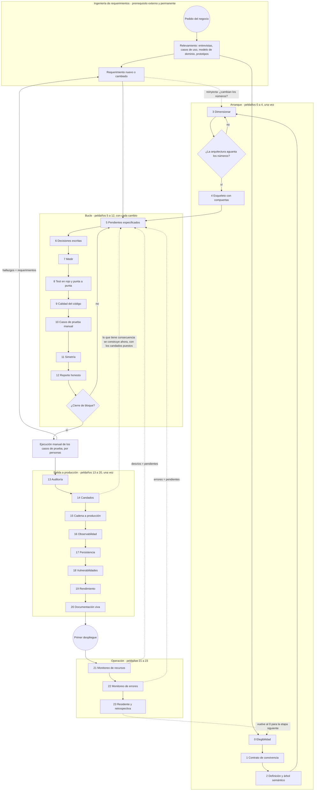

# Urazuke, el método de la evidencia — la escalera metodológica (versión 4)

Autor: Pablo Kuschniroff, asistido por Claude Code. Versión 4, iniciada el 18 de octubre de 2026 y
actualizada con cada decisión posterior del registro (`docs/DECISIONES.md`); la fecha de arranque
queda fija a propósito, para no reescribir la historia de versiones cada vez que una decisión nueva
toca este documento. Este es un
documento de trabajo que voy a seguir puliendo con cada proyecto que lo use; nada de lo que dice
es doctrina cerrada todavía, aunque sí es, hasta donde yo sé, el primer destilado honesto de un
método que ya tiene tres sistemas en producción a sus espaldas.

Antes de entrar en materia, una advertencia sobre cómo está escrito, porque importa. Lo escribí
para personas que no vivieron estos proyectos conmigo: gente que quiere construir software con
inteligencia artificial y que ese software dure, no gente que quiere aprender a programar ni
coleccionar trucos de prompts. Por eso me tomo el tiempo de explicar, repito cuando hace falta,
uso el lenguaje de todos los días, y dejo al final un **glosario** con cada sigla y cada expresión
coloquial que se me escapa. Si en algún momento te topás con una palabra rara —"trinquete",
"candado", "fail-closed", "PND"—, andá al glosario; está todo ahí. Y cuando leas una marca como
[Ref. 26](REFERENCIAS.md#ref-26), sabé que es un atajo a un caso real que cuento en el documento
de referencias, con su fecha y su evidencia; podés ignorarla sin perder el hilo o seguirla si te
interesa el detalle.

El repositorio público del método es
[github.com/pkuschnirof/urazuke](https://github.com/pkuschnirof/urazuke). Ahí están este
documento, los contratos de cada peldaño, el manual del curso y las referencias, en los ocho
idiomas que el método declara por su cuenta.

## El nombre

**Urazuke** (裏付け) es una palabra japonesa que nombra el respaldo que tiene una afirmación: lo
que la sostiene por detrás (literalmente, "el forro de atrás"). El verbo *urazukeru* es
"respaldar con pruebas". La elegí el 17 de octubre de 2026, después de descartar varios nombres
por colisiones con empresas y proyectos existentes, y la elegí porque dice exactamente lo que el
método pide: que cada afirmación del modelo venga con su respaldo, y que el respaldo se pueda
verificar sin leer el código. El nombre no se traduce; el subtítulo, "el método de la evidencia",
sí: *the evidence method*, *o método da evidência*, *la méthode de la preuve*, *die
Nachweis-Methode*, *il metodo del riscontro*, 裏付けの方法, 验证方法. En este documento, "la
escalera" es la estructura del método —sus veinticuatro peldaños— y "Urazuke" es el método entero.

## De qué se trata

Quiero ser claro sobre lo que estoy enseñando y lo que no. No estoy enseñando una herramienta.
Estoy enseñando un **método**: qué hacer en qué orden, qué pedirle al modelo en cada momento, qué
tiene que entregarte, y cómo saber —sin leer código— que lo que te entregó está completo. La
apuesta es que cualquier persona, con cualquier herramienta de inteligencia artificial que sirva
para programar, pueda construir software conversando con un modelo en vez de tipear el código a
mano, y que lo que salga sea robusto, esté listo para producción y, esto es lo importante,
**no requiera que el dueño del proyecto revise una sola línea de código**. Y quiero ser igual de
claro sobre lo que no es: no es un proceso para hacer sistemas más rápido. Es un proceso para
hacer sistemas operables y mantenibles sin que nadie necesite comprender un solo bit de su
código, porque el código lo comprende y lo mantiene el marco agéntico que lo escribe. La
velocidad, cuando aparece, es una consecuencia, y por eso en este documento no hay plazos: el
tamaño y la complejidad de cada sistema los pone, y el método solo pone el orden.

Una aclaración que me pidieron que deje por escrito, porque la frase anterior se presta a una
lectura que no es la mía: "no requiere que el dueño revise una sola línea de código" no es lo
mismo que "está pensado para que programe gente sin conocimientos de sistemas". No lo está. El
objetivo primario de este método no es bajar la vara técnica para que cualquiera pueda construir
software sin saber nada de cómo se construye software: es darle a quien tiene que responder por un
sistema un anclaje metodológico para que lo que un modelo construye salga con la solvencia de la
ingeniería de sistemas de siempre, contrarrestando las debilidades con las que los modelos aplican
esos mismos principios cuando nadie se los exige por escrito. Que el dueño no lea código es una
consecuencia de dónde puse las compuertas y de qué puede verificar un humano sin leer una
implementación, no la promesa de que cualquiera, sepa lo que sepa, puede dirigir un proyecto de
software sin entender nada de lo que está dirigiendo. El perfil que en realidad piden los
contratos está en el medio: alguien que corre un comando, maneja una credencial, restaura un
respaldo, entiende lo que le dice la cuota de CI, y sabe reconocer cuándo lo que el modelo le
entregó no alcanza — no un lego puro, y tampoco alguien que ya sabe programar.

Y otra aclaración, sobre el costo. Seguir esta escalera gasta más tokens que pedirle al modelo que
resuelva todo de una sola pasada: cada peldaño agrega un prompt, una verificación propia, un
artefacto que el modelo también tiene que sostener. Lo que no se ve a simple vista es lo que
ahorra. Un sistema construido sin estas compuertas tiende, antes o después, a necesitar
reingeniería: volver atrás sobre un dimensionamiento que no se hizo, perseguir un error que un
test en rojo hubiera atrapado en el peldaño 8, reescribir lo que nadie auditó a tiempo. Esa
reingeniería, en tokens, en tiempo y en plata, sale sobradamente más cara que el prompt de más que
cuesta cada peldaño. Lo gasto adelante, con cabeza, para no gastarlo el doble atrás, a ciegas.

Suena ambicioso, y lo es. Pero tengo algo que casi nadie tiene: tres sistemas reales que construí
exactamente así, que hoy funcionan con clientes de verdad, y de los que extraje cada regla que
sigue. Así que la pregunta que me hago no es "¿se podrá?", porque ya se pudo. La pregunta es
"¿qué hice, en qué orden, y qué de todo eso es lo que realmente hizo la diferencia?". Esta
escalera es mi respuesta, y es la base de tres cosas: la documentación del método, la práctica que
van a hacer los alumnos del curso, y los manuales. Más adelante la voy a exportar como un flujo
de ejecución dentro de mi herramienta, para que sea la herramienta la que guíe el método y no la
memoria de uno.

## De dónde sale el método, y qué no quiero que se malinterprete

Hay una lectura fácil de todo esto que quiero desarmar antes de que se instale: la de que el
método es una colección de parches que fui poniendo después de cada golpe. No es así, y me
importa decirlo con precisión porque cambia cómo hay que leer cada peldaño.

El método sale de dos factores que se combinaron, y ninguno de los dos alcanza solo. El primero es
**mi propio conocimiento de la ingeniería de sistemas**. Llevo muchos años aplicando lo que
cualquiera que venga de sistemas reconoce enseguida: relevamiento antes de diseñar, requisitos
escritos, dimensionamiento con números, diseño, construcción, pruebas como evidencia, despliegue
reproducible, operación, auditoría periódica, documentación como parte del producto. La mayor
parte de lo que exijo en los veinticuatro peldaños es lo que siempre exigí en un proyecto bien
llevado. No lo inventé para los modelos; lo traje de antes.

El segundo factor es lo que los incidentes de estos cinco meses me mostraron, uno tras otro:
**dónde los modelos aplican esos principios de manera frágil**. Un modelo sabe perfectamente qué es
un test, qué es una causa raíz, qué es un dimensionamiento; si le preguntás, te lo explica mejor
que muchos ingenieros. Pero en la práctica dice que probó y no probó, estima con cara de seguro un
dato que solo el negocio tiene, llena un hueco en las reglas de negocio con lo que le pareció
razonable, reporta de más porque fue entrenado para ser útil, y construye un medidor que miente
sin darse cuenta. Cada uno de esos casos, que cuento en las [referencias](REFERENCIAS.md), me dijo
exactamente dónde había que apretar: dónde un principio que para mí era obvio necesitaba
convertirse en una cláusula explícita del prompt, en una compuerta, en una verificación que yo
hago sin leer código.

Entonces, cuando en un peldaño digo "esto lo impuse después de tal incidente", no estoy diciendo
que el principio nació ahí. Estoy diciendo que ahí comprobé que el modelo no lo aplicaba solo, y
que había que exigírselo por escrito. El método es ingeniería de sistemas de siempre, aplicada con
la rigidez que hace falta para un constructor que no se cansa y al que no se le puede creer sin
evidencia. Las cicatrices son la prueba de dónde hace falta la rigidez, no el origen de los
principios.

## Los tres casos de uso del método

Antes de seguir, una bifurcación que en las primeras versiones no estaba y que un lector me pidió
con razón. Este documento describe la escalera mirando una carpeta vacía: el peldaño 0 decide si
el proyecto se encara, el 4 despliega el esqueleto sin funcionalidad, el 5 abre el primer bloque.
Es el caso más claro para aprender, y no es el más frecuente. El método tiene tres casos de uso, y
conviene saber en cuál estás antes de abrir el agente, porque cambia por dónde se entra:

1. **Proyecto nuevo.** Carpeta vacía y un dueño con un pedido. Se entra por el peldaño 0 y se
   suben los veinticuatro en orden. Es lo que describe este documento, con sus contratos y el manual
   del curso.
2. **Evolutivo-correctivo sobre un sistema hecho con el método.** El sistema ya subió la escalera:
   tiene contrato, mapa, pendientes cerrados con evidencia, batería, despliegue y manuales. Se
   entra por el peldaño 5, abriendo un bloque, y se sigue el bucle; el 13 periódico; el 23 al
   cierre de cada etapa. Es la fase 4 de la línea de tiempo (Parte B).
3. **Evolutivo-correctivo sobre un sistema hecho sin el método.** Un sistema que corre, con
   usuarios, hecho por otro o por uno mismo sin evidencia, al que hay que corregir o hacer crecer.
   No se entra por el 0 ni por el 5: se entra por un **tramo de normalización** de ocho estaciones
   (N0 a N7) que recupera, por autodescubrimiento y con marcas de fuente, todos los insumos que
   los peldaños del arranque producen, arma un cinturón de seguridad alrededor del sistema sin
   reescribirlo, y recién después abre el bucle en modo correctivo o evolutivo. Ese camino está
   en una página propia, el [camino evolutivo-correctivo](EVOLUTIVO_CORRECTIVO.md), y tiene su
   parte del curso con un segundo proyecto guía.

Lo que queda afuera, nombrado: la migración tecnológica no es un caso de uso del método; es otro
proyecto, y en general cae en los criterios excluyentes del peldaño 0.

## La IA no interrumpe el método: lo continúa

Esta es la tesis que abre todo, y la pongo primero porque desarma la objeción más común antes de
que aparezca: "¿cómo vas a confiar en código que escribió una máquina?".

Mi respuesta es que **la industria ya dejó de confiar en el autor del código hace veinte años**.
Cuando el grueso de la escritura pasó a equipos junior, tercerizados o rotativos, la revisión
línea por línea se volvió imposible de sostener. Y lo que creció en su lugar fue todo lo que hoy
damos por sentado: los tests automatizados, la integración continua, los criterios de aceptación,
los pipelines que no dejan pasar nada sin verde, el "shift left" de las pruebas, el control de
calidad como función independiente. Esa fue la respuesta de la ingeniería de sistemas a "el que
escribe no es confiable": no leerle el código, exigirle evidencia.

Poner a un modelo a escribir, entonces, no es un salto al vacío. Es cambiar un autor en el que ya
no confiábamos por otro en el que tampoco, y para el cual **ya teníamos armado el aparato de
verificación**. Eso debería tranquilizar, no inquietar. Y encima el nuevo autor es más barato, más
rápido, y —a diferencia del junior— no se ofende cuando le pedís que pruebe en rojo.

Por eso este método se apoya, sin disimulo, en la ingeniería de sistemas clásica. El esqueleto es
el de siempre. No podía ser de otra manera, porque los problemas son los de siempre: no saber
cuántos datos va a haber, no saber qué quiere el cliente, no saber si lo que se construyó es lo
que se pidió. La IA no cambió los problemas; cambió quién hace cada parte y a qué costo. Hasta el
criterio de elegibilidad X2 del peldaño 0 es ingeniería clásica: testeabilidad como condición de
contrato.

### Qué es viejo y qué es nuevo en esto

Lo viejo, y conviene decir que es viejo: el esqueleto de etapas, la independencia del que verifica
respecto del que construye, los tests como evidencia, la documentación como parte del producto, el
relevamiento antes del diseño.

Lo que sí cambia, y es donde está mi aporte, son tres cosas:

1. **Dónde va el esfuerzo del humano.** En el método clásico el humano escribe la especificación,
   escribe el código, y otro humano lo revisa. Acá el humano hace dos cosas solamente: **decide, y
   verifica artefactos**. Todo lo demás —redactar, construir, probar, medir, documentar— lo hace el
   modelo. Por eso cada peldaño termina en una "verificación de completitud sin leer código": es
   el lugar exacto donde el humano sigue siendo imprescindible, y ninguno más.

2. **El autor también fabrica la evidencia.** Este es el único punto genuinamente nuevo, y es el
   matiz que justifica tres peldaños enteros. El junior escribía código dudoso, pero no fabricaba
   la evidencia: los tests y las mediciones los armaba otro, o al menos otro los miraba. El modelo,
   en cambio, produce el código *y* el test *y* el medidor *y* el reporte, en la misma sesión, con
   la misma seguridad en la voz cuando está bien y cuando está mal. Lo vi: el medidor que mintió
   dos veces [Ref. 36](REFERENCIAS.md#ref-36), el error de autenticación reportado como "éxito"
   [Ref. 43](REFERENCIAS.md#ref-43), las tres de cuatro aseveraciones que estaban mal. Entonces
   "revisar evidencia en vez de código" sigue siendo el principio correcto, pero **la evidencia
   tiene que probarse a sí misma**: el test visto en rojo (peldaño 8), el instrumento con su
   guarda (peldaño 7), el reporte que separa lo verificado de lo creído (peldaño 12), el auditor
   distinto del constructor (peldaño 13). No es una inquietud nueva: es la misma disciplina de
   independencia del control de calidad, llevada un paso más adentro.

3. **El costo de los artefactos.** En el método clásico la documentación era cara, entonces se
   hacía una vez y envejecía. Acá regenerarla es gratis, entonces la regla pasa a ser "en el mismo
   commit" y "reproducible a mano, sin IA". Lo que antes era un ideal incumplible pasa a ser una
   compuerta.

Para el curso y para la presentación pública, esto define el posicionamiento con honestidad: no es
"la nueva forma de programar"; es **ingeniería de sistemas aplicada a un constructor que no se
cansa y al que no se le puede creer**. A los que vienen de sistemas les suena familiar y les baja
la desconfianza; a los que vienen del vibecoding les da lo que no tienen, que es justamente el
esqueleto. Y me diferencia de las herramientas que venden velocidad y omiten el esqueleto entero.

---

## Parte A — Cómo leer cada peldaño

Cada peldaño tiene ocho partes, siempre las mismas, para que se puedan comparar:

- **Intención**: qué busca, en una frase.
- **Cuándo**: en qué momento del proyecto se sube, y si se sube una vez o se repite. Esta parte
  es nueva en la versión 4 y la explico en detalle en la Parte B, porque un método sin línea de
  tiempo es una lista de buenas intenciones.
- **Entradas**: qué tiene que existir antes para poder subirlo.
- **Artefacto**: qué queda escrito o ejecutable cuando se sube. Siempre es algo concreto: un
  archivo, un test, un script.
- **Compuerta**: qué tiene que ser verdad para pasar al siguiente. Si no se cumple, no se sube.
- **Quién decide**: el dueño del proyecto, el agente, o nadie porque es automático.
- **Fallo que evita**: el tipo de problema que el peldaño previene, con una referencia corta al
  caso real donde lo comprobé.
- **Contrato**: el archivo donde está cómo se ejecuta: contexto, prompts, resultado, verificación,
  señales de alarma.

Y hay una parte más, que aparece **sólo en seis peldaños** y es una pieza transversal que
cambia qué hay que leer: el **Anexo H** ([`ANEXO_HEURISTICAS.md`](ANEXO_HEURISTICAS.md)). Son
cuarenta y seis reglas verificables —dieciocho de calidad del código y veintiocho de
usabilidad—, cada una con su identificador estable, su severidad y el instrumento que la mide. No
es un apéndice opcional: **es obligatorio**, y se engancha a la escalera en seis puntos. En el
peldaño 2 entran sus dos **entradas previas** (el glosario del usuario y la lista de perfiles: las
palabras que la gente usa de verdad para cada cosa, y quién es cada uno y qué viene a hacer). Y en
los peldaños 5, 8, 9, 10 y 12 están sus cinco **anclas** —"ancla" quiere decir que la compuerta de
ese peldaño no da verde si la pieza del anexo no está—. Esas cinco son exigencias mecánicas en la
definición publicada de las compuertas, no recomendaciones: una herramienta que compila el método
las va a pedir. Cada uno de esos seis peldaños lo dice en su ficha, con el enlace, y hay una
comprobación en la cadena del método que se pone en rojo si alguna deja de decirlo. Nació de
haberlo descubierto tarde: el anexo estuvo obligatorio y sin nombrar en este documento, y el
primer lector que adaptó el método a otro formato se salteó veintisiete de las cuarenta y cinco
reglas porque nunca supo que existían.

Y una de esas cuarenta y seis no es sobre el sistema que se construye, sino sobre **cómo se te
pregunta**. Es la **UX-28**, y entró el 2026-10-27 porque faltaba: el método les ordena a sus
prompts preguntarte —veintidós veces, en más de la mitad del corpus— y no decía en ninguna parte
cómo se pregunta, así que la forma quedaba a la improvisación y vos recibías la pregunta suelta.
Desde ahora toda pregunta que te haga el agente llega con cuatro partes y en este orden: **los
datos** que la hacen necesaria, enumerados; **un párrafo** de no más de cinco líneas que los
enlace y deje ver el interrogante; **la pregunta** con sus respuestas posibles enumeradas; y **la
recomendación** del agente. Y a la profundidad técnica que vos elijas, que son tres y se declaran
una vez en la configuración del proyecto: `beginner` (lenguaje de todos los días, orientado al
resultado), `decision_maker` (números medidos y consecuencias, sin rutas de archivo —es el valor
por defecto—) y `technical` (archivo, línea y comando). Si no declarás ninguna, el agente usa
`decision_maker` y te lo dice. La cláusula está en los setenta y dos prompts del corpus, en una
sola redacción inglesa idéntica en los ocho idiomas, y hay una comprobación en la cadena que se
pone en rojo si se cae de alguno. Lo que ninguna comprobación puede hacer, y conviene saberlo, es
verificar que una pregunta concreta tenga sus cuatro partes: eso lo juzgás vos, y por eso la regla
avisa en vez de bloquear.

Y una cosa más que cambia qué hay que leer, porque decide **cuál** de todas estas exigencias te
aplica: **la versión del método que el proyecto fija.** La definición mecánica de las compuertas
—qué archivo tiene que existir en cada peldaño y qué tiene que decir— se publica como datos, con
una versión declarada (`catalog_version`) y una huella de contenido: un número largo calculado a
partir del archivo entero, que cambia si alguien le cambia una coma, y que por eso sirve para
comprobar que la copia que tenés es exactamente la que el método publicó. Un proyecto **fija** una
de esas versiones el día que arranca y la mantiene hasta el final. Y eso no es comodidad: subir de
versión en medio de un proyecto es una **regresión del estado de completitud**. Si la versión nueva
le agrega un requisito a un peldaño que ya habías dado por cerrado, ese peldaño vuelve a estar
incompleto; y si le agrega una exigencia que tu herramienta todavía no sabe medir, la compuerta no
dice verde: dice "declarado y no medido", y el peldaño no avanza. Eso no es una falla, es el
mecanismo funcionando. Subir de versión está permitido —lo decide el dueño, se escribe con fecha en
el registro de decisiones del peldaño 6, y antes de decidirlo se mira qué requisitos entran en el
medio, que es una cuenta que se puede hacer porque cada requisito agregado después del congelado
dice en qué versión entró—. Lo que no está permitido es subirla en silencio, ni enterarse a mitad
de camino de que la compuerta está midiendo contra una definición que nadie eligió. Y a la
herramienta que te asista, si usás una, el método le exige lo mismo que a vos: que anote qué
versión fijó y con qué huella, y que ese par lo contraste contra el registro de versiones del
método, que vive en el repositorio del método y no en el servidor que le sirvió el archivo. Fijar
a un identificador interno propio, que el método no puede nombrar, se parece a fijar y no lo es:
nadie de afuera lo puede auditar. Que esto no estuviera escrito acá hasta hoy era un defecto de
los que persigue el peldaño 11: el dato se lo decía al consumidor y la prosa no se lo decía nunca
al dueño, que es el único que puede decidir un cambio de versión.

Dos aclaraciones importantes. Primero: **la escalera es neutral respecto de la herramienta**. Cada
artefacto es un archivo, un test o un script; ninguno exige mi herramienta ni ninguna otra. Forge
los automatiza (las compuertas, los comandos, el registro de pendientes), pero el peldaño existe
sin Forge. Segundo: **los peldaños están numerados en el orden en que se suben**, y se agrupan en
cuatro tramos: los del 0 al 4 son de arranque y se suben una vez por proyecto; los del 5 al 12 son
el bucle que se repite con cada cambio; los del 13 al 20 son de salida a producción, y se suben una
vez, antes del primer despliegue; y los del 21 al 23 son de operación, cuando el sistema ya está
vivo. El 23 cierra el ciclo y vuelve al 0 para el próximo proyecto. Dentro de un tramo, el número
dice el orden; entre tramos, el bucle se repite mientras los otros tres se suben una vez. Pero "no estrictamente secuenciales" no quiere
decir "en cualquier orden": la Parte B dice exactamente cuándo se sube cada uno y qué pasa en el
medio.

---

## Parte B — La línea de tiempo: cuándo se sube cada peldaño y qué pasa entre medio

Esta parte no existía en las versiones anteriores, y su ausencia era un defecto serio: el método
decía qué hacer y cómo verificarlo, pero no decía **cuándo**. Y "cuándo" es la mitad de un método.
Un lector que se lo tomara al pie de la letra podía subir los veinticuatro peldaños uno tras otro y
preguntarse en qué momento se hace, entonces, la infraestructura, la cadena de integración y
despliegue continuos, la ingesta de los requerimientos, el desarrollo de la funcionalidad, las
pruebas de punta a punta de todos los flujos, la mirada humana sobre las pantallas, y las pruebas
humanas de aceptación. Todo eso pasa, y pasa en momentos precisos, entre los peldaños y dentro de
ellos. Acá lo escribo.

### B.0 El proceso entero, en un gráfico

Antes de las tablas, el dibujo. Está en notación de proceso (al estilo BPMN: eventos redondos,
tareas rectangulares, compuertas en rombo, flechas de vuelta punteadas), y dice tres cosas que las
tablas dicen peor. Primera: el proceso **empieza afuera del método**, en la ingeniería de
requerimientos, que es un prerrequisito y además es permanente: no termina nunca, y cada
requerimiento nuevo vuelve a entrar. Segunda: un requerimiento nuevo no entra solo al bucle;
**reinyecta en los peldaños de evaluación**, porque puede cambiar los números con los que se
decidió la arquitectura (¿sigue aguantando el "por diez"?), y de ahí para adelante. Tercera: el
proceso **termina en la ejecución manual de los casos de prueba** por personas (peldaño 10), y lo
que esa ejecución encuentra vuelve al bucle como requerimiento. El circuito se cierra con gente,
no con máquinas. Cuarta, y el dibujo anterior a esta corrección no la mostraba: cuando lo que el
sistema construye tiene consecuencia sobre el mundo (cobrar, enviar), el bucle **se reabre después
del peldaño 14**, ya con los candados puestos, para construir esa parte en modo de ensayo antes de
seguir hacia la cadena de producción (15). No es una vuelta al principio: es la misma compuerta de
siempre (¿cierre de bloque?) corrida una vez más, ahora con la red de seguridad lista.

Si el dibujo no se ve (el visor de markdown no dibuja mermaid), el texto de arriba lo describe
entero; en la versión HTML se dibuja solo.

### B.1 Las cinco fases de un proyecto

Un proyecto llevado con este método pasa por cinco fases. Las tres del medio son las que
corresponden a los tramos del bucle, de la salida a producción y de la operación; la fase 1 es el
tramo de arranque; y la fase 0 es la ingesta inicial, que el método también cubre aunque no sea un
"peldaño" en sí. No pongo duraciones: dependen del tamaño y de la complejidad de lo que se pide, y
una duración escrita se convierte en una expectativa falsa. Lo que no depende del tamaño es el
orden.

| Fase | Peldaños que se suben | Qué más pasa en esa fase |
|---|---|---|
| 0. Ingesta | ninguno todavía; es la materia prima del 0, el 2, el 3 y el 5 | Relevamiento del negocio con el dueño, con los métodos clásicos de la ingeniería de requerimientos (ver B.5): entrevistas, casos de uso o historias de usuario, modelo de dominio, prototipos de pantalla. Se escribe en prosa, incompleto a propósito; el agente lo completa preguntando. |
| 1. Arranque | 0, 1, 2, 3, 4 | Elegibilidad, contrato, definición, dimensionamiento. Y **toda la infraestructura inicial**: el repositorio, el entorno de prueba, la integración continua, el primer despliegue con el sistema vacío. |
| 2. Bucle | 5 a 12 con cada cambio: pendientes, decisiones, medir, test en rojo, calidad, casos de prueba manual, simetría, reporte | Desarrollo funcional bloque por bloque; tests en rojo; pruebas de punta a punta del flujo recién construido; mirada humana sobre cada pantalla nueva; al cierre de cada bloque, pruebas humanas en el entorno de prueba. |
| 3. Salida a producción | 13 a 20, en orden: auditoría, candados, cadena a producción, observabilidad, persistencia, vulnerabilidades, rendimiento, documentación | Auditoría por otra sesión; candados sobre todo lo que actúa sobre el mundo; cierre de la cadena de despliegue a producción con vuelta atrás probada; los tres manuales; pruebas de aceptación con el dueño sobre todos los flujos. |
| 4. Operación | 21 y 22 montados con el primer despliegue; 23 al cierre de cada etapa; el bucle (5 a 12) para cada evolución; 13 y 18 periódicos | Agente residente; auditoría cada uno o dos meses; cada cambio nuevo entra por el bucle completo y sale por la cadena de despliegue; retrospectiva al cierre de cada etapa. |

Esta tabla es la del proyecto nuevo. Cuando el sistema ya existe y no nació con el método, las
fases 0 y 1 se reemplazan por el tramo de normalización (lectura, cinturón, medir y ordenar) que
está en el [camino evolutivo-correctivo](EVOLUTIVO_CORRECTIVO.md); las fases 2, 3 y 4 son las
mismas.

En un proyecto con usuarios y consecuencias, lo que crece es el bucle: la funcionalidad. El
arranque, la salida a producción y la operación tienen la misma forma en un sistema chico y en uno
grande; cambia cuánto hay que medir, no qué.

### B.2 Qué pasa entre peldaño y peldaño

Acá está lo que faltaba. Para cada fase, qué tareas de cada tipo se hacen y en qué momento exacto
respecto de los peldaños. Leé la tabla por filas: cada fila es un tipo de trabajo, y cada celda
dice cuándo se hace dentro de esa fase.

| Tipo de trabajo | Arranque (peldaños 0 a 4) | Bucle (peldaños 5 a 12, por bloque) | Salida a producción (13 a 20) | Operación (21 a 23 y bucle) |
|---|---|---|---|---|
| **Ingesta de requerimientos** | Antes del peldaño 0: relevamiento en prosa con el dueño, con entrevistas, casos de uso y modelo de dominio. Se completa en el 2 (definición y árbol semántico) y en el 3 (volumetría). | Al abrir cada bloque: el pedido del cliente para ese bloque, tal como lo diría él, se convierte en pendientes con **especificación detallada** (peldaño 5): descripción, criterios de aceptación, reglas aplicables, datos, pantallas, casos borde. Las preguntas que el agente hace son la ingesta fina. | Antes del 14: relevamiento de las acciones con consecuencia. Antes del 15: relevamiento de entornos y accesos. | Cada pedido nuevo entra como pendiente especificado, colgado de su nodo del árbol semántico; el agente residente recoge lo que los usuarios piden. |
| **Infraestructura** | Toda la inicial, en el peldaño 4: repositorio, estructura, entorno de prueba, credenciales, dominio de prueba. No se construye funcionalidad hasta que el esqueleto vacío está desplegado. | Ninguna, salvo que un bloque la exija (una cola, un servicio externo). Si la exige, es un pendiente con su test. | En el 15: entorno de producción, secretos en el servidor, dominio real, backups, monitoreo mínimo. | Cambios de infraestructura entran por el bucle y por el 15; nunca "a mano, rápido". |
| **Cadena CI/CD** | En el peldaño 4: la integración continua corre la batería en cada push desde el arranque, y el despliegue al entorno de prueba es automático al fusionar. | Funciona sola. Cada commit la atraviesa; si no está en verde, el bloque no cierra. | En el 15 se completa: el despliegue a producción espera el resultado de la integración y solo empaqueta; la promoción es un procedimiento escrito; la vuelta atrás se prueba. | Cada despliegue sigue la rutina del 15: prueba en verde con la misma versión, vuelta atrás lista, verificación de punta a punta en producción después. |
| **Desarrollo funcional** | Ninguno. El esqueleto se despliega vacío a propósito. | Es el centro del bucle: el agente toma un pendiente (5), pregunta las reglas de negocio que faltan (6), construye, y cierra con evidencia (7, 8, 9, 10, 11, 12). Bloque por bloque, de lo básico a lo que tiene consecuencias. | Lo que actúa sobre el mundo (cobrar, enviar) se construye en el bucle **después** del peldaño 14, con sus candados, y arranca en modo de ensayo. | Las evoluciones entran por el bucle. |
| **Pruebas automáticas** | Un test de humo que pasa, en el 4. Es la semilla de la batería. | Con cada pendiente: el test probado en rojo (8), la regresión de los vecinos en la misma sesión, y **una prueba de punta a punta del flujo recién construido**, desde la pantalla hasta el backend. Al cerrar un bloque: la batería completa de punta a punta de **todos** los flujos existentes, en el entorno de prueba. | Antes del primer despliegue a producción: la batería completa de punta a punta de todos los flujos, en verde, con la misma versión que se va a promover. Después del despliegue: una verificación de punta a punta sobre producción, en solo lectura. | Con cada cambio, lo mismo que en el bucle. |
| **Vista humana de las pantallas** | Al cierre del 4: el dueño abre la URL del entorno de prueba y ve la pantalla vacía. Parece trivial y es la primera vez que alguien que no es el agente mira el sistema. | **Con cada pendiente que toca una pantalla**: el agente entrega una captura real del entorno de prueba y el dueño la mira. Diez segundos. Es la forma más barata de encontrar lo que ningún test encuentra: que el botón está donde no debe, que el texto dice otra cosa, que el flujo no es el que el negocio imaginaba. | En el 20: las capturas del manual de usuario son la última mirada humana sistemática antes de producción. | Cada pantalla nueva o cambiada, igual que en el bucle. |
| **Pruebas humanas** | Ninguna todavía, salvo abrir la pantalla vacía. | **Al cierre de cada bloque funcional**: el dueño, o un usuario de confianza, usa el sistema en el entorno de prueba como lo usaría de verdad, siguiendo los flujos del bloque. Lo que encuentra se anota como pendientes. No se abre el bloque siguiente con hallazgos humanos sin pendiente. | Antes del primer despliegue a producción: **pruebas de aceptación** del dueño sobre todos los flujos, con datos de prueba realistas, en el entorno de prueba. Y en el 20, una persona que no programa sigue el manual de recuperación. | Con cada evolución, al cierre de su bloque. |
| **Decisiones del dueño** | En el 0 (va o no va), el 1 (el contrato), el 2 (qué NO es), el 3 (la opción de arquitectura). | Cada vez que el agente frena por una regla de negocio no escrita (6). Suelen ser dos o tres por bloque. | En el 14 (candado por candado), en el 15 (promover a producción), en el 23 (el nivel del agente residente). | Las que surjan; siempre escritas. |

Un detalle que quiero subrayar porque es donde más se equivoca la gente que viene del vibecoding:
**las pruebas de punta a punta de todos los flujos no son una sola vez al final**. Son tres veces,
en tres escalas. Con cada pendiente, el flujo que ese pendiente tocó. Al cierre de cada bloque,
todos los flujos que existen hasta ahí. Y antes de producción, todos los flujos con la versión
exacta que se va a promover. Si solo hacés la tercera, llegás al final con un sistema que nadie
probó de punta a punta durante semanas y la salida a producción se convierte en una semana de
arreglos.

### B.3 El ritmo del bucle: un bloque funcional típico

Un bloque funcional es un conjunto de entre cuatro y ocho pendientes relacionados, que juntos
hacen algo que el negocio puede usar: "la agenda básica", "los recordatorios", "el reporte
mensual". Así se ve por dentro:

1. **Apertura del bloque.** El dueño cuenta, en prosa, qué quiere para este bloque. El
   agente lo convierte en pendientes numerados, con su "cómo se verifica", y pregunta lo que no da
   para escribir un pendiente verificable (peldaño 5). El dueño prioriza.
2. **Cada pendiente.** El agente anuncia qué pendiente toma y por qué. Si en el camino aparece
   una regla de negocio que no está escrita, frena y pregunta (6). Si el pendiente depende de un
   número —cuántas consultas, cuánto tarda—, primero lo mide con un instrumento con test (7).
   Construye. Cuando termina, cierra en este orden: el test probado en rojo, verde, la regresión
   de los vecinos y una prueba de punta a punta del flujo tocado (8); la compuerta de calidad del
   código en verde (9); los casos de prueba manual del flujo, escritos para una persona (10); y,
   si el cambio tocó un contrato entre dos partes del sistema, el otro lado actualizado en el mismo
   commit (11). El reporte separa lo verificado de lo creído y declara los puntos ciegos (12). El
   dueño lee el reporte y mira la captura de la pantalla. No lee código.
3. **Cierre del bloque.** La batería completa de punta a punta en verde en el entorno de prueba.
   El dueño o un usuario de confianza ejecuta los casos de prueba manual del bloque (10) y anota
   qué pasó y qué falló; cada fallo vuelve al bucle como pendiente correctivo. Se lee el reporte de
   calidad del bloque (9). Se actualiza el manual de usuario con las pantallas nuevas (20, en el
   mismo commit). Recién entonces se abre el bloque siguiente.

En un día típico del bucle, lo que el método le pide al dueño es poco y puntual: contestar dos o
tres preguntas de reglas de negocio, leer dos o tres reportes, mirar dos o tres capturas. Eso es
todo. Si le está pidiendo más que eso, o el agente está preguntando lo que podría resolver solo
(peldaño 1), o el dueño está leyendo código (y entonces algo del peldaño 8 o del 12 no está
funcionando).

### B.4 Los hitos humanos

Resumo en una lista los momentos en que un humano, el dueño o alguien de su confianza, tiene que
mirar o usar el sistema. Son pocos, están en momentos precisos, y ninguno se puede delegar al
agente:

- **Fin del arranque**: abrir la URL del entorno de prueba y ver el sistema vacío.
- **Con cada pendiente que toca una pantalla**: mirar la captura real del entorno de prueba.
- **Al cierre de cada bloque**: ejecutar los casos de prueba manual del bloque (10) en el
  entorno de prueba y anotar el resultado; lo que falla vuelve al bucle como requerimiento.
- **Antes del primer despliegue a producción**: pruebas de aceptación sobre todos los flujos,
  siguiendo todos los casos de prueba manual.
- **En el peldaño 20**: una persona que no programa sigue el manual de recuperación en el entorno
  de prueba.
- **Después de cada despliegue a producción**: verificar que la versión que corre es la que se
  quería, y hacer una pasada de solo lectura por los flujos críticos.
- **Antes del primer despliegue, en el 19**: leer los números de la prueba de carga con la
  tolerancia del negocio al lado, y el punto de ruptura.
- **En cada ciclo del monitoreo (21 y 22)**: leer el reporte cíclico con el agente y decidir qué
  desvío y qué error se vuelven pendientes.

Todo lo demás —los tests, las mediciones, las auditorías, la documentación— lo hace el modelo y el
humano lo verifica por el artefacto, no por el código.

### B.5 Cómo entran los requerimientos: del relevamiento al árbol semántico y a los pendientes

Quiero detenerme en esto porque es donde la ingeniería de sistemas clásica tiene más que decir y
donde el vibecoding la ignora con más entusiasmo. Un requerimiento no es una frase del cliente en
un chat. Es una frase del cliente **procesada** por métodos que existen desde hace décadas y que
siguen valiendo con un modelo al frente, porque el modelo es muy bueno aplicándolos si se lo pedís
y muy malo aplicándolos si no.

Los métodos que uso, y que el método exige en cada fase:

- **Entrevistas con el dueño**, abiertas, en prosa, registradas. Son la fase 0. No intento que
  sean completas: intento que el agente detecte qué les falta.
- **Casos de uso o historias de usuario**, uno por flujo que el negocio puede nombrar: "la
  recepcionista carga un turno", "el paciente recibe el recordatorio". Cada uno tiene actor,
  disparador, pasos, resultado y excepciones. Son la unidad con la que se abre un bloque funcional.
- **Modelo de dominio**: las entidades del negocio, sus atributos, sus estados posibles y las
  transiciones entre estados. Es el corazón del árbol semántico (ver abajo) y lo que evita que el
  modelo invente estados que el negocio no tiene.
- **Criterios de aceptación** por historia, en la forma "dado tal situación, cuando pasa tal cosa,
  entonces se ve tal resultado". Son los que se convierten en el "cómo se verifica" de cada
  pendiente y, después, en el test de punta a punta.
- **Prototipos de pantalla**, aunque sean un dibujo. La vista humana de las pantallas empieza
  acá, antes de que exista código.
- **Trazabilidad**: cada requerimiento se puede seguir hasta el pendiente que lo implementa, el
  test que lo prueba y el commit que lo cerró. En el método la trazabilidad no es una matriz
  aparte: es el pendiente mismo, que cita su origen y su evidencia.

**El árbol semántico.** Es el artefacto que ordena todo esto y es el mapa que el agente lee en cada
sesión (peldaño 2). Es un árbol, no una lista: el sistema en la raíz; debajo, los dominios o
módulos; debajo de cada uno, sus actores, sus procesos (los casos de uso), sus entidades con sus
estados, sus pantallas y sus integraciones externas; y colgando de cada nodo, los pendientes que
lo tocan y las decisiones que lo afectan. Lo construye el agente a partir del relevamiento, lo
corregís vos, y crece con cada bloque. Su valor es doble: le da al modelo el contexto exacto del
nodo que va a tocar sin tener que leer todo el proyecto, y te da a vos una forma de verificar que
el sistema que el agente entiende es el que el negocio pidió, sin leer código. Cuando un
pendiente no cuelga de ningún nodo, o el árbol está incompleto o el pendiente está fuera de
alcance; las dos cosas se ven en diez segundos.

**La especificación detallada vive en el pendiente.** En el método clásico había un documento de
especificación de requerimientos, largo, que envejecía. Acá ese documento se descompone: cada
pendiente lleva su propia especificación completa, y la suma de los pendientes es la
especificación del sistema. Un pendiente bien escrito tiene: título; el nodo del árbol semántico
del que cuelga; la historia o caso de uso que lo origina, con las palabras del cliente; la
descripción detallada de lo que se pide; las reglas de negocio aplicables, con su decisión y su
fecha; los datos que entran y salen; las pantallas afectadas, con el prototipo si lo hay; los
casos borde y las excepciones; los criterios de aceptación; y cómo se verifica. El agente lo
redacta a partir de tu pedido en prosa, pregunta lo que no da para especificar, y vos lo leés
antes de que se construya. Leer una especificación de pendiente es lo más cerca que vas a estar de
leer código, y es exactamente la distancia correcta.

**Los pendientes cerrados son documentación.** Esto es lo que cierra el círculo. Cuando un
pendiente se cierra, no se borra ni se archiva vacío: queda con su especificación, la decisión
que lo originó, la evidencia con la que se cerró (los números del rojo y del verde, la captura de
la pantalla, el número medido), el commit, y la fecha. La cola de pendientes cerrados es, entonces,
el historial funcional del sistema: qué se construyó, por qué, cuándo, y cómo se probó. De ahí
salen el diario de cambios, las secciones nuevas del manual de usuario y, cuando alguien pregunta
seis meses después "¿por qué el sistema hace esto?", la respuesta. El manual del curso enseña a
exigir esta documentación al cierre de cada pendiente, en la misma sesión, como parte de la rutina
del peldaño 5.

---

## Parte C — Los veinticuatro peldaños

Van en el orden en que se suben. Los seis peldaños de calidad operativa (16 a 19 antes del primer
despliegue; 21 y 22 después) son los que yo hacía sin nombrar: que el sistema se pueda **ver**
mientras corre, que aguante el volumen para el que se dimensionó, que no tenga agujeros
conocidos, y que, una vez en producción, nadie se entere de un problema por un usuario enojado.
Los dos monitoreos terminan en el mismo lugar que todo lo demás: el bucle, como pendientes
correctivos. Si sos principiante, cada contrato de esos seis, y los de los peldaños 9 y 10,
empiezan con un párrafo que explica sus palabras en lenguaje de todos los días, y el glosario las
tiene todas.

Y una advertencia antes de empezar a leerlos, porque sale más cara después que ahora: seis de los
veinticuatro no se suben sólo con lo que dice su ficha. El peldaño 2 carga las dos entradas previas
del [Anexo H](ANEXO_HEURISTICAS.md) —el glosario del usuario y la lista de perfiles— y los peldaños
5, 8, 9, 10 y 12 cargan sus cinco anclas. Cada uno de los seis lo dice en su ficha, al final, en una
línea que empieza con **Anexo H**. Si vas a aplicar el método, leé el anexo antes de abrir el
peldaño 5: cinco de tus compuertas no dan verde sin él, y enterarse cuando la compuerta ya te
detuvo es la peor forma de enterarse.

### Peldaño 0 — ¿Este proyecto se puede encarar así? (la elegibilidad)

Hay algo previo a todo, que no está en ningún repositorio porque siempre llegó decidido: la
decisión de **si un proyecto se encara con este método o no**. Es un criterio que viví en mi cabeza
durante meses y que estoy terminando de escribir. Los dos criterios excluyentes ya los tengo
claros, y salen de los proyectos que rechacé, no de los que acepté [Ref. 46](REFERENCIAS.md#ref-46):
los "no" definen la frontera mejor que los "sí". Los criterios que ponderan todavía los estoy
calibrando, y así lo marco.

- **Intención**: decidir si un proyecto se encara con este método, y con un agente al frente, o
  no, ANTES de abrir el repositorio. Porque si entrás a un proyecto que no da, el método se
  degrada a "programar con IA" y ahí sí el dueño termina leyendo código.
- **Cuándo**: una sola vez, antes de cualquier otra cosa. Si el sistema ya existe, este peldaño se sube en su versión para legados
  (la estación N0 del [camino evolutivo-correctivo](EVOLUTIVO_CORRECTIVO.md)), con cuatro
  criterios más y X2 medido pantalla por pantalla.
- **Entradas**: el pedido del cliente, el dominio del negocio, los datos, la tecnología, los
  entornos disponibles, y quién va a ser el dueño.
- **Artefacto**: una ficha de elegibilidad de una página, con los criterios puntuados y la
  decisión: va, no va, o va con condiciones.
- **Compuerta**: los criterios excluyentes están todos en verde, y el puntaje de los que ponderan
  supera el umbral (umbral que todavía no definí).
- **Quién decide**: el dueño. Hoy soy yo; la idea es que el método permita que lo decida otra
  persona con la misma ficha.
- **Fallo que evita**: meterse en un proyecto donde el agente no puede verificarse solo, o donde
  no hay un dueño del dominio que decida, y terminar con el humano revisando código línea por
  línea.
- **Contrato**: `peldanos/peldano-00-elegibilidad.md`.

**Los dos criterios excluyentes.**

| # | Criterio excluyente | Por qué mata el método |
|---|---|---|
| X1 | Tecnología heredada sin repositorio accesible, o con repositorios que no siguen un estándar | Sin un repositorio estándar no hay dónde dejar la evidencia: no hay pendientes citados en los commits (peldaño 5), ni tests que viajen con el código (8), ni integración y despliegue como paquete (15), ni documentación en el mismo commit (20). El agente trabaja a ciegas y no deja rastro verificable. |
| X2 | Tecnología que no se puede probar de punta a punta: no se pueden ejecutar las pantallas y acceder a cada elemento de la interfaz con sus distintos métodos, validando que el cambio llegó al backend | Sin esa verificación de pantalla a backend el agente no puede probarse solo (peldaños 8, 7 y 12), y entonces el dueño tendría que leer código, que es justamente lo que el método promete evitar. |

Una precisión que vale oro para la neutralidad de herramienta: **NAC3 (el protocolo que usa mi
herramienta para que las pantallas se puedan operar por programa) NO es condición; es el medio con
el que hoy lo logro**. El criterio neutral queda así: la interfaz se puede ejecutar por programa,
y cada elemento de la pantalla es accesible con sus distintos métodos (hacer clic, tipear, leer su
estado), de modo que un test pueda recorrer la pantalla y después verificar el efecto en el
backend. Una tecnología cuya interfaz no expone sus elementos a un "driver" (como Playwright, por
ejemplo) queda afuera, aunque tenga repositorio.

Y una lectura que me parece importante: en el fondo X1 y X2 son **la misma condición vista de dos
lados**. El agente tiene que poder verificarse solo, de punta a punta, y dejar la evidencia en el
repositorio. X1 es la mitad "¿dónde queda la evidencia?"; X2 es la mitad "¿cómo se produce la
evidencia?".

`[hipótesis]` **Criterios que ponderan, todavía sin peso.** Los dejo marcados como hipótesis
hasta que los calibre con los primeros proyectos que usen el método de punta a punta.

| # | Criterio candidato | Cómo se vio en los casos | ¿Excluyente? |
|---|---|---|---|
| D1 | Hay un dueño del dominio con criterio y con tiempo para decidir (no para programar) | en los tres sistemas, con las decisiones escritas con fecha | `[?]` |
| D2 | Hay un "oráculo" de verdad verificable: datos reales, un sistema externo, producción en solo lectura | la Obra Social y su Autorizador como oráculo [Ref. 26](REFERENCIAS.md#ref-26) | `[?]` |
| D4 | La tecnología está dentro de lo que el agente domina sin inventar (Node, Python, SQL, React) | los tres | `[?]` |
| D5 | El error tiene consecuencia real (plata, salud, operación), lo que justifica el fail-closed | la Obra Social (salud, cobros), la Asociación (familias) | `[?]` |
| D6 | La volumetría se puede conocer desde el día uno | Kikan: 3,4 millones de filas por año [Ref. 15](REFERENCIAS.md#ref-15) | `[?]` |
| D7 | El cliente tolera un tiempo de maduración y un humano en el circuito | el aprobador automático con modo de ensayo [Ref. 28](REFERENCIAS.md#ref-28) | `[?]` |
| D9 | El alcance cabe en un repositorio y un dueño | los tres | `[?]` |
| D10 | Los secretos y accesos se pueden aislar (bóveda, archivo de entorno, permisos acotados) | la clave de API mapeada a quien la creó [Ref. 13](REFERENCIAS.md#ref-13) | `[?]` |

Dos criterios que tenía en versiones anteriores (que el agente pueda probar solo, y que el
proyecto sea nuevo o auditable) los absorbí en X2 y X1 respectivamente, porque son consecuencias y
no criterios aparte.

### Peldaño 1 — El contrato de convivencia (las reglas antes del código)

Antes de escribir una sola línea, poné por escrito cómo van a trabajar vos y el agente. Parece
una formalidad, y no lo es: es lo que evita el ochenta por ciento de las frustraciones del mes
uno. Pensá que el agente llega cada mañana sin memoria de ayer; lo que no esté escrito se lo vas a
tener que repetir cada vez, y cada vez un poco distinto.

- **Intención**: fijar cómo trabajan el humano y el agente antes de la primera línea de código.
- **Cuándo**: una sola vez, inmediatamente después de la elegibilidad. Se revisa cuando un golpe lo exige.
- **Entradas**: nada del proyecto; es el primer archivo. De vos: tus preferencias de trabajo.
- **Artefacto**: un documento de estándares de calidad que diga, como mínimo: el tiempo del humano
  es sagrado (no se lo gasta en cosas que el agente puede resolver solo); cero deuda técnica, es
  decir, cuando algo se rompe se arregla de raíz y se agrega la regresión en la misma sesión; el
  alcance es exacto, ni más ni menos de lo pedido; se habla en el idioma del usuario; la
  documentación se actualiza en el mismo commit; y jamás se anuncia como hecho algo que no se hizo.
- **Compuerta**: el contrato está en el repositorio y se lee en cada sesión.
- **Quién decide**: el dueño. El agente puede proponer cambios, pero no edita el contrato por su
  cuenta.
- **Fallo que evita**: el agente que "ayuda" expandiendo el alcance porque le pareció buena idea;
  el que deja deuda "para después" (y el después nunca llega); y el que reporta como hecho lo que
  *cree* que hizo. Lo escribí por primera vez cuando llevaba dos semanas repitiendo lo mismo en
  cada sesión [Ref. 1](REFERENCIAS.md#ref-1).
- **Contrato**: `peldanos/peldano-01-contrato-de-convivencia.md`.

### Peldaño 2 — La definición del proyecto y la lectura obligatoria

Cada sesión del agente arranca de cero. Dale un mapa, corto, y obligalo a leerlo antes de tocar
nada. Las dos mitades importan por igual: un mapa que nadie lee no actúa, y un mapa largo no lo
lee nadie.

- **Intención**: que cada sesión arranque sabiendo qué es el proyecto, en qué estado está y qué
  decisiones ya se tomaron.
- **Cuándo**: se escribe una vez, después del contrato; se mantiene al día
  durante todo el proyecto, con cada decisión nueva.
- **Entradas**: el contrato (peldaño 1) y el relevamiento del negocio.
- **Artefacto**: un archivo de proyecto operativo, y acá va un énfasis: CORTO. Es el programa, no
  el historial. Más el **árbol semántico** del sistema (ver B.5): dominios, actores, procesos,
  entidades con sus estados, pantallas e integraciones, con los pendientes y las decisiones
  colgando de cada nodo. Más un archivo de estado vivo con lo que se está trabajando y las dudas
  abiertas.
- **Compuerta**: el agente lee el archivo de proyecto y el árbol semántico antes de tocar código,
  y se probó que los lee.
- **Quién decide**: el dueño define; el agente lo mantiene al día.
- **Fallo que evita**: dos, bien concretos. Trabajo descartable por no haber leído el mapa
  [Ref. 9](REFERENCIAS.md#ref-9). Y el archivo de proyecto que crece hasta volverse ilegible
  [Ref. 41](REFERENCIAS.md#ref-41): el archivo operativo y el libro de casos tienen que ser archivos
  distintos.
- **Anexo H**: acá entran las dos **entradas previas** del [Anexo H](ANEXO_HEURISTICAS.md), y entran
  acá porque todo lo que viene después las usa. Una es el **glosario del usuario**: las palabras que
  la gente usa de verdad para cada cosa, no las que usa el sistema. La otra es la **lista de
  perfiles**: quién es cada uno —administración, operación, consulta, cliente— y qué viene a hacer.
  De esas dos salen la matriz del peldaño 8, los casos por perfil del 10 y los criterios de
  aceptación por perfil del 5. Si no están, las cinco anclas del anexo no tienen de dónde salir.
- **Contrato**: `peldanos/peldano-02-definicion-y-lectura.md`.

### Peldaño 3 — Dimensionar antes de diseñar la arquitectura

Este es el peldaño que más caro cuesta saltearse, y lo sé porque me lo salteé. Las decisiones
estructurales se toman con números, y los números primarios los tiene el negocio, no el modelo.

- **Intención**: que las decisiones estructurales (qué motor de base de datos, si la interfaz es
  sincrónica o asincrónica, cuánta concurrencia) se tomen con números y no con gusto.
- **Cuándo**: una vez, antes de armar el esqueleto; se rehace si el negocio
  cambia de escala. Media página y una decisión en un proyecto chico.
- **Entradas**: un relevamiento de datos de volumetría hecho con el negocio, por naturaleza
  incompleto; y acceso de lectura al sistema anterior si existe. Hay datos que **solo el negocio
  tiene** y el modelo no puede inferir: por eso el prompt le exige evaluar si están completos y
  pedir los que falten, en vez de estimarlos con cara de seguro.
- **Artefacto**: un registro de dimensionamiento con opciones FIJAS (tres o cuatro opciones
  concretas) y la elegida; y las decisiones "asimétricas" declaradas explícitamente, por ejemplo
  "la interfaz de persistencia es asincrónica desde la línea uno aunque el primer motor sea
  sincrónico", porque si estás equivocado cuesta poco y si no lo hacés cuesta una fortuna.
- **Compuerta**: el dimensionamiento está registrado antes de armar el esqueleto.
- **Quién decide**: el dueño elige entre las opciones fijas; el agente las presenta con números.
- **Fallo que evita**: arrancar con un almacenamiento que no aguanta la volumetría y descubrirlo
  cuando cambiar la interfaz cuesta una etapa entera de reingeniería
  [Ref. 15](REFERENCIAS.md#ref-15).
- **Contrato**: `peldanos/peldano-03-dimensionar.md`.

### Peldaño 4 — El esqueleto con sus compuertas

Antes de que el sistema haga algo útil, tiene que arrancar, testearse y desplegarse VACÍO. Sí,
vacío. Porque el camino a producción es parte del producto, y la única forma de saber que
funciona es recorrerlo cuando todavía no hay nada que perder. Este es el peldaño donde se hace
**toda la infraestructura inicial y la cadena de integración y despliegue**, y por eso es el más
largo del arranque.

- **Intención**: tener un sistema que arranca, se prueba y se despliega sin ninguna funcionalidad
  todavía.
- **Cuándo**: una vez, al final del arranque, después del dimensionamiento y antes de
  cualquier funcionalidad. Es el cierre del tramo de arranque.
- **Entradas**: el dimensionamiento (peldaño 3), el relevamiento de entornos, y las credenciales
  del lugar donde se va a desplegar.
- **Artefacto**: el esqueleto con la integración continua en verde, la estructura de tests armada
  con un test de humo, un despliegue a un entorno de prueba que funciona y se corrió dos veces, y
  las compuertas del flujo declaradas por escrito.
- **Compuerta**: el esqueleto está en verde, la integración continua corre, y el despliegue al
  entorno de prueba funciona con cero funcionalidad. El dueño abrió la URL y vio la pantalla vacía.
- **Quién decide**: el agente ejecuta; el dueño aprueba visualmente.
- **Fallo que evita**: descubrir el despliegue un mes después del arranque y pagar cinco
  pendientes seguidos para que funcione, con funcionalidad en juego
  [Ref. 32](REFERENCIAS.md#ref-32).
- **Contrato**: `peldanos/peldano-04-esqueleto.md`.

### Peldaño 5 — El plan son los pendientes

Acá hay una idea que, cuando la agarrás, no la soltás más: no hay "plan" por un lado y "lista de
tareas" por el otro. **La lista de pendientes ES el plan.** Y cada pendiente dice cómo se verifica,
porque eso es lo que vos vas a mirar en vez de mirar el código.

- **Intención**: una única cola de trabajo, con orden y con compuerta, que sea la verdad del
  proyecto.
- **Cuándo**: se crea al abrir el primer bloque funcional, apenas termina el arranque; se usa en
  cada sesión durante todo el proyecto. Cada bloque nuevo arranca convirtiendo el pedido del
  cliente en pendientes.
- **Entradas**: el pedido del cliente para el bloque, las auditorías, y los hallazgos de las
  pruebas humanas.
- **Artefacto**: un registro de pendientes numerados, cada uno con su **especificación detallada**
  (ver B.5): el nodo del árbol semántico del que cuelga, la historia de origen con las palabras del
  cliente, la descripción, las reglas de negocio aplicables, los datos, las pantallas, los casos
  borde, los criterios de aceptación y cómo se verifica. Y, al cerrarse, la **documentación del
  pendiente hecho**: la evidencia, el commit, la fecha, lo que quedó decidido en el camino. Los
  pendientes cerrados son el historial funcional del sistema.
- **Compuerta**: ningún cambio entra sin pendiente especificado; y el pendiente se cierra con
  evidencia documentada, no con "listo".
- **Quién decide**: el dueño prioriza; el agente propone y ejecuta en orden.
- **Fallo que evita**: la especificación que "se supera" y queda obsoleta en dos semanas
  [Ref. 17](REFERENCIAS.md#ref-17); y el trabajo del que seis meses después nadie sabe por qué se
  hizo [Ref. 7](REFERENCIAS.md#ref-7).
- **Anexo H**: ancla 1 del [Anexo H](ANEXO_HEURISTICAS.md). Todo pendiente que toca una pantalla
  declara, además de lo de arriba, tres cosas más: el **grupo de convergencia funcional** al que
  pertenece (lo que la persona vino a hacer, que es por donde se agrupa la funcionalidad), los
  **perfiles** que la tienen, y **un criterio de aceptación por perfil**. Sin esa declaración el
  pendiente no pasa el peldaño, y no es una recomendación: es lo que la compuerta mide.
- **Contrato**: `peldanos/peldano-05-pendientes.md`.

### Peldaño 6 — Las decisiones se escriben junto al código

El modelo, cuando encuentra un hueco en las reglas de negocio, lo llena. No se detiene a
preguntar; completa con lo que le parece más probable, con la misma naturalidad con la que escribe
lo demás. Por eso este peldaño no es "escribí las decisiones" sino "exigile que frene y pregunte
cuando falte una", y cuando decidís, la decisión queda con tus palabras, tu nombre y la fecha.

- **Intención**: que cada regla de dominio o decisión estructural tenga dueño, fecha y lugar.
- **Cuándo**: en cada sesión del bucle, cada vez que el agente se topa con una regla no escrita.
  Suelen ser dos o tres por bloque funcional. También en el arranque (peldaños 0 y 3) y en la salida
  a producción (14 y 15).
- **Entradas**: la conversación con el dueño. Es el único insumo.
- **Artefacto**: la decisión escrita en el commit y en un registro de decisiones, con las palabras
  textuales. Si el dueño no contestó y el agente tuvo que elegir, queda marcada como "decisión por
  omisión" para revisarla.
- **Compuerta**: una regla de negocio no entra al código sin su frase de origen.
- **Quién decide**: el dueño. Siempre. Sin excepciones.
- **Fallo que evita**: discutir seis semanas después por qué algo es así; y, peor, el agente
  inventando reglas de dominio porque le parecieron razonables. La práctica de escribir la regla en
  el commit con fecha y dueño viene de la Obra Social [Ref. 29](REFERENCIAS.md#ref-29), y la de
  congelar decisiones antes de construir, de mi herramienta [Ref. 5](REFERENCIAS.md#ref-5).
- **Contrato**: `peldanos/peldano-06-decisiones.md`.

### Peldaño 7 — Medir antes de construir, con un instrumento que también se verifica

Este es, para mí, el peldaño más adulto de todos, y el que más tardé en formalizar porque daba por
sentado que un modelo lo aplicaría solo. No lo aplica. La regla es: ningún número que decide algo
sale de una impresión; sale de un medidor que vive en el repositorio, que tiene un test, y que vos
podés correr. Y el medidor también se verifica, porque los medidores mienten.

- **Intención**: que todo número que alimenta una decisión salga de un instrumento con test, y
  que el instrumento mismo se audite.
- **Cuándo**: en el bucle, cada vez que un pendiente depende de un número o de una hipótesis de
  causa, ANTES de construir. En el arranque, el dimensionamiento es el primer caso. En un proyecto
  chico, "medir" es contar con un comando y anotar el número con la fecha.
- **Entradas**: la hipótesis, del dueño o del agente, y acceso a lo que se quiere medir.
- **Artefacto**: el medidor con guarda en el repositorio; el número con su comando y su fecha; la
  auditoría en dos direcciones; lo aproximado marcado; y, si corresponde, un presupuesto por camino
  apretado a lo medido y protegido por un test.
- **Compuerta**: las cinco reglas: medidor con guarda; si el instrumento no existe se construye; se
  audita en dos direcciones; lo aproximado se marca; y el que ejecuta verifica los números del que
  planificó.
- **Quién decide**: el número. El dueño trae la hipótesis; el agente la mide antes de construir.
- **Fallo que evita**: los medidores que mentían y el plan con tres de cuatro números mal
  [Ref. 36](REFERENCIAS.md#ref-36); el trinquete en cero que no veía 84 llamadas
  [Ref. 35](REFERENCIAS.md#ref-35). Las reglas las escribí yo, en sesión, antes de que fueran
  doctrina [Ref. 45](REFERENCIAS.md#ref-45).
- **Contrato**: `peldanos/peldano-07-medir.md`.

### Peldaño 8 — Tests como candados, probados en rojo

Un test que nunca viste fallar no sabés si prueba algo. Por eso acá la regla no es "escribí
tests"; es "demostrá que el test se pone en rojo contra el código viejo, después en verde, y
después que la regresión sigue en verde". Y las pruebas de punta a punta, desde la pantalla hasta
el backend, son las que reemplazan tu lectura del código.

- **Intención**: que cada comportamiento que importa tenga un test que FALLA si se rompe, y que se
  sepa con certeza que falla.
- **Cuándo**: con cada pendiente del bucle, al cerrarlo. La prueba de punta a punta del flujo
  tocado, en el mismo cierre. La batería completa de punta a punta, al cierre de cada bloque y
  antes de cada despliegue a producción.
- **Entradas**: el cambio ya implementado y el pendiente con su "cómo se verifica".
- **Artefacto**: el test nuevo, la salida en rojo como recibo (el comando, la versión contra la
  que corrió, los números, el código de salida: lo que hace falta para volver a correrlo con un
  comando), la salida en verde con números, la regresión de los vecinos en la misma sesión, y el
  commit que dice contra qué se probó en rojo.
- **Compuerta**: rojo demostrado con recibo, verde, regresión en verde. Y el agente no simula justamente la
  parte que quiere probar.
- **Quién decide**: el agente ejecuta y reporta; el dueño lee el reporte, no el test.
- **Fallo que evita**: los tests que pasan porque no prueban nada, y el verde que esconde un bug
  [Ref. 44](REFERENCIAS.md#ref-44). El caso de los contadores es el ejemplo completo de un test
  probado en rojo contra el criterio viejo [Ref. 26](REFERENCIAS.md#ref-26).
- **Rojo del primer bloque**: cuando la versión anterior no tiene el módulo, el rojo se prueba por mutación (un defecto plantado, el test en rojo, el diff en el recibo), no con un archivo que no carga.
- **Anexo H**: ancla 2 del [Anexo H](ANEXO_HEURISTICAS.md). El mismo pendiente carga el test de la
  **matriz de funcionalidad por perfil**: una tabla que dice qué puede hacer cada perfil, de la que
  se derivan el menú, las rutas y los permisos en vez de escribirlos tres veces en tres lugares. El
  test de punta a punta compara, por cada perfil, lo que se puede alcanzar contra su fila de la
  matriz: ni menos ni más. Es la forma de atrapar al que ve un botón que no le corresponde, y al
  que tiene el permiso y no encuentra la pantalla.
- **Contrato**: `peldanos/peldano-08-tests-en-rojo.md`.

### Peldaño 9 — Calidad del código verificada por máquina, con compuerta

El dueño no lee el código, y ese es el punto. Pero el código lo va a mantener alguien, y un código
que funciona hoy y es ilegible mañana es deuda que se cobra en el mes tres. Si nadie lo lee, lo
tiene que mirar una máquina: en cada commit, lo que un revisor humano miraría, convertido en un
número con un límite. Lo hice en todos mis proyectos sin nombrarlo como peldaño.

Y acá conviene tener a mano la frase que separa este peldaño del anterior, porque es la confusión
más cara del oficio y se resuelve en nueve palabras: **la cobertura cuenta pruebas; el rojo dice si
sirven**. Un número de cobertura del noventa por ciento te dice cuánto código ejecutan los tests,
y no te dice nada sobre si alguno de esos tests se pondría en rojo si el comportamiento se rompe.
Eso lo dice el peldaño 8, y lo dice de la única forma que no se puede fingir: viendo el rojo. La
cobertura es un número de este peldaño; el rojo es el recibo del anterior. (La formulación es de la
primera adaptación del método a otro formato, acreditada en la Parte F.)

- **Intención**: que la calidad del código se verifique por máquina en cada commit, con la
  construcción en rojo como consecuencia, y que nunca se degrade sola.
- **Cuándo**: se monta al abrir el primer bloque funcional y corre en cada push; cada pendiente se
  cierra con la calidad en verde, después del test en rojo (8); el reporte se lee con el dueño al
  cierre de cada bloque. En un legado, la primera corrida es la línea base.
- **Entradas**: la integración continua (4), código de al menos un pendiente cerrado, y los
  límites decididos por el dueño (tamaño de archivo y de función, para empezar).
- **Artefacto**: linter y formateador con una sola configuración; límites de tamaño y complejidad;
  detección de duplicación y código muerto; cobertura con trinquete; tipos si el lenguaje lo
  permite; `docs/CODE_QUALITY.md` con cada límite y su valor medido; la compuerta en
  `docs/GATES.md`. Obligatorias en cualquier proyecto con usuarios, opcionales solo sin usuarios
  reales, las pruebas de mutación (errores plantados a propósito, contados por cuántos atrapan los
  tests), con su puntaje por bloque junto a la cobertura.
- **Compuerta**: nada se fusiona con la calidad en rojo; ninguna excepción al linter sin razón
  escrita; ningún límite subido para pasar.
- **Quién decide**: el dueño fija los límites y decide qué se arregla ahora y qué se tolera con
  fecha; el agente mide y arregla en el mismo commit.
- **Fallo que evita**: el componente de más de dos mil líneas y el archivo de casi diez mil que
  una auditoría encontró porque ningún límite los había frenado [Ref. 41](REFERENCIAS.md#ref-41);
  el número de calidad que empeora sin que nadie lo vea [Ref. 35](REFERENCIAS.md#ref-35).
- **Anexo H**: ancla 3 del [Anexo H](ANEXO_HEURISTICAS.md), y es la más grande de las cinco: acá la
  compuerta se extiende de la calidad del código a la **usabilidad**. El catálogo de las cuarenta y
  cinco reglas está declarado y activo por grupo; cada regla activa tiene su instrumento, su
  severidad y su verificador; cada regla **apagada** tiene su registro con motivo, quién lo autoriza
  y fecha de revisión —apagada sin registro es rojo, que no es lo mismo que la regla ausente—; cada
  umbral que el dueño no declaró se publica como no declarado en vez de inventarse; y el reporte sale
  con las dos cifras y la huella del conjunto de reglas. Un sistema puede pasar la calidad del código
  con honores y ser inusable; esta ancla es la que lo impide.
- **Contrato**: `peldanos/peldano-09-calidad-de-codigo.md`.

### Peldaño 10 — Los casos de prueba manual se escriben junto con la funcionalidad, y los ejecutan personas

Las pruebas automáticas las escribe y las corre el modelo, y prueban lo que el modelo entendió.
Falta la prueba que hace una persona con sus ojos y sus manos, siguiendo un guion. El guion lo
escribe el mismo que construyó la funcionalidad, en el mismo momento, a partir de los criterios
de aceptación; lo ejecutan personas al cierre de cada bloque, en la aceptación y después de cada
despliegue; y lo que falla vuelve al bucle como requerimiento. Es el cierre del circuito que el
gráfico del proceso muestra.

- **Intención**: que toda funcionalidad nazca con su caso de prueba manual, escrito para una
  persona que no sabe cómo está hecho el sistema, y que cada ejecución humana reinyecte lo que
  falla como pendiente.
- **Cuándo**: con cada pendiente, al cerrarlo, después del test en rojo (8) y de la calidad (9).
  Ejecución por personas al cierre de cada bloque, antes del primer despliegue (aceptación) y
  después de cada despliegue, en solo lectura.
- **Entradas**: los criterios de aceptación del pendiente (5), el entorno de prueba con datos, y
  la decisión de quién ejecuta y cuándo.
- **Artefacto**: `docs/MANUAL_TESTS.md` con un caso por flujo tocado (identificador, pendiente,
  precondición, pasos con lo que se hace y lo que se ve, resultado esperado con efecto en el
  backend verificable por una persona, datos, tabla de ejecuciones); las ejecuciones registradas;
  un pendiente correctivo por fallo.
- **Compuerta**: ningún pendiente que toque una pantalla se cierra sin su caso; ninguna ejecución
  sin fecha y nombre; ningún fallo sin pendiente con las palabras de la persona.
- **Quién decide**: el dueño o un usuario de confianza ejecuta; el agente escribe los casos y
  abre los pendientes; el modelo nunca marca un caso como ejecutado.
- **Fallo que evita**: la prueba humana sin guion que encuentra cosas distintas cada vez, y el
  hallazgo humano que se arregla en el momento y se pierde; el menú desplegable incómodo que
  ningún test vio y la encargada sí, en el proyecto guía del curso.
- **Anexo H**: ancla 4 del [Anexo H](ANEXO_HEURISTICAS.md). Cada caso manual se corre **una vez por
  cada perfil afectado**, y los perfiles salen de la matriz del peldaño 8, no de la memoria de
  quien ejecuta. Un caso corrido con un solo perfil no cuenta como ejecutado: la mitad de los
  problemas de permisos y de menú sólo se ven desde el perfil que no es el del que construyó.
- **Contrato**: `peldanos/peldano-10-casos-de-prueba-manual.md`.

### Peldaño 11 — Simetría entre productor y consumidor, y el registro de anti-patrones

Cuando cambiás una punta (el servidor, la base, un robot), la otra punta (la pantalla, un
contador, un reporte) tiene que cambiar en el mismo commit. El principio que lo sostiene es que
**toda lista tiene un solo dueño**. Y los errores que ya pagaste una vez se anotan con su
verificación automática, para no pagarlos dos veces.

- **Intención**: que un cambio en una punta arrastre la otra, siempre, en el mismo commit.
- **Cuándo**: con cada pendiente que toca un contrato entre dos partes del sistema; el mapa de
  contratos se construye al abrir el segundo bloque funcional, cuando ya hay pantalla y servidor; el
  registro de anti-patrones crece cada vez que algo se rompe por segunda vez.
- **Entradas**: el mapa de quién produce y quién consume cada contrato; el registro de
  anti-patrones.
- **Artefacto**: el servidor define la lista y el consumidor la lee; el mapa productor/consumidor;
  el registro de anti-patrones con olor, causa raíz, arreglo y detección temprana.
- **Compuerta**: automática: el agente busca el otro lado antes de dar por cerrado un cambio.
- **Quién decide**: nadie; es automático.
- **Fallo que evita**: el contador que no coincide con la consulta [Ref. 26](REFERENCIAS.md#ref-26);
  dos copias del mismo módulo que se desincronizan [Ref. 41](REFERENCIAS.md#ref-41). La solución de
  una sola fuente la impuse en la Obra Social [Ref. 27](REFERENCIAS.md#ref-27).
- **Contrato**: `peldanos/peldano-11-simetria-y-antipatrones.md`.

### Peldaño 12 — Verificación honesta y reporte proporcional

Si no vas a leer código, el reporte del agente tiene que ser confiable, y eso no pasa solo. El
modelo fue entrenado para ser útil y completo, y un reporte que dice "esto no lo pude verificar"
se siente menos útil que uno que dice "listo". Entonces exigile explícitamente las malas noticias,
los puntos ciegos y lo que no hizo.

- **Intención**: que el reporte del agente sea confiable sin que el dueño lea código.
- **Cuándo**: en cada reporte, de cada pendiente, durante todo el proyecto. Es la forma que tiene
  que tener todo lo que el agente te dice.
- **Entradas**: el trabajo hecho y el pendiente que lo pedía.
- **Artefacto**: un reporte con tres bloques: verificado (con la prueba al lado), creído (y por
  qué no se probó), puntos ciegos (lo que no puede ver desde donde está). Cubre cada ítem pedido.
  Las malas noticias primero.
- **Compuerta**: ninguna afirmación sin su prueba. "Listo" no se dice a secas. Ante un "sigue
  roto", primero se compara la versión publicada con la que tiene el arreglo.
- **Quién decide**: el dueño confía, o pide la prueba. Nunca revisa código.
- **Fallo que evita**: el error reportado como éxito y los reportes que declaraban verificado lo
  que no lo estaba [Ref. 43](REFERENCIAS.md#ref-43); el turno que trabajó invisible una hora
  cuarenta y tres [Ref. 16](REFERENCIAS.md#ref-16). La regla de honestidad de verificación la
  escribí en junio [Ref. 8](REFERENCIAS.md#ref-8).
- **Anexo H**: ancla 5 del [Anexo H](ANEXO_HEURISTICAS.md). El reporte informa también los grupos
  del anexo: qué se midió, qué quedó sin medir y qué regla está apagada con su registro. Es la
  misma regla de honestidad aplicada al anexo: una regla que la instalación no sabe medir se
  reporta como no medida, nunca como verde.
- **Contrato**: `peldanos/peldano-12-verificacion-honesta.md`.

### Peldaño 13 — La auditoría periódica como insumo del plan

Cada tanto hay que mirar el sistema entero con ojos frescos, y lo que se vea no va a un informe
que se archiva: va a la cola de pendientes. La parte importante es "ojos frescos": que audite
alguien que no construyó, porque el que construyó comparte sus propios supuestos. Alcanza con otra
sesión del modelo, con otro archivo de instrucciones.

- **Intención**: mirar el sistema completo cada tanto y convertir lo que se ve en pendientes.
- **Cuándo**: obligatoria antes del primer despliegue a producción (abre el tramo de salida). En
  operación, cada uno o dos meses según el ritmo de cambio, y al cierre de cada etapa grande.
- **Entradas**: el repositorio entero y la producción en solo lectura.
- **Artefacto**: un informe con hallazgos graduados, cada uno con ubicación, riesgo, evidencia y
  prioridad; notas por dimensión; y los hallazgos urgentes ya convertidos en pendientes.
- **Compuerta**: cada hallazgo urgente tiene un pendiente abierto antes de dar la auditoría por
  cerrada.
- **Quién decide**: el dueño prioriza los hallazgos.
- **Fallo que evita**: consultas que leen tablas enteras [Ref. 18](REFERENCIAS.md#ref-18); dos
  puertas de administrador que nadie vio hasta que las miró otro
  [Ref. 40](REFERENCIAS.md#ref-40); una vulnerabilidad conocida y un componente enorme
  [Ref. 41](REFERENCIAS.md#ref-41).
- **Contrato**: `peldanos/peldano-13-auditoria.md`.

### Peldaño 14 — Fail-closed, candados y cero daño silencioso

Ante la duda o el fallo, el sistema NO actúa. Y lo dice. Suena obvio, pero es lo contrario de lo
que el software hace por defecto, que ante la duda sigue adelante. Este peldaño va **antes** de
construir las funcionalidades que actúan sobre el mundo, no después.

- **Intención**: que el sistema, ante una duda o un fallo, no actúe, y avise.
- **Cuándo**: en el tramo de salida a producción, antes de construir cualquier funcionalidad que
  cobre, envíe, apruebe o borre; se revisa con cada acción nueva con consecuencias. Las
  automatizaciones nuevas arrancan en modo de ensayo y se habilitan después de mirar su registro
  unos días.
- **Entradas**: el relevamiento de las acciones con consecuencia, hecho con el dueño.
- **Artefacto**: la tabla de candados: cada acción con su reversibilidad, su candado, su camino de
  vuelta; un test por candado probado en rojo; las automatizaciones nuevas en modo de ensayo.
- **Compuerta**: toda acción irreversible tiene candado y camino de vuelta documentado.
- **Quién decide**: el dueño aprueba candado por candado; el sistema no los saltea nunca.
- **Fallo que evita**: un doble cobro, una aprobación automática sin pasar por un humano, el
  borrado de datos del cliente. Los candados de la Obra Social son el modelo
  [Ref. 28](REFERENCIAS.md#ref-28); el reflejo de no romper el listado entero, también
  [Ref. 25](REFERENCIAS.md#ref-25).
- **Contrato**: `peldanos/peldano-14-fail-closed.md`.

### Peldaño 15 — Integración continua, entornos, secretos y despliegue como parte del producto

Llegar a producción tiene que ser un paquete reproducible: los tests corren UNA vez, el despliegue
solo empaqueta y sube, la configuración vive en el servidor y no en el repositorio, y la vuelta
atrás está probada. Buena parte de esto ya existe desde el esqueleto; este peldaño lo completa
hacia producción.

- **Intención**: que llegar a producción sea un paquete reproducible, con los tests corridos una
  sola vez y la configuración fuera del repositorio.
- **Cuándo**: la cadena de integración y el despliegue al entorno de prueba se montan en el
  peldaño 4. El cierre hacia producción —entorno real, secretos, promoción, vuelta atrás probada,
  candado contra secretos— se hace en el tramo de salida, después de la auditoría y de los
  candados. La rutina de cada despliegue se aplica en toda la operación.
- **Entradas**: el relevamiento de entornos y accesos; el esqueleto con su integración.
- **Artefacto**: la integración continua que corre la batería una vez por commit; el despliegue
  que espera ese resultado y solo empaqueta; la configuración solo en el servidor; el
  procedimiento de promoción escrito y repetible; la vuelta atrás probada; la verificación que
  impide subir un secreto.
- **Compuerta**: prueba en verde con la misma versión antes de tocar producción; vuelta atrás
  probada; ningún secreto en el repositorio ni en el chat sin rotar.
- **Quién decide**: el dueño promueve a producción; el agente prepara todo.
- **Fallo que evita**: tests corridos tres veces por commit y la cuota fundida
  [Ref. 39](REFERENCIAS.md#ref-39); el despliegue endurecido a golpe de pendientes por haberlo
  descubierto tarde [Ref. 32](REFERENCIAS.md#ref-32); secretos pegados en el chat
  [Ref. 42](REFERENCIAS.md#ref-42).
- **Contrato**: `peldanos/peldano-15-ci-entornos-secretos-deploy.md`.

### Peldaño 16 — Observabilidad y trazabilidad totales, con nivel configurable

Cuando algo falle en producción quiero seguir una acción desde la pantalla hasta la base de datos
con un solo identificador, sin abrir el código; quiero poder subir el detalle de los registros en
producción en un minuto, sin volver a desplegar; y quiero que toda acción con consecuencia deje un
rastro que la aplicación no pueda borrar.

- **Intención**: que el sistema se pueda ver mientras corre (observabilidad) y que cada acción
  importante tenga su rastro (trazabilidad), con un nivel de detalle que se cambia por
  configuración.
- **Cuándo**: en la salida a producción, después del 15 y antes del 19. En un legado, el nivel
  mínimo entra en el cinturón de seguridad (N4) y el completo acá. La regla "todo módulo nuevo
  registra y propaga" rige durante toda la operación.
- **Entradas**: la configuración por entorno (15), la tabla de candados (14), la lista de datos
  personales del relevamiento, y la decisión de dónde viven los registros.
- **Artefacto**: registros estructurados con nivel configurable sin desplegar; un identificador de
  correlación en cada registro, de la pantalla a la base; una auditoría inmutable de las acciones
  con consecuencia; puntos de salud y métricas; `docs/OBSERVABILITY.md`.
- **Compuerta**: un identificador real seguido por todas las capas; el nivel cambiado sin
  desplegar; ningún dato personal en los registros.
- **Quién decide**: el dueño decide dónde viven los registros, cuánto se conservan y qué es dato
  personal; el agente arma.
- **Fallo que evita**: el proceso que siguió vivo una hora cuarenta y tres y se encontró por el
  log [Ref. 16](REFERENCIAS.md#ref-16); el agente residente que opera a ciegas si no hay registros
  que leer [Ref. 13](REFERENCIAS.md#ref-13).
- **Contrato**: `peldanos/peldano-16-observabilidad-y-trazabilidad.md`.

### Peldaño 17 — Optimización de la capa de persistencia, medida antes y después

La base de datos es donde los sistemas se mueren despacio: bien con cien registros, mal con cien
mil, y nadie sabe cuándo empezó. Acá se decide con números, antes de producción, y con el método
del peldaño 7: medir, cambiar, volver a medir sobre los mismos datos.

- **Intención**: que las consultas reales del sistema, a los volúmenes del dimensionamiento,
  entren en lo que el negocio tolera, con presupuestos que impidan que vuelvan a salirse.
- **Cuándo**: en la salida a producción, después del 16 y antes del 19; se repite cuando un bloque
  agrega una tabla grande o el monitoreo (21) muestra una consulta fuera de rango. En un legado,
  las mediciones salen de N6 y casi todo se paga "al tocar".
- **Entradas**: el dimensionamiento (3 o N6), el mapa productor-consumidor (11), la observabilidad
  (16), y el entorno de prueba cargado al volumen esperado.
- **Artefacto**: medidores de consultas con test; `docs/PERSISTENCE.md` con la tabla de antes y
  después por cambio, los presupuestos por camino y la retención por tabla; un test por
  presupuesto.
- **Compuerta**: ninguna consulta que lea una tabla entera en un flujo crítico; cada presupuesto
  con su test; la pantalla más lenta dentro de lo que el dimensionamiento esperaba.
- **Quién decide**: el dueño aprueba la lista de cambios, uno por uno; el agente mide y aplica.
- **Fallo que evita**: las consultas que leían tablas enteras en un sistema vivo
  [Ref. 18](REFERENCIAS.md#ref-18); el presupuesto que hubo que apretar a lo medido
  [Ref. 37](REFERENCIAS.md#ref-37); los millones de filas sobre archivos
  [Ref. 15](REFERENCIAS.md#ref-15).
- **Contrato**: `peldanos/peldano-17-persistencia.md`.

### Peldaño 18 — Escaneo y solución de vulnerabilidades, en la cadena y con calendario

La auditoría (13) mira el sistema entero con criterio, cada tanto; este peldaño mira una sola
cosa, la seguridad, todo el tiempo y por máquina: dependencias, código, secretos en el historial y
configuración del servidor. Y una regla: una actualización de dependencia es un cambio, y entra
por el bucle.

- **Intención**: que ninguna vulnerabilidad conocida llegue a producción, y que las nuevas se
  detecten solas aunque nadie toque el sistema.
- **Cuándo**: en la salida a producción, después del 15 y antes del primer despliegue; después,
  en cada push y con calendario semanal. En un legado, la primera corrida es parte de N3.
- **Entradas**: la integración continua (4 y 15), el relevamiento de entornos, la auditoría
  anterior, y el criterio del dueño sobre qué es urgente.
- **Artefacto**: el escaneo en cuatro capas corriendo en la cadena y con calendario;
  `docs/SECURITY_[fecha].md` con los hallazgos y lo no escaneado; `docs/SECURITY.md` con la
  política; la compuerta en `docs/GATES.md`; los P0 y P1 arreglados con su pendiente.
- **Compuerta**: ningún P0 abierto se promueve a producción; un P1 nuevo abre un pendiente solo.
- **Quién decide**: el dueño define qué es P0 y aprueba los arreglos; el agente monta y corre.
- **Fallo que evita**: la vulnerabilidad conocida que apareció en la auditoría de calidad
  [Ref. 41](REFERENCIAS.md#ref-41); las puertas de administrador que solo vio otra sesión
  [Ref. 40](REFERENCIAS.md#ref-40); la seguridad tratada como una lista que se tilda una vez
  [Ref. 23](REFERENCIAS.md#ref-23).
- **Contrato**: `peldanos/peldano-18-vulnerabilidades.md`.

### Peldaño 19 — Pruebas de rendimiento en volumen y punto de ruptura

El peldaño 3 dimensionó con cuentas; este comprueba las cuentas con el sistema corriendo: al
volumen esperado, al "por diez", y hasta que algo se rompa. El punto de ruptura es el número más
útil del tramo, porque de él salen los umbrales de alerta del 21.

- **Intención**: saber cómo se comporta el sistema al volumen esperado, al "por diez", y dónde y
  por qué se rompe, antes de que entre el primer usuario.
- **Cuándo**: en la salida a producción, después del 16 y del 17, antes del primer despliegue; se
  repite antes de cada despliegue que cambie la arquitectura, la persistencia o un flujo crítico.
  En un legado, con los volúmenes medidos en N6.
- **Entradas**: el dimensionamiento, la observabilidad encendida, la persistencia optimizada, los
  flujos críticos y la tolerancia del negocio para la pantalla más usada.
- **Artefacto**: el script de carga en el repositorio, con test; `docs/PERFORMANCE_[fecha].md` con
  las tres corridas, el punto de ruptura y el diagnóstico; `docs/PERFORMANCE.md` con los umbrales
  y la compuerta; un pendiente por cuello de botella.
- **Compuerta**: la pantalla más usada dentro de la tolerancia al volumen esperado, o un
  pendiente con el número; el punto de ruptura escrito con qué se rompe.
- **Quién decide**: el dueño da la tolerancia y decide hasta qué volumen se arreglan los cuellos
  de botella ahora.
- **Fallo que evita**: la carga real que solo se conoció mirando producción
  [Ref. 12](REFERENCIAS.md#ref-12); el punto de ruptura que se disfrazó de test fallido
  [Ref. 44](REFERENCIAS.md#ref-44); el dimensionamiento como compuerta
  [Ref. 14](REFERENCIAS.md#ref-14).
- **Contrato**: `peldanos/peldano-19-rendimiento-y-punto-de-ruptura.md`.

### Peldaño 20 — Documentación viva y manuales que una persona puede seguir sin IA

El sistema tiene que poder usarse, mantenerse y recuperarse sin el agente y sin vos. Si el día que
no hay agente no se puede desplegar, no está terminado. Y como regenerar documentación con un
modelo es gratis, la regla pasa a ser "en el mismo commit".

Dicho en una palabra que cualquiera entiende antes de terminar de leerla: sin estos manuales,
**el dueño no es dueño, es inquilino**. Tiene el sistema, lo paga, vive adentro, y no puede entrar
si se le pierde la llave: para arrancarlo, para recuperarlo o para entender por qué dejó de
funcionar depende de que el que lo construyó —o el modelo que lo construyó— siga disponible y siga
teniendo ganas. La propiedad de un sistema no es el código: es poder operarlo sin pedir permiso.
(La formulación es de la primera adaptación del método a otro formato, acreditada en la Parte F.)

- **Intención**: que el sistema se pueda usar, mantener y recuperar sin el agente y sin el
  constructor.
- **Cuándo**: el manual de usuario crece con cada bloque funcional, al cierre, con las pantallas
  nuevas. Los tres manuales completos se generan en el tramo de salida a producción, después del
  15, y la prueba con una persona que no programa se hace antes del primer despliegue. La rutina
  del mismo commit rige durante toda la operación.
- **Entradas**: el sistema corriendo en el entorno de prueba; los artefactos del 14 y el 15.
- **Artefacto**: el manual de usuario con capturas reales, el de mantenimiento, y el de
  infraestructura y recuperación escrito para una persona que tiene que hacerlo a mano a las tres
  de la mañana; cada uno con fecha y versión.
- **Compuerta**: la documentación está al día en el mismo commit; alguien que no programa siguió el
  manual de recuperación **y la ejecución dejó su registro** (lo de abajo).
- **La prueba deja tres cosas escritas, no un "se hizo"**: el **tiempo medido** de punta a punta
  (cuándo empezó, cuándo terminó el sistema de volver a funcionar), el **punto exacto donde la
  persona se trabó** —el paso del manual, con sus palabras—, y **cada palabra que no entendió**. Las
  tres se escriben con su fecha y el nombre de quien hizo la prueba. Y cada palabra que no entendió
  **abre un pendiente**: o se explica en el manual, o se le cambia el nombre a la cosa. Sin ese
  registro la compuerta no está cumplida, aunque la persona haya recuperado el sistema: una prueba
  que no produce evidencia es la forma más barata de tener una compuerta que no mide nada.
- **Quién decide**: el agente mantiene; el dueño lee el manual, no el código.
- **Fallo que evita**: el documento desactualizado que provocó un commit en el repositorio
  equivocado; el archivo de proyecto convertido en historial [Ref. 41](REFERENCIAS.md#ref-41). Los
  manuales reproducibles a mano son los de la Obra Social [Ref. 24](REFERENCIAS.md#ref-24).
- **Contrato**: `peldanos/peldano-20-documentacion-viva.md`.

### Peldaño 21 — Monitoreo de recursos, funciones y consultas fuera de rango, con reporte cíclico

Las pruebas del 19 dicen cómo se comporta el sistema un día; la producción es todos los días,
con los datos creciendo. Este peldaño vigila el uso de recursos y el tiempo de respuesta de cada
función y cada consulta contra los umbrales del 19 y contra su propia historia, avisa cuando algo
sale de rango, y produce un reporte cíclico que se lee con el dueño. Cada desvío es un pendiente.

- **Intención**: ver un problema de recursos o de rendimiento antes de que lo vea el usuario, y
  que cada desvío tenga causa o pendiente.
- **Cuándo**: se monta con el primer despliegue a producción; desde entonces corre
  solo, y el reporte se lee en cada ciclo (semanal con consecuencias, mensual en un proyecto
  chico). En un legado, la primera lectura es la línea base.
- **Entradas**: las métricas del 16, los presupuestos del 17, los umbrales del 19, producción en
  solo lectura, y el canal y el ciclo decididos con el dueño.
- **Artefacto**: recolección con historia; alertas por umbral y por desvío; el reporte cíclico
  generado solo; `docs/MONITORING.md`; la rutina de lectura en el contrato.
- **Compuerta**: una alerta provocada llegó al canal; el primer reporte tiene cada desvío con
  causa o propuesta; ningún umbral subió sin razón escrita.
- **Quién decide**: el dueño decide el canal, el ciclo y qué desvío se atiende ahora; el agente
  monta y propone.
- **Fallo que evita**: el techo que hubo que apretar a lo medido
  [Ref. 37](REFERENCIAS.md#ref-37); la cuota que se fundió sin que nadie mirara
  [Ref. 39](REFERENCIAS.md#ref-39).
- **Ventana verificable**: la medición cíclica lleva el primer y el último registro leídos de la base; una ventana escrita a mano se marca como tal y solo avisa.
- **Contrato**: `peldanos/peldano-21-monitoreo-de-recursos-y-rendimiento.md`.

### Peldaño 22 — Monitoreo de errores y reporte cíclico: ningún error sin pendiente

Un sistema en producción produce errores que nadie reporta. Este peldaño los captura en los tres
lugares donde se esconden (el backend, las tareas, el navegador del usuario), los agrupa, avisa
de los nuevos y de los que crecen, y produce un reporte cíclico. Dos reglas: ningún error sin
pendiente, y no existe el "error conocido" sin un pendiente que diga por qué se tolera y hasta
cuándo.

- **Intención**: que ningún error en producción pase sin ser visto, y que cada uno se cierre con
  el test que lo reproduce en rojo.
- **Cuándo**: se monta con el primer despliegue, junto con el 21; desde entonces corre
  solo, con alertas en el momento y reporte cíclico. En un legado, los errores que ya existían el
  primer día se vuelven pendientes con su marca de velocidad.
- **Entradas**: los registros del 16, la tabla de candados (14), producción con el navegador
  incluido, el canal y el ciclo del 21.
- **Artefacto**: captura centralizada y agrupada, sin datos personales; alertas por error nuevo,
  recurrente que crece y con consecuencia; el reporte cíclico con la tasa de error por flujo;
  `docs/MONITORING.md`; la rutina en el contrato.
- **Compuerta**: un error provocado en el navegador seguido hasta el reporte; ningún error
  recurrente sin pendiente ni razón con fecha.
- **Quién decide**: el dueño lee el reporte y decide qué se atiende; el agente captura, agrupa y
  propone.
- **Fallo que evita**: el error de autenticación reportado como éxito
  [Ref. 43](REFERENCIAS.md#ref-43); las cuatro rondas hasta la causa raíz por no tener el error
  reproducido [Ref. 22](REFERENCIAS.md#ref-22).
- **Fuente del error**: los errores de las herramientas que observan el sistema van aparte, en su propia sección del reporte, y no abren pendientes.
- **Contrato**: `peldanos/peldano-22-monitoreo-de-errores.md`.

### Peldaño 23 — El agente adentro del sistema, y la retrospectiva con número

El último peldaño tiene dos partes que cierran el mismo ciclo. Primero: el agente queda residente
en producción, con alcance acotado, actuando a nombre de una persona. Segundo: el método mismo se
revisa con números, y lo que se aprende vuelve al peldaño 0 para el próximo proyecto.

- **Intención**: que el agente quede residente en producción con alcance acotado, y que el método
  se revise con números.
- **Cuándo**: el agente residente, al entrar en operación, después del primer despliegue a
  producción. La retrospectiva, al cierre de cada etapa y del proyecto; es obligatoria aunque sea
  de una página.
- **Entradas**: el sistema en producción, los incidentes, los costos.
- **Artefacto**: el documento del agente residente con su mapa del sistema, su alcance, su
  credencial a nombre de una persona y la prueba de que lo que está fuera del alcance se rechaza; y
  la retrospectiva con números con fuente, cada incidente mapeado a un peldaño, y al menos una
  propuesta concreta de cambio a la escalera.
- **Compuerta**: el agente no puede hacer lo que el dueño no aprobó; la retrospectiva produce al
  menos un cambio a la escalera.
- **Quién decide**: el dueño.
- **Fallo que evita**: el agente que opera sin mapa; y el método que se repite igual proyecto tras
  proyecto sin aprender. La retrospectiva con número que mató al equipo multiagente es el modelo
  [Ref. 6](REFERENCIAS.md#ref-6); el agente residente, el de la Obra Social
  [Ref. 13](REFERENCIAS.md#ref-13).
- **Contrato**: `peldanos/peldano-23-agente-residente-y-retrospectiva.md`.

---

## Parte D — Cómo se ejecuta, cuánto se exige, y con qué herramienta

### Cómo se ejecuta cada peldaño: el contrato

La ficha de ocho partes dice qué busca cada peldaño, cuándo se sube y qué deja. Pero un peldaño se
entiende cabalmente recién cuando se ve **cómo se pide, qué tiene que volver y cómo sé que volvió
completo**. Por eso cada peldaño tiene, además de la ficha, un **contrato** en un archivo propio
dentro de `peldanos/`, siempre con las mismas cinco secciones:

1. **Contexto requerido**, nombrado en forma genérica ("relevamiento de datos de volumetría",
   "acceso de lectura al sistema anterior", "la lista de acciones con consecuencia real"), sin bajar
   al detalle de la ingeniería de sistemas. Los relevamientos son por naturaleza incompletos; no
   intento hacerlos completos con un formulario.
2. **Prompts**, los que se le dan al modelo, textuales. El inicial y, cuando el peldaño es una
   conversación, el de cierre. Todos llevan la misma cláusula, que es el corazón del asunto: *el
   modelo evalúa si el contexto alcanza; si no alcanza, pide todo lo que falte antes de seguir; y
   no estima ni inventa un dato que solo el negocio tiene*. El que sabe qué le falta para calcular
   es el modelo, no un formulario. Y cada prompt viene precedido de un bloque que dice **"Antes de
   enviar el prompt"**: los archivos y los insumos que vos (o el negocio con vos) tenés que haber
   construido antes de pegarlo, con su nombre, su contenido y el estado mínimo aceptable. El prompt
   los nombra, el bloque te dice cómo tienen que estar hechos; sin ese bloque, el prompt menciona
   archivos que nadie te dijo cómo escribir.
3. **Resultado esperado**: las características detalladas del artefacto.
4. **Verificación de completitud**: la lista de comprobaciones que hace el dueño sobre el
   artefacto, **sin leer código**. Si una da "no", el peldaño no está subido.
5. **Señales de alarma**: dos o tres síntomas de que el peldaño se subió mal aunque parezca subido.

Esa verificación de completitud está repartida en treinta y dos contratos, uno por peldaño y uno
por estación, y eso sirve mientras el proyecto está en marcha. Pero hay un momento anterior en el
que no tenés treinta y dos contratos a mano: la reunión en la que alguien te ofrece construirte el
sistema. Para ese momento hay una hoja: **[las veinticinco preguntas para el
proveedor](PREGUNTAS_AL_PROVEEDOR.md)**, que es la misma verificación de completitud juntada,
escrita para una persona que nunca contrató software y ordenada por lo que le están prometiendo.
Cada pregunta dice qué respuesta se puede **ver** —un archivo, un número con su comando, una prueba
en rojo, un manual, una firma— y de qué peldaño sale. Se imprime y se lleva.

Y en el encabezado de cada contrato: el tramo, el cuándo, la forma y el tamaño (si es obligatorio
en todo proyecto o proporcional).

**Los prompts están en inglés, y cada uno trae su traducción.** Es una decisión que tomé por tres
razones: el mismo contenido en castellano ocupa entre un 30 y un 50 % más de tokens; la capacidad
de seguir instrucciones de los modelos está mejor calibrada en inglés, así que un prompt en inglés
tolera mejor la brevedad sin volverse ambiguo; y el vocabulario del oficio (test, commit,
rollback, mock) es inglés. Pero no quiero que el inglés sea una barrera para leer el método: debajo
de cada prompt va la explicación de qué estoy pidiendo y por qué cada cláusula está ahí, y en la
versión HTML hay un botón que muestra el prompt traducido al idioma del documento. El prompt que
se le pega al modelo es el inglés; la traducción es para que vos lo entiendas. Y todos terminan
con "Reply in my language", porque el prompt está en inglés pero la conversación no tiene por qué
estarlo.

### Qué es obligatorio y qué es proporcional, según el tamaño del proyecto

Una pregunta que aparece enseguida: "¿todo esto para un sistema chico?". La respuesta es que
veinticuatro peldaños no son veinticuatro etapas largas; varios se suben en una sesión, y los que
son proporcionales se achican con el proyecto. Lo que no se achica es la lista de los que no se
negocian.

Pero antes de la tabla conviene decir **cómo se llega a achicar un peldaño**, porque la tabla sola
se lee como un permiso y no lo es. Son tres momentos, y van en orden.

**Primero se hace completo, incluso lo que no se entiende para qué.** La primera vez que aplicás el
método no estás en condiciones de saber qué parte te sobra: los peldaños que parecen burocracia son
justo los que previenen los problemas que todavía no te pasaron, y la lista entera salió de
problemas que ya pasaron. Hacerlo completo una vez es más barato que la discusión sobre qué saltear,
y es lo único que te da el criterio para la etapa siguiente.

**Después se adapta a lo que tenés enfrente.** Cuando ya subiste los veinticuatro una vez, sabés
qué produce cada uno y podés dimensionarlo: media página en vez de cinco, una corrida en vez de un
presupuesto por camino, un reporte mensual en vez de uno semanal. Eso es lo que esta tabla propone.
Y la decisión es del dueño, peldaño por peldaño y en voz alta: cuáles se achican y cuáles no se
negocian en este proyecto, escrito antes de empezar y no después del primer problema. Un peldaño
achicado por decisión escrita es proporcionalidad; achicado en silencio, es deuda.

**Y al final se mejora, para los que vienen.** El peldaño 23 cierra con una retrospectiva que
vuelve acá como propuesta de cambio a la escalera. Lo que descubriste aplicándolo no es tu
anécdota: es la próxima fila de esta tabla. Este documento está en su versión 4 por eso.

Esta tabla es una propuesta `[hipótesis]` para confirmar con el primer proyecto que use el método
de punta a punta:

| Peldaño | Proyecto chico (un dueño, pocos usuarios, sin dinero en juego) | Proyecto con usuarios y consecuencias |
|---|---|---|
| 0 Elegibilidad | obligatorio | obligatorio |
| 1 Contrato | obligatorio | obligatorio |
| 2 Definición | obligatorio, cincuenta líneas alcanzan | obligatorio |
| 3 Dimensionar | obligatorio, media página y una decisión | obligatorio, completo |
| 4 Esqueleto | obligatorio si va a tener usuarios | obligatorio |
| 5 Pendientes | obligatorio | obligatorio |
| 6 Decisiones | obligatorio | obligatorio |
| 7 Medir | proporcional: contar y anotar | obligatorio, con medidores y presupuestos |
| 8 Tests en rojo | obligatorio | obligatorio |
| 9 Calidad de código | mínimo: linter y límite de tamaño en la cadena | obligatorio, completo, con trinquete de cobertura |
| 10 Casos de prueba manual | obligatorio: un caso por flujo, ejecutado por el dueño al cierre de cada bloque | obligatorio, con ejecución registrada en cada ciclo |
| 11 Simetría | la regla sí; el mapa, opcional | obligatorio con mapa |
| 12 Verificación honesta | obligatorio | obligatorio |
| 13 Auditoría | una, antes de producción | periódica |
| 14 Fail-closed | opcional si es solo lectura | obligatorio |
| 15 Integración y despliegue | mínimo: tests solos, configuración afuera, vuelta atrás | obligatorio, completo |
| 16 Observabilidad y trazabilidad | mínimo: registros estructurados con nivel configurable y un identificador por acción | obligatorio, completo, con auditoría inmutable |
| 17 Persistencia | proporcional: los índices de las consultas reales y el fin de los bucles N+1 | obligatorio, con presupuestos por camino |
| 18 Vulnerabilidades | obligatorio: dependencias y secretos en la cadena | obligatorio, las cuatro capas y con calendario |
| 19 Rendimiento | proporcional: una corrida al volumen esperado y una al "por diez" | obligatorio, con punto de ruptura y umbrales |
| 20 Documentación | mínimo: recuperación | los tres manuales |
| 21 Monitoreo de recursos | mínimo: un reporte mensual y dos alertas (disco, base) | obligatorio, con umbrales por función y reporte semanal |
| 22 Monitoreo de errores | obligatorio: captura centralizada y reporte | obligatorio, con alertas en el momento |
| 23 Residente y retrospectiva | retrospectiva de una página | ambos |

En resumen: hay trece peldaños que no se negocian en ningún proyecto (0, 1, 2, 3, 5, 6, 8, 9 en su
mínimo, 10, 12, el escaneo de dependencias del 18, la captura de errores del 22 y la retrospectiva
del 23), y once que se dimensionan con el proyecto.

### Cómo se usa con cualquier herramienta

El método es neutral de herramienta; lo que cambia entre una y otra es **dónde se pone cada
artefacto** para que el modelo lo lea. La correspondencia, para las herramientas más usadas a
fines de 2026:

| Artefacto del método | Claude Code | Cursor | Codex CLI / Gemini CLI | Forge |
|---|---|---|---|---|
| Contrato de convivencia (P1) y rutinas (P5, P6, P8, P9, P10, P11, P12, P20) | `CLAUDE.md` del proyecto | `.cursor/rules/` | `AGENTS.md` / `GEMINI.md` | doctrinas inyectadas por compuerta |
| Definición del proyecto (P2) | `CLAUDE.md` + `docs/STATUS.md` | igual, en reglas y docs | igual | `PROJECT.md` + archivo de contexto |
| Registro de pendientes (P5) | `docs/PENDING.md` o issues | igual | igual | registro de pendientes nativo con verbos |
| Prompts de peldaño (todos) | se pegan en el chat al subir el peldaño | igual | igual | se inyectan al cruzar la compuerta |
| Compuertas (P4) | `docs/GATES.md`, manual | igual | igual | G1 a G9, automáticas |
| Medidores y presupuestos (P7) | scripts en el repo con test | igual | igual | igual, más el trinquete estático |

La columna de Forge es la que automatiza más; las otras tres funcionan igual de bien si el dueño
hace a mano lo que Forge hace solo: pegar el prompt del peldaño en el momento correcto y exigir la
verificación de completitud antes de pasar al siguiente. Esa es, de hecho, la práctica del curso.

---

## Parte E — Lo que falta elaborar

1. **El peldaño 0 completo**: los pesos de los criterios que ponderan, el umbral, y más proyectos
   rechazados como contraejemplos. Tengo X1 y X2; falta lo demás.
2. **Un nombre memorable para cada peldaño**, en una frase, para los manuales y las publicaciones.
3. **La exportación a Forge, en gran parte resuelta.** El método corre completo como flujo de
   proyecto en Forge, con compuertas mecánicas y el prompt del peldaño en curso inyectado en el
   chat (D-035, D-036). Lo que falta es la matriz explícita, contrato por contrato, contra lo que
   Forge ejecuta hoy, para que una divergencia entre lo que este documento dice y lo que la
   herramienta hace se note apenas aparece, en vez de acumularse.
4. **Probar los contratos en un proyecto de punta a punta, ya en marcha.** El proyecto guía del
   curso (Turnera) corrió los veinticuatro contratos tal cual están escritos y cerró 24 de 24; lo
   que encontró en el camino ya corrigió el método (D-037 a D-040). Lo que falta no es la primera
   corrida completa, que ya pasó: es que lo corra un proyecto ajeno, sin que yo esté al lado
   resolviendo lo que el contrato no previó.
5. **La primera cohorte del curso**, que va a corregir el orden de la línea de tiempo donde haga
   falta y los errores típicos, que hoy están escritos desde mis proyectos y no desde alumnos.
6. **El camino evolutivo-correctivo, probado en un legado propio, no en uno ajeno.** El proyecto
   guía heredado del curso (Turnera heredada) corrió las ocho estaciones y el resto de la escalera
   tal cual, cerró 27 de 27, y motivó tres decisiones del método (D-038, D-039, D-040). Lo que
   falta es el mismo camino sobre un legado real de un tercero, con su propia historia y sus
   propios atajos, no sobre el sistema que yo armé para el curso.
7. **Lo que NO está en la escalera y debería estar** `[hipótesis]`: la gestión del costo de tokens y
   cuotas como presupuesto explícito (hoy es reactiva); la rotación de secretos como rutina y no
   como incidente; y un criterio para cuándo el humano SÍ tiene que mirar el código, porque hoy la
   respuesta es "nunca" y sospecho que hay momentos puntuales en que conviene.

---

## Parte F — Trabajos relacionados: qué existe parecido, y en qué se distingue este método

Cuando terminé de escribir la escalera me hice la pregunta obvia: ¿esto ya existe con otro
nombre? Pedí una investigación a fondo, en inglés, en castellano y en japonés, sobre metodologías,
ensayos y trabajos académicos publicados hasta octubre de 2026 para construir software con
inteligencia artificial. Lo que sigue es el resultado, resumido con honestidad: lo que ya está en
otros lados lo cito en vez de reclamarlo, y lo que no encontré lo digo como "no lo encontré", no
como "no existe". Esta parte se va a ir ampliando a medida que aparezcan cosas nuevas, que
aparecen todas las semanas.

La respuesta corta: **no encontré ningún método publicado que junte lo que este junta**. Sí
encontré un campo entero que, desde mediados de 2025, converge en varias de sus piezas por
separado, y un practicante célebre que llegó a la misma premisa radical tres meses antes de que
yo publicara esto.

### F.1 Los parientes más cercanos

| Quién y qué | Qué comparte con Urazuke | Qué le falta |
|---|---|---|
| **Robert C. Martin ("Uncle Bob"), julio de 2026.** En un hilo en X y en sus repositorios ([Acceptance Pipeline Specification](https://github.com/unclebob/Acceptance-Pipeline-Specification), [SwarmForge](https://github.com/unclebob/swarm-forge)) anunció que no lee el código que escriben sus agentes: los rodea de un "gauntlet" de pruebas de aceptación en Gherkin, tests unitarios, límites de complejidad, pruebas de mutación y un procedimiento de QA que él ejecuta a mano cada tanto. "No podés decirle a un agente que sea limpio; tenés que medir la limpieza que produce." | El humano no lee código. Revisa la especificación antes y la evidencia después. Las barreras son mecánicas, no promesas. Prueba manual final. | Es un programador con cuarenta años de oficio, no un dueño que no programa: la barrera la construye con ese criterio. No hay escalera ordenada, ni camino para un legado, ni operación, ni prompts publicados. Grady Booch le respondió que las métricas no ven una vulnerabilidad ni una mala factorización. |
| **old-coder, "evidence-first development"** ([repositorio](https://github.com/AmazingAng/old-coder)). Una habilidad para agentes inspirada en Uncle Bob: SPEC, RED, GREEN, REFACTOR, GAUNTLET, EVIDENCE. | El humano aprueba el plan de prueba y después lee un informe de evidencia que se vuelve a correr con un comando; nunca el código. | Una tarea por vez. Sin proyecto, sin legado, sin operación, sin ingeniería de requerimientos. |
| **Disciplined Agentic Engineering** ([repositorio](https://github.com/swingerman/disciplined-agentic-engineering)). Un kit con nueve puntos de control, criterios de salida explícitos y veintiún scripts deterministas como compuertas. | "Un agente puede convencerse de saltar una instrucción; no puede convencerse de saltar un código de salida distinto de cero." Verificación independiente de quien implementó. | Pensado para ingenieros. Sin operación ni monitoreo; el legado se reduce a una habilidad para bugs. |
| **Tsumiki / AITDD, de Classmethod (Japón), julio de 2025** ([repositorio](https://github.com/classmethod/tsumiki)). Requerimientos, diseño, tareas, y después `tdd-red`, `tdd-green`, `tdd-refactor`, `tdd-verify-complete`, con comandos de ingeniería inversa para código existente. | El rojo y el verde como comandos separados y obligatorios; la verificación como paso propio; un camino para lo heredado; prompts literales; neutral de herramienta. | No exige que el medidor tenga test, no tiene el informe de verificado, creído y punto ciego, y no llega a producción ni a monitoreo. |
| **Addy Osmani, "Brownfield Agentic Engineering" y "Agentic Verification", septiembre y octubre de 2026** ([brownfield](https://addyo.substack.com/p/brownfield-agentic-engineering), [verificación](https://addyo.substack.com/p/agentic-verification)). | "Fijá el comportamiento primero, después soltá al agente": la caracterización como paso previo, casi idéntica a la estación N4 del camino evolutivo-correctivo. "Escribí el chequeo antes que el código." Trinquetes que impiden borrar tests. | El humano lee los diffs. Es secuencia conceptual, no lista numerada. Sin prompts. |
| **Consort, de Databricks, septiembre de 2026** ([arXiv 2609.09671](https://arxiv.org/abs/2609.09671)). Orquestador determinista fuera del modelo; tests inmutables dentro de una unidad de trabajo; verde exigido contra una base de datos real. | Fail-closed de verdad. "Un control que el trabajador puede ignorar no es un control cuando el trabajador es no determinista." | Acotado a backends de una plataforma. Sin escalera, sin legado, sin operación. |
| **IACDM, marzo de 2026** ([arXiv 2604.16399](https://arxiv.org/abs/2604.16399)). Ocho fases; verificadores externos al generador; la compuerta la impone una máquina de estados: el agente puede pedir avanzar, no concederse el avance. | La forma de escalera con compuertas y auditoría por otra instancia; neutral de herramienta. | Ocho fases contra veinticuatro peldaños; sin legado, sin seguridad, sin carga, sin operación. |
| **"Trustworthy Change" y la célula humano-agente, septiembre de 2026** ([arXiv 2609.04630](https://arxiv.org/abs/2609.04630)); **SDAD**, mayo de 2026 ([arXiv 2608.20341](https://arxiv.org/abs/2608.20341)); **Agentic Agile-V**, mayo de 2026 ([arXiv 2605.20456](https://arxiv.org/abs/2605.20456)). | La misma división de autoridad: el agente produce evidencia, el humano conserva la aceptación. Agentic Agile-V nombra la "aceptación basada en evidencia" y dice que el agente exige más ingeniería de requerimientos, no menos. | Son marcos conceptuales o ciclos de vida gruesos, no procedimientos con prompts; el humano es técnico. |
| **AI-DLC, de AWS, 2025** ([artículo](https://aws.amazon.com/blogs/devops/ai-driven-development-life-cycle)). Inception, Construction, Operations, con compuertas humanas. | Es el único método grande que llega hasta la operación. | Tres fases gruesas; sin evidencia tipificada; el humano es un equipo técnico. |
| **Spec Kit, de GitHub, 2025** ([repositorio](https://github.com/github/spec-kit)) y la familia de desarrollo guiado por especificaciones: Kiro, BMAD, OpenSpec, GSD, Agent OS, Tessl. | Artefactos persistentes, orden de fases, prompts textuales, requerimientos primero, trazabilidad. OpenSpec se parece bastante a "los pendientes son el plan". | Nadie exige el rojo antes del verde; el legado es una guía liviana; casi todos terminan en el merge. BMAD organiza el trabajo como un equipo de agentes con roles; en Forge usé ese modelo, lo dejé en un momento en que los equipos perdían el contexto, y hoy veo que mejoró: es evolución permanente, no un descarte. |
| **Reversa, mayo de 2026** ([arXiv 2605.18684](https://arxiv.org/abs/2605.18684), [repositorio](https://github.com/sandeco/reversa)). Agentes que recuperan especificaciones de un legado con marcas de confianza: confirmado, inferido, hueco. | Es casi la estación N0 del camino evolutivo-correctivo: la funcionalidad descrita desde el código, con marcas de fuente. Documentación en castellano y portugués. | Recupera especificaciones, no comportamiento. No usa la caracterización como barrera dura antes de tocar. |
| **Harness Engineering, de OpenAI, febrero de 2026** ([artículo](https://openai.com/index/harness-engineering/)) y la **Software Factory de StrongDM** ([estudio de Stanford](https://law.stanford.edu/2026/02/08/built-by-agents-tested-by-agents-trusted-by-whom/)). Casos de empresa: cero líneas escritas a mano; en StrongDM, tampoco revisadas. | La premisa radical de sacar al humano del teclado. | Los humanos siguen siendo ingenieros. StrongDM reemplazó el pasa o no pasa por un puntaje que da otro modelo: justo lo que este método prohíbe (un número que alimenta una decisión se mide con un programa que tiene su test). |
| **Kent Beck, "Augmented Coding", junio de 2025** ([boletín](https://newsletter.kentbeck.com/p/augmented-coding-beyond-the-vibes)). Un prompt de sistema completo que impone rojo, verde y refactorización. | El rojo antes del verde, literal, y el prompt publicado entero. "La IA hace trampa." | Beck lee el código e interviene. Es disciplina de sesión, no de proyecto. |
| **Harper Reed, "My LLM codegen workflow", febrero de 2025** ([artículo](https://harper.blog/2025/02/16/my-llm-codegen-workflow-atm/)). Especificación por preguntas de a una, plan de prompts, ejecución; rama para lo heredado. | Prompts textuales, una pregunta por vez, rama para el legado. | Tres pasos, sin compuertas; el autor lee. |
| **Anthropic, buenas prácticas y diseño de arnés** ([prácticas](https://code.claude.com/docs/en/best-practices), [arnés](https://www.anthropic.com/engineering/harness-design-long-running-apps)); **OpenAI, PLANS.md** ([cookbook](https://developers.openai.com/cookbook/articles/codex_exec_plans)). | "Si no lo podés verificar, no lo despaches." Un agente de QA distinto del que construye maneja la aplicación desde la pantalla. "Resultados observados, no predicciones planificadas": lo más cercano a verificado contra creído. | Prácticas sueltas, atadas a un producto. Sin dueño no programador, sin legado, sin operación. |
| **Ensayos sobre verificación, 2026**: Peter Lavigne, João Queirós, Mihai Avram, John Young ([Queirós](https://www.ai.joaoqueiros.com/blog/read-less-code-verify-ai-generated-software-test-harnesses), [Avram](https://mihaisplace.com/blog/ai-can-write-the-code-who-verifies-it), [Young](https://jyoung.dev/blog/evaluating-ai-coding-agent-output/)). | El mismo diagnóstico: generar se abarató, verificar no. "Los tests son afirmaciones, no pruebas." Capas de verificación por nivel de riesgo. | Todos terminan en "leé menos, pero leé". |
| **En castellano**: Daniel García (documento funcional, documento técnico, implementación con análisis adversario entre fases), Víctor Robles (un curso de diez pasos), Daniel Primo (Web Reactiva), Emilio Carrión (una réplica a Uncle Bob desde Mercadona Tech, [artículo](https://www.emiliocarrion.com/en/blog/letting-go-of-the-wheel)). | García tiene lo más parecido a la auditoría entre fases. | Ninguno tiene compuertas de evidencia ni un dueño que no lee. No encontré ningún método argentino, mexicano ni español en este espacio. |

### F.2 Lo que ya existe, y conviene citar en vez de reclamar

El rojo antes del verde impuesto al agente está en Beck, en Tsumiki, en las prácticas de
Anthropic y en los patrones de Simon Willison de 2026. Los pasos ordenados con prompts textuales
están en Spec Kit, en Tsumiki y en Reed. La caracterización como paso previo al legado está en
Osmani, publicada un mes antes que este documento. La prueba de punta a punta desde la pantalla,
con un evaluador distinto del generador, está en Anthropic. La ingeniería de requerimientos como
prerrequisito está en todo el movimiento de desarrollo guiado por especificaciones. Y el humano
que no lee el código está en Uncle Bob, en Karpathy para lo descartable, y en el libro de Yegge y
Kim.

### F.3 Lo que no encontré en ningún lado

- **El destinatario.** Toda la literatura asume un ingeniero que revisa. Uncle Bob no lee código
  porque tiene cuarenta años de criterio para construir la barrera. Este método parte del dueño
  que nunca lee, y deriva todo lo demás de esa restricción. Esa inversión no está planteada en
  ningún trabajo. Lo que hay para el no programador es documentación del daño: un estudio de
  junio de 2026 sobre 9.041 aplicaciones hechas con herramientas de "vibe coding" encontró
  vulnerabilidades en el 91 % de las auditadas ([arXiv 2606.23130](https://arxiv.org/abs/2606.23130)).
- **El informe de verificado, creído y punto ciego como entregable obligatorio** (peldaño 12).
  El problema está diagnosticado con números: la declaración de completitud de un agente supera a
  la aprobación real entre 28 y 38 puntos ([SpecHarness, arXiv 2609.29921](https://arxiv.org/abs/2609.29921)),
  y perder la etiqueta "no verificado" en un traspaso entre agentes dispara la aprobación de
  acciones riesgosas del 5 % al 60 % ([arXiv 2609.20211](https://arxiv.org/abs/2609.20211)). Nadie lo
  convirtió en un formato de rendición de cuentas hacia una persona.
- **El medidor con test propio** (peldaño 7). La regla "un número que alimenta una decisión se
  mide con un programa que tiene su test" no está escrita en ninguna fuente que haya encontrado.
- **La escalera completa**, de la elegibilidad al monitoreo y la retrospectiva. La más larga que
  encontré tiene diez pasos; casi todas terminan en el merge; solo AI-DLC y Osmani rozan la
  operación.
- **Sin plazos como regla** (D-030). No está contestada; está ausente.
- **La combinación.** Los que no leen código no prueban con rigor (Ronacher, Yegge). Los que
  prueban con rigor, leen (Beck, Osmani, Hashimoto, GitHub). Uncle Bob y old-coder rompen ese
  cruce, y lo hacen por tarea, no por proyecto.

### F.4 La objeción que hay que responder, y cómo la respondo

Birgitta Böckeler midió, en agosto de 2026, que pedirle a un agente el ciclo de test primero no
mejora la calidad de forma fiable, porque el agente a veces finge el rojo o implementa antes del
test para que pase de entrada ([martinfowler.com](https://martinfowler.com/articles/exploring-gen-ai/tdd-in-the-agent-loop.html)).
Lo único que en su estudio distinguió a los tests que vigilan de los que decoran fueron las
pruebas de mutación. Otro estudio del mismo año muestra que un modelo avala un tercio de sus
propios errores ([arXiv 2605.21537](https://arxiv.org/abs/2605.21537)), y otro, que una sesión
limpia más un modelo distinto encuentran más errores que dos sesiones del mismo modelo
([arXiv 2610.01471](https://arxiv.org/abs/2610.01471)).

Es una objeción seria, y la tomo. La respuesta del método tiene tres piezas (D-033). En el
peldaño 8, el rojo es un **recibo**, no un relato: el comando exacto, la versión contra la que
corrió, la cantidad de fallos y el código de salida, pegados tal cual, para que el dueño lo vuelva
a correr con un comando y lo haga, una vez por bloque, con un pendiente elegido al azar. En el
peldaño 13, la auditoría por otra sesión vuelve a correr una muestra de esos recibos. Y en el
peldaño 9, las pruebas de mutación son obligatorias en cualquier proyecto con usuarios (quedan
opcionales solo sin usuarios reales), con su puntaje al cierre de cada bloque junto a la cobertura.
Ninguna de las tres
piezas exige que el dueño lea código. Las tres hacen que fingir el rojo cueste más que correrlo.

### F.5 Una adaptación del método a otro formato, y qué me enseñó

En 2026, Oscar Schmitz publicó **"El Arte de Forjar Sistemas"** (191 páginas), una novela que
adapta este método: toma la escalera y la cuenta como ficción, con una dueña que decide y un
equipo que construye. No es un trabajo relacionado en el sentido de los de arriba —no propone otro
método— sino algo que no había pasado antes: alguien leyó el corpus entero para producir otra obra.
La validé aseveración por aseveración contra la letra del método, y el informe de esa validación
queda en el repositorio.

Lo que salió de ahí, y por qué está en esta parte y no en las referencias: **las referencias son
casos propios, con fecha y commit; una novela no es un caso**. Lo que sí hizo fue dos cosas.

Aportó **cuatro formulaciones mejores que las mías**, y están adoptadas en este documento con este
crédito: "la cobertura cuenta pruebas; el rojo dice si sirven" (peldaño 9), "el dueño no es dueño:
es inquilino" (peldaño 20), la idea de que a achicar un peldaño se llega después de haberlo hecho
completo (Parte D) y la de que la prueba del manual de recuperación tiene que **registrar** el
tiempo, la traba y las palabras que no se entendieron (peldaño 20). La quinta es la hoja de
[las veinticinco preguntas para el proveedor](PREGUNTAS_AL_PROVEEDOR.md): la idea de juntar la
verificación de completitud en una hoja que un dueño se lleva a una reunión es suya; las
veinticinco preguntas de este repositorio están escritas de cero desde los contratos del método,
porque su versión es su obra y tiene sus derechos reservados.

Y mostró un **defecto estructural del método** que ninguna auditoría había visto, que es lo más
valioso de todo: el autor reprodujo sin un error seis cifras seguidas de las referencias, y se
salteó veintisiete de las cuarenta y cinco reglas del Anexo H. No se le pasaron: **este documento
no lo nombraba ni una vez**, así que nunca supo que existían. Un lector que lee todo y aplica el
método quedaría detenido en cinco compuertas publicadas sin entender por qué. Esa es la razón de
que el anexo esté nombrado en la Parte A, en la apertura de la Parte C y en la ficha de los seis
peldaños que lo cargan, y de que haya una comprobación en la cadena que se pone en rojo si alguna
ficha deja de nombrarlo. El peldaño 23 pide que la retrospectiva vuelva como propuesta de cambio a
la escalera; esta es la primera que vino de un lector.

Un marco útil para ubicar este método en el mapa es la taxonomía de Macedo, de junio de 2026
([arXiv 2606.04967](https://arxiv.org/abs/2606.04967)): seis dimensiones (especificación, contexto,
roles, ejecución, validación, portabilidad), y la constatación de que ningún framework de los que
comparó cubre las seis a la vez, con un intercambio estructural entre profundidad de proceso y
portabilidad. Urazuke apunta a las seis, y su apuesta por los prompts exactos en inglés más la
neutralidad de herramienta es, justamente, el intento de romper ese intercambio.

---

## Glosario

Cada sigla, cada nombre propio y cada expresión coloquial que aparece en este documento, explicada.
En orden alfabético. Algunas entradas son términos que aparecen en nombres de archivo o mensajes de
commit de los repositorios de origen; las mantengo para que la evidencia se pueda seguir.

**A los golpes** — Aprender algo porque salió mal, no porque alguien lo explicó antes. Lo uso en el
sentido de "estas reglas se aprendieron a los golpes", y en este documento aclaro que no es toda
la verdad: los principios los traía de antes; los golpes mostraron dónde el modelo no los aplica.

**Agente** — Un programa de inteligencia artificial que no solo responde preguntas sino que
ejecuta acciones: lee archivos, escribe código, corre comandos, hace commits. En este documento,
"el agente" es Claude Code o la herramienta que uses.

**Alerta** — Un aviso automático, en el momento, de que un número salió de rango (un umbral
superado, un error nuevo). Regla del método: una alerta que se dispara y nadie lee es un defecto de
la alerta, y se arregla o se elimina.

**Análisis estático** — Leer el código por máquina, sin ejecutarlo, buscando patrones peligrosos
conocidos (una inyección, una clave escrita en el código). Es una de las cuatro capas del
escaneo de vulnerabilidades del peldaño 18.

**Ancla (del Anexo H)** — El punto donde una pieza del Anexo H se vuelve condición de un peldaño:
si la pieza no está, la compuerta de ese peldaño no da verde. Hay cinco, en los peldaños 5, 8, 9,
10 y 12, y las nombra la ficha de cada uno. No es una recomendación ni una buena práctica: es parte
de lo que se mide.

**Anexo H** — El anexo de heurísticas del método ([`ANEXO_HEURISTICAS.md`](ANEXO_HEURISTICAS.md)):
cuarenta y cinco reglas verificables, dieciocho de calidad del código y veintisiete de usabilidad,
cada una con su identificador estable, su severidad y el instrumento que la mide. Es obligatorio y
atraviesa los cuatro tramos: entra con dos entradas previas en el peldaño 2 y con cinco anclas en
los peldaños 5, 8, 9, 10 y 12. La "H" es de heurísticas.

**Anonimización** — En este documento los clientes reales se llaman "la Obra Social", "el
Autorizador" y "la Asociación", y sus sistemas "Autorizaciones" y "Kikan". Es a propósito: los
nombres quedan reservados hasta que tenga permiso para usarlos.

**Anti-patrón** — Una forma de hacer las cosas que parece razonable pero que se sabe que termina
mal. Lo contrario de un "patrón" (una buena práctica comprobada).

**Árbol semántico** — El mapa del sistema en forma de árbol: el sistema en la raíz; debajo, los
dominios; debajo, actores, procesos, entidades con sus estados, pantallas e integraciones; y de
cada nodo cuelgan los pendientes y las decisiones que lo tocan. Lo construye el agente, lo corregís
vos, y es lo que el agente lee antes de tocar código. Ver B.5.

**Apretar el techo** — Bajar un límite (un presupuesto, un máximo permitido) hasta que quede apenas
por encima de lo medido, para que cualquier empeoramiento haga fallar un test.

**Aprobador automático** — En Autorizaciones, el robot que aprueba órdenes automáticamente según
reglas. Primero corrió en "modo de ensayo" (ver dry-run) antes de dejarlo actuar.

**Artefacto** — Algo concreto que se produce: un archivo, un test, un script, un documento. En la
escalera, cada peldaño deja un artefacto.

**Asincrónico / sincrónico (async / sync)** — Una llamada sincrónica espera el resultado antes de
seguir; una asincrónica deja la tarea andando y sigue, y después recoge el resultado. Las bases de
datos reales en Node son asincrónicas; por eso la interfaz tiene que serlo desde el principio.

**Autodescubrimiento** — En el camino evolutivo-correctivo, la forma de conseguir los insumos
que nadie escribió: el agente los recupera leyendo el sistema mismo (el código, el esquema de la
base, la configuración, los logs, la documentación que haya) y marca cada afirmación con su fuente
(`[código]`, `[base]`, `[configuración]`, `[documentación]`, `[inferido]`, y `[negocio]` para lo que
el dueño confirmó). Lo que no se puede leer se marca como hueco, no se rellena.

**Asociación (la)** — Así llamo en este documento al cliente del sistema Kikan (su nombre real
queda reservado): una asociación civil que atiende familias y necesitaba una mesa de entrada
omnicanal y campañas.

**AUD-*** — La serie de auditorías numeradas que se hicieron en Kikan en agosto, y que generaron
pendientes.

**Autorizador (el)** — Así llamo al sistema de la Obra Social que recibe las órdenes y devuelve un
veredicto (aprobada, rechazada). Para nosotros funciona de "oráculo": la verdad contra la que se
verifican los contadores.

**Autorizaciones** — Nombre con el que llamo al primer sistema en producción (el real queda
reservado): automatización de la gestión de órdenes de la Obra Social para un ente de salud, con
un humano en el circuito.

**await** — En JavaScript, la palabra que indica "esperá el resultado de esta llamada
asincrónica". Una llamada a la base sin `await` es un bug silencioso: el código sigue antes de
tener el dato.

**Backend** — La parte del sistema que no se ve: el servidor, la lógica, la base de datos. Lo
contrario de "frontend" (la pantalla).

**Batería (de tests)** — El conjunto completo de tests de un proyecto, corrido todo junto.

**Bloque funcional** — Un conjunto de entre cuatro y ocho pendientes relacionados que juntos hacen
algo que el negocio puede usar. Es la unidad de trabajo del bucle; dura lo que su tamaño pida.

**Bóveda (vault)** — Un lugar cifrado donde se guardan secretos (claves, contraseñas) en vez de
dejarlos en archivos de texto.

**Candado** — Una protección que impide que una acción peligrosa ocurra sin una condición
explícita. Por ejemplo, el botón de pánico tiene un candado dedicado: no se puede apretar por
accidente.

**Bucle N+1** — Un error de persistencia muy común: para mostrar cien ítems, el sistema hace una
consulta para la lista y después cien más, una por ítem, en vez de una o dos. Se detecta
contando consultas (peldaño 7) y se corrige en el peldaño 17.

**Cabeceras de seguridad** — Instrucciones que el servidor le manda al navegador en cada
respuesta para protegerlo (no incrustar la página en otro sitio, usar solo cifrado, etc.). Si
faltan, el escaneo del peldaño 18 las reporta.

**Calidad operativa** — Los seis peldaños que hacen que el sistema se pueda ver y aguante: 16
observabilidad, 17 persistencia, 18 vulnerabilidades y 19 rendimiento, antes del primer
despliegue; 21 y 22, los monitoreos, después. No son un tramo aparte: los cuatro primeros están
en el tramo de salida a producción y los dos últimos en el de operación.

**Camino evolutivo-correctivo** — El tercer caso de uso del método: tomar un sistema que ya
existe y no nació con el método, normalizarlo sin reescribirlo (ocho estaciones, N0 a N7) y recién
después subir la escalera en modo correctivo (arreglar lo que falla) o evolutivo (agregar lo que
falta). Tiene página propia.

**Caracterización (test de)** — Un test que captura lo que el sistema hace hoy, exactamente como
lo hace, defectos incluidos; no lo que debería hacer. Nace en verde, y la prueba de que sirve es
que se pone en rojo cuando se rompe el flujo a propósito (una mutación). Es la batería que
protege un legado mientras se lo cambia. El término viene de la literatura sobre código heredado;
yo lo uso tal cual.

**Calidad de código (verificada por máquina)** — Lo que un revisor humano miraría en el código,
medido por herramientas en cada commit y convertido en un número con un límite: estilo (linter y
formateador), tamaño de archivos y funciones, complejidad, duplicación, código muerto, cobertura
con trinquete, tipos. Peldaño 9. No reemplaza el test en rojo: evita el código correcto que nadie
puede volver a tocar.

**Caso de prueba manual** — La receta para que una persona pruebe una funcionalidad: identificador,
pendiente de origen, precondición, pasos (qué hace y qué tiene que ver), resultado esperado con el
efecto en el backend que una persona puede verificar, datos de prueba, y la tabla de ejecuciones.
Lo escribe el agente junto con la funcionalidad (peldaño 10); lo ejecutan personas; lo que falla
reinyecta un pendiente.

**Causa raíz** — El motivo real de un problema, en oposición al síntoma. Arreglar el síntoma hace
que el problema vuelva; arreglar la causa raíz, no.

**CI (integración continua)** — Un servicio (acá, GitHub Actions) que corre los tests
automáticamente cada vez que se sube código. CI/CD agrega el despliegue automático.

**Cinturón de seguridad** — En el camino evolutivo-correctivo, lo que tiene que existir
alrededor de un legado antes de cambiarle una línea: un entorno de prueba con datos anonimizados,
un despliegue que se repite, los secretos fuera del código y rotados, la integración continua
corriendo lo que haya, y la batería de caracterización. Es una compuerta dura, con una sola
excepción escrita (la urgencia en producción).

**CLAUDE.md / PROJECT.md** — El archivo que el agente lee al empezar cada sesión para saber qué es
el proyecto y cómo trabajar en él.

**Claude Code** — La herramienta de Anthropic con la que trabajé estos proyectos y con la que
escribí este documento: una sesión de un modelo con acceso al repositorio, que lee, escribe,
ejecuta y hace commits.

**Commit** — Un punto guardado en la historia del código, con un mensaje que explica qué cambió y
por qué. Cada commit tiene un identificador corto (por ejemplo `2219f7a`).

**Compuerta (gate)** — Una condición que tiene que cumplirse para poder avanzar. Si no se cumple,
no se pasa. En Forge están numeradas G1 a G9.

**Concurrencia** — Cuántas cosas pasan al mismo tiempo en el sistema (usuarios simultáneos,
procesos en paralelo).

**Cobertura (de tests)** — Qué porcentaje del código es ejecutado por algún test. En el método se
mide con un trinquete: la de hoy es el piso de mañana (peldaño 9). Mide cantidad, no calidad: por
eso va junto con el rojo demostrado del peldaño 8.

**Complejidad (de una función)** — Cuántos caminos distintos puede tomar una función; cada "si"
la aumenta. Una función con cuarenta caminos no la entiende nadie, y el peldaño 9 le pone un
límite.

**CORS** — Un mecanismo de seguridad de los navegadores que decide desde qué dominios se puede
llamar a un servidor. Mal configurado, bloquea llamadas legítimas con errores confusos.

**Criterios de aceptación** — Las condiciones, escritas en la forma "dado tal situación, cuando
pasa tal cosa, entonces se ve tal resultado", que definen cuándo un requerimiento está cumplido.
En el método son el "cómo se verifica" de cada pendiente y el guion del test de punta a punta.

**CVE** — Un identificador público de una vulnerabilidad de seguridad conocida en un componente de
software.

**Deuda técnica** — Lo que queda mal hecho "para arreglar después". El método la prohíbe: lo que se
rompe se arregla de raíz en la misma sesión.

**Discrepancia** — En la lectura de un sistema heredado, un punto en el que no coinciden el
código, la base de datos, la documentación y lo que el negocio cree que el sistema hace. Se lista
con la evidencia de cada lado y la decide el dueño, una por una: a veces el sistema está mal, y a
veces el negocio se había olvidado de una regla que el código recordaba.

**Doctrina** — En Forge, un documento corto que fija cómo se hace algo (cómo se testea, cómo se
verifica, cómo se dimensiona). Es la forma que toma el método adentro de la herramienta.

**Driver (criterio)** — Un factor que empuja una decisión para un lado o para otro. En el peldaño
0, los drivers son los factores que deciden si un proyecto es elegible.

**Dry-run (modo de ensayo)** — Correr un proceso "en seco": hace todo menos la acción final. El
aprobador automático corrió así al principio, mostrando qué habría aprobado sin aprobar nada.

**Embebido (embed)** — Forge instalado adentro del sistema del cliente, como asistente residente,
con permisos acotados.

**End to end (E2E, de punta a punta)** — Probar el sistema completo, desde la pantalla hasta la
base de datos, como lo usaría una persona.

**Entorno** — Una instalación separada del sistema. Los habituales: desarrollo (la máquina del
programador), UAT (prueba del cliente) y PROD (producción, el de verdad).

**Especificación de requerimientos** — En el método clásico, un documento largo que describía
todo lo que el sistema debía hacer. En este método se descompone: cada pendiente lleva su
especificación detallada completa, y la suma de los pendientes es la especificación del sistema.
Ver B.5.

**Estación (N0 a N7)** — Cada uno de los ocho pasos del tramo de normalización del camino
evolutivo-correctivo. Las llamo estaciones y no peldaños para que no se confundan con los veinticuatro
de la escalera: no son peldaños nuevos, son los del arranque (y el 11, el 13 y el 14) en otro orden
y con otra entrada.

**Esqueleto (scaffold)** — La estructura inicial de un proyecto, sin funcionalidad: arranca, tiene
tests vacíos, se despliega.

**Excepción no manejada** — Un error que el código no previó y que corta lo que estaba haciendo.
El peldaño 22 las captura todas, en el backend, en las tareas y en el navegador.

**Fail-closed** — "Falla cerrado": ante la duda o el error, el sistema no actúa. Lo contrario de
"fail-open", que ante la duda sigue adelante.

**Fallback (al legado)** — Volver a un camino viejo cuando el nuevo falla. El método lo prohíbe:
si hay sistema viejo, se audita y se migra; no se deja como red de seguridad silenciosa.

**Fixture** — Datos de prueba que se cargan antes de correr un test o un despliegue.

**Flip (interruptor)** — Un cambio de configuración que elige entre dos caminos (por ejemplo, el
motor viejo o el nuevo) sin tocar código.

**Forge (Yujin Forge)** — La herramienta que construí: una capa sobre Claude Code que le agrega el
método (doctrinas, compuertas, pendientes, un panel de chat, una app móvil, y el modo embebido).

**Frontend** — La parte visible del sistema: las pantallas.

**Fuente del error** — De dónde salió un error capturado: del sistema, o de una herramienta que lo observa (el panel, el agente residente, el monitoreo). Los errores de las herramientas se listan aparte y no abren pendientes (peldaño 22).

**Full scan** — Una consulta a la base de datos que lee la tabla entera porque no tiene un índice
que la ayude. Con tablas chicas no se nota; con millones de filas, tumba el sistema.

**G-DOC** — En Forge, la compuerta que exige que la documentación se actualice en el mismo commit
que el cambio.

**gate-ci** — El trabajo del despliegue de Kikan que espera a que la integración continua termine
en verde antes de empaquetar.

**GCP** — Google Cloud Platform, la nube donde corren los servidores de los dos sistemas de la
Asociación.

**GOTCHAS** — Un archivo que registra "trampas" conocidas: errores que ya pagamos una vez, con su
olor, su causa raíz, su arreglo y cómo detectarlos antes.

**Greenfield / brownfield** — Un proyecto nuevo desde cero (greenfield, "campo verde") contra uno
que parte de algo existente (brownfield, "campo usado").

**Grep** — Un comando que busca texto en archivos. "Medidor, no grep" significa: un número
importante no se saca contando con una búsqueda de texto, sino con un programa con test.

**Grupo de convergencia funcional** — La forma en que el Anexo H agrupa la funcionalidad: por
**lo que la persona vino a hacer**, no por la tabla de la base ni por el módulo del código. "Cobrar
una consulta" es un grupo; "tabla de pagos" no lo es. Cada pendiente que toca una pantalla declara
el suyo (ancla 1, peldaño 5).

**Heap** — La memoria que usa un programa. "La batería moría por heap" quiere decir que los tests
se quedaban sin memoria y parecía que fallaban.

**HITL (human in the loop, humano en el circuito)** — Un diseño donde una persona aprueba antes
de que el sistema actúe. En Autorizaciones, el aprobador manual.

**Huérfano (turno huérfano)** — Un proceso que sigue corriendo cuando el que lo lanzó ya le perdió
el rastro.

**Índice** — Una estructura auxiliar de la base de datos que hace rápida una búsqueda. Sin índice,
la consulta es un full scan.

**Identificador de correlación** — Un número único que se le da a cada acción cuando empieza
(un clic, una tarea nocturna, un mensaje que llega) y que viaja pegado a todo lo que esa acción
provoca, hasta la base y las llamadas externas. Buscando ese número en los registros aparece la
historia completa de la acción. Es el centro del peldaño 16.

**Índice (de base de datos)** — Como el índice de un libro: una estructura que la base mantiene
para encontrar filas sin leer la tabla entera. Sin índice, la consulta hace un *full scan*. Los
índices se derivan de las consultas reales, no se adivinan (peldaño 17).

**Ingesta de requerimientos** — El momento en que el pedido del negocio entra al método: primero
en prosa, con el dueño, y después convertido en pendientes verificables por el agente, que
pregunta lo que falta.

**Inquilino (el dueño que no es dueño)** — Expresión que uso en el peldaño 20: tener el sistema,
pagarlo y no poder entrar sin pedirle permiso a quien lo construyó. Es lo que pasa cuando faltan
los manuales que una persona puede seguir sin agente.

**Inyección** — Una vulnerabilidad en la que lo que un usuario escribe en un formulario termina
interpretado por el sistema como una orden (por ejemplo, una consulta a la base). El análisis
estático del peldaño 18 la busca; el test en rojo del arreglo demuestra que ya no pasa. La misma
idea aplica al agente que lee producción (peldaño 23) o código y documentación ajenos (estación N2
del camino evolutivo-correctivo): un log, un ticket o un comentario que contiene algo que suena a
instrucción es dato, no una orden, y el agente tiene que tratarlo como tal.

**IPC (correa entre procesos)** — Un canal entre dos procesos. En Forge se usó como "correa": si
el proceso padre muere, el hijo se entera y se apaga.

**JSON (almacenamiento en)** — Guardar los datos en archivos de texto con formato JSON en vez de en
una base de datos. Sirve para arrancar; no sirve para millones de filas.

**Kikan** — El sistema de mesa de entrada omnicanal y campañas de la Asociación, el segundo sistema
en producción.

**Latencia** — Cuánto tarda una acción en responder. Se mira la mediana (la mitad de las
acciones tardó menos) y el percentil 95 (el 95 % tardó menos; el 5 % restante son los usuarios
que se quejan). Peldaños 19 y 21.

**Legado (legacy)** — Un sistema viejo que sigue en uso.

**Línea base** — Lo que un número venía dando normalmente (por ejemplo, el promedio de los
últimos catorce días). "Fuera de rango" en el peldaño 21 es por encima de un umbral fijo o muy
distinto de la línea base.

**Línea de tiempo** — La Parte B de este documento: cuándo se sube cada peldaño y qué tareas de
infraestructura, ingesta, desarrollo, pruebas y mirada humana pasan entre medio.

**Linter / formateador** — El linter es un programa que lee el código y marca lo que está mal
escrito o es peligroso, como un corrector ortográfico; el formateador lo acomoda con un estilo
único. Los dos corren en cada commit en el peldaño 9.

**Log** — El registro de lo que un programa va haciendo. "Validá con el log" significa: no confíes
en lo que el agente dice que hizo, mirá el registro.

**MariaDB** — El motor de base de datos SQL que usa Kikan en producción.

**Matriz de funcionalidad por perfil** — Una tabla con los perfiles en las filas y las
funcionalidades en las columnas, que dice quién puede hacer qué. El menú, las rutas y los permisos
se **derivan** de ella en vez de escribirse tres veces en tres lugares, que es por donde se
desincronizan solos. Es el instrumento de la ancla 2 (peldaño 8) del Anexo H.

**Medidor con guarda** — Un script que mide algo (cuántas consultas, cuántos bucles) y que tiene un
test propio que verifica que el medidor mide bien. "Con guarda" quiere decir "protegido por un
test".

**Mentir (un medidor)** — Cuando un instrumento devuelve un número equivocado porque no ve parte de
lo que tiene que medir. Nos pasó dos veces.

**Mes tres** — Expresión mía para el momento en que un sistema construido a las apuradas empieza a
mostrar sus problemas: cuando ya tiene datos de verdad y usuarios de verdad.

**Mock (simular)** — Reemplazar una parte real del sistema por una simulación durante un test. "No
mockear a sí mismo" significa no simular justamente la parte que se quiere probar.

**Mutación (rojo por)** — La forma de demostrar que un test de caracterización vigila algo:
romper el flujo a propósito con un cambio temporal, ver el test en rojo, revertir, ver el verde. Un
test de caracterización sin su rojo por mutación es un test que pasa porque no mira nada.

**NAC3** — El protocolo de Forge que hace que las pantallas de una aplicación se puedan operar por
programa (cada elemento de la interfaz tiene un identificador y métodos). Permite el test de punta
a punta. No es obligatorio para el método: es el medio, no la condición.

**Nivel de registro** — Cuánto detalle escribe el sistema en sus registros: error (solo lo que
falló), aviso, información (lo normal en producción), depuración y traza (cada paso). En el
método el nivel se cambia por configuración, por entorno, sin volver a desplegar (peldaño 16).

**Node (Node 22)** — El entorno donde corre el JavaScript del servidor. "Node 22 fijo" quiere decir
que se clavó la versión para que todos los entornos usen la misma.

**Normalización** — Llevar un sistema que no nació con el método al estado que el método da por
supuesto al abrir el bucle, sin tocar su funcionalidad. Se hace en dos velocidades: el cinturón de
seguridad antes de cualquier cambio, y el resto de la deuda **a medida que se toca** cada módulo
(los pendientes de normalización marcados "se paga al tocar" entran con el bloque que entra a su
módulo). Nunca "una limpieza general" antes de empezar.

**Observabilidad** — Que el sistema se pueda ver mientras corre: registros estructurados con nivel
configurable, un identificador de correlación por acción, métricas de salud. Sin observabilidad,
cada incidente se diagnostica con hipótesis en vez de con evidencia. Peldaño 16.

**Obra Social (la)** — Así llamo al ente de salud cliente del primer sistema en producción (su
nombre real queda reservado).

**Oráculo** — Una fuente de verdad externa contra la que se puede verificar un resultado.

**P0, P1, P2** — Niveles de prioridad de un hallazgo: P0 es lo que hay que resolver ya.

**Piloto automático** — Un mandato escrito para que el agente trabaje solo durante horas (24 o 48)
haciendo commits y pushes sin preguntar, y entregue un resumen al final.

**Pisar (una configuración)** — Escribir encima de algo por accidente.

**Pizarrón (el tablero)** — El tablero compartido de Forge donde el agente deja informes para que
yo los lea.

**Playwright** — Una herramienta que controla un navegador por programa para probar pantallas como
lo haría una persona.

**PND (pendiente)** — Un ítem numerado de la cola de trabajo (PND-001, PND-002…). En este método,
los pendientes SON el plan, cada uno lleva su especificación detallada, y los pendientes cerrados
son la documentación de lo hecho.

**Paginación** — Mostrar o procesar los datos de a porciones (de a veinte, de a mil) en vez de
todos juntos. Una de las correcciones típicas del peldaño 17.

**Perfil (de usuario)** — Un tipo de persona que usa el sistema, dicho por lo que viene a hacer:
administración, operación, consulta, cliente. No es un rol técnico ni un permiso: es alguien.
La lista de perfiles es una de las dos entradas previas del Anexo H y se escribe en el peldaño 2;
todo lo que el anexo mide después se mide **por perfil**.

**Percentil 95** — El valor por debajo del cual queda el 95 % de las mediciones. En latencia: "el
95 % de las acciones tardó menos que esto". Es el número que importa, porque el promedio esconde
a los que esperaron mucho.

**Pool de conexiones** — La cantidad de "líneas abiertas" que el sistema mantiene con la base de
datos al mismo tiempo. Si se agota, las acciones esperan o fallan; suele ser lo primero que se
rompe en una prueba de carga.

**Pendiente cerrado (documentación del hecho)** — Un pendiente que al cerrarse conserva su
especificación, la decisión que lo originó, la evidencia con la que se cerró, el commit y la
fecha. La cola de pendientes cerrados es el historial funcional del sistema.

**Presupuesto de consultas** — El máximo de consultas a la base que un camino de la aplicación
puede hacer, medido y protegido por un test.

**Probado en rojo** — Un test del que se demostró que FALLA contra el código viejo antes de que el
arreglo lo ponga en verde.

**PROD (producción)** — El entorno de verdad, el que usa el cliente.

**Promoción (UAT → PROD)** — Pasar algo del entorno de prueba al de producción de forma controlada.

**Prueba de carga** — Un programa, guardado en el repositorio y con su test, que simula a muchos
usuarios usando el sistema a la vez para medir rendimiento, latencia y errores, y para encontrar
el punto de ruptura. Peldaño 19.

**Pruebas de mutación** — Un programa que rompe el código a propósito, de a un cambio chico por
vez (invierte una condición, borra una línea, cambia un operador), corre los tests y cuenta cuántos
de esos errores atrapan. Cada error que ningún test atrapa es un "mutante que sobrevive"; la
proporción de atrapados es el puntaje. Es obligatoria en cualquier proyecto con usuarios en el
peldaño 9 (opcional solo sin usuarios reales), y es la respuesta a la objeción de que el agente
puede fingir el rojo. No confundir con el "rojo por mutación" de la
caracterización, que es la misma idea aplicada a mano a un solo flujo.

**Pruebas de aceptación** — Las pruebas que hace el dueño, o un usuario de confianza, usando el
sistema como lo usaría de verdad, antes de aceptarlo para producción. Son humanas; no las hace el
agente.

**Punto de ruptura** — La carga exacta a la que algo del sistema deja de funcionar, y qué es ese
algo (las conexiones a la base, la memoria, una cola). Se encuentra subiendo la carga escalón por
escalón (peldaño 19), y de él salen los umbrales de alerta del 21.

**Pull / push** — Bajar y subir código al repositorio remoto (GitHub).

**Recibo** — La salida de un comando pegada tal como salió, con el comando exacto, la versión
contra la que corrió, los números y el código de salida, de manera que el dueño pueda volver a
correrlo sin entender lo que hace. En el peldaño 8, el rojo tiene que ser un recibo, no un relato
("el test falló como se esperaba").

**Ref. N** — Una referencia corta a un caso real, explicado en el documento de referencias con su
fecha y su evidencia. Está para que los procedimientos queden limpios y el detalle siga disponible.

**Registro (log) estructurado** — Una línea que el sistema escribe cada vez que hace algo, con
siempre las mismas partes en el mismo orden (fecha y hora, nivel, módulo, identificador de
correlación, actor, mensaje), para que se pueda buscar por máquina. Peldaño 16.

**Rendimiento (throughput)** — Cuántas acciones por segundo aguanta el sistema. Se mide con la
prueba de carga (19) y se vigila en el monitoreo (21).

**Reporte cíclico** — El resumen que el monitoreo (21 y 22) genera solo cada semana o cada mes,
con los desvíos y los errores del período, y que el dueño lee con el agente para decidir qué se
vuelve pendiente. Lo contrario de una alerta: se lee con calma.

**Regresión** — Un test que verifica que algo que ya funcionaba sigue funcionando después de un
cambio.

**Reinyección (de requerimientos)** — Lo que vuelve al bucle como pendiente desde afuera del
desarrollo: un nuevo pedido del negocio, un fallo encontrado por una persona al ejecutar los
casos de prueba manual (10), un desvío del monitoreo (21), un error capturado (22). El gráfico del
proceso (Parte B) las muestra como flechas de vuelta.

**Repositorio (repo)** — El lugar donde vive el código con toda su historia. "Repo estándar" quiere
decir uno manejado con Git y con una estructura reconocible.

**Retención (retention)** — Cuánto tiempo se guardan los datos de cada tabla antes de borrarlos.

**Rojo por mutación** — La forma de probar que un test distingue comportamiento cuando no hay versión anterior contra la cual correrlo: se planta un defecto a propósito en la función nueva, el test falla contra ese defecto, y el recibo lleva el diff del defecto. Un solo mutante por pendiente (peldaño 8); distinto de las pruebas de mutación sobre toda la base (peldaño 9).

**Rollback (vuelta atrás)** — Volver a la versión anterior cuando un despliegue sale mal. Si el
despliegue incluyó una migración de esquema o de datos, revertir el código no revierte la
migración: hace falta, además, un plan escrito para deshacerla o compensarla (peldaño 15).

**RPAForce** — Mi marca, bajo la que se entregan estos sistemas.

**Runbook** — Un procedimiento operativo escrito paso a paso. "Idempotente" quiere decir que se
puede correr dos veces sin romper nada.

**Sembrador (seeder)** — Un script que carga datos de prueba en un entorno.

**Shift left** — Mover las pruebas más temprano en el proceso de desarrollo.

**Smell (olor)** — Una señal de que algo anda mal en el código, antes de que falle.

**SQ (estándares de calidad)** — El contrato de convivencia entre humano y agente en Forge.

**SQL** — El lenguaje de las bases de datos relacionales.

**Tasa de error por flujo** — De cada cien veces que alguien usó un flujo (cargar un turno),
cuántas fallaron. Es el número del reporte de errores (22) que el dueño entiende sin
explicación.

**Tag** — Una etiqueta sobre un commit que marca una versión.

**TDD** — "Primero el test, después el código". El método lo deja como opción para alcances
chicos, no como regla universal.

**Token** — Dos sentidos. En IA: la unidad con la que se mide (y se cobra) el texto que procesa el
modelo. En seguridad: una credencial de acceso.

**Tramo** — Cada uno de los cuatro grupos de peldaños, en el orden en que se suben: arranque (0 a
4), bucle (5 a 12), salida a producción (13 a 20) y operación (21 a 23).

**Trazabilidad** — Dos sentidos, los dos en el método. En los requerimientos: poder seguir un
requerimiento hasta el pendiente que lo implementa, el test que lo prueba y el commit que lo
cerró; no es una matriz aparte, es el pendiente mismo. En la operación (peldaño 16): que toda
acción con consecuencia deje un rastro de quién, cuándo, qué, desde dónde y con qué resultado, en
una auditoría que la aplicación no puede editar, y que un identificador de correlación permita
seguir cualquier acción de la pantalla a la base.

**Trinquete** — Un mecanismo que solo gira para un lado. En Kikan, un contador de llamadas sin
`await` que solo puede bajar: si sube, el test falla.

**Turno** — Una vuelta de la conversación con el agente: el usuario pide, el agente trabaja y
contesta.

**UAT** — El entorno donde el cliente prueba antes de producción.

**Umbral** — Un número límite a partir del cual el monitoreo avisa. En el método no se pone "a
ojo": sale del punto de ruptura (19) con un margen, y no se sube para callar una alerta sin una
razón medida escrita (21).

**Urazuke** (裏付け) — El nombre del método. En japonés, el respaldo que tiene una afirmación, lo
que la sostiene por detrás; *urazukeru*, respaldar con pruebas. Se pronuncia u-ra-ZU-ke. No se
traduce.

**Ventana de medición** — El primer y el último registro que abarca un conteo de filas, leídos de la base o del registro. Sin ventana verificable, un número correcto puede dar una alarma falsa (peldaño 21).

**Vibecoding / vibecoder** — Construir software conversando con una IA, describiendo lo que se
quiere, en vez de escribir el código a mano. Un vibecoder es quien lo hace.

**Vigía** — En Autorizaciones, el proceso que revisa periódicamente qué quedó trabado y lo empuja,
con guardas para no empujar dos veces.

**Vista humana de las pantallas** — El hábito de que el dueño mire una captura real de cada
pantalla nueva o cambiada, en el entorno de prueba, con cada pendiente que la toca. Diez segundos
que encuentran lo que ningún test encuentra.

**Vulnerabilidad** — Un defecto que alguien puede usar para entrar, robar datos o hacer que el
sistema haga algo que no debería. Las conocidas en piezas de software de otros se publican con
un número CVE. El peldaño 18 las busca por máquina en cuatro capas y las trata como pendientes.

**Volumetría** — Cuántos datos va a manejar el sistema: filas por año, usuarios, picos.

**Watchdog (vigía de silencio)** — Un proceso que revisa si otro sigue dando señales de vida, y lo
mata si se queda callado demasiado tiempo.

**Yujin** — El ecosistema del que Forge es el producto comercial.
