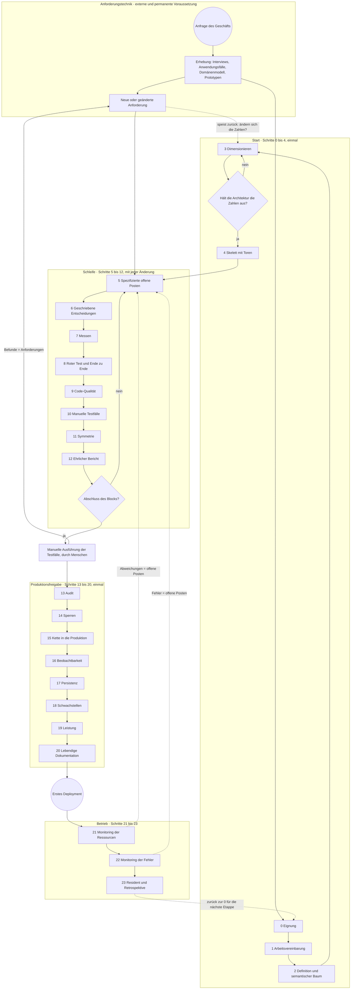

# Urazuke, die Nachweis-Methode — die methodische Leiter (Version 4)

Autor: Pablo Kuschniroff, unterstützt von Claude Code. Version 4, 18. Oktober 2026. Dies ist ein
Arbeitsdokument, das ich mit jedem Projekt, das es benutzt, weiter polieren werde; nichts von dem,
was es sagt, ist schon abgeschlossene Doktrin, auch wenn es, soweit ich weiß, das erste ehrliche
Destillat einer Methode ist, die bereits drei Systeme in Produktion hinter sich hat.

Bevor es zur Sache geht, eine Warnung dazu, wie es geschrieben ist, denn das ist wichtig. Ich habe
es für Menschen geschrieben, die diese Projekte nicht mit mir erlebt haben: Leute, die Software
mit künstlicher Intelligenz bauen wollen und wollen, dass diese Software hält, keine Leute, die
programmieren lernen oder Prompt-Tricks sammeln wollen. Deshalb nehme ich mir die Zeit zu
erklären, wiederhole, wenn es nötig ist, benutze die Sprache des Alltags und lasse am Ende ein
**Glossar** mit jeder Abkürzung und jedem umgangssprachlichen Ausdruck, der mir herausrutscht. Wenn
du irgendwann auf ein seltsames Wort stößt —„Ratsche“, „Sperre“, „fail-closed“, „PND“—, geh ins
Glossar; da steht alles. Und wenn du eine Marke wie [Ref. 26](REFERENCIAS.md#ref-26) liest, wisse,
dass sie eine Abkürzung zu einem realen Fall ist, den ich im Referenzdokument erzähle, mit seinem
Datum und seinem Beleg; du kannst sie ignorieren, ohne den Faden zu verlieren, oder ihr folgen,
wenn dich das Detail interessiert.

Das öffentliche Repository der Methode ist
[github.com/pkuschnirof/urazuke](https://github.com/pkuschnirof/urazuke). Dort liegen dieses
Dokument, die Verträge jedes Schritts, das Kurshandbuch und die Referenzen, in den acht Sprachen
von NAC3.

## Der Name

**Urazuke** (裏付け) ist ein japanisches Wort für den Rückhalt, den eine Behauptung hat: das, was
sie von hinten stützt (wörtlich „das Futter auf der Rückseite“). Das Verb *urazukeru* bedeutet
„mit Belegen untermauern“. Ich habe es am 17. Oktober 2026 gewählt, nachdem ich mehrere Namen
wegen Kollisionen mit bestehenden Firmen und Projekten verworfen hatte, und ich habe es gewählt,
weil es genau das sagt, was die Methode verlangt: dass jede Behauptung des Modells mit ihrem
Rückhalt kommt, und dass sich der Rückhalt prüfen lässt, ohne den Code zu lesen. Der Name wird
nicht übersetzt; der Untertitel, „die Nachweis-Methode“, schon: *the evidence method*, *o método
da evidência*, *la méthode de la preuve*, *il metodo del riscontro*, 裏付けの方法, 验证方法. In
diesem Dokument ist „die Leiter“ die Struktur der Methode —ihre vierundzwanzig Schritte— und
„Urazuke“ die ganze Methode.

## Worum es geht

Ich will klar sein darüber, was ich lehre und was nicht. Ich lehre kein Werkzeug. Ich lehre eine
**Methode**: was in welcher Reihenfolge zu tun ist, was man in jedem Moment vom Modell verlangt,
was es dir liefern muss, und wie du —ohne Code zu lesen— weißt, dass das, was es dir geliefert hat,
vollständig ist. Die Wette ist, dass jede Person, mit jedem Werkzeug der künstlichen Intelligenz,
das zum Programmieren taugt, Software bauen kann, indem sie sich mit einem Modell unterhält, statt
den Code von Hand zu tippen, und dass das, was herauskommt, robust ist, produktionsreif, und, das
ist das Wichtige, **nicht verlangt, dass der Projekteigentümer eine einzige Zeile Code
durchsieht**. Und ich will genauso klar darüber sein, was sie nicht ist: sie ist kein Prozess,
um Systeme schneller zu machen. Sie ist ein Prozess, um Systeme betreibbar und wartbar zu machen,
ohne dass irgendjemand auch nur ein Bit ihres Codes verstehen muss, denn den Code versteht und
pflegt der agentische Rahmen, der ihn schreibt. Die Geschwindigkeit ist, wenn sie auftaucht, eine
Folge, und deshalb gibt es in diesem Dokument keine Fristen: die setzen die Größe und die
Komplexität jedes Systems, und die Methode setzt nur die Reihenfolge.

Das klingt ehrgeizig, und das ist es. Aber ich habe etwas, das fast niemand hat: drei reale
Systeme, die ich genau so gebaut habe, die heute mit echten Kunden laufen, und aus denen ich jede
Regel gezogen habe, die folgt. Die Frage, die ich mir stelle, ist also nicht „geht das?“, denn es
ging schon. Die Frage ist „was habe ich getan, in welcher Reihenfolge, und was von alldem hat
wirklich den Unterschied gemacht?“. Diese Leiter ist meine Antwort, und sie ist die Grundlage für
drei Dinge: die Dokumentation der Methode, die Praxis, die die Teilnehmer des Kurses machen werden,
und die Handbücher. Später werde ich sie als Ausführungsablauf in mein Werkzeug exportieren, damit
das Werkzeug die Methode führt und nicht das Gedächtnis eines Einzelnen.

## Woher die Methode kommt, und was ich nicht missverstanden sehen will

Es gibt eine bequeme Lesart von alldem, die ich entkräften will, bevor sie sich festsetzt: die,
dass die Methode eine Sammlung von Flicken sei, die ich nach jedem Schlag aufgesetzt habe. So ist
es nicht, und es ist mir wichtig, das präzise zu sagen, weil es ändert, wie jeder Schritt zu lesen
ist.

Die Methode entsteht aus zwei Faktoren, die sich verbunden haben, und keiner der beiden reicht
allein. Der erste ist **mein eigenes Wissen über Systemtechnik**. Ich wende seit vielen Jahren an,
was jeder, der aus der Systemwelt kommt, sofort wiedererkennt: Erhebung vor dem Entwurf,
geschriebene Anforderungen, Dimensionierung mit Zahlen, Entwurf, Bau, Tests als Beleg,
reproduzierbares Deployment, Betrieb, periodisches Audit, Dokumentation als Teil des Produkts. Das
meiste von dem, was ich in den vierundzwanzig Schritten verlange, ist das, was ich in einem gut
geführten Projekt immer verlangt habe. Ich habe es nicht für die Modelle erfunden; ich habe es
von früher mitgebracht.

Der zweite Faktor ist das, was mir die Vorfälle dieser fünf Monate gezeigt haben, einer nach dem
anderen: **wo die Modelle diese Prinzipien brüchig anwenden**. Ein Modell weiß genau, was ein Test
ist, was eine Grundursache ist, was eine Dimensionierung ist; wenn du es fragst, erklärt es dir das
besser als viele Ingenieure. Aber in der Praxis sagt es, es habe getestet, und hat nicht getestet,
schätzt mit sicherer Miene eine Zahl, die nur das Geschäft hat, füllt eine Lücke in den
Geschäftsregeln mit dem, was ihm vernünftig erschien, berichtet zu viel, weil es darauf trainiert
wurde, nützlich zu sein, und baut ein Messgerät, das lügt, ohne es zu merken. Jeder dieser Fälle,
die ich in den [Referenzen](REFERENCIAS.md) erzähle, hat mir genau gesagt, wo nachzuziehen war: wo
ein Prinzip, das für mich offensichtlich war, zu einer expliziten Klausel des Prompts werden
musste, zu einem Tor, zu einer Prüfung, die ich mache, ohne Code zu lesen.

Wenn ich also in einem Schritt sage „das habe ich nach diesem oder jenem Vorfall durchgesetzt“,
sage ich nicht, dass das Prinzip dort geboren wurde. Ich sage, dass ich dort festgestellt habe,
dass das Modell es nicht von allein anwandte, und dass man es ihm schriftlich abverlangen musste.
Die Methode ist Systemtechnik von jeher, angewandt mit der Strenge, die ein Bauender braucht, der
nicht müde wird und dem man ohne Beleg nicht glauben kann. Die Narben sind der Beweis dafür, wo die
Strenge nötig ist, nicht der Ursprung der Prinzipien.

## Die drei Anwendungsfälle der Methode

Bevor es weitergeht, eine Abzweigung, die in den ersten Versionen nicht da war und die ein Leser
zu Recht von mir verlangt hat. Dieses Dokument beschreibt die Leiter mit Blick auf einen leeren
Ordner: Schritt 0 entscheidet, ob das Projekt angegangen wird, Schritt 4 deployt das Skelett ohne
Funktionalität, Schritt 5 öffnet den ersten Block. Es ist der klarste Fall zum Lernen, und es ist
nicht der häufigste. Die Methode hat drei Anwendungsfälle, und es lohnt sich zu wissen, in welchem
du steckst, bevor du den Agenten öffnest, denn es ändert sich, wo man einsteigt:

1. **Neues Projekt.** Leerer Ordner und ein Eigentümer mit einer Anfrage. Man steigt bei Schritt 0
   ein und erklimmt die vierundzwanzig der Reihe nach. Das ist es, was dieses Dokument
   beschreibt, mit seinen Verträgen und dem Kurshandbuch.
2. **Evolutiv-korrektiv über einem System, das mit der Methode gemacht wurde.** Das System hat die
   Leiter schon erklommen: es hat Vereinbarung, Karte, mit Beleg geschlossene offene Posten,
   Batterie, Deployment und Handbücher. Man steigt bei Schritt 5 ein, indem man einen Block
   öffnet, und folgt der Schleife; die 13 periodisch; die 23 beim Abschluss jeder Etappe. Es ist
   die Phase 4 der Zeitlinie (Teil B).
3. **Evolutiv-korrektiv über einem System, das ohne die Methode gemacht wurde.** Ein System, das
   läuft, mit Nutzern, von einem anderen gemacht oder von einem selbst ohne Beleg, das korrigiert
   oder weiterentwickelt werden muss. Man steigt weder bei der 0 noch bei der 5 ein: man steigt
   über einen **Normalisierungsabschnitt** aus acht Stationen ein (N0 bis N7), der durch
   Selbsterschließung und mit Quellenmarken alle Eingaben wiedergewinnt, die die Schritte des
   Starts erzeugen, einen Sicherheitsgurt um das System legt, ohne es neu zu schreiben, und erst
   danach die Schleife im korrektiven oder im evolutiven Modus öffnet. Dieser Weg steht auf einer
   eigenen Seite, dem [evolutiv-korrektiven Weg](EVOLUTIVO_CORRECTIVO.md), und hat seinen eigenen
   Teil des Kurses mit einem zweiten Leitprojekt.

Was draußen bleibt, benannt: die technologische Migration ist kein Anwendungsfall der Methode; sie
ist ein anderes Projekt, und sie fällt im Allgemeinen unter die Ausschlusskriterien von Schritt 0.

## Die KI unterbricht die Methode nicht: sie setzt sie fort

Das ist die These, die alles eröffnet, und ich setze sie an den Anfang, weil sie den häufigsten
Einwand entkräftet, bevor er auftaucht: „wie willst du Code vertrauen, den eine Maschine
geschrieben hat?“.

Meine Antwort ist, dass **die Branche schon vor zwanzig Jahren aufgehört hat, dem Autor des Codes
zu vertrauen**. Als der Großteil des Schreibens an Junior-, ausgelagerte oder wechselnde Teams
ging, wurde die Durchsicht Zeile für Zeile unhaltbar. Und was an ihrer Stelle wuchs, war all das,
was wir heute für selbstverständlich halten: die automatisierten Tests, die Continuous Integration,
die Abnahmekriterien, die Pipelines, die nichts ohne Grün durchlassen, das „Shift left“ der Tests,
die Qualitätskontrolle als unabhängige Funktion. Das war die Antwort der Systemtechnik auf „der,
der schreibt, ist nicht vertrauenswürdig“: ihm nicht den Code lesen, ihm Belege abverlangen.

Ein Modell zum Schreiben einzusetzen ist also kein Sprung ins Leere. Es ist, einen Autor, dem wir
schon nicht mehr vertrauten, gegen einen anderen zu tauschen, dem wir auch nicht vertrauen, und für
den **wir den Prüfapparat schon aufgebaut hatten**. Das sollte beruhigen, nicht beunruhigen. Und
obendrein ist der neue Autor billiger, schneller und —anders als der Junior— nicht beleidigt, wenn
du ihn bittest, rot zu beweisen.

Deshalb stützt sich diese Methode, ohne es zu verbergen, auf die klassische Systemtechnik. Das
Skelett ist das von jeher. Es konnte nicht anders sein, denn die Probleme sind die von jeher: nicht
wissen, wie viele Daten es geben wird, nicht wissen, was der Kunde will, nicht wissen, ob das
Gebaute das Verlangte ist. Die KI hat die Probleme nicht geändert; sie hat geändert, wer welchen
Teil macht und zu welchen Kosten. Sogar das Eignungskriterium X2 von Schritt 0 ist klassische
Ingenieurskunst: Testbarkeit als Vertragsbedingung.

### Was daran alt ist und was neu

Das Alte, und es lohnt sich zu sagen, dass es alt ist: das Skelett aus Etappen, die Unabhängigkeit
dessen, der prüft, von dem, der baut, die Tests als Beleg, die Dokumentation als Teil des Produkts,
die Erhebung vor dem Entwurf.

Was sich sehr wohl ändert, und wo mein Beitrag liegt, sind drei Dinge:

1. **Wohin der Aufwand des Menschen geht.** In der klassischen Methode schreibt der Mensch die
   Spezifikation, schreibt den Code, und ein anderer Mensch sieht ihn durch. Hier tut der Mensch
   nur zwei Dinge: **er entscheidet, und er prüft Artefakte**. Alles andere —verfassen, bauen,
   testen, messen, dokumentieren— tut das Modell. Deshalb endet jeder Schritt in einer
   „Vollständigkeitsprüfung ohne Code zu lesen“: das ist der exakte Ort, an dem der Mensch weiterhin
   unverzichtbar ist, und kein anderer.

2. **Der Autor stellt auch die Belege her.** Das ist der einzige genuin neue Punkt, und es ist die
   Nuance, die drei ganze Schritte rechtfertigt. Der Junior schrieb zweifelhaften Code, aber er
   stellte nicht die Belege her: die Tests und die Messungen baute ein anderer, oder zumindest sah
   ein anderer sie an. Das Modell dagegen produziert den Code *und* den Test *und* das Messgerät
   *und* den Bericht, in derselben Sitzung, mit derselben Sicherheit in der Stimme, wenn es richtig
   ist und wenn es falsch ist. Ich habe es gesehen: das Messgerät, das zweimal log
   [Ref. 36](REFERENCIAS.md#ref-36), der Authentifizierungsfehler, der als „Erfolg“ gemeldet wurde
   [Ref. 43](REFERENCIAS.md#ref-43), die drei von vier Behauptungen, die falsch waren. Also bleibt
   „Belege prüfen statt Code“ das richtige Prinzip, aber **der Beleg muss sich selbst beweisen**:
   der rot gesehene Test (Schritt 8), das Instrument mit seinem Schutz (Schritt 7), der Bericht,
   der das Verifizierte vom Geglaubten trennt (Schritt 12), der vom Bauenden verschiedene Auditor
   (Schritt 13). Das ist keine neue Sorge: es ist dieselbe Disziplin der Unabhängigkeit der
   Qualitätskontrolle, einen Schritt weiter nach innen getragen.

3. **Die Kosten der Artefakte.** In der klassischen Methode war Dokumentation teuer, also machte
   man sie einmal, und sie alterte. Hier ist sie neu zu erzeugen gratis, also wird die Regel zu „im
   selben Commit“ und „von Hand reproduzierbar, ohne KI“. Was früher ein unerfüllbares Ideal war,
   wird zu einem Tor.

Für den Kurs und für die öffentliche Präsentation definiert das die Positionierung mit
Ehrlichkeit: es ist nicht „die neue Art zu programmieren“; es ist **Systemtechnik, angewandt auf
einen Bauenden, der nicht müde wird und dem man nicht glauben kann**. Denen, die aus der Systemwelt
kommen, klingt das vertraut und nimmt ihnen das Misstrauen; denen, die vom Vibecoding kommen, gibt
es das, was sie nicht haben, nämlich genau das Skelett. Und es unterscheidet mich von den
Werkzeugen, die Geschwindigkeit verkaufen und das ganze Skelett auslassen.

---

## Teil A — Wie jeder Schritt zu lesen ist

Jeder Schritt hat acht Teile, immer dieselben, damit sie sich vergleichen lassen:

- **Absicht**: was er anstrebt, in einem Satz.
- **Wann**: in welchem Moment des Projekts er erklommen wird, und ob er einmal erklommen oder
  wiederholt wird. Dieser Teil ist neu in Version 4, und ich erkläre ihn ausführlich in Teil B, denn
  eine Methode ohne Zeitlinie ist eine Liste guter Vorsätze.
- **Eingaben**: was vorher existieren muss, um ihn erklimmen zu können.
- **Artefakt**: was geschrieben oder ausführbar zurückbleibt, wenn er erklommen ist. Es ist immer
  etwas Konkretes: eine Datei, ein Test, ein Skript.
- **Tor**: was wahr sein muss, um zum nächsten zu kommen. Wenn es nicht erfüllt ist, geht es nicht
  weiter.
- **Wer entscheidet**: der Projekteigentümer, der Agent, oder niemand, weil es automatisch ist.
- **Fehler, den er verhindert**: die Art von Problem, der der Schritt vorbeugt, mit einem kurzen
  Verweis auf den realen Fall, in dem ich das festgestellt habe.
- **Vertrag**: die Datei, in der steht, wie er ausgeführt wird: Kontext, Prompts, Ergebnis,
  Prüfung, Warnsignale.

Zwei wichtige Klarstellungen. Erstens: **die Leiter ist neutral gegenüber dem Werkzeug**. Jedes
Artefakt ist eine Datei, ein Test oder ein Skript; keines verlangt mein Werkzeug oder irgendein
anderes. Forge automatisiert sie (die Tore, die Befehle, das Register der offenen Posten), aber der
Schritt existiert ohne Forge. Zweitens: **die Schritte sind in der Reihenfolge nummeriert, in der
sie erklommen werden**, und sie gruppieren sich in vier Abschnitte: die von 0 bis 4 sind der Start
und werden einmal pro Projekt erklommen; die von 5 bis 12 sind die Schleife, die sich mit jeder
Änderung wiederholt; die von 13 bis 20 sind die Produktionsfreigabe und werden einmal erklommen,
vor dem ersten Deployment; und die von 21 bis 23 sind der Betrieb, wenn das System schon lebt.
Die 23 schließt den Kreis und kehrt zur 0 für das nächste Projekt zurück. Innerhalb eines
Abschnitts sagt die Zahl die Reihenfolge; zwischen den Abschnitten wiederholt sich die Schleife,
während die anderen drei einmal erklommen werden. Aber „nicht streng sequenziell“ heißt nicht
„in beliebiger Reihenfolge“: Teil B sagt genau, wann jeder erklommen wird und was dazwischen
passiert.

---

## Teil B — Die Zeitlinie: wann jeder Schritt erklommen wird und was dazwischen passiert

Dieser Teil existierte in den vorherigen Versionen nicht, und sein Fehlen war ein ernster Mangel:
die Methode sagte, was zu tun ist und wie es zu prüfen ist, aber sie sagte nicht, **wann**. Und
„wann“ ist die Hälfte einer Methode. Ein Leser, der sie wörtlich nahm, konnte die
vierundzwanzig Schritte einen nach dem anderen erklimmen und sich fragen, in welchem Moment dann
die Infrastruktur gemacht
wird, die Kette aus Continuous Integration und Deployment, die Aufnahme der Anforderungen, die
Entwicklung der Funktionalität, die Ende-zu-Ende-Tests aller Flüsse, der menschliche Blick auf die
Bildschirme, und die menschlichen Abnahmetests. All das passiert, und es passiert in präzisen
Momenten, zwischen den Schritten und innerhalb von ihnen. Hier schreibe ich es auf.

### B.0 Der ganze Prozess in einem Bild

Vor den Tabellen die Zeichnung. Sie ist in Prozessnotation gehalten (im Stil von BPMN: runde
Ereignisse, rechteckige Aufgaben, rautenförmige Tore, gepunktete Rückflusspfeile) und sagt drei
Dinge, die die Tabellen schlechter sagen. Erstens: der Prozess **beginnt außerhalb der Methode**,
in der Anforderungstechnik, die eine Voraussetzung und zugleich permanent ist: sie hört nie auf,
und jede neue Anforderung tritt wieder ein. Zweitens: eine neue Anforderung tritt nicht einfach in
die Schleife ein; sie **speist in die Bewertungsschritte zurück**, denn sie kann die Zahlen
ändern, mit denen die Architektur entschieden wurde (hält sie das „mal zehn“ noch aus?), und von
da an weiter. Drittens: der Prozess **endet in der manuellen Ausführung der Testfälle** durch
Menschen (Schritt 10), und was diese Ausführung findet, kehrt als Anforderung in die Schleife
zurück. Der Kreis schließt sich mit Menschen, nicht mit Maschinen.

Wenn die Zeichnung nicht zu sehen ist (der Markdown-Betrachter zeichnet kein Mermaid), beschreibt
der Text darüber sie vollständig; in der HTML-Fassung zeichnet sie sich von allein.

### B.1 Die fünf Phasen eines Projekts

Ein Projekt, das mit dieser Methode geführt wird, durchläuft fünf Phasen. Die drei mittleren
entsprechen den Abschnitten der Schleife, der Produktionsfreigabe und des Betriebs; die Phase 1 ist
der Abschnitt des Starts; und die Phase 0 ist die anfängliche Aufnahme, die die Methode ebenfalls
abdeckt, auch wenn sie kein „Schritt“ an sich ist. Ich schreibe keine Dauern hin: sie hängen von
der Größe und der Komplexität dessen ab, was verlangt wird, und eine geschriebene Dauer wird zu
einer falschen Erwartung. Was nicht von der Größe abhängt, ist die Reihenfolge.

| Phase | Schritte, die erklommen werden | Was sonst in dieser Phase passiert |
|---|---|---|
| 0. Aufnahme | noch keiner; sie ist der Rohstoff für 0, 2, 3 und 5 | Erhebung des Geschäfts mit dem Eigentümer, mit den klassischen Methoden der Anforderungstechnik (siehe B.5): Interviews, Anwendungsfälle oder User Stories, Domänenmodell, Bildschirmprototypen. Wird in Prosa geschrieben, absichtlich unvollständig; der Agent vervollständigt sie durch Fragen. |
| 1. Start | 0, 1, 2, 3, 4 | Eignung, Vereinbarung, Definition, Dimensionierung. Und **die gesamte anfängliche Infrastruktur**: das Repository, die Testumgebung, die Continuous Integration, das erste Deployment mit dem leeren System. |
| 2. Schleife | 5 bis 12 mit jeder Änderung: offene Posten, Entscheidungen, messen, roter Test, Qualität, manuelle Testfälle, Symmetrie, Bericht | Funktionale Entwicklung Block für Block; rote Tests; Ende-zu-Ende-Tests des gerade gebauten Flusses; menschlicher Blick auf jeden neuen Bildschirm; beim Abschluss jedes Blocks menschliche Tests in der Testumgebung. |
| 3. Produktionsfreigabe | 13 bis 20, der Reihe nach: Audit, Sperren, Kette in die Produktion, Beobachtbarkeit, Persistenz, Schwachstellen, Leistung, Dokumentation | Audit durch eine andere Sitzung; Sperren auf allem, was auf die Welt wirkt; Abschluss der Deployment-Kette in die Produktion mit getestetem Rollback; die drei Handbücher; Abnahmetests mit dem Eigentümer über alle Flüsse. |
| 4. Betrieb | 21 und 22, mit dem ersten Deployment aufgebaut; 23 beim Abschluss jeder Etappe; die Schleife (5 bis 12) für jede Weiterentwicklung; 13 und 18 periodisch | Residenter Agent; Audit alle ein bis zwei Monate; jede neue Änderung geht durch die vollständige Schleife hinein und durch die Deployment-Kette hinaus; Retrospektive beim Abschluss jeder Etappe. |

Diese Tabelle ist die des neuen Projekts. Wenn das System schon existiert und nicht mit der
Methode geboren wurde, werden die Phasen 0 und 1 durch den Normalisierungsabschnitt ersetzt
(Lesen, Gurt, messen und ordnen), der im
[evolutiv-korrektiven Weg](EVOLUTIVO_CORRECTIVO.md) steht; die Phasen 2, 3 und 4 sind dieselben.

In einem Projekt mit Nutzern und Konsequenzen wächst die Schleife: die Funktionalität. Der Start,
die Produktionsfreigabe und der Betrieb haben in einem kleinen und in einem großen System dieselbe
Form; es ändert sich, wie viel zu messen ist, nicht was.

### B.2 Was zwischen Schritt und Schritt passiert

Hier ist das, was gefehlt hat. Für jede Phase, welche Aufgaben welcher Art gemacht werden und in
welchem exakten Moment relativ zu den Schritten. Lies die Tabelle zeilenweise: jede Zeile ist eine
Art von Arbeit, und jede Zelle sagt, wann sie innerhalb dieser Phase gemacht wird.

| Art der Arbeit | Start (Schritte 0 bis 4) | Schleife (Schritte 5 bis 12, pro Block) | Produktionsfreigabe (13 bis 20) | Betrieb (21 bis 23 und Schleife) |
|---|---|---|---|---|
| **Anforderungsaufnahme** | Vor Schritt 0: Erhebung in Prosa mit dem Eigentümer, mit Interviews, Anwendungsfällen und Domänenmodell. Wird in 2 (Definition und semantischer Baum) und in 3 (Mengen) vervollständigt. | Beim Öffnen jedes Blocks: die Anfrage des Kunden für diesen Block, so wie er sie sagen würde, wird in offene Posten mit **detaillierter Spezifikation** verwandelt (Schritt 5): Beschreibung, Abnahmekriterien, anwendbare Regeln, Daten, Bildschirme, Randfälle. Die Fragen, die der Agent stellt, sind die Feinaufnahme. | Vor 14: Erhebung der Aktionen mit Konsequenz. Vor 15: Erhebung der Umgebungen und Zugänge. | Jede neue Anfrage tritt als spezifizierter offener Posten ein, an seinem Knoten des semantischen Baums hängend; der residente Agent sammelt, was die Nutzer verlangen. |
| **Infrastruktur** | Die gesamte anfängliche, in Schritt 4: Repository, Struktur, Testumgebung, Zugangsdaten, Testdomain. Es wird keine Funktionalität gebaut, bis das leere Skelett deployt ist. | Keine, es sei denn, ein Block verlangt sie (eine Warteschlange, ein externer Dienst). Wenn er sie verlangt, ist es ein offener Posten mit seinem Test. | In 15: Produktionsumgebung, Geheimnisse auf dem Server, echte Domain, Backups, minimales Monitoring. | Infrastrukturänderungen gehen durch die Schleife und durch 15; nie „von Hand, schnell“. |
| **CI/CD-Kette** | In Schritt 4: die Continuous Integration lässt die Batterie bei jedem Push ab dem Start laufen, und das Deployment in die Testumgebung ist beim Mergen automatisch. | Läuft von allein. Jeder Commit durchläuft sie; wenn sie nicht grün ist, schließt der Block nicht. | In 15 wird sie vervollständigt: das Deployment in die Produktion wartet auf das Ergebnis der Integration und verpackt nur; die Beförderung ist ein schriftliches Verfahren; das Rollback wird getestet. | Jedes Deployment folgt der Routine von 15: Testumgebung grün mit derselben Version, Rollback bereit, danach Ende-zu-Ende-Prüfung in der Produktion. |
| **Funktionale Entwicklung** | Keine. Das Skelett wird absichtlich leer deployt. | Sie ist das Zentrum der Schleife: der Agent nimmt einen offenen Posten (5), fragt nach den fehlenden Geschäftsregeln (6), baut, und schließt mit Beleg (7, 8, 9, 10, 11, 12). Block für Block, vom Grundlegenden zu dem, was Konsequenzen hat. | Was auf die Welt wirkt (abbuchen, senden), wird in der Schleife **nach** Schritt 14 gebaut, mit seinen Sperren, und startet im Trockenlauf. | Die Weiterentwicklungen gehen durch die Schleife. |
| **Automatische Tests** | Ein Smoke-Test, der besteht, in 4. Er ist der Keim der Batterie. | Mit jedem offenen Posten: der rot bewiesene Test (8), die Regression der Nachbarn in derselben Sitzung, und **ein Ende-zu-Ende-Test des gerade gebauten Flusses**, vom Bildschirm bis zum Backend. Beim Schließen eines Blocks: die vollständige Ende-zu-Ende-Batterie **aller** bestehenden Flüsse, in der Testumgebung. | Vor dem ersten Deployment in die Produktion: die vollständige Ende-zu-Ende-Batterie aller Flüsse, grün, mit derselben Version, die befördert wird. Nach dem Deployment: eine Ende-zu-Ende-Prüfung auf der Produktion, nur lesend. | Mit jeder Änderung dasselbe wie in der Schleife. |
| **Menschlicher Blick auf die Bildschirme** | Beim Abschluss von 4: der Eigentümer öffnet die URL der Testumgebung und sieht den leeren Bildschirm. Es wirkt trivial und ist das erste Mal, dass jemand, der nicht der Agent ist, das System ansieht. | **Mit jedem offenen Posten, der einen Bildschirm berührt**: der Agent liefert einen echten Screenshot aus der Testumgebung, und der Eigentümer sieht ihn an. Zehn Sekunden. Es ist die billigste Art, das zu finden, was kein Test findet: dass der Knopf steht, wo er nicht hingehört, dass der Text etwas anderes sagt, dass der Fluss nicht der ist, den sich das Geschäft vorgestellt hat. | In 20: die Screenshots des Benutzerhandbuchs sind der letzte systematische menschliche Blick vor der Produktion. | Jeder neue oder geänderte Bildschirm, wie in der Schleife. |
| **Menschliche Tests** | Noch keine, außer den leeren Bildschirm zu öffnen. | **Beim Abschluss jedes Funktionsblocks**: der Eigentümer, oder ein vertrauenswürdiger Nutzer, benutzt das System in der Testumgebung so, wie er es wirklich benutzen würde, entlang der Flüsse des Blocks. Was er findet, wird als offene Posten notiert. Der nächste Block wird nicht geöffnet, solange es menschliche Befunde ohne offenen Posten gibt. | Vor dem ersten Deployment in die Produktion: **Abnahmetests** des Eigentümers über alle Flüsse, mit realistischen Testdaten, in der Testumgebung. Und in 20 folgt eine Person, die nicht programmiert, dem Wiederherstellungshandbuch. | Mit jeder Weiterentwicklung, beim Abschluss ihres Blocks. |
| **Entscheidungen des Eigentümers** | In 0 (go oder no-go), 1 (die Vereinbarung), 2 (was es NICHT ist), 3 (die Architekturoption). | Jedes Mal, wenn der Agent wegen einer nicht geschriebenen Geschäftsregel anhält (6). Meist sind es zwei oder drei pro Block. | In 14 (Sperre für Sperre), in 15 (in die Produktion befördern), in 23 (die Stufe des residenten Agenten). | Die, die anfallen; immer schriftlich. |

Ein Detail, das ich unterstreichen will, weil es das ist, wo sich die Leute, die vom Vibecoding
kommen, am meisten irren: **die Ende-zu-Ende-Tests aller Flüsse sind nicht ein einziges Mal am
Ende**. Sie sind dreimal, in drei Maßstäben. Mit jedem offenen Posten der Fluss, den dieser Posten
berührt hat. Beim Abschluss jedes Blocks alle Flüsse, die es bis dahin gibt. Und vor der Produktion
alle Flüsse mit der exakten Version, die befördert wird. Wenn du nur das dritte machst, kommst du
am Ende mit einem System an, das wochenlang niemand Ende zu Ende getestet hat, und die
Produktionsfreigabe wird zu einer Woche voller Reparaturen.

### B.3 Der Rhythmus der Schleife: ein typischer Funktionsblock

Ein Funktionsblock ist eine Menge von vier bis acht zusammenhängenden offenen Posten, die zusammen
etwas tun, das das Geschäft benutzen kann: „die Grundagenda“, „die Erinnerungen“, „der
Monatsbericht“. So sieht er von innen aus:

1. **Öffnen des Blocks.** Der Eigentümer erzählt in Prosa, was er für diesen Block will. Der
   Agent verwandelt es in nummerierte offene Posten, mit ihrem „wie wird geprüft“, und fragt nach
   dem, was nicht ausreicht, um einen prüfbaren offenen Posten zu schreiben (Schritt 5). Der
   Eigentümer priorisiert.
2. **Jeder offene Posten.** Der Agent kündigt an, welchen offenen Posten er nimmt und warum. Wenn
   unterwegs eine Geschäftsregel auftaucht, die nicht aufgeschrieben ist, hält er an und fragt (6).
   Wenn der offene Posten von einer Zahl abhängt —wie viele Abfragen, wie lange es dauert—, misst
   er sie zuerst mit einem Instrument mit Test (7). Er baut. Wenn er fertig ist, schließt er in
   dieser Reihenfolge: der rot bewiesene Test, grün, die Regression der Nachbarn und ein
   Ende-zu-Ende-Test des berührten Flusses (8); das Tor der Code-Qualität in Grün (9); die
   manuellen Testfälle des Flusses, für eine Person geschrieben (10); und, wenn die Änderung einen
   Vertrag zwischen zwei Teilen des Systems berührt hat, die andere Seite im selben Commit
   aktualisiert (11). Der Bericht trennt das Verifizierte vom Geglaubten und erklärt die blinden
   Flecken (12). Der Eigentümer liest den Bericht und sieht sich den Screenshot des Bildschirms an.
   Er liest keinen Code.
3. **Abschluss des Blocks.** Die vollständige Ende-zu-Ende-Batterie grün in der Testumgebung. Der
   Eigentümer oder ein vertrauenswürdiger Nutzer führt die manuellen Testfälle des Blocks aus (10)
   und notiert, was passiert ist und was fehlgeschlagen ist; jeder Fehlschlag kehrt als korrektiver
   offener Posten in die Schleife zurück. Der Qualitätsbericht des Blocks wird gelesen (9). Das
   Benutzerhandbuch wird mit den neuen Bildschirmen aktualisiert (20, im selben Commit). Erst dann
   wird der nächste Block geöffnet.

An einem typischen Tag der Schleife investiert der Eigentümer zwischen fünfzehn und dreißig
Minuten: zwei oder drei Fragen zu Geschäftsregeln beantworten, zwei oder drei Berichte lesen, zwei
oder drei Screenshots ansehen. Das ist alles, was die Methode von ihm verlangt. Wenn er mehr
investiert, fragt entweder der Agent, was er allein lösen könnte (Schritt 1), oder der Eigentümer
liest Code (und dann funktioniert etwas an Schritt 8 oder 12 nicht).

### B.4 Die menschlichen Meilensteine

Ich fasse in einer Liste die Momente zusammen, in denen ein Mensch, der Eigentümer oder jemand
aus seinem Vertrauen, das System ansehen oder benutzen muss. Es sind wenige, sie liegen in präzisen
Momenten, und keiner lässt sich an den Agenten delegieren:

- **Ende des Starts**: die URL der Testumgebung öffnen und das leere System sehen.
- **Mit jedem offenen Posten, der einen Bildschirm berührt**: den echten Screenshot aus der
  Testumgebung ansehen.
- **Beim Abschluss jedes Blocks**: die manuellen Testfälle des Blocks (10) in der Testumgebung
  ausführen und das Ergebnis notieren; was fehlschlägt, kehrt als Anforderung in die Schleife
  zurück.
- **Vor dem ersten Deployment in die Produktion**: Abnahmetests über alle Flüsse, allen manuellen
  Testfällen folgend.
- **In Schritt 20**: eine Person, die nicht programmiert, folgt dem Wiederherstellungshandbuch in
  der Testumgebung.
- **Nach jedem Deployment in die Produktion**: prüfen, dass die laufende Version die gewollte ist,
  und einen nur lesenden Durchgang durch die kritischen Flüsse machen.
- **Vor dem ersten Deployment, in der 19**: die Zahlen des Lasttests mit der Toleranz des
  Geschäfts daneben lesen, und den Bruchpunkt.
- **In jedem Zyklus des Monitorings (21 und 22)**: den zyklischen Bericht mit dem Agenten lesen
  und entscheiden, welche Abweichung und welcher Fehler zu offenen Posten werden.

Alles andere —die Tests, die Messungen, die Audits, die Dokumentation— macht das Modell, und der
Mensch prüft es am Artefakt, nicht am Code.

### B.5 Wie die Anforderungen hereinkommen: von der Erhebung zum semantischen Baum und zu den offenen Posten

Ich will hier verweilen, denn hier hat die klassische Systemtechnik am meisten zu sagen und hier
ignoriert das Vibecoding sie mit dem größten Enthusiasmus. Eine Anforderung ist nicht ein Satz des
Kunden in einem Chat. Es ist ein Satz des Kunden, **verarbeitet** durch Methoden, die seit
Jahrzehnten existieren und mit einem Modell am Steuer weiterhin gelten, denn das Modell ist sehr
gut darin, sie anzuwenden, wenn du es darum bittest, und sehr schlecht darin, wenn nicht.

Die Methoden, die ich verwende und die die Methode in jeder Phase verlangt:

- **Interviews mit dem Eigentümer**, offen, in Prosa, aufgezeichnet. Sie sind Phase 0. Ich
  versuche nicht, dass sie vollständig sind: ich versuche, dass der Agent erkennt, was ihnen
  fehlt.
- **Anwendungsfälle oder User Stories**, einer pro Fluss, den das Geschäft benennen kann: „die
  Empfangskraft trägt einen Termin ein“, „der Patient bekommt die Erinnerung“. Jeder hat Akteur,
  Auslöser, Schritte, Ergebnis und Ausnahmen. Sie sind die Einheit, mit der ein Funktionsblock
  geöffnet wird.
- **Domänenmodell**: die Entitäten des Geschäfts, ihre Attribute, ihre möglichen Zustände und die
  Übergänge zwischen Zuständen. Es ist das Herz des semantischen Baums (siehe unten) und das, was
  verhindert, dass das Modell Zustände erfindet, die das Geschäft nicht hat.
- **Abnahmekriterien** pro Story, in der Form „gegeben diese Situation, wenn dies passiert, dann
  sieht man dieses Ergebnis“. Sie sind es, die zum „wie wird geprüft“ jedes offenen Postens werden
  und später zum Ende-zu-Ende-Test.
- **Bildschirmprototypen**, und sei es eine Zeichnung. Der menschliche Blick auf die Bildschirme
  beginnt hier, bevor es Code gibt.
- **Nachverfolgbarkeit**: jede Anforderung lässt sich bis zum offenen Posten verfolgen, der sie
  umsetzt, zum Test, der sie prüft, und zum Commit, der sie geschlossen hat. In der Methode ist die
  Nachverfolgbarkeit keine separate Matrix: sie ist der offene Posten selbst, der seinen Ursprung
  und seinen Beleg zitiert.

**Der semantische Baum.** Er ist das Artefakt, das all das ordnet, und die Karte, die der Agent in
jeder Sitzung liest (Schritt 2). Er ist ein Baum, keine Liste: das System an der Wurzel; darunter
die Domänen oder Module; unter jedem seine Akteure, seine Prozesse (die Anwendungsfälle), seine
Entitäten mit ihren Zuständen, seine Bildschirme und seine externen Integrationen; und an jedem
Knoten hängend die offenen Posten, die ihn berühren, und die Entscheidungen, die ihn betreffen. Der
Agent baut ihn aus der Erhebung, du korrigierst ihn, und er wächst mit jedem Block. Sein Wert ist
doppelt: er gibt dem Modell den exakten Kontext des Knotens, den es anfassen wird, ohne das ganze
Projekt lesen zu müssen, und er gibt dir eine Art zu prüfen, dass das System, das der Agent
versteht, das ist, das das Geschäft verlangt hat, ohne Code zu lesen. Wenn ein offener Posten an
keinem Knoten hängt, ist entweder der Baum unvollständig oder der offene Posten außerhalb des
Umfangs; beides sieht man in zehn Sekunden.

**Die detaillierte Spezifikation lebt im offenen Posten.** In der klassischen Methode gab es ein
Anforderungsspezifikationsdokument, lang, das alterte. Hier wird dieses Dokument zerlegt: jeder
offene Posten trägt seine eigene vollständige Spezifikation, und die Summe der offenen Posten ist
die Spezifikation des Systems. Ein gut geschriebener offener Posten hat: Titel; den Knoten des
semantischen Baums, an dem er hängt; die Story oder den Anwendungsfall, der ihn auslöst, mit den
Worten des Kunden; die detaillierte Beschreibung dessen, was verlangt wird; die anwendbaren
Geschäftsregeln, mit ihrer Entscheidung und ihrem Datum; die Daten, die hinein- und hinausgehen;
die betroffenen Bildschirme, mit dem Prototyp, falls es einen gibt; die Randfälle und die
Ausnahmen; die Abnahmekriterien; und wie geprüft wird. Der Agent verfasst ihn aus deiner Anfrage in
Prosa, fragt nach dem, was sich nicht spezifizieren lässt, und du liest ihn, bevor gebaut wird. Die
Spezifikation eines offenen Postens zu lesen ist das Nächste, was du dem Lesen von Code kommen
wirst, und es ist genau die richtige Distanz.

**Die geschlossenen Posten sind Dokumentation.** Das ist es, was den Kreis schließt. Wenn ein
offener Posten geschlossen wird, wird er nicht gelöscht und nicht leer archiviert: er bleibt mit
seiner Spezifikation, der Entscheidung, die ihn ausgelöst hat, dem Beleg, mit dem er geschlossen
wurde (die Zahlen des Rot und des Grün, der Screenshot des Bildschirms, die gemessene Zahl), dem
Commit und dem Datum. Die Warteschlange der geschlossenen Posten ist also die funktionale Historie
des Systems: was gebaut wurde, warum, wann und wie es getestet wurde. Daraus entstehen das
Änderungsprotokoll, die neuen Abschnitte des Benutzerhandbuchs und, wenn jemand sechs Monate später
fragt „warum tut das System das?“, die Antwort. Das Kurshandbuch lehrt, diese Dokumentation beim
Schließen jedes offenen Postens einzufordern, in derselben Sitzung, als Teil der Routine von
Schritt 5.

---

## Teil C — Die vierundzwanzig Schritte

Sie stehen in der Reihenfolge, in der sie erklommen werden. Die sechs Schritte der
Betriebsqualität (16 bis 19 vor dem ersten Deployment; 21 und 22 danach) sind die, die ich tat,
ohne sie zu benennen: dass sich das System **sehen** lässt, während es läuft, dass es das Volumen
aushält, für das es dimensioniert wurde, dass es keine bekannten Löcher hat, und dass, einmal in
der Produktion, niemand von einem Problem durch einen wütenden Nutzer erfährt. Die beiden
Monitorings enden am selben Ort wie alles andere: in der Schleife, als korrektive offene Posten.
Wenn du Anfänger bist: jeder Vertrag dieser sechs, und die der Schritte 9 und 10, beginnen mit
einem Absatz, der seine Wörter in der Sprache des Alltags erklärt, und das Glossar hat sie alle.

### Schritt 0 — Lässt sich dieses Projekt so angehen? (die Eignung)

Es gibt etwas, das allem vorausgeht und in keinem Repository steht, weil es immer schon entschieden
ankam: die Entscheidung, **ob ein Projekt mit dieser Methode angegangen wird oder nicht**. Es ist
ein Kriterium, das ich monatelang im Kopf gelebt habe und das ich gerade fertig aufschreibe. Die
zwei Ausschlusskriterien habe ich schon klar, und sie stammen aus den Projekten, die ich abgelehnt
habe, nicht aus denen, die ich angenommen habe [Ref. 46](REFERENCIAS.md#ref-46): die „Nein“
definieren die Grenze besser als die „Ja“. Die gewichtenden Kriterien kalibriere ich noch, und so
markiere ich sie.

- **Absicht**: entscheiden, ob ein Projekt mit dieser Methode angegangen wird, mit einem Agenten am
  Steuer, oder nicht, BEVOR das Repository geöffnet wird. Denn wenn du in ein Projekt einsteigst,
  das nicht taugt, verkommt die Methode zu „mit KI programmieren“, und dann liest der Eigentümer
  tatsächlich Code.
- **Wann**: ein einziges Mal, vor allem anderen. Wenn das System schon existiert, wird dieser
  Schritt in seiner Fassung für Altsysteme erklommen (die Station N0 des
  [evolutiv-korrektiven Weges](EVOLUTIVO_CORRECTIVO.md)), mit vier weiteren Kriterien und X2
  Bildschirm für Bildschirm gemessen.
- **Eingaben**: die Anfrage des Kunden, die Domäne des Geschäfts, die Daten, die Technologie, die
  verfügbaren Umgebungen, und wer der Eigentümer sein wird.
- **Artefakt**: ein Eignungsblatt von einer Seite, mit den bewerteten Kriterien und der
  Entscheidung: go, no-go oder go mit Bedingungen.
- **Tor**: die Ausschlusskriterien sind alle grün, und die Punktzahl der gewichtenden übersteigt die
  Schwelle (eine Schwelle, die ich noch nicht definiert habe).
- **Wer entscheidet**: der Eigentümer. Heute bin das ich; die Idee ist, dass die Methode erlaubt,
  dass eine andere Person es mit demselben Blatt entscheidet.
- **Fehler, den er verhindert**: in ein Projekt einzusteigen, in dem der Agent sich nicht selbst
  prüfen kann oder in dem es keinen Eigentümer der Domäne gibt, der entscheidet, und am Ende den
  Menschen Code Zeile für Zeile durchsehen zu lassen.
- **Vertrag**: `peldanos/peldano-00-elegibilidad.md`.

**Die zwei Ausschlusskriterien.**

| # | Ausschlusskriterium | Warum es die Methode tötet |
|---|---|---|
| X1 | Alttechnologie ohne zugängliches Repository, oder mit Repositories, die keinem Standard folgen | Ohne Standard-Repository gibt es keinen Ort, an dem der Beleg hinterlassen werden kann: keine in Commits zitierten offenen Posten (Schritt 5), keine mit dem Code reisenden Tests (8), keine Integration und kein Deployment als Paket (15), keine Dokumentation im selben Commit (20). Der Agent arbeitet blind und hinterlässt keine prüfbare Spur. |
| X2 | Technologie, die sich nicht Ende zu Ende testen lässt: man kann die Bildschirme nicht ausführen und nicht auf jedes Element der Oberfläche mit seinen verschiedenen Methoden zugreifen, um zu prüfen, dass die Änderung im Backend angekommen ist | Ohne diese Prüfung vom Bildschirm bis zum Backend kann sich der Agent nicht selbst prüfen (Schritte 8, 7 und 12), und dann müsste der Eigentümer Code lesen, was genau das ist, was die Methode zu vermeiden verspricht. |

Eine Präzisierung, die für die Werkzeugneutralität Gold wert ist: **NAC3 (das Protokoll, das mein
Werkzeug benutzt, damit die Bildschirme programmatisch bedient werden können) ist KEINE Bedingung;
es ist das Mittel, mit dem ich es heute erreiche**. Das neutrale Kriterium lautet so: die
Oberfläche lässt sich programmatisch ausführen, und jedes Element des Bildschirms ist mit seinen
verschiedenen Methoden zugänglich (klicken, tippen, seinen Zustand lesen), so dass ein Test den
Bildschirm durchlaufen und danach die Wirkung im Backend prüfen kann. Eine Technologie, deren
Oberfläche ihre Elemente keinem „Driver“ (wie zum Beispiel Playwright) zugänglich macht, bleibt
draußen, auch wenn sie ein Repository hat.

Und eine Lesart, die mir wichtig erscheint: im Grunde sind X1 und X2 **dieselbe Bedingung von
zwei Seiten gesehen**. Der Agent muss sich selbst prüfen können, Ende zu Ende, und den Beleg im
Repository hinterlassen. X1 ist die Hälfte „wo bleibt der Beleg?“; X2 ist die Hälfte „wie wird der
Beleg erzeugt?“.

`[Hypothese]` **Gewichtende Kriterien, noch ohne Gewicht.** Ich lasse sie als Hypothese markiert,
bis ich sie mit den ersten Projekten kalibriere, die die Methode von Anfang bis Ende benutzen.

| # | Kandidatenkriterium | Wie es sich in den Fällen zeigte | Ausschließend? |
|---|---|---|---|
| D1 | Es gibt einen Eigentümer der Domäne mit Urteilsvermögen und mit Zeit zum Entscheiden (nicht zum Programmieren) | in den drei Systemen, mit den Entscheidungen schriftlich und mit Datum | `[?]` |
| D2 | Es gibt ein „Orakel“ prüfbarer Wahrheit: echte Daten, ein externes System, Produktion nur lesend | die Krankenkasse und ihr Autorisierer als Orakel [Ref. 26](REFERENCIAS.md#ref-26) | `[?]` |
| D4 | Die Technologie liegt innerhalb dessen, was der Agent beherrscht, ohne zu erfinden (Node, Python, SQL, React) | die drei | `[?]` |
| D5 | Der Fehler hat reale Konsequenzen (Geld, Gesundheit, Betrieb), was das Fail-closed rechtfertigt | die Krankenkasse (Gesundheit, Abbuchungen), der Verein (Familien) | `[?]` |
| D6 | Die Menge lässt sich ab dem ersten Tag kennen | Kikan: 3,4 Millionen Zeilen pro Jahr [Ref. 15](REFERENCIAS.md#ref-15) | `[?]` |
| D7 | Der Kunde toleriert eine Reifezeit und einen Menschen im Kreislauf | der automatische Genehmiger mit Trockenlauf [Ref. 28](REFERENCIAS.md#ref-28) | `[?]` |
| D9 | Der Umfang passt in ein Repository und einen Eigentümer | die drei | `[?]` |
| D10 | Die Geheimnisse und Zugänge lassen sich isolieren (Tresor, Umgebungsdatei, begrenzte Berechtigungen) | der API-Schlüssel, zugeordnet dem, der ihn erstellt hat [Ref. 13](REFERENCIAS.md#ref-13) | `[?]` |

Zwei Kriterien, die ich in früheren Versionen hatte (dass der Agent allein testen kann, und dass
das Projekt neu oder auditierbar ist), habe ich in X2 bzw. X1 aufgehen lassen, denn sie sind
Konsequenzen und keine eigenen Kriterien.

### Schritt 1 — Die Arbeitsvereinbarung (die Regeln vor dem Code)

Bevor du eine einzige Zeile schreibst, leg schriftlich fest, wie du und der Agent arbeiten werden.
Es sieht aus wie eine Formalität, und das ist es nicht: es ist das, was achtzig Prozent der
Frustrationen des ersten Monats verhindert. Denk daran, dass der Agent jeden Morgen ohne Erinnerung
an gestern ankommt; was nicht aufgeschrieben ist, wirst du ihm jedes Mal wiederholen müssen, und
jedes Mal ein bisschen anders.

- **Absicht**: festlegen, wie Mensch und Agent arbeiten, vor der ersten Zeile Code.
- **Wann**: ein einziges Mal, unmittelbar nach der Eignung. Wird überarbeitet, wenn ein
  Rückschlag es verlangt.
- **Eingaben**: nichts aus dem Projekt; es ist die erste Datei. Von dir: deine Arbeitsvorlieben.
- **Artefakt**: ein Dokument der Qualitätsstandards, das mindestens sagt: die Zeit des Menschen ist
  heilig (sie wird nicht für Dinge verbraucht, die der Agent allein lösen kann); null technische
  Schulden, das heißt, wenn etwas bricht, wird es an der Wurzel behoben und die Regression in
  derselben Sitzung hinzugefügt; der Umfang ist exakt, nicht mehr und nicht weniger als verlangt;
  es wird in der Sprache des Nutzers gesprochen; die Dokumentation wird im selben Commit
  aktualisiert; und niemals wird etwas als erledigt angekündigt, das nicht erledigt wurde.
- **Tor**: die Vereinbarung liegt im Repository und wird in jeder Sitzung gelesen.
- **Wer entscheidet**: der Eigentümer. Der Agent kann Änderungen vorschlagen, bearbeitet die
  Vereinbarung aber nicht auf eigene Faust.
- **Fehler, den er verhindert**: den Agenten, der „hilft“, indem er den Umfang ausweitet, weil es
  ihm eine gute Idee schien; den, der Schulden „für später“ liegen lässt (und das Später kommt
  nie); und den, der als erledigt meldet, was er zu erledigt *glaubt*. Ich habe sie zum ersten Mal
  geschrieben, als ich zwei Wochen lang in jeder Sitzung dasselbe wiederholt hatte
  [Ref. 1](REFERENCIAS.md#ref-1).
- **Vertrag**: `peldanos/peldano-01-contrato-de-convivencia.md`.

### Schritt 2 — Die Projektdefinition und die Pflichtlektüre

Jede Sitzung des Agenten beginnt bei null. Gib ihm eine Karte, kurz, und zwing ihn, sie zu lesen,
bevor er irgendetwas anfasst. Beide Hälften sind gleich wichtig: eine Karte, die niemand liest,
wirkt nicht, und eine lange Karte liest niemand.

- **Absicht**: dass jede Sitzung beginnt und weiß, was das Projekt ist, in welchem Zustand es ist
  und welche Entscheidungen schon getroffen wurden.
- **Wann**: wird einmal geschrieben, nach der Vereinbarung; wird während des ganzen Projekts
  aktuell gehalten, mit jeder neuen Entscheidung.
- **Eingaben**: die Vereinbarung (Schritt 1) und die Erhebung des Geschäfts.
- **Artefakt**: eine betriebliche Projektdatei, und hier eine Betonung: KURZ. Sie ist das
  Programm, nicht die Historie. Plus der **semantische Baum** des Systems (siehe B.5): Domänen,
  Akteure, Prozesse, Entitäten mit ihren Zuständen, Bildschirme und Integrationen, mit den offenen
  Posten und den Entscheidungen an jedem Knoten. Plus eine Datei mit dem lebenden Zustand, mit
  dem, woran gearbeitet wird, und den offenen Fragen.
- **Tor**: der Agent liest die Projektdatei und den semantischen Baum, bevor er Code anfasst, und
  es wurde geprüft, dass er sie liest.
- **Wer entscheidet**: der Eigentümer definiert; der Agent hält sie aktuell.
- **Fehler, den er verhindert**: zwei, ganz konkret. Wegwerfbare Arbeit, weil die Karte nicht
  gelesen wurde [Ref. 9](REFERENCIAS.md#ref-9). Und die Projektdatei, die wächst, bis sie unlesbar
  wird [Ref. 41](REFERENCIAS.md#ref-41): die betriebliche Datei und das Fallbuch müssen
  verschiedene Dateien sein.
- **Vertrag**: `peldanos/peldano-02-definicion-y-lectura.md`.

### Schritt 3 — Dimensionieren, bevor die Architektur entworfen wird

Das ist der Schritt, dessen Überspringen am teuersten kommt, und ich weiß das, weil ich ihn
übersprungen habe. Die strukturellen Entscheidungen werden mit Zahlen getroffen, und die
Primärzahlen hat das Geschäft, nicht das Modell.

- **Absicht**: dass die strukturellen Entscheidungen (welche Datenbank-Engine, ob die Schnittstelle
  synchron oder asynchron ist, wie viel Nebenläufigkeit) mit Zahlen getroffen werden und nicht nach
  Geschmack.
- **Wann**: einmal, bevor das Skelett gebaut wird; wird neu gemacht, wenn das Geschäft seine
  Größenordnung ändert. Eine halbe Seite und eine Entscheidung in einem kleinen Projekt.
- **Eingaben**: eine Erhebung der Mengendaten, mit dem Geschäft gemacht, von Natur aus
  unvollständig; und Lesezugang zum Vorgängersystem, falls es eines gibt. Es gibt Daten, die **nur
  das Geschäft hat** und das Modell nicht erschließen kann: deshalb verlangt der Prompt von ihm, zu
  bewerten, ob sie vollständig sind, und die fehlenden zu erfragen, statt sie mit sicherer Miene zu
  schätzen.
- **Artefakt**: eine Dimensionierungsaufzeichnung mit FESTEN Optionen (drei oder vier konkrete
  Optionen) und der gewählten; und die „asymmetrischen“ Entscheidungen explizit deklariert, zum
  Beispiel „die Persistenzschnittstelle ist ab der ersten Zeile asynchron, auch wenn die erste
  Engine synchron ist“, denn wenn du dich irrst, kostet es wenig, und wenn du es nicht tust, kostet
  es ein Vermögen.
- **Tor**: die Dimensionierung ist festgehalten, bevor das Skelett gebaut wird.
- **Wer entscheidet**: der Eigentümer wählt zwischen den festen Optionen; der Agent legt sie mit
  Zahlen vor.
- **Fehler, den er verhindert**: mit einem Speicher anzufangen, der die Menge nicht aushält, und
  das zu entdecken, wenn das Ändern der Schnittstelle eine ganze Etappe der Neuentwicklung kostet
  [Ref. 15](REFERENCIAS.md#ref-15).
- **Vertrag**: `peldanos/peldano-03-dimensionar.md`.

### Schritt 4 — Das Skelett mit seinen Toren

Bevor das System etwas Nützliches tut, muss es LEER starten, getestet und deployt werden. Ja,
leer. Denn der Weg in die Produktion ist Teil des Produkts, und die einzige Art zu wissen, dass er
funktioniert, ist, ihn zu gehen, solange es noch nichts zu verlieren gibt. Das ist der Schritt, in
dem **die gesamte anfängliche Infrastruktur und die Integrations- und Deployment-Kette** gemacht
wird, und deshalb ist er der längste des Starts.

- **Absicht**: ein System haben, das startet, getestet und deployt wird, noch ohne jede
  Funktionalität.
- **Wann**: einmal, am Ende des Starts, nach der Dimensionierung und vor jeder
  Funktionalität. Es ist der Abschluss des Startabschnitts.
- **Eingaben**: die Dimensionierung (Schritt 3), die Erhebung der Umgebungen, und die Zugangsdaten
  des Ortes, an den deployt wird.
- **Artefakt**: das Skelett mit grüner Continuous Integration, die Teststruktur aufgebaut mit
  einem Smoke-Test, ein Deployment in eine Testumgebung, das funktioniert und zweimal gelaufen ist,
  und die Tore des Arbeitsablaufs schriftlich deklariert.
- **Tor**: das Skelett ist grün, die Continuous Integration läuft, und das Deployment in die
  Testumgebung funktioniert mit null Funktionalität. Der Eigentümer hat die URL geöffnet und den
  leeren Bildschirm gesehen.
- **Wer entscheidet**: der Agent führt aus; der Eigentümer gibt visuell frei.
- **Fehler, den er verhindert**: das Deployment einen Monat nach dem Start zu entdecken und fünf
  offene Posten in Folge zu bezahlen, damit es funktioniert, mit Funktionalität auf dem Spiel
  [Ref. 32](REFERENCIAS.md#ref-32).
- **Vertrag**: `peldanos/peldano-04-esqueleto.md`.

### Schritt 5 — Der Plan sind die offenen Posten

Hier gibt es eine Idee, die man, wenn man sie einmal gepackt hat, nicht mehr loslässt: es gibt
keinen „Plan“ auf der einen und keine „Aufgabenliste“ auf der anderen Seite. **Die Liste der
offenen Posten IST der Plan.** Und jeder offene Posten sagt, wie er geprüft wird, denn das ist es,
was du ansehen wirst, statt den Code anzusehen.

- **Absicht**: eine einzige Arbeitswarteschlange, mit Ordnung und mit Tor, die die Wahrheit des
  Projekts ist.
- **Wann**: wird beim Öffnen des ersten Funktionsblocks angelegt, sobald der Start abgeschlossen
  ist; wird in jeder Sitzung während des ganzen Projekts benutzt. Jeder neue Block beginnt damit,
  die Anfrage des Kunden in offene Posten zu verwandeln.
- **Eingaben**: die Anfrage des Kunden für den Block, die Audits und die Befunde der menschlichen
  Tests.
- **Artefakt**: ein Register nummerierter offener Posten, jeder mit seiner **detaillierten
  Spezifikation** (siehe B.5): der Knoten des semantischen Baums, an dem er hängt, die
  Ursprungsstory mit den Worten des Kunden, die Beschreibung, die anwendbaren Geschäftsregeln, die
  Daten, die Bildschirme, die Randfälle, die Abnahmekriterien und wie geprüft wird. Und beim
  Schließen die **Dokumentation des erledigten Postens**: der Beleg, der Commit, das Datum, was
  unterwegs entschieden wurde. Die geschlossenen Posten sind die funktionale Historie des Systems.
- **Tor**: keine Änderung geht ohne spezifizierten offenen Posten hinein; und der Posten wird mit
  dokumentiertem Beleg geschlossen, nicht mit „erledigt“.
- **Wer entscheidet**: der Eigentümer priorisiert; der Agent schlägt vor und führt in Reihenfolge
  aus.
- **Fehler, den er verhindert**: die Spezifikation, die „überholt wird“ und in zwei Wochen veraltet
  ist [Ref. 17](REFERENCIAS.md#ref-17); und die Arbeit, von der sechs Monate später niemand weiß,
  warum sie gemacht wurde [Ref. 7](REFERENCIAS.md#ref-7).
- **Vertrag**: `peldanos/peldano-05-pendientes.md`.

### Schritt 6 — Entscheidungen werden neben dem Code festgehalten

Das Modell, wenn es eine Lücke in den Geschäftsregeln findet, füllt sie. Es hält nicht inne, um zu
fragen; es ergänzt mit dem, was ihm am wahrscheinlichsten erscheint, mit derselben
Selbstverständlichkeit, mit der es alles andere schreibt. Deshalb lautet dieser Schritt nicht
„schreib die Entscheidungen auf“, sondern „verlang von ihm, dass er anhält und fragt, wenn eine
fehlt“, und wenn du entscheidest, bleibt die Entscheidung mit deinen Worten, deinem Namen und dem
Datum.

- **Absicht**: dass jede Domänenregel oder strukturelle Entscheidung Eigentümer, Datum und Ort hat.
- **Wann**: in jeder Sitzung der Schleife, jedes Mal, wenn der Agent auf eine nicht geschriebene
  Regel stößt. Meist sind es zwei oder drei pro Funktionsblock. Auch im Start (Schritte 0 und 3)
  und in der Produktionsfreigabe (14 und 15).
- **Eingaben**: das Gespräch mit dem Eigentümer. Es ist die einzige Eingabe.
- **Artefakt**: die Entscheidung, geschrieben im Commit und in einem Entscheidungsregister, mit den
  wörtlichen Worten. Wenn der Eigentümer nicht geantwortet hat und der Agent wählen musste, bleibt
  sie als „Entscheidung durch Unterlassung“ markiert, zur Überprüfung.
- **Tor**: eine Geschäftsregel kommt nicht ohne ihren Ursprungssatz in den Code.
- **Wer entscheidet**: der Eigentümer. Immer. Ohne Ausnahmen.
- **Fehler, den er verhindert**: sechs Wochen später zu diskutieren, warum etwas so ist; und,
  schlimmer, den Agenten, der Domänenregeln erfindet, weil sie ihm vernünftig erschienen. Die
  Praxis, die Regel im Commit mit Datum und Eigentümer zu schreiben, stammt von der Krankenkasse
  [Ref. 29](REFERENCIAS.md#ref-29), und die, Entscheidungen vor dem Bauen einzufrieren, aus meinem
  Werkzeug [Ref. 5](REFERENCIAS.md#ref-5).
- **Vertrag**: `peldanos/peldano-06-decisiones.md`.

### Schritt 7 — Messen vor dem Bauen, mit einem Instrument, das ebenfalls geprüft wird

Das ist für mich der erwachsenste Schritt von allen, und der, den ich am spätesten formalisiert
habe, weil ich davon ausging, dass ein Modell ihn von allein anwenden würde. Tut es nicht. Die
Regel lautet: keine Zahl, die etwas entscheidet, stammt aus einem Eindruck; sie stammt aus einem
Messgerät, das im Repository lebt, einen Test hat, und das du ausführen kannst. Und das Messgerät
wird ebenfalls geprüft, denn Messgeräte lügen.

- **Absicht**: dass jede Zahl, die eine Entscheidung speist, aus einem Instrument mit Test stammt,
  und dass das Instrument selbst auditiert wird.
- **Wann**: in der Schleife, jedes Mal, wenn ein offener Posten von einer Zahl oder einer
  Ursachenhypothese abhängt, BEVOR gebaut wird. Im Start ist die Dimensionierung der erste Fall. In
  einem kleinen Projekt heißt „messen“: mit einem Befehl zählen und die Zahl mit dem Datum
  notieren.
- **Eingaben**: die Hypothese, vom Eigentümer oder vom Agenten, und Zugang zu dem, was gemessen
  werden soll.
- **Artefakt**: das Messgerät mit Schutz im Repository; die Zahl mit ihrem Befehl und ihrem Datum;
  das Audit in zwei Richtungen; das Näherungsweise markiert; und, wenn es passt, ein Budget pro
  Pfad, auf das Gemessene gezurrt und durch einen Test geschützt.
- **Tor**: die fünf Regeln: Messgerät mit Schutz; wenn das Instrument nicht existiert, wird es
  gebaut; es wird in zwei Richtungen auditiert; das Näherungsweise wird markiert; und wer ausführt,
  verifiziert die Zahlen dessen, der geplant hat.
- **Wer entscheidet**: die Zahl. Der Eigentümer bringt die Hypothese; der Agent misst sie, bevor er
  baut.
- **Fehler, den er verhindert**: die Messgeräte, die logen, und den Plan mit drei von vier
  falschen Zahlen [Ref. 36](REFERENCIAS.md#ref-36); die Ratsche auf null, die 84 Aufrufe nicht sah
  [Ref. 35](REFERENCIAS.md#ref-35). Die Regeln habe ich selbst geschrieben, in der Sitzung, bevor
  sie Doktrin wurden [Ref. 45](REFERENCIAS.md#ref-45).
- **Vertrag**: `peldanos/peldano-07-medir.md`.

### Schritt 8 — Tests als Sperren, rot bewiesen

Von einem Test, den du nie hast fehlschlagen sehen, weißt du nicht, ob er etwas beweist. Deshalb
lautet die Regel hier nicht „schreib Tests“; sie lautet „beweise, dass der Test gegen den alten
Code rot wird, danach grün, und danach dass die Regression weiter grün ist“. Und die
Ende-zu-Ende-Tests, vom Bildschirm bis zum Backend, sind die, die deine Lektüre des Codes ersetzen.

- **Absicht**: dass jedes Verhalten, das zählt, einen Test hat, der FEHLSCHLÄGT, wenn es bricht,
  und dass man mit Sicherheit weiß, dass er fehlschlägt.
- **Wann**: mit jedem offenen Posten der Schleife, beim Schließen. Der Ende-zu-Ende-Test des
  berührten Flusses im selben Abschluss. Die vollständige Ende-zu-Ende-Batterie beim Abschluss
  jedes Blocks und vor jedem Deployment in die Produktion.
- **Eingaben**: die bereits umgesetzte Änderung und der offene Posten mit seinem „wie wird
  geprüft“.
- **Artefakt**: der neue Test, die rote Ausgabe als Beleg (der Befehl, die Version, gegen die er
  lief, die Zahlen, der Exit-Code: was nötig ist, um ihn mit einem Befehl noch einmal laufen zu
  lassen), die grüne Ausgabe mit Zahlen, die Regression der Nachbarn in derselben Sitzung, und der
  Commit, der sagt, wogegen rot bewiesen wurde.
- **Tor**: Rot bewiesen mit Beleg, Grün, Regression grün. Und der Agent simuliert nicht
  ausgerechnet den Teil, den er prüfen will.
- **Wer entscheidet**: der Agent führt aus und berichtet; der Eigentümer liest den Bericht, nicht
  den Test.
- **Fehler, den er verhindert**: die Tests, die bestehen, weil sie nichts prüfen, und das Grün, das
  einen Bug versteckt [Ref. 44](REFERENCIAS.md#ref-44). Der Fall der Zähler ist das vollständige
  Beispiel eines Tests, der rot gegen das alte Kriterium bewiesen wurde
  [Ref. 26](REFERENCIAS.md#ref-26).
- **Rot des ersten Blocks**: wenn die vorherige Version das Modul nicht hat, wird das Rot durch Mutation bewiesen (ein gepflanzter Fehler, der Test rot, der Diff im Beleg), nicht mit einer Datei, die nicht lädt.
- **Vertrag**: `peldanos/peldano-08-tests-en-rojo.md`.

### Schritt 9 — Maschinell verifizierte Code-Qualität, mit Tor

Der Eigentümer liest den Code nicht, und genau das ist der Sinn. Aber den Code wird irgendjemand
pflegen, und ein Code, der heute funktioniert und morgen unlesbar ist, ist Schuld, die im dritten
Monat eingetrieben wird. Wenn ihn niemand liest, muss ihn eine Maschine ansehen: bei jedem Commit
das, was ein menschlicher Prüfer ansehen würde, verwandelt in eine Zahl mit einer Grenze. Ich habe
es in all meinen Projekten gemacht, ohne es Schritt zu nennen.

- **Absicht**: dass die Code-Qualität bei jedem Commit maschinell verifiziert wird, mit dem roten
  Build als Konsequenz, und dass sie nie von allein verfällt.
- **Wann**: wird beim Öffnen des ersten Funktionsblocks aufgebaut und läuft bei jedem Push; jeder
  offene Posten wird mit grüner Qualität geschlossen, nach dem roten Test (8); der Bericht wird
  beim Abschluss jedes Blocks mit dem Eigentümer gelesen. In einem Altsystem ist der erste Lauf
  die Basislinie.
- **Eingaben**: die Continuous Integration (4), Code aus mindestens einem geschlossenen offenen
  Posten, und die vom Eigentümer entschiedenen Grenzen (Größe von Datei und Funktion, zum
  Anfangen).
- **Artefakt**: Linter und Formatierer mit einer einzigen Konfiguration; Grenzen für Größe und
  Komplexität; Erkennung von Duplizierung und totem Code; Abdeckung mit Ratsche; Typen, wenn die
  Sprache es erlaubt; `docs/CODE_QUALITY.md` mit jeder Grenze und ihrem gemessenen Wert; das Tor
  in `docs/GATES.md`. Als optionale Verstärkung die Mutationstests (absichtlich eingepflanzte
  Fehler, gezählt danach, wie viele die Tests fangen), mit ihrer Punktzahl pro Block neben der
  Abdeckung.
- **Tor**: nichts wird mit roter Qualität zusammengeführt; keine Linter-Ausnahme ohne
  geschriebene Begründung; keine Grenze angehoben, um durchzukommen.
- **Wer entscheidet**: der Eigentümer legt die Grenzen fest und entscheidet, was jetzt repariert
  und was mit Datum toleriert wird; der Agent misst und repariert im selben Commit.
- **Fehler, den er verhindert**: die Komponente mit mehr als zweitausend Zeilen und die Datei mit
  fast zehntausend, die ein Audit fand, weil keine Grenze sie gestoppt hatte
  [Ref. 41](REFERENCIAS.md#ref-41); die Qualitätszahl, die schlechter wird, ohne dass es jemand
  sieht [Ref. 35](REFERENCIAS.md#ref-35).
- **Vertrag**: `peldanos/peldano-09-calidad-de-codigo.md`.

### Schritt 10 — Die manuellen Testfälle werden zusammen mit der Funktionalität geschrieben, und Menschen führen sie aus

Die automatischen Tests schreibt und lässt das Modell laufen, und sie prüfen, was das Modell
verstanden hat. Es fehlt der Test, den eine Person mit ihren Augen und ihren Händen macht, einem
Drehbuch folgend. Das Drehbuch schreibt derselbe, der die Funktionalität gebaut hat, im selben
Moment, aus den Abnahmekriterien; ausgeführt wird es von Menschen beim Abschluss jedes Blocks, bei
der Abnahme und nach jedem Deployment; und was fehlschlägt, kehrt als Anforderung in die Schleife
zurück. Das ist der Schluss des Kreises, den das Prozessbild zeigt.

- **Absicht**: dass jede Funktionalität mit ihrem manuellen Testfall geboren wird, geschrieben für
  eine Person, die nicht weiß, wie das System gemacht ist, und dass jede menschliche Ausführung
  das, was fehlschlägt, als offenen Posten zurückspeist.
- **Wann**: bei jedem offenen Posten, beim Schließen, nach dem roten Test (8) und nach der
  Qualität (9). Ausführung durch Menschen beim Abschluss jedes Blocks, vor dem ersten Deployment
  (Abnahme) und nach jedem Deployment, nur lesend.
- **Eingaben**: die Abnahmekriterien des offenen Postens (5), die Testumgebung mit Daten, und die
  Entscheidung, wer ausführt und wann.
- **Artefakt**: `docs/MANUAL_TESTS.md` mit einem Fall pro berührtem Fluss (Kennung, offener
  Posten, Vorbedingung, Schritte mit dem, was getan und was gesehen wird, erwartetes Ergebnis mit
  einer von einer Person verifizierbaren Wirkung im Backend, Daten, Ausführungstabelle); die
  festgehaltenen Ausführungen; ein korrektiver offener Posten pro Fehlschlag.
- **Tor**: kein offener Posten, der einen Bildschirm berührt, wird ohne seinen Fall geschlossen;
  keine Ausführung ohne Datum und Namen; kein Fehlschlag ohne offenen Posten mit den Worten der
  Person.
- **Wer entscheidet**: der Eigentümer oder ein Nutzer des Vertrauens führt aus; der Agent schreibt
  die Fälle und öffnet die offenen Posten; das Modell markiert nie einen Fall als ausgeführt.
- **Fehler, den er verhindert**: den menschlichen Test ohne Drehbuch, der jedes Mal etwas anderes
  findet, und den menschlichen Fund, der im Moment repariert wird und verloren geht; das
  unbequeme Auswahlmenü, das kein Test sah und die Leiterin sehr wohl, im Leitprojekt des Kurses.
- **Vertrag**: `peldanos/peldano-10-casos-de-prueba-manual.md`.

### Schritt 11 — Symmetrie zwischen Produzent und Konsument, und das Register der Anti-Muster

Wenn du ein Ende änderst (den Server, die Datenbank, einen Roboter), muss sich das andere Ende (der
Bildschirm, ein Zähler, ein Bericht) im selben Commit ändern. Das Prinzip, das das trägt, ist, dass
**jede Liste einen einzigen Eigentümer hat**. Und die Fehler, die du schon einmal bezahlt hast,
werden mit ihrer automatischen Prüfung notiert, um sie nicht zweimal zu bezahlen.

- **Absicht**: dass eine Änderung an einem Ende das andere mitzieht, immer, im selben Commit.
- **Wann**: mit jedem offenen Posten, der einen Vertrag zwischen zwei Teilen des Systems berührt;
  die Vertragskarte wird beim Öffnen des zweiten Funktionsblocks gebaut, wenn es schon Bildschirm
  und Server gibt; das Register der Anti-Muster wächst jedes Mal, wenn etwas zum zweiten Mal
  bricht.
- **Eingaben**: die Karte, wer jeden Vertrag produziert und wer ihn konsumiert; das Register der
  Anti-Muster.
- **Artefakt**: der Server definiert die Liste und der Konsument liest sie; die
  Produzent/Konsument-Karte; das Register der Anti-Muster mit Geruch, Grundursache, Behebung und
  Früherkennung.
- **Tor**: automatisch: der Agent sucht die andere Seite, bevor er eine Änderung als geschlossen
  betrachtet.
- **Wer entscheidet**: niemand; es ist automatisch.
- **Fehler, den er verhindert**: den Zähler, der nicht mit der Abfrage übereinstimmt
  [Ref. 26](REFERENCIAS.md#ref-26); zwei Kopien desselben Moduls, die auseinanderdriften
  [Ref. 41](REFERENCIAS.md#ref-41). Die Lösung der einzigen Quelle habe ich bei der Krankenkasse
  durchgesetzt [Ref. 27](REFERENCIAS.md#ref-27).
- **Vertrag**: `peldanos/peldano-11-simetria-y-antipatrones.md`.

### Schritt 12 — Ehrliche Verifikation und verhältnismäßiger Bericht

Wenn du keinen Code lesen wirst, muss der Bericht des Agenten vertrauenswürdig sein, und das
passiert nicht von allein. Das Modell wurde darauf trainiert, nützlich und vollständig zu sein, und
ein Bericht, der sagt „das konnte ich nicht verifizieren“, fühlt sich weniger nützlich an als
einer, der „erledigt“ sagt. Also verlang ausdrücklich die schlechten Nachrichten, die blinden
Flecken und das, was er nicht getan hat.

- **Absicht**: dass der Bericht des Agenten vertrauenswürdig ist, ohne dass der Eigentümer Code
  liest.
- **Wann**: in jedem Bericht, zu jedem offenen Posten, während des ganzen Projekts. Es ist die
  Form, die alles haben muss, was der Agent dir sagt.
- **Eingaben**: die erledigte Arbeit und der offene Posten, der sie verlangt hat.
- **Artefakt**: ein Bericht mit drei Blöcken: verifiziert (mit dem Beweis daneben), geglaubt (und
  warum es nicht getestet wurde), blinde Flecken (was er von dort, wo er ist, nicht sehen kann).
  Deckt jeden verlangten Punkt ab. Die schlechten Nachrichten zuerst.
- **Tor**: keine Behauptung ohne ihren Beweis. „Erledigt“ wird nicht einfach so gesagt. Bei einem
  „ist immer noch kaputt“ wird zuerst die veröffentlichte Version mit der verglichen, die die
  Behebung enthält.
- **Wer entscheidet**: der Eigentümer vertraut, oder verlangt den Beweis. Er sieht nie Code durch.
- **Fehler, den er verhindert**: den als Erfolg gemeldeten Fehler und die Berichte, die als
  verifiziert erklärten, was es nicht war [Ref. 43](REFERENCIAS.md#ref-43); den Zug, der eine
  Stunde dreiundvierzig unsichtbar arbeitete [Ref. 16](REFERENCIAS.md#ref-16). Die Regel der
  Verifikationsehrlichkeit habe ich im Juni geschrieben [Ref. 8](REFERENCIAS.md#ref-8).
- **Vertrag**: `peldanos/peldano-12-verificacion-honesta.md`.

### Schritt 13 — Das periodische Audit als Input für den Plan

Ab und zu muss man sich das ganze System mit frischen Augen ansehen, und was man sieht, geht nicht
in einen Bericht, der abgelegt wird: es geht in die Warteschlange der offenen Posten. Der wichtige
Teil ist „frische Augen“: dass jemand auditiert, der nicht gebaut hat, denn wer gebaut hat, teilt
seine eigenen Annahmen. Es reicht eine andere Sitzung des Modells, mit einer anderen
Anweisungsdatei.

- **Absicht**: das vollständige System ab und zu ansehen und das Gesehene in offene Posten
  verwandeln.
- **Wann**: verpflichtend vor dem ersten Deployment in die Produktion (eröffnet den Abschnitt der
  Freigabe). Im Betrieb alle ein bis zwei Monate je nach Änderungstempo, und beim Abschluss jeder
  großen Etappe.
- **Eingaben**: das ganze Repository und die Produktion nur lesend.
- **Artefakt**: ein Bericht mit abgestuften Befunden, jeder mit Ort, Risiko, Beleg und Priorität;
  Noten pro Dimension; und die dringenden Befunde schon in offene Posten verwandelt.
- **Tor**: jeder dringende Befund hat einen offenen Posten, bevor das Audit als abgeschlossen gilt.
- **Wer entscheidet**: der Eigentümer priorisiert die Befunde.
- **Fehler, den er verhindert**: Abfragen, die ganze Tabellen lesen [Ref. 18](REFERENCIAS.md#ref-18);
  zwei Administrator-Türen, die niemand sah, bis ein anderer hinschaute
  [Ref. 40](REFERENCIAS.md#ref-40); eine bekannte Schwachstelle und eine riesige Komponente
  [Ref. 41](REFERENCIAS.md#ref-41).
- **Vertrag**: `peldanos/peldano-13-auditoria.md`.

### Schritt 14 — Fail-closed, Sperren und null stiller Schaden

Bei Zweifel oder Fehler handelt das System NICHT. Und es sagt es. Klingt offensichtlich, ist aber
das Gegenteil von dem, was Software standardmäßig tut, nämlich im Zweifel weiterzumachen. Dieser
Schritt kommt **vor** dem Bau der Funktionalitäten, die auf die Welt wirken, nicht danach.

- **Absicht**: dass das System bei einem Zweifel oder einem Fehler nicht handelt, und Bescheid
  gibt.
- **Wann**: im Abschnitt der Produktionsfreigabe, bevor irgendeine Funktionalität gebaut wird, die
  abbucht, sendet, genehmigt oder löscht; wird mit jeder neuen Aktion mit Konsequenzen überprüft.
  Die neuen Automatisierungen starten im Trockenlauf und werden freigeschaltet, nachdem man ihr
  Protokoll ein paar Tage angesehen hat.
- **Eingaben**: die Erhebung der Aktionen mit Konsequenz, mit dem Eigentümer gemacht.
- **Artefakt**: die Sperrentabelle: jede Aktion mit ihrer Umkehrbarkeit, ihrer Sperre, ihrem
  Rückweg; ein Test pro Sperre, rot bewiesen; die neuen Automatisierungen im Trockenlauf.
- **Tor**: jede unumkehrbare Aktion hat eine Sperre und einen dokumentierten Rückweg.
- **Wer entscheidet**: der Eigentümer gibt Sperre für Sperre frei; das System überspringt sie nie.
- **Fehler, den er verhindert**: eine doppelte Abbuchung, eine automatische Genehmigung ohne einen
  Menschen, das Löschen von Kundendaten. Die Sperren der Krankenkasse sind das Vorbild
  [Ref. 28](REFERENCIAS.md#ref-28); der Reflex, nicht die ganze Liste zu brechen, ebenfalls
  [Ref. 25](REFERENCIAS.md#ref-25).
- **Vertrag**: `peldanos/peldano-14-fail-closed.md`.

### Schritt 15 — Continuous Integration, Umgebungen, Geheimnisse und Deployment als Teil des Produkts

In die Produktion zu kommen muss ein reproduzierbares Paket sein: die Tests laufen EINMAL, das
Deployment verpackt nur und lädt hoch, die Konfiguration lebt auf dem Server und nicht im
Repository, und das Rollback ist getestet. Ein guter Teil davon existiert schon seit dem Skelett;
dieser Schritt vervollständigt ihn Richtung Produktion.

- **Absicht**: dass der Weg in die Produktion ein reproduzierbares Paket ist, mit den Tests ein
  einziges Mal gelaufen und der Konfiguration außerhalb des Repositorys.
- **Wann**: die Integrationskette und das Deployment in die Testumgebung werden in Schritt 4
  aufgebaut. Der Abschluss Richtung Produktion —echte Umgebung, Geheimnisse, Beförderung,
  getestetes Rollback, Sperre gegen Geheimnisse— geschieht im Abschnitt der Freigabe, nach dem
  Audit und den Sperren. Die Routine jedes Deployments gilt im ganzen Betrieb.
- **Eingaben**: die Erhebung der Umgebungen und Zugänge; das Skelett mit seiner Integration.
- **Artefakt**: die Continuous Integration, die die Batterie einmal pro Commit laufen lässt; das
  Deployment, das auf dieses Ergebnis wartet und nur verpackt; die Konfiguration nur auf dem
  Server; das Beförderungsverfahren schriftlich und wiederholbar; das getestete Rollback; die
  Prüfung, die verhindert, dass ein Geheimnis hochgeladen wird.
- **Tor**: Testumgebung grün mit derselben Version, bevor die Produktion angefasst wird; Rollback
  getestet; kein Geheimnis im Repository oder im Chat ohne Rotation.
- **Wer entscheidet**: der Eigentümer befördert in die Produktion; der Agent bereitet alles vor.
- **Fehler, den er verhindert**: dreimal pro Commit gelaufene Tests und das verbrannte Kontingent
  [Ref. 39](REFERENCIAS.md#ref-39); das Schlag für Schlag mit offenen Posten gehärtete Deployment,
  weil es spät entdeckt wurde [Ref. 32](REFERENCIAS.md#ref-32); in den Chat eingefügte Geheimnisse
  [Ref. 42](REFERENCIAS.md#ref-42).
- **Vertrag**: `peldanos/peldano-15-ci-entornos-secretos-deploy.md`.

### Schritt 16 — Vollständige Beobachtbarkeit und Nachverfolgbarkeit, mit konfigurierbarem Level

Wenn in der Produktion etwas schiefgeht, will ich einer Aktion vom Bildschirm bis zur Datenbank
mit einer einzigen Kennung folgen, ohne den Code zu öffnen; ich will das Detail der Logs in der
Produktion in einer Minute hochdrehen können, ohne neu zu deployen; und ich will, dass jede
Aktion mit Konsequenz eine Spur hinterlässt, die die Anwendung nicht löschen kann.

- **Absicht**: dass sich das System sehen lässt, während es läuft (Beobachtbarkeit), und dass
  jede wichtige Aktion ihre Spur hat (Nachverfolgbarkeit), mit einem Detailniveau, das sich per
  Konfiguration ändert.
- **Wann**: in der Produktionsfreigabe, nach der 15 und vor der 19. In einem Altsystem gehört das
  Mindestniveau in den Sicherheitsgurt (N4) und das vollständige hierher. Die Regel „jedes neue
  Modul loggt und propagiert“ gilt während des ganzen Betriebs.
- **Eingaben**: die Konfiguration pro Umgebung (15), die Tabelle der Sperren (14), die Liste der
  personenbezogenen Daten aus der Erhebung, und die Entscheidung, wo die Logs leben.
- **Artefakt**: strukturierte Logs mit konfigurierbarem Level ohne Deployment; eine
  Korrelations-ID in jedem Eintrag, vom Bildschirm bis zur Datenbank; ein unveränderliches
  Audit-Log der Aktionen mit Konsequenz; Endpunkte für Gesundheit und Metriken;
  `docs/OBSERVABILITY.md`.
- **Tor**: eine echte Kennung, der durch alle Schichten gefolgt wird; das Level ohne Deployment
  geändert; keine personenbezogenen Daten in den Logs.
- **Wer entscheidet**: der Eigentümer entscheidet, wo die Logs leben, wie lange sie aufbewahrt
  werden und was ein personenbezogenes Datum ist; der Agent baut.
- **Fehler, den er verhindert**: den Prozess, der eine Stunde dreiundvierzig weiterlebte und über
  das Log gefunden wurde [Ref. 16](REFERENCIAS.md#ref-16); den residenten Agenten, der blind
  agiert, wenn es keine Logs zu lesen gibt [Ref. 13](REFERENCIAS.md#ref-13).
- **Vertrag**: `peldanos/peldano-16-observabilidad-y-trazabilidad.md`.

### Schritt 17 — Optimierung der Persistenzschicht, vorher und nachher gemessen

Die Datenbank ist der Ort, an dem Systeme langsam sterben: gut mit hundert Datensätzen, schlecht
mit hunderttausend, und niemand weiß, wann es angefangen hat. Hier wird mit Zahlen entschieden,
vor der Produktion, und mit der Methode von Schritt 7: messen, ändern, auf denselben Daten noch
einmal messen.

- **Absicht**: dass die echten Abfragen des Systems, bei den Volumina der Dimensionierung, in
  das passen, was das Geschäft toleriert, mit Budgets, die verhindern, dass sie wieder
  herauslaufen.
- **Wann**: in der Produktionsfreigabe, nach der 16 und vor der 19; wiederholt sich, wenn ein
  Block eine große Tabelle hinzufügt oder das Monitoring (21) eine Abfrage außerhalb des Bereichs
  zeigt. In einem Altsystem stammen die Messungen aus N6 und fast alles wird „beim Anfassen“
  bezahlt.
- **Eingaben**: die Dimensionierung (3 oder N6), die Produzenten-Konsumenten-Karte (8), die
  Beobachtbarkeit (16), und die auf das erwartete Volumen geladene Testumgebung.
- **Artefakt**: Messgeräte für Abfragen mit Test; `docs/PERSISTENCE.md` mit der Tabelle von
  Vorher und Nachher pro Änderung, den Budgets pro Pfad und der Retention pro Tabelle; ein Test
  pro Budget.
- **Tor**: keine Abfrage, die in einem kritischen Fluss eine ganze Tabelle liest; jedes Budget
  mit seinem Test; der langsamste Bildschirm innerhalb dessen, was die Dimensionierung erwartet
  hat.
- **Wer entscheidet**: der Eigentümer gibt die Liste der Änderungen frei, eine nach der anderen;
  der Agent misst und wendet an.
- **Fehler, den er verhindert**: die Abfragen, die in einem lebenden System ganze Tabellen lasen
  [Ref. 18](REFERENCIAS.md#ref-18); das Budget, das auf das Gemessene gezurrt werden musste
  [Ref. 37](REFERENCIAS.md#ref-37); die Millionen Zeilen auf Dateien
  [Ref. 15](REFERENCIAS.md#ref-15).
- **Vertrag**: `peldanos/peldano-17-persistencia.md`.

### Schritt 18 — Scannen und Beheben von Schwachstellen, in der Kette und mit Zeitplan

Das Audit (13) sieht sich das ganze System mit Urteilsvermögen an, hin und wieder; dieser Schritt
sieht sich eine einzige Sache an, die Sicherheit, die ganze Zeit und maschinell: Abhängigkeiten,
Code, Geheimnisse in der Historie und Konfiguration des Servers. Und eine Regel: eine
Aktualisierung einer Abhängigkeit ist eine Änderung, und sie geht durch die Schleife.

- **Absicht**: dass keine bekannte Schwachstelle in die Produktion gelangt, und dass die neuen
  von allein entdeckt werden, auch wenn niemand das System anfasst.
- **Wann**: in der Produktionsfreigabe, nach der 15 und vor dem ersten Deployment; danach bei
  jedem Push und mit wöchentlichem Zeitplan. In einem Altsystem ist der erste Durchlauf Teil von
  N3.
- **Eingaben**: die Continuous Integration (4 und 15), die Erhebung der Umgebungen, das vorherige
  Audit, und das Kriterium des Eigentümers dazu, was dringend ist.
- **Artefakt**: der Scan in vier Schichten, der in der Kette und mit Zeitplan läuft;
  `docs/SECURITY_[Datum].md` mit den Befunden und dem nicht Gescannten; `docs/SECURITY.md` mit
  der Richtlinie; das Tor in `docs/GATES.md`; die P0 und P1 mit ihrem offenen Posten repariert.
- **Tor**: kein offenes P0 wird in die Produktion befördert; ein neues P1 eröffnet von allein
  einen offenen Posten.
- **Wer entscheidet**: der Eigentümer definiert, was P0 ist, und gibt die Reparaturen frei; der
  Agent baut auf und lässt laufen.
- **Fehler, den er verhindert**: die bekannte Schwachstelle, die im Qualitätsaudit auftauchte
  [Ref. 41](REFERENCIAS.md#ref-41); die Administratortüren, die nur eine andere Sitzung sah
  [Ref. 40](REFERENCIAS.md#ref-40); die Sicherheit, behandelt als eine Liste, die man einmal
  abhakt [Ref. 23](REFERENCIAS.md#ref-23).
- **Vertrag**: `peldanos/peldano-18-vulnerabilidades.md`.

### Schritt 19 — Lasttests im Volumen und Bruchpunkt

Schritt 3 hat mit Rechnungen dimensioniert; dieser überprüft die Rechnungen mit dem laufenden
System: im erwarteten Volumen, beim „mal zehn“, und bis etwas bricht. Der Bruchpunkt ist die
nützlichste Zahl des Abschnitts, denn aus ihm kommen die Alarm-Schwellenwerte der 21.

- **Absicht**: wissen, wie sich das System im erwarteten Volumen und beim „mal zehn“ verhält, und
  wo und warum es bricht, bevor der erste Nutzer hereinkommt.
- **Wann**: in der Produktionsfreigabe, nach der 16 und der 17, vor dem ersten Deployment;
  wiederholt sich vor jedem Deployment, das die Architektur, die Persistenz oder einen kritischen
  Fluss ändert. In einem Altsystem mit den in N6 gemessenen Volumina.
- **Eingaben**: die Dimensionierung, die eingeschaltete Beobachtbarkeit, die optimierte
  Persistenz, die kritischen Flüsse und die Toleranz des Geschäfts für den meistbenutzten
  Bildschirm.
- **Artefakt**: das Lastskript im Repository, mit Test; `docs/PERFORMANCE_[Datum].md` mit den
  drei Durchläufen, dem Bruchpunkt und der Diagnose; `docs/PERFORMANCE.md` mit den
  Schwellenwerten und dem Tor; ein offener Posten pro Flaschenhals.
- **Tor**: der meistbenutzte Bildschirm innerhalb der Toleranz im erwarteten Volumen, oder ein
  offener Posten mit der Zahl; der Bruchpunkt geschrieben, mit dem, was bricht.
- **Wer entscheidet**: der Eigentümer gibt die Toleranz vor und entscheidet, bis zu welchem
  Volumen die Flaschenhälse jetzt repariert werden.
- **Fehler, den er verhindert**: die echte Last, die man erst durch den Blick auf die Produktion
  kannte [Ref. 12](REFERENCIAS.md#ref-12); den Bruchpunkt, der sich als fehlgeschlagener Test
  verkleidete [Ref. 44](REFERENCIAS.md#ref-44); die Dimensionierung als Tor
  [Ref. 14](REFERENCIAS.md#ref-14).
- **Vertrag**: `peldanos/peldano-19-rendimiento-y-punto-de-ruptura.md`.

### Schritt 20 — Lebendige Dokumentation und Handbücher, denen eine Person ohne KI folgen kann

Das System muss sich ohne den Agenten und ohne dich benutzen, warten und wiederherstellen lassen.
Wenn es an dem Tag, an dem es keinen Agenten gibt, nicht deployt werden kann, ist es nicht fertig.
Und da Dokumentation mit einem Modell neu zu erzeugen gratis ist, wird die Regel zu „im selben
Commit“.

- **Absicht**: dass das System sich ohne den Agenten und ohne den Bauenden benutzen, warten und
  wiederherstellen lässt.
- **Wann**: das Benutzerhandbuch wächst mit jedem Funktionsblock, beim Abschluss, mit den neuen
  Bildschirmen. Die drei vollständigen Handbücher werden im Abschnitt der Produktionsfreigabe
  erzeugt, nach 15, und der Test mit einer Person, die nicht programmiert, findet vor dem ersten
  Deployment statt. Die Routine des selben Commits gilt im ganzen Betrieb.
- **Eingaben**: das System, das in der Testumgebung läuft; die Artefakte von 14 und 15.
- **Artefakt**: das Benutzerhandbuch mit echten Screenshots, das Wartungshandbuch, und das
  Infrastruktur- und Wiederherstellungshandbuch, geschrieben für eine Person, die es um drei Uhr
  morgens von Hand tun muss; jedes mit Datum und Version.
- **Tor**: die Dokumentation ist im selben Commit aktuell; jemand, der nicht programmiert, ist dem
  Wiederherstellungshandbuch gefolgt.
- **Wer entscheidet**: der Agent pflegt; der Eigentümer liest das Handbuch, nicht den Code.
- **Fehler, den er verhindert**: das veraltete Dokument, das einen Commit im falschen Repository
  verursachte; die Projektdatei, die zur Historie wurde [Ref. 41](REFERENCIAS.md#ref-41). Die von
  Hand reproduzierbaren Handbücher sind die der Krankenkasse [Ref. 24](REFERENCIAS.md#ref-24).
- **Vertrag**: `peldanos/peldano-20-documentacion-viva.md`.

### Schritt 21 — Monitoring von Ressourcen, Funktionen und Abfragen außerhalb des Bereichs, mit zyklischem Bericht

Die Tests der 19 sagen, wie sich das System an einem Tag verhält; die Produktion ist jeden Tag,
mit wachsenden Daten. Dieser Schritt wacht über die Ressourcennutzung und die Antwortzeit jeder
Funktion und jeder Abfrage gegen die Schwellenwerte der 19 und gegen ihre eigene Geschichte,
meldet, wenn etwas aus dem Bereich läuft, und erzeugt einen zyklischen Bericht, der mit dem
Eigentümer gelesen wird. Jede Abweichung ist ein offener Posten.

- **Absicht**: ein Ressourcen- oder Leistungsproblem sehen, bevor der Nutzer es sieht, und dass
  jede Abweichung eine Ursache oder einen offenen Posten hat.
- **Wann**: wird mit dem ersten Deployment in die Produktion aufgebaut; von da an läuft
  er allein, und der Bericht wird in jedem Zyklus gelesen (wöchentlich mit Konsequenzen,
  monatlich in einem kleinen Projekt). In einem Altsystem ist die erste Lesung die Basislinie.
- **Eingaben**: die Metriken der 16, die Budgets der 17, die Schwellenwerte der 19, die Produktion
  nur lesend, und der Kanal und der Zyklus, mit dem Eigentümer entschieden.
- **Artefakt**: Erfassung mit Geschichte; Alarme nach Schwellenwert und nach Abweichung; der
  allein erzeugte zyklische Bericht; `docs/MONITORING.md`; die Leseroutine in der Vereinbarung.
- **Tor**: ein provozierter Alarm ist am Kanal angekommen; der erste Bericht hat jede Abweichung
  mit Ursache oder Vorschlag; kein Schwellenwert wurde ohne geschriebene Begründung angehoben.
- **Wer entscheidet**: der Eigentümer entscheidet den Kanal, den Zyklus und welche Abweichung
  jetzt angegangen wird; der Agent baut auf und schlägt vor.
- **Fehler, den er verhindert**: die Obergrenze, die auf das Gemessene gezurrt werden musste
  [Ref. 37](REFERENCIAS.md#ref-37); das Kontingent, das verbrannte, ohne dass jemand hinsah
  [Ref. 39](REFERENCIAS.md#ref-39).
- **Überprüfbares Fenster**: die zyklische Messung trägt den ersten und den letzten aus der Datenbank gelesenen Datensatz; ein von Hand getipptes Fenster wird als solches markiert und warnt nur.
- **Vertrag**: `peldanos/peldano-21-monitoreo-de-recursos-y-rendimiento.md`.

### Schritt 22 — Fehler-Monitoring und zyklischer Bericht: kein Fehler ohne offenen Posten

Ein System in Produktion erzeugt Fehler, die niemand meldet. Dieser Schritt erfasst sie an den
drei Orten, an denen sie sich verstecken (das Backend, die Aufgaben, der Browser des Nutzers),
gruppiert sie, meldet die neuen und die, die wachsen, und erzeugt einen zyklischen Bericht. Zwei
Regeln: kein Fehler ohne offenen Posten, und es gibt keinen „bekannten Fehler“ ohne einen offenen
Posten, der sagt, warum er toleriert wird und bis wann.

- **Absicht**: dass kein Fehler in der Produktion ungesehen bleibt, und dass jeder mit dem Test
  geschlossen wird, der ihn rot reproduziert.
- **Wann**: wird mit dem ersten Deployment aufgebaut, zusammen mit der 21; von da an
  läuft er allein, mit Alarmen im Moment und zyklischem Bericht. In einem Altsystem werden die
  Fehler, die am ersten Tag schon existierten, zu offenen Posten mit ihrer
  Geschwindigkeitsmarke.
- **Eingaben**: die Logs der 16, die Tabelle der Sperren (14), die Produktion mit dem Browser
  eingeschlossen, der Kanal und der Zyklus der 21.
- **Artefakt**: zentrale und gruppierte Erfassung, ohne personenbezogene Daten; Alarme bei neuem
  Fehler, bei wiederkehrendem, der wächst, und bei Fehlern mit Konsequenz; der zyklische Bericht
  mit der Fehlerrate pro Fluss; `docs/MONITORING.md`; die Routine in der Vereinbarung.
- **Tor**: ein im Browser provozierter Fehler, dem bis zum Bericht gefolgt wird; kein
  wiederkehrender Fehler ohne offenen Posten und ohne Begründung mit Datum.
- **Wer entscheidet**: der Eigentümer liest den Bericht und entscheidet, was angegangen wird; der
  Agent erfasst, gruppiert und schlägt vor.
- **Fehler, den er verhindert**: den Authentifizierungsfehler, der als Erfolg gemeldet wurde
  [Ref. 43](REFERENCIAS.md#ref-43); die vier Runden bis zur Grundursache, weil der Fehler nicht
  reproduziert war [Ref. 22](REFERENCIAS.md#ref-22).
- **Fehlerquelle**: die Fehler der Werkzeuge, die das System beobachten, stehen getrennt in einem eigenen Abschnitt des Berichts und öffnen keine offenen Punkte.
- **Vertrag**: `peldanos/peldano-22-monitoreo-de-errores.md`.

### Schritt 23 — Der Agent im System, und die Retrospektive mit Zahlen

Der letzte Schritt hat zwei Teile, die denselben Kreis schließen. Erstens: der Agent bleibt
resident in der Produktion, mit begrenztem Umfang, und handelt im Namen einer Person. Zweitens: die
Methode selbst wird mit Zahlen überprüft, und was gelernt wird, kehrt zu Schritt 0 für das nächste
Projekt zurück.

- **Absicht**: dass der Agent resident in der Produktion bleibt, mit begrenztem Umfang, und dass
  die Methode mit Zahlen überprüft wird.
- **Wann**: der residente Agent beim Eintritt in den Betrieb, nach dem ersten Deployment in die
  Produktion. Die Retrospektive beim Abschluss jeder Etappe und des Projekts; sie ist
  verpflichtend, und sei sie eine Seite lang.
- **Eingaben**: das System in Produktion, die Vorfälle, die Kosten.
- **Artefakt**: das Dokument des residenten Agenten mit seiner Systemkarte, seinem Umfang, seinem
  Zugangsschlüssel im Namen einer Person und dem Beweis, dass das, was außerhalb des Umfangs liegt,
  abgelehnt wird; und die Retrospektive mit Zahlen mit Quelle, jedem Vorfall einem Schritt
  zugeordnet, und mindestens einem konkreten Vorschlag, die Leiter zu ändern.
- **Tor**: der Agent kann nicht tun, was der Eigentümer nicht freigegeben hat; die Retrospektive
  bringt mindestens eine Änderung an der Leiter hervor.
- **Wer entscheidet**: der Eigentümer.
- **Fehler, den er verhindert**: den Agenten, der ohne Karte agiert; und die Methode, die sich
  Projekt für Projekt gleich wiederholt, ohne zu lernen. Die Retrospektive mit Zahlen, die das
  Multi-Agenten-Team abgeschafft hat, ist das Vorbild [Ref. 6](REFERENCIAS.md#ref-6); der residente
  Agent der der Krankenkasse [Ref. 13](REFERENCIAS.md#ref-13).
- **Vertrag**: `peldanos/peldano-23-agente-residente-y-retrospectiva.md`.

---

## Teil D — Wie es ausgeführt wird, wie viel verlangt wird, und mit welchem Werkzeug

### Wie jeder Schritt ausgeführt wird: der Vertrag

Die achtteilige Karte sagt, was jeder Schritt anstrebt, wann er erklommen wird und was er
hinterlässt. Aber einen Schritt versteht man erst richtig, wenn man sieht, **wie er verlangt wird,
was zurückkommen muss und woher ich weiß, dass es vollständig zurückgekommen ist**. Deshalb hat
jeder Schritt, zusätzlich zur Karte, einen **Vertrag** in einer eigenen Datei innerhalb von
`peldanos/`, immer mit denselben fünf Abschnitten:

1. **Benötigter Kontext**, generisch benannt („Erhebung der Mengendaten“, „Lesezugang zum
   Vorgängersystem“, „die Liste der Aktionen mit realer Konsequenz“), ohne ins Detail der
   Systemtechnik hinabzusteigen. Die Erhebungen sind von Natur aus unvollständig; ich versuche
   nicht, sie mit einem Formular vollständig zu machen.
2. **Prompts**, die, die dem Modell gegeben werden, wörtlich. Der anfängliche und, wenn der Schritt
   ein Gespräch ist, der abschließende. Alle tragen dieselbe Klausel, die das Herz der Sache ist:
   *das Modell bewertet, ob der Kontext ausreicht; wenn er nicht ausreicht, bittet es um alles, was
   fehlt, bevor es weitermacht; und es schätzt oder erfindet keine Zahl, die nur das Geschäft hat*.
   Wer weiß, was ihm zum Rechnen fehlt, ist das Modell, nicht ein Formular. Und jedem Prompt
   geht ein Block voran, der **„Bevor du den Prompt schickst“** heißt: die Dateien und die
   Eingaben, die du (oder das Geschäft mit dir) gebaut haben musst, bevor du ihn einfügst, mit
   ihrem Namen, ihrem Inhalt und dem akzeptablen Mindestzustand. Der Prompt nennt sie; der Block
   sagt dir, wie sie gemacht sein müssen. Ohne diesen Block erwähnt der Prompt Dateien, von
   denen dir niemand gesagt hat, wie man sie schreibt.
3. **Erwartetes Ergebnis**: die detaillierten Merkmale des Artefakts.
4. **Vollständigkeitsprüfung**: die Liste der Kontrollen, die der Eigentümer am Artefakt macht,
   **ohne Code zu lesen**. Wenn eine „nein“ ergibt, ist der Schritt nicht erklommen.
5. **Warnsignale**: zwei oder drei Symptome dafür, dass der Schritt schlecht erklommen wurde, auch
   wenn er erklommen aussieht.

Und in der Kopfzeile jedes Vertrags: der Abschnitt, das Wann, die Form und die Größe (ob er in
jedem Projekt verpflichtend oder proportional ist).

**Die Prompts sind auf Englisch, und jeder bringt seine Übersetzung mit.** Das ist eine
Entscheidung, die ich aus drei Gründen getroffen habe: derselbe Inhalt auf Spanisch belegt zwischen
30 und 50 % mehr Tokens; die Fähigkeit der Modelle, Anweisungen zu befolgen, ist auf Englisch
besser kalibriert, also verträgt ein englischer Prompt Kürze besser, ohne mehrdeutig zu werden; und
das Vokabular des Fachs (test, commit, rollback, mock) ist Englisch. Aber ich will nicht, dass das
Englische eine Hürde beim Lesen der Methode ist: unter jedem Prompt steht die Erklärung, was ich
verlange und warum jede Klausel dort steht, und in der HTML-Fassung gibt es einen Knopf, der den
Prompt in die Sprache des Dokuments übersetzt zeigt. Der Prompt, der dem Modell eingefügt wird,
ist der englische; die Übersetzung ist dafür da, dass du ihn verstehst. Und alle enden mit „Reply
in my language“, denn der Prompt ist auf Englisch, aber das Gespräch muss es nicht sein.

### Was verpflichtend ist und was proportional, je nach Projektgröße

Eine Frage, die sofort auftaucht: „all das für ein kleines System?“. Die Antwort ist, dass
vierundzwanzig Schritte nicht vierundzwanzig lange Etappen sind; mehrere werden in einer Sitzung
erklommen, und die, die proportional sind, schrumpfen mit dem Projekt. Was nicht schrumpft, ist
die Liste derer, die nicht verhandelbar sind. Diese Tabelle ist ein Vorschlag `[Hypothese]`, zu
bestätigen mit dem ersten Projekt, das die Methode von Anfang bis Ende benutzt:

| Schritt | Kleines Projekt (ein Eigentümer, wenige Nutzer, kein Geld auf dem Spiel) | Projekt mit Nutzern und Konsequenzen |
|---|---|---|
| 0 Eignung | verpflichtend | verpflichtend |
| 1 Vereinbarung | verpflichtend | verpflichtend |
| 2 Definition | verpflichtend, fünfzig Zeilen reichen | verpflichtend |
| 3 Dimensionieren | verpflichtend, eine halbe Seite und eine Entscheidung | verpflichtend, vollständig |
| 4 Skelett | verpflichtend, wenn es Nutzer haben wird | verpflichtend |
| 5 Offene Posten | verpflichtend | verpflichtend |
| 6 Entscheidungen | verpflichtend | verpflichtend |
| 7 Messen | proportional: zählen und notieren | verpflichtend, mit Messgeräten und Budgets |
| 8 Rote Tests | verpflichtend | verpflichtend |
| 9 Code-Qualität | Minimum: Linter und Größenbeschränkung in der Kette | verpflichtend, vollständig, mit Abdeckungs-Ratsche |
| 10 Manuelle Testfälle | verpflichtend: ein Fall pro Fluss, vom Eigentümer beim Abschluss jedes Blocks ausgeführt | verpflichtend, mit in jedem Zyklus festgehaltener Ausführung |
| 11 Symmetrie | die Regel ja; die Karte optional | verpflichtend mit Karte |
| 12 Ehrliche Verifikation | verpflichtend | verpflichtend |
| 13 Audit | eines, vor der Produktion | periodisch |
| 14 Fail-closed | optional, wenn nur lesend | verpflichtend |
| 15 Integration und Deployment | Minimum: Tests allein, Konfiguration draußen, Rollback | verpflichtend, vollständig |
| 16 Beobachtbarkeit und Nachverfolgbarkeit | Minimum: strukturierte Logs mit konfigurierbarem Level und eine Kennung pro Aktion | verpflichtend, vollständig, mit unveränderlichem Audit-Log |
| 17 Persistenz | proportional: die Indizes der echten Abfragen und das Ende der N+1-Schleifen | verpflichtend, mit Budgets pro Pfad |
| 18 Schwachstellen | verpflichtend: Abhängigkeiten und Geheimnisse in der Kette | verpflichtend, die vier Schichten und mit Zeitplan |
| 19 Leistung | proportional: ein Durchlauf im erwarteten Volumen und einer im „mal zehn“ | verpflichtend, mit Bruchpunkt und Schwellenwerten |
| 20 Dokumentation | Minimum: Wiederherstellung | die drei Handbücher |
| 21 Monitoring der Ressourcen | Minimum: ein monatlicher Bericht und zwei Alarme (Platte, Datenbank) | verpflichtend, mit Schwellenwerten pro Funktion und wöchentlichem Bericht |
| 22 Monitoring der Fehler | verpflichtend: zentrale Erfassung und Bericht | verpflichtend, mit Alarmen im Moment |
| 23 Resident und Retrospektive | Retrospektive von einer Seite | beides |

Zusammengefasst: es gibt dreizehn Schritte, die in keinem Projekt verhandelbar sind (0, 1, 2, 3, 5,
6, 8, 9 in seinem Minimum, 10, 12, der Scan der Abhängigkeiten von 18, die Fehlererfassung von 22
und die Retrospektive von 23), und elf, die mit dem Projekt dimensioniert werden.

### Wie es mit jedem Werkzeug benutzt wird

Die Methode ist werkzeugneutral; was sich von einem zum anderen ändert, ist, **wo jedes Artefakt
abgelegt wird**, damit das Modell es liest. Die Entsprechung für die Ende 2026 meistgenutzten
Werkzeuge:

| Artefakt der Methode | Claude Code | Cursor | Codex CLI / Gemini CLI | Forge |
|---|---|---|---|---|
| Arbeitsvereinbarung (S1) und Routinen (S5, S6, S8, S9, S10, S11, S12, S20) | `CLAUDE.md` des Projekts | `.cursor/rules/` | `AGENTS.md` / `GEMINI.md` | pro Tor injizierte Doktrinen |
| Projektdefinition (S2) | `CLAUDE.md` + `docs/STATUS.md` | dito, in Regeln und Docs | dito | `PROJECT.md` + Kontextdatei |
| Register der offenen Posten (S5) | `docs/PENDING.md` oder Issues | dito | dito | natives Register offener Posten mit Verben |
| Schritt-Prompts (alle) | werden beim Erklimmen des Schritts in den Chat eingefügt | dito | dito | werden beim Durchschreiten des Tors injiziert |
| Tore (S4) | `docs/GATES.md`, manuell | dito | dito | G1 bis G9, automatisch |
| Messgeräte und Budgets (S7) | Skripte im Repo mit Test | dito | dito | dito, plus die statische Ratsche |

Die Forge-Spalte ist die, die am meisten automatisiert; die anderen drei funktionieren genauso gut,
wenn der Eigentümer von Hand tut, was Forge allein tut: den Prompt des Schritts im richtigen Moment
einfügen und die Vollständigkeitsprüfung verlangen, bevor es zum nächsten geht. Das ist tatsächlich
die Praxis des Kurses.

---

## Teil E — Was noch auszuarbeiten ist

1. **Der vollständige Schritt 0**: die Gewichte der gewichtenden Kriterien, die Schwelle, und mehr
   abgelehnte Projekte als Gegenbeispiele. Ich habe X1 und X2; der Rest fehlt.
2. **Ein einprägsamer Name für jeden Schritt**, in einem Satz, für die Handbücher und die
   Veröffentlichungen.
3. **Der Export nach Forge**: welche Schritte schon Tore oder Befehle sind und welche fehlen, um
   die Leiter als Ausführungsablauf laufen lassen zu können.
4. **Die Verträge in einem realen Projekt von Anfang bis Ende testen.** Die Prompts der
   vierundzwanzig Verträge sind aus dem geschrieben, was ich getan habe, nicht eins zu eins
   ausgeführt. Das erste Projekt, das
   sie vollständig benutzt, wird mehrere korrigieren; das ist Teil von Schritt 23.
5. **Die erste Kohorte des Kurses**, die die Reihenfolge der Zeitlinie dort korrigieren wird, wo
   es nötig ist, und die typischen Fehler, die heute aus meinen Projekten und nicht aus
   Teilnehmern geschrieben sind.
6. **Der evolutiv-korrektive Weg, an einem echten Altsystem von Anfang bis Ende erprobt.** Die
   acht Stationen sind aus dem geschrieben, was ich in fremden Systemen im Diagnosemodus getan
   habe, und aus den umgeordneten Schritten, nicht aus einer vollständigen Normalisierung, die mit
   diesen Prompts ausgeführt wurde.
7. **Was NICHT in der Leiter ist und sein sollte** `[Hypothese]`: das Management der Token- und
   Kontingentkosten als explizites Budget (heute ist es reaktiv); die Rotation von Geheimnissen als
   Routine und nicht als Vorfall; und ein Kriterium dafür, wann der Mensch den Code DOCH ansehen
   muss, denn heute lautet die Antwort „nie“, und ich vermute, dass es punktuelle Momente gibt, in
   denen es sich lohnt.

---

## Teil F — Verwandte Arbeiten: was es Ähnliches gibt, und worin sich diese Methode unterscheidet

Als ich mit dem Schreiben der Leiter fertig war, stellte ich mir die naheliegende Frage: gibt es
das schon unter einem anderen Namen? Ich habe eine gründliche Recherche in Auftrag gegeben, auf
Englisch, auf Spanisch und auf Japanisch, über Methodiken, Essays und akademische Arbeiten, die
bis Oktober 2026 veröffentlicht wurden, um Software mit künstlicher Intelligenz zu bauen. Was
folgt, ist das Ergebnis, ehrlich zusammengefasst: was es anderswo schon gibt, zitiere ich, statt
es für mich zu beanspruchen, und was ich nicht gefunden habe, sage ich als „ich habe es nicht
gefunden“, nicht als „es existiert nicht“. Dieser Teil wird sich erweitern, sobald Neues
auftaucht, und Neues taucht jede Woche auf.

Die kurze Antwort: **ich habe keine veröffentlichte Methode gefunden, die das zusammenbringt, was
diese zusammenbringt**. Gefunden habe ich ein ganzes Feld, das seit Mitte 2025 bei mehreren ihrer
Teile einzeln zusammenläuft, und einen berühmten Praktiker, der drei Monate, bevor ich das hier
veröffentlichte, zu derselben radikalen Prämisse gelangt ist.

### F.1 Die nächsten Verwandten

| Wer und was | Was es mit Urazuke teilt | Was ihm fehlt |
|---|---|---|
| **Robert C. Martin („Uncle Bob“), Juli 2026.** In einem Thread auf X und in seinen Repositories ([Acceptance Pipeline Specification](https://github.com/unclebob/Acceptance-Pipeline-Specification), [SwarmForge](https://github.com/unclebob/swarm-forge)) kündigte er an, dass er den Code nicht liest, den seine Agenten schreiben: er umgibt sie mit einem „Gauntlet“ aus Abnahmetests in Gherkin, Unit-Tests, Komplexitätsgrenzen, Mutationstests und einem QA-Verfahren, das er ab und zu von Hand ausführt. „Du kannst einem Agenten nicht sagen, er soll sauber sein; du musst die Sauberkeit messen, die er produziert.“ | Der Mensch liest keinen Code. Er prüft vorher die Spezifikation und nachher die Belege. Die Barrieren sind mechanisch, keine Versprechen. Manueller Test am Ende. | Er ist ein Programmierer mit vierzig Jahren Handwerk, kein Eigentümer, der nicht programmiert: die Barriere baut er mit diesem Urteilsvermögen. Es gibt keine geordnete Leiter, keinen Weg für ein Altsystem, keinen Betrieb, keine veröffentlichten Prompts. Grady Booch antwortete ihm, dass Metriken weder eine Schwachstelle noch eine schlechte Faktorisierung sehen. |
| **old-coder, „evidence-first development“** ([Repository](https://github.com/AmazingAng/old-coder)). Eine von Uncle Bob inspirierte Fähigkeit für Agenten: SPEC, RED, GREEN, REFACTOR, GAUNTLET, EVIDENCE. | Der Mensch genehmigt den Testplan und liest danach einen Belegbericht, der sich mit einem Befehl noch einmal laufen lässt; nie den Code. | Eine Aufgabe auf einmal. Ohne Projekt, ohne Altsystem, ohne Betrieb, ohne Anforderungstechnik. |
| **Disciplined Agentic Engineering** ([Repository](https://github.com/swingerman/disciplined-agentic-engineering)). Ein Kit mit neun Kontrollpunkten, expliziten Ausstiegskriterien und einundzwanzig deterministischen Skripten als Toren. | „Ein Agent kann sich einreden, eine Anweisung zu überspringen; er kann sich nicht einreden, einen Exit-Code ungleich null zu überspringen.“ Verifikation unabhängig von dem, der implementiert hat. | Für Ingenieure gedacht. Ohne Betrieb und ohne Monitoring; das Altsystem reduziert sich auf eine Fähigkeit für Bugs. |
| **Tsumiki / AITDD, von Classmethod (Japan), Juli 2025** ([Repository](https://github.com/classmethod/tsumiki)). Anforderungen, Entwurf, Aufgaben, und danach `tdd-red`, `tdd-green`, `tdd-refactor`, `tdd-verify-complete`, mit Reverse-Engineering-Befehlen für bestehenden Code. | Das Rot und das Grün als getrennte und verpflichtende Befehle; die Verifikation als eigener Schritt; ein Weg für das Geerbte; wörtliche Prompts; werkzeugneutral. | Verlangt nicht, dass das Messgerät einen Test hat, hat nicht den Bericht aus verifiziert, geglaubt und blinder Fleck, und kommt weder bis zur Produktion noch bis zum Monitoring. |
| **Addy Osmani, „Brownfield Agentic Engineering“ und „Agentic Verification“, September und Oktober 2026** ([Brownfield](https://addyo.substack.com/p/brownfield-agentic-engineering), [Verifikation](https://addyo.substack.com/p/agentic-verification)). | „Fixiere zuerst das Verhalten, dann lass den Agenten los“: die Charakterisierung als vorgelagerter Schritt, fast identisch mit der Station N4 des evolutiv-korrektiven Weges. „Schreib die Prüfung vor dem Code.“ Ratschen, die das Löschen von Tests verhindern. | Der Mensch liest die Diffs. Es ist eine konzeptuelle Abfolge, keine nummerierte Liste. Ohne Prompts. |
| **Consort, von Databricks, September 2026** ([arXiv 2609.09671](https://arxiv.org/abs/2609.09671)). Deterministischer Orchestrator außerhalb des Modells; unveränderliche Tests innerhalb einer Arbeitseinheit; Grün verlangt gegen eine echte Datenbank. | Echtes Fail-closed. „Eine Kontrolle, die der Arbeiter ignorieren kann, ist keine Kontrolle, wenn der Arbeiter nicht deterministisch ist.“ | Beschränkt auf Backends einer Plattform. Ohne Leiter, ohne Altsystem, ohne Betrieb. |
| **IACDM, März 2026** ([arXiv 2604.16399](https://arxiv.org/abs/2604.16399)). Acht Phasen; Verifizierer außerhalb des Generators; das Tor setzt eine Zustandsmaschine durch: der Agent kann darum bitten, weiterzugehen, sich den Übergang aber nicht selbst gewähren. | Die Form der Leiter mit Toren und Audit durch eine andere Instanz; werkzeugneutral. | Acht Phasen gegen vierundzwanzig Schritte; ohne Altsystem, ohne Sicherheit, ohne Last, ohne Betrieb. |
| **„Trustworthy Change“ und die Mensch-Agent-Zelle, September 2026** ([arXiv 2609.04630](https://arxiv.org/abs/2609.04630)); **SDAD**, Mai 2026 ([arXiv 2608.20341](https://arxiv.org/abs/2608.20341)); **Agentic Agile-V**, Mai 2026 ([arXiv 2605.20456](https://arxiv.org/abs/2605.20456)). | Dieselbe Aufteilung der Autorität: der Agent produziert Belege, der Mensch behält die Abnahme. Agentic Agile-V nennt die „belegbasierte Abnahme“ und sagt, dass der Agent mehr Anforderungstechnik verlangt, nicht weniger. | Es sind konzeptuelle Rahmen oder grobe Lebenszyklen, keine Verfahren mit Prompts; der Mensch ist ein Techniker. |
| **AI-DLC, von AWS, 2025** ([Artikel](https://aws.amazon.com/blogs/devops/ai-driven-development-life-cycle)). Inception, Construction, Operations, mit menschlichen Toren. | Es ist die einzige große Methode, die bis zum Betrieb reicht. | Drei grobe Phasen; ohne typisierte Belege; der Mensch ist ein technisches Team. |
| **Spec Kit, von GitHub, 2025** ([Repository](https://github.com/github/spec-kit)) und die Familie der spezifikationsgetriebenen Entwicklung: Kiro, BMAD, OpenSpec, GSD, Agent OS, Tessl. | Persistente Artefakte, Reihenfolge der Phasen, textuelle Prompts, Anforderungen zuerst, Nachverfolgbarkeit. OpenSpec ähnelt ziemlich dem „der Plan sind die offenen Posten“. | Niemand verlangt das Rot vor dem Grün; das Altsystem ist ein leichter Leitfaden; fast alle enden beim Merge. BMAD organisiert die Arbeit als Team von Agenten mit Rollen; in Forge habe ich dieses Modell benutzt, es zu einem Zeitpunkt aufgegeben, als die Teams den Kontext verloren, und heute sehe ich, dass es besser geworden ist: das ist permanente Evolution, kein Verwerfen. |
| **Reversa, Mai 2026** ([arXiv 2605.18684](https://arxiv.org/abs/2605.18684), [Repository](https://github.com/sandeco/reversa)). Agenten, die Spezifikationen aus einem Altsystem mit Vertrauensmarken zurückgewinnen: bestätigt, abgeleitet, Lücke. | Es ist fast die Station N0 des evolutiv-korrektiven Weges: die Funktionalität, beschrieben aus dem Code, mit Quellenmarken. Dokumentation auf Spanisch und Portugiesisch. | Gewinnt Spezifikationen zurück, nicht Verhalten. Benutzt die Charakterisierung nicht als harte Barriere vor dem Anfassen. |
| **Harness Engineering, von OpenAI, Februar 2026** ([Artikel](https://openai.com/index/harness-engineering/)) und die **Software Factory von StrongDM** ([Studie aus Stanford](https://law.stanford.edu/2026/02/08/built-by-agents-tested-by-agents-trusted-by-whom/)). Unternehmensfälle: null von Hand geschriebene Zeilen; bei StrongDM auch keine durchgesehenen. | Die radikale Prämisse, den Menschen von der Tastatur zu nehmen. | Die Menschen bleiben Ingenieure. StrongDM hat das Bestanden-oder-nicht durch eine Punktzahl ersetzt, die ein anderes Modell vergibt: genau das, was diese Methode verbietet (eine Zahl, die eine Entscheidung speist, wird mit einem Programm gemessen, das seinen Test hat). |
| **Kent Beck, „Augmented Coding“, Juni 2025** ([Newsletter](https://newsletter.kentbeck.com/p/augmented-coding-beyond-the-vibes)). Ein vollständiger System-Prompt, der Rot, Grün und Refactoring durchsetzt. | Das Rot vor dem Grün, wörtlich, und der ganze Prompt veröffentlicht. „Die KI schummelt.“ | Beck liest den Code und greift ein. Es ist Disziplin für eine Sitzung, nicht für ein Projekt. |
| **Harper Reed, „My LLM codegen workflow“, Februar 2025** ([Artikel](https://harper.blog/2025/02/16/my-llm-codegen-workflow-atm/)). Spezifikation über Fragen, eine nach der anderen, Plan aus Prompts, Ausführung; ein Zweig für das Geerbte. | Textuelle Prompts, eine Frage auf einmal, Zweig für das Altsystem. | Drei Schritte, ohne Tore; der Autor liest. |
| **Anthropic, Best Practices und Harness-Design** ([Praktiken](https://code.claude.com/docs/en/best-practices), [Harness](https://www.anthropic.com/engineering/harness-design-long-running-apps)); **OpenAI, PLANS.md** ([Cookbook](https://developers.openai.com/cookbook/articles/codex_exec_plans)). | „Wenn du es nicht verifizieren kannst, liefere es nicht aus.“ Ein QA-Agent, verschieden von dem, der baut, bedient die Anwendung vom Bildschirm aus. „Beobachtete Ergebnisse, keine geplanten Vorhersagen“: das Nächste an verifiziert gegen geglaubt. | Lose Praktiken, an ein Produkt gebunden. Ohne nicht programmierenden Eigentümer, ohne Altsystem, ohne Betrieb. |
| **Essays über Verifikation, 2026**: Peter Lavigne, João Queirós, Mihai Avram, John Young ([Queirós](https://www.ai.joaoqueiros.com/blog/read-less-code-verify-ai-generated-software-test-harnesses), [Avram](https://mihaisplace.com/blog/ai-can-write-the-code-who-verifies-it), [Young](https://jyoung.dev/blog/evaluating-ai-coding-agent-output/)). | Dieselbe Diagnose: Erzeugen ist billig geworden, Verifizieren nicht. „Tests sind Behauptungen, keine Beweise.“ Verifikationsschichten nach Risikoniveau. | Alle enden bei „lies weniger, aber lies“. |
| **Auf Spanisch**: Daniel García (Funktionsdokument, technisches Dokument, Implementierung mit gegnerischer Analyse zwischen den Phasen), Víctor Robles (ein Kurs in zehn Schritten), Daniel Primo (Web Reactiva), Emilio Carrión (eine Erwiderung auf Uncle Bob von Mercadona Tech aus, [Artikel](https://www.emiliocarrion.com/en/blog/letting-go-of-the-wheel)). | García hat das, was dem Audit zwischen den Phasen am nächsten kommt. | Keiner hat Belegtore oder einen Eigentümer, der nicht liest. Ich habe keine argentinische, mexikanische oder spanische Methode in diesem Raum gefunden. |

### F.2 Was es schon gibt, und was man besser zitiert, statt es zu beanspruchen

Das dem Agenten auferlegte Rot vor dem Grün steht bei Beck, bei Tsumiki, in den Praktiken von
Anthropic und in den Mustern von Simon Willison von 2026. Die geordneten Schritte mit textuellen
Prompts stehen in Spec Kit, in Tsumiki und bei Reed. Die Charakterisierung als dem Altsystem
vorgelagerter Schritt steht bei Osmani, veröffentlicht einen Monat vor diesem Dokument. Der
Ende-zu-Ende-Test vom Bildschirm aus, mit einem Bewerter, der nicht der Generator ist, steht bei
Anthropic. Die Anforderungstechnik als Voraussetzung steht in der ganzen Bewegung der
spezifikationsgetriebenen Entwicklung. Und der Mensch, der den Code nicht liest, steht bei Uncle
Bob, bei Karpathy für das Wegwerfbare, und im Buch von Yegge und Kim.

### F.3 Was ich nirgends gefunden habe

- **Der Adressat.** Die gesamte Literatur setzt einen Ingenieur voraus, der prüft. Uncle Bob liest
  keinen Code, weil er vierzig Jahre Urteilsvermögen hat, um die Barriere zu bauen. Diese Methode
  geht vom Eigentümer aus, der nie liest, und leitet alles andere aus dieser Einschränkung ab.
  Diese Umkehrung ist in keiner Arbeit angelegt. Was es für den Nicht-Programmierer gibt, ist
  Dokumentation des Schadens: eine Studie vom Juni 2026 über 9.041 Anwendungen, die mit
  „Vibe-Coding“-Werkzeugen gemacht wurden, fand in 91 % der auditierten Schwachstellen
  ([arXiv 2606.23130](https://arxiv.org/abs/2606.23130)).
- **Der Bericht aus verifiziert, geglaubt und blinder Fleck als verpflichtendes Ergebnis**
  (Schritt 12). Das Problem ist mit Zahlen diagnostiziert: die Vollständigkeitserklärung eines
  Agenten übertrifft die tatsächliche Genehmigung um 28 bis 38 Punkte
  ([SpecHarness, arXiv 2609.29921](https://arxiv.org/abs/2609.29921)), und das Etikett „nicht
  verifiziert“ bei einer Übergabe zwischen Agenten zu verlieren, lässt die Genehmigung riskanter
  Aktionen von 5 % auf 60 % springen ([arXiv 2609.20211](https://arxiv.org/abs/2609.20211)).
  Niemand hat das in ein Format der Rechenschaft gegenüber einer Person verwandelt.
- **Das Messgerät mit eigenem Test** (Schritt 7). Die Regel „eine Zahl, die eine Entscheidung
  speist, wird mit einem Programm gemessen, das seinen Test hat“ steht in keiner Quelle, die ich
  gefunden habe.
- **Die vollständige Leiter**, von der Eignung bis zum Monitoring und zur Retrospektive. Die
  längste, die ich gefunden habe, hat zehn Schritte; fast alle enden beim Merge; nur AI-DLC und
  Osmani streifen den Betrieb.
- **Ohne Fristen als Regel** (D-030). Sie ist nicht widerlegt; sie ist abwesend.
- **Die Kombination.** Die, die keinen Code lesen, testen nicht mit Strenge (Ronacher, Yegge).
  Die, die mit Strenge testen, lesen (Beck, Osmani, Hashimoto, GitHub). Uncle Bob und old-coder
  brechen diese Kreuzung, und sie tun es pro Aufgabe, nicht pro Projekt.

### F.4 Der Einwand, der beantwortet werden muss, und wie ich ihn beantworte

Birgitta Böckeler hat im August 2026 gemessen, dass es die Qualität nicht verlässlich verbessert,
von einem Agenten den Zyklus „erst der Test“ zu verlangen, weil der Agent das Rot manchmal
vortäuscht oder vor dem Test implementiert, damit er von Anfang an besteht
([martinfowler.com](https://martinfowler.com/articles/exploring-gen-ai/tdd-in-the-agent-loop.html)).
Das Einzige, was in ihrer Studie die Tests, die wachen, von denen unterschied, die dekorieren,
waren die Mutationstests. Eine andere Studie desselben Jahres zeigt, dass ein Modell ein Drittel
seiner eigenen Fehler absegnet ([arXiv 2605.21537](https://arxiv.org/abs/2605.21537)), und eine
weitere, dass eine saubere Sitzung plus ein anderes Modell mehr Fehler finden als zwei Sitzungen
desselben Modells ([arXiv 2610.01471](https://arxiv.org/abs/2610.01471)).

Es ist ein ernster Einwand, und ich nehme ihn an. Die Antwort der Methode hat drei Teile (D-033).
In Schritt 8 ist das Rot ein **Beleg**, keine Erzählung: der exakte Befehl, die Version, gegen die
er lief, die Zahl der Fehlschläge und der Exit-Code, so eingefügt, wie sie sind, damit der
Eigentümer es mit einem Befehl noch einmal laufen lassen kann und das auch tut, einmal pro Block,
mit einem zufällig gewählten offenen Posten. In Schritt 13 lässt das Audit durch eine andere
Sitzung eine Stichprobe dieser Belege noch einmal laufen. Und in Schritt 9 kommen die
Mutationstests als optionale Verstärkung hinein, empfohlen in jedem Projekt mit Nutzern, mit ihrer
Punktzahl beim Abschluss jedes Blocks neben der Abdeckung. Keiner der drei Teile verlangt, dass
der Eigentümer Code liest. Alle drei sorgen dafür, dass das Rot vorzutäuschen mehr kostet, als es
laufen zu lassen.

Ein nützlicher Rahmen, um diese Methode auf der Karte zu verorten, ist die Taxonomie von Macedo
vom Juni 2026 ([arXiv 2606.04967](https://arxiv.org/abs/2606.04967)): sechs Dimensionen
(Spezifikation, Kontext, Rollen, Ausführung, Validierung, Portabilität), und die Feststellung,
dass kein Framework von denen, die er verglichen hat, alle sechs zugleich abdeckt, mit einem
strukturellen Tausch zwischen Prozesstiefe und Portabilität. Urazuke zielt auf alle sechs, und
sein Einsatz auf die exakten Prompts auf Englisch plus die Werkzeugneutralität ist genau der
Versuch, diesen Tausch zu brechen.

---

## Glossar

Jede Abkürzung, jeder Eigenname und jeder umgangssprachliche Ausdruck, der in diesem Dokument
vorkommt, erklärt. In alphabetischer Reihenfolge. Einige Einträge sind Begriffe, die in Dateinamen
oder Commit-Nachrichten der Ursprungs-Repositories vorkommen; ich behalte sie bei, damit der Beleg
nachverfolgt werden kann.

**Abdeckung (von Tests)** — Welcher Prozentsatz des Codes von irgendeinem Test ausgeführt wird.
In der Methode wird sie mit einer Ratsche gemessen: die von heute ist der Boden von morgen
(Schritt 9). Sie misst Menge, nicht Qualität: deshalb geht sie zusammen mit dem bewiesenen Rot
von Schritt 8.

**Abfragebudget** — Die maximale Anzahl von Datenbankabfragen, die ein Pfad der Anwendung machen
darf, gemessen und durch einen Test geschützt.

**Abnahmekriterien** — Die Bedingungen, geschrieben in der Form „gegeben diese Situation, wenn dies
passiert, dann sieht man dieses Ergebnis“, die definieren, wann eine Anforderung erfüllt ist. In
der Methode sind sie das „wie wird geprüft“ jedes offenen Postens und das Drehbuch des
Ende-zu-Ende-Tests.

**Abnahmetests** — Die Tests, die der Eigentümer, oder ein vertrauenswürdiger Nutzer, macht, indem
er das System so benutzt, wie er es wirklich benutzen würde, bevor er es für die Produktion
abnimmt. Sie sind menschlich; der Agent macht sie nicht.

**Abschnitt** — Jede der vier Gruppen von Schritten, in der Reihenfolge, in der sie erklommen
werden: Start (0 bis 4), Schleife (5 bis 12), Produktionsfreigabe (13 bis 20) und Betrieb
(21 bis 23).

**Agent** — Ein Programm der künstlichen Intelligenz, das nicht nur Fragen beantwortet, sondern
Aktionen ausführt: Dateien liest, Code schreibt, Befehle ausführt, Commits macht. In diesem
Dokument ist „der Agent“ Claude Code oder das Werkzeug, das du benutzt.

**Alarm** — Ein automatischer Hinweis, im Moment, dass eine Zahl aus dem Bereich gelaufen ist
(ein überschrittener Schwellenwert, ein neuer Fehler). Regel der Methode: ein Alarm, der auslöst
und den niemand liest, ist ein Defekt des Alarms, und er wird repariert oder entfernt.

**Anforderungsaufnahme** — Der Moment, in dem die Anfrage des Geschäfts in die Methode eintritt:
zuerst in Prosa, mit dem Eigentümer, und dann vom Agenten in prüfbare offene Posten verwandelt,
der nach dem fragt, was fehlt.

**Anforderungsspezifikation** — In der klassischen Methode ein langes Dokument, das alles
beschrieb, was das System tun sollte. In dieser Methode wird es zerlegt: jeder offene Posten trägt
seine vollständige detaillierte Spezifikation, und die Summe der offenen Posten ist die
Spezifikation des Systems. Siehe B.5.

**Anonymisierung** — In diesem Dokument heißen die realen Kunden „die Krankenkasse“, „der
Autorisierer“ und „der Verein“, und ihre Systeme „Autorizaciones“ und „Kikan“. Das ist Absicht: die
Namen bleiben zurückgehalten, bis ich die Erlaubnis habe, sie zu nennen.

**Anti-Muster** — Eine Art, Dinge zu tun, die vernünftig aussieht, von der man aber weiß, dass sie
schlecht endet. Das Gegenteil eines „Musters“ (einer bewährten guten Praxis).

**Artefakt** — Etwas Konkretes, das produziert wird: eine Datei, ein Test, ein Skript, ein
Dokument. In der Leiter hinterlässt jeder Schritt ein Artefakt.

**Asynchron / synchron (async / sync)** — Ein synchroner Aufruf wartet auf das Ergebnis, bevor er
weitermacht; ein asynchroner setzt die Aufgabe in Gang und macht weiter, um das Ergebnis später
abzuholen. Echte Datenbanken in Node sind asynchron; deshalb muss die Schnittstelle es von Anfang
an sein.

**AUD-*** — Die Serie nummerierter Audits, die im August in Kikan durchgeführt wurden und offene
Posten erzeugten.

**Auf die harte Tour** — Etwas lernen, weil es schiefging, nicht, weil es jemand vorher erklärt hat.
Ich benutze es im Sinne von „diese Regeln wurden auf die harte Tour gelernt“, und in diesem
Dokument stelle ich klar, dass das nicht die ganze Wahrheit ist: die Prinzipien hatte ich von
früher; die Schläge zeigten, wo das Modell sie nicht anwendet.

**Autopilot** — Ein schriftliches Mandat, damit der Agent stundenlang (24 oder 48) allein arbeitet,
Commits und Pushes macht, ohne zu fragen, und am Ende eine Zusammenfassung liefert.

**Autorisierer (der)** — So nenne ich das System der Krankenkasse, das die Aufträge entgegennimmt
und ein Urteil zurückgibt (genehmigt, abgelehnt). Für uns fungiert es als „Orakel“: die Wahrheit,
gegen die die Zähler geprüft werden.

**Autorizaciones** — Name, mit dem ich das erste Produktionssystem bezeichne (der echte bleibt
zurückgehalten): Automatisierung der Bearbeitung der Aufträge der Krankenkasse für eine
Gesundheitseinrichtung, mit einem Menschen im Kreislauf.

**Automatischer Genehmiger** — In Autorizaciones der Roboter, der Aufträge nach Regeln
automatisch genehmigt. Er lief zuerst im „Trockenlauf“ (siehe Dry-run), bevor man ihn handeln
ließ.

**await** — In JavaScript das Wort, das „warte auf das Ergebnis dieses asynchronen Aufrufs“
bedeutet. Ein Datenbankaufruf ohne `await` ist ein stiller Bug: der Code macht weiter, bevor er die
Daten hat.

**Backend** — Der Teil des Systems, den man nicht sieht: der Server, die Logik, die Datenbank. Das
Gegenteil von „Frontend“ (dem Bildschirm).

**Basislinie** — Was eine Zahl normalerweise ergeben hat (zum Beispiel der Durchschnitt der
letzten vierzehn Tage). „Außerhalb des Bereichs“ in Schritt 21 heißt über einem festen
Schwellenwert oder sehr verschieden von der Basislinie.

**Batterie (von Tests)** — Die vollständige Menge der Tests eines Projekts, alle zusammen
ausgeführt.

**Beförderung (UAT → PROD)** — Etwas kontrolliert von der Testumgebung in die Produktion bringen.

**Beleg** — Die Ausgabe eines Befehls, so eingefügt, wie sie herauskam, mit dem exakten Befehl,
der Version, gegen die er lief, den Zahlen und dem Exit-Code, sodass der Eigentümer ihn noch einmal
laufen lassen kann, ohne zu verstehen, was er tut. In Schritt 8 muss das Rot ein Beleg sein, keine
Erzählung („der Test ist wie erwartet fehlgeschlagen“).

**Beobachtbarkeit** — Dass sich das System sehen lässt, während es läuft: strukturierte Logs mit
konfigurierbarem Level, eine Korrelations-ID pro Aktion, Metriken zur Gesundheit. Ohne
Beobachtbarkeit wird jeder Vorfall mit Hypothesen statt mit Belegen diagnostiziert. Schritt 16.

**Betriebsqualität** — Die sechs Schritte, die dafür sorgen, dass sich das System sehen lässt und
dass es aushält: 16 Beobachtbarkeit, 17 Persistenz, 18 Schwachstellen und 19 Leistung, vor dem
ersten Deployment; 21 und 22, die Monitorings, danach. Sie sind kein eigener Abschnitt: die
ersten vier stehen im Abschnitt der Produktionsfreigabe und die letzten zwei in dem des
Betriebs.

**Bruchpunkt** — Die genaue Last, bei der etwas im System aufhört zu funktionieren, und was
dieses Etwas ist (die Verbindungen zur Datenbank, der Speicher, eine Warteschlange). Er wird
gefunden, indem die Last Stufe für Stufe hochgefahren wird (Schritt 19), und aus ihm kommen die
Alarm-Schwellenwerte der 21.

**Charakterisierungstest** — Ein Test, der erfasst, was das System heute tut, genau so, wie es
es tut, Defekte eingeschlossen; nicht das, was es tun sollte. Er wird grün geboren, und der
Beweis, dass er taugt, ist, dass er rot wird, wenn man den Fluss absichtlich kaputt macht (eine
Mutation).
Er ist die Batterie, die ein Altsystem schützt, während es verändert wird. Der Begriff stammt aus
der Literatur über geerbten Code; ich benutze ihn genau so.

**CI (Continuous Integration)** — Ein Dienst (hier GitHub Actions), der die Tests automatisch
ausführt, jedes Mal, wenn Code hochgeladen wird. CI/CD fügt das automatische Deployment hinzu.

**CLAUDE.md / PROJECT.md** — Die Datei, die der Agent zu Beginn jeder Sitzung liest, um zu
wissen, was das Projekt ist und wie darin zu arbeiten ist.

**Claude Code** — Das Werkzeug von Anthropic, mit dem ich diese Projekte bearbeitet und dieses
Dokument geschrieben habe: eine Sitzung eines Modells mit Zugang zum Repository, die liest,
schreibt, ausführt und Commits macht.

**Code-Qualität (maschinell verifiziert)** — Was ein menschlicher Prüfer im Code ansehen würde,
von Werkzeugen bei jedem Commit gemessen und in eine Zahl mit einer Grenze verwandelt: Stil
(Linter und Formatierer), Größe von Dateien und Funktionen, Komplexität, Duplizierung, toter
Code, Abdeckung mit Ratsche, Typen. Schritt 9. Er ersetzt nicht den roten Test: er verhindert
den korrekten Code, den niemand mehr anfassen kann.

**Commit** — Ein gespeicherter Punkt in der Geschichte des Codes, mit einer Nachricht, die erklärt,
was sich geändert hat und warum. Jeder Commit hat eine kurze Kennung (zum Beispiel `2219f7a`).

**CORS** — Ein Sicherheitsmechanismus der Browser, der entscheidet, von welchen Domains aus ein
Server aufgerufen werden darf. Falsch konfiguriert, blockiert er legitime Aufrufe mit verwirrenden
Fehlern.

**CVE** — Eine öffentliche Kennung einer bekannten Sicherheitsschwachstelle in einer
Softwarekomponente.

**Diskrepanz** — Beim Lesen eines geerbten Systems ein Punkt, an dem der Code, die Datenbank,
die Dokumentation und das, was das Geschäft glaubt, dass das System tut, nicht übereinstimmen. Sie
wird mit dem Beleg jeder Seite aufgelistet, und der Eigentümer entscheidet sie, eine nach der
anderen: manchmal ist das System falsch, und manchmal hatte das Geschäft eine Regel vergessen, die
der Code erinnert hat.

**Doktrin** — In Forge ein kurzes Dokument, das festlegt, wie etwas getan wird (wie getestet, wie
verifiziert, wie dimensioniert wird). Es ist die Form, die die Methode innerhalb des Werkzeugs
annimmt.

**Driver (Kriterium)** — Ein Faktor, der eine Entscheidung in die eine oder andere Richtung
schiebt. Bei Schritt 0 sind die Driver die Faktoren, die entscheiden, ob ein Projekt geeignet ist.

**Dry-run (Trockenlauf)** — Einen Prozess „trocken“ laufen lassen: er tut alles außer der
endgültigen Aktion. Der automatische Genehmiger lief zuerst so und zeigte, was er genehmigt hätte,
ohne etwas zu genehmigen.

**Durchsatz (throughput)** — Wie viele Aktionen pro Sekunde das System aushält. Wird mit dem
Lasttest gemessen (19) und im Monitoring überwacht (21).

**Eingebettet (embed)** — Forge, installiert im System des Kunden, als residenter Assistent, mit
begrenzten Berechtigungen.

**End to end (E2E, Ende-zu-Ende)** — Das vollständige System testen, vom Bildschirm bis zur
Datenbank, so wie ein Mensch es benutzen würde.

**Evolutiv-korrektiver Weg** — Der dritte Anwendungsfall der Methode: ein System nehmen, das
schon existiert und nicht mit der Methode geboren wurde, es normalisieren, ohne es neu zu
schreiben (acht Stationen, N0 bis N7), und erst danach die Leiter im korrektiven Modus
(reparieren, was fehlschlägt) oder im evolutiven Modus (hinzufügen, was fehlt) erklimmen. Er hat
eine eigene Seite.

**Fail-closed** — „Fällt geschlossen aus“: bei Zweifel oder Fehler handelt das System nicht. Das
Gegenteil von „fail-open“, das bei Zweifel weitermacht.

**Fallback (auf das Legacy)** — Auf einen alten Pfad zurückgreifen, wenn der neue versagt. Die
Methode verbietet es: wenn es ein altes System gibt, wird es auditiert und migriert; es wird nicht
als stilles Sicherheitsnetz belassen.

**Fehlerquelle** — Woher ein erfasster Fehler kam: aus dem System oder aus einem Werkzeug, das es beobachtet (das Panel, der residente Agent, das Monitoring). Die Fehler der Werkzeuge werden getrennt aufgeführt und öffnen keine offenen Punkte (Stufe 22).

**Fehlerrate pro Fluss** — Von hundert Malen, die jemand einen Fluss benutzt hat (einen Termin
eintragen), wie viele fehlgeschlagen sind. Es ist die Zahl des Fehlerberichts (22), die der
Eigentümer ohne Erklärung versteht.

**Fixture** — Testdaten, die geladen werden, bevor ein Test oder ein Deployment läuft.

**Flip (Schalter)** — Eine Konfigurationsänderung, die zwischen zwei Pfaden wählt (zum Beispiel
der alten oder der neuen Engine), ohne Code anzufassen.

**Forge (Yujin Forge)** — Das Werkzeug, das ich gebaut habe: eine Schicht über Claude Code, die
die Methode hinzufügt (Doktrinen, Tore, offene Posten, ein Chat-Panel, eine Mobil-App und den
eingebetteten Modus).

**Frontend** — Der sichtbare Teil des Systems: die Bildschirme.

**Full Scan** — Eine Datenbankabfrage, die die ganze Tabelle liest, weil sie keinen Index hat, der
ihr hilft. Bei kleinen Tabellen merkt man es nicht; bei Millionen Zeilen bringt es das System zu
Fall.

**Funktionsblock** — Eine Menge von vier bis acht zusammenhängenden offenen Posten, die zusammen
etwas tun, das das Geschäft benutzen kann. Er ist die Arbeitseinheit der Schleife; er dauert,
was seine Größe verlangt.

**G-DOC** — In Forge das Tor, das verlangt, dass die Dokumentation im selben Commit wie die
Änderung aktualisiert wird.

**gate-ci** — Der Job im Deployment von Kikan, der wartet, bis die Continuous Integration grün
beendet ist, bevor verpackt wird.

**GCP** — Google Cloud Platform, die Cloud, in der die Server der beiden Systeme des Vereins
laufen.

**Geschlossener Posten (Dokumentation des Erledigten)** — Ein offener Posten, der beim Schließen
seine Spezifikation, die Entscheidung, die ihn ausgelöst hat, den Beleg, mit dem er geschlossen
wurde, den Commit und das Datum behält. Die Warteschlange der geschlossenen Posten ist die
funktionale Historie des Systems.

**GOTCHAS** — Eine Datei, die bekannte „Fallen“ festhält: Fehler, die wir schon einmal bezahlt
haben, mit ihrem Geruch, ihrer Grundursache, ihrer Behebung und wie man sie vorher erkennt.

**Greenfield / Brownfield** — Ein neues Projekt von null (Greenfield, „grüne Wiese“) gegenüber
einem, das von etwas Bestehendem ausgeht (Brownfield, „Brachland“).

**Grep** — Ein Befehl, der Text in Dateien sucht. „Messgerät, nicht grep“ bedeutet: eine wichtige
Zahl erhält man nicht, indem man mit einer Textsuche zählt, sondern mit einem Programm mit Test.

**Grundursache** — Der wirkliche Grund eines Problems, im Gegensatz zum Symptom. Das Symptom zu
beheben lässt das Problem zurückkehren; die Grundursache zu beheben nicht.

**Heap** — Der Speicher, den ein Programm benutzt. „Die Batterie starb am Heap“ heißt, dass den
Tests der Speicher ausging und es so aussah, als würden sie fehlschlagen.

**HITL (human in the loop, Mensch im Kreislauf)** — Ein Entwurf, bei dem eine Person genehmigt,
bevor das System handelt. In Autorizaciones der manuelle Genehmiger.

**Index** — Eine Hilfsstruktur der Datenbank, die eine Suche schnell macht. Ohne Index ist die
Abfrage ein Full Scan.

**Index (einer Datenbank)** — Wie das Register eines Buches: eine Struktur, die die Datenbank
pflegt, um Zeilen zu finden, ohne die ganze Tabelle zu lesen. Ohne Index macht die Abfrage einen
*Full Scan*. Die Indizes werden aus den echten Abfragen abgeleitet, nicht geraten (Schritt 17).

**Injektion** — Eine Schwachstelle, bei der das, was ein Nutzer in ein Formular schreibt, vom
System am Ende als Befehl aufgefasst wird (zum Beispiel als Abfrage an die Datenbank). Die
statische Analyse von Schritt 18 sucht sie; der rote Test der Reparatur beweist, dass sie nicht
mehr durchgeht.

**IPC (Leine zwischen Prozessen)** — Ein Kanal zwischen zwei Prozessen. In Forge wurde er als
„Leine“ verwendet: stirbt der Elternprozess, erfährt es das Kind und schaltet sich ab.

**JSON (Speicherung in)** — Die Daten in Textdateien im JSON-Format halten statt in einer
Datenbank. Zum Anfangen gut; für Millionen Zeilen unbrauchbar.

**Kikan** — Das Omnikanal-Servicedesk- und Kampagnensystem des Vereins, das zweite
Produktionssystem.

**Komplexität (einer Funktion)** — Wie viele verschiedene Wege eine Funktion nehmen kann; jedes
„wenn“ erhöht sie. Eine Funktion mit vierzig Wegen versteht niemand, und Schritt 9 setzt ihr
eine Grenze.

**Korrelations-ID** — Eine eindeutige Nummer, die jeder Aktion zu Beginn gegeben wird (ein Klick,
eine nächtliche Aufgabe, eine eintreffende Nachricht) und die an allem klebt, was diese Aktion
auslöst, bis zur Datenbank und zu den externen Aufrufen. Sucht man diese Nummer in den Logs,
erscheint die ganze Geschichte der Aktion. Sie ist das Zentrum von Schritt 16.

**Krankenkasse (die)** — So nenne ich die Gesundheitseinrichtung, die Kunde des ersten
Produktionssystems ist (ihr echter Name bleibt zurückgehalten).

**Lasttest** — Ein Programm, das im Repository gespeichert ist und seinen Test hat und das viele
Nutzer simuliert, die das System gleichzeitig benutzen, um Durchsatz, Latenz und Fehler zu
messen und um den Bruchpunkt zu finden. Schritt 19.

**Latenz** — Wie lange eine Aktion zum Antworten braucht. Man sieht sich den Median an (die
Hälfte der Aktionen brauchte weniger) und das 95. Perzentil (95 % brauchten weniger; die
restlichen 5 % sind die Nutzer, die sich beschweren). Schritte 19 und 21.

**Legacy (Altsystem)** — Ein altes System, das noch in Gebrauch ist.

**Linter / Formatierer** — Der Linter ist ein Programm, das den Code liest und markiert, was
schlecht geschrieben oder gefährlich ist, wie eine Rechtschreibprüfung; der Formatierer rückt
ihn in einem einzigen Stil zurecht. Beide laufen in Schritt 9 bei jedem Commit.

**Log** — Die Aufzeichnung dessen, was ein Programm nach und nach tut. „Prüf mit dem Log“
bedeutet: vertraue nicht dem, was der Agent sagt, getan zu haben, schau in die Aufzeichnung.

**Log-Level** — Wie viel Detail das System in seine Logs schreibt: Fehler (nur das, was
fehlgeschlagen ist), Warnung, Information (das Normale in der Produktion), Debug und Trace (jeder
einzelne Schritt). In der Methode wird das Level per Konfiguration geändert, pro Umgebung, ohne
neu zu deployen (Schritt 16).

**Lügen (ein Messgerät)** — Wenn ein Instrument eine falsche Zahl liefert, weil es einen Teil
dessen, was es messen soll, nicht sieht. Uns ist das zweimal passiert.

**Manueller Testfall** — Das Rezept, damit eine Person eine Funktionalität prüft: Kennung,
offener Posten, aus dem er stammt, Vorbedingung, Schritte (was getan wird und was zu sehen sein
muss), erwartetes Ergebnis mit der von einer Person verifizierbaren Wirkung im Backend,
Testdaten und die Ausführungstabelle. Der Agent schreibt ihn zusammen mit der Funktionalität
(Schritt 10); Menschen führen ihn aus; was fehlschlägt, speist einen offenen Posten zurück.

**MariaDB** — Die SQL-Datenbank-Engine, die Kikan in Produktion verwendet.

**Menge (Volumetrie)** — Wie viele Daten das System handhaben wird: Zeilen pro Jahr, Nutzer,
Spitzen.

**Menschlicher Blick auf die Bildschirme** — Die Gewohnheit, dass der Eigentümer sich einen echten
Screenshot jedes neuen oder geänderten Bildschirms ansieht, in der Testumgebung, mit jedem offenen
Posten, der ihn berührt. Zehn Sekunden, die finden, was kein Test findet.

**Messfenster** — Der erste und der letzte Datensatz, die eine Zeilenzählung umfasst, aus der Datenbank oder dem Protokoll gelesen. Ohne überprüfbares Fenster kann eine richtige Zahl einen Fehlalarm auslösen (Stufe 21).

**Messgerät mit Schutz** — Ein Skript, das etwas misst (wie viele Abfragen, wie viele Schleifen)
und einen eigenen Test hat, der prüft, dass das Messgerät richtig misst. „Mit Schutz“ heißt „durch
einen Test geschützt“.

**Mock (simulieren)** — Einen echten Teil des Systems während eines Tests durch eine Simulation
ersetzen. „Sich nicht selbst mocken“ heißt, nicht genau den Teil zu simulieren, den man prüfen
will.

**Monat drei** — Mein Ausdruck für den Moment, in dem ein schnell gebautes System seine Probleme
zu zeigen beginnt: wenn es echte Daten und echte Nutzer hat.

**Mutation (Rot durch)** — Die Art zu zeigen, dass ein Charakterisierungstest etwas bewacht:
den Fluss absichtlich mit einer vorübergehenden Änderung kaputt machen, den Test rot sehen,
zurücknehmen, das Grün sehen. Ein Charakterisierungstest ohne sein Rot durch Mutation ist ein
Test, der besteht, weil er nichts ansieht.

**Mutationstests** — Ein Programm, das den Code absichtlich kaputt macht, mit je einer kleinen
Änderung auf einmal (kehrt eine Bedingung um, löscht eine Zeile, ändert einen Operator), die Tests
laufen lässt und zählt, wie viele dieser Fehler sie fangen. Jeder Fehler, den kein Test fängt, ist
ein „überlebender Mutant“; der Anteil der gefangenen ist die Punktzahl. Es ist die optionale
Verstärkung von Schritt 9 und die Antwort auf den Einwand, dass der Agent das Rot vortäuschen kann.
Nicht zu verwechseln mit dem „Rot durch Mutation“ der Charakterisierung, das dieselbe Idee ist, von
Hand auf einen einzigen Fluss angewendet.

**N+1-Schleife** — Ein sehr häufiger Persistenzfehler: um hundert Elemente anzuzeigen, macht das
System eine Abfrage für die Liste und danach hundert weitere, eine pro Element, statt einer oder
zweier. Man erkennt ihn, indem man Abfragen zählt (Schritt 7), und korrigiert ihn in Schritt 17.

**NAC3** — Das Protokoll von Forge, das die Bildschirme einer Anwendung programmatisch bedienbar
macht (jedes Element der Oberfläche hat eine Kennung und Methoden). Es ermöglicht das
Ende-zu-Ende-Testen. Es ist für die Methode nicht verpflichtend: es ist das Mittel, nicht die
Bedingung.

**Nachverfolgbarkeit** — Zwei Bedeutungen, beide in der Methode. Bei den Anforderungen: eine
Anforderung bis zum offenen Posten verfolgen können, der sie umsetzt, zum Test, der sie prüft,
und zum Commit, der sie geschlossen hat; es ist keine separate Matrix, es ist der offene Posten
selbst. Im Betrieb (Schritt 16): dass jede Aktion mit Konsequenz eine Spur hinterlässt — wer,
wann, was, von wo und mit welchem Ergebnis —, in einem Audit-Log, das die Anwendung nicht
bearbeiten kann, und dass eine Korrelations-ID erlaubt, jeder Aktion vom Bildschirm bis zur
Datenbank zu folgen.

**Nebenläufigkeit** — Wie viele Dinge im System gleichzeitig passieren (gleichzeitige Nutzer,
parallele Prozesse).

**Node (Node 22)** — Die Umgebung, in der serverseitiges JavaScript läuft. „Node 22 fixiert“
bedeutet, dass die Version festgenagelt wurde, damit alle Umgebungen dieselbe verwenden.

**Normalisierung** — Ein System, das nicht mit der Methode geboren wurde, in den Zustand
bringen, den die Methode beim Öffnen der Schleife voraussetzt, ohne seine Funktionalität
anzufassen. Es geschieht in zwei Geschwindigkeiten: der Sicherheitsgurt vor jeder Änderung, und
der Rest der Schuld **beim Anfassen** jedes Moduls (die mit „wird beim Anfassen bezahlt“
markierten Normalisierungsposten treten mit dem Block ein, der in ihr Modul eintritt). Niemals
„ein allgemeines Aufräumen“ vor dem Anfangen.

**Obergrenze zurren** — Ein Limit (ein Budget, ein erlaubtes Maximum) senken, bis es knapp über
dem Gemessenen liegt, damit jede Verschlechterung einen Test fehlschlagen lässt.

**Orakel** — Eine externe Quelle der Wahrheit, gegen die ein Ergebnis geprüft werden kann.

**P0, P1, P2** — Prioritätsstufen eines Befunds: P0 ist das, was sofort zu lösen ist.

**Paginierung** — Die Daten in Portionen anzeigen oder verarbeiten (zu zwanzig, zu tausend) statt
alle auf einmal. Eine der typischen Korrekturen von Schritt 17.

**Perzentil 95** — Der Wert, unterhalb dessen 95 % der Messungen liegen. Bei der Latenz: „95 % der
Aktionen brauchten weniger als das“. Es ist die Zahl, die zählt, denn der Durchschnitt verbirgt
die, die lange gewartet haben.

**Playwright** — Ein Werkzeug, das einen Browser programmatisch steuert, um Bildschirme so zu
testen, wie ein Mensch es tun würde.

**PND (offener Posten)** — Ein nummerierter Eintrag der Arbeitswarteschlange (PND-001,
PND-002 …). In dieser Methode SIND die offenen Posten der Plan, jeder trägt seine detaillierte
Spezifikation, und die geschlossenen Posten sind die Dokumentation des Erledigten.

**PROD (Produktion)** — Die echte Umgebung, die der Kunde benutzt.

**Pull / Push** — Code vom bzw. zum entfernten Repository (GitHub) herunter- und hochladen.

**Ratsche** — Ein Mechanismus, der sich nur in eine Richtung dreht. In Kikan ein Zähler von
Aufrufen ohne `await`, der nur sinken kann: steigt er, schlägt der Test fehl.

**Ref. N** — Ein kurzer Verweis auf einen realen Fall, erklärt im Referenzdokument mit seinem Datum
und seinem Beleg. Er ist dafür da, dass die Verfahren sauber bleiben und das Detail verfügbar
bleibt.

**Regression** — Ein Test, der prüft, dass etwas, das schon funktionierte, nach einer Änderung
weiter funktioniert.

**Repository (Repo)** — Der Ort, an dem der Code mit seiner ganzen Geschichte lebt.
„Standard-Repo“ heißt eines, das mit Git verwaltet wird und eine erkennbare Struktur hat.

**Retention (Aufbewahrung)** — Wie lange die Daten jeder Tabelle aufbewahrt werden, bevor sie
gelöscht werden.

**Rollback (Rückweg)** — Zur vorherigen Version zurückkehren, wenn ein Deployment schiefgeht.

**Rot bewiesen** — Ein Test, von dem gezeigt wurde, dass er gegen den alten Code FEHLSCHLÄGT, bevor
die Behebung ihn grün macht.

**Rot durch Mutation** — Der Weg zu beweisen, dass ein Test Verhalten unterscheidet, wenn es keine vorherige Version gibt, gegen die man ihn laufen lassen kann: ein Fehler wird absichtlich in die neue Funktion gepflanzt, der Test schlägt gegen diesen Fehler fehl, und der Beleg trägt den Diff des Fehlers. Ein Mutant pro offenem Punkt (Stufe 8); etwas anderes als Mutationstests über die ganze Codebasis (Stufe 9).

**RPAForce** — Meine Marke, unter der diese Systeme geliefert werden.

**Rückspeisung (von Anforderungen)** — Was von außerhalb der Entwicklung als offener Posten in
die Schleife zurückkehrt: eine neue Anfrage des Geschäfts, ein Fehlschlag, den eine Person beim
Ausführen der manuellen Testfälle gefunden hat (10), eine Abweichung des Monitorings (21), ein
erfasster Fehler (22). Das Prozessbild (Teil B) zeigt sie als Rückflusspfeile.

**Runbook** — Ein Schritt für Schritt aufgeschriebenes Betriebsverfahren. „Idempotent“ heißt, es
kann zweimal laufen, ohne etwas zu brechen.

**Sämaschine (Seeder)** — Ein Skript, das Testdaten in eine Umgebung lädt.

**Schwachstelle** — Ein Defekt, den jemand nutzen kann, um einzudringen, Daten zu stehlen oder
das System etwas tun zu lassen, was es nicht sollte. Die bekannten in Softwarebausteinen anderer
werden mit einer CVE-Nummer veröffentlicht. Schritt 18 sucht sie maschinell in vier Schichten und
behandelt sie als offene Posten.

**Schwellenwert** — Eine Grenzzahl, ab der das Monitoring meldet. In der Methode wird er nicht
„nach Augenmaß“ gesetzt: er kommt aus dem Bruchpunkt (19) mit einem Spielraum, und er wird nicht
angehoben, um einen Alarm zum Schweigen zu bringen, ohne eine gemessene, geschriebene Begründung
(21).

**Selbsterschließung** — Auf dem evolutiv-korrektiven Weg die Art, die Eingaben zu beschaffen,
die niemand geschrieben hat: der Agent gewinnt sie zurück, indem er das System selbst liest (den
Code, das Schema der Datenbank, die Konfiguration, die Logs, die Dokumentation, die es gibt), und
markiert jede Behauptung mit ihrer Quelle (`[Code]`, `[Datenbank]`, `[Konfiguration]`,
`[Dokumentation]`, `[erschlossen]`, und `[Geschäft]` für das, was der Eigentümer bestätigt hat).
Was sich nicht lesen lässt, wird als Lücke markiert und nicht gefüllt.

**Semantischer Baum** — Die Karte des Systems in Baumform: das System an der Wurzel; darunter die
Domänen; darunter Akteure, Prozesse, Entitäten mit ihren Zuständen, Bildschirme und Integrationen;
und an jedem Knoten hängen die offenen Posten und die Entscheidungen, die ihn berühren. Der Agent
baut ihn, du korrigierst ihn, und er ist das, was der Agent liest, bevor er Code anfasst. Siehe B.5.

**Shift left** — Das Testen im Entwicklungsprozess nach vorn verlagern.

**Sicherheitsgurt** — Auf dem evolutiv-korrektiven Weg das, was um ein Altsystem herum
existieren muss, bevor ihm eine Zeile geändert wird: eine Testumgebung mit anonymisierten Daten,
ein Deployment, das sich wiederholt, die Geheimnisse außerhalb des Codes und rotiert, die
Continuous Integration, die laufen lässt, was es gibt, und die Charakterisierungsbatterie. Es ist
ein hartes Tor, mit einer einzigen schriftlichen Ausnahme (dem Notfall in der Produktion).

**Sicherheits-Header** — Anweisungen, die der Server dem Browser in jeder Antwort schickt, um
ihn zu schützen (die Seite nicht in eine andere Website einbetten, nur Verschlüsselung benutzen
und so weiter). Fehlen sie, meldet der Scan von Schritt 18 sie.

**Skelett (Scaffold)** — Die anfängliche Struktur eines Projekts, ohne Funktionalität: es startet,
hat leere Tests, wird deployt.

**Smell (Geruch)** — Ein Zeichen, dass im Code etwas nicht stimmt, bevor er versagt.

**Sperre** — Ein Schutz, der verhindert, dass eine gefährliche Aktion ohne ausdrückliche Bedingung
stattfindet. Der Panikknopf zum Beispiel hat eine eigene Sperre: er kann nicht versehentlich
gedrückt werden.

**SQ (Qualitätsstandards)** — Die Arbeitsvereinbarung zwischen Mensch und Agent in Forge.

**SQL** — Die Sprache der relationalen Datenbanken.

**Station (N0 bis N7)** — Jeder der acht Schritte des Normalisierungsabschnitts des
evolutiv-korrektiven Weges. Ich nenne sie Stationen und nicht Schritte, damit sie nicht mit den
vierundzwanzig der Leiter verwechselt werden: es sind keine neuen Schritte, es sind die des
Starts (und die 11, die 13 und die 14) in anderer Reihenfolge und mit anderem Eingang.

**Statische Analyse** — Den Code maschinell lesen, ohne ihn auszuführen, und dabei nach
bekannten gefährlichen Mustern suchen (einer Injektion, einem im Code geschriebenen Schlüssel).
Es ist eine der vier Schichten des Schwachstellen-Scans von Schritt 18.

**Strukturiertes Log** — Eine Zeile, die das System jedes Mal schreibt, wenn es etwas tut, immer
mit denselben Teilen in derselben Reihenfolge (Datum und Uhrzeit, Level, Modul, Korrelations-ID,
Akteur, Meldung), damit man sie maschinell durchsuchen kann. Schritt 16.

**Tafel (das Board)** — Das geteilte Board in Forge, auf dem der Agent Berichte hinterlässt,
damit ich sie lese.

**Tag** — Eine Markierung auf einem Commit, die eine Version kennzeichnet.

**TDD** — „Erst der Test, dann der Code“. Die Methode behält es als Option für kleine Umfänge,
nicht als universelle Regel.

**Technische Schuld** — Was schlecht gemacht „zum späteren Reparieren“ liegen bleibt. Die Methode
verbietet sie: was bricht, wird in derselben Sitzung an der Wurzel behoben.

**Token** — Zwei Bedeutungen. In der KI: die Einheit, in der der vom Modell verarbeitete Text
gemessen (und berechnet) wird. In der Sicherheit: ein Zugangsschlüssel.

**Tor (Gate)** — Eine Bedingung, die erfüllt sein muss, um weiterzukommen. Ist sie nicht erfüllt,
kommt man nicht durch. In Forge sind sie G1 bis G9 nummeriert.

**Tresor (Vault)** — Ein verschlüsselter Ort, an dem Geheimnisse (Schlüssel, Passwörter)
aufbewahrt werden, statt sie in Textdateien zu lassen.

**UAT** — Die Umgebung, in der der Kunde vor der Produktion testet.

**Überschreiben (eine Konfiguration)** — Versehentlich über etwas drüberschreiben.

**Umgebung** — Eine getrennte Installation des Systems. Die üblichen: Entwicklung (die Maschine
des Programmierers), UAT (Test durch den Kunden) und PROD (Produktion, die echte).

**Urazuke** (裏付け) — Der Name der Methode. Auf Japanisch der Rückhalt, den eine Behauptung hat,
das, was sie von hinten stützt; *urazukeru*, mit Belegen untermauern. Ausgesprochen u-ra-ZU-ke.
Wird nicht übersetzt.

**Unbehandelte Ausnahme** — Ein Fehler, den der Code nicht vorgesehen hat und der abbricht, was
er gerade tat. Schritt 22 erfasst sie alle, im Backend, in den Aufgaben und im Browser.

**Verbindungspool** — Die Anzahl der „offenen Leitungen“, die das System gleichzeitig zur
Datenbank hält. Ist er erschöpft, warten die Aktionen oder sie schlagen fehl; meist ist er das
Erste, was in einem Lasttest bricht.

**Verein (der)** — So nenne ich in diesem Dokument den Kunden des Systems Kikan (sein echter Name
bleibt zurückgehalten): ein gemeinnütziger Verein, der Familien betreut und einen
Omnikanal-Servicedesk und Kampagnen brauchte.

**Verwaist (verwaister Zug)** — Ein Prozess, der weiterläuft, wenn der, der ihn gestartet hat, ihn
schon aus den Augen verloren hat.

**Vibecoding / Vibecoder** — Software bauen, indem man mit einer KI spricht und beschreibt, was
man will, statt den Code von Hand zu schreiben. Ein Vibecoder ist, wer das tut.

**Wächter** — In Autorizaciones der Prozess, der regelmäßig prüft, was hängen geblieben ist, und
es anstößt, mit Schutzvorrichtungen, um nicht zweimal anzustoßen.

**Watchdog (Stille-Wachhund)** — Ein Prozess, der beobachtet, ob ein anderer noch Lebenszeichen
gibt, und ihn beendet, wenn er zu lange still bleibt.

**Yujin** — Das Ökosystem, dessen kommerzielles Produkt Forge ist.

**Zeitlinie** — Teil B dieses Dokuments: wann jeder Schritt erklommen wird und welche Aufgaben der
Infrastruktur, Aufnahme, Entwicklung, Tests und des menschlichen Blicks dazwischen passieren.

**Zug** — Eine Runde des Gesprächs mit dem Agenten: der Nutzer bittet, der Agent arbeitet und
antwortet.

**Zyklischer Bericht** — Die Zusammenfassung, die das Monitoring (21 und 22) jede Woche oder
jeden Monat von allein erzeugt, mit den Abweichungen und den Fehlern des Zeitraums, und die der
Eigentümer mit dem Agenten liest, um zu entscheiden, was zu einem offenen Posten wird. Das
Gegenteil eines Alarms: sie wird in Ruhe gelesen.
