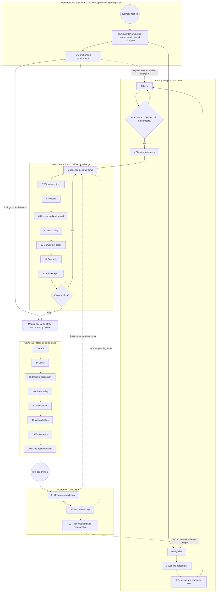

# Urazuke, the evidence method — the methodological ladder (version 4)

Author: Pablo Kuschniroff, assisted by Claude Code. Version 4, 18 October 2026. This is a working
document that I am going to keep polishing with every project that uses it; nothing it says is
closed doctrine yet, although it is, as far as I know, the first honest distillation of a method
that already has three systems in production behind it.

Before getting into the matter, a warning about how it is written, because it matters. I wrote it
for people who did not live through these projects with me: people who want to build software
with artificial intelligence and want that software to last, not people who want to learn to
program or to collect prompt tricks. That is why I take the time to explain, repeat when needed,
use everyday language, and leave at the end a **glossary** with every acronym and every colloquial
expression that slips out of me. If at some point you run into an odd word — "ratchet", "lock",
"fail-closed", "PND" — go to the glossary; it is all there. And when you read a mark like
[Ref. 26](REFERENCIAS.md#ref-26), know that it is a shortcut to a real case that I tell in the
references document, with its date and its evidence; you can ignore it without losing the thread
or follow it if the detail interests you.

The public repository of the method is
[github.com/pkuschnirof/urazuke](https://github.com/pkuschnirof/urazuke). There you will find this
document, the contracts of each step, the course manual and the references, in the eight NAC3
languages.

## The name

**Urazuke** (裏付け) is a Japanese word that names the backing a claim has: what holds it up from
behind (literally, "the lining at the back"). The verb *urazukeru* is "to back with proof". I chose
it on 17 October 2026, after discarding several names because of collisions with existing
companies and projects, and I chose it because it says exactly what the method asks for: that every
claim of the model come with its backing, and that the backing can be verified without reading the
code. The name is not translated; the subtitle, "the evidence method", is: *el método de la
evidencia*, *o método da evidência*, *la méthode de la preuve*, *die Nachweis-Methode*, *il metodo
del riscontro*, 裏付けの方法, 验证方法. In this document, "the ladder" is the structure of the
method — its twenty-four steps — and "Urazuke" is the whole method.

## What this is about

I want to be clear about what I am teaching and what I am not. I am not teaching a tool. I am
teaching a **method**: what to do in what order, what to ask the model for at each moment, what it
has to deliver to you, and how to know — without reading code — that what it delivered is complete.
The bet is that anyone, with any artificial intelligence tool that can be used for programming, can
build software by conversing with a model instead of typing the code by hand, and that what comes
out is robust, is ready for production and, this is the important part, **does not require the
project owner to review a single line of code**. And I want to be just as clear
about what it is not: it is not a process for making systems faster. It is a process for making
systems operable and maintainable without anyone needing to understand a single bit of their
code, because the code is understood and maintained by the agentic framework that writes it.
Speed, when it appears, is a consequence, and that is why there are no deadlines in this
document: the size and the complexity of each system set those, and the method only sets the
order.

It sounds ambitious, and it is. But I have something almost nobody has: three real systems that I
built exactly this way, that work today with real clients, and from which I extracted every rule
that follows. So the question I ask myself is not "can it be done?", because it has already been
done. The question is "what did I do, in what order, and which of all that is what really made the
difference?". This ladder is my answer, and it is the basis of three things: the documentation of
the method, the practice the students of the course are going to do, and the manuals. Later I am
going to export it as an execution workflow inside my tool, so that it is the tool that guides the
method and not anyone's memory.

## Where the method comes from, and what I do not want misread

There is an easy reading of all this that I want to dismantle before it settles in: that the method
is a collection of patches that I kept applying after each blow. It is not, and it matters to me to
say so precisely, because it changes how each step has to be read.

The method comes from two factors that combined, and neither of the two is enough on its own. The
first is **my own knowledge of systems engineering**. I have spent many years applying what anyone
who comes from systems recognises immediately: survey before design, written requirements, sizing
with numbers, design, construction, tests as evidence, reproducible deployment, operation, periodic
audit, documentation as part of the product. Most of what I demand in the twenty-four steps is
what I
always demanded in a well-run project. I did not invent it for the models; I brought it from
before.

The second factor is what the incidents of these five months showed me, one after another:
**where the models apply those principles in a fragile way**. A model knows perfectly well what a
test is, what a root cause is, what a sizing is; if you ask it, it explains it better than many
engineers. But in practice it says it tested and did not test, it estimates with a straight face a
figure that only the business has, it fills a gap in the business rules with whatever seemed
reasonable to it, it over-reports because it was trained to be helpful, and it builds a meter that
lies without noticing. Each of those cases, which I tell in the [references](REFERENCIAS.md), told
me exactly where to tighten: where a principle that was obvious to me needed to become an explicit
clause of the prompt, a gate, a check that I do without reading code.

So, when in a step I say "I imposed this after such-and-such incident", I am not saying that the
principle was born there. I am saying that there I confirmed that the model did not apply it on its
own, and that it had to be demanded of it in writing. The method is the systems engineering we have
always had, applied with the rigidity needed for a builder that does not get tired and that cannot
be believed without evidence. The scars are the proof of where the rigidity is needed, not the
origin of the principles.

## The three use cases of the method

Before going on, a fork that was not in the first versions and that a reader rightly asked me
for. This document describes the ladder looking at an empty folder: step 0 decides whether the
project is taken on, step 4 deploys the skeleton without functionality, step 5 opens the first
block. It is the clearest case for learning, and it is not the most frequent one. The method has
three use cases, and it is worth knowing which one you are in before opening the agent, because
it changes where you enter:

1. **New project.** An empty folder and an owner with a request. You enter at step 0 and you
   climb the twenty-four in order. It is what this document describes, with its contracts and the
   course manual.
2. **Evolutive-corrective on a system made with the method.** The system already climbed the
   ladder: it has a definition, a map, pending items closed with evidence, a suite, a deployment
   and manuals. You enter at step 5, opening a block, and you follow the loop; step 13
   periodically; step 23 at the close of each stage. It is phase 4 of the timeline (Part B).
3. **Evolutive-corrective on a system made without the method.** A system that runs, with users,
   made by somebody else or by oneself without evidence, which has to be corrected or made to
   grow. You enter neither at step 0 nor at step 5: you enter through a **normalization stretch**
   of eight stations (N0 to N7) that recovers, by autodiscovery and with source tags, all the
   inputs the start-up steps produce, builds a safety belt around the system without rewriting
   it, and only then opens the loop in corrective or evolutive mode. That path has a page of its
   own, the [evolutive-corrective path](EVOLUTIVO_CORRECTIVO.md), and it has its part of the
   course with a second guide project.

What is left out, named: a technology migration is not a use case of the method; it is a
different project, and it generally falls under the exclusionary criteria of step 0.

## AI does not interrupt the method: it continues it

This is the thesis that opens everything, and I put it first because it dismantles the most common
objection before it appears: "how are you going to trust code that a machine wrote?".

My answer is that **the industry already stopped trusting the author of the code twenty years
ago**. When the bulk of the writing moved to junior, outsourced or rotating teams, line-by-line
review became impossible to sustain. And what grew in its place was everything we take for granted
today: automated tests, continuous integration, acceptance criteria, pipelines that let nothing
through without green, the "shift left" of testing, quality control as an independent function.
That was the answer of systems engineering to "the one who writes is not trustworthy": do not read
their code, demand evidence from them.

Putting a model to write, then, is not a leap into the void. It is swapping an author we no longer
trusted for another we do not trust either, and for whom **we already had the verification
apparatus built**. That should reassure, not unsettle. And on top of that the new author is
cheaper, faster, and — unlike the junior — does not take offence when you ask it to prove red.

That is why this method leans, without disguise, on classical systems engineering. The skeleton is
the usual one. It could not be otherwise, because the problems are the usual ones: not knowing how
much data there will be, not knowing what the client wants, not knowing whether what was built is
what was asked for. AI did not change the problems; it changed who does each part and at what cost.
Even the eligibility criterion X2 of step 0 is classical engineering: testability as a condition of
contract.

### What is old and what is new in this

The old, and it is worth saying that it is old: the skeleton of stages, the independence of the one
who verifies from the one who builds, tests as evidence, documentation as part of the product, the
survey before the design.

What does change, and this is where my contribution lies, are three things:

1. **Where the human's effort goes.** In the classical method the human writes the specification,
   writes the code, and another human reviews it. Here the human does only two things: **decides,
   and verifies artefacts**. Everything else — drafting, building, testing, measuring, documenting —
   the model does. That is why every step ends in a "completeness check without reading code": it is
   the exact place where the human is still indispensable, and no other.

2. **The author also manufactures the evidence.** This is the only genuinely new point, and it is
   the nuance that justifies three whole steps. The junior wrote dubious code, but did not
   manufacture the evidence: the tests and the measurements were put together by someone else, or
   at least someone else looked at them. The model, instead, produces the code *and* the test *and*
   the meter *and* the report, in the same session, with the same confidence in its voice when it is
   right and when it is wrong. I saw it: the meter that lied twice [Ref. 36](REFERENCIAS.md#ref-36),
   the authentication error reported as "success" [Ref. 43](REFERENCIAS.md#ref-43), the three out of
   four claims that were wrong. So "review evidence instead of code" is still the right principle,
   but **the evidence has to prove itself**: the test seen red (step 8), the instrument with its
   guard (step 7), the report that separates what was verified from what is believed (step 12), the
   auditor different from the builder (step 13). It is not a new concern: it is the same discipline
   of independence of quality control, taken one step further in.

3. **The cost of the artefacts.** In the classical method documentation was expensive, so it was
   done once and aged. Here regenerating it is free, so the rule becomes "in the same commit" and
   "reproducible by hand, without AI". What used to be an unattainable ideal becomes a gate.

For the course and for the public presentation, this defines the positioning honestly: it is not
"the new way to program"; it is **systems engineering applied to a builder that does not get tired
and that cannot be believed**. To those who come from systems it sounds familiar and lowers their
distrust; to those who come from vibecoding it gives them what they do not have, which is precisely
the skeleton. And it sets me apart from the tools that sell speed and omit the whole skeleton.

---

## Part A — How to read each step

Each step has eight parts, always the same, so that they can be compared:

- **Intention**: what it seeks, in one sentence.
- **When**: at what moment of the project it is climbed, and whether it is climbed once or repeats.
  This part is new in version 4 and I explain it in detail in Part B, because a method without a
  timeline is a list of good intentions.
- **Inputs**: what has to exist beforehand to be able to climb it.
- **Artefact**: what is left written or executable when it is climbed. It is always something
  concrete: a file, a test, a script.
- **Gate**: what has to be true to move on to the next one. If it is not met, you do not climb.
- **Who decides**: the project owner, the agent, or nobody because it is automatic.
- **Failure it prevents**: the kind of problem the step prevents, with a short reference to the
  real case where I confirmed it.
- **Contract**: the file where how it is executed lives: context, prompts, result, check, warning
  signs.

Two important clarifications. First: **the ladder is neutral with respect to the tool**. Each
artefact is a file, a test or a script; none requires my tool or any other. Forge automates them
(the gates, the commands, the pending-items register), but the step exists without Forge. Second:
**the steps are numbered in the order in which they are climbed**, and they are grouped into
four stretches: steps 0 to 4 are start-up and are climbed once per project; steps 5 to 12 are the
loop that repeats with every change; steps 13 to 20 are going live, and they are climbed once,
before the first deployment; and steps 21 to 23 are operation, when the system is already alive.
Step 23 closes the cycle and returns to step 0 for the next project. Within a stretch, the number
says the order; between stretches, the loop repeats while the other three are climbed once. But
"not strictly sequential" does not mean "in any order": Part B says exactly when each one is
climbed and what happens in between.

---

## Part B — The timeline: when each step is climbed and what happens in between

This part did not exist in the previous versions, and its absence was a serious defect: the method
said what to do and how to verify it, but it did not say **when**. And "when" is half of a method.
A reader who took it literally could climb the twenty-four steps one after another and wonder at
what moment, then, the infrastructure gets done, the continuous integration and deployment chain, the
intake of the requirements, the development of the functionality, the end-to-end tests of all the
flows, the human look at the screens, and the human acceptance testing. All of that happens, and
it happens at precise moments, between the steps and inside them. Here I write it down.

### B.0 The whole process, in one diagram

Before the tables, the drawing. It is in process notation (BPMN style: round events, rectangular
tasks, diamond gateways, dotted return arrows), and it says three things the tables say worse.
First: the process **starts outside the method**, in requirements engineering, which is a
prerequisite and is also permanent: it never ends, and every new requirement comes back in.
Second: a new requirement does not enter the loop on its own; **it reinjects into the evaluation
steps**, because it can change the numbers the architecture was decided with (does it still hold
the "times ten"?), and from there onwards. Third: the process **ends in the manual execution of
the test cases** by people (step 10), and what that execution finds comes back into the loop as a
requirement. The circuit closes with people, not with machines.

If the drawing does not show (your markdown viewer does not render mermaid), the text above
describes it in full; in the HTML version it is drawn on its own.

### B.1 The five phases of a project

A project run with this method goes through five phases. The three in the middle are the ones
that correspond to the stretches of the loop, of going live and of operation; phase 1 is the
start-up stretch; and phase 0 is the initial intake, which the method also covers even though it
is not a "step" in itself. I do not give durations: they depend on the size and the complexity of
what is asked for, and a written duration turns into a false expectation. What does not depend on
the size is the order.

| Phase | Steps climbed | What else happens in that phase |
|---|---|---|
| 0. Intake | none yet; it is the raw material of steps 0, 2, 3 and 5 | Survey of the business with the owner, with the classical methods of requirements engineering (see B.5): interviews, use cases or user stories, domain model, screen prototypes. It is written in prose, incomplete on purpose; the agent completes it by asking. |
| 1. Start-up | 0, 1, 2, 3, 4 | Eligibility, agreement, definition, sizing. And **all the initial infrastructure**: the repository, the test environment, continuous integration, the first deployment with the empty system. |
| 2. Loop | 5 to 12 with every change: pending items, decisions, measure, red test, quality, manual test cases, symmetry, report | Functional development block by block; tests proved red; end-to-end tests of the flow just built; a human look at every new screen; at the close of each block, human testing in the test environment. |
| 3. Going live | 13 to 20, in order: audit, locks, chain to production, observability, persistence, vulnerabilities, performance, documentation | Audit by another session; locks on everything that acts on the world; closing the deployment chain to production with a tested rollback; the three manuals; acceptance testing with the owner over all the flows. |
| 4. Operation | 21 and 22 set up with the first deployment; 23 at the close of each stage; the loop (5 to 12) for every evolution; 13 and 18 periodically | Resident agent; audit every one or two months; every new change enters through the full loop and leaves through the deployment chain; retrospective at the close of each stage. |

This table is the one for a new project. When the system already exists and was not born with
the method, phases 0 and 1 are replaced by the normalization stretch (reading, belt, measure and
order) that is in the [evolutive-corrective path](EVOLUTIVO_CORRECTIVO.md); phases 2, 3 and 4 are
the same.

In a project with users and consequences, what grows is the loop: the functionality. Start-up,
going live and operation have the same shape in a small system and in a large one; what changes
is how much has to be measured, not what.

### B.2 What happens between step and step

Here is what was missing. For each phase, which tasks of each kind are done and at what exact
moment with respect to the steps. Read the table by rows: each row is a kind of work, and each cell
says when it is done within that phase.

| Kind of work | Start-up (steps 0 to 4) | Loop (steps 5 to 12, per block) | Going live (13 to 20) | Operation (21 to 23 and the loop) |
|---|---|---|---|---|
| **Requirements intake** | Before step 0: survey in prose with the owner, with interviews, use cases and domain model. It is completed in step 2 (definition and semantic tree) and in step 3 (volume). | When opening each block: the client's request for that block, just as they would say it, is turned into pending items with a **detailed specification** (step 5): description, acceptance criteria, applicable rules, data, screens, edge cases. The questions the agent asks are the fine intake. | Before step 14: survey of the consequential actions. Before step 15: survey of environments and access. | Every new request enters as a specified pending item, hanging from its node of the semantic tree; the resident agent collects what the users ask for. |
| **Infrastructure** | All the initial infrastructure, in step 4: repository, structure, test environment, credentials, test domain. No functionality is built until the empty skeleton is deployed. | None, unless a block demands it (a queue, an external service). If it does, it is a pending item with its test. | In step 15: production environment, secrets on the server, real domain, backups, minimal monitoring. | Infrastructure changes enter through the loop and through step 15; never "by hand, quickly". |
| **CI/CD chain** | In step 4: continuous integration runs the suite on every push from start-up, and deployment to the test environment is automatic on merge. | It works on its own. Every commit goes through it; if it is not green, the block does not close. | In step 15 it is completed: deployment to production waits for the integration result and only packages; promotion is a written procedure; the rollback is tested. | Every deployment follows the routine of step 15: test environment green with the same version, rollback ready, end-to-end check on production afterwards. |
| **Functional development** | None. The skeleton is deployed empty on purpose. | It is the centre of the loop: the agent takes a pending item (5), asks for the business rules that are missing (6), builds, and closes with evidence (7, 8, 9, 10, 11, 12). Block by block, from the basics to what has consequences. | What acts on the world (charging, sending) is built in the loop **after** step 14, with its locks, and starts in dry-run mode. | Evolutions enter through the loop. |
| **Automated tests** | One smoke test that passes, in step 4. It is the seed of the suite. | With every pending item: the test proved red (7), the regression of the neighbours in the same session, and **one end-to-end test of the flow just built**, from the screen to the backend. At the close of a block: the complete end-to-end suite of **all** the existing flows, in the test environment. | Before the first deployment to production: the complete end-to-end suite of all the flows, green, with the same version that is going to be promoted. After the deployment: an end-to-end check on production, read-only. | With every change, the same as in the loop. |
| **Human look at the screens** | At the close of step 4: the owner opens the URL of the test environment and sees the empty screen. It seems trivial and it is the first time someone who is not the agent looks at the system. | **With every pending item that touches a screen**: the agent delivers a real screenshot from the test environment and the owner looks at it. Ten seconds. It is the cheapest way to find what no test finds: that the button is where it should not be, that the text says something else, that the flow is not the one the business imagined. | In step 20: the screenshots of the user manual are the last systematic human look before production. | Every new or changed screen, the same as in the loop. |
| **Human testing** | None yet, apart from opening the empty screen. | **At the close of each functional block**: the owner, or a trusted user, uses the system in the test environment as they would for real, following the flows of the block. What they find is written down as pending items. The next block is not opened with human findings without a pending item. | Before the first deployment to production: **acceptance testing** by the owner over all the flows, with realistic test data, in the test environment. And in step 20, a person who does not program follows the recovery manual. | With every evolution, at the close of its block. |
| **Owner's decisions** | In step 0 (go or no-go), step 1 (the agreement), step 2 (what it is NOT), step 3 (the architecture option). | Every time the agent stops for an unwritten business rule (6). Usually two or three per block. | In step 14 (lock by lock), in step 15 (promote to production), in step 23 (the level of the resident agent). | Whatever comes up; always written. |

One detail I want to underline because it is where people who come from vibecoding get it wrong
most often: **the end-to-end tests of all the flows are not a single time at the end**. They are
three times, at three scales. With every pending item, the flow that pending item touched. At the
close of each block, all the flows that exist up to that point. And before production, all the flows
with the exact version that is going to be promoted. If you only do the third, you arrive at the
end with a system nobody tested end to end for weeks and the go-live turns into a week of fixes.

### B.3 The rhythm of the loop: a typical functional block

A functional block is a set of between four and eight related pending items that together do
something the business can use: "the basic schedule", "the reminders", "the monthly report". This
is what it looks like from the inside:

1. **Opening the block.** The owner tells, in prose, what they want for this block. The agent
   turns it into numbered pending items, with their "how it is verified", and asks what is not
   enough to write a verifiable pending item (step 5). The owner prioritises.
2. **Each pending item.** The agent announces which pending item it takes and why. If along the
   way a business rule appears that is not written, it stops and asks (6). If the pending item
   depends on a number — how many queries, how long it takes — it measures it first with an
   instrument with a test (7). It builds. When it finishes, it closes in this order: the test
   proved red, green, the regression of the neighbours and an end-to-end test of the flow touched
   (8); the code quality gate green (9); the manual test cases of the flow, written for a person
   (10); and, if the change touched a contract between two parts of the system, the other side
   updated in the same commit (11). The report separates what was verified from what is believed
   and declares the blind spots (12). The owner reads the report and looks at the screenshot of
   the screen. They do not read code.
3. **Closing the block.** The complete end-to-end suite green in the test environment. The owner
   or a trusted user executes the manual test cases of the block (10) and writes down what
   happened and what failed; every failure comes back into the loop as a corrective pending item.
   The quality report of the block is read (9). The user manual is updated with the new screens
   (20, in the same commit). Only then is the next block opened.

On a typical day of the loop, the owner invests between fifteen and thirty minutes: answering two
or three business-rule questions, reading two or three reports, looking at two or three
screenshots. That is all the method asks of them. If they are investing more, either the agent is
asking what it could resolve on its own (step 1), or the owner is reading code (and then something
in step 8 or step 12 is not working).

### B.4 The human milestones

I summarise in a list the moments when a human, the owner or someone they trust, has to look at or
use the system. They are few, they are at precise moments, and none can be delegated to the agent:

- **End of start-up**: open the URL of the test environment and see the empty system.
- **With every pending item that touches a screen**: look at the real screenshot from the test
  environment.
- **At the close of each block**: execute the manual test cases of the block (10) in the test
  environment and write down the result; what fails comes back into the loop as a requirement.
- **Before the first deployment to production**: acceptance testing over all the flows, following
  all the manual test cases.
- **In step 20**: a person who does not program follows the recovery manual in the test
  environment.
- **After every deployment to production**: verify that the version running is the intended one,
  and do a read-only pass through the critical flows.
- **Before the first deployment, in step 19**: read the numbers of the load test with the
  business's tolerance alongside, and the breaking point.
- **In every monitoring cycle (21 and 22)**: read the cyclic report with the agent and decide
  which deviation and which error become pending items.

Everything else — the tests, the measurements, the audits, the documentation — the model does, and
the human verifies it by the artefact, not by the code.

### B.5 How requirements come in: from the survey to the semantic tree and to the pending items

I want to dwell on this because it is where classical systems engineering has the most to say and
where vibecoding ignores it most enthusiastically. A requirement is not a sentence from the client
in a chat. It is a sentence from the client **processed** by methods that have existed for decades
and that still hold with a model at the front, because the model is very good at applying them if
you ask it to and very bad at applying them if you do not.

The methods I use, and that the method demands in every phase:

- **Interviews with the owner**, open, in prose, recorded. They are phase 0. I do not try to make
  them complete: I try to get the agent to detect what they lack.
- **Use cases or user stories**, one per flow the business can name: "the receptionist books an
  appointment", "the patient receives the reminder". Each has actor, trigger, steps, outcome and
  exceptions. They are the unit with which a functional block is opened.
- **Domain model**: the business entities, their attributes, their possible states and the
  transitions between states. It is the heart of the semantic tree (see below) and what prevents
  the model from inventing states the business does not have.
- **Acceptance criteria** per story, in the form "given such a situation, when such a thing
  happens, then such a result is seen". They are what become the "how it is verified" of each
  pending item and, later, the end-to-end test.
- **Screen prototypes**, even if they are a drawing. The human look at the screens starts here,
  before any code exists.
- **Traceability**: every requirement can be followed to the pending item that implements it, the
  test that proves it and the commit that closed it. In the method, traceability is not a separate
  matrix: it is the pending item itself, which cites its origin and its evidence.

**The semantic tree.** It is the artefact that orders all this and it is the map the agent reads in
every session (step 2). It is a tree, not a list: the system at the root; below, the domains or
modules; below each one, its actors, its processes (the use cases), its entities with their states,
its screens and its external integrations; and hanging from each node, the pending items that touch
it and the decisions that affect it. The agent builds it from the survey, you correct it, and it
grows with every block. Its value is twofold: it gives the model the exact context of the node it
is going to touch without having to read the whole project, and it gives you a way to verify that
the system the agent understands is the one the business asked for, without reading code. When a
pending item hangs from no node, either the tree is incomplete or the pending item is out of scope;
both things are seen in ten seconds.

**The detailed specification lives in the pending item.** In the classical method there was a
requirements specification document, long, that aged. Here that document is decomposed: each
pending item carries its own complete specification, and the sum of the pending items is the
specification of the system. A well-written pending item has: title; the node of the semantic tree
it hangs from; the story or use case that originates it, with the client's words; the detailed
description of what is asked for; the applicable business rules, with their decision and their
date; the data that goes in and out; the screens affected, with the prototype if there is one; the
edge cases and the exceptions; the acceptance criteria; and how it is verified. The agent drafts it
from your request in prose, asks what is not enough to specify, and you read it before it is built.
Reading a pending item's specification is the closest you are going to get to reading code, and it
is exactly the right distance.

**Closed pending items are documentation.** This is what closes the circle. When a pending item is
closed, it is not deleted or filed away empty: it stays with its specification, the decision that
originated it, the evidence it was closed with (the counts of the red and the green, the screenshot
of the screen, the measured number), the commit, and the date. The queue of closed pending items is,
then, the functional history of the system: what was built, why, when, and how it was tested. From
there come the changelog, the new sections of the user manual and, when someone asks six months
later "why does the system do this?", the answer. The course manual teaches to demand this
documentation at the close of every pending item, in the same session, as part of the routine of
step 5.

---

## Part C — The twenty-four steps

They go in the order in which they are climbed. The six operational quality steps (16 to 19
before the first deployment; 21 and 22 afterwards) are the ones I used to do without naming them:
making the system possible to **see** while it runs, making it hold the volume it was sized for,
making sure it has no known holes, and making sure that, once in production, nobody finds out
about a problem from an angry user. The two monitorings end up in the same place as everything
else: the loop, as corrective pending items. If you are a beginner, each of those six contracts,
and the ones of steps 9 and 10, begins with a paragraph that explains its words in everyday
language, and the glossary has them all.

### Step 0 — Can this project be run this way? (eligibility)

There is something prior to everything, which is in no repository because it always arrived
already decided: the decision of **whether a project is run with this method or not**. It is a
criterion I lived in my head for months and that I am finishing writing down. The two exclusionary
criteria I already have clear, and they come from the projects I rejected, not from the ones I
accepted [Ref. 46](REFERENCIAS.md#ref-46): the "no"s define the frontier better than the "yes"es.
The weighted criteria I am still calibrating, and I mark them as such.

- **Intention**: decide whether a project is run with this method, and with an agent at the front,
  or not, BEFORE opening the repository. Because if you enter a project that does not qualify, the
  method degrades to "programming with AI" and there the owner does end up reading code.
- **When**: once only, before anything else. If the system already exists, this step is climbed
  in its version for legacy systems
  (station N0 of the [evolutive-corrective path](EVOLUTIVO_CORRECTIVO.md)), with four more
  criteria and X2 measured screen by screen.
- **Inputs**: the client's request, the business domain, the data, the technology, the available
  environments, and who is going to be the owner.
- **Artefact**: a one-page eligibility sheet, with the criteria scored and the decision: go, no-go,
  or go under conditions.
- **Gate**: the exclusionary criteria are all green, and the score of the weighted ones exceeds the
  threshold (a threshold I have not defined yet).
- **Who decides**: the owner. Today it is me; the idea is that the method allows another person to
  decide it with the same sheet.
- **Failure it prevents**: getting into a project where the agent cannot verify itself on its own,
  or where there is no domain owner who decides, and ending up with the human reviewing code line
  by line.
- **Contract**: `peldanos/peldano-00-elegibilidad.md`.

**The two exclusionary criteria.**

| # | Exclusionary criterion | Why it kills the method |
|---|---|---|
| X1 | Legacy technology without an accessible repository, or with repositories that do not follow a standard | Without a standard repository there is nowhere to leave the evidence: no pending items cited in the commits (step 5), no tests travelling with the code (7), no integration and deployment as a package (13), no documentation in the same commit (14). The agent works blind and leaves no verifiable trace. |
| X2 | Technology that cannot be tested end to end: the screens cannot be executed and each element of the interface accessed with its different methods, validating that the change reached the backend | Without that screen-to-backend verification the agent cannot test itself (steps 8, 9 and 10), and then the owner would have to read code, which is precisely what the method promises to avoid. |

A precision that is worth gold for tool neutrality: **NAC3 (the protocol my tool uses so that
screens can be operated by program) is NOT a condition; it is the means with which I achieve it
today**. The neutral criterion reads like this: the interface can be executed by program, and each
element of the screen is accessible with its different methods (click, type, read its state), so
that a test can walk the screen and then verify the effect in the backend. A technology whose
interface does not expose its elements to a "driver" (like Playwright, for example) is out, even if
it has a repository.

And a reading I find important: at bottom, X1 and X2 are **the same condition seen from two sides**.
The agent has to be able to verify itself on its own, end to end, and leave the evidence in the
repository. X1 is the half "where does the evidence stay?"; X2 is the half "how is the evidence
produced?".

`[hypothesis]` **Weighted criteria, still without weight.** I leave them marked as hypotheses until
I calibrate them with the first projects that use the method end to end.

| # | Candidate criterion | How it showed up in the cases | Exclusionary? |
|---|---|---|---|
| D1 | There is a domain owner with judgement and with time to decide (not to program) | in the three systems, with the decisions written with their date | `[?]` |
| D2 | There is an "oracle" of verifiable truth: real data, an external system, production read-only | the Health Fund and its Authorizer as oracle [Ref. 26](REFERENCIAS.md#ref-26) | `[?]` |
| D4 | The technology is within what the agent masters without inventing (Node, Python, SQL, React) | the three | `[?]` |
| D5 | An error has a real consequence (money, health, operations), which justifies fail-closed | the Health Fund (health, charges), the Association (families) | `[?]` |
| D6 | The volume can be known from day one | Kikan: 3.4 million rows per year [Ref. 15](REFERENCIAS.md#ref-15) | `[?]` |
| D7 | The client tolerates a maturing period and a human in the loop | the auto-approver with dry-run mode [Ref. 28](REFERENCIAS.md#ref-28) | `[?]` |
| D9 | The scope fits in one repository and one owner | the three | `[?]` |
| D10 | Secrets and access can be isolated (vault, environment file, bounded permissions) | the API key mapped to whoever created it [Ref. 13](REFERENCIAS.md#ref-13) | `[?]` |

Two criteria I had in previous versions (that the agent can test on its own, and that the project
is new or auditable) I absorbed into X2 and X1 respectively, because they are consequences and not
separate criteria.

### Step 1 — The working agreement (the rules before the code)

Before writing a single line, put in writing how you and the agent are going to work. It seems a
formality, and it is not: it is what prevents eighty per cent of the frustrations of month one.
Think that the agent arrives every morning with no memory of yesterday; whatever is not written you
are going to have to repeat every time, and every time a little differently.

- **Intention**: fix how the human and the agent work before the first line of code.
- **When**: once only, immediately after eligibility. It is revised when a blow demands it.
- **Inputs**: nothing from the project; it is the first file. From you: your working preferences.
- **Artefact**: a quality standards document that says, at a minimum: the human's time is sacred
  (it is not spent on things the agent can resolve on its own); zero technical debt, that is, when
  something breaks it is fixed at the root and the regression is added in the same session; the
  scope is exact, no more and no less than what was asked; the user's language is spoken;
  documentation is updated in the same commit; and never is something announced as done that was
  not done.
- **Gate**: the agreement is in the repository and is read in every session.
- **Who decides**: the owner. The agent can propose changes, but does not edit the agreement on its
  own.
- **Failure it prevents**: the agent that "helps" by expanding the scope because it seemed a good
  idea; the one that leaves debt "for later" (and later never comes); and the one that reports as
  done what it *believes* it did. I wrote it for the first time when I had spent two weeks repeating
  the same thing in every session [Ref. 1](REFERENCIAS.md#ref-1).
- **Contract**: `peldanos/peldano-01-contrato-de-convivencia.md`.

### Step 2 — The project definition and the mandatory reading

Every session of the agent starts from zero. Give it a map, short, and force it to read it before
touching anything. The two halves matter equally: a map nobody reads does not act, and a long map
nobody reads.

- **Intention**: that every session start knowing what the project is, what state it is in and
  which decisions have already been made.
- **When**: it is written once, after the agreement; it is kept up to date
  throughout the project, with every new decision.
- **Inputs**: the agreement (step 1) and the business survey.
- **Artefact**: an operational project file, and here goes an emphasis: SHORT. It is the programme,
  not the history. Plus the **semantic tree** of the system (see B.5): domains, actors, processes,
  entities with their states, screens and integrations, with the pending items and the decisions
  hanging from each node. Plus a living-state file with what is being worked on and the open
  doubts.
- **Gate**: the agent reads the project file and the semantic tree before touching code, and it was
  proved that it reads them.
- **Who decides**: the owner defines; the agent keeps it up to date.
- **Failure it prevents**: two, quite concrete. Throwaway work for not having read the map
  [Ref. 9](REFERENCIAS.md#ref-9). And the project file that grows until it becomes unreadable
  [Ref. 41](REFERENCIAS.md#ref-41): the operational file and the casebook have to be different
  files.
- **Contract**: `peldanos/peldano-02-definicion-y-lectura.md`.

### Step 3 — Size before designing the architecture

This is the step that costs the most to skip, and I know it because I skipped it. Structural
decisions are made with numbers, and the primary numbers are held by the business, not by the
model.

- **Intention**: that structural decisions (which database engine, whether the interface is
  synchronous or asynchronous, how much concurrency) are made with numbers and not with taste.
- **When**: once, before building the skeleton; it is redone if the business
  changes scale. Half a page and one decision in a small project.
- **Inputs**: a volume data survey done with the business, incomplete by nature; and read access to
  the previous system if one exists. There is data that **only the business has** and the model
  cannot infer: that is why the prompt demands that it evaluate whether the data is complete and ask
  for what is missing, instead of estimating it with a straight face.
- **Artefact**: a sizing record with FIXED options (three or four concrete options) and the chosen
  one; and the "asymmetric" decisions declared explicitly, for example "the persistence interface
  is asynchronous from line one even if the first engine is synchronous", because if you are wrong
  it costs little and if you do not do it it costs a fortune.
- **Gate**: the sizing is recorded before building the skeleton.
- **Who decides**: the owner chooses among the fixed options; the agent presents them with numbers.
- **Failure it prevents**: starting with a storage that cannot take the volume and discovering it
  when changing the interface costs a whole stage of re-engineering
  [Ref. 15](REFERENCIAS.md#ref-15).
- **Contract**: `peldanos/peldano-03-dimensionar.md`.

### Step 4 — The skeleton with its gates

Before the system does anything useful, it has to start, be tested and be deployed EMPTY. Yes,
empty. Because the path to production is part of the product, and the only way to know it works is
to walk it when there is still nothing to lose. This is the step where **all the initial
infrastructure and the integration and deployment chain** are done, and that is why it is the
longest of the start-up stretch.

- **Intention**: have a system that starts, is tested and is deployed with no functionality yet.
- **When**: once, at the end of start-up, after the sizing and before any functionality. It
  is the close of the start-up stretch.
- **Inputs**: the sizing (step 3), the environments survey, and the credentials of the place where
  it is going to be deployed.
- **Artefact**: the skeleton with continuous integration green, the test structure set up with one
  smoke test, a deployment to a test environment that works and was run twice, and the gates of the
  workflow declared in writing.
- **Gate**: the skeleton is green, continuous integration runs, and the deployment to the test
  environment works with zero functionality. The owner opened the URL and saw the empty screen.
- **Who decides**: the agent executes; the owner approves visually.
- **Failure it prevents**: discovering the deployment a month after start-up and paying five pending
  items in a row to make it work, with functionality at stake
  [Ref. 32](REFERENCIAS.md#ref-32).
- **Contract**: `peldanos/peldano-04-esqueleto.md`.

### Step 5 — The plan is the pending items

Here is an idea that, once you grasp it, you never let go of: there is no "plan" on one side and
"task list" on the other. **The list of pending items IS the plan.** And every pending item says
how it is verified, because that is what you are going to look at instead of looking at the code.

- **Intention**: a single work queue, ordered and gated, that is the truth of the project.
- **When**: it is created when opening the first functional block, as soon as start-up ends; it is
  used in every session throughout the project. Every new block starts by turning the client's
  request into pending items.
- **Inputs**: the client's request for the block, the audits, and the findings of human testing.
- **Artefact**: a register of numbered pending items, each with its **detailed specification** (see
  B.5): the node of the semantic tree it hangs from, the origin story with the client's words, the
  description, the applicable business rules, the data, the screens, the edge cases, the acceptance
  criteria and how it is verified. And, on closing, the **documentation of the pending item done**:
  the evidence, the commit, the date, what was decided along the way. Closed pending items are the
  functional history of the system.
- **Gate**: no change goes in without a specified pending item; and the pending item is closed with
  documented evidence, not with "done".
- **Who decides**: the owner prioritises; the agent proposes and executes in order.
- **Failure it prevents**: the specification that "gets overtaken" and is obsolete in two weeks
  [Ref. 17](REFERENCIAS.md#ref-17); and the work that six months later nobody knows why it was done
  [Ref. 7](REFERENCIAS.md#ref-7).
- **Contract**: `peldanos/peldano-05-pendientes.md`.

### Step 6 — Decisions are written next to the code

The model, when it finds a gap in the business rules, fills it. It does not stop to ask; it
completes with what seems most likely to it, with the same naturalness with which it writes
everything else. That is why this step is not "write down the decisions" but "demand that it stop
and ask when one is missing", and when you decide, the decision stays with your words, your name
and the date.

- **Intention**: that every domain rule or structural decision have an owner, a date and a place.
- **When**: in every session of the loop, every time the agent runs into an unwritten rule. Usually
  two or three per functional block. Also in start-up (steps 0 and 3) and in go-live (12 and 13).
- **Inputs**: the conversation with the owner. It is the only input.
- **Artefact**: the decision written in the commit and in a decisions register, with the exact
  words. If the owner did not answer and the agent had to choose, it is marked as a "decision by
  omission" to be reviewed.
- **Gate**: a business rule does not enter the code without its origin sentence.
- **Who decides**: the owner. Always. No exceptions.
- **Failure it prevents**: arguing six weeks later about why something is the way it is; and, worse,
  the agent inventing domain rules because they seemed reasonable to it. The practice of writing
  the rule in the commit with date and owner comes from the Health Fund
  [Ref. 29](REFERENCIAS.md#ref-29), and that of freezing decisions before building, from my tool
  [Ref. 5](REFERENCIAS.md#ref-5).
- **Contract**: `peldanos/peldano-06-decisiones.md`.

### Step 7 — Measure before building, with an instrument that is itself verified

This is, for me, the most grown-up step of all, and the one that took me longest to formalise
because I took for granted that a model would apply it on its own. It does not. The rule is: no
number that decides anything comes from an impression; it comes from a meter that lives in the
repository, that has a test, and that you can run. And the meter is verified too, because meters
lie.

- **Intention**: that every number that feeds a decision come from an instrument with a test, and
  that the instrument itself be audited.
- **When**: in the loop, every time a pending item depends on a number or on a hypothesis of cause,
  BEFORE building. In start-up, the sizing is the first case. In a small project, "measuring" is
  counting with a command and writing the number down with the date.
- **Inputs**: the hypothesis, from the owner or the agent, and access to what is to be measured.
- **Artefact**: the guarded meter in the repository; the number with its command and its date; the
  two-direction audit; what is approximate marked; and, if applicable, a budget per path tightened
  to the measured value and protected by a test.
- **Gate**: the five rules: guarded meter; if the instrument does not exist, it is built; it is
  audited in two directions; what is approximate is marked; and the one who executes verifies the
  numbers of the one who planned.
- **Who decides**: the number. The owner brings the hypothesis; the agent measures it before
  building.
- **Failure it prevents**: the meters that lied and the plan with three out of four numbers wrong
  [Ref. 36](REFERENCIAS.md#ref-36); the ratchet at zero that did not see 84 calls
  [Ref. 35](REFERENCIAS.md#ref-35). I wrote the rules myself, in session, before they were doctrine
  [Ref. 45](REFERENCIAS.md#ref-45).
- **Contract**: `peldanos/peldano-07-medir.md`.

### Step 8 — Tests as locks, proved red

A test you never saw fail, you do not know whether it proves anything. That is why here the rule is
not "write tests"; it is "demonstrate that the test turns red against the old code, then green, and
then that the regression stays green". And the end-to-end tests, from the screen to the backend,
are what replace your reading of the code.

- **Intention**: that every behaviour that matters have a test that FAILS if it breaks, and that it
  be known with certainty that it fails.
- **When**: with every pending item of the loop, when closing it. The end-to-end test of the flow
  touched, in the same close. The complete end-to-end suite, at the close of each block and before
  every deployment to production.
- **Inputs**: the change already implemented and the pending item with its "how it is verified".
- **Artefact**: the new test, the red output as a receipt (the command, the version it ran
  against, the counts, the exit code: what it takes to run it again with one command), the green
  output with counts, the regression of the neighbours in the same session, and the commit that
  says what it was proved red against.
- **Gate**: red demonstrated with a receipt, green, regression green. And the agent does not mock
  precisely the part it wants to test.
- **Who decides**: the agent executes and reports; the owner reads the report, not the test.
- **Failure it prevents**: tests that pass because they prove nothing, and the green that hides a
  bug [Ref. 44](REFERENCIAS.md#ref-44). The case of the counters is the complete example of a test
  proved red against the old criterion [Ref. 26](REFERENCIAS.md#ref-26).
- **Contract**: `peldanos/peldano-08-tests-en-rojo.md`.

### Step 9 — Code quality verified by machine, with a gate

The owner does not read the code, and that is the point. But somebody is going to maintain the
code, and code that works today and is unreadable tomorrow is debt that gets charged in month
three. If nobody reads it, a machine has to look at it: on every commit, what a human reviewer
would look at, turned into a number with a limit. I did it in all my projects without naming it
as a step.

- **Intention**: that the quality of the code be verified by machine on every commit, with the
  build in red as the consequence, and that it never degrade on its own.
- **When**: it is set up when the first functional block opens and it runs on every push; every
  pending item is closed with quality green, after the red test (8); the report is read with the
  owner at the close of each block. In a legacy system, the first run is the baseline.
- **Inputs**: continuous integration (4), code from at least one closed pending item, and the
  limits decided by the owner (file and function size, to begin with).
- **Artefact**: a linter and a formatter with a single configuration; size and complexity limits;
  detection of duplication and dead code; coverage with a ratchet; types if the language allows
  it; `docs/CODE_QUALITY.md` with every limit and its measured value; the gate in
  `docs/GATES.md`. As an optional reinforcement, mutation testing (bugs planted on purpose,
  counted by how many the tests catch), with its score per block next to the coverage.
- **Gate**: nothing is merged with quality red; no linter exception without a written reason; no
  limit raised in order to pass.
- **Who decides**: the owner sets the limits and decides what gets fixed now and what gets
  tolerated with a date; the agent measures and fixes in the same commit.
- **Failure it prevents**: the component of more than two thousand lines and the file of almost
  ten thousand that an audit found because no limit had stopped them
  [Ref. 41](REFERENCIAS.md#ref-41); the quality number that gets worse without anyone seeing it
  [Ref. 35](REFERENCIAS.md#ref-35).
- **Contract**: `peldanos/peldano-09-calidad-de-codigo.md`.

### Step 10 — Manual test cases are written together with the functionality, and people execute them

The automated tests are written and run by the model, and they test what the model understood.
What is missing is the test a person does with their eyes and their hands, following a script.
The script is written by the same one who built the functionality, at the same moment, out of the
acceptance criteria; people execute it at the close of each block, in the acceptance and after
every deployment; and what fails comes back into the loop as a requirement. It is the closing of
the circuit the process diagram shows.

- **Intention**: that every piece of functionality be born with its manual test case, written for
  a person who does not know how the system is built, and that every human execution reinject
  what fails as a pending item.
- **When**: with every pending item, when closing it, after the red test (8) and quality (9).
  Execution by people at the close of each block, before the first deployment (acceptance) and
  after every deployment, read-only.
- **Inputs**: the acceptance criteria of the pending item (5), the test environment with data,
  and the decision of who executes and when.
- **Artefact**: `docs/MANUAL_TESTS.md` with one case per flow touched (identifier, pending item,
  precondition, steps with what is done and what is seen, expected result with a backend effect
  verifiable by a person, data, execution table); the executions recorded; one corrective pending
  item per failure.
- **Gate**: no pending item that touches a screen is closed without its case; no execution
  without a date and a name; no failure without a pending item carrying the person's words.
- **Who decides**: the owner or a trusted user executes; the agent writes the cases and opens the
  pending items; the model never marks a case as executed.
- **Failure it prevents**: the human test without a script that finds different things every
  time, and the human finding that gets fixed on the spot and is lost; the awkward drop-down
  menu that no test saw and the manager did, in the course's guide project.
- **Contract**: `peldanos/peldano-10-casos-de-prueba-manual.md`.

### Step 11 — Producer/consumer symmetry, and the anti-pattern register

When you change one end (the server, the database, a robot), the other end (the screen, a counter,
a report) has to change in the same commit. The principle that holds it up is that **every list has
a single owner**. And the mistakes you already paid for once are written down with their automatic
check, so as not to pay for them twice.

- **Intention**: that a change at one end drag the other along, always, in the same commit.
- **When**: with every pending item that touches a contract between two parts of the system; the
  contracts map is built when opening the second functional block, when there is already a screen
  and a server; the anti-pattern register grows every time something breaks for the second time.
- **Inputs**: the map of who produces and who consumes each contract; the anti-pattern register.
- **Artefact**: the server defines the list and the consumer reads it; the producer/consumer map;
  the anti-pattern register with smell, root cause, fix and early detection.
- **Gate**: automatic: the agent looks for the other side before considering a change closed.
- **Who decides**: nobody; it is automatic.
- **Failure it prevents**: the counter that does not match the query [Ref. 26](REFERENCIAS.md#ref-26);
  two copies of the same module that drift apart [Ref. 41](REFERENCIAS.md#ref-41). The
  single-source solution I imposed at the Health Fund [Ref. 27](REFERENCIAS.md#ref-27).
- **Contract**: `peldanos/peldano-11-simetria-y-antipatrones.md`.

### Step 12 — Honest verification and proportional reporting

If you are not going to read code, the agent's report has to be trustworthy, and that does not
happen on its own. The model was trained to be helpful and complete, and a report that says "I
could not verify this" feels less helpful than one that says "done". So demand explicitly the bad
news, the blind spots and what it did not do.

- **Intention**: that the agent's report be trustworthy without the owner reading code.
- **When**: in every report, of every pending item, throughout the project. It is the shape
  everything the agent tells you has to have.
- **Inputs**: the work done and the pending item that asked for it.
- **Artefact**: a report with three blocks: verified (with the proof next to it), believed (and why
  it was not tested), blind spots (what it cannot see from where it is). It covers every item
  asked for. Bad news first.
- **Gate**: no claim without its proof. "Done" is not said on its own. Faced with a "still broken",
  first the published version is compared with the one that has the fix.
- **Who decides**: the owner trusts, or asks for the proof. Never reviews code.
- **Failure it prevents**: the error reported as success and the reports that declared verified
  what was not [Ref. 43](REFERENCIAS.md#ref-43); the turn that worked invisible for an hour and
  forty-three minutes [Ref. 16](REFERENCIAS.md#ref-16). I wrote the verification-honesty rule in
  June [Ref. 8](REFERENCIAS.md#ref-8).
- **Contract**: `peldanos/peldano-12-verificacion-honesta.md`.

### Step 13 — The periodic audit as input to the plan

Every so often the whole system has to be looked at with fresh eyes, and what is seen does not go
to a report that gets filed: it goes to the queue of pending items. The important part is "fresh
eyes": that someone who did not build audits, because the one who built shares their own
assumptions. Another session of the model, with another instructions file, is enough.

- **Intention**: look at the complete system every so often and turn what is seen into pending
  items.
- **When**: mandatory before the first deployment to production (it opens the go-live stretch). In
  operation, every one or two months depending on the pace of change, and at the close of each big
  stage.
- **Inputs**: the whole repository and production read-only.
- **Artefact**: a report with graded findings, each with location, risk, evidence and priority;
  grades per dimension; and the urgent findings already turned into pending items.
- **Gate**: every urgent finding has an open pending item before the audit is considered closed.
- **Who decides**: the owner prioritises the findings.
- **Failure it prevents**: queries that read whole tables [Ref. 18](REFERENCIAS.md#ref-18); two
  administrator doors that nobody saw until someone else looked
  [Ref. 40](REFERENCIAS.md#ref-40); a known vulnerability and an enormous component
  [Ref. 41](REFERENCIAS.md#ref-41).
- **Contract**: `peldanos/peldano-13-auditoria.md`.

### Step 14 — Fail-closed, locks and zero silent harm

On doubt or failure, the system does NOT act. And it says so. It sounds obvious, but it is the
opposite of what software does by default, which on doubt carries on. This step goes **before**
building the functionalities that act on the world, not after.

- **Intention**: that the system, on doubt or failure, not act, and warn.
- **When**: in the go-live stretch, before building any functionality that charges, sends, approves
  or deletes; it is revised with every new consequential action. New automations start in dry-run
  mode and are enabled after looking at their log for a few days.
- **Inputs**: the survey of consequential actions, done with the owner.
- **Artefact**: the locks table: each action with its reversibility, its lock, its way back; one
  test per lock proved red; new automations in dry-run mode.
- **Gate**: every irreversible action has a lock and a documented way back.
- **Who decides**: the owner approves lock by lock; the system never skips them.
- **Failure it prevents**: a double charge, an automatic approval without going through a human,
  the deletion of the client's data. The Health Fund's locks are the model
  [Ref. 28](REFERENCIAS.md#ref-28); the reflex of not breaking the whole listing, too
  [Ref. 25](REFERENCIAS.md#ref-25).
- **Contract**: `peldanos/peldano-14-fail-closed.md`.

### Step 15 — Continuous integration, environments, secrets and deployment as part of the product

Reaching production has to be a reproducible package: the tests run ONCE, the deployment only
packages and uploads, the configuration lives on the server and not in the repository, and the
rollback is tested. A good part of this already exists from the skeleton; this step completes it
towards production.

- **Intention**: that reaching production be a reproducible package, with the tests run a single
  time and the configuration outside the repository.
- **When**: the integration chain and the deployment to the test environment are set up in step 4.
  The close towards production — real environment, secrets, promotion, tested rollback, lock
  against secrets — is done in the go-live stretch, after the audit and the locks. The routine of
  every deployment applies throughout operation.
- **Inputs**: the survey of environments and access; the skeleton with its integration.
- **Artefact**: continuous integration that runs the suite once per commit; the deployment that
  waits for that result and only packages; the configuration only on the server; the promotion
  procedure written and repeatable; the rollback tested; the check that prevents uploading a
  secret.
- **Gate**: test environment green with the same version before touching production; rollback
  tested; no secret in the repository or in the chat without rotation.
- **Who decides**: the owner promotes to production; the agent prepares everything.
- **Failure it prevents**: tests run three times per commit and the quota burned
  [Ref. 39](REFERENCIAS.md#ref-39); the deployment hardened blow by blow with pending items for
  having discovered it late [Ref. 32](REFERENCIAS.md#ref-32); secrets pasted in the chat
  [Ref. 42](REFERENCIAS.md#ref-42).
- **Contract**: `peldanos/peldano-15-ci-entornos-secretos-deploy.md`.

### Step 16 — Total observability and traceability, with a configurable level

When something fails in production I want to follow an action from the screen to the database with
a single identifier, without opening the code; I want to be able to raise the detail of the log
records in production in a minute, without redeploying; and I want every consequential action to
leave a trace the application cannot delete.

- **Intention**: that the system can be seen while it runs (observability) and that every
  important action has its trace (traceability), with a level of detail that is changed by
  configuration.
- **When**: in the go-live phase, after step 15 and before step 19. In a legacy system, the
  minimum level goes into the safety belt (N4) and the complete one here. The rule "every new
  module logs and propagates" applies throughout operation.
- **Inputs**: the configuration per environment (13), the table of locks (12), the list of
  personal data from the survey, and the decision about where the log records live.
- **Artefact**: structured log records with a level configurable without deploying; a correlation
  id in every record, from the screen to the database; an immutable audit trail of the
  consequential actions; health and metrics endpoints; `docs/OBSERVABILITY.md`.
- **Gate**: one real identifier followed through every layer; the level changed without deploying;
  no personal data in the log records.
- **Who decides**: the owner decides where the log records live, how long they are kept and what
  is personal data; the agent builds.
- **Failure it prevents**: the process that stayed alive for an hour and forty-three minutes and
  was found through the log [Ref. 16](REFERENCIAS.md#ref-16); the resident agent that operates
  blind if there are no records to read [Ref. 13](REFERENCIAS.md#ref-13).
- **Contract**: `peldanos/peldano-16-observabilidad-y-trazabilidad.md`.

### Step 17 — Optimization of the persistence layer, measured before and after

The database is where systems die slowly: fine with a hundred records, badly with a hundred
thousand, and nobody knows when it started. Here it is decided with numbers, before production,
and with the method of step 7: measure, change, measure again on the same data.

- **Intention**: that the real queries of the system, at the volumes of the sizing, fit within
  what the business tolerates, with budgets that stop them from going out of range again.
- **When**: in the go-live phase, after step 16 and before step 19; it is repeated when a block
  adds a large table or the monitoring (20) shows a query out of range. In a legacy system, the
  measurements come out of N6 and almost everything is paid "when touched".
- **Inputs**: the sizing (3 or N6), the producer/consumer map (8), the observability (16), and the
  test environment loaded at the expected volume.
- **Artefact**: query meters with a test; `docs/PERSISTENCE.md` with the before and after table per
  change, the budgets per path and the retention per table; one test per budget.
- **Gate**: no query that reads a whole table in a critical flow; every budget with its test; the
  slowest screen within what the sizing expected.
- **Who decides**: the owner approves the list of changes, one by one; the agent measures and
  applies.
- **Failure it prevents**: the queries that read whole tables on a live system
  [Ref. 18](REFERENCIAS.md#ref-18); the budget that had to be tightened to the measured value
  [Ref. 37](REFERENCIAS.md#ref-37); millions of rows on top of files
  [Ref. 15](REFERENCIAS.md#ref-15).
- **Contract**: `peldanos/peldano-17-persistencia.md`.

### Step 18 — Scanning and fixing vulnerabilities, in the chain and on a schedule

The audit (11) looks at the whole system with judgement, every so often; this step looks at a
single thing, security, all the time and by machine: dependencies, code, secrets in the history
and the server's configuration. And one rule: a dependency upgrade is a change, and it comes in
through the loop.

- **Intention**: that no known vulnerability reaches production, and that new ones are detected on
  their own even if nobody touches the system.
- **When**: in the go-live phase, after step 15 and before the first deployment; afterwards, on
  every push and with a weekly schedule. In a legacy system, the first run is part of N3.
- **Inputs**: continuous integration (4 and 13), the survey of environments, the previous audit,
  and the owner's criteria about what is urgent.
- **Artefact**: the four-layer scan running in the chain and on a schedule;
  `docs/SECURITY_[date].md` with the findings and what was not scanned; `docs/SECURITY.md` with the
  policy; the gate in `docs/GATES.md`; the P0s and P1s fixed with their pending item.
- **Gate**: no open P0 is promoted to production; a new P1 opens a pending item on its own.
- **Who decides**: the owner defines what a P0 is and approves the fixes; the agent sets it up and
  runs it.
- **Failure it prevents**: the known vulnerability that showed up in the quality audit
  [Ref. 41](REFERENCIAS.md#ref-41); the administrator doors that only another session saw
  [Ref. 40](REFERENCIAS.md#ref-40); security treated as a list you tick once
  [Ref. 23](REFERENCIAS.md#ref-23).
- **Contract**: `peldanos/peldano-18-vulnerabilidades.md`.

### Step 19 — Performance tests at volume and the breaking point

Step 3 sized the system with calculations; this one checks the calculations with the system
running: at the expected volume, at "times ten", and until something breaks. The breaking point is
the most useful number of the stretch, because the alert thresholds of step 21 come out of it.

- **Intention**: to know how the system behaves at the expected volume, at "times ten", and where
  and why it breaks, before the first user comes in.
- **When**: in the go-live phase, after steps 16 and 17, before the first deployment; it is
  repeated before every deployment that changes the architecture, the persistence or a critical
  flow. In a legacy system, with the volumes measured in N6.
- **Inputs**: the sizing, the observability switched on, the optimized persistence layer, the
  critical flows and the business's tolerance for the most used screen.
- **Artefact**: the load script in the repository, with a test; `docs/PERFORMANCE_[date].md` with
  the three runs, the breaking point and the diagnosis; `docs/PERFORMANCE.md` with the thresholds
  and the gate; one pending item per bottleneck.
- **Gate**: the most used screen within the tolerance at the expected volume, or a pending item
  with the number; the breaking point written down with what breaks.
- **Who decides**: the owner gives the tolerance and decides up to which volume the bottlenecks
  get fixed now.
- **Failure it prevents**: the real load that was only known by looking at production
  [Ref. 12](REFERENCIAS.md#ref-12); the breaking point that disguised itself as a failed test
  [Ref. 44](REFERENCIAS.md#ref-44); the sizing as a gate
  [Ref. 14](REFERENCIAS.md#ref-14).
- **Contract**: `peldanos/peldano-19-rendimiento-y-punto-de-ruptura.md`.

### Step 20 — Living documentation and manuals a person can follow without AI

The system has to be usable, maintainable and recoverable without the agent and without you. If on
the day there is no agent it cannot be deployed, it is not finished. And since regenerating
documentation with a model is free, the rule becomes "in the same commit".

- **Intention**: that the system can be used, maintained and recovered without the agent and
  without the builder.
- **When**: the user manual grows with every functional block, at the close, with the new screens.
  The three complete manuals are generated in the go-live stretch, after step 15, and the test with
  a person who does not program is done before the first deployment. The same-commit routine rules
  throughout operation.
- **Inputs**: the system running in the test environment; the artefacts of steps 14 and 15.
- **Artefact**: the user manual with real screenshots, the maintenance manual, and the
  infrastructure and recovery manual written for a person who has to do it by hand at three in the
  morning; each with date and version.
- **Gate**: the documentation is up to date in the same commit; someone who does not program
  followed the recovery manual.
- **Who decides**: the agent maintains; the owner reads the manual, not the code.
- **Failure it prevents**: the outdated document that caused a commit in the wrong repository; the
  project file turned into history [Ref. 41](REFERENCIAS.md#ref-41). The manuals reproducible by
  hand are the Health Fund's [Ref. 24](REFERENCIAS.md#ref-24).
- **Contract**: `peldanos/peldano-20-documentacion-viva.md`.

### Step 21 — Monitoring of resources, functions and queries out of range, with a cyclic report

The tests of step 19 say how the system behaves on one day; production is every day, with the data
growing. This step watches resource usage and the response time of every function and every query
against the thresholds of step 19 and against its own history, warns when something goes out of
range, and produces a cyclic report that is read with the owner. Every deviation is a pending item.

- **Intention**: to see a resource or performance problem before the user sees it, and to have
  every deviation carry a cause or a pending item.
- **When**: it is set up with the first deployment to production; from then on it runs on
  its own, and the report is read every cycle (weekly with consequences, monthly in a small
  project). In a legacy system, the first reading is the baseline.
- **Inputs**: the metrics of step 16, the budgets of step 17, the thresholds of step 19,
  production read-only, and the channel and the cycle decided with the owner.
- **Artefact**: collection with history; alerts by threshold and by deviation; the cyclic report
  generated on its own; `docs/MONITORING.md`; the reading routine in the agreement.
- **Gate**: a provoked alert reached the channel; the first report has every deviation with a cause
  or a proposal; no threshold went up without a written reason.
- **Who decides**: the owner decides the channel, the cycle and which deviation is attended to now;
  the agent sets it up and proposes.
- **Failure it prevents**: the ceiling that had to be tightened to the measured value
  [Ref. 37](REFERENCIAS.md#ref-37); the quota that was burned without anybody looking
  [Ref. 39](REFERENCIAS.md#ref-39).
- **Contract**: `peldanos/peldano-21-monitoreo-de-recursos-y-rendimiento.md`.

### Step 22 — Error monitoring and cyclic report: no error without a pending item

A system in production produces errors nobody reports. This step captures them in the three places
where they hide (the backend, the jobs, the user's browser), groups them, warns about the new ones
and the ones that grow, and produces a cyclic report. Two rules: no error without a pending item,
and there is no such thing as a "known error" without a pending item that says why it is tolerated
and until when.

- **Intention**: that no error in production goes unseen, and that each one is closed with the test
  that reproduces it in red.
- **When**: it is set up with the first deployment, together with step 21; from then on
  it runs on its own, with alerts at the moment and a cyclic report. In a legacy system, the errors
  that already existed on the first day turn into pending items with their speed mark.
- **Inputs**: the log records of step 16, the table of locks (12), production with the browser
  included, the channel and the cycle of step 21.
- **Artefact**: centralized and grouped capture, without personal data; alerts for a new error, for
  a recurring one that grows and for one with consequences; the cyclic report with the error rate
  per flow; `docs/MONITORING.md`; the routine in the agreement.
- **Gate**: an error provoked in the browser followed through to the report; no recurring error
  without a pending item or a reason with a date.
- **Who decides**: the owner reads the report and decides what is attended to; the agent captures,
  groups and proposes.
- **Failure it prevents**: the authentication error reported as a success
  [Ref. 43](REFERENCIAS.md#ref-43); the four rounds to the root cause for not having the error
  reproduced [Ref. 22](REFERENCIAS.md#ref-22).
- **Contract**: `peldanos/peldano-22-monitoreo-de-errores.md`.

### Step 23 — The agent inside the system, and the retrospective with numbers

The last step has two parts that close the same cycle. First: the agent stays resident in
production, with a bounded scope, acting on behalf of a person. Second: the method itself is
reviewed with numbers, and what is learned returns to step 0 for the next project.

- **Intention**: that the agent stay resident in production with a bounded scope, and that the
  method be reviewed with numbers.
- **When**: the resident agent, on entering operation, after the first deployment to production.
  The retrospective, at the close of each stage and of the project; it is mandatory even if it is
  one page.
- **Inputs**: the system in production, the incidents, the costs.
- **Artefact**: the resident agent's document with its map of the system, its scope, its credential
  in a person's name and the proof that what is outside the scope is rejected; and the
  retrospective with sourced numbers, every incident mapped to a step, and at least one concrete
  proposal to change the ladder.
- **Gate**: the agent cannot do what the owner did not approve; the retrospective produces at least
  one change to the ladder.
- **Who decides**: the owner.
- **Failure it prevents**: the agent that operates without a map; and the method that repeats
  itself unchanged project after project without learning. The retrospective with numbers that
  killed the multi-agent crew is the model [Ref. 6](REFERENCIAS.md#ref-6); the resident agent, the
  Health Fund's [Ref. 13](REFERENCIAS.md#ref-13).
- **Contract**: `peldanos/peldano-23-agente-residente-y-retrospectiva.md`.

---

## Part D — How it is executed, how much is demanded, and with which tool

### How each step is executed: the contract

The eight-part card says what each step seeks, when it is climbed and what it leaves. But a step is
fully understood only when you see **how it is asked for, what has to come back and how I know it
came back complete**. That is why each step has, besides the card, a **contract** in a file of its
own inside `peldanos/`, always with the same five sections:

1. **Required context**, named generically ("volume data survey", "read access to the previous
   system", "the list of actions with real consequences"), without going down into the detail of
   systems engineering. Surveys are incomplete by nature; I do not try to make them complete with a
   form.
2. **Prompts**, the ones given to the model, verbatim. The opening one and, when the step is a
   conversation, the closing one. All carry the same clause, which is the heart of the matter: *the
   model evaluates whether the context is enough; if it is not enough, it asks for everything that
   is missing before going on; and it does not estimate or invent a figure that only the business
   has*. The one who knows what it lacks in order to compute is the model, not a form. And every
   prompt comes preceded by a block that says **"Before sending the prompt"**: the files and the
   inputs that you (or the business with you) have to have built before pasting it, with their
   name, their content and the minimum acceptable state. The prompt names them; the block tells
   you how they have to be made. Without that block, the prompt mentions files that nobody told
   you how to write.
3. **Expected result**: the detailed characteristics of the artefact.
4. **Completeness check**: the list of checks the owner does on the artefact, **without reading
   code**. If one gives "no", the step is not climbed.
5. **Warning signs**: two or three symptoms that the step was climbed badly even though it seems
   climbed.

And in the header of each contract: the stretch, the when, the form and the size (whether it is
mandatory in every project or proportional).

**The prompts are in English, and each one comes with its translation.** It is a decision I made
for three reasons: the same content in Spanish takes between 30 and 50 % more tokens; the models'
ability to follow instructions is better calibrated in English, so a prompt in English tolerates
brevity better without becoming ambiguous; and the vocabulary of the trade (test, commit, rollback,
mock) is English. But I do not want English to be a barrier to reading the method: below each
prompt goes the explanation of what I am asking for and why each clause is there, and in the HTML
version there is a button that shows the prompt translated into the document's language. The prompt
that gets pasted to the model is the English one; the translation is for you to understand it. And
they all end with "Reply in my language", because the prompt is in English but the conversation
does not have to be.

### What is mandatory and what is proportional, by project size

A question that comes up right away: "all this for a small system?". The answer is that
twenty-four steps are not twenty-four long stages; several are climbed in one session, and the
ones that are proportional shrink with the project. What does not shrink is the list of the ones
that are not negotiable. This table is a `[hypothesis]` proposal to confirm with the first
project that uses the method end to end:

| Step | Small project (one owner, few users, no money at stake) | Project with users and consequences |
|---|---|---|
| 0 Eligibility | mandatory | mandatory |
| 1 Agreement | mandatory | mandatory |
| 2 Definition | mandatory, fifty lines are enough | mandatory |
| 3 Sizing | mandatory, half a page and one decision | mandatory, complete |
| 4 Skeleton | mandatory if it is going to have users | mandatory |
| 5 Pending items | mandatory | mandatory |
| 6 Decisions | mandatory | mandatory |
| 7 Measure | proportional: count and write down | mandatory, with meters and budgets |
| 8 Tests proved red | mandatory | mandatory |
| 9 Code quality | minimum: a linter and a size limit in the chain | mandatory, complete, with a coverage ratchet |
| 10 Manual test cases | mandatory: one case per flow, executed by the owner at the close of each block | mandatory, with the execution recorded in every cycle |
| 11 Symmetry | the rule yes; the map, optional | mandatory with map |
| 12 Honest verification | mandatory | mandatory |
| 13 Audit | one, before production | periodic |
| 14 Fail-closed | optional if it is read-only | mandatory |
| 15 Integration and deployment | minimum: tests on their own, configuration outside, rollback | mandatory, complete |
| 16 Observability and traceability | minimum: structured log records with a configurable level and one identifier per action | mandatory, complete, with an immutable audit trail |
| 17 Persistence | proportional: the indexes of the real queries and the end of the N+1 loops | mandatory, with budgets per path |
| 18 Vulnerabilities | mandatory: dependencies and secrets in the chain | mandatory, the four layers and on a schedule |
| 19 Performance | proportional: one run at the expected volume and one at "times ten" | mandatory, with a breaking point and thresholds |
| 20 Documentation | minimum: recovery | the three manuals |
| 21 Monitoring of resources | minimum: one monthly report and two alerts (disk, database) | mandatory, with thresholds per function and a weekly report |
| 22 Error monitoring | mandatory: centralized capture and report | mandatory, with alerts at the moment |
| 23 Resident and retrospective | one-page retrospective | both |

In summary: there are thirteen steps that are not negotiable in any project (0, 1, 2, 3, 5, 6, 8,
9 at its minimum, 10, 12, the dependency scan of 18, the error capture of 22 and the
retrospective of 23), and eleven that are sized with the project.

### How it is used with any tool

The method is tool-neutral; what changes from one tool to another is **where each artefact is put**
so that the model reads it. The correspondence, for the most used tools at the end of 2026:

| Artefact of the method | Claude Code | Cursor | Codex CLI / Gemini CLI | Forge |
|---|---|---|---|---|
| Working agreement (S1) and routines (S5, S6, S8, S9, S10, S11, S12, S20) | the project's `CLAUDE.md` | `.cursor/rules/` | `AGENTS.md` / `GEMINI.md` | doctrines injected per gate |
| Project definition (S2) | `CLAUDE.md` + `docs/STATUS.md` | same, in rules and docs | same | `PROJECT.md` + context file |
| Pending-items register (S5) | `docs/PENDING.md` or issues | same | same | native pending-items register with verbs |
| Step prompts (all) | pasted into the chat when climbing the step | same | same | injected when the gate is crossed |
| Gates (S4) | `docs/GATES.md`, manual | same | same | G1 to G9, automatic |
| Meters and budgets (S7) | scripts in the repo with tests | same | same | same, plus the static ratchet |

The Forge column is the one that automates the most; the other three work just as well if the
owner does by hand what Forge does on its own: paste the step's prompt at the right moment and
demand the completeness check before moving on to the next. That is, in fact, the practice of the
course.

---

## Part E — What remains to be elaborated

1. **Step 0 complete**: the weights of the weighted criteria, the threshold, and more rejected
   projects as counterexamples. I have X1 and X2; the rest is missing.
2. **A memorable name for each step**, in one sentence, for the manuals and the publications.
3. **The export to Forge**: which steps are already gates or commands and which are missing to be
   able to run the ladder as an execution workflow.
4. **Test the contracts in a real project end to end.** The prompts of the twenty-four
   contracts are written from what I did, not executed as-is. The first project that uses them
   in full is going to correct several; it is part of step 23.
5. **The first cohort of the course**, which is going to correct the order of the timeline where
   it is needed and the typical mistakes, which today are written from my projects and not from
   students.
6. **The evolutive-corrective path proved on a real legacy system end to end.** The eight
   stations are written from what I did on other people's systems in diagnostic mode and from the
   steps reordered, not from a complete normalization executed with those prompts.
7. **What is NOT on the ladder and should be** `[hypothesis]`: the management of token cost and
   quotas as an explicit budget (today it is reactive); secret rotation as a routine and not as an
   incident; and a criterion for when the human DOES have to look at the code, because today the
   answer is "never" and I suspect there are specific moments when it is worthwhile.

---

## Part F — Related work: what exists that is similar, and how this method differs

When I finished writing the ladder I asked myself the obvious question: does this already exist
under another name? I asked for a thorough investigation, in English, in Spanish and in Japanese,
of methodologies, essays and academic papers published up to October 2026 on building software
with artificial intelligence. What follows is the result, summarized honestly: what is already
elsewhere I cite instead of claiming it, and what I did not find I say as "I did not find it", not
as "it does not exist". This part is going to keep growing as new things appear, and they appear
every week.

The short answer: **I did not find any published method that brings together what this one brings
together**. I did find an entire field that, since mid-2025, converges on several of its pieces
separately, and a celebrated practitioner who arrived at the same radical premise three months
before I published this.

### F.1 The closest relatives

| Who and what | What it shares with Urazuke | What it lacks |
|---|---|---|
| **Robert C. Martin ("Uncle Bob"), July 2026.** In a thread on X and in his repositories ([Acceptance Pipeline Specification](https://github.com/unclebob/Acceptance-Pipeline-Specification), [SwarmForge](https://github.com/unclebob/swarm-forge)) he announced that he does not read the code his agents write: he surrounds them with a "gauntlet" of acceptance tests in Gherkin, unit tests, complexity limits, mutation testing and a QA procedure he runs by hand every so often. "You cannot tell an agent to be clean; you have to measure the cleanliness it produces." | The human does not read code. He reviews the specification before and the evidence after. The barriers are mechanical, not promises. A final manual test. | He is a programmer with forty years of craft, not an owner who does not program: he builds the barrier with that judgement. There is no ordered ladder, no path for a legacy system, no operation, no published prompts. Grady Booch replied to him that metrics do not see a vulnerability or a bad factoring. |
| **old-coder, "evidence-first development"** ([repository](https://github.com/AmazingAng/old-coder)). A skill for agents inspired by Uncle Bob: SPEC, RED, GREEN, REFACTOR, GAUNTLET, EVIDENCE. | The human approves the test plan and then reads an evidence report that is rerun with one command; never the code. | One task at a time. No project, no legacy, no operation, no requirements engineering. |
| **Disciplined Agentic Engineering** ([repository](https://github.com/swingerman/disciplined-agentic-engineering)). A kit with nine checkpoints, explicit exit criteria and twenty-one deterministic scripts as gates. | "An agent can talk itself into skipping an instruction; it cannot talk itself into skipping a non-zero exit code." Verification independent of whoever implemented. | Meant for engineers. No operation and no monitoring; the legacy case is reduced to a skill for bugs. |
| **Tsumiki / AITDD, by Classmethod (Japan), July 2025** ([repository](https://github.com/classmethod/tsumiki)). Requirements, design, tasks, and then `tdd-red`, `tdd-green`, `tdd-refactor`, `tdd-verify-complete`, with reverse-engineering commands for existing code. | The red and the green as separate and mandatory commands; verification as a step of its own; a path for the inherited; literal prompts; tool-neutral. | It does not require the meter to have a test, it has no verified, believed and blind-spot report, and it does not reach production or monitoring. |
| **Addy Osmani, "Brownfield Agentic Engineering" and "Agentic Verification", September and October 2026** ([brownfield](https://addyo.substack.com/p/brownfield-agentic-engineering), [verification](https://addyo.substack.com/p/agentic-verification)). | "Pin the behaviour first, then let the agent loose": characterization as the preliminary step, almost identical to station N4 of the evolutive-corrective path. "Write the check before the code." Ratchets that prevent deleting tests. | The human reads the diffs. It is a conceptual sequence, not a numbered list. No prompts. |
| **Consort, by Databricks, September 2026** ([arXiv 2609.09671](https://arxiv.org/abs/2609.09671)). A deterministic orchestrator outside the model; immutable tests inside a unit of work; green demanded against a real database. | Real fail-closed. "A control the worker can ignore is not a control when the worker is non-deterministic." | Limited to the backends of one platform. No ladder, no legacy, no operation. |
| **IACDM, March 2026** ([arXiv 2604.16399](https://arxiv.org/abs/2604.16399)). Eight phases; verifiers external to the generator; the gate is enforced by a state machine: the agent can request to advance, not grant itself the advance. | The ladder shape with gates and audit by another instance; tool-neutral. | Eight phases against twenty-four steps; no legacy, no security, no load, no operation. |
| **"Trustworthy Change" and the human-agent cell, September 2026** ([arXiv 2609.04630](https://arxiv.org/abs/2609.04630)); **SDAD**, May 2026 ([arXiv 2608.20341](https://arxiv.org/abs/2608.20341)); **Agentic Agile-V**, May 2026 ([arXiv 2605.20456](https://arxiv.org/abs/2605.20456)). | The same division of authority: the agent produces evidence, the human keeps acceptance. Agentic Agile-V names "evidence-based acceptance" and says the agent demands more requirements engineering, not less. | They are conceptual frameworks or coarse life cycles, not procedures with prompts; the human is technical. |
| **AI-DLC, by AWS, 2025** ([article](https://aws.amazon.com/blogs/devops/ai-driven-development-life-cycle)). Inception, Construction, Operations, with human gates. | It is the only large method that reaches operation. | Three coarse phases; no typed evidence; the human is a technical team. |
| **Spec Kit, by GitHub, 2025** ([repository](https://github.com/github/spec-kit)) and the spec-driven development family: Kiro, BMAD, OpenSpec, GSD, Agent OS, Tessl. | Persistent artefacts, phase order, textual prompts, requirements first, traceability. OpenSpec looks quite a lot like "the pending items are the plan". | Nobody requires the red before the green; the legacy case is a light guide; almost all of them end at the merge. BMAD organizes the work as a team of agents with roles; in Forge I used that model, I left it at a time when the teams were losing context, and today I see it has improved: it is permanent evolution, not a discard. |
| **Reversa, May 2026** ([arXiv 2605.18684](https://arxiv.org/abs/2605.18684), [repository](https://github.com/sandeco/reversa)). Agents that recover specifications from a legacy system with confidence marks: confirmed, inferred, gap. | It is almost station N0 of the evolutive-corrective path: the functionality described from the code, with source marks. Documentation in Spanish and Portuguese. | It recovers specifications, not behaviour. It does not use characterization as a hard barrier before touching anything. |
| **Harness Engineering, by OpenAI, February 2026** ([article](https://openai.com/index/harness-engineering/)) and **StrongDM's Software Factory** ([Stanford study](https://law.stanford.edu/2026/02/08/built-by-agents-tested-by-agents-trusted-by-whom/)). Company cases: zero lines written by hand; at StrongDM, not reviewed either. | The radical premise of taking the human away from the keyboard. | The humans are still engineers. StrongDM replaced the pass-or-fail with a score given by another model: exactly what this method forbids (a number that feeds a decision is measured with a program that has its test). |
| **Kent Beck, "Augmented Coding", June 2025** ([newsletter](https://newsletter.kentbeck.com/p/augmented-coding-beyond-the-vibes)). A complete system prompt that imposes red, green and refactoring. | The red before the green, literally, and the prompt published in full. "The AI cheats." | Beck reads the code and intervenes. It is session discipline, not project discipline. |
| **Harper Reed, "My LLM codegen workflow", February 2025** ([article](https://harper.blog/2025/02/16/my-llm-codegen-workflow-atm/)). Specification by questions one at a time, a plan of prompts, execution; a branch for the inherited. | Textual prompts, one question at a time, a branch for the legacy. | Three steps, no gates; the author reads. |
| **Anthropic, best practices and harness design** ([practices](https://code.claude.com/docs/en/best-practices), [harness](https://www.anthropic.com/engineering/harness-design-long-running-apps)); **OpenAI, PLANS.md** ([cookbook](https://developers.openai.com/cookbook/articles/codex_exec_plans)). | "If you cannot verify it, do not ship it." A QA agent distinct from the one that builds drives the application from the screen. "Observed results, not planned predictions": the closest thing to verified versus believed. | Loose practices, tied to a product. No non-programming owner, no legacy, no operation. |
| **Essays on verification, 2026**: Peter Lavigne, João Queirós, Mihai Avram, John Young ([Queirós](https://www.ai.joaoqueiros.com/blog/read-less-code-verify-ai-generated-software-test-harnesses), [Avram](https://mihaisplace.com/blog/ai-can-write-the-code-who-verifies-it), [Young](https://jyoung.dev/blog/evaluating-ai-coding-agent-output/)). | The same diagnosis: generating got cheap, verifying did not. "Tests are assertions, not proofs." Verification layers by level of risk. | They all end in "read less, but read". |
| **In Spanish**: Daniel García (functional document, technical document, implementation with adversarial analysis between phases), Víctor Robles (a ten-step course), Daniel Primo (Web Reactiva), Emilio Carrión (a reply to Uncle Bob from Mercadona Tech, [article](https://www.emiliocarrion.com/en/blog/letting-go-of-the-wheel)). | García has the closest thing to the audit between phases. | None of them has evidence gates or an owner who does not read. I did not find any Argentine, Mexican or Spanish method in this space. |

### F.2 What already exists, and is better cited than claimed

The red before the green imposed on the agent is in Beck, in Tsumiki, in Anthropic's practices and
in Simon Willison's 2026 patterns. The ordered steps with textual prompts are in Spec Kit, in
Tsumiki and in Reed. Characterization as the step before touching a legacy system is in Osmani,
published one month before this document. The end-to-end test from the screen, with an evaluator
distinct from the generator, is in Anthropic. Requirements engineering as a prerequisite is in the
whole spec-driven development movement. And the human who does not read the code is in Uncle Bob,
in Karpathy for throwaway work, and in the book by Yegge and Kim.

### F.3 What I did not find anywhere

- **The addressee.** All the literature assumes an engineer who reviews. Uncle Bob does not read
  code because he has forty years of judgement with which to build the barrier. This method starts
  from the owner who never reads, and derives everything else from that constraint. That inversion
  is not posed in any work. What there is for the non-programmer is documentation of the damage: a
  June 2026 study of 9,041 applications made with "vibe coding" tools found vulnerabilities in
  91 % of the ones audited ([arXiv 2606.23130](https://arxiv.org/abs/2606.23130)).
- **The verified, believed and blind-spot report as a mandatory deliverable** (step 12). The
  problem is diagnosed with numbers: an agent's declaration of completeness exceeds real approval
  by 28 to 38 points ([SpecHarness, arXiv 2609.29921](https://arxiv.org/abs/2609.29921)), and
  losing the "unverified" label in a handoff between agents shoots the approval of risky actions
  up from 5 % to 60 % ([arXiv 2609.20211](https://arxiv.org/abs/2609.20211)). Nobody turned it
  into an accountability format addressed to a person.
- **The meter with its own test** (step 7). The rule "a number that feeds a decision is measured
  with a program that has its test" is not written in any source I found.
- **The complete ladder**, from eligibility to monitoring and the retrospective. The longest one I
  found has ten steps; almost all of them end at the merge; only AI-DLC and Osmani touch on
  operation.
- **No deadlines as a rule** (D-030). It is not answered; it is absent.
- **The combination.** Those who do not read code do not test with rigour (Ronacher, Yegge). Those
  who test with rigour read (Beck, Osmani, Hashimoto, GitHub). Uncle Bob and old-coder break that
  crossing, and they do it per task, not per project.

### F.4 The objection that has to be answered, and how I answer it

Birgitta Böckeler measured, in August 2026, that asking an agent for the test-first cycle does not
reliably improve quality, because the agent sometimes fakes the red or implements before the test
so that it passes from the start ([martinfowler.com](https://martinfowler.com/articles/exploring-gen-ai/tdd-in-the-agent-loop.html)).
The only thing that, in her study, told the tests that watch from the tests that decorate was
mutation testing. Another study from the same year shows that a model endorses a third of its own
errors ([arXiv 2605.21537](https://arxiv.org/abs/2605.21537)), and another, that a clean session
plus a different model find more errors than two sessions of the same model
([arXiv 2610.01471](https://arxiv.org/abs/2610.01471)).

It is a serious objection, and I take it. The method's answer has three pieces (D-033). In step 8,
the red is a **receipt**, not a story: the exact command, the version it ran against, the count of
failures and the exit code, pasted as they came out, so that the owner can run it again with one
command and does so, once per block, with a pending item chosen at random. In step 13, the audit
by another session reruns a sample of those receipts. And in step 9, mutation testing comes in as
an optional reinforcement, recommended in every project with users, with its score at the close of
every block next to the coverage. None of the three pieces requires the owner to read code. All
three make faking the red cost more than running it.

A useful frame for placing this method on the map is Macedo's taxonomy, from June 2026
([arXiv 2606.04967](https://arxiv.org/abs/2606.04967)): six dimensions (specification, context,
roles, execution, validation, portability), and the finding that none of the frameworks it
compared covers all six at once, with a structural trade-off between depth of process and
portability. Urazuke aims at all six, and its bet on exact prompts in English plus tool
neutrality is, precisely, the attempt to break that trade-off.

---

## Glossary

Every acronym, every proper name and every colloquial expression that appears in this document,
explained. In alphabetical order. Some entries are terms that appear in file names or commit
messages of the source repositories; I keep them so that the evidence can be followed.

**Acceptance criteria** — The conditions, written in the form "given such a situation, when such a
thing happens, then such a result is seen", that define when a requirement is met. In the method
they are the "how it is verified" of each pending item and the script of the end-to-end test.

**Acceptance testing** — The tests the owner, or a trusted user, does using the system as they
would for real, before accepting it for production. They are human; the agent does not do them.

**Agent** — An artificial intelligence program that does not just answer questions but executes
actions: reads files, writes code, runs commands, makes commits. In this document, "the agent" is
Claude Code or whichever tool you use.

**Alert** — An automatic warning, at the moment, that a number has gone out of range (a
threshold exceeded, a new error). Rule of the method: an alert that fires and nobody reads is a
defect of the alert, and it gets fixed or removed.

**Anonymisation** — In this document the real clients are called "the Health Fund", "the
Authorizer" and "the Association", and their systems "Autorizaciones" and "Kikan". It is on
purpose: the names are withheld until I have permission to use them.

**Anti-pattern** — A way of doing things that seems reasonable but is known to end badly. The
opposite of a "pattern" (a proven good practice).

**Artefact** — Something concrete that is produced: a file, a test, a script, a document. On the
ladder, every step leaves an artefact.

**Association (the)** — What I call in this document the client of the Kikan system (its real name
is withheld): a civil association that serves families and needed an omnichannel service desk and
campaigns.

**Asynchronous / synchronous (async / sync)** — A synchronous call waits for the result before
going on; an asynchronous one leaves the task running and goes on, and collects the result later.
Real databases in Node are asynchronous; that is why the interface has to be so from the start.

**AUD-\*** — The series of numbered audits that were done in Kikan in August, and that generated
pending items.

**Authorizer (the)** — What I call the Health Fund's system that receives the orders and returns a
verdict (approved, rejected). For us it works as an "oracle": the truth against which the counters
are verified.

**Auto-approver** — In Autorizaciones, the robot that approves orders automatically according to
rules. It first ran in "dry-run mode" (see dry-run) before letting it act.

**Autodiscovery** — On the evolutive-corrective path, the way to obtain the inputs nobody
wrote: the agent recovers them by reading the system itself (the code, the database schema, the
configuration, the logs, whatever documentation there is) and tags every statement with its source
(`[code]`, `[database]`, `[configuration]`, `[documentation]`, `[inferred]`, and `[business]` for
what the owner confirmed). What cannot be read is marked as a gap, not filled in.

**Autopilot** — A written mandate for the agent to work on its own for hours (24 or 48), making
commits and pushes without asking, and deliver a summary at the end.

**Autorizaciones** — The name I give to the first system in production (the real one is withheld):
automation of the handling of the Health Fund's orders for a health entity, with a human in the
loop.

**await** — In JavaScript, the word that means "wait for the result of this asynchronous call". A
call to the database without `await` is a silent bug: the code goes on before it has the data.

**Backend** — The part of the system that is not seen: the server, the logic, the database. The
opposite of "frontend" (the screen).

**Baseline** — What a number had normally been giving (for example, the average of the last
fourteen days). "Out of range" in step 21 is above a fixed threshold or very different from the
baseline.

**Board (the)** — Forge's shared board where the agent leaves reports for me to read.

**Breaking point** — The exact load at which something in the system stops working, and what
that something is (the database connections, the memory, a queue). It is found by raising the load
step by step (step 19), and the alert thresholds of step 21 come out of it.

**Characterization (test)** — A test that captures what the system does today, exactly as it
does it, defects included; not what it ought to do. It is born green, and the proof that it is
useful is that it goes red when the flow is broken on purpose (a mutation). It is the suite that
protects a legacy system while it is being changed. The term comes from the literature on legacy
code; I use it as it is.

**CI (continuous integration)** — A service (here, GitHub Actions) that runs the tests
automatically every time code is pushed. CI/CD adds automatic deployment.

**CLAUDE.md / PROJECT.md** — The file the agent reads when starting each session to know what the
project is and how to work in it.

**Claude Code** — Anthropic's tool with which I worked on these projects and with which I wrote
this document: a session of a model with access to the repository, which reads, writes, executes
and makes commits.

**Closed pending item (documentation of what was done)** — A pending item that, on closing, keeps
its specification, the decision that originated it, the evidence it was closed with, the commit and
the date. The queue of closed pending items is the functional history of the system.

**Code quality (verified by machine)** — What a human reviewer would look at in the code,
measured by tools on every commit and turned into a number with a limit: style (linter and
formatter), size of files and functions, complexity, duplication, dead code, coverage with a
ratchet, types. Step 9. It does not replace the red test: it prevents correct code that nobody
can ever touch again.

**Commit** — A saved point in the history of the code, with a message that explains what changed
and why. Each commit has a short identifier (for example `2219f7a`).

**Complexity (of a function)** — How many different paths a function can take; every "if"
increases it. A function with forty paths is understood by nobody, and step 9 puts a limit on it.

**Concurrency** — How many things happen at the same time in the system (simultaneous users,
parallel processes).

**Connection pool** — The number of "open lines" the system keeps with the database at the same
time. If it runs out, the actions wait or fail; it is usually the first thing to break in a load
test.

**Correlation id** — A unique number given to each action when it starts (a click, a nightly job,
a message that arrives) and that travels attached to everything that action provokes, down to the
database and the external calls. Searching for that number in the log records brings up the
complete story of the action. It is the centre of step 16.

**CORS** — A security mechanism of browsers that decides from which domains a server can be
called. Misconfigured, it blocks legitimate calls with confusing errors.

**Coverage (of tests)** — What percentage of the code is executed by some test. In the method
it is measured with a ratchet: today's is tomorrow's floor (step 9). It measures quantity, not
quality: that is why it goes together with the demonstrated red of step 8.

**CVE** — A public identifier of a known security vulnerability in a software component.

**Cyclic report** — The summary the monitoring (21 and 22) generates on its own every week or
every month, with the deviations and the errors of the period, and that the owner reads with the
agent in order to decide what becomes a pending item. The opposite of an alert: it is read calmly.

**Discrepancy** — In the reading of an inherited system, a point where the code, the database,
the documentation and what the business believes the system does do not agree. It is listed with
the evidence on each side and the owner decides it, one by one: sometimes the system is wrong, and
sometimes the business had forgotten a rule the code remembered.

**Doctrine** — In Forge, a short document that fixes how something is done (how to test, how to
verify, how to size). It is the form the method takes inside the tool.

**Driver (criterion)** — A factor that pushes a decision one way or another. In step 0, the drivers
are the factors that decide whether a project is eligible.

**Dry-run (dry-run mode)** — Running a process "dry": it does everything except the final action.
The auto-approver ran like this at the beginning, showing what it would have approved without
approving anything.

**Embedded (embed)** — Forge installed inside the client's system, as a resident assistant, with
bounded permissions.

**End to end (E2E)** — Testing the complete system, from the screen to the database, as a person
would use it.

**Environment** — A separate installation of the system. The usual ones: development (the
programmer's machine), UAT (client testing) and PROD (production, the real one).

**Error rate per flow** — Out of every hundred times somebody used a flow (booking an
appointment), how many failed. It is the number of the error report (22) that the owner
understands without an explanation.

**Evolutive-corrective path** — The third use case of the method: taking a system that already
exists and was not born with the method, normalizing it without rewriting it (eight stations, N0
to N7) and only then climbing the ladder in corrective mode (fixing what fails) or evolutive mode
(adding what is missing). It has a page of its own.

**Fail-closed** — "Fails closed": on doubt or error, the system does not act. The opposite of
"fail-open", which on doubt carries on.

**Fallback (to legacy)** — Going back to an old path when the new one fails. The method forbids
it: if there is an old system, it is audited and migrated; it is not left as a silent safety net.

**Fixture** — Test data loaded before running a test or a deployment.

**Flip (switch)** — A configuration change that chooses between two paths (for example, the old
engine or the new one) without touching code.

**Forge (Yujin Forge)** — The tool I built: a layer on top of Claude Code that adds the method to
it (doctrines, gates, pending items, a chat panel, a mobile app, and the embedded mode).

**Frontend** — The visible part of the system: the screens.

**Full scan** — A database query that reads the whole table because it has no index to help it.
With small tables it is not noticed; with millions of rows, it brings the system down.

**Functional block** — A set of between four and eight related pending items that together do
something the business can use. It is the unit of work of the loop; it lasts as long as its size
demands.

**G-DOC** — In Forge, the gate that demands that documentation be updated in the same commit as the
change.

**Gate** — A condition that has to be met to be able to move forward. If it is not met, you do not
pass. In Forge they are numbered G1 to G9.

**gate-ci** — The job in Kikan's deployment that waits for continuous integration to finish green
before packaging.

**GCP** — Google Cloud Platform, the cloud where the servers of the Association's two systems run.

**GOTCHAS** — A file that records known "traps": mistakes we already paid for once, with their
smell, their root cause, their fix and how to detect them earlier.

**Greenfield / brownfield** — A new project from scratch (greenfield) versus one that starts from
something existing (brownfield).

**Grep** — A command that searches for text in files. "A meter, not grep" means: an important
number is not obtained by counting with a text search, but with a program with a test.

**Guarded meter** — A script that measures something (how many queries, how many loops) and that
has its own test verifying that the meter measures correctly. "Guarded" means "protected by a
test".

**Hard way (the)** — Learning something because it went wrong, not because someone explained it
beforehand. I use it in the sense of "these rules were learned the hard way", and in this document I
clarify that it is not the whole truth: the principles I brought from before; the blows showed
where the model does not apply them.

**Health Fund (the)** — What I call the health entity that is the client of the first system in
production (its real name is withheld).

**Heap** — The memory a program uses. "The suite was dying by heap" means that the tests were
running out of memory and it looked as if they were failing.

**HITL (human in the loop)** — A design where a person approves before the system acts. In
Autorizaciones, the manual approver.

**Human look at the screens** — The habit of the owner looking at a real screenshot of every new
or changed screen, in the test environment, with every pending item that touches it. Ten seconds
that find what no test finds.

**Index** — An auxiliary structure of the database that makes a search fast. Without an index, the
query is a full scan.

**Index (database)** — Like the index of a book: a structure the database maintains in order to
find rows without reading the whole table. Without an index, the query does a *full scan*. Indexes
are derived from the real queries, they are not guessed (step 17).

**Injection** — A vulnerability in which what a user writes into a form ends up interpreted by the
system as an order (for example, a query to the database). The static analysis of step 18 looks
for it; the test proved red of the fix demonstrates that it no longer passes.

**IPC (inter-process leash)** — A channel between two processes. In Forge it was used as a
"leash": if the parent process dies, the child finds out and shuts down.

**JSON (storage in)** — Keeping the data in text files in JSON format instead of in a database. It
works to get started; it does not work for millions of rows.

**Kikan** — The Association's omnichannel service desk and campaigns system, the second system in
production.

**Latency** — How long an action takes to respond. You look at the median (half of the actions
took less) and the 95th percentile (95 % took less; the remaining 5 % are the users who complain).
Steps 19 and 21.

**Legacy** — An old system that is still in use.

**Lie (a meter)** — When an instrument returns a wrong number because it does not see part of what
it has to measure. It happened to us twice.

**Linter / formatter** — The linter is a program that reads the code and marks what is badly
written or dangerous, like a spell checker; the formatter arranges it with a single style. Both
run on every commit in step 9.

**Load test** — A program, kept in the repository and with its test, that simulates many users
using the system at the same time in order to measure throughput, latency and errors, and to find
the breaking point. Step 19.

**Lock** — A protection that prevents a dangerous action from happening without an explicit
condition. For example, the panic button has a dedicated lock: it cannot be pressed by accident.

**Log** — The record of what a program is doing. "Validate with the log" means: do not trust what
the agent says it did, look at the record.

**Log level** — How much detail the system writes in its log records: error (only what failed),
warning, info (the normal one in production), debug and trace. In the method the level is changed
by configuration, per environment, without redeploying (step 16).

**Manual test case** — The recipe for a person to test a piece of functionality: identifier,
originating pending item, precondition, steps (what is done and what has to be seen), expected
result with the backend effect a person can verify, test data, and the execution table. The agent
writes it together with the functionality (step 10); people execute it; what fails reinjects a
pending item.

**MariaDB** — The SQL database engine Kikan uses in production.

**Mock** — Replacing a real part of the system with a simulation during a test. "Do not mock
yourself" means not simulating precisely the part you want to test.

**Month three** — My expression for the moment when a system built in a hurry starts showing its
problems: when it already has real data and real users.

**Mutation (red by)** — The way to prove that a characterization test watches something: break
the flow on purpose with a temporary change, see the test red, revert, see the green. A
characterization test without its red by mutation is a test that passes because it watches
nothing.

**Mutation testing** — A program that breaks the code on purpose, one small change at a time
(flips a condition, deletes a line, changes an operator), runs the tests and counts how many of
those bugs they catch. Every bug no test catches is a "surviving mutant"; the proportion caught is
the score. It is the optional reinforcement of step 9 and the answer to the objection that the
agent can fake the red. Not to be confused with the "red by mutation" of characterization, which
is the same idea applied by hand to a single flow.

**N+1 loop** — A very common persistence mistake: to show a hundred items, the system makes one
query for the list and then a hundred more, one per item, instead of one or two. It is detected by
counting queries (step 7) and corrected in step 17.

**NAC3** — Forge's protocol that makes the screens of an application operable by program (each
element of the interface has an identifier and methods). It allows the end-to-end test. It is not
mandatory for the method: it is the means, not the condition.

**Node (Node 22)** — The environment where the server's JavaScript runs. "Node 22 pinned" means the
version was nailed down so that all environments use the same one.

**Normalization** — Bringing a system that was not born with the method to the state the method
takes for granted when it opens the loop, without touching its functionality. It is done at two
speeds: the safety belt before any change, and the rest of the debt **as each module is touched**
(the normalization pending items marked "paid when touched" enter with the block that enters their
module). Never "a general cleanup" before starting.

**Observability** — That the system can be seen while it runs: structured log records with a
configurable level, a correlation id per action, health metrics. Without observability, every
incident is diagnosed with hypotheses instead of with evidence. Step 16.

**Operational quality** — The six steps that make the system possible to see and able to hold:
16 observability, 17 persistence, 18 vulnerabilities and 19 performance, before the first
deployment; 21 and 22, the monitorings, afterwards. They are not a separate stretch: the first
four are in the going-live stretch and the last two in the operation one.

**Oracle** — An external source of truth against which a result can be verified.

**Orphan (orphan turn)** — A process that keeps running when the one that launched it has already
lost track of it.

**Overwrite (a configuration)** — Writing on top of something by accident.

**P0, P1, P2** — Priority levels of a finding: P0 is what has to be resolved right now.

**Pagination** — Showing or processing the data in portions (twenty at a time, a thousand at a
time) instead of all at once. One of the typical corrections of step 17.

**Percentile 95** — The value below which 95 % of the measurements fall. In latency: "95 % of the
actions took less than this". It is the number that matters, because the average hides the ones
who waited a long time.

**Playwright** — A tool that controls a browser by program to test screens as a person would.

**PND (pending item)** — A numbered item of the work queue (PND-001, PND-002…). In this method, the
pending items ARE the plan, each carries its detailed specification, and the closed pending items
are the documentation of what was done.

**PROD (production)** — The real environment, the one the client uses.

**Promotion (UAT → PROD)** — Moving something from the test environment to production in a
controlled way.

**Proved red** — A test that was demonstrated to FAIL against the old code before the fix turns it
green.

**Pull / push** — Downloading and uploading code to the remote repository (GitHub).

**Query budget** — The maximum number of database queries a path of the application can make,
measured and protected by a test.

**Ratchet** — A mechanism that only turns one way. In Kikan, a counter of calls without `await`
that can only go down: if it goes up, the test fails.

**Receipt** — The output of a command pasted as it came out, with the exact command, the version
it ran against, the counts and the exit code, so that the owner can run it again without
understanding what it does. In step 8, the red has to be a receipt, not a story ("the test failed
as expected").

**Ref. N** — A short reference to a real case, explained in the references document with its date
and its evidence. It is there so that the procedures stay clean and the detail stays available.

**Regression** — A test that verifies that something that already worked keeps working after a
change.

**Reinjection (of requirements)** — What comes back into the loop as a pending item from
outside development: a new request from the business, a failure found by a person executing the
manual test cases (10), a deviation from the monitoring (21), a captured error (22). The process
diagram (Part B) shows them as return arrows.

**Repository (repo)** — The place where the code lives with all its history. "Standard repo" means
one managed with Git and with a recognisable structure.

**Requirements intake** — The moment when the business's request enters the method: first in
prose, with the owner, and then turned into verifiable pending items by the agent, which asks for
what is missing.

**Requirements specification** — In the classical method, a long document that described
everything the system had to do. In this method it is decomposed: each pending item carries its
complete detailed specification, and the sum of the pending items is the specification of the
system. See B.5.

**Retention** — How long the data of each table is kept before deleting it.

**Rollback** — Going back to the previous version when a deployment goes wrong.

**Root cause** — The real reason for a problem, as opposed to the symptom. Fixing the symptom makes
the problem come back; fixing the root cause does not.

**RPAForce** — My brand, under which these systems are delivered.

**Runbook** — An operating procedure written step by step. "Idempotent" means it can be run twice
without breaking anything.

**Safety belt** — On the evolutive-corrective path, what has to exist around a legacy system
before a single line of it is changed: a test environment with anonymised data, a deployment that
repeats, the secrets outside the code and rotated, continuous integration running whatever there
is, and the characterization suite. It is a hard gate, with a single written exception (an
emergency in production).

**Security headers** — Instructions the server sends to the browser in every response in order
to protect it (do not embed the page in another site, use encryption only, and so on). If they are
missing, the scan of step 18 reports them.

**Seeder** — A script that loads test data into an environment.

**Semantic tree** — The map of the system in the form of a tree: the system at the root; below,
the domains; below, actors, processes, entities with their states, screens and integrations; and
from each node hang the pending items and the decisions that touch it. The agent builds it, you
correct it, and it is what the agent reads before touching code. See B.5.

**Shift left** — Moving testing earlier in the development process.

**Skeleton (scaffold)** — The initial structure of a project, without functionality: it starts, it
has empty tests, it is deployed.

**Smell** — A sign that something is wrong in the code, before it fails.

**SQ (quality standards)** — The working agreement between human and agent in Forge.

**SQL** — The language of relational databases.

**Static analysis** — Reading the code by machine, without running it, looking for known
dangerous patterns (an injection, a key written into the code). It is one of the four layers of
the vulnerability scan of step 18.

**Station (N0 to N7)** — Each of the eight moves of the normalization stretch of the
evolutive-corrective path. I call them stations and not steps so that they do not get confused
with the twenty-four of the ladder: they are not new steps, they are the start-up ones (and 11,
13 and 14) in another order and with another input.

**Stretch** — Each of the four groups of steps, in the order in which they are climbed: start-up
(0 to 4), loop (5 to 12), going live (13 to 20) and operation (21 to 23).

**Structured log (record)** — A line the system writes every time it does something, always with
the same parts in the same order (timestamp, level, module, correlation id, actor, message), so
that it can be searched by machine. Step 16.

**Tag** — A label on a commit that marks a version.

**TDD** — "First the test, then the code". The method leaves it as an option for small scopes, not
as a universal rule.

**Technical debt** — What is left badly done "to fix later". The method forbids it: what breaks is
fixed at the root in the same session.

**Test suite** — The complete set of tests of a project, run all together.

**Threshold** — A limit number above which the monitoring warns. In the method it is not set "by
eye": it comes out of the breaking point (19) with a margin, and it is not raised to silence an
alert without a measured reason written down (21).

**Throughput** — How many actions per second the system holds. It is measured with the load test
(19) and watched in the monitoring (21).

**Tighten the ceiling** — Lowering a limit (a budget, a maximum allowed) until it sits just above
the measured value, so that any worsening makes a test fail.

**Timeline** — Part B of this document: when each step is climbed and which tasks of
infrastructure, intake, development, testing and human look happen in between.

**Token** — Two senses. In AI: the unit with which the text the model processes is measured (and
charged). In security: an access credential.

**Traceability** — Two senses, both of them in the method. In the requirements: being able to
follow a requirement to the pending item that implements it, the test that proves it and the
commit that closed it; it is not a separate matrix, it is the pending item itself. In operation
(step 16): that every consequential action leaves a trace of who, when, what, from where and with
which outcome, in an audit trail the application cannot edit, and that a correlation id makes it
possible to follow any action from the screen to the database.

**Turn** — One round of the conversation with the agent: the user asks, the agent works and
answers.

**UAT** — The environment where the client tests before production.

**Unhandled exception** — An error the code did not foresee and that cuts short what it was
doing. Step 22 captures them all, in the backend, in the jobs and in the browser.

**Urazuke** (裏付け) — The name of the method. In Japanese, the backing a claim has, what holds it
up from behind; *urazukeru*, to back with proof. Pronounced u-ra-ZU-ke. It is not translated.

**Vault** — An encrypted place where secrets (keys, passwords) are kept instead of leaving them in
text files.

**Vibecoding / vibecoder** — Building software by conversing with an AI, describing what you want,
instead of writing the code by hand. A vibecoder is whoever does it.

**Volume (volumetrics)** — How much data the system is going to handle: rows per year, users,
peaks.

**Vulnerability** — A defect somebody can use to get in, steal data or make the system do
something it should not. The known ones in other people's software pieces are published with a CVE
number. Step 18 looks for them by machine in four layers and treats them as pending items.

**Watchdog (silence watchdog)** — A process that checks whether another is still giving signs of
life, and kills it if it stays silent too long.

**Watchman** — In Autorizaciones, the process that periodically checks what got stuck and pushes
it, with guards so as not to push twice.

**Yujin** — The ecosystem of which Forge is the commercial product.
