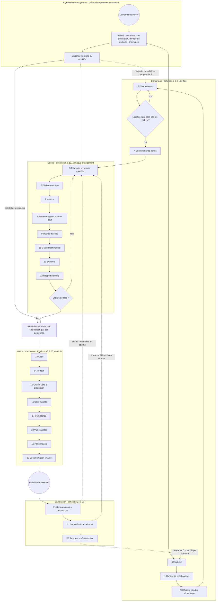

# Urazuke, la méthode de la preuve — l'échelle méthodologique (version 4)

Auteur : Pablo Kuschniroff, assisté par Claude Code. Version 4, 18 octobre 2026. Ceci est un
document de travail que je vais continuer à polir avec chaque projet qui l'utilisera ; rien de ce
qu'il dit n'est encore doctrine fermée, même si c'est, pour autant que je sache, le premier
distillat honnête d'une méthode qui a déjà trois systèmes en production derrière elle.

Avant d'entrer dans le vif du sujet, un avertissement sur la façon dont c'est écrit, parce que cela
compte. Je l'ai écrit pour des personnes qui n'ont pas vécu ces projets avec moi : des gens qui
veulent construire du logiciel avec l'intelligence artificielle et que ce logiciel dure, pas des
gens qui veulent apprendre à programmer ni collectionner des astuces de prompts. C'est pourquoi je
prends le temps d'expliquer, je répète quand il le faut, j'utilise le langage de tous les jours, et
je laisse à la fin un **glossaire** avec chaque sigle et chaque expression familière qui
m'échappe. Si à un moment vous tombez sur un mot étrange — « cliquet », « verrou », « fail-closed »,
« PND » —, allez au glossaire ; tout y est. Et quand vous lisez une marque comme
[Ref. 26](REFERENCIAS.md#ref-26), sachez que c'est un raccourci vers un cas réel que je raconte
dans le document de références, avec sa date et sa preuve ; vous pouvez l'ignorer sans perdre le
fil ou la suivre si le détail vous intéresse.

Le dépôt public de la méthode est
[github.com/pkuschnirof/urazuke](https://github.com/pkuschnirof/urazuke). On y trouve ce
document, les contrats de chaque échelon, le manuel du cours et les références, dans les huit
langues de NAC3.

## Le nom

**Urazuke** (裏付け) est un mot japonais qui désigne l'appui dont dispose une affirmation : ce qui
la soutient par derrière (littéralement, « la doublure de derrière »). Le verbe *urazukeru*
signifie « étayer par des preuves ». Je l'ai choisi le 17 octobre 2026, après avoir écarté
plusieurs noms pour cause de collision avec des entreprises et des projets existants, et je l'ai
choisi parce qu'il dit exactement ce que la méthode demande : que chaque affirmation du modèle
vienne avec son appui, et que l'appui puisse se vérifier sans lire le code. Le nom ne se traduit
pas ; le sous-titre, « la méthode de la preuve », si : *the evidence method*, *o método da
evidência*, *la méthode de la preuve*, *die Nachweis-Methode*, *il metodo del riscontro*,
裏付けの方法, 验证方法. Dans ce document, « l'échelle » est la structure de la méthode — ses
vingt-quatre échelons — et « Urazuke » est la méthode entière.

## De quoi s'agit-il

Je veux être clair sur ce que j'enseigne et sur ce que je n'enseigne pas. Je n'enseigne pas un
outil. J'enseigne une **méthode** : quoi faire dans quel ordre, quoi demander au modèle à chaque
moment, ce qu'il doit vous livrer, et comment savoir — sans lire de code — que ce qu'il vous a
livré est complet. Le pari est que n'importe qui, avec n'importe quel outil d'intelligence
artificielle capable de programmer, puisse construire du logiciel en conversant avec un modèle au
lieu de taper le code à la main, et que ce qui en sorte soit robuste, prêt pour la production et,
c'est là l'important, **n'exige pas que le propriétaire du projet relise une seule ligne de
code**. Et je veux être tout aussi clair sur ce qu'elle n'est pas : ce n'est pas un procédé pour
faire des systèmes plus vite. C'est un procédé pour faire des systèmes exploitables et
maintenables sans que personne n'ait besoin de comprendre un seul bit de leur code, parce que le
code, c'est le cadre agentique qui l'écrit qui le comprend et le maintient. La vitesse, quand elle
apparaît, est une conséquence, et c'est pourquoi il n'y a pas de délais dans ce document : la
taille et la complexité de chaque système les fixent, et la méthode ne fixe que l'ordre.

Cela paraît ambitieux, et ça l'est. Mais j'ai quelque chose que presque personne n'a : trois
systèmes réels que j'ai construits exactement ainsi, qui fonctionnent aujourd'hui avec de vrais
clients, et dont j'ai extrait chaque règle qui suit. Donc la question que je me pose n'est pas
« est-ce que ce sera possible ? », parce que ça l'a déjà été. La question est « qu'ai-je fait, dans
quel ordre, et qu'est-ce qui, dans tout cela, a vraiment fait la différence ? ». Cette échelle est
ma réponse, et c'est la base de trois choses : la documentation de la méthode, la pratique que
feront les élèves du cours, et les manuels. Plus tard je l'exporterai comme un flux d'exécution
dans mon outil, pour que ce soit l'outil qui guide la méthode et non la mémoire de chacun.

## D'où vient la méthode, et ce que je ne veux pas qu'on comprenne de travers

Il y a une lecture facile de tout ceci que je veux désamorcer avant qu'elle ne s'installe : celle
selon laquelle la méthode serait une collection de rustines que j'aurais posées après chaque coup
dur. Ce n'est pas le cas, et il m'importe de le dire avec précision, parce que cela change la
façon dont il faut lire chaque échelon.

La méthode vient de deux facteurs qui se sont combinés, et aucun des deux ne suffit seul. Le
premier est **ma propre connaissance de l'ingénierie des systèmes**. Cela fait de nombreuses années
que j'applique ce que n'importe qui venant des systèmes reconnaît tout de suite : relevé avant de
concevoir, exigences écrites, dimensionnement avec des chiffres, conception, construction, tests
comme preuve, déploiement reproductible, exploitation, audit périodique, documentation comme partie
du produit. La plus grande partie de ce que j'exige dans les vingt-quatre échelons est ce que j'ai
toujours exigé dans un projet bien mené. Je ne l'ai pas inventé pour les modèles ; je l'ai apporté
d'avant.

Le second facteur est ce que les incidents de ces cinq mois m'ont montré, l'un après l'autre :
**où les modèles appliquent ces principes de manière fragile**. Un modèle sait parfaitement ce
qu'est un test, ce qu'est une cause racine, ce qu'est un dimensionnement ; si vous le lui demandez,
il vous l'explique mieux que bien des ingénieurs. Mais en pratique il dit qu'il a testé et il n'a
pas testé, il estime d'un air assuré une donnée que seul le métier possède, il remplit un trou
dans les règles métier avec ce qui lui a paru raisonnable, il rapporte trop parce qu'il a été
entraîné à être utile, et il construit un compteur qui ment sans s'en rendre compte. Chacun de ces
cas, que je raconte dans les [références](REFERENCIAS.md), m'a dit exactement où il fallait
serrer : où un principe qui pour moi était évident devait se convertir en une clause explicite du
prompt, en une porte, en une vérification que je fais sans lire de code.

Donc, quand dans un échelon je dis « ceci, je l'ai imposé après tel incident », je ne dis pas que le
principe est né là. Je dis que c'est là que j'ai constaté que le modèle ne l'appliquait pas tout
seul, et qu'il fallait le lui exiger par écrit. La méthode est de l'ingénierie des systèmes de
toujours, appliquée avec la rigidité nécessaire pour un constructeur qui ne se fatigue pas et qu'on
ne peut pas croire sans preuve. Les cicatrices sont la preuve de là où la rigidité est nécessaire,
pas l'origine des principes.

## Les trois cas d'utilisation de la méthode

Avant d'aller plus loin, une bifurcation qui n'était pas dans les premières versions et qu'un
lecteur m'a demandée à juste titre. Ce document décrit l'échelle en regardant un dossier vide :
l'échelon 0 décide si le projet s'aborde, le 4 déploie le squelette sans fonctionnalité, le 5
ouvre le premier bloc. C'est le cas le plus clair pour apprendre, et ce n'est pas le plus
fréquent. La méthode a trois cas d'utilisation, et il vaut mieux savoir dans lequel vous êtes
avant d'ouvrir l'agent, parce que cela change par où l'on entre :

1. **Projet neuf.** Dossier vide et un propriétaire avec une demande. On entre par l'échelon 0 et
   on gravit les vingt-quatre dans l'ordre. C'est ce que décrit ce document, avec ses contrats et le
   manuel du cours.
2. **Évolutif-correctif sur un système fait avec la méthode.** Le système a déjà gravi l'échelle :
   il a un contrat, une carte, des éléments en attente clos avec leur preuve, une batterie, un
   déploiement et des manuels. On entre par l'échelon 5, en ouvrant un bloc, et on suit la
   boucle ; le 13 périodique ; le 23 à la clôture de chaque étape. C'est la phase 4 de la ligne de
   temps (Partie B).
3. **Évolutif-correctif sur un système fait sans la méthode.** Un système qui tourne, avec des
   utilisateurs, fait par un autre ou par soi-même sans preuve, qu'il faut corriger ou faire
   grandir. On n'entre ni par le 0 ni par le 5 : on entre par un **tronçon de normalisation** de
   huit stations (N0 à N7) qui récupère, par autodécouverte et avec des marques de source, tous
   les intrants que les échelons du démarrage produisent, monte une ceinture de sécurité autour du
   système sans le réécrire, et seulement ensuite ouvre la boucle en mode correctif ou évolutif.
   Ce chemin est dans une page à lui, le [chemin évolutif-correctif](EVOLUTIVO_CORRECTIVO.md), et
   il a sa part du cours avec un second projet-guide.

Ce qui reste dehors, nommé : la migration technologique n'est pas un cas d'utilisation de la
méthode ; c'est un autre projet, et en général cela tombe dans les critères excluants de l'échelon
0.

## L'IA n'interrompt pas la méthode : elle la continue

C'est la thèse qui ouvre tout, et je la mets en premier parce qu'elle désamorce l'objection la plus
courante avant qu'elle n'apparaisse : « comment vas-tu faire confiance à du code écrit par une
machine ? ».

Ma réponse est que **l'industrie a déjà cessé de faire confiance à l'auteur du code il y a vingt
ans**. Quand le gros de l'écriture est passé à des équipes juniors, externalisées ou tournantes, la
revue ligne par ligne est devenue impossible à soutenir. Et ce qui a grandi à sa place, c'est tout
ce que nous tenons aujourd'hui pour acquis : les tests automatisés, l'intégration continue, les
critères d'acceptation, les pipelines qui ne laissent rien passer sans vert, le « shift left » des
tests, le contrôle qualité comme fonction indépendante. Ce fut la réponse de l'ingénierie des
systèmes à « celui qui écrit n'est pas fiable » : ne pas lui lire le code, lui exiger des preuves.

Mettre un modèle à écrire, donc, n'est pas un saut dans le vide. C'est remplacer un auteur en qui
nous ne faisions déjà plus confiance par un autre en qui nous ne faisons pas confiance non plus, et
pour lequel **nous avions déjà monté l'appareil de vérification**. Cela devrait rassurer, pas
inquiéter. Et en plus, le nouvel auteur est moins cher, plus rapide, et — à la différence du
junior — il ne se vexe pas quand vous lui demandez de prouver en rouge.

C'est pourquoi cette méthode s'appuie, sans le cacher, sur l'ingénierie des systèmes classique. Le
squelette est celui de toujours. Il ne pouvait pas en être autrement, parce que les problèmes sont
ceux de toujours : ne pas savoir combien de données il y aura, ne pas savoir ce que veut le client,
ne pas savoir si ce qui a été construit est ce qui a été demandé. L'IA n'a pas changé les
problèmes ; elle a changé qui fait chaque partie et à quel coût. Même le critère d'éligibilité X2
de l'échelon 0 est de l'ingénierie classique : la testabilité comme condition de contrat.

### Ce qui est ancien et ce qui est nouveau là-dedans

L'ancien, et il convient de dire que c'est ancien : le squelette d'étapes, l'indépendance de celui
qui vérifie par rapport à celui qui construit, les tests comme preuve, la documentation comme
partie du produit, le relevé avant la conception.

Ce qui change vraiment, et c'est là que se trouve mon apport, ce sont trois choses :

1. **Où va l'effort de l'humain.** Dans la méthode classique, l'humain écrit la spécification, écrit
   le code, et un autre humain le relit. Ici l'humain ne fait que deux choses : **il décide, et il
   vérifie des artefacts**. Tout le reste — rédiger, construire, tester, mesurer, documenter — c'est
   le modèle qui le fait. C'est pourquoi chaque échelon se termine par une « vérification de
   complétude sans lire de code » : c'est l'endroit exact où l'humain reste indispensable, et aucun
   autre.

2. **L'auteur fabrique aussi la preuve.** C'est le seul point authentiquement nouveau, et c'est la
   nuance qui justifie trois échelons entiers. Le junior écrivait du code douteux, mais il ne
   fabriquait pas la preuve : les tests et les mesures, c'est un autre qui les montait, ou du moins
   un autre les regardait. Le modèle, lui, produit le code *et* le test *et* le compteur *et* le
   rapport, dans la même session, avec la même assurance dans la voix quand c'est juste et quand
   c'est faux. Je l'ai vu : le compteur qui a menti deux fois [Ref. 36](REFERENCIAS.md#ref-36),
   l'erreur d'authentification rapportée comme « succès » [Ref. 43](REFERENCIAS.md#ref-43), les
   trois assertions sur quatre qui étaient fausses. Alors « réviser la preuve au lieu du code »
   reste le principe correct, mais **la preuve doit se prouver elle-même** : le test vu en rouge
   (échelon 8), l'instrument avec sa garde (échelon 7), le rapport qui sépare le vérifié du cru
   (échelon 12), l'auditeur distinct du constructeur (échelon 13). Ce n'est pas une inquiétude
   nouvelle : c'est la même discipline d'indépendance du contrôle qualité, portée un pas plus loin
   vers l'intérieur.

3. **Le coût des artefacts.** Dans la méthode classique, la documentation coûtait cher, donc on la
   faisait une fois et elle vieillissait. Ici la régénérer est gratuit, donc la règle devient « dans
   le même commit » et « reproductible à la main, sans IA ». Ce qui était avant un idéal inatteignable
   devient une porte.

Pour le cours et pour la présentation publique, cela définit le positionnement avec honnêteté : ce
n'est pas « la nouvelle façon de programmer » ; c'est **de l'ingénierie des systèmes appliquée à un
constructeur qui ne se fatigue pas et qu'on ne peut pas croire**. À ceux qui viennent des systèmes,
cela sonne familier et cela fait baisser la méfiance ; à ceux qui viennent du vibecoding, cela
donne ce qu'ils n'ont pas, qui est justement le squelette. Et cela me distingue des outils qui
vendent de la vitesse et omettent le squelette entier.

---

## Partie A — Comment lire chaque échelon

Chaque échelon a huit parties, toujours les mêmes, pour qu'on puisse les comparer :

- **Intention** : ce qu'il cherche, en une phrase.
- **Quand** : à quel moment du projet on le gravit, et si on le gravit une fois ou si on le répète.
  Cette partie est nouvelle dans la version 4 et je l'explique en détail dans la Partie B, parce
  qu'une méthode sans ligne de temps est une liste de bonnes intentions.
- **Entrées** : ce qui doit exister avant pour pouvoir le gravir.
- **Artefact** : ce qui reste écrit ou exécutable quand on l'a gravi. C'est toujours quelque chose
  de concret : un fichier, un test, un script.
- **Porte** : ce qui doit être vrai pour passer au suivant. Si ce n'est pas rempli, on ne monte pas.
- **Qui décide** : le propriétaire du projet, l'agent, ou personne parce que c'est automatique.
- **Échec évité** : le type de problème que l'échelon prévient, avec une référence courte au cas
  réel où je l'ai constaté.
- **Contrat** : le fichier où se trouve comment on l'exécute : contexte, prompts, résultat,
  vérification, signaux d'alarme.

Deux précisions importantes. D'abord : **l'échelle est neutre vis-à-vis de l'outil**. Chaque
artefact est un fichier, un test ou un script ; aucun n'exige mon outil ni aucun autre. Forge les
automatise (les portes, les commandes, le registre des éléments en attente), mais l'échelon existe
sans Forge. Ensuite : **les échelons sont numérotés dans l'ordre où on les gravit**, et ils se
regroupent en quatre tronçons : ceux de 0 à 4 sont de démarrage et se gravissent une fois par
projet ; ceux de 5 à 12 sont la boucle qui se répète à chaque changement ; ceux de 13 à 20 sont
de mise en production, et se gravissent une fois, avant le premier déploiement ; et ceux de 21 à
23 sont d'exploitation, quand le système est déjà vivant. Le 23 ferme le cycle et revient au 0
pour le prochain projet. À l'intérieur d'un tronçon, le numéro dit l'ordre ; entre tronçons, la
boucle se répète pendant que les trois autres se gravissent une fois. Mais « pas strictement
séquentiels » ne veut pas dire « dans n'importe quel ordre » : la Partie B dit exactement quand on
gravit chacun et ce qui se passe entre les deux.

---

## Partie B — La ligne de temps : quand on gravit chaque échelon et ce qui se passe entre-temps

Cette partie n'existait pas dans les versions précédentes, et son absence était un défaut
sérieux : la méthode disait quoi faire et comment le vérifier, mais elle ne disait pas **quand**.
Et « quand » est la moitié d'une méthode. Un lecteur qui l'aurait prise au pied de la lettre
pouvait gravir les vingt-quatre échelons l'un après l'autre et se demander à quel moment, alors, on
fait
l'infrastructure, la chaîne d'intégration et de déploiement continus, l'ingestion des exigences, le
développement de la fonctionnalité, les tests de bout en bout de tous les flux, le regard humain
sur les écrans, et les tests humains d'acceptation. Tout cela se passe, et se passe à des moments
précis, entre les échelons et à l'intérieur d'eux. Je l'écris ici.

### B.0 Le procédé entier, en un graphique

Avant les tableaux, le dessin. Il est en notation de procédé (à la manière de BPMN : événements
ronds, tâches rectangulaires, portes en losange, flèches de retour pointillées), et il dit trois
choses que les tableaux disent moins bien. Première : le procédé **commence en dehors de la
méthode**, dans l'ingénierie des exigences, qui est un prérequis et qui est en outre permanente :
elle ne finit jamais, et chaque nouvelle exigence y rentre à nouveau. Deuxième : une exigence
nouvelle n'entre pas seulement dans la boucle ; **elle se réinjecte dans les échelons
d'évaluation**, parce qu'elle peut changer les chiffres avec lesquels l'architecture a été décidée
(est-ce que ça tient encore le « fois dix » ?), et de là vers l'avant. Troisième : le procédé **se
termine par l'exécution manuelle des cas de test** par des personnes (échelon 10), et ce que cette
exécution trouve revient dans la boucle comme exigence. Le circuit se ferme avec des gens, pas avec
des machines.

Si le dessin ne s'affiche pas (le lecteur de markdown ne dessine pas mermaid), le texte ci-dessus
le décrit en entier ; dans la version HTML il se dessine tout seul.

### B.1 Les cinq phases d'un projet

Un projet mené avec cette méthode passe par cinq phases. Les trois du milieu sont celles qui
correspondent aux tronçons de la boucle, de la mise en production et de l'exploitation ; la phase 1
est le tronçon de démarrage ; et la phase 0 est l'ingestion initiale, que la méthode couvre aussi
même si ce n'est pas un « échelon » en soi. Je ne mets pas de durées : elles dépendent de la taille
et de la complexité de ce qui est demandé, et une durée écrite se transforme en attente fausse. Ce
qui ne dépend pas de la taille, c'est l'ordre.

| Phase | Échelons gravis | Que se passe-t-il d'autre dans cette phase |
|---|---|---|
| 0. Ingestion | aucun encore ; c'est la matière première du 0, du 2, du 3 et du 5 | Relevé du métier avec le propriétaire, avec les méthodes classiques de l'ingénierie des exigences (voir B.5) : entretiens, cas d'utilisation ou récits utilisateur, modèle de domaine, prototypes d'écran. Il s'écrit en prose, incomplet à dessein ; l'agent le complète en posant des questions. |
| 1. Démarrage | 0, 1, 2, 3, 4 | Éligibilité, contrat, définition, dimensionnement. Et **toute l'infrastructure initiale** : le dépôt, l'environnement de test, l'intégration continue, le premier déploiement avec le système vide. |
| 2. Boucle | 5 à 12 à chaque changement : éléments en attente, décisions, mesurer, test en rouge, qualité, cas de test manuel, symétrie, rapport | Développement fonctionnel bloc par bloc ; tests en rouge ; tests de bout en bout du flux qui vient d'être construit ; regard humain sur chaque écran nouveau ; à la clôture de chaque bloc, tests humains dans l'environnement de test. |
| 3. Mise en production | 13 à 20, dans l'ordre : audit, verrous, chaîne vers la production, observabilité, persistance, vulnérabilités, performance, documentation | Audit par une autre session ; verrous sur tout ce qui agit sur le monde ; clôture de la chaîne de déploiement vers la production avec retour arrière testé ; les trois manuels ; tests d'acceptation avec le propriétaire sur tous les flux. |
| 4. Exploitation | 21 et 22 montés avec le premier déploiement ; 23 à la clôture de chaque étape ; la boucle (5 à 12) pour chaque évolution ; 13 et 18 périodiques | Agent résident ; audit tous les un ou deux mois ; chaque nouveau changement entre par la boucle complète et sort par la chaîne de déploiement ; rétrospective à la clôture de chaque étape. |

Ce tableau est celui du projet neuf. Quand le système existe déjà et qu'il n'est pas né avec la
méthode, les phases 0 et 1 se remplacent par le tronçon de normalisation (lecture, ceinture,
mesurer et ordonner) qui est dans le [chemin évolutif-correctif](EVOLUTIVO_CORRECTIVO.md) ; les
phases 2, 3 et 4 sont les mêmes.

Dans un projet avec des utilisateurs et des conséquences, ce qui grandit, c'est la boucle : la
fonctionnalité. Le démarrage, la mise en production et l'exploitation ont la même forme dans un
petit système et dans un grand ; ce qui change, c'est combien il y a à mesurer, pas quoi.

### B.2 Ce qui se passe entre un échelon et le suivant

Voici ce qui manquait. Pour chaque phase, quelles tâches de chaque type on fait et à quel moment
exact par rapport aux échelons. Lisez la table par lignes : chaque ligne est un type de travail, et
chaque cellule dit quand on le fait dans cette phase.

| Type de travail | Démarrage (échelons 0 à 4) | Boucle (échelons 5 à 12, par bloc) | Mise en production (13 à 20) | Exploitation (21 à 23 et boucle) |
|---|---|---|---|---|
| **Ingestion des exigences** | Avant l'échelon 0 : relevé en prose avec le propriétaire, avec entretiens, cas d'utilisation et modèle de domaine. Il se complète au 2 (définition et arbre sémantique) et au 3 (volumétrie). | À l'ouverture de chaque bloc : la demande du client pour ce bloc, telle qu'il la formulerait, se convertit en éléments en attente avec **spécification détaillée** (échelon 5) : description, critères d'acceptation, règles applicables, données, écrans, cas limites. Les questions que pose l'agent sont l'ingestion fine. | Avant le 14 : relevé des actions à conséquence. Avant le 15 : relevé des environnements et des accès. | Chaque nouvelle demande entre comme élément en attente spécifié, accroché à son nœud de l'arbre sémantique ; l'agent résident recueille ce que demandent les utilisateurs. |
| **Infrastructure** | Toute l'initiale, à l'échelon 4 : dépôt, structure, environnement de test, identifiants, domaine de test. On ne construit pas de fonctionnalité tant que le squelette vide n'est pas déployé. | Aucune, sauf si un bloc l'exige (une file, un service externe). S'il l'exige, c'est un élément en attente avec son test. | Au 15 : environnement de production, secrets sur le serveur, domaine réel, sauvegardes, supervision minimale. | Les changements d'infrastructure entrent par la boucle et par le 15 ; jamais « à la main, vite fait ». |
| **Chaîne CI/CD** | À l'échelon 4 : l'intégration continue lance la batterie à chaque push dès le démarrage, et le déploiement vers l'environnement de test est automatique à la fusion. | Elle fonctionne seule. Chaque commit la traverse ; si elle n'est pas au vert, le bloc ne se clôture pas. | Au 15 elle se complète : le déploiement en production attend le résultat de l'intégration et ne fait qu'empaqueter ; la promotion est une procédure écrite ; le retour arrière se teste. | Chaque déploiement suit la routine du 15 : test au vert avec la même version, retour arrière prêt, vérification de bout en bout en production après. |
| **Développement fonctionnel** | Aucun. Le squelette se déploie vide à dessein. | C'est le centre de la boucle : l'agent prend un élément en attente (5), demande les règles métier qui manquent (6), construit, et clôture avec des preuves (7, 8, 9, 10, 11, 12). Bloc par bloc, du basique à ce qui a des conséquences. | Ce qui agit sur le monde (facturer, envoyer) se construit dans la boucle **après** l'échelon 14, avec ses verrous, et démarre en mode à blanc. | Les évolutions entrent par la boucle. |
| **Tests automatiques** | Un test de fumée qui passe, au 4. C'est la graine de la batterie. | Avec chaque élément en attente : le test prouvé en rouge (8), la régression des voisins dans la même session, et **un test de bout en bout du flux qui vient d'être construit**, de l'écran jusqu'au backend. À la clôture d'un bloc : la batterie complète de bout en bout de **tous** les flux existants, dans l'environnement de test. | Avant le premier déploiement en production : la batterie complète de bout en bout de tous les flux, au vert, avec la même version qui va être promue. Après le déploiement : une vérification de bout en bout sur la production, en lecture seule. | À chaque changement, la même chose que dans la boucle. |
| **Regard humain sur les écrans** | À la clôture du 4 : le propriétaire ouvre l'URL de l'environnement de test et voit l'écran vide. Cela paraît trivial et c'est la première fois que quelqu'un qui n'est pas l'agent regarde le système. | **Avec chaque élément en attente qui touche un écran** : l'agent livre une capture réelle de l'environnement de test et le propriétaire la regarde. Dix secondes. C'est la façon la moins chère de trouver ce qu'aucun test ne trouve : que le bouton est là où il ne devrait pas être, que le texte dit autre chose, que le flux n'est pas celui que le métier imaginait. | Au 20 : les captures du manuel utilisateur sont le dernier regard humain systématique avant la production. | Chaque écran nouveau ou modifié, comme dans la boucle. |
| **Tests humains** | Aucun encore, sauf ouvrir l'écran vide. | **À la clôture de chaque bloc fonctionnel** : le propriétaire, ou un utilisateur de confiance, utilise le système dans l'environnement de test comme il l'utiliserait pour de vrai, en suivant les flux du bloc. Ce qu'il trouve se note comme éléments en attente. On n'ouvre pas le bloc suivant avec des trouvailles humaines sans élément en attente. | Avant le premier déploiement en production : **tests d'acceptation** du propriétaire sur tous les flux, avec des données de test réalistes, dans l'environnement de test. Et au 20, une personne qui ne programme pas suit le manuel de reprise. | À chaque évolution, à la clôture de son bloc. |
| **Décisions du propriétaire** | Au 0 (ça passe ou ça ne passe pas), au 1 (le contrat), au 2 (ce que ce N'EST PAS), au 3 (l'option d'architecture). | Chaque fois que l'agent s'arrête sur une règle métier non écrite (6). Il y en a généralement deux ou trois par bloc. | Au 14 (verrou par verrou), au 15 (promouvoir en production), au 23 (le niveau de l'agent résident). | Celles qui surgissent ; toujours écrites. |

Un détail que je veux souligner parce que c'est là que les gens qui viennent du vibecoding se
trompent le plus : **les tests de bout en bout de tous les flux ne se font pas une seule fois à la
fin**. Ils se font trois fois, à trois échelles. Avec chaque élément en attente, le flux que cet
élément a touché. À la clôture de chaque bloc, tous les flux qui existent jusque-là. Et avant la
production, tous les flux avec la version exacte qui va être promue. Si vous ne faites que la
troisième, vous arrivez à la fin avec un système que personne n'a testé de bout en bout pendant des
semaines, et la mise en production se transforme en une semaine de réparations.

### B.3 Le rythme de la boucle : un bloc fonctionnel typique

Un bloc fonctionnel est un ensemble de quatre à huit éléments en attente liés entre eux, qui
ensemble font quelque chose que le métier peut utiliser : « l'agenda de base », « les rappels », « le
rapport mensuel ». Voici à quoi il ressemble de l'intérieur :

1. **Ouverture du bloc.** Le propriétaire raconte, en prose, ce qu'il veut pour ce bloc. L'agent le
   convertit en éléments en attente numérotés, avec leur « comment on vérifie », et demande ce qui
   ne suffit pas pour écrire un élément en attente vérifiable (échelon 5). Le propriétaire
   priorise.
2. **Chaque élément en attente.** L'agent annonce quel élément il prend et pourquoi. Si en chemin
   apparaît une règle métier qui n'est pas écrite, il s'arrête et demande (6). Si l'élément dépend
   d'un nombre — combien de requêtes, combien de temps —, il le mesure d'abord avec un instrument
   doté d'un test (7). Il construit. Quand il termine, il clôture dans cet ordre : le test prouvé en
   rouge, vert, la régression des voisins et un test de bout en bout du flux touché (8) ; la porte
   de qualité du code au vert (9) ; les cas de test manuel du flux, écrits pour une personne (10) ;
   et, si le changement a touché un contrat entre deux parties du système, l'autre côté mis à jour
   dans le même commit (11). Le rapport sépare le vérifié du cru et déclare les angles morts (12).
   Le propriétaire lit le rapport et regarde la capture de l'écran. Il ne lit pas de code.
3. **Clôture du bloc.** La batterie complète de bout en bout au vert dans l'environnement de test.
   Le propriétaire ou un utilisateur de confiance exécute les cas de test manuel du bloc (10) et
   note ce qui s'est passé et ce qui a échoué ; chaque échec revient dans la boucle comme élément
   en attente correctif. On lit le rapport de qualité du bloc (9). On met à jour le manuel
   utilisateur avec les nouveaux écrans (20, dans le même commit). C'est seulement alors qu'on
   ouvre le bloc suivant.

Dans une journée typique de la boucle, le propriétaire investit entre quinze et trente minutes :
répondre à deux ou trois questions de règles métier, lire deux ou trois rapports, regarder deux ou
trois captures. C'est tout ce que la méthode lui demande. S'il investit davantage, soit l'agent
demande ce qu'il pourrait résoudre seul (échelon 1), soit le propriétaire lit du code (et alors
quelque chose de l'échelon 8 ou du 12 ne fonctionne pas).

### B.4 Les jalons humains

Je résume dans une liste les moments où un humain, le propriétaire ou quelqu'un de sa confiance,
doit regarder ou utiliser le système. Ils sont peu nombreux, ils sont à des moments précis, et
aucun ne peut se déléguer à l'agent :

- **Fin du démarrage** : ouvrir l'URL de l'environnement de test et voir le système vide.
- **Avec chaque élément en attente qui touche un écran** : regarder la capture réelle de
  l'environnement de test.
- **À la clôture de chaque bloc** : exécuter les cas de test manuel du bloc (10) dans
  l'environnement de test et noter le résultat ; ce qui échoue revient dans la boucle comme
  exigence.
- **Avant le premier déploiement en production** : tests d'acceptation sur tous les flux, en
  suivant tous les cas de test manuel.
- **À l'échelon 20** : une personne qui ne programme pas suit le manuel de reprise dans
  l'environnement de test.
- **Après chaque déploiement en production** : vérifier que la version qui tourne est celle qu'on
  voulait, et faire une passe en lecture seule sur les flux critiques.
- **Avant le premier déploiement, au 19** : lire les chiffres du test de charge avec la tolérance
  du métier à côté, et le point de rupture.
- **À chaque cycle de la supervision (21 et 22)** : lire le rapport cyclique avec l'agent et
  décider quel écart et quelle erreur deviennent des éléments en attente.

Tout le reste — les tests, les mesures, les audits, la documentation — c'est le modèle qui le fait
et l'humain le vérifie par l'artefact, pas par le code.

### B.5 Comment entrent les exigences : du relevé à l'arbre sémantique et aux éléments en attente

Je veux m'arrêter là-dessus parce que c'est là que l'ingénierie des systèmes classique a le plus à
dire et là que le vibecoding l'ignore avec le plus d'enthousiasme. Une exigence n'est pas une
phrase du client dans un chat. C'est une phrase du client **traitée** par des méthodes qui existent
depuis des décennies et qui restent valables avec un modèle aux commandes, parce que le modèle est
très bon pour les appliquer si vous le lui demandez et très mauvais pour les appliquer si vous ne
le lui demandez pas.

Les méthodes que j'utilise, et que la méthode exige à chaque phase :

- **Entretiens avec le propriétaire**, ouverts, en prose, enregistrés. C'est la phase 0. Je
  n'essaie pas qu'ils soient complets : j'essaie que l'agent détecte ce qui leur manque.
- **Cas d'utilisation ou récits utilisateur**, un par flux que le métier peut nommer : « la
  réceptionniste saisit un rendez-vous », « le patient reçoit le rappel ». Chacun a un acteur, un
  déclencheur, des étapes, un résultat et des exceptions. C'est l'unité avec laquelle on ouvre un
  bloc fonctionnel.
- **Modèle de domaine** : les entités du métier, leurs attributs, leurs états possibles et les
  transitions entre états. C'est le cœur de l'arbre sémantique (voir plus bas) et ce qui évite que
  le modèle invente des états que le métier n'a pas.
- **Critères d'acceptation** par récit, sous la forme « étant donné telle situation, quand telle
  chose se produit, alors on voit tel résultat ». Ce sont eux qui se convertissent en « comment on
  vérifie » de chaque élément en attente et, ensuite, en test de bout en bout.
- **Prototypes d'écran**, même si ce n'est qu'un dessin. Le regard humain sur les écrans commence
  ici, avant qu'il n'existe du code.
- **Traçabilité** : chaque exigence peut se suivre jusqu'à l'élément en attente qui l'implémente,
  le test qui la prouve et le commit qui l'a clôturée. Dans la méthode, la traçabilité n'est pas une
  matrice à part : c'est l'élément en attente lui-même, qui cite son origine et sa preuve.

**L'arbre sémantique.** C'est l'artefact qui ordonne tout cela et c'est la carte que l'agent lit à
chaque session (échelon 2). C'est un arbre, pas une liste : le système à la racine ; en dessous, les
domaines ou modules ; sous chacun, ses acteurs, ses processus (les cas d'utilisation), ses entités
avec leurs états, ses écrans et ses intégrations externes ; et accrochés à chaque nœud, les
éléments en attente qui le touchent et les décisions qui l'affectent. C'est l'agent qui le
construit à partir du relevé, c'est vous qui le corrigez, et il grandit avec chaque bloc. Sa valeur
est double : il donne au modèle le contexte exact du nœud qu'il va toucher sans avoir à lire tout le
projet, et il vous donne à vous une façon de vérifier que le système que l'agent comprend est
celui que le métier a demandé, sans lire de code. Quand un élément en attente n'est accroché à aucun
nœud, soit l'arbre est incomplet, soit l'élément est hors périmètre ; les deux se voient en dix
secondes.

**La spécification détaillée vit dans l'élément en attente.** Dans la méthode classique il y avait
un document de spécification des exigences, long, qui vieillissait. Ici ce document se décompose :
chaque élément en attente porte sa propre spécification complète, et la somme des éléments en
attente est la spécification du système. Un élément en attente bien écrit a : un titre ; le nœud de
l'arbre sémantique auquel il est accroché ; le récit ou le cas d'utilisation qui l'origine, avec
les mots du client ; la description détaillée de ce qui est demandé ; les règles métier
applicables, avec leur décision et leur date ; les données qui entrent et qui sortent ; les écrans
affectés, avec le prototype s'il y en a un ; les cas limites et les exceptions ; les critères
d'acceptation ; et comment on vérifie. L'agent le rédige à partir de votre demande en prose,
demande ce qui ne suffit pas pour spécifier, et vous le lisez avant qu'il ne se construise. Lire
une spécification d'élément en attente est ce qui vous rapprochera le plus de la lecture du code,
et c'est exactement la bonne distance.

**Les éléments en attente clôturés sont de la documentation.** C'est ce qui ferme le cercle. Quand
un élément en attente se clôture, on ne l'efface pas et on ne l'archive pas vide : il reste avec sa
spécification, la décision qui l'a originé, la preuve avec laquelle il a été clôturé (les chiffres
du rouge et du vert, la capture de l'écran, le nombre mesuré), le commit, et la date. La file des
éléments en attente clôturés est, donc, l'historique fonctionnel du système : ce qui a été
construit, pourquoi, quand, et comment ça a été testé. C'est de là que sortent le journal des
modifications, les nouvelles sections du manuel utilisateur et, quand quelqu'un demande six mois
plus tard « pourquoi le système fait-il cela ? », la réponse. Le manuel du cours apprend à exiger
cette documentation à la clôture de chaque élément en attente, dans la même session, comme partie
de la routine de l'échelon 5.

---

## Partie C — Les vingt-quatre échelons

Ils vont dans l'ordre où on les gravit. Les six échelons de qualité opérationnelle (16 à 19 avant
le premier déploiement ; 21 et 22 après) sont ceux que je faisais sans les nommer : que le système
puisse se **voir** pendant qu'il tourne, qu'il tienne le volume pour lequel il a été dimensionné,
qu'il n'ait pas de trous connus, et qu'une fois en production personne n'apprenne un problème par
un utilisateur en colère. Les deux supervisions finissent au même endroit que tout le reste : la
boucle, comme éléments en attente correctifs. Si vous débutez, chacun de ces six contrats, et ceux
des échelons 9 et 10, commencent par un paragraphe qui explique leurs mots dans le langage de tous
les jours, et le glossaire les a tous.

### Étape 0 — Ce projet peut-il être abordé ainsi ? (l'éligibilité)

Il y a quelque chose qui précède tout le reste, et qui n'est dans aucun dépôt parce que c'est
toujours arrivé déjà décidé : la décision de **savoir si un projet s'aborde avec cette méthode ou
non**. C'est un critère que j'ai porté dans ma tête pendant des mois et que je finis d'écrire. Les
deux critères excluants, je les ai déjà clairement ; ils sortent des projets que j'ai refusés, pas
de ceux que j'ai acceptés [Ref. 46](REFERENCIAS.md#ref-46) : les « non » définissent la frontière
mieux que les « oui ». Les critères qui pondèrent, je suis encore en train de les calibrer, et je
le signale comme tel.

- **Intention** : décider si un projet s'aborde avec cette méthode, et avec un agent aux commandes,
  ou non, AVANT d'ouvrir le dépôt. Parce que si vous entrez dans un projet qui ne s'y prête pas, la
  méthode se dégrade en « programmer avec l'IA », et là, oui, le propriétaire finit par lire du
  code.
- **Quand** : une seule fois, avant toute autre chose. Si le système existe déjà, cet échelon se gravit dans sa version pour
  les legacy (la station N0 du [chemin évolutif-correctif](EVOLUTIVO_CORRECTIVO.md)), avec quatre
  critères de plus et X2 mesuré écran par écran.
- **Entrées** : la demande du client, le domaine métier, les données, la technologie, les
  environnements disponibles, et qui va être le propriétaire.
- **Artefact** : une fiche d'éligibilité d'une page, avec les critères notés et la décision : on y
  va, on n'y va pas, ou on y va sous conditions.
- **Porte** : les critères excluants sont tous au vert, et la note de ceux qui pondèrent dépasse le
  seuil (un seuil que je n'ai pas encore défini).
- **Qui décide** : le propriétaire. Aujourd'hui c'est moi ; l'idée est que la méthode permette à
  une autre personne de le décider avec la même fiche.
- **Échec évité** : se lancer dans un projet où l'agent ne peut pas se vérifier seul, ou où il n'y
  a pas de propriétaire du domaine pour décider, et finir avec l'humain qui relit le code ligne par
  ligne.
- **Contrat** : `peldanos/peldano-00-elegibilidad.md`.

**Les deux critères excluants.**

| # | Critère excluant | Pourquoi il tue la méthode |
|---|---|---|
| X1 | Technologie héritée sans dépôt accessible, ou avec des dépôts qui ne suivent pas un standard | Sans dépôt standard il n'y a nulle part où déposer la preuve : pas d'éléments en attente cités dans les commits (échelon 5), pas de tests qui voyagent avec le code (8), pas d'intégration ni de déploiement comme paquet (15), pas de documentation dans le même commit (20). L'agent travaille à l'aveugle et ne laisse aucune trace vérifiable. |
| X2 | Technologie qu'on ne peut pas tester de bout en bout : on ne peut pas exécuter les écrans et accéder à chaque élément de l'interface avec ses différentes méthodes, en validant que le changement est bien arrivé au backend | Sans cette vérification de l'écran au backend l'agent ne peut pas se tester seul (échelons 8, 7 et 12), et alors le propriétaire devrait lire du code, ce qui est précisément ce que la méthode promet d'éviter. |

Une précision qui vaut de l'or pour la neutralité vis-à-vis de l'outil : **NAC3 (le protocole
qu'utilise mon outil pour que les écrans puissent être pilotés par programme) N'EST PAS une
condition ; c'est le moyen par lequel j'y parviens aujourd'hui**. Le critère neutre s'énonce ainsi :
l'interface peut être exécutée par programme, et chaque élément de l'écran est accessible avec ses
différentes méthodes (cliquer, saisir, lire son état), de sorte qu'un test puisse parcourir l'écran
puis vérifier l'effet dans le backend. Une technologie dont l'interface n'expose pas ses éléments à
un « driver » (comme Playwright, par exemple) reste dehors, même si elle a un dépôt.

Et une lecture qui me paraît importante : au fond, X1 et X2 sont **la même condition vue de deux
côtés**. L'agent doit pouvoir se vérifier seul, de bout en bout, et laisser la preuve dans le dépôt.
X1 est la moitié « où reste la preuve ? » ; X2 est la moitié « comment se produit la preuve ? ».

`[hypothèse]` **Critères qui pondèrent, encore sans poids.** Je les laisse marqués comme hypothèse
jusqu'à ce que je les calibre avec les premiers projets qui utiliseront la méthode de bout en bout.

| # | Critère candidat | Comment cela s'est vu dans les cas | Excluant ? |
|---|---|---|---|
| D1 | Il y a un propriétaire du domaine qui a du jugement et du temps pour décider (pas pour programmer) | dans les trois systèmes, avec les décisions écrites et datées | `[?]` |
| D2 | Il y a un « oracle » de vérité vérifiable : des données réelles, un système externe, la production en lecture seule | la Mutuelle et son Autorisateur comme oracle [Ref. 26](REFERENCIAS.md#ref-26) | `[?]` |
| D4 | La technologie est dans ce que l'agent maîtrise sans inventer (Node, Python, SQL, React) | les trois | `[?]` |
| D5 | L'erreur a une conséquence réelle (argent, santé, exploitation), ce qui justifie le fail-closed | la Mutuelle (santé, facturation), l'Association (familles) | `[?]` |
| D6 | La volumétrie peut être connue dès le premier jour | Kikan : 3,4 millions de lignes par an [Ref. 15](REFERENCIAS.md#ref-15) | `[?]` |
| D7 | Le client tolère un temps de maturation et un humain dans la boucle | l'approbateur automatique avec mode à blanc [Ref. 28](REFERENCIAS.md#ref-28) | `[?]` |
| D9 | Le périmètre tient dans un dépôt et un propriétaire | les trois | `[?]` |
| D10 | Les secrets et les accès peuvent être isolés (coffre, fichier d'environnement, permissions bornées) | la clé d'API associée à la personne qui l'a créée [Ref. 13](REFERENCIAS.md#ref-13) | `[?]` |

Deux critères que j'avais dans les versions précédentes (que l'agent puisse tester seul, et que le
projet soit nouveau ou auditable), je les ai absorbés dans X2 et X1 respectivement, parce que ce
sont des conséquences et non des critères à part.

### Étape 1 — Le contrat de collaboration (les règles avant le code)

Avant d'écrire une seule ligne, mettez par écrit comment vous et l'agent allez travailler. Cela
ressemble à une formalité, et ce n'en est pas une : c'est ce qui évite quatre-vingts pour cent des
frustrations du premier mois. Pensez que l'agent arrive chaque matin sans mémoire de la veille ; ce
qui n'est pas écrit, vous allez devoir le lui répéter à chaque fois, et à chaque fois un peu
différemment.

- **Intention** : fixer comment travaillent l'humain et l'agent avant la première ligne de code.
- **Quand** : une seule fois, immédiatement après l'éligibilité. On le révise quand un coup dur
  l'exige.
- **Entrées** : rien du projet ; c'est le premier fichier. De vous : vos préférences de travail.
- **Artefact** : un document de standards de qualité qui dise, au minimum : le temps de l'humain
  est sacré (on ne le dépense pas en choses que l'agent peut résoudre seul) ; zéro dette technique,
  c'est-à-dire que quand quelque chose casse on le répare à la racine et on ajoute la régression
  dans la même session ; le périmètre est exact, ni plus ni moins que ce qui a été demandé ; on
  parle la langue de l'utilisateur ; la documentation se met à jour dans le même commit ; et on
  n'annonce jamais comme fait quelque chose qui n'a pas été fait.
- **Porte** : le contrat est dans le dépôt et se lit à chaque session.
- **Qui décide** : le propriétaire. L'agent peut proposer des changements, mais il n'édite pas le
  contrat de son propre chef.
- **Échec évité** : l'agent qui « aide » en élargissant le périmètre parce que ça lui a semblé une
  bonne idée ; celui qui laisse de la dette « pour plus tard » (et le plus tard n'arrive jamais) ;
  et celui qui rapporte comme fait ce qu'il *croit* avoir fait. Je l'ai écrit pour la première fois
  quand cela faisait deux semaines que je répétais la même chose à chaque session
  [Ref. 1](REFERENCIAS.md#ref-1).
- **Contrat** : `peldanos/peldano-01-contrato-de-convivencia.md`.

### Étape 2 — La définition du projet et la lecture obligatoire

Chaque session de l'agent démarre de zéro. Donnez-lui une carte, courte, et obligez-le à la lire
avant de toucher à quoi que ce soit. Les deux moitiés comptent autant l'une que l'autre : une carte
que personne ne lit n'agit pas, et une carte longue, personne ne la lit.

- **Intention** : que chaque session démarre en sachant ce qu'est le projet, dans quel état il se
  trouve et quelles décisions ont déjà été prises.
- **Quand** : elle s'écrit une fois, après le contrat ; elle se maintient à
  jour pendant tout le projet, avec chaque nouvelle décision.
- **Entrées** : le contrat (échelon 1) et le relevé du métier.
- **Artefact** : un fichier de projet opérationnel, et ici j'insiste : COURT. C'est le programme,
  pas l'historique. Plus l'**arbre sémantique** du système (voir B.5) : domaines, acteurs,
  processus, entités avec leurs états, écrans et intégrations, avec les éléments en attente et les
  décisions accrochés à chaque nœud. Plus un fichier d'état vivant avec ce qui est en cours et les
  doutes ouverts.
- **Porte** : l'agent lit le fichier de projet et l'arbre sémantique avant de toucher au code, et
  on a prouvé qu'il les lit.
- **Qui décide** : le propriétaire définit ; l'agent le maintient à jour.
- **Échec évité** : deux, bien concrets. Du travail jetable pour ne pas avoir lu la carte
  [Ref. 9](REFERENCIAS.md#ref-9). Et le fichier de projet qui grossit jusqu'à devenir illisible
  [Ref. 41](REFERENCIAS.md#ref-41) : le fichier opérationnel et le livre de cas doivent être des
  fichiers distincts.
- **Contrat** : `peldanos/peldano-02-definicion-y-lectura.md`.

### Étape 3 — Dimensionner avant de concevoir l'architecture

C'est l'échelon qu'il coûte le plus cher de sauter, et je le sais parce que je l'ai sauté. Les
décisions structurelles se prennent avec des chiffres, et les chiffres primaires, c'est le métier
qui les a, pas le modèle.

- **Intention** : que les décisions structurelles (quel moteur de base de données, si l'interface
  est synchrone ou asynchrone, combien de concurrence) se prennent avec des chiffres et non au goût.
- **Quand** : une fois, avant de monter le squelette ; on le refait si le
  métier change d'échelle. Une demi-page et une décision dans un petit projet.
- **Entrées** : un relevé de données de volumétrie fait avec le métier, par nature incomplet ; et
  un accès en lecture au système précédent s'il existe. Il y a des données que **seul le métier
  possède** et que le modèle ne peut pas inférer : c'est pourquoi le prompt exige de lui qu'il
  évalue si elles sont complètes et qu'il demande celles qui manquent, au lieu de les estimer avec
  un air assuré.
- **Artefact** : un registre de dimensionnement avec des options FIXES (trois ou quatre options
  concrètes) et celle qui a été choisie ; et les décisions « asymétriques » déclarées explicitement,
  par exemple « l'interface de persistance est asynchrone dès la première ligne même si le premier
  moteur est synchrone », parce que si vous vous trompez cela coûte peu et si vous ne le faites pas
  cela coûte une fortune.
- **Porte** : le dimensionnement est enregistré avant de monter le squelette.
- **Qui décide** : le propriétaire choisit parmi les options fixes ; l'agent les présente avec des
  chiffres.
- **Échec évité** : démarrer avec un stockage qui ne supporte pas la volumétrie et le découvrir
  quand changer l'interface coûte une étape entière de réingénierie
  [Ref. 15](REFERENCIAS.md#ref-15).
- **Contrat** : `peldanos/peldano-03-dimensionar.md`.

### Étape 4 — Le squelette avec ses portes

Avant que le système fasse quoi que ce soit d'utile, il doit démarrer, se tester et se déployer
VIDE. Oui, vide. Parce que le chemin vers la production fait partie du produit, et la seule façon
de savoir qu'il fonctionne est de le parcourir quand il n'y a encore rien à perdre. C'est l'échelon
où se fait **toute l'infrastructure initiale et la chaîne d'intégration et de déploiement**, et
c'est pour cela qu'il est le plus long du démarrage.

- **Intention** : avoir un système qui démarre, se teste et se déploie sans aucune fonctionnalité
  encore.
- **Quand** : une fois, à la fin du démarrage, après le dimensionnement et avant toute
  fonctionnalité. C'est la clôture du tronçon de démarrage.
- **Entrées** : le dimensionnement (échelon 3), le relevé des environnements, et les identifiants
  de l'endroit où l'on va déployer.
- **Artefact** : le squelette avec l'intégration continue au vert, la structure de tests montée
  avec un test de fumée, un déploiement vers un environnement de test qui fonctionne et qui a été
  lancé deux fois, et les portes du flux déclarées par écrit.
- **Porte** : le squelette est au vert, l'intégration continue tourne, et le déploiement vers
  l'environnement de test fonctionne avec zéro fonctionnalité. Le propriétaire a ouvert l'URL et vu
  l'écran vide.
- **Qui décide** : l'agent exécute ; le propriétaire approuve visuellement.
- **Échec évité** : découvrir le déploiement un mois après le démarrage et payer cinq éléments en
  attente d'affilée pour qu'il fonctionne, avec de la fonctionnalité en jeu
  [Ref. 32](REFERENCIAS.md#ref-32).
- **Contrat** : `peldanos/peldano-04-esqueleto.md`.

### Étape 5 — Le plan, ce sont les éléments en attente

Il y a ici une idée qui, une fois que vous l'avez saisie, ne vous lâche plus : il n'y a pas un
« plan » d'un côté et une « liste de tâches » de l'autre. **La liste des éléments en attente EST le
plan.** Et chaque élément en attente dit comment on le vérifie, parce que c'est cela que vous allez
regarder au lieu de regarder le code.

- **Intention** : une file de travail unique, ordonnée et avec porte, qui soit la vérité du projet.
- **Quand** : elle se crée à l'ouverture du premier bloc fonctionnel, dès que le démarrage se
  termine ; elle s'utilise à chaque session pendant tout le projet. Chaque nouveau bloc commence par
  convertir la demande du client en éléments en attente.
- **Entrées** : la demande du client pour le bloc, les audits, et les constats des tests humains.
- **Artefact** : un registre d'éléments en attente numérotés, chacun avec sa **spécification
  détaillée** (voir B.5) : le nœud de l'arbre sémantique auquel il est accroché, le récit d'origine
  avec les mots du client, la description, les règles métier applicables, les données, les écrans,
  les cas limites, les critères d'acceptation et comment on vérifie. Et, à la clôture, la
  **documentation de l'élément réalisé** : la preuve, le commit, la date, ce qui a été décidé en
  chemin. Les éléments en attente clos sont l'historique fonctionnel du système.
- **Porte** : aucun changement n'entre sans élément en attente spécifié ; et l'élément se clôt avec
  une preuve documentée, pas avec un « c'est fait ».
- **Qui décide** : le propriétaire priorise ; l'agent propose et exécute dans l'ordre.
- **Échec évité** : la spécification qui « se fait dépasser » et devient obsolète en deux semaines
  [Ref. 17](REFERENCIAS.md#ref-17) ; et le travail dont, six mois plus tard, personne ne sait
  pourquoi il a été fait [Ref. 7](REFERENCIAS.md#ref-7).
- **Contrat** : `peldanos/peldano-05-pendientes.md`.

### Étape 6 — Les décisions s'écrivent à côté du code

Le modèle, quand il trouve un trou dans les règles métier, le remplit. Il ne s'arrête pas pour
demander ; il complète avec ce qui lui semble le plus probable, avec le même naturel que lorsqu'il
écrit le reste. C'est pourquoi cet échelon n'est pas « écrivez les décisions » mais « exigez de lui
qu'il freine et qu'il demande quand il en manque une », et quand vous décidez, la décision reste
avec vos mots, votre nom et la date.

- **Intention** : que chaque règle de domaine ou décision structurelle ait un propriétaire, une date
  et un lieu.
- **Quand** : à chaque session de la boucle, chaque fois que l'agent bute sur une règle non écrite.
  Il y en a en général deux ou trois par bloc fonctionnel. Aussi au démarrage (échelons 0 et 3) et
  à la mise en production (14 et 15).
- **Entrées** : la conversation avec le propriétaire. C'est le seul intrant.
- **Artefact** : la décision écrite dans le commit et dans un registre des décisions, avec les mots
  textuels. Si le propriétaire n'a pas répondu et que l'agent a dû choisir, elle reste marquée
  « décision par omission » pour être révisée.
- **Porte** : une règle métier n'entre pas dans le code sans sa phrase d'origine.
- **Qui décide** : le propriétaire. Toujours. Sans exception.
- **Échec évité** : discuter six semaines plus tard de pourquoi quelque chose est ainsi ; et, pire,
  l'agent qui invente des règles de domaine parce qu'elles lui ont semblé raisonnables. La pratique
  d'écrire la règle dans le commit avec la date et le propriétaire vient de la Mutuelle
  [Ref. 29](REFERENCIAS.md#ref-29), et celle de geler les décisions avant de construire, de mon
  outil [Ref. 5](REFERENCIAS.md#ref-5).
- **Contrat** : `peldanos/peldano-06-decisiones.md`.

### Étape 7 — Mesurer avant de construire, avec un instrument lui-même vérifié

C'est, pour moi, l'échelon le plus adulte de tous, et celui que j'ai mis le plus de temps à
formaliser parce que je tenais pour acquis qu'un modèle l'appliquerait seul. Il ne l'applique pas.
La règle est : aucun chiffre qui décide de quelque chose ne sort d'une impression ; il sort d'un
compteur qui vit dans le dépôt, qui a un test, et que vous pouvez lancer. Et le compteur aussi se
vérifie, parce que les compteurs mentent.

- **Intention** : que tout chiffre qui alimente une décision sorte d'un instrument avec test, et
  que l'instrument lui-même soit audité.
- **Quand** : dans la boucle, chaque fois qu'un élément en attente dépend d'un chiffre ou d'une
  hypothèse de cause, AVANT de construire. Au démarrage, le dimensionnement est le premier cas.
  Dans un petit projet, « mesurer » c'est compter avec une commande et noter le chiffre avec la
  date.
- **Entrées** : l'hypothèse, du propriétaire ou de l'agent, et l'accès à ce qu'on veut mesurer.
- **Artefact** : le compteur gardé dans le dépôt ; le chiffre avec sa commande et sa date ; l'audit
  dans les deux directions ; l'approximatif marqué ; et, le cas échéant, un budget par chemin
  resserré sur ce qui a été mesuré et protégé par un test.
- **Porte** : les cinq règles : compteur gardé ; si l'instrument n'existe pas on le construit ; on
  l'audite dans les deux directions ; l'approximatif se marque ; et celui qui exécute vérifie les
  chiffres de celui qui a planifié.
- **Qui décide** : le chiffre. Le propriétaire apporte l'hypothèse ; l'agent la mesure avant de
  construire.
- **Échec évité** : les compteurs qui mentaient et le plan avec trois chiffres faux sur quatre
  [Ref. 36](REFERENCIAS.md#ref-36) ; le cliquet à zéro qui ne voyait pas 84 appels
  [Ref. 35](REFERENCIAS.md#ref-35). Les règles, c'est moi qui les ai écrites, en session, avant
  qu'elles ne deviennent doctrine [Ref. 45](REFERENCIAS.md#ref-45).
- **Contrat** : `peldanos/peldano-07-medir.md`.

### Étape 8 — Les tests comme verrous, prouvés en rouge

Un test que vous n'avez jamais vu échouer, vous ne savez pas s'il prouve quelque chose. C'est
pourquoi ici la règle n'est pas « écrivez des tests » ; c'est « démontrez que le test passe au rouge
contre l'ancien code, puis au vert, puis que la régression reste au vert ». Et les tests de bout en
bout, de l'écran jusqu'au backend, sont ceux qui remplacent votre lecture du code.

- **Intention** : que chaque comportement qui compte ait un test qui ÉCHOUE s'il casse, et qu'on
  sache avec certitude qu'il échoue.
- **Quand** : avec chaque élément en attente de la boucle, à sa clôture. Le test de bout en bout du
  flux touché, dans la même clôture. La batterie complète de bout en bout, à la clôture de chaque
  bloc et avant chaque déploiement en production.
- **Entrées** : le changement déjà implémenté et l'élément en attente avec son « comment on
  vérifie ».
- **Artefact** : le nouveau test, la sortie en rouge comme reçu (la commande, la version contre
  laquelle il a tourné, les chiffres, le code de sortie : ce qu'il faut pour le relancer avec une
  commande), la sortie en vert avec des chiffres, la régression des voisins dans la même session,
  et le commit qui dit contre quoi on a prouvé le rouge.
- **Porte** : rouge démontré avec reçu, vert, régression au vert. Et l'agent ne simule pas
  précisément la partie qu'il veut tester.
- **Qui décide** : l'agent exécute et rapporte ; le propriétaire lit le rapport, pas le test.
- **Échec évité** : les tests qui passent parce qu'ils ne prouvent rien, et le vert qui cache un
  bug [Ref. 44](REFERENCIAS.md#ref-44). Le cas des compteurs est l'exemple complet d'un test prouvé
  en rouge contre l'ancien critère [Ref. 26](REFERENCIAS.md#ref-26).
- **Contrat** : `peldanos/peldano-08-tests-en-rojo.md`.

### Étape 9 — Qualité du code vérifiée par machine, avec une porte

Le propriétaire ne lit pas le code, et c'est tout l'intérêt. Mais quelqu'un va maintenir ce code,
et un code qui marche aujourd'hui et qui sera illisible demain est une dette qui se paie au
troisième mois. Si personne ne le lit, c'est une machine qui doit le regarder : à chaque commit,
ce qu'un relecteur humain regarderait, converti en un chiffre avec une limite. Je l'ai fait dans
tous mes projets sans le nommer comme un échelon.

- **Intention** : que la qualité du code se vérifie par machine à chaque commit, avec la
  construction au rouge comme conséquence, et qu'elle ne se dégrade jamais toute seule.
- **Quand** : elle se monte à l'ouverture du premier bloc fonctionnel et tourne à chaque push ;
  chaque élément en attente se clos avec la qualité au vert, après le test en rouge (8) ; le
  rapport se lit avec le propriétaire à la clôture de chaque bloc. Dans un système hérité, la
  première exécution est la ligne de base.
- **Entrées** : l'intégration continue (4), le code d'au moins un élément en attente clos, et les
  limites décidées par le propriétaire (taille de fichier et de fonction, pour commencer).
- **Artefact** : linter et formateur avec une seule configuration ; limites de taille et de
  complexité ; détection de duplication et de code mort ; couverture avec cliquet ; types si le
  langage le permet ; `docs/CODE_QUALITY.md` avec chaque limite et sa valeur mesurée ; la porte
  dans `docs/GATES.md`. Comme renfort optionnel, les tests de mutation (des erreurs plantées
  exprès, comptées d'après combien les tests en attrapent), avec leur score par bloc à côté de la
  couverture.
- **Porte** : rien n'est fusionné avec la qualité au rouge ; aucune exception au linter sans
  raison écrite ; aucune limite relevée pour passer.
- **Qui décide** : le propriétaire fixe les limites et décide ce qui se corrige maintenant et ce
  qui se tolère avec une date ; l'agent mesure et corrige dans le même commit.
- **Échec évité** : le composant de plus de deux mille lignes et le fichier de presque dix mille
  qu'un audit a trouvés parce qu'aucune limite ne les avait arrêtés
  [Ref. 41](REFERENCIAS.md#ref-41) ; le chiffre de qualité qui empire sans que personne ne le voie
  [Ref. 35](REFERENCIAS.md#ref-35).
- **Contrat** : `peldanos/peldano-09-calidad-de-codigo.md`.

### Étape 10 — Les cas de test manuel s'écrivent avec la fonctionnalité, et ce sont des personnes qui les exécutent

Les tests automatiques, c'est le modèle qui les écrit et les lance, et ils testent ce que le
modèle a compris. Il manque le test que fait une personne avec ses yeux et ses mains, en suivant
un scénario. Le scénario est écrit par celui-là même qui a construit la fonctionnalité, au même
moment, à partir des critères d'acceptation ; des personnes l'exécutent à la clôture de chaque
bloc, à l'acceptation et après chaque déploiement ; et ce qui échoue revient dans la boucle comme
exigence. C'est la fermeture du circuit que montre le graphique du procédé.

- **Intention** : que toute fonctionnalité naisse avec son cas de test manuel, écrit pour une
  personne qui ne sait pas comment le système est fait, et que chaque exécution humaine réinjecte
  ce qui échoue comme élément en attente.
- **Quand** : avec chaque élément en attente, à sa clôture, après le test en rouge (8) et la
  qualité (9). Exécution par des personnes à la clôture de chaque bloc, avant le premier
  déploiement (acceptation) et après chaque déploiement, en lecture seule.
- **Entrées** : les critères d'acceptation de l'élément en attente (5), l'environnement de test
  avec des données, et la décision de qui exécute et quand.
- **Artefact** : `docs/MANUAL_TESTS.md` avec un cas par flux touché (identifiant, élément en
  attente, précondition, étapes avec ce qu'on fait et ce qu'on voit, résultat attendu avec l'effet
  côté backend vérifiable par une personne, données, tableau des exécutions) ; les exécutions
  enregistrées ; un élément en attente correctif par échec.
- **Porte** : aucun élément en attente qui touche un écran ne se clos sans son cas ; aucune
  exécution sans date et sans nom ; aucun échec sans élément en attente avec les mots de la
  personne.
- **Qui décide** : le propriétaire ou un utilisateur de confiance exécute ; l'agent écrit les cas
  et ouvre les éléments en attente ; le modèle ne marque jamais un cas comme exécuté.
- **Échec évité** : le test humain sans scénario qui trouve des choses différentes à chaque fois,
  et la trouvaille humaine qui se corrige sur le moment et se perd ; le menu déroulant incommode
  qu'aucun test n'a vu et que la responsable, elle, a vu, dans le projet-guide du cours.
- **Contrat** : `peldanos/peldano-10-casos-de-prueba-manual.md`.

### Étape 11 — Symétrie entre producteur et consommateur, et le registre des anti-patrons

Quand vous changez un bout (le serveur, la base, un robot), l'autre bout (l'écran, un compteur, un
rapport) doit changer dans le même commit. Le principe qui soutient cela est que **toute liste a un
seul propriétaire**. Et les erreurs que vous avez déjà payées une fois se notent avec leur
vérification automatique, pour ne pas les payer deux fois.

- **Intention** : qu'un changement à un bout entraîne l'autre, toujours, dans le même commit.
- **Quand** : avec chaque élément en attente qui touche un contrat entre deux parties du système ;
  la carte des contrats se construit à l'ouverture du deuxième bloc fonctionnel, quand il y a déjà
  un écran et un serveur ; le registre des anti-patrons grandit chaque fois que quelque chose casse
  pour la deuxième fois.
- **Entrées** : la carte de qui produit et qui consomme chaque contrat ; le registre des
  anti-patrons.
- **Artefact** : le serveur définit la liste et le consommateur la lit ; la carte
  producteur/consommateur ; le registre des anti-patrons avec odeur, cause racine, correctif et
  détection précoce.
- **Porte** : automatique : l'agent cherche l'autre côté avant de considérer un changement comme
  clos.
- **Qui décide** : personne ; c'est automatique.
- **Échec évité** : le compteur qui ne coïncide pas avec la requête
  [Ref. 26](REFERENCIAS.md#ref-26) ; deux copies du même module qui se désynchronisent
  [Ref. 41](REFERENCIAS.md#ref-41). La solution de la source unique, je l'ai imposée à la Mutuelle
  [Ref. 27](REFERENCIAS.md#ref-27).
- **Contrat** : `peldanos/peldano-11-simetria-y-antipatrones.md`.

### Étape 12 — Vérification honnête et rapport proportionné

Si vous n'allez pas lire le code, le rapport de l'agent doit être fiable, et cela n'arrive pas tout
seul. Le modèle a été entraîné pour être utile et complet, et un rapport qui dit « ceci, je n'ai pas
pu le vérifier » semble moins utile qu'un rapport qui dit « c'est fait ». Alors exigez de lui
explicitement les mauvaises nouvelles, les angles morts et ce qu'il n'a pas fait.

- **Intention** : que le rapport de l'agent soit fiable sans que le propriétaire lise du code.
- **Quand** : à chaque rapport, de chaque élément en attente, pendant tout le projet. C'est la forme
  que doit avoir tout ce que l'agent vous dit.
- **Entrées** : le travail réalisé et l'élément en attente qui le demandait.
- **Artefact** : un rapport en trois blocs : vérifié (avec la preuve à côté), cru (et pourquoi on
  ne l'a pas testé), angles morts (ce qu'il ne peut pas voir d'où il est). Il couvre chaque point
  demandé. Les mauvaises nouvelles d'abord.
- **Porte** : aucune affirmation sans sa preuve. « C'est fait » ne se dit pas tout court. Devant un
  « c'est toujours cassé », on compare d'abord la version publiée avec celle qui contient le
  correctif.
- **Qui décide** : le propriétaire fait confiance, ou demande la preuve. Il ne relit jamais de
  code.
- **Échec évité** : l'erreur rapportée comme succès et les rapports qui déclaraient vérifié ce qui
  ne l'était pas [Ref. 43](REFERENCIAS.md#ref-43) ; le tour qui a travaillé invisible pendant une
  heure quarante-trois [Ref. 16](REFERENCIAS.md#ref-16). La règle d'honnêteté de vérification, je
  l'ai écrite en juin [Ref. 8](REFERENCIAS.md#ref-8).
- **Contrat** : `peldanos/peldano-12-verificacion-honesta.md`.

### Étape 13 — L'audit périodique comme intrant du plan

De temps en temps il faut regarder le système entier avec des yeux neufs, et ce qu'on y voit ne va
pas dans un rapport qu'on archive : il va dans la file des éléments en attente. La partie
importante est « des yeux neufs » : que ce soit quelqu'un qui n'a pas construit qui audite, parce
que celui qui a construit partage ses propres présupposés. Une autre session du modèle, avec un
autre fichier d'instructions, suffit.

- **Intention** : regarder le système complet de temps en temps et convertir ce qu'on voit en
  éléments en attente.
- **Quand** : obligatoire avant le premier déploiement en production (il ouvre le tronçon de mise
  en production). En exploitation, tous les un ou deux mois selon le rythme de changement, et à la
  clôture de chaque grande étape.
- **Entrées** : le dépôt entier et la production en lecture seule.
- **Artefact** : un rapport avec des constats gradués, chacun avec son emplacement, son risque, sa
  preuve et sa priorité ; des notes par dimension ; et les constats urgents déjà convertis en
  éléments en attente.
- **Porte** : chaque constat urgent a un élément en attente ouvert avant de considérer l'audit
  comme clos.
- **Qui décide** : le propriétaire priorise les constats.
- **Échec évité** : des requêtes qui lisent des tables entières [Ref. 18](REFERENCIAS.md#ref-18) ;
  deux portes d'administrateur que personne n'avait vues jusqu'à ce qu'un autre les regarde
  [Ref. 40](REFERENCIAS.md#ref-40) ; une vulnérabilité connue et un composant énorme
  [Ref. 41](REFERENCIAS.md#ref-41).
- **Contrat** : `peldanos/peldano-13-auditoria.md`.

### Étape 14 — Fail-closed, verrous et zéro dommage silencieux

Dans le doute ou en cas d'échec, le système N'AGIT PAS. Et il le dit. Cela semble évident, mais
c'est le contraire de ce que fait le logiciel par défaut, qui, dans le doute, continue. Cet échelon
vient **avant** de construire les fonctionnalités qui agissent sur le monde, pas après.

- **Intention** : que le système, devant un doute ou un échec, n'agisse pas, et prévienne.
- **Quand** : dans le tronçon de mise en production, avant de construire toute fonctionnalité qui
  facture, envoie, approuve ou supprime ; on le révise à chaque nouvelle action à conséquences. Les
  nouvelles automatisations démarrent en mode à blanc et s'activent après avoir regardé leur
  journal pendant quelques jours.
- **Entrées** : le relevé des actions à conséquences, fait avec le propriétaire.
- **Artefact** : la table des verrous : chaque action avec sa réversibilité, son verrou, son chemin
  de retour ; un test par verrou prouvé en rouge ; les nouvelles automatisations en mode à blanc.
- **Porte** : toute action irréversible a un verrou et un chemin de retour documenté.
- **Qui décide** : le propriétaire approuve verrou par verrou ; le système ne les contourne jamais.
- **Échec évité** : une double facturation, une approbation automatique sans passer par un humain,
  la suppression de données du client. Les verrous de la Mutuelle sont le modèle
  [Ref. 28](REFERENCIAS.md#ref-28) ; le réflexe de ne pas casser le listing entier, aussi
  [Ref. 25](REFERENCIAS.md#ref-25).
- **Contrat** : `peldanos/peldano-14-fail-closed.md`.

### Étape 15 — Intégration continue, environnements, secrets et déploiement comme partie du produit

Arriver en production doit être un paquet reproductible : les tests tournent UNE fois, le
déploiement ne fait qu'empaqueter et téléverser, la configuration vit sur le serveur et non dans le
dépôt, et le retour arrière est éprouvé. Une bonne partie de cela existe déjà depuis le squelette ;
cet échelon le complète vers la production.

- **Intention** : qu'arriver en production soit un paquet reproductible, avec les tests lancés une
  seule fois et la configuration hors du dépôt.
- **Quand** : la chaîne d'intégration et le déploiement vers l'environnement de test se montent à
  l'échelon 4. La clôture vers la production — environnement réel, secrets, promotion, retour
  arrière éprouvé, verrou contre les secrets — se fait dans le tronçon de mise en production, après
  l'audit et les verrous. La routine de chaque déploiement s'applique pendant toute l'exploitation.
- **Entrées** : le relevé des environnements et des accès ; le squelette avec son intégration.
- **Artefact** : l'intégration continue qui lance la batterie une fois par commit ; le déploiement
  qui attend ce résultat et ne fait qu'empaqueter ; la configuration uniquement sur le serveur ; la
  procédure de promotion écrite et répétable ; le retour arrière éprouvé ; la vérification qui
  empêche de pousser un secret.
- **Porte** : test au vert avec la même version avant de toucher à la production ; retour arrière
  éprouvé ; aucun secret dans le dépôt ni dans le chat sans rotation.
- **Qui décide** : le propriétaire promeut en production ; l'agent prépare tout.
- **Échec évité** : les tests lancés trois fois par commit et le quota brûlé
  [Ref. 39](REFERENCIAS.md#ref-39) ; le déploiement durci à coups d'éléments en attente pour l'avoir
  découvert tard [Ref. 32](REFERENCIAS.md#ref-32) ; des secrets collés dans le chat
  [Ref. 42](REFERENCIAS.md#ref-42).
- **Contrat** : `peldanos/peldano-15-ci-entornos-secretos-deploy.md`.

### Étape 16 — Observabilité et traçabilité totales, avec un niveau configurable

Quand quelque chose cassera en production, je veux suivre une action depuis l'écran jusqu'à la
base de données avec un seul identifiant, sans ouvrir le code ; je veux pouvoir monter le détail
des journaux en production en une minute, sans redéployer ; et je veux que toute action à
conséquence laisse une trace que l'application ne puisse pas effacer.

- **Intention** : que le système puisse se voir pendant qu'il tourne (observabilité) et que chaque
  action importante ait sa trace (traçabilité), avec un niveau de détail qui se change par
  configuration.
- **Quand** : dans la mise en production, après le 15 et avant le 19. Dans un système hérité, le
  niveau minimum entre dans la ceinture de sécurité (N4) et le niveau complet ici. La règle « tout
  nouveau module journalise et propage » vaut pendant toute l'exploitation.
- **Entrées** : la configuration par environnement (15), la table des verrous (14), la liste des
  données personnelles du relevé, et la décision sur l'endroit où vivent les journaux.
- **Artefact** : des journaux structurés avec un niveau configurable sans déployer ; un
  identifiant de corrélation dans chaque enregistrement, de l'écran à la base ; un audit immuable
  des actions à conséquence ; des points de santé et de métriques ; `docs/OBSERVABILITY.md`.
- **Porte** : un identifiant réel suivi à travers toutes les couches ; le niveau changé sans
  déployer ; aucune donnée personnelle dans les journaux.
- **Qui décide** : le propriétaire décide où vivent les journaux, combien de temps on les conserve
  et ce qu'est une donnée personnelle ; l'agent monte le dispositif.
- **Échec évité** : le processus qui a continué de vivre une heure quarante-trois et qu'on a
  trouvé par le journal [Ref. 16](REFERENCIAS.md#ref-16) ; l'agent résident qui travaille en
  aveugle s'il n'y a pas de journaux à lire [Ref. 13](REFERENCIAS.md#ref-13).
- **Contrat** : `peldanos/peldano-16-observabilidad-y-trazabilidad.md`.

### Étape 17 — Optimisation de la couche de persistance, mesurée avant et après

La base de données est l'endroit où les systèmes meurent lentement : bien avec cent
enregistrements, mal avec cent mille, et personne ne sait quand ça a commencé. Ici cela se décide
avec des chiffres, avant la production, et avec la méthode de l'échelon 7 : mesurer, changer,
remesurer sur les mêmes données.

- **Intention** : que les requêtes réelles du système, aux volumes du dimensionnement, entrent
  dans ce que le métier tolère, avec des budgets qui empêchent qu'elles en ressortent.
- **Quand** : dans la mise en production, après le 16 et avant le 19 ; se répète quand un bloc
  ajoute une grande table ou que la supervision (21) montre une requête hors plage. Dans un
  système hérité, les mesures sortent de N6 et presque tout se paie « quand on y touche ».
- **Entrées** : le dimensionnement (3 ou N6), la carte producteur-consommateur (11),
  l'observabilité (16), et l'environnement de test chargé au volume attendu.
- **Artefact** : des compteurs de requêtes avec test ; `docs/PERSISTENCE.md` avec la table de
  l'avant et de l'après par changement, les budgets par chemin et la rétention par table ; un test
  par budget.
- **Porte** : aucune requête qui lise une table entière dans un flux critique ; chaque budget avec
  son test ; l'écran le plus lent dans ce que le dimensionnement attendait.
- **Qui décide** : le propriétaire approuve la liste des changements, un par un ; l'agent mesure
  et applique.
- **Échec évité** : les requêtes qui lisaient des tables entières dans un système vivant
  [Ref. 18](REFERENCIAS.md#ref-18) ; le budget qu'il a fallu resserrer à ce qui avait été mesuré
  [Ref. 37](REFERENCIAS.md#ref-37) ; les millions de lignes sur des fichiers
  [Ref. 15](REFERENCIAS.md#ref-15).
- **Contrat** : `peldanos/peldano-17-persistencia.md`.

### Étape 18 — Scan et résolution des vulnérabilités, dans la chaîne et avec un calendrier

L'audit (13) regarde le système entier avec discernement, de temps en temps ; cet échelon regarde
une seule chose, la sécurité, tout le temps et par machine : dépendances, code, secrets dans
l'historique et configuration du serveur. Et une règle : une mise à jour de dépendance est un
changement, et elle entre par la boucle.

- **Intention** : qu'aucune vulnérabilité connue n'arrive en production, et que les nouvelles se
  détectent toutes seules même si personne ne touche au système.
- **Quand** : dans la mise en production, après le 15 et avant le premier déploiement ; ensuite, à
  chaque push et avec un calendrier hebdomadaire. Dans un système hérité, la première passe fait
  partie de N3.
- **Entrées** : l'intégration continue (4 et 15), le relevé des environnements, l'audit précédent,
  et le critère du propriétaire sur ce qui est urgent.
- **Artefact** : le scan en quatre couches qui tourne dans la chaîne et avec un calendrier ;
  `docs/SECURITY_[date].md` avec les constats et ce qui n'a pas été scanné ; `docs/SECURITY.md`
  avec la politique ; la porte dans `docs/GATES.md` ; les P0 et P1 corrigés avec leur élément en
  attente.
- **Porte** : aucun P0 ouvert n'est promu en production ; un nouveau P1 ouvre un élément en
  attente tout seul.
- **Qui décide** : le propriétaire définit ce qu'est un P0 et approuve les corrections ; l'agent
  monte le dispositif et le lance.
- **Échec évité** : la vulnérabilité connue qui est apparue dans l'audit de qualité
  [Ref. 41](REFERENCIAS.md#ref-41) ; les portes d'administrateur que seule une autre session a
  vues [Ref. 40](REFERENCIAS.md#ref-40) ; la sécurité traitée comme une liste que l'on coche une
  fois [Ref. 23](REFERENCIAS.md#ref-23).
- **Contrat** : `peldanos/peldano-18-vulnerabilidades.md`.

### Étape 19 — Tests de performance en volume et point de rupture

L'échelon 3 a dimensionné avec des calculs ; celui-ci vérifie les calculs avec le système qui
tourne : au volume attendu, au « fois dix », et jusqu'à ce que quelque chose casse. Le point de
rupture est le chiffre le plus utile du tronçon, parce que c'est de lui que sortent les seuils
d'alerte du 21.

- **Intention** : savoir comment se comporte le système au volume attendu, au « fois dix », et où
  et pourquoi il casse, avant que le premier utilisateur n'entre.
- **Quand** : dans la mise en production, après le 16 et le 17, avant le premier déploiement ; se
  répète avant chaque déploiement qui change l'architecture, la persistance ou un flux critique.
  Dans un système hérité, avec les volumes mesurés en N6.
- **Entrées** : le dimensionnement, l'observabilité allumée, la persistance optimisée, les flux
  critiques et la tolérance du métier pour l'écran le plus utilisé.
- **Artefact** : le script de charge dans le dépôt, avec test ; `docs/PERFORMANCE_[date].md` avec
  les trois passes, le point de rupture et le diagnostic ; `docs/PERFORMANCE.md` avec les seuils
  et la porte ; un élément en attente par goulot d'étranglement.
- **Porte** : l'écran le plus utilisé dans la tolérance au volume attendu, ou un élément en
  attente avec le chiffre ; le point de rupture écrit avec ce qui casse.
- **Qui décide** : le propriétaire donne la tolérance et décide jusqu'à quel volume les goulots
  d'étranglement se corrigent maintenant.
- **Échec évité** : la charge réelle que l'on n'a connue qu'en regardant la production
  [Ref. 12](REFERENCIAS.md#ref-12) ; le point de rupture qui s'est déguisé en test raté
  [Ref. 44](REFERENCIAS.md#ref-44) ; le dimensionnement comme porte
  [Ref. 14](REFERENCIAS.md#ref-14).
- **Contrat** : `peldanos/peldano-19-rendimiento-y-punto-de-ruptura.md`.

### Étape 20 — Documentation vivante et manuels qu'une personne peut suivre sans IA

Le système doit pouvoir s'utiliser, se maintenir et se rétablir sans l'agent et sans vous. Si le
jour où il n'y a pas d'agent on ne peut pas déployer, il n'est pas terminé. Et comme régénérer la
documentation avec un modèle est gratuit, la règle devient « dans le même commit ».

- **Intention** : que le système puisse s'utiliser, se maintenir et se rétablir sans l'agent et
  sans le constructeur.
- **Quand** : le manuel utilisateur grandit avec chaque bloc fonctionnel, à sa clôture, avec les
  nouveaux écrans. Les trois manuels complets se génèrent dans le tronçon de mise en production,
  après le 15, et le test avec une personne qui ne programme pas se fait avant le premier
  déploiement. La routine du même commit s'applique pendant toute l'exploitation.
- **Entrées** : le système qui tourne dans l'environnement de test ; les artefacts du 14 et du 15.
- **Artefact** : le manuel utilisateur avec des captures réelles, celui de maintenance, et celui
  d'infrastructure et de reprise écrit pour une personne qui doit le faire à la main à trois heures
  du matin ; chacun avec date et version.
- **Porte** : la documentation est à jour dans le même commit ; quelqu'un qui ne programme pas a
  suivi le manuel de reprise.
- **Qui décide** : l'agent maintient ; le propriétaire lit le manuel, pas le code.
- **Échec évité** : le document périmé qui a provoqué un commit dans le mauvais dépôt ; le fichier
  de projet transformé en historique [Ref. 41](REFERENCIAS.md#ref-41). Les manuels reproductibles à
  la main sont ceux de la Mutuelle [Ref. 24](REFERENCIAS.md#ref-24).
- **Contrat** : `peldanos/peldano-20-documentacion-viva.md`.

### Étape 21 — Supervision des ressources, des fonctions et des requêtes hors plage, avec rapport cyclique

Les tests du 19 disent comment se comporte le système un jour ; la production, c'est tous les
jours, avec les données qui grandissent. Cet échelon surveille l'usage des ressources et le temps
de réponse de chaque fonction et de chaque requête par rapport aux seuils du 19 et à sa propre
histoire, prévient quand quelque chose sort de la plage, et produit un rapport cyclique que l'on
lit avec le propriétaire. Chaque écart est un élément en attente.

- **Intention** : voir un problème de ressources ou de performance avant que l'utilisateur ne le
  voie, et que chaque écart ait une cause ou un élément en attente.
- **Quand** : elle se monte avec le premier déploiement en production ; à partir de là
  elle tourne seule, et le rapport se lit à chaque cycle (hebdomadaire avec des conséquences,
  mensuel dans un petit projet). Dans un système hérité, la première lecture est la ligne de base.
- **Entrées** : les métriques du 16, les budgets du 17, les seuils du 19, la production en lecture
  seule, et le canal et le cycle décidés avec le propriétaire.
- **Artefact** : une collecte avec historique ; des alertes par seuil et par écart ; le rapport
  cyclique généré tout seul ; `docs/MONITORING.md` ; la routine de lecture dans le contrat.
- **Porte** : une alerte provoquée est arrivée au canal ; le premier rapport a chaque écart avec
  sa cause ou sa proposition ; aucun seuil n'a monté sans raison écrite.
- **Qui décide** : le propriétaire décide le canal, le cycle et quel écart se traite maintenant ;
  l'agent monte et propose.
- **Échec évité** : le plafond qu'il a fallu resserrer à ce qui avait été mesuré
  [Ref. 37](REFERENCIAS.md#ref-37) ; le quota qui a fondu sans que personne ne regarde
  [Ref. 39](REFERENCIAS.md#ref-39).
- **Contrat** : `peldanos/peldano-21-monitoreo-de-recursos-y-rendimiento.md`.

### Étape 22 — Supervision des erreurs et rapport cyclique : aucune erreur sans élément en attente

Un système en production produit des erreurs que personne ne signale. Cet échelon les capture dans
les trois endroits où elles se cachent (le backend, les tâches, le navigateur de l'utilisateur),
les regroupe, prévient de celles qui sont nouvelles et de celles qui croissent, et produit un
rapport cyclique. Deux règles : aucune erreur sans élément en attente, et l'« erreur connue »
n'existe pas sans un élément en attente qui dise pourquoi on la tolère et jusqu'à quand.

- **Intention** : qu'aucune erreur en production ne passe inaperçue, et que chacune se close avec
  le test qui la reproduit en rouge.
- **Quand** : elle se monte avec le premier déploiement, avec le 21 ; à partir de là
  elle tourne seule, avec des alertes sur le moment et un rapport cyclique. Dans un système
  hérité, les erreurs qui existaient déjà le premier jour deviennent des éléments en attente avec
  leur marque de vitesse.
- **Entrées** : les journaux du 16, la table des verrous (14), la production avec le navigateur
  inclus, le canal et le cycle du 21.
- **Artefact** : une capture centralisée et regroupée, sans données personnelles ; des alertes par
  erreur nouvelle, récurrente qui croît et à conséquence ; le rapport cyclique avec le taux
  d'erreur par flux ; `docs/MONITORING.md` ; la routine dans le contrat.
- **Porte** : une erreur provoquée dans le navigateur suivie jusqu'au rapport ; aucune erreur
  récurrente sans élément en attente ni raison datée.
- **Qui décide** : le propriétaire lit le rapport et décide ce qui se traite ; l'agent capture,
  regroupe et propose.
- **Échec évité** : l'erreur d'authentification rapportée comme un succès
  [Ref. 43](REFERENCIAS.md#ref-43) ; les quatre tours jusqu'à la cause racine faute d'avoir
  l'erreur reproduite [Ref. 22](REFERENCIAS.md#ref-22).
- **Contrat** : `peldanos/peldano-22-monitoreo-de-errores.md`.

### Étape 23 — L'agent dans le système, et la rétrospective chiffrée

Le dernier échelon a deux parties qui ferment le même cycle. D'abord : l'agent reste résident en
production, avec un périmètre borné, agissant au nom d'une personne. Ensuite : la méthode elle-même
se révise avec des chiffres, et ce qu'on apprend revient à l'échelon 0 pour le projet suivant.

- **Intention** : que l'agent reste résident en production avec un périmètre borné, et que la
  méthode se révise avec des chiffres.
- **Quand** : l'agent résident, à l'entrée en exploitation, après le premier déploiement en
  production. La rétrospective, à la clôture de chaque étape et du projet ; elle est obligatoire
  même si elle tient en une page.
- **Entrées** : le système en production, les incidents, les coûts.
- **Artefact** : le document de l'agent résident avec sa carte du système, son périmètre, son
  identifiant au nom d'une personne et la preuve que ce qui est hors périmètre est rejeté ; et la
  rétrospective avec des chiffres sourcés, chaque incident rapporté à un échelon, et au moins une
  proposition concrète de changement de l'échelle.
- **Porte** : l'agent ne peut pas faire ce que le propriétaire n'a pas approuvé ; la rétrospective
  produit au moins un changement de l'échelle.
- **Qui décide** : le propriétaire.
- **Échec évité** : l'agent qui opère sans carte ; et la méthode qui se répète à l'identique projet
  après projet sans apprendre. La rétrospective chiffrée qui a tué l'équipe multi-agents est le
  modèle [Ref. 6](REFERENCIAS.md#ref-6) ; l'agent résident, celui de la Mutuelle
  [Ref. 13](REFERENCIAS.md#ref-13).
- **Contrat** : `peldanos/peldano-23-agente-residente-y-retrospectiva.md`.

---

## Partie D — Comment s'exécute, combien on exige, et avec quel outil

### Comment s'exécute chaque échelon : le contrat

La fiche en huit parties dit ce que cherche chaque échelon, quand on le gravit et ce qu'il laisse.
Mais un échelon ne se comprend pleinement que lorsqu'on voit **comment on le demande, ce qui doit
revenir et comment je sais que c'est revenu complet**. C'est pourquoi chaque échelon a, en plus de
la fiche, un **contrat** dans un fichier propre dans `peldanos/`, toujours avec les mêmes cinq
sections :

1. **Contexte requis**, nommé de façon générique (« relevé de données de volumétrie », « accès en
   lecture au système précédent », « la liste des actions à conséquence réelle »), sans descendre
   dans le détail de l'ingénierie des systèmes. Les relevés sont par nature incomplets ; je n'essaie
   pas de les rendre complets avec un formulaire.
2. **Prompts**, ceux qu'on donne au modèle, textuels. Celui d'ouverture et, quand l'échelon est une
   conversation, celui de clôture. Tous portent la même clause, qui est le cœur de l'affaire : *le
   modèle évalue si le contexte suffit ; s'il ne suffit pas, il demande tout ce qui manque avant de
   continuer ; et il n'estime ni n'invente une donnée que seul le métier possède*. Celui qui sait ce
   qui lui manque pour calculer, c'est le modèle, pas un formulaire. Et chaque prompt vient
   précédé d'un bloc qui dit **« Avant d'envoyer le prompt »** : les fichiers et les intrants que
   vous (ou le métier avec vous) devez avoir construits avant de le coller, avec leur nom, leur
   contenu et l'état minimum acceptable. Le prompt les nomme, le bloc vous dit comment ils doivent
   être faits ; sans ce bloc, le prompt mentionne des fichiers que personne ne vous a dit comment
   écrire.
3. **Résultat attendu** : les caractéristiques détaillées de l'artefact.
4. **Vérification de complétude** : la liste des contrôles que fait le propriétaire sur
   l'artefact, **sans lire de code**. Si l'un d'eux donne « non », l'échelon n'est pas gravi.
5. **Signaux d'alarme** : deux ou trois symptômes que l'échelon a été mal gravi même s'il paraît
   l'être.

Et dans l'en-tête de chaque contrat : le tronçon, le quand, la forme et la taille (s'il est
obligatoire dans tout projet ou proportionnel).

**Les prompts sont en anglais, et chacun vient avec sa traduction.** C'est une décision que j'ai
prise pour trois raisons : le même contenu en espagnol occupe entre 30 et 50 % de tokens en plus ;
la capacité des modèles à suivre des instructions est mieux calibrée en anglais, de sorte qu'un
prompt en anglais tolère mieux la brièveté sans devenir ambigu ; et le vocabulaire du métier (test,
commit, rollback, mock) est anglais. Mais je ne veux pas que l'anglais soit une barrière pour lire
la méthode : sous chaque prompt vient l'explication de ce que je demande et de pourquoi chaque
clause est là, et dans la version HTML il y a un bouton qui montre le prompt traduit dans la langue
du document. Le prompt qu'on colle au modèle est l'anglais ; la traduction est là pour que vous le
compreniez. Et tous se terminent par « Reply in my language », parce que le prompt est en anglais
mais la conversation n'a aucune raison de l'être.

### Ce qui est obligatoire et ce qui est proportionnel, selon la taille du projet

Une question qui surgit tout de suite : « tout cela pour un petit système ? ». La réponse est que
vingt-quatre échelons ne font pas vingt-quatre longues étapes ; plusieurs se gravissent en une
seule session, et ceux qui sont proportionnels rétrécissent avec le projet. Ce qui ne rétrécit pas, c'est la liste de ceux qui ne
se négocient pas. Cette table est une proposition `[hypothèse]` à confirmer avec le premier projet
qui utilisera la méthode de bout en bout :

| Échelon | Petit projet (un propriétaire, peu d'utilisateurs, pas d'argent en jeu) | Projet avec utilisateurs et conséquences |
|---|---|---|
| 0 Éligibilité | obligatoire | obligatoire |
| 1 Contrat | obligatoire | obligatoire |
| 2 Définition | obligatoire, cinquante lignes suffisent | obligatoire |
| 3 Dimensionner | obligatoire, une demi-page et une décision | obligatoire, complet |
| 4 Squelette | obligatoire s'il va avoir des utilisateurs | obligatoire |
| 5 Éléments en attente | obligatoire | obligatoire |
| 6 Décisions | obligatoire | obligatoire |
| 7 Mesurer | proportionnel : compter et noter | obligatoire, avec compteurs et budgets |
| 8 Tests en rouge | obligatoire | obligatoire |
| 9 Qualité du code | minimum : linter et limite de taille dans la chaîne | obligatoire, complet, avec cliquet de couverture |
| 10 Cas de test manuel | obligatoire : un cas par flux, exécuté par le propriétaire à la clôture de chaque bloc | obligatoire, avec exécution enregistrée à chaque cycle |
| 11 Symétrie | la règle, oui ; la carte, optionnelle | obligatoire avec carte |
| 12 Vérification honnête | obligatoire | obligatoire |
| 13 Audit | un, avant la production | périodique |
| 14 Fail-closed | optionnel si c'est en lecture seule | obligatoire |
| 15 Intégration et déploiement | minimum : tests seuls, configuration dehors, retour arrière | obligatoire, complet |
| 16 Observabilité et traçabilité | minimum : journaux structurés avec niveau configurable et un identifiant par action | obligatoire, complet, avec audit immuable |
| 17 Persistance | proportionnel : les index des requêtes réelles et la fin des boucles N+1 | obligatoire, avec budgets par chemin |
| 18 Vulnérabilités | obligatoire : dépendances et secrets dans la chaîne | obligatoire, les quatre couches et avec calendrier |
| 19 Performance | proportionnel : une passe au volume attendu et une au « fois dix » | obligatoire, avec point de rupture et seuils |
| 20 Documentation | minimum : reprise | les trois manuels |
| 21 Supervision des ressources | minimum : un rapport mensuel et deux alertes (disque, base) | obligatoire, avec seuils par fonction et rapport hebdomadaire |
| 22 Supervision des erreurs | obligatoire : capture centralisée et rapport | obligatoire, avec alertes sur le moment |
| 23 Résident et rétrospective | rétrospective d'une page | les deux |

En résumé : il y a treize échelons qui ne se négocient dans aucun projet (0, 1, 2, 3, 5, 6, 8, 9
dans son minimum, 10, 12, le scan de dépendances du 18, la capture d'erreurs du 22 et la
rétrospective du 23), et onze qui se dimensionnent avec le projet.

### Comment l'utiliser avec n'importe quel outil

La méthode est neutre vis-à-vis de l'outil ; ce qui change de l'un à l'autre, c'est **où l'on met
chaque artefact** pour que le modèle le lise. La correspondance, pour les outils les plus utilisés
fin 2026 :

| Artefact de la méthode | Claude Code | Cursor | Codex CLI / Gemini CLI | Forge |
|---|---|---|---|---|
| Contrat de collaboration (E1) et routines (E5, E6, E8, E9, E10, E11, E12, E20) | `CLAUDE.md` du projet | `.cursor/rules/` | `AGENTS.md` / `GEMINI.md` | doctrines injectées par porte |
| Définition du projet (E2) | `CLAUDE.md` + `docs/STATUS.md` | idem, dans les règles et les docs | idem | `PROJECT.md` + fichier de contexte |
| Registre des éléments en attente (E5) | `docs/PENDING.md` ou issues | idem | idem | registre des éléments en attente natif avec verbes |
| Prompts d'échelon (tous) | collés dans le chat en gravissant l'échelon | idem | idem | injectés en franchissant la porte |
| Portes (E4) | `docs/GATES.md`, manuel | idem | idem | G1 à G9, automatiques |
| Compteurs et budgets (E7) | scripts dans le dépôt avec test | idem | idem | idem, plus le cliquet statique |

La colonne Forge est celle qui automatise le plus ; les trois autres fonctionnent tout aussi bien si
le propriétaire fait à la main ce que Forge fait tout seul : coller le prompt de l'échelon au bon
moment et exiger la vérification de complétude avant de passer au suivant. C'est, de fait, la
pratique du cours.

---

## Partie E — Ce qu'il reste à élaborer

1. **L'échelon 0 complet** : les poids des critères qui pondèrent, le seuil, et davantage de
   projets refusés comme contre-exemples. J'ai X1 et X2 ; il manque le reste.
2. **Un nom mémorable pour chaque échelon**, en une phrase, pour les manuels et les publications.
3. **L'export vers Forge** : quels échelons sont déjà des portes ou des commandes et lesquels
   manquent pour pouvoir faire tourner l'échelle comme un flux d'exécution.
4. **Tester les contrats dans un projet réel de bout en bout.** Les prompts des vingt-quatre
   contrats sont écrits à partir de ce que j'ai fait, pas exécutés tels quels. Le premier projet
   qui les utilisera en entier en corrigera plusieurs ; cela fait partie de l'échelon 23.
5. **La première cohorte du cours**, qui va corriger l'ordre de la ligne de temps là où il le faut
   et les erreurs typiques, qui sont aujourd'hui écrites depuis mes projets et non depuis des
   élèves.
6. **Le chemin évolutif-correctif éprouvé de bout en bout sur un legacy réel.** Les huit stations
   sont écrites à partir de ce que j'ai fait dans des systèmes d'autrui en mode diagnostic et à
   partir des échelons réordonnés, pas à partir d'une normalisation complète exécutée avec ces
   prompts.
7. **Ce qui N'EST PAS dans l'échelle et devrait y être** `[hypothèse]` : la gestion du coût des
   tokens et des quotas comme budget explicite (aujourd'hui elle est réactive) ; la rotation des
   secrets comme routine et non comme incident ; et un critère pour savoir quand l'humain DOIT
   regarder le code, parce qu'aujourd'hui la réponse est « jamais » et je soupçonne qu'il y a des
   moments précis où cela vaut la peine.

---

## Partie F — Travaux connexes : ce qui existe de semblable, et en quoi cette méthode s'en distingue

Quand j'ai fini d'écrire l'échelle, je me suis posé la question évidente : est-ce que cela existe
déjà sous un autre nom ? J'ai demandé une recherche de fond, en anglais, en espagnol et en
japonais, sur les méthodologies, les essais et les travaux académiques publiés jusqu'en octobre
2026 pour construire du logiciel avec l'intelligence artificielle. Ce qui suit en est le résultat,
résumé avec honnêteté : ce qui existe déjà ailleurs, je le cite au lieu de le revendiquer, et ce
que je n'ai pas trouvé, je le dis comme « je ne l'ai pas trouvé », pas comme « cela n'existe pas ».
Cette partie va s'élargir à mesure qu'apparaîtront des choses nouvelles, et il en apparaît toutes
les semaines.

La réponse courte : **je n'ai trouvé aucune méthode publiée qui réunisse ce que celle-ci réunit**.
J'ai bien trouvé un champ entier qui, depuis le milieu de 2025, converge vers plusieurs de ses
pièces séparément, et un praticien célèbre qui est arrivé à la même prémisse radicale trois mois
avant que je publie ceci.

### F.1 Les parents les plus proches

| Qui et quoi | Ce qu'il partage avec Urazuke | Ce qui lui manque |
|---|---|---|
| **Robert C. Martin (« Uncle Bob »), juillet 2026.** Dans un fil sur X et dans ses dépôts ([Acceptance Pipeline Specification](https://github.com/unclebob/Acceptance-Pipeline-Specification), [SwarmForge](https://github.com/unclebob/swarm-forge)), il a annoncé qu'il ne lit pas le code qu'écrivent ses agents : il les entoure d'un « gauntlet » de tests d'acceptation en Gherkin, de tests unitaires, de limites de complexité, de tests de mutation et d'une procédure de QA qu'il exécute à la main de temps en temps. « On ne peut pas dire à un agent d'être propre ; il faut mesurer la propreté qu'il produit. » | L'humain ne lit pas le code. Il relit la spécification avant et la preuve après. Les barrières sont mécaniques, pas des promesses. Test manuel final. | C'est un programmeur avec quarante ans de métier, pas un propriétaire qui ne programme pas : la barrière, il la construit avec ce discernement. Pas d'échelle ordonnée, ni de chemin pour un système hérité, ni d'exploitation, ni de prompts publiés. Grady Booch lui a répondu que les métriques ne voient ni une vulnérabilité ni une mauvaise factorisation. |
| **old-coder, « evidence-first development »** ([dépôt](https://github.com/AmazingAng/old-coder)). Une compétence pour agents inspirée d'Uncle Bob : SPEC, RED, GREEN, REFACTOR, GAUNTLET, EVIDENCE. | L'humain approuve le plan de test et lit ensuite un rapport de preuve qui se relance avec une commande ; jamais le code. | Une tâche à la fois. Sans projet, sans système hérité, sans exploitation, sans ingénierie des exigences. |
| **Disciplined Agentic Engineering** ([dépôt](https://github.com/swingerman/disciplined-agentic-engineering)). Un kit avec neuf points de contrôle, des critères de sortie explicites et vingt et un scripts déterministes comme portes. | « Un agent peut se convaincre de sauter une instruction ; il ne peut pas se convaincre de sauter un code de sortie différent de zéro. » Vérification indépendante de celui qui a implémenté. | Pensé pour des ingénieurs. Sans exploitation ni supervision ; le système hérité se réduit à une compétence pour les bugs. |
| **Tsumiki / AITDD, de Classmethod (Japon), juillet 2025** ([dépôt](https://github.com/classmethod/tsumiki)). Exigences, conception, tâches, puis `tdd-red`, `tdd-green`, `tdd-refactor`, `tdd-verify-complete`, avec des commandes d'ingénierie inverse pour le code existant. | Le rouge et le vert comme commandes séparées et obligatoires ; la vérification comme étape à part entière ; un chemin pour l'hérité ; des prompts littéraux ; neutre quant à l'outil. | N'exige pas que l'instrument de mesure ait son test, n'a pas le rapport du vérifié, du cru et de l'angle mort, et ne va ni jusqu'à la production ni jusqu'à la supervision. |
| **Addy Osmani, « Brownfield Agentic Engineering » et « Agentic Verification », septembre et octobre 2026** ([brownfield](https://addyo.substack.com/p/brownfield-agentic-engineering), [vérification](https://addyo.substack.com/p/agentic-verification)). | « Fixe le comportement d'abord, lâche l'agent ensuite » : la caractérisation comme étape préalable, presque identique à la station N4 du chemin évolutif-correctif. « Écris la vérification avant le code. » Des cliquets qui empêchent d'effacer des tests. | L'humain lit les diffs. C'est une séquence conceptuelle, pas une liste numérotée. Sans prompts. |
| **Consort, de Databricks, septembre 2026** ([arXiv 2609.09671](https://arxiv.org/abs/2609.09671)). Orchestrateur déterministe hors du modèle ; tests immuables à l'intérieur d'une unité de travail ; vert exigé contre une vraie base de données. | Du vrai fail-closed. « Un contrôle que le travailleur peut ignorer n'est pas un contrôle quand le travailleur est non déterministe. » | Limité aux backends d'une plateforme. Sans échelle, sans système hérité, sans exploitation. |
| **IACDM, mars 2026** ([arXiv 2604.16399](https://arxiv.org/abs/2604.16399)). Huit phases ; des vérificateurs externes au générateur ; la porte est imposée par une machine à états : l'agent peut demander à avancer, pas s'accorder l'avancement. | La forme d'échelle avec des portes et un audit par une autre instance ; neutre quant à l'outil. | Huit phases contre vingt-quatre échelons ; sans système hérité, sans sécurité, sans charge, sans exploitation. |
| **« Trustworthy Change » et la cellule humain-agent, septembre 2026** ([arXiv 2609.04630](https://arxiv.org/abs/2609.04630)) ; **SDAD**, mai 2026 ([arXiv 2608.20341](https://arxiv.org/abs/2608.20341)) ; **Agentic Agile-V**, mai 2026 ([arXiv 2605.20456](https://arxiv.org/abs/2605.20456)). | La même division de l'autorité : l'agent produit la preuve, l'humain conserve l'acceptation. Agentic Agile-V nomme l'« acceptation fondée sur la preuve » et dit que l'agent exige plus d'ingénierie des exigences, pas moins. | Ce sont des cadres conceptuels ou des cycles de vie à gros grain, pas des procédures avec prompts ; l'humain est technique. |
| **AI-DLC, d'AWS, 2025** ([article](https://aws.amazon.com/blogs/devops/ai-driven-development-life-cycle)). Inception, Construction, Operations, avec des portes humaines. | C'est la seule grande méthode qui va jusqu'à l'exploitation. | Trois phases à gros grain ; sans preuve typée ; l'humain est une équipe technique. |
| **Spec Kit, de GitHub, 2025** ([dépôt](https://github.com/github/spec-kit)) et la famille du développement guidé par les spécifications : Kiro, BMAD, OpenSpec, GSD, Agent OS, Tessl. | Artefacts persistants, ordre des phases, prompts textuels, exigences d'abord, traçabilité. OpenSpec ressemble pas mal à « le plan, ce sont les éléments en attente ». | Personne n'exige le rouge avant le vert ; le système hérité est un guide léger ; presque tous s'arrêtent au merge. BMAD organise le travail comme une équipe d'agents avec des rôles ; dans Forge j'ai utilisé ce modèle, je l'ai abandonné à un moment où les équipes perdaient le contexte, et je vois aujourd'hui qu'il s'est amélioré : c'est une évolution permanente, pas un rejet. |
| **Reversa, mai 2026** ([arXiv 2605.18684](https://arxiv.org/abs/2605.18684), [dépôt](https://github.com/sandeco/reversa)). Des agents qui récupèrent les spécifications d'un système hérité avec des marques de confiance : confirmé, inféré, lacune. | C'est presque la station N0 du chemin évolutif-correctif : la fonctionnalité décrite à partir du code, avec des marques de source. Documentation en espagnol et en portugais. | Récupère des spécifications, pas du comportement. N'utilise pas la caractérisation comme barrière dure avant de toucher. |
| **Harness Engineering, d'OpenAI, février 2026** ([article](https://openai.com/index/harness-engineering/)) et la **Software Factory de StrongDM** ([étude de Stanford](https://law.stanford.edu/2026/02/08/built-by-agents-tested-by-agents-trusted-by-whom/)). Des cas d'entreprise : zéro ligne écrite à la main ; chez StrongDM, pas relues non plus. | La prémisse radicale de retirer l'humain du clavier. | Les humains restent des ingénieurs. StrongDM a remplacé le « passe ou ne passe pas » par un score que donne un autre modèle : exactement ce que cette méthode interdit (un chiffre qui alimente une décision se mesure avec un programme qui a son test). |
| **Kent Beck, « Augmented Coding », juin 2025** ([lettre](https://newsletter.kentbeck.com/p/augmented-coding-beyond-the-vibes)). Un prompt système complet qui impose rouge, vert et refactorisation. | Le rouge avant le vert, littéral, et le prompt publié en entier. « L'IA triche. » | Beck lit le code et intervient. C'est une discipline de session, pas de projet. |
| **Harper Reed, « My LLM codegen workflow », février 2025** ([article](https://harper.blog/2025/02/16/my-llm-codegen-workflow-atm/)). Spécification par questions posées une à une, plan de prompts, exécution ; une branche pour l'hérité. | Prompts textuels, une question à la fois, une branche pour le système hérité. | Trois étapes, sans portes ; l'auteur lit. |
| **Anthropic, bonnes pratiques et conception de harnais** ([pratiques](https://code.claude.com/docs/en/best-practices), [harnais](https://www.anthropic.com/engineering/harness-design-long-running-apps)) ; **OpenAI, PLANS.md** ([cookbook](https://developers.openai.com/cookbook/articles/codex_exec_plans)). | « Si tu ne peux pas le vérifier, ne le livre pas. » Un agent de QA distinct de celui qui construit manipule l'application depuis l'écran. « Des résultats observés, pas des prédictions planifiées » : ce qu'il y a de plus proche du vérifié contre le cru. | Des pratiques éparses, liées à un produit. Sans propriétaire non programmeur, sans système hérité, sans exploitation. |
| **Essais sur la vérification, 2026** : Peter Lavigne, João Queirós, Mihai Avram, John Young ([Queirós](https://www.ai.joaoqueiros.com/blog/read-less-code-verify-ai-generated-software-test-harnesses), [Avram](https://mihaisplace.com/blog/ai-can-write-the-code-who-verifies-it), [Young](https://jyoung.dev/blog/evaluating-ai-coding-agent-output/)). | Le même diagnostic : générer est devenu bon marché, vérifier non. « Les tests sont des affirmations, pas des preuves. » Des couches de vérification par niveau de risque. | Tous finissent par « lis moins, mais lis ». |
| **En espagnol** : Daniel García (document fonctionnel, document technique, implémentation avec analyse adverse entre les phases), Víctor Robles (un cours en dix étapes), Daniel Primo (Web Reactiva), Emilio Carrión (une réplique à Uncle Bob depuis Mercadona Tech, [article](https://www.emiliocarrion.com/en/blog/letting-go-of-the-wheel)). | García a ce qu'il y a de plus proche de l'audit entre les phases. | Aucun n'a de portes de preuve ni de propriétaire qui ne lit pas. Je n'ai trouvé aucune méthode argentine, mexicaine ni espagnole dans cet espace. |

### F.2 Ce qui existe déjà, et qu'il vaut mieux citer que revendiquer

Le rouge avant le vert imposé à l'agent est chez Beck, chez Tsumiki, dans les pratiques
d'Anthropic et dans les patrons de Simon Willison de 2026. Les étapes ordonnées avec des prompts
textuels sont chez Spec Kit, chez Tsumiki et chez Reed. La caractérisation comme étape préalable
sur un système hérité est chez Osmani, publiée un mois avant ce document. Le test de bout en bout
depuis l'écran, avec un évaluateur distinct du générateur, est chez Anthropic. L'ingénierie des
exigences comme prérequis est dans tout le mouvement du développement guidé par les
spécifications. Et l'humain qui ne lit pas le code est chez Uncle Bob, chez Karpathy pour le
jetable, et dans le livre de Yegge et Kim.

### F.3 Ce que je n'ai trouvé nulle part

- **Le destinataire.** Toute la littérature suppose un ingénieur qui relit. Uncle Bob ne lit pas
  le code parce qu'il a quarante ans de discernement pour construire la barrière. Cette méthode
  part du propriétaire qui ne lit jamais, et dérive tout le reste de cette contrainte. Cette
  inversion n'est posée dans aucun travail. Ce qu'il y a pour le non-programmeur, c'est la
  documentation des dégâts : une étude de juin 2026 sur 9 041 applications faites avec des outils
  de « vibe coding » a trouvé des vulnérabilités dans 91 % de celles qui ont été auditées
  ([arXiv 2606.23130](https://arxiv.org/abs/2606.23130)).
- **Le rapport du vérifié, du cru et de l'angle mort comme livrable obligatoire** (échelon 12).
  Le problème est diagnostiqué avec des chiffres : la déclaration de complétude d'un agent dépasse
  l'approbation réelle de 28 à 38 points ([SpecHarness, arXiv 2609.29921](https://arxiv.org/abs/2609.29921)),
  et perdre l'étiquette « non vérifié » dans un passage de relais entre agents fait bondir
  l'approbation d'actions risquées de 5 % à 60 % ([arXiv 2609.20211](https://arxiv.org/abs/2609.20211)).
  Personne n'en a fait un format de reddition de comptes envers une personne.
- **L'instrument de mesure avec son propre test** (échelon 7). La règle « un chiffre qui alimente
  une décision se mesure avec un programme qui a son test » n'est écrite dans aucune source que
  j'aie trouvée.
- **L'échelle complète**, de l'éligibilité à la supervision et à la rétrospective. La plus longue
  que j'aie trouvée a dix étapes ; presque toutes s'arrêtent au merge ; seuls AI-DLC et Osmani
  effleurent l'exploitation.
- **Sans délais comme règle** (D-030). Elle n'est pas contestée ; elle est absente.
- **La combinaison.** Ceux qui ne lisent pas le code ne testent pas avec rigueur (Ronacher,
  Yegge). Ceux qui testent avec rigueur lisent (Beck, Osmani, Hashimoto, GitHub). Uncle Bob et
  old-coder cassent ce croisement, et ils le font par tâche, pas par projet.

### F.4 L'objection à laquelle il faut répondre, et comment j'y réponds

Birgitta Böckeler a mesuré, en août 2026, que demander à un agent le cycle du test d'abord
n'améliore pas la qualité de façon fiable, parce que l'agent feint parfois le rouge ou implémente
avant le test pour qu'il passe d'entrée ([martinfowler.com](https://martinfowler.com/articles/exploring-gen-ai/tdd-in-the-agent-loop.html)).
La seule chose qui, dans son étude, a distingué les tests qui surveillent de ceux qui décorent, ce
sont les tests de mutation. Une autre étude de la même année montre qu'un modèle avalise un tiers
de ses propres erreurs ([arXiv 2605.21537](https://arxiv.org/abs/2605.21537)), et une autre, qu'une
session propre plus un modèle différent trouvent plus d'erreurs que deux sessions du même modèle
([arXiv 2610.01471](https://arxiv.org/abs/2610.01471)).

C'est une objection sérieuse, et je la prends. La réponse de la méthode a trois pièces (D-033). À
l'échelon 8, le rouge est un **reçu**, pas un récit : la commande exacte, la version contre
laquelle il a tourné, le nombre d'échecs et le code de sortie, collés tels quels, pour que le
propriétaire le relance avec une commande et le fasse, une fois par bloc, avec un élément en
attente choisi au hasard. À l'échelon 13, l'audit par une autre session relance un échantillon de
ces reçus. Et à l'échelon 9, les tests de mutation entrent comme renfort optionnel, recommandé
dans tout projet qui aura des utilisateurs, avec leur score à la clôture de chaque bloc à côté de
la couverture. Aucune des trois pièces n'exige que le propriétaire lise du code. Les trois font
que feindre le rouge coûte plus cher que le lancer.

Un cadre utile pour situer cette méthode sur la carte est la taxonomie de Macedo, de juin 2026
([arXiv 2606.04967](https://arxiv.org/abs/2606.04967)) : six dimensions (spécification, contexte,
rôles, exécution, validation, portabilité), et le constat qu'aucun des frameworks qu'elle compare
ne couvre les six à la fois, avec un compromis structurel entre profondeur du processus et
portabilité. Urazuke vise les six, et son pari sur les prompts exacts en anglais plus la
neutralité quant à l'outil est, précisément, la tentative de casser ce compromis.

---

## Glossaire

Chaque sigle, chaque nom propre et chaque expression familière qui apparaît dans ce document,
expliqué. Dans l'ordre du document d'origine. Certaines entrées sont des termes qui apparaissent dans
des noms de fichiers ou des messages de commit des dépôts d'origine ; je les garde pour que la
preuve puisse être suivie.

**À la dure (apprendre)** — Apprendre quelque chose parce que ça a mal tourné, pas parce que
quelqu'un l'a expliqué avant. Je l'emploie au sens de « ces règles se sont apprises à la dure », et
dans ce document je précise que ce n'est pas toute la vérité : les principes, je les avais d'avant ;
les coups durs ont montré où le modèle ne les applique pas.

**Agent** — Un programme d'intelligence artificielle qui ne se contente pas de répondre à des
questions mais exécute des actions : il lit des fichiers, écrit du code, lance des commandes, fait
des commits. Dans ce document, « l'agent » est Claude Code ou l'outil que vous utilisez.

**Alerte** — Un avis automatique, sur le moment, qu'un chiffre est sorti de la plage (un seuil
dépassé, une erreur nouvelle). Règle de la méthode : une alerte qui se déclenche et que personne ne
lit est un défaut de l'alerte, et on la corrige ou on la supprime.

**Analyse statique** — Lire le code par machine, sans l'exécuter, en cherchant des motifs dangereux
connus (une injection, une clé écrite en dur). C'est l'une des quatre couches du scan de
vulnérabilités de l'échelon 18.

**Anonymisation** — Dans ce document les clients réels s'appellent « la Mutuelle »,
« l'Autorisateur » et « l'Association », et leurs systèmes « Autorizaciones » et « Kikan ». C'est
volontaire : les noms restent réservés jusqu'à ce que j'aie la permission de les utiliser.

**Anti-patron** — Une façon de faire les choses qui semble raisonnable mais dont on sait qu'elle
finit mal. Le contraire d'un « patron » (une bonne pratique éprouvée).

**Arbre sémantique** — La carte du système sous forme d'arbre : le système à la racine ; en
dessous, les domaines ; en dessous, acteurs, processus, entités avec leurs états, écrans et
intégrations ; et à chaque nœud sont accrochés les éléments en attente et les décisions qui le
touchent. L'agent le construit, vous le corrigez, et c'est ce que l'agent lit avant de toucher au
code. Voir B.5.

**Resserrer le plafond** — Abaisser une limite (un budget, un maximum autorisé) jusqu'à ce qu'elle
soit à peine au-dessus de ce qui a été mesuré, pour que toute dégradation fasse échouer un test.

**Approbateur automatique** — Dans Autorizaciones, le robot qui approuve des ordonnances
automatiquement selon des règles. Il a d'abord tourné en « mode à blanc » (voir dry-run) avant
qu'on le laisse agir.

**Artefact** — Quelque chose de concret qui est produit : un fichier, un test, un script, un
document. Dans l'échelle, chaque échelon laisse un artefact.

**Asynchrone / synchrone (async / sync)** — Un appel synchrone attend le résultat avant de
continuer ; un appel asynchrone laisse la tâche tourner et continue, puis récupère le résultat. Les
vraies bases de données en Node sont asynchrones ; c'est pourquoi l'interface doit l'être dès le
début.

**Association (l')** — C'est ainsi que j'appelle dans ce document le client du système Kikan (son
nom réel reste réservé) : une association civile qui accompagne des familles et avait besoin d'un
guichet d'entrée omnicanal et de campagnes.

**AUD-*** — La série d'audits numérotés qui ont été faits dans Kikan en août, et qui ont généré des
éléments en attente.

**Autodécouverte** — Dans le chemin évolutif-correctif, la façon d'obtenir les intrants que
personne n'a écrits : l'agent les récupère en lisant le système lui-même (le code, le schéma de la
base, la configuration, les journaux, la documentation qu'il y a) et marque chaque affirmation
avec sa source (`[code]`, `[base]`, `[configuration]`, `[documentation]`, `[inféré]`, et
`[métier]` pour ce que le propriétaire a confirmé). Ce qui ne peut pas se lire se marque comme
trou, cela ne se remplit pas.

**Autorisateur (l')** — C'est ainsi que j'appelle le système de la Mutuelle qui reçoit les
ordonnances et renvoie un verdict (approuvée, rejetée). Pour nous il fonctionne comme un
« oracle » : la vérité contre laquelle on vérifie les compteurs.

**Autorizaciones** — Nom sous lequel j'appelle le premier système en production (le vrai reste
réservé) : automatisation de la gestion des ordonnances de la Mutuelle pour un organisme de santé,
avec un humain dans la boucle.

**await** — En JavaScript, le mot qui indique « attends le résultat de cet appel asynchrone ». Un
appel à la base sans `await` est un bug silencieux : le code continue avant d'avoir la donnée.

**Backend** — La partie du système qu'on ne voit pas : le serveur, la logique, la base de données.
Le contraire de « frontend » (l'écran).

**Batterie (de tests)** — L'ensemble complet des tests d'un projet, lancés tous ensemble.

**Bloc fonctionnel** — Un ensemble de quatre à huit éléments en attente liés entre eux qui, à eux
tous, font quelque chose que le métier peut utiliser. C'est l'unité de travail de la boucle ; il
dure ce que sa taille demande.

**Boucle N+1** — Une erreur de persistance très courante : pour afficher cent éléments, le système
fait une requête pour la liste puis cent de plus, une par élément, au lieu d'une ou deux. Elle se
détecte en comptant les requêtes (échelon 7) et se corrige à l'échelon 17.

**Coffre (vault)** — Un endroit chiffré où l'on garde les secrets (clés, mots de passe) au lieu de
les laisser dans des fichiers texte.

**Verrou** — Une protection qui empêche qu'une action dangereuse se produise sans une condition
explicite. Par exemple, le bouton de panique a un verrou dédié : on ne peut pas l'appuyer par
accident.

**Caractérisation (test de)** — Un test qui capture ce que le système fait aujourd'hui, exactement
comme il le fait, défauts compris ; non pas ce qu'il devrait faire. Il naît au vert, et la preuve
qu'il sert à quelque chose est qu'il passe au rouge quand on casse le flux délibérément (une
mutation). C'est la batterie qui protège un legacy pendant qu'on le change. Le terme vient de la
littérature sur le code hérité ; je l'emploie tel quel.

**Qualité du code (vérifiée par machine)** — Ce qu'un relecteur humain regarderait dans le code,
mesuré par des outils à chaque commit et converti en un chiffre avec une limite : style (linter et
formateur), taille des fichiers et des fonctions, complexité, duplication, code mort, couverture
avec cliquet, types. Échelon 9. Cela ne remplace pas le test en rouge : cela évite le code correct
que plus personne ne peut toucher.

**Cas de test manuel** — La recette pour qu'une personne teste une fonctionnalité : identifiant,
élément en attente d'origine, précondition, étapes (ce qu'elle fait et ce qu'elle doit voir),
résultat attendu avec l'effet côté backend qu'une personne peut vérifier, données de test, et le
tableau des exécutions. L'agent l'écrit avec la fonctionnalité (échelon 10) ; des personnes
l'exécutent ; ce qui échoue réinjecte un élément en attente.

**Cause racine** — Le motif réel d'un problème, par opposition au symptôme. Corriger le symptôme
fait revenir le problème ; corriger la cause racine, non.

**Ceinture de sécurité** — Dans le chemin évolutif-correctif, ce qui doit exister autour d'un
legacy avant de lui changer une ligne : un environnement de test avec des données anonymisées, un
déploiement qui se répète, les secrets hors du code et rotés, l'intégration continue qui fait
tourner ce qu'il y a, et la batterie de caractérisation. C'est une porte dure, avec une seule
exception écrite (l'urgence en production).

**Centile 95** — La valeur sous laquelle se situent 95 % des mesures. En latence : « 95 % des
actions ont mis moins que cela ». C'est le chiffre qui compte, parce que la moyenne cache ceux qui
ont beaucoup attendu.

**Chemin évolutif-correctif** — Le troisième cas d'utilisation de la méthode : prendre un système
qui existe déjà et qui n'est pas né avec la méthode, le normaliser sans le réécrire (huit
stations, N0 à N7) et seulement ensuite gravir l'échelle en mode correctif (réparer ce qui échoue)
ou évolutif (ajouter ce qui manque). Il a une page à lui.

**CI (intégration continue)** — Un service (ici, GitHub Actions) qui lance les tests
automatiquement chaque fois qu'on pousse du code. CI/CD ajoute le déploiement automatique.

**CLAUDE.md / PROJECT.md** — Le fichier que l'agent lit en commençant chaque session pour savoir ce
qu'est le projet et comment y travailler.

**Claude Code** — L'outil d'Anthropic avec lequel j'ai travaillé sur ces projets et avec lequel
j'ai écrit ce document : une session d'un modèle avec accès au dépôt, qui lit, écrit, exécute et
fait des commits.

**Commit** — Un point sauvegardé dans l'histoire du code, avec un message qui explique ce qui a
changé et pourquoi. Chaque commit a un identifiant court (par exemple `2219f7a`).

**Porte (gate)** — Une condition qui doit être remplie pour pouvoir avancer. Si elle n'est pas
remplie, on ne passe pas. Dans Forge elles sont numérotées G1 à G9.

**Concurrence** — Combien de choses se passent en même temps dans le système (utilisateurs
simultanés, processus en parallèle).

**Couverture (de tests)** — Quel pourcentage du code est exécuté par au moins un test. Dans la
méthode, elle se mesure avec un cliquet : celle d'aujourd'hui est le plancher de demain
(échelon 9). Elle mesure la quantité, pas la qualité : c'est pour cela qu'elle va avec le rouge
démontré de l'échelon 8.

**Complexité (d'une fonction)** — Le nombre de chemins différents qu'une fonction peut prendre ;
chaque « si » l'augmente. Une fonction avec quarante chemins, personne ne la comprend, et
l'échelon 9 lui pose une limite.

**CORS** — Un mécanisme de sécurité des navigateurs qui décide depuis quels domaines on peut
appeler un serveur. Mal configuré, il bloque des appels légitimes avec des erreurs confuses.

**Critères d'acceptation** — Les conditions, écrites sous la forme « étant donné telle situation,
quand telle chose se produit, alors on voit tel résultat », qui définissent quand une exigence est
satisfaite. Dans la méthode ce sont le « comment on vérifie » de chaque élément en attente et le
scénario du test de bout en bout.

**CVE** — Un identifiant public d'une vulnérabilité de sécurité connue dans un composant logiciel.

**Débit (throughput)** — Combien d'actions par seconde le système supporte. Il se mesure avec le
test de charge (19) et se surveille dans la supervision (21).

**Dette technique** — Ce qui reste mal fait « pour corriger plus tard ». La méthode l'interdit : ce
qui casse se répare à la racine dans la même session.

**Divergence** — Dans la lecture d'un système hérité, un point où le code, la base de données, la
documentation et ce que le métier croit que le système fait ne coïncident pas. Elle se liste avec
la preuve de chaque côté et c'est le propriétaire qui la décide, une par une : parfois le système
a tort, et parfois le métier avait oublié une règle que le code se rappelait.

**Doctrine** — Dans Forge, un document court qui fixe comment on fait quelque chose (comment on
teste, comment on vérifie, comment on dimensionne). C'est la forme que prend la méthode à
l'intérieur de l'outil.

**Driver (critère)** — Un facteur qui pousse une décision d'un côté ou de l'autre. À l'échelon 0,
les drivers sont les facteurs qui décident si un projet est éligible.

**Dry-run (mode à blanc)** — Faire tourner un processus « à vide » : il fait tout sauf l'action
finale. L'approbateur automatique a tourné ainsi au début, en montrant ce qu'il aurait approuvé
sans rien approuver.

**Embarqué (embed)** — Forge installé à l'intérieur du système du client, comme assistant résident,
avec des permissions bornées.

**End to end (E2E, de bout en bout)** — Tester le système complet, de l'écran jusqu'à la base de
données, comme l'utiliserait une personne.

**En-têtes de sécurité** — Des instructions que le serveur envoie au navigateur à chaque réponse
pour le protéger (ne pas incruster la page dans un autre site, n'utiliser que du chiffrement,
etc.). Si elles manquent, le scan de l'échelon 18 les signale.

**Environnement** — Une installation séparée du système. Les habituels : développement (la machine
du programmeur), UAT (test du client) et PROD (production, le vrai).

**Exception non gérée** — Une erreur que le code n'avait pas prévue et qui interrompt ce qu'il
était en train de faire. L'échelon 22 les capture toutes, dans le backend, dans les tâches et dans
le navigateur.

**Spécification des exigences** — Dans la méthode classique, un document long qui décrivait tout ce
que le système devait faire. Dans cette méthode il se décompose : chaque élément en attente porte sa
spécification détaillée complète, et la somme des éléments en attente est la spécification du
système. Voir B.5.

**Squelette (scaffold)** — La structure initiale d'un projet, sans fonctionnalité : il démarre, il a
des tests vides, il se déploie.

**Fail-closed** — « Échoue fermé » : dans le doute ou en cas d'erreur, le système n'agit pas. Le
contraire de « fail-open », qui, dans le doute, continue.

**Fallback (vers le legacy)** — Revenir à un ancien chemin quand le nouveau échoue. La méthode
l'interdit : s'il y a un ancien système, on l'audite et on migre ; on ne le laisse pas comme filet de
sécurité silencieux.

**Fixture** — Des données de test qu'on charge avant de lancer un test ou un déploiement.

**Flip (interrupteur)** — Un changement de configuration qui choisit entre deux chemins (par
exemple, l'ancien moteur ou le nouveau) sans toucher au code.

**Forge (Yujin Forge)** — L'outil que j'ai construit : une couche au-dessus de Claude Code qui lui
ajoute la méthode (doctrines, portes, éléments en attente, un panneau de chat, une application
mobile, et le mode embarqué).

**Frontend** — La partie visible du système : les écrans.

**Full scan** — Une requête à la base de données qui lit la table entière parce qu'elle n'a pas
d'index pour l'aider. Avec de petites tables on ne le remarque pas ; avec des millions de lignes,
cela fait tomber le système.

**G-DOC** — Dans Forge, la porte qui exige que la documentation se mette à jour dans le même commit
que le changement.

**gate-ci** — Le job de déploiement de Kikan qui attend que l'intégration continue se termine au
vert avant d'empaqueter.

**GCP** — Google Cloud Platform, le nuage où tournent les serveurs des deux systèmes de
l'Association.

**GOTCHAS** — Un fichier qui enregistre les « pièges » connus : des erreurs que nous avons déjà
payées une fois, avec leur odeur, leur cause racine, leur correctif et comment les détecter avant.

**Greenfield / brownfield** — Un projet nouveau à partir de zéro (greenfield, « champ vert »)
contre un projet qui part de quelque chose d'existant (brownfield, « champ usé »).

**Grep** — Une commande qui cherche du texte dans des fichiers. « Un compteur, pas grep » signifie :
un chiffre important ne s'obtient pas en comptant avec une recherche de texte, mais avec un
programme qui a un test.

**Heap** — La mémoire qu'utilise un programme. « La batterie mourait par le heap » veut dire que les
tests se retrouvaient sans mémoire et qu'on aurait dit qu'ils échouaient.

**HITL (human in the loop, humain dans la boucle)** — Une conception où une personne approuve avant
que le système agisse. Dans Autorizaciones, l'approbateur manuel.

**Orphelin (tour orphelin)** — Un processus qui continue de tourner alors que celui qui l'a lancé
en a déjà perdu la trace.

**Identifiant de corrélation** — Un numéro unique donné à chaque action quand elle commence (un
clic, une tâche nocturne, un message qui arrive) et qui voyage collé à tout ce que cette action
provoque, jusqu'à la base et aux appels externes. En cherchant ce numéro dans les journaux,
l'histoire complète de l'action apparaît. C'est le centre de l'échelon 16.

**Index** — Une structure auxiliaire de la base de données qui rend une recherche rapide. Sans
index, la requête est un full scan.

**Index (de base de données)** — Comme l'index d'un livre : une structure que la base maintient
pour trouver des lignes sans lire la table entière. Sans index, la requête fait un *full scan*. Les
index se dérivent des requêtes réelles, on ne les devine pas (échelon 17).

**Ingestion des exigences** — Le moment où la demande du métier entre dans la méthode : d'abord en
prose, avec le propriétaire, puis convertie en éléments en attente vérifiables par l'agent, qui
demande ce qui manque.

**Injection** — Une vulnérabilité dans laquelle ce qu'un utilisateur écrit dans un formulaire finit
interprété par le système comme un ordre (par exemple, une requête à la base). L'analyse statique
de l'échelon 18 la cherche ; le test en rouge de la correction démontre qu'elle ne passe plus.

**IPC (laisse entre processus)** — Un canal entre deux processus. Dans Forge on l'a utilisé comme
« laisse » : si le processus parent meurt, l'enfant s'en aperçoit et s'éteint.

**JSON (stockage en)** — Garder les données dans des fichiers texte au format JSON au lieu d'une
base de données. Cela sert pour démarrer ; cela ne sert pas pour des millions de lignes.

**Kikan** — Le système de guichet d'entrée omnicanal et de campagnes de l'Association, le deuxième
système en production.

**Latence** — Combien de temps une action met à répondre. On regarde la médiane (la moitié des
actions a mis moins) et le centile 95 (95 % ont mis moins ; les 5 % restants sont les utilisateurs
qui se plaignent). Échelons 19 et 21.

**Legacy (hérité)** — Un ancien système toujours en usage.

**Ligne de base** — Ce qu'un chiffre donnait normalement (par exemple, la moyenne des quatorze
derniers jours). « Hors plage » à l'échelon 21, c'est au-dessus d'un seuil fixe ou très différent
de la ligne de base.

**Ligne de temps** — La Partie B de ce document : quand on gravit chaque échelon et quelles tâches
d'infrastructure, d'ingestion, de développement, de tests et de regard humain se passent entre les
deux.

**Linter / formateur** — Le linter est un programme qui lit le code et signale ce qui est mal
écrit ou dangereux, comme un correcteur orthographique ; le formateur le met en forme avec un
style unique. Les deux tournent à chaque commit à l'échelon 9.

**Journal (log)** — L'enregistrement de ce qu'un programme fait au fur et à mesure. « Valide avec le
journal » signifie : ne fais pas confiance à ce que l'agent dit avoir fait, regarde le journal.

**Journal structuré (log)** — Une ligne que le système écrit chaque fois qu'il fait quelque chose,
avec toujours les mêmes parties dans le même ordre (date et heure, niveau, module, identifiant de
corrélation, acteur, message), pour qu'on puisse la chercher par machine. Échelon 16.

**MariaDB** — Le moteur de base de données SQL qu'utilise Kikan en production.

**Compteur gardé** — Un script qui mesure quelque chose (combien de requêtes, combien de boucles)
et qui a son propre test qui vérifie que le compteur mesure bien. « Gardé » veut dire « protégé par
un test ».

**Mentir (un compteur)** — Quand un instrument renvoie un chiffre faux parce qu'il ne voit pas une
partie de ce qu'il doit mesurer. Cela nous est arrivé deux fois.

**Mois trois** — Expression à moi pour le moment où un système construit à la hâte commence à
montrer ses problèmes : quand il a déjà de vraies données et de vrais utilisateurs.

**Mock (simuler)** — Remplacer une partie réelle du système par une simulation pendant un test.
« Ne pas se mocker soi-même » signifie ne pas simuler précisément la partie qu'on veut tester.

**Mutation (rouge par)** — La façon de démontrer qu'un test de caractérisation surveille quelque
chose : casser le flux délibérément avec un changement temporaire, voir le test au rouge, annuler,
voir le vert. Un test de caractérisation sans son rouge par mutation est un test qui passe parce
qu'il ne regarde rien.

**NAC3** — Le protocole de Forge qui fait que les écrans d'une application peuvent être pilotés par
programme (chaque élément de l'interface a un identifiant et des méthodes). Il permet le test de
bout en bout. Il n'est pas obligatoire pour la méthode : c'est le moyen, pas la condition.

**Niveau de journalisation** — Combien de détail le système écrit dans ses journaux : erreur
(seulement ce qui a échoué), avertissement, information (le normal en production), débogage et
trace (chaque pas). Dans la méthode, le niveau se change par configuration, par environnement, sans
redéployer (échelon 16).

**Node (Node 22)** — L'environnement où tourne le JavaScript du serveur. « Node 22 fixé » veut dire
qu'on a épinglé la version pour que tous les environnements utilisent la même.

**Normalisation** — Amener un système qui n'est pas né avec la méthode à l'état que la méthode
tient pour acquis au moment d'ouvrir la boucle, sans toucher à sa fonctionnalité. Cela se fait à
deux vitesses : la ceinture de sécurité avant tout changement, et le reste de la dette **au fur et
à mesure qu'on y touche**, module par module (les éléments en attente de normalisation marqués
« se paie quand on y touche » entrent avec le bloc qui entre dans leur module). Jamais « un grand
nettoyage général » avant de commencer.

**Mutuelle (la)** — C'est ainsi que j'appelle l'organisme de santé client du premier système en
production (son nom réel reste réservé).

**Observabilité** — Que le système puisse se voir pendant qu'il tourne : journaux structurés avec
niveau configurable, un identifiant de corrélation par action, des métriques de santé. Sans
observabilité, chaque incident se diagnostique avec des hypothèses au lieu de preuves. Échelon 16.

**Oracle** — Une source de vérité externe contre laquelle on peut vérifier un résultat.

**P0, P1, P2** — Niveaux de priorité d'un constat : P0 est ce qu'il faut résoudre tout de suite.

**Pagination** — Afficher ou traiter les données par portions (par vingt, par mille) au lieu de
tout d'un coup. L'une des corrections typiques de l'échelon 17.

**Pilote automatique** — Un mandat écrit pour que l'agent travaille seul pendant des heures (24 ou
48) en faisant des commits et des pushes sans demander, et livre un résumé à la fin.

**Écraser (une configuration)** — Écrire par-dessus quelque chose par accident.

**Tableau (le tableau partagé)** — Le tableau partagé de Forge où l'agent dépose des rapports pour
que je les lise.

**Playwright** — Un outil qui pilote un navigateur par programme pour tester des écrans comme le
ferait une personne.

**PND (élément en attente)** — Un item numéroté de la file de travail (PND-001, PND-002…). Dans
cette méthode, les éléments en attente SONT le plan, chacun porte sa spécification détaillée, et les
éléments en attente clos sont la documentation de ce qui a été fait.

**Élément en attente clos (documentation du fait)** — Un élément en attente qui, à sa clôture,
conserve sa spécification, la décision qui l'a originé, la preuve avec laquelle il a été clos, le
commit et la date. La file des éléments en attente clos est l'historique fonctionnel du système.

**Budget de requêtes** — Le maximum de requêtes à la base qu'un chemin de l'application peut faire,
mesuré et protégé par un test.

**Point de rupture** — La charge exacte à laquelle quelque chose du système cesse de fonctionner,
et ce qu'est ce quelque chose (les connexions à la base, la mémoire, une file). Il se trouve en
montant la charge palier par palier (échelon 19), et c'est de lui que sortent les seuils d'alerte
du 21.

**Pool de connexions** — Le nombre de « lignes ouvertes » que le système maintient avec la base de
données en même temps. S'il s'épuise, les actions attendent ou échouent ; c'est souvent la
première chose qui casse dans un test de charge.

**Prouvé en rouge** — Un test dont on a démontré qu'il ÉCHOUE contre l'ancien code avant que le
correctif le mette au vert.

**PROD (production)** — Le vrai environnement, celui qu'utilise le client.

**Promotion (UAT → PROD)** — Faire passer quelque chose de l'environnement de test à celui de
production de façon contrôlée.

**Tests d'acceptation** — Les tests que fait le propriétaire, ou un utilisateur de confiance, en
utilisant le système comme il l'utiliserait pour de vrai, avant de l'accepter pour la production.
Ils sont humains ; ce n'est pas l'agent qui les fait.

**Tests de mutation** — Un programme qui casse le code exprès, un petit changement à la fois (il
inverse une condition, efface une ligne, change un opérateur), lance les tests et compte combien de
ces erreurs ils attrapent. Chaque erreur qu'aucun test n'attrape est un « mutant qui survit » ; la
proportion d'attrapés est le score. C'est le renfort optionnel de l'échelon 9 et la réponse à
l'objection selon laquelle l'agent peut feindre le rouge. À ne pas confondre avec le « rouge par
mutation » de la caractérisation, qui est la même idée appliquée à la main à un seul flux.

**Pull / push** — Descendre et monter du code depuis et vers le dépôt distant (GitHub).

**Qualité opérationnelle** — Les six échelons qui font que le système peut se voir et qu'il tient
la charge : 16 observabilité, 17 persistance, 18 vulnérabilités et 19 performance, avant le
premier déploiement ; 21 et 22, les supervisions, après. Ce n'est pas un tronçon à part : les
quatre premiers sont dans le tronçon de mise en production et les deux derniers dans celui de
l'exploitation.

**Rapport cyclique** — Le résumé que la supervision (21 et 22) génère toute seule chaque semaine
ou chaque mois, avec les écarts et les erreurs de la période, et que le propriétaire lit avec
l'agent pour décider ce qui devient un élément en attente. Le contraire d'une alerte : il se lit au
calme.

**Reçu** — La sortie d'une commande collée telle qu'elle est sortie, avec la commande exacte, la
version contre laquelle elle a tourné, les chiffres et le code de sortie, de manière que le
propriétaire puisse la relancer sans comprendre ce qu'elle fait. À l'échelon 8, le rouge doit être
un reçu, pas un récit (« le test a échoué comme prévu »).

**Ref. N** — Une référence courte à un cas réel, expliqué dans le document de références avec sa
date et sa preuve. Elle est là pour que les procédures restent propres et que le détail reste
disponible.

**Régression** — Un test qui vérifie que quelque chose qui fonctionnait déjà continue de fonctionner
après un changement.

**Réinjection (des exigences)** — Ce qui revient dans la boucle comme élément en attente depuis
l'extérieur du développement : une nouvelle demande du métier, un échec trouvé par une personne en
exécutant les cas de test manuel (10), un écart de la supervision (21), une erreur capturée (22).
Le graphique du procédé (Partie B) les montre comme des flèches de retour.

**Dépôt (repo)** — L'endroit où vit le code avec toute son histoire. « Dépôt standard » veut dire
un dépôt géré avec Git et avec une structure reconnaissable.

**Rétention (retention)** — Combien de temps on garde les données de chaque table avant de les
supprimer.

**Rollback (retour arrière)** — Revenir à la version précédente quand un déploiement tourne mal.

**RPAForce** — Ma marque, sous laquelle ces systèmes sont livrés.

**Runbook** — Une procédure opérationnelle écrite pas à pas. « Idempotent » veut dire qu'on peut la
lancer deux fois sans rien casser.

**Semeur (seeder)** — Un script qui charge des données de test dans un environnement.

**Seuil** — Un chiffre limite à partir duquel la supervision prévient. Dans la méthode on ne le
pose pas « à vue de nez » : il sort du point de rupture (19) avec une marge, et on ne le monte pas
pour faire taire une alerte sans une raison mesurée écrite (21).

**Shift left** — Déplacer les tests plus tôt dans le processus de développement.

**Smell (odeur)** — Un signe que quelque chose ne va pas dans le code, avant qu'il n'échoue.

**SQ (standards de qualité)** — Le contrat de collaboration entre l'humain et l'agent dans Forge.

**SQL** — Le langage des bases de données relationnelles.

**Station (N0 à N7)** — Chacune des huit étapes du tronçon de normalisation du chemin
évolutif-correctif. Je les appelle des stations et non des échelons pour qu'elles ne se confondent
pas avec les vingt-quatre de l'échelle : ce ne sont pas de nouveaux échelons, ce sont ceux du
démarrage
(et le 11, le 13 et le 14) dans un autre ordre et avec une autre entrée.

**Tag** — Une étiquette sur un commit qui marque une version.

**Taux d'erreur par flux** — Sur cent fois où quelqu'un a utilisé un flux (enregistrer un
rendez-vous), combien ont échoué. C'est le chiffre du rapport d'erreurs (22) que le propriétaire
comprend sans explication.

**TDD** — « D'abord le test, ensuite le code ». La méthode le laisse comme option pour les petits
périmètres, pas comme règle universelle.

**Test de charge** — Un programme, gardé dans le dépôt et avec son test, qui simule beaucoup
d'utilisateurs se servant du système à la fois pour mesurer le débit, la latence et les erreurs, et
pour trouver le point de rupture. Échelon 19.

**Token (jeton)** — Deux sens. En IA : l'unité avec laquelle on mesure (et on facture) le texte que
traite le modèle. En sécurité : un identifiant d'accès.

**Tronçon** — Chacun des quatre groupes d'échelons, dans l'ordre où on les gravit : démarrage
(0 à 4), boucle (5 à 12), mise en production (13 à 20) et exploitation (21 à 23).

**Traçabilité** — Deux sens, les deux dans la méthode. Dans les exigences : pouvoir suivre une
exigence jusqu'à l'élément en attente qui l'implémente, le test qui la prouve et le commit qui l'a
close ; ce n'est pas une matrice à part, c'est l'élément en attente lui-même. Dans l'exploitation
(échelon 16) : que toute action à conséquence laisse une trace de qui, quand, quoi, d'où et avec
quel résultat, dans un audit que l'application ne peut pas modifier, et qu'un identifiant de
corrélation permette de suivre n'importe quelle action de l'écran à la base.

**Cliquet** — Un mécanisme qui ne tourne que dans un sens. Dans Kikan, un compteur d'appels sans
`await` qui ne peut que descendre : s'il monte, le test échoue.

**Tour** — Un aller-retour de la conversation avec l'agent : l'utilisateur demande, l'agent
travaille et répond.

**UAT** — L'environnement où le client teste avant la production.

**Urazuke** (裏付け) — Le nom de la méthode. En japonais, l'appui dont dispose une affirmation, ce
qui la soutient par derrière ; *urazukeru*, étayer par des preuves. Se prononce ou-ra-ZOU-ké. Ne se
traduit pas.

**Vibecoding / vibecoder** — Construire du logiciel en conversant avec une IA, en décrivant ce
qu'on veut, au lieu d'écrire le code à la main. Un vibecoder est celui qui le fait.

**Veilleur** — Dans Autorizaciones, le processus qui vérifie périodiquement ce qui est resté bloqué
et le pousse, avec des gardes pour ne pas pousser deux fois.

**Regard humain sur les écrans** — L'habitude que le propriétaire regarde une capture réelle de
chaque écran nouveau ou modifié, dans l'environnement de test, avec chaque élément en attente qui
le touche. Dix secondes qui trouvent ce qu'aucun test ne trouve.

**Volumétrie** — Combien de données le système va gérer : lignes par an, utilisateurs, pics.

**Vulnérabilité** — Un défaut que quelqu'un peut utiliser pour entrer, voler des données ou faire
que le système fasse quelque chose qu'il ne devrait pas. Celles qui sont connues dans des morceaux
de logiciel d'autres gens se publient avec un numéro CVE. L'échelon 18 les cherche par machine en
quatre couches et les traite comme des éléments en attente.

**Chien de garde (watchdog, veilleur de silence)** — Un processus qui vérifie si un autre continue
de donner signe de vie, et le tue s'il reste silencieux trop longtemps.

**Yujin** — L'écosystème dont Forge est le produit commercial.
