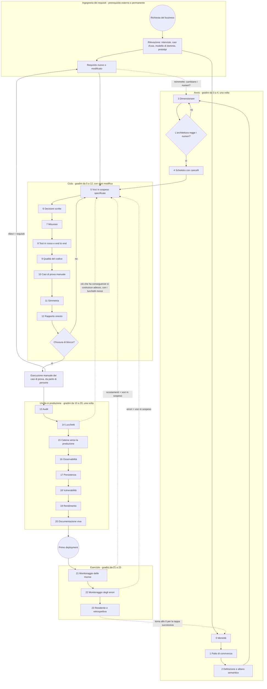

# Urazuke, il metodo del riscontro — la scala metodologica (versione 4)

Autore: Pablo Kuschniroff, assistito da Claude Code. Versione 4, iniziata il 18 ottobre 2026 e
tenuta aggiornata con ogni decisione successiva del registro (`docs/DECISIONES.md`); la data
d'inizio resta fissa di proposito, per non riscrivere la storia delle versioni ogni volta che una
nuova decisione tocca questo documento. Questo è un
documento di lavoro che continuerò a rifinire con ogni progetto che lo userà; nulla di ciò che
dice è ancora dottrina chiusa, anche se è, per quanto ne so, il primo distillato onesto di un
metodo che ha già tre sistemi in produzione alle spalle.

Prima di entrare nel merito, un'avvertenza su come è scritto, perché conta. L'ho scritto per
persone che non hanno vissuto questi progetti con me: gente che vuole costruire software con
l'intelligenza artificiale e che quel software duri, non gente che vuole imparare a programmare né
collezionare trucchi di prompt. Per questo mi prendo il tempo di spiegare, ripeto quando serve,
uso il linguaggio di tutti i giorni, e lascio alla fine un **glossario** con ogni sigla e ogni
espressione colloquiale che mi scappa. Se a un certo punto ti imbatti in una parola strana —
"cricchetto", "lucchetto", "fail-closed", "PND" —, vai al glossario; c'è tutto. E quando leggi un
segno come [Ref. 26](REFERENCIAS.md#ref-26), sappi che è una scorciatoia verso un caso reale che
racconto nel documento delle referenze, con la sua data e la sua prova; puoi ignorarlo senza
perdere il filo o seguirlo se ti interessa il dettaglio.

Il repository pubblico del metodo è
[github.com/pkuschnirof/urazuke](https://github.com/pkuschnirof/urazuke). Lì ci sono questo
documento, i contratti di ogni gradino, il manuale del corso e le referenze, nelle otto lingue che il metodo
dichiara per conto proprio.

## Il nome

**Urazuke** (裏付け) è una parola giapponese che indica il sostegno di cui dispone un'affermazione:
ciò che la regge da dietro (letteralmente, "la fodera sul retro"). Il verbo *urazukeru* significa
"sostenere con prove". L'ho scelta il 17 ottobre 2026, dopo aver scartato diversi nomi per
collisioni con aziende e progetti esistenti, e l'ho scelta perché dice esattamente ciò che il
metodo chiede: che ogni affermazione del modello arrivi con il suo riscontro, e che il riscontro
si possa verificare senza leggere il codice. Il nome non si traduce; il sottotitolo, "il metodo
del riscontro", sì: *el método de la evidencia*, *the evidence method*, *o método da evidência*,
*la méthode de la preuve*, *die Nachweis-Methode*, 裏付けの方法, 验证方法. In questo documento, "la
scala" è la struttura del metodo — i suoi ventiquattro gradini — e "Urazuke" è il metodo intero.

## Di cosa si tratta

Voglio essere chiaro su ciò che sto insegnando e su ciò che non insegno. Non sto insegnando uno
strumento. Sto insegnando un **metodo**: cosa fare in quale ordine, cosa chiedere al modello in
ogni momento, cosa deve consegnarti, e come sapere — senza leggere codice — che ciò che ti ha
consegnato è completo. La scommessa è che chiunque, con qualunque strumento di intelligenza
artificiale che serva a programmare, possa costruire software conversando con un modello invece
di digitare il codice a mano, e che ciò che ne esce sia robusto, pronto per la produzione e,
questo è l'importante, **non richieda che il proprietario del progetto riveda una sola riga di
codice**. E voglio essere altrettanto chiaro su ciò che non è: non è un processo per fare sistemi
più in fretta. È un processo per fare sistemi utilizzabili e manutenibili senza che nessuno abbia
bisogno di comprendere un solo bit del loro codice, perché il codice lo comprende e lo mantiene il
quadro agentico che lo scrive. La velocità, quando compare, è una conseguenza, e per questo in
questo documento non ci sono scadenze: le mettono la dimensione e la complessità di ogni sistema,
e il metodo mette solo l'ordine.

Una precisazione che mi è stata chiesta per iscritto, perché la frase precedente si presta a una
lettura che non è la mia: "non richiede che il proprietario riveda una sola riga di codice" non è
lo stesso che "pensato perché programmino persone senza conoscenze di sistemi". Non lo è.
L'obiettivo primario di questo metodo non è abbassare l'asticella tecnica perché chiunque possa
costruire software senza sapere nulla di come si costruisce il software: è dare a chi deve
rispondere di un sistema un ancoraggio metodologico affinché ciò che un modello costruisce esca
con la solidità dell'ingegneria dei sistemi di sempre, contrastando le debolezze con cui i modelli
applicano quegli stessi principi quando nessuno li esige per iscritto. Che il proprietario non
legga codice è una conseguenza di dove ho messo le porte e di cosa può verificare un essere umano
senza leggere un'implementazione, non la promessa che chiunque, sappia quel che sappia, possa
dirigere un progetto software senza capire nulla di ciò che sta dirigendo. Il profilo che i
contratti chiedono davvero sta nel mezzo: qualcuno che esegue un comando, gestisce una
credenziale, ripristina un backup, capisce cosa gli sta dicendo la quota di CI, e sa riconoscere
quando ciò che il modello ha consegnato non basta — non un profano puro, e nemmeno qualcuno che
già sa programmare.

E un'altra precisazione, sul costo. Seguire questa scala consuma più token che chiedere al modello
di risolvere tutto in un solo passaggio: ogni gradino aggiunge un prompt, una verifica propria, un
artefatto che il modello deve anche sostenere. Quello che non si vede a prima vista è quanto fa
risparmiare. Un sistema costruito senza queste porte tende, prima o poi, ad aver bisogno di
reingegnerizzazione: tornare indietro su un dimensionamento mai fatto, inseguire un errore che un
test in rosso avrebbe intercettato al gradino 8, riscrivere ciò che nessuno ha controllato in
tempo. Quella reingegnerizzazione, in token, in tempo e in denaro, costa di gran lunga più del
prompt in più che costa ogni gradino. Lo spendo in anticipo, con lucidità, per non spenderlo il
doppio dopo, alla cieca.

Suona ambizioso, e lo è. Ma ho qualcosa che quasi nessuno ha: tre sistemi reali che ho costruito
esattamente così, che oggi funzionano con clienti veri, e da cui ho estratto ogni regola che
segue. Quindi la domanda che mi faccio non è "si potrà?", perché si è già potuto. La domanda è
"cosa ho fatto, in che ordine, e cosa di tutto questo è ciò che ha fatto davvero la differenza?".
Questa scala è la mia risposta, ed è la base di tre cose: la documentazione del metodo, la
pratica che faranno gli allievi del corso, e i manuali. Più avanti la esporterò come flusso di
esecuzione dentro il mio strumento, perché sia lo strumento a guidare il metodo e non la memoria
di ciascuno.

## Da dove viene il metodo, e cosa non voglio che venga frainteso

C'è una lettura facile di tutto questo che voglio smontare prima che si installi: quella secondo
cui il metodo è una collezione di cerotti che ho messo dopo ogni colpo. Non è così, e ci tengo a
dirlo con precisione perché cambia come va letto ogni gradino.

Il metodo nasce da due fattori che si sono combinati, e nessuno dei due basta da solo. Il primo è
**la mia conoscenza dell'ingegneria dei sistemi**. Sono molti anni che applico ciò che chiunque
venga dai sistemi riconosce subito: rilevazione prima di progettare, requisiti scritti,
dimensionamento con numeri, progettazione, costruzione, test come prova, deployment riproducibile,
esercizio, audit periodico, documentazione come parte del prodotto. La maggior parte di ciò che
esigo nei ventiquattro gradini è ciò che ho sempre esatto in un progetto condotto bene. Non l'ho
inventato per i modelli; l'ho portato da prima.

Il secondo fattore è ciò che gli incidenti di questi cinque mesi mi hanno mostrato, uno dopo
l'altro: **dove i modelli applicano quei principi in modo fragile**. Un modello sa perfettamente
cos'è un test, cos'è una causa radice, cos'è un dimensionamento; se glielo chiedi, te lo spiega
meglio di molti ingegneri. Ma in pratica dice di aver provato e non ha provato, stima con faccia
sicura un dato che solo il business ha, riempie un buco nelle regole di business con ciò che gli è
sembrato ragionevole, riporta più del dovuto perché è stato addestrato per essere utile, e
costruisce un misuratore che mente senza accorgersene. Ciascuno di quei casi, che racconto nelle
[referenze](REFERENCIAS.md), mi ha detto esattamente dove bisognava stringere: dove un principio
che per me era ovvio doveva trasformarsi in una clausola esplicita del prompt, in un cancello, in
una verifica che io faccio senza leggere codice.

Quindi, quando in un gradino dico "questo l'ho imposto dopo il tale incidente", non sto dicendo
che il principio è nato lì. Sto dicendo che lì ho constatato che il modello non lo applicava da
solo, e che bisognava esigerglielo per iscritto. Il metodo è ingegneria dei sistemi di sempre,
applicata con la rigidità che serve per un costruttore che non si stanca e a cui non si può
credere senza prove. Le cicatrici sono la prova di dove serve la rigidità, non l'origine dei
principi.

## I tre casi d'uso del metodo

Prima di proseguire, una biforcazione che nelle prime versioni non c'era e che un lettore mi ha
chiesto a ragione. Questo documento descrive la scala guardando una cartella vuota: il gradino 0
decide se il progetto si affronta, il 4 distribuisce lo scheletro senza funzionalità, il 5 apre il
primo blocco. È il caso più chiaro per imparare, e non è il più frequente. Il metodo ha tre casi
d'uso, e conviene sapere in quale ti trovi prima di aprire l'agente, perché cambia da dove si
entra:

1. **Progetto nuovo.** Cartella vuota e un proprietario con una richiesta. Si entra dal gradino 0
   e si salgono i ventiquattro in ordine. È ciò che descrive questo documento, con i suoi
   contratti e il manuale del corso.
2. **Evolutivo-correttivo su un sistema fatto con il metodo.** Il sistema ha già salito la scala:
   ha contratto, mappa, voci in sospeso chiuse con prove, batteria, deployment e manuali. Si entra
   dal gradino 5, aprendo un blocco, e si segue il ciclo; il 13 periodico; il 23 alla chiusura di
   ogni tappa. È la fase 4 della linea del tempo (Parte B).
3. **Evolutivo-correttivo su un sistema fatto senza il metodo.** Un sistema che gira, con utenti,
   fatto da un altro o da sé stessi senza prove, che bisogna correggere o far crescere. Non si
   entra dallo 0 né dal 5: si entra da un **tratto di normalizzazione** di otto stazioni (da N0 a
   N7) che recupera, per autoscoperta e con le marche di origine, tutti gli input che i gradini
   dell'avvio producono, costruisce una cintura di sicurezza attorno al sistema senza riscriverlo,
   e solo dopo apre il ciclo in modalità correttiva o evolutiva. Quel percorso sta in una pagina
   propria, il [percorso evolutivo-correttivo](EVOLUTIVO_CORRECTIVO.md), e ha la sua parte del
   corso con un secondo progetto guida.

Ciò che resta fuori, nominato: la migrazione tecnologica non è un caso d'uso del metodo; è un
altro progetto, e in generale cade nei criteri escludenti del gradino 0.

## L'IA non interrompe il metodo: lo continua

Questa è la tesi che apre tutto, e la metto per prima perché smonta l'obiezione più comune prima
che compaia: "come fai a fidarti di codice che ha scritto una macchina?".

La mia risposta è che **l'industria ha già smesso di fidarsi dell'autore del codice vent'anni fa**.
Quando il grosso della scrittura è passato a team junior, esternalizzati o a rotazione, la
revisione riga per riga è diventata impossibile da sostenere. E ciò che è cresciuto al suo posto è
tutto quello che oggi diamo per scontato: i test automatizzati, l'integrazione continua, i criteri
di accettazione, le pipeline che non lasciano passare nulla senza verde, lo "shift left" dei test,
il controllo di qualità come funzione indipendente. Quella è stata la risposta dell'ingegneria dei
sistemi a "chi scrive non è affidabile": non leggergli il codice, esigergli prove.

Mettere un modello a scrivere, allora, non è un salto nel vuoto. È cambiare un autore di cui già
non ci fidavamo con un altro di cui nemmeno, e per il quale **avevamo già montato l'apparato di
verifica**. Questo dovrebbe tranquillizzare, non inquietare. E per di più il nuovo autore è più
economico, più veloce, e — a differenza del junior — non si offende quando gli chiedi di provare in
rosso.

Per questo questo metodo si appoggia, senza nasconderlo, all'ingegneria dei sistemi classica. Lo
scheletro è quello di sempre. Non poteva essere altrimenti, perché i problemi sono quelli di
sempre: non sapere quanti dati ci saranno, non sapere cosa vuole il cliente, non sapere se ciò che
si è costruito è ciò che era stato chiesto. L'IA non ha cambiato i problemi; ha cambiato chi fa
ogni parte e a quale costo. Perfino il criterio di idoneità X2 del gradino 0 è ingegneria
classica: testabilità come condizione di contratto.

### Cosa è vecchio e cosa è nuovo in tutto questo

Il vecchio, e conviene dire che è vecchio: lo scheletro delle fasi, l'indipendenza di chi verifica
rispetto a chi costruisce, i test come prova, la documentazione come parte del prodotto, la
rilevazione prima della progettazione.

Ciò che sì cambia, ed è dove sta il mio contributo, sono tre cose:

1. **Dove va lo sforzo dell'umano.** Nel metodo classico l'umano scrive la specifica, scrive il
   codice, e un altro umano lo rivede. Qui l'umano fa due cose soltanto: **decide, e verifica
   artefatti**. Tutto il resto — redigere, costruire, provare, misurare, documentare — lo fa il
   modello. Per questo ogni gradino termina in una "verifica di completezza senza leggere codice":
   è il punto esatto in cui l'umano resta imprescindibile, e nessun altro.

2. **L'autore fabbrica anche la prova.** Questo è l'unico punto genuinamente nuovo, ed è la
   sfumatura che giustifica tre gradini interi. Il junior scriveva codice dubbio, ma non fabbricava
   la prova: i test e le misurazioni li montava un altro, o almeno un altro li guardava. Il
   modello, invece, produce il codice *e* il test *e* il misuratore *e* il rapporto, nella stessa
   sessione, con la stessa sicurezza nella voce quando è giusto e quando è sbagliato. L'ho visto:
   il misuratore che ha mentito due volte [Ref. 36](REFERENCIAS.md#ref-36), l'errore di
   autenticazione riportato come "successo" [Ref. 43](REFERENCIAS.md#ref-43), le tre affermazioni
   su quattro che erano sbagliate. Allora "rivedere le prove invece del codice" continua a essere
   il principio corretto, ma **la prova deve dimostrare se stessa**: il test visto in rosso
   (gradino 8), lo strumento con la sua guardia (gradino 7), il rapporto che separa il verificato
   dal creduto (gradino 12), l'auditor diverso dal costruttore (gradino 13). Non è una
   preoccupazione nuova: è la stessa disciplina di indipendenza del controllo di qualità, portata
   un passo più dentro.

3. **Il costo degli artefatti.** Nel metodo classico la documentazione era cara, quindi si faceva
   una volta e invecchiava. Qui rigenerarla è gratis, quindi la regola diventa "nello stesso
   commit" e "riproducibile a mano, senza IA". Ciò che prima era un ideale irraggiungibile diventa
   un cancello.

Per il corso e per la presentazione pubblica, questo definisce il posizionamento con onestà: non è
"il nuovo modo di programmare"; è **ingegneria dei sistemi applicata a un costruttore che non si
stanca e a cui non si può credere**. A chi viene dai sistemi suona familiare e gli abbassa la
diffidenza; a chi viene dal vibecoding dà ciò che non ha, che è proprio lo scheletro. E mi
differenzia dagli strumenti che vendono velocità e omettono lo scheletro intero.

---

## Parte A — Come leggere ogni gradino

Ogni gradino ha otto parti, sempre le stesse, perché si possano confrontare:

- **Intenzione**: cosa cerca, in una frase.
- **Quando**: in quale momento del progetto si sale, e se si sale una volta o si ripete. Questa
  parte è nuova nella versione 4 e la spiego in dettaglio nella Parte B, perché un metodo senza
  linea del tempo è una lista di buone intenzioni.
- **Input**: cosa deve esistere prima per poterlo salire.
- **Artefatto**: cosa resta scritto o eseguibile quando si sale. È sempre qualcosa di concreto: un
  file, un test, uno script.
- **Cancello**: cosa deve essere vero per passare al successivo. Se non si soddisfa, non si sale.
- **Chi decide**: il proprietario del progetto, l'agente, o nessuno perché è automatico.
- **Fallimento che evita**: il tipo di problema che il gradino previene, con una referenza breve
  al caso reale in cui l'ho constatato.
- **Contratto**: il file in cui c'è come si esegue: contesto, prompt, risultato, verifica, segnali
  d'allarme.

E c'è una parte in più, che compare **solo in sei gradini** ed è un pezzo trasversale che cambia
cosa bisogna leggere: l'**Allegato H** ([`ANEXO_HEURISTICAS.md`](ANEXO_HEURISTICAS.md)).
Quarantacinque regole verificabili — diciotto di qualità del codice e ventisette di usabilità —,
ciascuna con il suo identificatore stabile, la sua severità e lo strumento che la misura. Non è
un'appendice opzionale: **è obbligatorio**, e si aggancia alla scala in sei punti. Al gradino 2
entrano i suoi due **ingressi previi** (il glossario dell'utente e la lista dei profili: le parole
che la gente usa davvero per ogni cosa, e chi è ciascuno e cosa viene a fare). E ai gradini 5, 8,
9, 10 e 12 ci sono le sue cinque **ancore** — "ancora" vuol dire che la paratia di quel gradino non
va al verde se il pezzo dell'allegato non c'è. Quelle cinque sono esigenze meccaniche nella
definizione pubblicata delle paratie, non raccomandazioni: uno strumento che compila il metodo le
chiederà. Ognuno di quei sei gradini lo dice nella sua scheda, con il link, e c'è una verifica nella
catena del metodo stesso che va in rosso se qualcuna smette di dirlo. È nata dall'averlo scoperto
tardi: l'allegato è stato obbligatorio e non nominato in questo documento, e il primo lettore che ha
adattato il metodo a un altro formato ha saltato ventisette delle quarantacinque regole perché non
ha mai saputo che esistevano.

Due chiarimenti importanti. Primo: **la scala è neutrale rispetto allo strumento**. Ogni artefatto
è un file, un test o uno script; nessuno esige il mio strumento né nessun altro. Forge li
automatizza (i cancelli, i comandi, il registro delle voci in sospeso), ma il gradino esiste
senza Forge. Secondo: **i gradini sono numerati nell'ordine in cui si salgono**, e si raggruppano
in quattro fasi: quelli dallo 0 al 4 sono di avvio e si salgono una volta per progetto; quelli dal
5 al 12 sono il ciclo che si ripete con ogni modifica; quelli dal 13 al 20 sono di uscita in
produzione, e si salgono una volta, prima del primo deployment; e quelli dal 21 al 23 sono di
esercizio, quando il sistema è già vivo. Il 23 chiude il ciclo e torna allo 0 per il progetto
successivo. Dentro una fase, il numero dice l'ordine; tra fasi, il ciclo si ripete mentre le altre
tre si salgono una volta. Ma "non strettamente sequenziali" non vuol dire "in qualunque ordine":
la Parte B dice esattamente quando si sale ciascuno e cosa succede nel mezzo.

---

## Parte B — La linea del tempo: quando si sale ogni gradino e cosa succede nel mezzo

Questa parte non esisteva nelle versioni precedenti, e la sua assenza era un difetto serio: il
metodo diceva cosa fare e come verificarlo, ma non diceva **quando**. E "quando" è la metà di un
metodo. Un lettore che lo prendesse alla lettera poteva salire i ventiquattro gradini uno dopo
l'altro e chiedersi in quale momento si fanno, allora, l'infrastruttura, la catena di integrazione e
deployment continui, l'acquisizione dei requisiti, lo sviluppo della funzionalità, le prove end to
end di tutti i flussi, lo sguardo umano sulle schermate, e le prove umane di accettazione. Tutto
questo succede, e succede in momenti precisi, tra i gradini e dentro di essi. Qui lo scrivo.

### B.0 Il processo intero, in un grafico

Prima delle tabelle, il disegno. È in notazione di processo (nello stile BPMN: eventi tondi,
compiti rettangolari, cancelli a rombo, frecce di ritorno punteggiate), e dice tre cose che le
tabelle dicono peggio. Prima: il processo **comincia fuori dal metodo**, nell'ingegneria dei
requisiti, che è un prerequisito e per di più è permanente: non finisce mai, e ogni requisito
nuovo rientra. Seconda: un requisito nuovo non entra solo nel ciclo; **reimmette nei gradini di
valutazione**, perché può cambiare i numeri con cui si è decisa l'architettura (regge ancora il
"per dieci"?), e da lì in avanti. Terza: il processo **termina nell'esecuzione manuale dei casi
di prova** da parte di persone (gradino 10), e ciò che quell'esecuzione trova torna nel ciclo come
requisito. Il circuito si chiude con le persone, non con le macchine. Quarta, e il disegno non lo
mostrava prima di questa correzione: quando ciò che il sistema costruisce ha una conseguenza sul
mondo (addebitare, inviare), il ciclo **si riapre dopo il gradino 14**, con i lucchetti già messi,
per costruire quella parte in modalità prova generale prima di proseguire verso la catena di
produzione (15). Non è un ritorno all'inizio: è lo stesso cancello di sempre (chiusura del blocco?)
percorso un'altra volta, ora con la rete di sicurezza pronta.

Se il disegno non si vede (il visualizzatore di markdown non disegna mermaid), il testo qui sopra
lo descrive per intero; nella versione HTML si disegna da solo.

### B.1 Le cinque fasi di un progetto

Un progetto condotto con questo metodo passa per cinque fasi. Le tre del mezzo sono quelle che
corrispondono alle fasi del ciclo, dell'uscita in produzione e dell'esercizio; la fase 1 è la fase
di avvio; e la fase 0 è l'acquisizione iniziale, che il metodo copre comunque anche se non è un
"gradino" in sé. Non metto durate: dipendono dalla dimensione e dalla complessità di ciò che si
chiede, e una durata scritta si trasforma in un'aspettativa falsa. Ciò che non dipende dalla
dimensione è l'ordine.

| Fase | Gradini che si salgono | Cos'altro succede in quella fase |
|---|---|---|
| 0. Acquisizione | nessuno ancora; è la materia prima dello 0, del 2, del 3 e del 5 | Rilevazione del business con il proprietario, con i metodi classici dell'ingegneria dei requisiti (vedi B.5): interviste, casi d'uso o storie utente, modello di dominio, prototipi di schermata. Si scrive in prosa, incompleta apposta; l'agente la completa chiedendo. |
| 1. Avvio | 0, 1, 2, 3, 4 | Idoneità, patto, definizione, dimensionamento. E **tutta l'infrastruttura iniziale**: il repository, l'ambiente di test, l'integrazione continua, il primo deployment con il sistema vuoto. |
| 2. Ciclo | da 5 a 12 con ogni modifica: voci in sospeso, decisioni, misurare, test in rosso, qualità, casi di prova manuale, simmetria, rapporto | Sviluppo funzionale blocco per blocco; test in rosso; prove end to end del flusso appena costruito; sguardo umano su ogni schermata nuova; alla chiusura di ogni blocco, prove umane nell'ambiente di test. |
| 3. Uscita in produzione | da 13 a 20, in ordine: audit, lucchetti, catena verso la produzione, osservabilità, persistenza, vulnerabilità, rendimento, documentazione | Audit da parte di un'altra sessione; lucchetti su tutto ciò che agisce sul mondo; chiusura della catena di deployment in produzione con rollback provato; i tre manuali; test di accettazione con il proprietario su tutti i flussi. |
| 4. Esercizio | 21 e 22 montati con il primo deployment; 23 alla chiusura di ogni tappa; il ciclo (da 5 a 12) per ogni evoluzione; 13 e 18 periodici | Agente residente; audit ogni uno o due mesi; ogni modifica nuova entra dal ciclo completo ed esce dalla catena di deployment; retrospettiva alla chiusura di ogni tappa. |

Questa tabella è quella del progetto nuovo. Quando il sistema esiste già e non è nato con il
metodo, le fasi 0 e 1 si sostituiscono con il tratto di normalizzazione (lettura, cintura,
misurare e ordinare) che sta nel [percorso evolutivo-correttivo](EVOLUTIVO_CORRECTIVO.md); le
fasi 2, 3 e 4 sono le stesse.

In un progetto con utenti e conseguenze, ciò che cresce è il ciclo: la funzionalità. L'avvio,
l'uscita in produzione e l'esercizio hanno la stessa forma in un sistema piccolo e in uno grande;
cambia quanto bisogna misurare, non cosa.

### B.2 Cosa succede tra un gradino e l'altro

Qui c'è ciò che mancava. Per ogni fase, quali compiti di ogni tipo si fanno e in quale momento
esatto rispetto ai gradini. Leggi la tabella per righe: ogni riga è un tipo di lavoro, e ogni
cella dice quando si fa dentro quella fase.

| Tipo di lavoro | Avvio (gradini da 0 a 4) | Ciclo (gradini da 5 a 12, per blocco) | Uscita in produzione (da 13 a 20) | Esercizio (da 21 a 23 e ciclo) |
|---|---|---|---|---|
| **Acquisizione dei requisiti** | Prima del gradino 0: rilevazione in prosa con il proprietario, con interviste, casi d'uso e modello di dominio. Si completa nel 2 (definizione e albero semantico) e nel 3 (volumetria). | All'apertura di ogni blocco: la richiesta del cliente per quel blocco, così come la direbbe lui, si trasforma in voci in sospeso con **specifica dettagliata** (gradino 5): descrizione, criteri di accettazione, regole applicabili, dati, schermate, casi limite. Le domande che l'agente fa sono l'acquisizione fine. | Prima del 14: rilevazione delle azioni con conseguenza. Prima del 15: rilevazione di ambienti e accessi. | Ogni richiesta nuova entra come voce in sospeso specificata, appesa al suo nodo dell'albero semantico; l'agente residente raccoglie ciò che gli utenti chiedono. |
| **Infrastruttura** | Tutta quella iniziale, nel gradino 4: repository, struttura, ambiente di test, credenziali, dominio di test. Non si costruisce funzionalità finché lo scheletro vuoto non è distribuito. | Nessuna, salvo che un blocco la esiga (una coda, un servizio esterno). Se la esige, è una voce in sospeso con il suo test. | Nel 15: ambiente di produzione, segreti sul server, dominio reale, backup, monitoraggio minimo. | Le modifiche di infrastruttura entrano dal ciclo e dal 15; mai "a mano, in fretta". |
| **Catena CI/CD** | Nel gradino 4: l'integrazione continua esegue la batteria a ogni push fin dall'avvio, e il deployment all'ambiente di test è automatico alla fusione. | Funziona da sola. Ogni commit la attraversa; se non è in verde, il blocco non si chiude. | Nel 15 si completa: il deployment in produzione aspetta il risultato dell'integrazione e si limita a impacchettare; la promozione è una procedura scritta; il rollback si prova. | Ogni deployment segue la routine del 15: test in verde con la stessa versione, rollback pronto, verifica end to end in produzione dopo. |
| **Sviluppo funzionale** | Nessuno. Lo scheletro si distribuisce vuoto apposta. | È il centro del ciclo: l'agente prende una voce in sospeso (5), chiede le regole di business che mancano (6), costruisce, e chiude con prove (7, 8, 9, 10, 11, 12). Blocco per blocco, dal basilare a ciò che ha conseguenze. | Ciò che agisce sul mondo (incassare, inviare) si costruisce nel ciclo **dopo** il gradino 14, con i suoi lucchetti, e parte in modalità di prova. | Le evoluzioni entrano dal ciclo. |
| **Test automatici** | Un test di fumo che passa, nel 4. È il seme della batteria. | Con ogni voce in sospeso: il test provato in rosso (8), la regressione dei vicini nella stessa sessione, e **una prova end to end del flusso appena costruito**, dalla schermata fino al backend. Alla chiusura di un blocco: la batteria completa end to end di **tutti** i flussi esistenti, nell'ambiente di test. | Prima del primo deployment in produzione: la batteria completa end to end di tutti i flussi, in verde, con la stessa versione che si promuoverà. Dopo il deployment: una verifica end to end sulla produzione, in sola lettura. | Con ogni modifica, lo stesso del ciclo. |
| **Sguardo umano sulle schermate** | Alla chiusura del 4: il proprietario apre l'URL dell'ambiente di test e vede la schermata vuota. Sembra banale ed è la prima volta che qualcuno che non è l'agente guarda il sistema. | **Con ogni voce in sospeso che tocca una schermata**: l'agente consegna una schermata catturata dall'ambiente di test e il proprietario la guarda. Dieci secondi. È il modo più economico di trovare ciò che nessun test trova: che il pulsante è dove non deve, che il testo dice un'altra cosa, che il flusso non è quello che il business immaginava. | Nel 20: le catture del manuale utente sono l'ultimo sguardo umano sistematico prima della produzione. | Ogni schermata nuova o modificata, come nel ciclo. |
| **Prove umane** | Nessuna ancora, salvo aprire la schermata vuota. | **Alla chiusura di ogni blocco funzionale**: il proprietario, o un utente di fiducia, usa il sistema nell'ambiente di test come lo userebbe davvero, seguendo i flussi del blocco. Ciò che trova si annota come voci in sospeso. Non si apre il blocco successivo con rilievi umani senza voce in sospeso. | Prima del primo deployment in produzione: **test di accettazione** del proprietario su tutti i flussi, con dati di test realistici, nell'ambiente di test. E nel 20, una persona che non programma segue il manuale di ripristino. | Con ogni evoluzione, alla chiusura del suo blocco. |
| **Decisioni del proprietario** | Nello 0 (va o non va), nell'1 (il patto), nel 2 (cosa NON è), nel 3 (l'opzione di architettura). | Ogni volta che l'agente si ferma per una regola di business non scritta (6). Di solito sono due o tre per blocco. | Nel 14 (lucchetto per lucchetto), nel 15 (promuovere in produzione), nel 23 (il livello dell'agente residente). | Quelle che emergono; sempre scritte. |

Un dettaglio che voglio sottolineare perché è dove sbaglia di più chi viene dal vibecoding: **le
prove end to end di tutti i flussi non sono una sola volta alla fine**. Sono tre volte, su tre
scale. Con ogni voce in sospeso, il flusso che quella voce ha toccato. Alla chiusura di ogni
blocco, tutti i flussi che esistono fino a lì. E prima della produzione, tutti i flussi con la
versione esatta che si promuoverà. Se fai solo la terza, arrivi alla fine con un sistema che
nessuno ha provato end to end per settimane e l'uscita in produzione si trasforma in una
settimana di aggiustamenti.

### B.3 Il ritmo del ciclo: un blocco funzionale tipico

Un blocco funzionale è un insieme di tra quattro e otto voci in sospeso correlate, che insieme
fanno qualcosa che il business può usare: "l'agenda di base", "i promemoria", "il rapporto
mensile". Così si vede da dentro:

1. **Apertura del blocco.** Il proprietario racconta, in prosa, cosa vuole per questo blocco.
   L'agente lo trasforma in voci in sospeso numerate, con il loro "come si verifica", e chiede ciò
   che non basta per scrivere una voce verificabile (gradino 5). Il proprietario dà le priorità.
2. **Ogni voce in sospeso.** L'agente annuncia quale voce prende e perché. Se lungo la strada
   compare una regola di business che non è scritta, si ferma e chiede (6). Se la voce dipende da
   un numero — quante query, quanto ci mette —, prima lo misura con uno strumento con test (7).
   Costruisce. Quando finisce, chiude in quest'ordine: il test provato in rosso, verde, la
   regressione dei vicini e una prova end to end del flusso toccato (8); il cancello di qualità
   del codice in verde (9); i casi di prova manuale del flusso, scritti per una persona (10); e,
   se la modifica ha toccato un contratto tra due parti del sistema, l'altro lato aggiornato nello
   stesso commit (11). Il rapporto separa il verificato dal creduto e dichiara i punti ciechi (12).
   Il proprietario legge il rapporto e guarda la cattura della schermata. Non legge codice.
3. **Chiusura del blocco.** La batteria completa end to end in verde nell'ambiente di test. Il
   proprietario o un utente di fiducia esegue i casi di prova manuale del blocco (10) e annota
   cosa è successo e cosa è fallito; ogni fallimento torna nel ciclo come voce in sospeso
   correttiva. Si legge il rapporto di qualità del blocco (9). Si aggiorna il manuale utente con
   le schermate nuove (20, nello stesso commit). Solo allora si apre il blocco successivo.

In una giornata tipica del ciclo, ciò che il metodo chiede al proprietario è poco e limitato:
rispondere a due o tre domande di regole di business, leggere due o tre rapporti, guardare due o
tre catture. Questo è tutto. Se gli sta chiedendo di più, o l'agente sta chiedendo ciò che potrebbe
risolvere da solo (gradino 1), o il proprietario sta leggendo codice (e allora qualcosa del
gradino 8 o del 12 non sta funzionando).

### B.4 I momenti umani

Riassumo in una lista i momenti in cui un umano, il proprietario o qualcuno di sua fiducia, deve
guardare o usare il sistema. Sono pochi, stanno in momenti precisi, e nessuno si può delegare
all'agente:

- **Fine dell'avvio**: aprire l'URL dell'ambiente di test e vedere il sistema vuoto.
- **Con ogni voce in sospeso che tocca una schermata**: guardare la cattura reale dell'ambiente di
  test.
- **Alla chiusura di ogni blocco**: eseguire i casi di prova manuale del blocco (10)
  nell'ambiente di test e annotare il risultato; ciò che fallisce torna nel ciclo come requisito.
- **Prima del primo deployment in produzione**: test di accettazione su tutti i flussi, seguendo
  tutti i casi di prova manuale.
- **Nel gradino 20**: una persona che non programma segue il manuale di ripristino nell'ambiente di
  test.
- **Dopo ogni deployment in produzione**: verificare che la versione che gira è quella voluta, e
  fare una passata in sola lettura sui flussi critici.
- **Prima del primo deployment, nel 19**: leggere i numeri della prova di carico con la tolleranza
  del business accanto, e il punto di rottura.
- **In ogni ciclo del monitoraggio (21 e 22)**: leggere il rapporto ciclico con l'agente e
  decidere quale scostamento e quale errore diventano voci in sospeso.

Tutto il resto — i test, le misurazioni, gli audit, la documentazione — lo fa il modello e l'umano
lo verifica dall'artefatto, non dal codice.

### B.5 Come entrano i requisiti: dalla rilevazione all'albero semantico e alle voci in sospeso

Voglio soffermarmi su questo perché è dove l'ingegneria dei sistemi classica ha più da dire e dove
il vibecoding la ignora con più entusiasmo. Un requisito non è una frase del cliente in una chat.
È una frase del cliente **elaborata** con metodi che esistono da decenni e che continuano a valere
con un modello davanti, perché il modello è molto bravo ad applicarli se glielo chiedi e molto
scarso ad applicarli se non lo fai.

I metodi che uso, e che il metodo esige in ogni fase:

- **Interviste con il proprietario**, aperte, in prosa, registrate. Sono la fase 0. Non cerco che
  siano complete: cerco che l'agente rilevi cosa manca loro.
- **Casi d'uso o storie utente**, uno per flusso che il business sa nominare: "la receptionist
  carica un appuntamento", "il paziente riceve il promemoria". Ciascuno ha attore, evento
  scatenante, passi, risultato ed eccezioni. Sono l'unità con cui si apre un blocco funzionale.
- **Modello di dominio**: le entità del business, i loro attributi, i loro stati possibili e le
  transizioni tra stati. È il cuore dell'albero semantico (vedi sotto) ed è ciò che evita che il
  modello inventi stati che il business non ha.
- **Criteri di accettazione** per storia, nella forma "dato tale situazione, quando succede tale
  cosa, allora si vede tale risultato". Sono quelli che si trasformano nel "come si verifica" di
  ogni voce in sospeso e, dopo, nel test end to end.
- **Prototipi di schermata**, anche se sono un disegno. Lo sguardo umano sulle schermate comincia
  qui, prima che esista codice.
- **Tracciabilità**: ogni requisito si può seguire fino alla voce in sospeso che lo implementa, al
  test che lo prova e al commit che l'ha chiuso. Nel metodo la tracciabilità non è una matrice a
  parte: è la voce in sospeso stessa, che cita la sua origine e la sua prova.

**L'albero semantico.** È l'artefatto che ordina tutto questo ed è la mappa che l'agente legge in
ogni sessione (gradino 2). È un albero, non una lista: il sistema alla radice; sotto, i domini o
moduli; sotto ciascuno, i suoi attori, i suoi processi (i casi d'uso), le sue entità con i loro
stati, le sue schermate e le sue integrazioni esterne; e appese a ogni nodo, le voci in sospeso
che lo toccano e le decisioni che lo riguardano. Lo costruisce l'agente a partire dalla
rilevazione, lo correggi tu, e cresce con ogni blocco. Il suo valore è doppio: dà al modello il
contesto esatto del nodo che sta per toccare senza dover leggere tutto il progetto, e dà a te un
modo di verificare che il sistema che l'agente capisce è quello che il business ha chiesto, senza
leggere codice. Quando una voce in sospeso non è appesa a nessun nodo, o l'albero è incompleto o
la voce è fuori perimetro; entrambe le cose si vedono in dieci secondi.

**La specifica dettagliata vive nella voce in sospeso.** Nel metodo classico c'era un documento di
specifica dei requisiti, lungo, che invecchiava. Qui quel documento si scompone: ogni voce in
sospeso porta la propria specifica completa, e la somma delle voci in sospeso è la specifica del
sistema. Una voce ben scritta ha: titolo; il nodo dell'albero semantico a cui è appesa; la storia
o il caso d'uso che la origina, con le parole del cliente; la descrizione dettagliata di ciò che
si chiede; le regole di business applicabili, con la loro decisione e la loro data; i dati che
entrano ed escono; le schermate interessate, con il prototipo se c'è; i casi limite e le
eccezioni; i criteri di accettazione; e come si verifica. L'agente la redige a partire dalla tua
richiesta in prosa, chiede ciò che non basta per specificare, e tu la leggi prima che si
costruisca. Leggere la specifica di una voce in sospeso è il più vicino che sarai mai a leggere
codice, ed è esattamente la distanza giusta.

**Le voci in sospeso chiuse sono documentazione.** Questo è ciò che chiude il cerchio. Quando una
voce in sospeso si chiude, non si cancella né si archivia vuota: resta con la sua specifica, la
decisione che l'ha originata, la prova con cui è stata chiusa (i numeri del rosso e del verde, la
cattura della schermata, il numero misurato), il commit, e la data. La coda delle voci in sospeso
chiuse è, allora, lo storico funzionale del sistema: cosa si è costruito, perché, quando, e come
si è provato. Da lì escono il diario delle modifiche, le sezioni nuove del manuale utente e,
quando qualcuno chiede sei mesi dopo "perché il sistema fa questo?", la risposta. Il manuale del
corso insegna a esigere questa documentazione alla chiusura di ogni voce in sospeso, nella stessa
sessione, come parte della routine del gradino 5.

---

## Parte C — I ventiquattro gradini

Vanno nell'ordine in cui si salgono. I sei gradini di qualità operativa (da 16 a 19 prima del
primo deployment; 21 e 22 dopo) sono quelli che io facevo senza nominarli: che il sistema si possa
**vedere** mentre gira, che regga il volume per cui è stato dimensionato, che non abbia buchi
noti, e che, una volta in produzione, nessuno venga a sapere di un problema da un utente
arrabbiato. I due monitoraggi finiscono nello stesso posto di tutto il resto: il ciclo, come voci
in sospeso correttive. Se sei alle prime armi, ogni contratto di quei sei, e quelli dei gradini 9
e 10, comincia con un paragrafo che spiega le sue parole nel linguaggio di tutti i giorni, e il
glossario le ha tutte.

E un avvertimento prima di cominciare a leggerli, perché costa più caro dopo che adesso: sei dei
ventiquattro non si salgono solo con quello che dice la loro scheda. Il gradino 2 porta i due
ingressi previi dell'[Allegato H](ANEXO_HEURISTICAS.md) — il glossario dell'utente e la lista dei
profili — e i gradini 5, 8, 9, 10 e 12 portano le sue cinque ancore. Ognuno dei sei lo dice nella
sua scheda, alla fine, in una riga che comincia con **Allegato H**. Se hai intenzione di applicare
il metodo, leggi l'allegato prima di aprire il gradino 5: cinque delle tue paratie non vanno al
verde senza di esso, e accorgersene quando la paratia ti ha già fermato è il modo peggiore di
accorgersene.

### Passo 0 — Questo progetto si può affrontare così? (l'idoneità)

C'è qualcosa di previo a tutto, che non sta in nessun repository perché è sempre arrivato già
deciso: la decisione di **se un progetto si affronta con questo metodo o no**. È un criterio che
ho vissuto nella mia testa per mesi e che sto finendo di scrivere. I due criteri escludenti li ho
già chiari, e vengono dai progetti che ho rifiutato, non da quelli che ho accettato
[Ref. 46](REFERENCIAS.md#ref-46): i "no" definiscono il confine meglio dei "sì". I criteri che
pesano li sto ancora calibrando, e così li segno.

- **Intenzione**: decidere se un progetto si affronta con questo metodo, e con un agente davanti,
  o no, PRIMA di aprire il repository. Perché se entri in un progetto che non regge, il metodo
  degrada in "programmare con l'IA" e lì sì che il proprietario finisce per leggere codice.
- **Quando**: una sola volta, prima di qualunque altra cosa. Se il sistema esiste già, questo
  gradino si sale nella sua versione per i legacy (la stazione N0 del
  [percorso evolutivo-correttivo](EVOLUTIVO_CORRECTIVO.md)), con quattro criteri in più e X2
  misurato schermata per schermata.
- **Input**: la richiesta del cliente, il dominio del business, i dati, la tecnologia, gli
  ambienti disponibili, e chi sarà il proprietario.
- **Artefatto**: una scheda di idoneità di una pagina, con i criteri valutati e la decisione: va,
  non va, o va con condizioni.
- **Cancello**: i criteri escludenti sono tutti in verde, e il punteggio di quelli che pesano
  supera la soglia (soglia che non ho ancora definito).
- **Chi decide**: il proprietario. Oggi sono io; l'idea è che il metodo permetta che lo decida
  un'altra persona con la stessa scheda.
- **Fallimento che evita**: infilarsi in un progetto in cui l'agente non può verificarsi da solo,
  o in cui non c'è un proprietario del dominio che decida, e finire con l'umano che rivede codice
  riga per riga.
- **Contratto**: `peldanos/peldano-00-elegibilidad.md`.

**I due criteri escludenti.**

| # | Criterio escludente | Perché uccide il metodo |
|---|---|---|
| X1 | Tecnologia ereditata senza repository accessibile, o con repository che non seguono uno standard | Senza un repository standard non c'è dove lasciare la prova: niente voci in sospeso citate nei commit (gradino 5), né test che viaggino con il codice (8), né integrazione e deployment come pacchetto (15), né documentazione nello stesso commit (20). L'agente lavora alla cieca e non lascia traccia verificabile. |
| X2 | Tecnologia che non si può provare end to end: non si possono eseguire le schermate e accedere a ogni elemento dell'interfaccia con i suoi diversi metodi, validando che la modifica sia arrivata al backend | Senza quella verifica da schermata a backend l'agente non può provarsi da solo (gradini 8, 7 e 12), e allora il proprietario dovrebbe leggere codice, che è proprio ciò che il metodo promette di evitare. |

Una precisazione che vale oro per la neutralità di strumento: **NAC3 (il protocollo che il mio
strumento usa perché le schermate si possano operare da programma) NON è condizione; è il mezzo
con cui oggi ci riesco**. Il criterio neutrale resta così: l'interfaccia si può eseguire da
programma, e ogni elemento della schermata è accessibile con i suoi diversi metodi (cliccare,
digitare, leggerne lo stato), in modo che un test possa percorrere la schermata e poi verificare
l'effetto nel backend. Una tecnologia la cui interfaccia non espone i suoi elementi a un "driver"
(come Playwright, per esempio) resta fuori, anche se ha un repository.

E una lettura che mi sembra importante: in fondo X1 e X2 sono **la stessa condizione vista da due
lati**. L'agente deve potersi verificare da solo, end to end, e lasciare la prova nel repository.
X1 è la metà "dove resta la prova?"; X2 è la metà "come si produce la prova?".

`[ipotesi]` **Criteri che pesano, ancora senza peso.** Li lascio segnati come ipotesi finché non
li calibro con i primi progetti che useranno il metodo end to end.

| # | Criterio candidato | Come si è visto nei casi | Escludente? |
|---|---|---|---|
| D1 | C'è un proprietario del dominio con criterio e con tempo per decidere (non per programmare) | nei tre sistemi, con le decisioni scritte con data | `[?]` |
| D2 | C'è un "oracolo" di verità verificabile: dati reali, un sistema esterno, produzione in sola lettura | la Mutua e il suo Autorizzatore come oracolo [Ref. 26](REFERENCIAS.md#ref-26) | `[?]` |
| D4 | La tecnologia rientra in ciò che l'agente padroneggia senza inventare (Node, Python, SQL, React) | tutti e tre | `[?]` |
| D5 | L'errore ha conseguenze reali (soldi, salute, esercizio), il che giustifica il fail-closed | la Mutua (salute, addebiti), l'Associazione (famiglie) | `[?]` |
| D6 | La volumetria si può conoscere dal primo giorno | Kikan: 3,4 milioni di righe all'anno [Ref. 15](REFERENCIAS.md#ref-15) | `[?]` |
| D7 | Il cliente tollera un tempo di maturazione e un umano nel circuito | l'approvatore automatico con modalità di prova [Ref. 28](REFERENCIAS.md#ref-28) | `[?]` |
| D9 | Il perimetro sta in un repository e un proprietario | tutti e tre | `[?]` |
| D10 | I segreti e gli accessi si possono isolare (cassaforte, file di ambiente, permessi limitati) | la chiave API associata a chi l'ha creata [Ref. 13](REFERENCIAS.md#ref-13) | `[?]` |

Due criteri che avevo nelle versioni precedenti (che l'agente possa provare da solo, e che il
progetto sia nuovo o verificabile con audit) li ho assorbiti rispettivamente in X2 e in X1,
perché sono conseguenze e non criteri a parte.

### Passo 1 — Il patto di convivenza (le regole prima del codice)

Prima di scrivere una sola riga, metti per iscritto come lavorerete tu e l'agente. Sembra una
formalità, e non lo è: è ciò che evita l'ottanta per cento delle frustrazioni del mese uno. Pensa
che l'agente arriva ogni mattina senza memoria di ieri; ciò che non è scritto glielo dovrai
ripetere ogni volta, e ogni volta un po' diverso.

- **Intenzione**: fissare come lavorano l'umano e l'agente prima della prima riga di codice.
- **Quando**: una sola volta, immediatamente dopo l'idoneità. Si rivede quando un colpo lo
  esige.
- **Input**: nulla del progetto; è il primo file. Da te: le tue preferenze di lavoro.
- **Artefatto**: un documento di standard di qualità che dica, come minimo: il tempo dell'umano è
  sacro (non lo si spende in cose che l'agente può risolvere da solo); zero debito tecnico, cioè,
  quando qualcosa si rompe si corregge alla radice e si aggiunge la regressione nella stessa
  sessione; il perimetro è esatto, né più né meno di ciò che è stato chiesto; si parla nella
  lingua dell'utente; la documentazione si aggiorna nello stesso commit; e non si annuncia mai
  come fatto qualcosa che non è stato fatto.
- **Cancello**: il patto è nel repository e si legge in ogni sessione.
- **Chi decide**: il proprietario. L'agente può proporre modifiche, ma non edita il patto per
  conto suo.
- **Fallimento che evita**: l'agente che "aiuta" espandendo il perimetro perché gli è sembrata una
  buona idea; quello che lascia debito "per dopo" (e il dopo non arriva mai); e quello che
  riporta come fatto ciò che *crede* di aver fatto. L'ho scritto per la prima volta quando erano
  due settimane che ripetevo le stesse cose in ogni sessione [Ref. 1](REFERENCIAS.md#ref-1).
- **Contratto**: `peldanos/peldano-01-contrato-de-convivencia.md`.

### Passo 2 — La definizione del progetto e la lettura obbligatoria

Ogni sessione dell'agente parte da zero. Dagli una mappa, breve, e obbligalo a leggerla prima di
toccare qualsiasi cosa. Le due metà contano allo stesso modo: una mappa che nessuno legge non
agisce, e una mappa lunga non la legge nessuno.

- **Intenzione**: che ogni sessione parta sapendo cos'è il progetto, in che stato è e quali
  decisioni sono già state prese.
- **Quando**: si scrive una volta, dopo il patto; si mantiene aggiornata per tutto il progetto,
  con ogni decisione nuova.
- **Input**: il patto (gradino 1) e la rilevazione del business.
- **Artefatto**: un file di progetto operativo, e qui va un'enfasi: BREVE. È il programma, non lo
  storico. Più l'**albero semantico** del sistema (vedi B.5): domini, attori, processi, entità con
  i loro stati, schermate e integrazioni, con le voci in sospeso e le decisioni appese a ogni nodo.
  Più un file di stato vivo con ciò su cui si sta lavorando e i dubbi aperti.
- **Cancello**: l'agente legge il file di progetto e l'albero semantico prima di toccare codice, e
  si è provato che li legge.
- **Chi decide**: il proprietario definisce; l'agente lo mantiene aggiornato.
- **Fallimento che evita**: due, ben concreti. Lavoro da buttare per non aver letto la mappa
  [Ref. 9](REFERENCIAS.md#ref-9). E il file di progetto che cresce fino a diventare illeggibile
  [Ref. 41](REFERENCIAS.md#ref-41): il file operativo e il libro dei casi devono essere file
  distinti.
- **Allegato H**: qui entrano i due **ingressi previi** dell'[Allegato H](ANEXO_HEURISTICAS.md), ed
  entrano qui perché tutto quello che viene dopo li usa. Uno è il **glossario dell'utente**: le
  parole che la gente usa davvero per ogni cosa, non quelle che usa il sistema. L'altro è la **lista
  dei profili**: chi è ciascuno — amministrazione, esercizio, consultazione, cliente — e cosa viene
  a fare. Da questi due escono la matrice del gradino 8, i casi per profilo del 10 e i criteri di
  accettazione per profilo del 5. Se non ci sono, le cinque ancore dell'allegato non hanno da dove
  uscire.
- **Contratto**: `peldanos/peldano-02-definicion-y-lectura.md`.

### Passo 3 — Dimensionare prima di progettare l'architettura

Questo è il gradino che costa più caro saltare, e lo so perché l'ho saltato. Le decisioni
strutturali si prendono con numeri, e i numeri primari li ha il business, non il modello.

- **Intenzione**: che le decisioni strutturali (quale motore di database, se l'interfaccia è
  sincrona o asincrona, quanta concorrenza) si prendano con numeri e non con il gusto.
- **Quando**: una volta, prima di montare lo scheletro; si rifà se il business cambia scala.
  Mezza pagina e una decisione in un progetto piccolo.
- **Input**: una rilevazione di dati di volumetria fatta con il business, per natura incompleta; e
  accesso in lettura al sistema precedente se esiste. Ci sono dati che **solo il business ha** e
  che il modello non può inferire: per questo il prompt gli esige di valutare se sono completi e
  di chiedere quelli che mancano, invece di stimarli con faccia sicura.
- **Artefatto**: un registro di dimensionamento con opzioni FISSE (tre o quattro opzioni concrete)
  e quella scelta; e le decisioni "asimmetriche" dichiarate esplicitamente, per esempio
  "l'interfaccia di persistenza è asincrona dalla riga uno anche se il primo motore è sincrono",
  perché se ti sbagli costa poco e se non lo fai costa una fortuna.
- **Cancello**: il dimensionamento è registrato prima di montare lo scheletro.
- **Chi decide**: il proprietario sceglie tra le opzioni fisse; l'agente le presenta con numeri.
- **Fallimento che evita**: partire con uno storage che non regge la volumetria e scoprirlo
  quando cambiare l'interfaccia costa un'intera tappa di reingegnerizzazione
  [Ref. 15](REFERENCIAS.md#ref-15).
- **Contratto**: `peldanos/peldano-03-dimensionar.md`.

### Passo 4 — Lo scheletro con i suoi cancelli

Prima che il sistema faccia qualcosa di utile, deve partire, testarsi e distribuirsi VUOTO. Sì,
vuoto. Perché il cammino verso la produzione è parte del prodotto, e l'unico modo di sapere che
funziona è percorrerlo quando ancora non c'è nulla da perdere. Questo è il gradino in cui si fa
**tutta l'infrastruttura iniziale e la catena di integrazione e deployment**, e per questo è il
più lungo dell'avvio.

- **Intenzione**: avere un sistema che parte, si prova e si distribuisce senza nessuna
  funzionalità ancora.
- **Quando**: una volta, alla fine dell'avvio, dopo il dimensionamento e prima di
  qualunque funzionalità. È la chiusura della fase di avvio.
- **Input**: il dimensionamento (gradino 3), la rilevazione degli ambienti, e le credenziali del
  posto in cui si distribuirà.
- **Artefatto**: lo scheletro con l'integrazione continua in verde, la struttura di test montata
  con un test di fumo, un deployment su un ambiente di test che funziona e si è eseguito due
  volte, e i cancelli del flusso dichiarati per iscritto.
- **Cancello**: lo scheletro è in verde, l'integrazione continua gira, e il deployment
  all'ambiente di test funziona con zero funzionalità. Il proprietario ha aperto l'URL e ha visto
  la schermata vuota.
- **Chi decide**: l'agente esegue; il proprietario approva visivamente.
- **Fallimento che evita**: scoprire il deployment un mese dopo l'avvio e pagare cinque voci in
  sospeso di fila perché funzioni, con funzionalità in gioco [Ref. 32](REFERENCIAS.md#ref-32).
- **Contratto**: `peldanos/peldano-04-esqueleto.md`.

### Passo 5 — Il piano sono le voci in sospeso

Qui c'è un'idea che, quando la afferri, non la lasci più: non c'è un "piano" da una parte e una
"lista di compiti" dall'altra. **La lista delle voci in sospeso È il piano.** E ogni voce dice
come si verifica, perché è quello che tu guarderai invece di guardare il codice.

- **Intenzione**: un'unica coda di lavoro, con ordine e con cancello, che sia la verità del
  progetto.
- **Quando**: si crea all'apertura del primo blocco funzionale, appena finisce l'avvio; si usa in
  ogni sessione per tutto il progetto. Ogni blocco nuovo parte trasformando la richiesta del
  cliente in voci in sospeso.
- **Input**: la richiesta del cliente per il blocco, gli audit, e i rilievi delle prove umane.
- **Artefatto**: un registro di voci in sospeso numerate, ciascuna con la sua **specifica
  dettagliata** (vedi B.5): il nodo dell'albero semantico a cui è appesa, la storia di origine con
  le parole del cliente, la descrizione, le regole di business applicabili, i dati, le schermate,
  i casi limite, i criteri di accettazione e come si verifica. E, alla chiusura, la
  **documentazione della voce fatta**: la prova, il commit, la data, ciò che è stato deciso lungo
  la strada. Le voci in sospeso chiuse sono lo storico funzionale del sistema.
- **Cancello**: nessuna modifica entra senza voce in sospeso specificata; e la voce si chiude con
  prova documentata, non con "fatto".
- **Chi decide**: il proprietario dà le priorità; l'agente propone ed esegue in ordine.
- **Fallimento che evita**: la specifica che "viene superata" e resta obsoleta in due settimane
  [Ref. 17](REFERENCIAS.md#ref-17); e il lavoro di cui sei mesi dopo nessuno sa perché è stato
  fatto [Ref. 7](REFERENCIAS.md#ref-7).
- **Allegato H**: ancora 1 dell'[Allegato H](ANEXO_HEURISTICAS.md). Ogni voce in sospeso che tocca
  una schermata dichiara, oltre a quanto sopra, tre cose in più: il **gruppo di convergenza
  funzionale** a cui appartiene (quello che la persona è venuta a fare, che è il criterio con cui si
  raggruppa la funzionalità), i **profili** che la hanno, e **un criterio di accettazione per
  profilo**. Senza quella dichiarazione la voce non passa il gradino, e non è una raccomandazione: è
  quello che la paratia misura.
- **Contratto**: `peldanos/peldano-05-pendientes.md`.

### Passo 6 — Le decisioni si scrivono accanto al codice

Il modello, quando trova un buco nelle regole di business, lo riempie. Non si ferma a chiedere;
completa con ciò che gli sembra più probabile, con la stessa naturalezza con cui scrive il resto.
Per questo questo gradino non è "scrivi le decisioni" ma "esigigli che si fermi e chieda quando ne
manca una", e quando decidi, la decisione resta con le tue parole, il tuo nome e la data.

- **Intenzione**: che ogni regola di dominio o decisione strutturale abbia proprietario, data e
  luogo.
- **Quando**: in ogni sessione del ciclo, ogni volta che l'agente si imbatte in una regola non
  scritta. Di solito sono due o tre per blocco funzionale. Anche nell'avvio (gradini 0 e 3) e
  nell'uscita in produzione (14 e 15).
- **Input**: la conversazione con il proprietario. È l'unico input.
- **Artefatto**: la decisione scritta nel commit e in un registro delle decisioni, con le parole
  testuali. Se il proprietario non ha risposto e l'agente ha dovuto scegliere, resta segnata come
  "decisione per omissione" da rivedere.
- **Cancello**: una regola di business non entra nel codice senza la sua frase di origine.
- **Chi decide**: il proprietario. Sempre. Senza eccezioni.
- **Fallimento che evita**: discutere sei settimane dopo perché qualcosa è così; e, peggio,
  l'agente che inventa regole di dominio perché gli sono sembrate ragionevoli. La pratica di
  scrivere la regola nel commit con data e proprietario viene dalla Mutua
  [Ref. 29](REFERENCIAS.md#ref-29), e quella di congelare le decisioni prima di costruire, dal mio
  strumento [Ref. 5](REFERENCIAS.md#ref-5).
- **Contratto**: `peldanos/peldano-06-decisiones.md`.

### Passo 7 — Misurare prima di costruire, con uno strumento che a sua volta si verifica

Questo è, per me, il gradino più adulto di tutti, e quello che ho impiegato più tempo a
formalizzare perché davo per scontato che un modello l'avrebbe applicato da solo. Non lo applica.
La regola è: nessun numero che decide qualcosa esce da un'impressione; esce da un misuratore che
vive nel repository, che ha un test, e che tu puoi eseguire. E anche il misuratore si verifica,
perché i misuratori mentono.

- **Intenzione**: che ogni numero che alimenta una decisione esca da uno strumento con test, e che
  lo strumento stesso venga sottoposto ad audit.
- **Quando**: nel ciclo, ogni volta che una voce in sospeso dipende da un numero o da un'ipotesi
  di causa, PRIMA di costruire. Nell'avvio, il dimensionamento è il primo caso. In un progetto
  piccolo, "misurare" è contare con un comando e annotare il numero con la data.
- **Input**: l'ipotesi, del proprietario o dell'agente, e l'accesso a ciò che si vuole misurare.
- **Artefatto**: il misuratore con guardia nel repository; il numero con il suo comando e la sua
  data; l'audit in due direzioni; l'approssimato segnato; e, se del caso, un budget per percorso
  stretto sul misurato e protetto da un test.
- **Cancello**: le cinque regole: misuratore con guardia; se lo strumento non esiste si
  costruisce; si sottopone ad audit in due direzioni; l'approssimato si segna; e chi esegue
  verifica i numeri di chi ha pianificato.
- **Chi decide**: il numero. Il proprietario porta l'ipotesi; l'agente la misura prima di
  costruire.
- **Fallimento che evita**: i misuratori che mentivano e il piano con tre numeri su quattro
  sbagliati [Ref. 36](REFERENCIAS.md#ref-36); il cricchetto a zero che non vedeva 84 chiamate
  [Ref. 35](REFERENCIAS.md#ref-35). Le regole le ho scritte io, in sessione, prima che fossero
  dottrina [Ref. 45](REFERENCIAS.md#ref-45).
- **Contratto**: `peldanos/peldano-07-medir.md`.

### Passo 8 — I test come lucchetti, provati in rosso

Un test che non hai mai visto fallire non sai se prova qualcosa. Per questo qui la regola non è
"scrivi test"; è "dimostra che il test si mette in rosso contro il codice vecchio, poi in verde, e
poi che la regressione resta in verde". E le prove end to end, dalla schermata fino al backend,
sono quelle che sostituiscono la tua lettura del codice.

- **Intenzione**: che ogni comportamento che conta abbia un test che FALLISCE se si rompe, e che
  si sappia con certezza che fallisce.
- **Quando**: con ogni voce in sospeso del ciclo, alla chiusura. La prova end to end del flusso
  toccato, nella stessa chiusura. La batteria completa end to end, alla chiusura di ogni blocco e
  prima di ogni deployment in produzione.
- **Input**: la modifica già implementata e la voce in sospeso con il suo "come si verifica".
- **Artefatto**: il test nuovo, l'output in rosso come ricevuta (il comando, la versione contro
  cui è stato eseguito, i numeri, il codice di uscita: ciò che serve per eseguirlo di nuovo con un
  comando), l'output in verde con i numeri, la regressione dei vicini nella stessa sessione, e il
  commit che dice contro cosa si è provato in rosso.
- **Cancello**: rosso dimostrato con ricevuta, verde, regressione in verde. E l'agente non simula
  proprio la parte che vuole provare.
- **Chi decide**: l'agente esegue e riporta; il proprietario legge il rapporto, non il test.
- **Fallimento che evita**: i test che passano perché non provano nulla, e il verde che nasconde
  un bug [Ref. 44](REFERENCIAS.md#ref-44). Il caso dei contatori è l'esempio completo di un test
  provato in rosso contro il criterio vecchio [Ref. 26](REFERENCIAS.md#ref-26).
- **Rosso del primo blocco**: quando la versione precedente non ha il modulo, il rosso si prova per mutazione (un difetto piantato, il test in rosso, il diff nella ricevuta), non con un file che non si carica.
- **Allegato H**: ancora 2 dell'[Allegato H](ANEXO_HEURISTICAS.md). La stessa voce in sospeso porta
  il test della **matrice di funzionalità per profilo**: una tabella che dice cosa può fare ogni
  profilo, dalla quale si derivano il menu, le rotte e i permessi invece di scriverli tre volte in
  tre posti. Il test da punta a punta confronta, per ogni profilo, ciò che è raggiungibile con la sua
  riga della matrice: né meno né più. È il modo di beccare chi vede un pulsante che non gli spetta,
  e chi ha il permesso e non trova la schermata.
- **Contratto**: `peldanos/peldano-08-tests-en-rojo.md`.

### Passo 9 — Qualità del codice verificata dalla macchina, con cancello

Il proprietario non legge il codice, e quello è il punto. Ma il codice lo manterrà qualcuno, e un
codice che oggi funziona e domani è illeggibile è debito che si paga al terzo mese. Se nessuno lo
legge, lo deve guardare una macchina: a ogni commit, ciò che un revisore umano guarderebbe,
convertito in un numero con un limite. L'ho fatto in tutti i miei progetti senza chiamarlo
gradino.

E qui conviene avere a portata di mano la frase che separa questo gradino dal precedente, perché è
la confusione più cara del mestiere e si risolve in nove parole: **la copertura conta test; il rosso
dice se servono**. Un numero di copertura del novanta per cento ti dice quanto codice i test
eseguono, e non ti dice niente sul fatto che qualcuno di quei test andrebbe in rosso se il
comportamento si rompesse. Quello lo dice il gradino 8, e lo dice nell'unico modo che non si può
fingere: vedendo il rosso. La copertura è un numero di questo gradino; il rosso è la ricevuta del
precedente. (La formulazione è del primo adattamento del metodo a un altro formato, accreditato
nella Parte F.)

- **Intenzione**: che la qualità del codice si verifichi a macchina a ogni commit, con la
  costruzione in rosso come conseguenza, e che non si degradi mai da sola.
- **Quando**: si monta all'apertura del primo blocco funzionale e gira a ogni push; ogni voce in
  sospeso si chiude con la qualità in verde, dopo il test in rosso (8); il rapporto si legge con il
  proprietario alla chiusura di ogni blocco. In un legacy, la prima esecuzione è la linea base.
- **Input**: l'integrazione continua (4), codice di almeno una voce in sospeso chiusa, e i limiti
  decisi dal proprietario (dimensione di file e di funzione, per cominciare).
- **Artefatto**: linter e formattatore con una sola configurazione; limiti di dimensione e
  complessità; rilevamento di duplicazione e codice morto; copertura con cricchetto; tipi se il
  linguaggio lo permette; `docs/CODE_QUALITY.md` con ogni limite e il suo valore misurato; il
  cancello in `docs/GATES.md`. Obbligatori in qualunque progetto con utenti, opzionali solo senza
  utenti reali, i test di mutazione (errori piantati di proposito, contati per quanti ne catturano
  i test), con il loro punteggio per blocco accanto
  alla copertura.
- **Cancello**: niente viene unito con la qualità in rosso; nessuna eccezione al linter senza
  ragione scritta; nessun limite alzato per passare.
- **Chi decide**: il proprietario fissa i limiti e decide cosa si sistema adesso e cosa si tollera
  con una data; l'agente misura e sistema nello stesso commit.
- **Fallimento che evita**: il componente di più di duemila righe e il file di quasi diecimila che
  un audit ha trovato perché nessun limite li aveva fermati [Ref. 41](REFERENCIAS.md#ref-41); il
  numero di qualità che peggiora senza che nessuno lo veda [Ref. 35](REFERENCIAS.md#ref-35).
- **Allegato H**: ancora 3 dell'[Allegato H](ANEXO_HEURISTICAS.md), e la più grande delle cinque:
  qui la paratia si estende dalla qualità del codice all'**usabilità**. Il catalogo delle
  quarantacinque regole è dichiarato e attivo per gruppo; ogni regola attiva ha il suo strumento, la
  sua severità e il suo verificatore; ogni regola **spenta** ha il suo registro con il motivo, chi
  lo autorizza e la data di revisione — spenta senza registro è rosso, che non è la stessa cosa
  della regola assente —; ogni soglia che il proprietario non ha dichiarato si pubblica come non
  dichiarata invece di inventarla; e il rapporto esce con le due cifre e l'impronta dell'insieme di
  regole. Un sistema può passare la qualità del codice con lode ed essere inusabile; questa ancora è
  ciò che lo impedisce.
- **Contratto**: `peldanos/peldano-09-calidad-de-codigo.md`.

### Passo 10 — I casi di prova manuale si scrivono insieme alla funzionalità, e li eseguono le persone

I test automatici li scrive e li esegue il modello, e provano ciò che il modello ha capito. Manca
la prova che fa una persona con i suoi occhi e le sue mani, seguendo un copione. Il copione lo
scrive lo stesso che ha costruito la funzionalità, nello stesso momento, a partire dai criteri di
accettazione; lo eseguono le persone alla chiusura di ogni blocco, nell'accettazione e dopo ogni
deployment; e ciò che fallisce torna nel ciclo come requisito. È la chiusura del circuito che il
grafico del processo mostra.

- **Intenzione**: che ogni funzionalità nasca con il suo caso di prova manuale, scritto per una
  persona che non sa com'è fatto il sistema, e che ogni esecuzione umana reimmetta ciò che
  fallisce come voce in sospeso.
- **Quando**: con ogni voce in sospeso, alla sua chiusura, dopo il test in rosso (8) e la qualità
  (9). Esecuzione da parte di persone alla chiusura di ogni blocco, prima del primo deployment
  (accettazione) e dopo ogni deployment, in sola lettura.
- **Input**: i criteri di accettazione della voce in sospeso (5), l'ambiente di test con i dati, e
  la decisione su chi esegue e quando.
- **Artefatto**: `docs/MANUAL_TESTS.md` con un caso per flusso toccato (identificatore, voce in
  sospeso, precondizione, passi con ciò che si fa e ciò che si vede, risultato atteso con
  l'effetto nel backend verificabile da una persona, dati, tabella di esecuzioni); le esecuzioni
  registrate; una voce in sospeso correttiva per ogni fallimento.
- **Cancello**: nessuna voce in sospeso che tocchi una schermata si chiude senza il suo caso;
  nessuna esecuzione senza data e nome; nessun fallimento senza voce in sospeso con le parole
  della persona.
- **Chi decide**: il proprietario o un utente di fiducia esegue; l'agente scrive i casi e apre le
  voci in sospeso; il modello non marca mai un caso come eseguito.
- **Fallimento che evita**: la prova umana senza copione che trova cose diverse ogni volta, e il
  rilievo umano che si sistema sul momento e si perde; il menu a tendina scomodo che nessun test
  ha visto e la responsabile sì, nel progetto guida del corso.
- **Allegato H**: ancora 4 dell'[Allegato H](ANEXO_HEURISTICAS.md). Ogni caso manuale si esegue
  **una volta per ogni profilo interessato**, e i profili escono dalla matrice del gradino 8, non
  dalla memoria di chi esegue. Un caso eseguito con un solo profilo non conta come eseguito: metà
  dei problemi di permessi e di menu si vede solo dal profilo che non è quello di chi ha costruito.
- **Contratto**: `peldanos/peldano-10-casos-de-prueba-manual.md`.

### Passo 11 — Simmetria tra produttore e consumatore, e il registro degli anti-pattern

Quando cambi un capo (il server, il database, un robot), l'altro capo (la schermata, un
contatore, un rapporto) deve cambiare nello stesso commit. Il principio che lo sostiene è che
**ogni lista ha un solo proprietario**. E gli errori che hai già pagato una volta si annotano con
la loro verifica automatica, per non pagarli due volte.

- **Intenzione**: che una modifica a un capo trascini l'altro, sempre, nello stesso commit.
- **Quando**: con ogni voce in sospeso che tocca un contratto tra due parti del sistema; la mappa
  dei contratti si costruisce all'apertura del secondo blocco funzionale, quando ci sono già
  schermata e server; il registro degli anti-pattern cresce ogni volta che qualcosa si rompe per
  la seconda volta.
- **Input**: la mappa di chi produce e chi consuma ogni contratto; il registro degli anti-pattern.
- **Artefatto**: il server definisce la lista e il consumatore la legge; la mappa
  produttore/consumatore; il registro degli anti-pattern con odore, causa radice, correzione e
  rilevamento precoce.
- **Cancello**: automatico: l'agente cerca l'altro lato prima di dare per chiusa una modifica.
- **Chi decide**: nessuno; è automatico.
- **Fallimento che evita**: il contatore che non coincide con la query
  [Ref. 26](REFERENCIAS.md#ref-26); due copie dello stesso modulo che si desincronizzano
  [Ref. 41](REFERENCIAS.md#ref-41). La soluzione della fonte unica l'ho imposta alla Mutua
  [Ref. 27](REFERENCIAS.md#ref-27).
- **Contratto**: `peldanos/peldano-11-simetria-y-antipatrones.md`.

### Passo 12 — Verifica onesta e rapporto proporzionato

Se non leggerai codice, il rapporto dell'agente deve essere affidabile, e questo non succede da
solo. Il modello è stato addestrato per essere utile e completo, e un rapporto che dice "questo
non l'ho potuto verificare" sembra meno utile di uno che dice "fatto". Quindi esigigli
esplicitamente le cattive notizie, i punti ciechi e ciò che non ha fatto.

- **Intenzione**: che il rapporto dell'agente sia affidabile senza che il proprietario legga
  codice.
- **Quando**: in ogni rapporto, di ogni voce in sospeso, per tutto il progetto. È la forma che
  deve avere tutto ciò che l'agente ti dice.
- **Input**: il lavoro fatto e la voce in sospeso che lo chiedeva.
- **Artefatto**: un rapporto con tre blocchi: verificato (con la prova accanto), creduto (e perché
  non si è provato), punti ciechi (ciò che non può vedere da dove sta). Copre ogni elemento
  chiesto. Le cattive notizie prima.
- **Cancello**: nessuna affermazione senza la sua prova. "Fatto" non si dice e basta. Davanti a
  un "è ancora rotto", prima si confronta la versione pubblicata con quella che ha la correzione.
- **Chi decide**: il proprietario si fida, o chiede la prova. Non rivede mai codice.
- **Fallimento che evita**: l'errore riportato come successo e i rapporti che dichiaravano
  verificato ciò che non lo era [Ref. 43](REFERENCIAS.md#ref-43); il turno che ha lavorato
  invisibile per un'ora e quarantatré [Ref. 16](REFERENCIAS.md#ref-16). La regola di onestà di
  verifica l'ho scritta a giugno [Ref. 8](REFERENCIAS.md#ref-8).
- **Allegato H**: ancora 5 dell'[Allegato H](ANEXO_HEURISTICAS.md). Il rapporto informa anche sui
  gruppi dell'allegato: cosa si è misurato, cosa è rimasto senza misura e quale regola è spenta con
  il suo registro. È la stessa regola di onestà applicata all'allegato: una regola che
  l'installazione non sa misurare si riporta come non misurata, mai come verde.
- **Contratto**: `peldanos/peldano-12-verificacion-honesta.md`.

### Passo 13 — L'audit periodico come input del piano

Ogni tanto bisogna guardare il sistema intero con occhi freschi, e ciò che si vede non va in un
rapporto che si archivia: va nella coda delle voci in sospeso. La parte importante è "occhi
freschi": che faccia l'audit qualcuno che non ha costruito, perché chi ha costruito condivide le
proprie assunzioni. Basta un'altra sessione del modello, con un altro file di istruzioni.

- **Intenzione**: guardare il sistema completo ogni tanto e trasformare ciò che si vede in voci in
  sospeso.
- **Quando**: obbligatorio prima del primo deployment in produzione (apre la fase di uscita). In
  esercizio, ogni uno o due mesi secondo il ritmo di cambiamento, e alla chiusura di ogni tappa
  grande.
- **Input**: il repository intero e la produzione in sola lettura.
- **Artefatto**: un rapporto con rilievi graduati, ciascuno con posizione, rischio, prova e
  priorità; voti per dimensione; e i rilievi urgenti già trasformati in voci in sospeso.
- **Cancello**: ogni rilievo urgente ha una voce in sospeso aperta prima di dare l'audit per
  chiuso.
- **Chi decide**: il proprietario dà le priorità ai rilievi.
- **Fallimento che evita**: query che leggono tabelle intere [Ref. 18](REFERENCIAS.md#ref-18); due
  porte di amministratore che nessuno ha visto finché non le ha guardate un altro
  [Ref. 40](REFERENCIAS.md#ref-40); una vulnerabilità nota e un componente enorme
  [Ref. 41](REFERENCIAS.md#ref-41).
- **Contratto**: `peldanos/peldano-13-auditoria.md`.

### Passo 14 — Fail-closed, lucchetti e zero danno silenzioso

Davanti al dubbio o al fallimento, il sistema NON agisce. E lo dice. Suona ovvio, ma è il
contrario di ciò che il software fa per default, che davanti al dubbio va avanti. Questo gradino
va **prima** di costruire le funzionalità che agiscono sul mondo, non dopo.

- **Intenzione**: che il sistema, davanti a un dubbio o a un fallimento, non agisca, e avvisi.
- **Quando**: nella fase di uscita in produzione, prima di costruire qualunque funzionalità che
  incassi, invii, approvi o cancelli; si rivede con ogni azione nuova con conseguenze. Le
  automazioni nuove partono in modalità di prova e si abilitano dopo aver guardato il loro
  registro per qualche giorno.
- **Input**: la rilevazione delle azioni con conseguenza, fatta con il proprietario.
- **Artefatto**: la tabella dei lucchetti: ogni azione con la sua reversibilità, il suo lucchetto,
  la sua via del ritorno; un test per lucchetto provato in rosso; le automazioni nuove in
  modalità di prova.
- **Cancello**: ogni azione irreversibile ha lucchetto e via del ritorno documentata.
- **Chi decide**: il proprietario approva lucchetto per lucchetto; il sistema non li salta mai.
- **Fallimento che evita**: un doppio addebito, un'approvazione automatica senza passare per un
  umano, la cancellazione di dati del cliente. I lucchetti della Mutua sono il modello
  [Ref. 28](REFERENCIAS.md#ref-28); il riflesso di non rompere l'elenco intero, anche
  [Ref. 25](REFERENCIAS.md#ref-25).
- **Contratto**: `peldanos/peldano-14-fail-closed.md`.

### Passo 15 — Integrazione continua, ambienti, segreti e deployment come parte del prodotto

Arrivare in produzione deve essere un pacchetto riproducibile: i test girano UNA volta, il
deployment si limita a impacchettare e caricare, la configurazione vive sul server e non nel
repository, e il rollback è provato. Buona parte di questo esiste già dallo scheletro; questo
gradino lo completa verso la produzione.

- **Intenzione**: che arrivare in produzione sia un pacchetto riproducibile, con i test eseguiti
  una sola volta e la configurazione fuori dal repository.
- **Quando**: la catena di integrazione e il deployment all'ambiente di test si montano nel
  gradino 4. La chiusura verso la produzione — ambiente reale, segreti, promozione, rollback
  provato, lucchetto contro i segreti — si fa nella fase di uscita, dopo l'audit e i lucchetti.
  La routine di ogni deployment si applica per tutto l'esercizio.
- **Input**: la rilevazione di ambienti e accessi; lo scheletro con la sua integrazione.
- **Artefatto**: l'integrazione continua che esegue la batteria una volta per commit; il
  deployment che aspetta quel risultato e si limita a impacchettare; la configurazione solo sul
  server; la procedura di promozione scritta e ripetibile; il rollback provato; la verifica che
  impedisce di caricare un segreto.
- **Cancello**: test in verde con la stessa versione prima di toccare la produzione; rollback
  provato; nessun segreto nel repository né nella chat senza ruotarlo.
- **Chi decide**: il proprietario promuove in produzione; l'agente prepara tutto.
- **Fallimento che evita**: test eseguiti tre volte per commit e la quota bruciata
  [Ref. 39](REFERENCIAS.md#ref-39); il deployment indurito a colpi di voci in sospeso per averlo
  scoperto tardi [Ref. 32](REFERENCIAS.md#ref-32); segreti incollati nella chat
  [Ref. 42](REFERENCIAS.md#ref-42).
- **Contratto**: `peldanos/peldano-15-ci-entornos-secretos-deploy.md`.

### Passo 16 — Osservabilità e tracciabilità totali, con livello configurabile

Quando qualcosa fallirà in produzione voglio seguire un'azione dalla schermata fino al database
con un solo identificatore, senza aprire il codice; voglio poter alzare il dettaglio dei registri
in produzione in un minuto, senza rifare il deployment; e voglio che ogni azione con conseguenza
lasci una traccia che l'applicazione non possa cancellare.

- **Intenzione**: che il sistema si possa vedere mentre gira (osservabilità) e che ogni azione
  importante abbia la sua traccia (tracciabilità), con un livello di dettaglio che si cambia per
  configurazione.
- **Quando**: nell'uscita in produzione, dopo il 15 e prima del 19. In un legacy, il livello
  minimo entra nella cintura di sicurezza (N4) e quello completo qui. La regola "ogni modulo nuovo
  registra e propaga" vige durante tutto l'esercizio.
- **Input**: la configurazione per ambiente (15), la tabella dei lucchetti (14), la lista dei dati
  personali della rilevazione, e la decisione su dove vivono i registri.
- **Artefatto**: registri strutturati con livello configurabile senza deployment; un
  identificatore di correlazione in ogni record, dalla schermata al database; un audit immutabile
  delle azioni con conseguenza; endpoint di salute e metriche; `docs/OBSERVABILITY.md`.
- **Cancello**: un identificatore reale seguito attraverso tutti gli strati; il livello cambiato
  senza deployment; nessun dato personale nei registri.
- **Chi decide**: il proprietario decide dove vivono i registri, per quanto si conservano e cosa è
  dato personale; l'agente costruisce.
- **Fallimento che evita**: il processo che è rimasto vivo un'ora e quarantatré e si è trovato dal
  log [Ref. 16](REFERENCIAS.md#ref-16); l'agente residente che opera alla cieca se non ci sono
  registri da leggere [Ref. 13](REFERENCIAS.md#ref-13).
- **Contratto**: `peldanos/peldano-16-observabilidad-y-trazabilidad.md`.

### Passo 17 — Ottimizzazione dello strato di persistenza, misurata prima e dopo

Il database è dove i sistemi muoiono lentamente: bene con cento record, male con centomila, e
nessuno sa quando è cominciato. Qui si decide con i numeri, prima della produzione, e con il
metodo del gradino 7: misurare, cambiare, misurare di nuovo sugli stessi dati.

- **Intenzione**: che le query reali del sistema, ai volumi del dimensionamento, rientrino in ciò
  che il business tollera, con budget che impediscano loro di uscirne di nuovo.
- **Quando**: nell'uscita in produzione, dopo il 16 e prima del 19; si ripete quando un blocco
  aggiunge una tabella grande o il monitoraggio (21) mostra una query fuori range. In un legacy,
  le misurazioni escono da N6 e quasi tutto si paga "al tocco".
- **Input**: il dimensionamento (3 o N6), la mappa produttore-consumatore (11), l'osservabilità
  (16), e l'ambiente di test caricato al volume atteso.
- **Artefatto**: misuratori di query con test; `docs/PERSISTENCE.md` con la tabella del prima e
  dopo per ogni modifica, i budget per percorso e la retention per tabella; un test per budget.
- **Cancello**: nessuna query che legga una tabella intera in un flusso critico; ogni budget con
  il suo test; la schermata più lenta dentro ciò che il dimensionamento si aspettava.
- **Chi decide**: il proprietario approva la lista delle modifiche, una per una; l'agente misura e
  applica.
- **Fallimento che evita**: le query che leggevano tabelle intere in un sistema vivo
  [Ref. 18](REFERENCIAS.md#ref-18); il budget che si è dovuto stringere a ciò che era stato
  misurato [Ref. 37](REFERENCIAS.md#ref-37); i milioni di righe su file
  [Ref. 15](REFERENCIAS.md#ref-15).
- **Contratto**: `peldanos/peldano-17-persistencia.md`.

### Passo 18 — Scansione e soluzione delle vulnerabilità, nella catena e con un calendario

L'audit (13) guarda il sistema intero con criterio, ogni tanto; questo gradino guarda una cosa
sola, la sicurezza, tutto il tempo e a macchina: dipendenze, codice, segreti nella storia e
configurazione del server. E una regola: un aggiornamento di dipendenza è una modifica, ed entra
dal ciclo.

- **Intenzione**: che nessuna vulnerabilità nota arrivi in produzione, e che quelle nuove si
  rilevino da sole anche se nessuno tocca il sistema.
- **Quando**: nell'uscita in produzione, dopo il 15 e prima del primo deployment; poi, a ogni push
  e con un calendario settimanale. In un legacy, la prima esecuzione fa parte di N3.
- **Input**: l'integrazione continua (4 e 15), la rilevazione degli ambienti, l'audit precedente,
  e il criterio del proprietario su cosa è urgente.
- **Artefatto**: la scansione in quattro strati che gira nella catena e con un calendario;
  `docs/SECURITY_[data].md` con i rilievi e ciò che non è stato scansionato; `docs/SECURITY.md`
  con la politica; il cancello in `docs/GATES.md`; i P0 e i P1 sistemati con la loro voce in
  sospeso.
- **Cancello**: nessun P0 aperto viene promosso in produzione; un P1 nuovo apre una voce in
  sospeso da solo.
- **Chi decide**: il proprietario definisce cosa è P0 e approva le soluzioni; l'agente monta ed
  esegue.
- **Fallimento che evita**: la vulnerabilità nota comparsa nell'audit di qualità
  [Ref. 41](REFERENCIAS.md#ref-41); le porte di amministratore che ha visto solo un'altra sessione
  [Ref. 40](REFERENCIAS.md#ref-40); la sicurezza trattata come una lista che si spunta una volta
  [Ref. 23](REFERENCIAS.md#ref-23).
- **Contratto**: `peldanos/peldano-18-vulnerabilidades.md`.

### Passo 19 — Prove di rendimento in volume e punto di rottura

Il gradino 3 ha dimensionato con i conti; questo verifica i conti con il sistema in esecuzione: al
volume atteso, al "per dieci", e finché qualcosa non si rompe. Il punto di rottura è il numero più
utile della fase, perché da lì escono le soglie di allerta del 21.

- **Intenzione**: sapere come si comporta il sistema al volume atteso, al "per dieci", e dove e
  perché si rompe, prima che entri il primo utente.
- **Quando**: nell'uscita in produzione, dopo il 16 e il 17, prima del primo deployment; si ripete
  prima di ogni deployment che cambi l'architettura, la persistenza o un flusso critico. In un
  legacy, con i volumi misurati in N6.
- **Input**: il dimensionamento, l'osservabilità accesa, la persistenza ottimizzata, i flussi
  critici e la tolleranza del business per la schermata più usata.
- **Artefatto**: lo script di carico nel repository, con test; `docs/PERFORMANCE_[data].md` con le
  tre esecuzioni, il punto di rottura e la diagnosi; `docs/PERFORMANCE.md` con le soglie e il
  cancello; una voce in sospeso per ogni collo di bottiglia.
- **Cancello**: la schermata più usata dentro la tolleranza al volume atteso, o una voce in
  sospeso con il numero; il punto di rottura scritto con cosa si rompe.
- **Chi decide**: il proprietario dà la tolleranza e decide fino a quale volume si sistemano i
  colli di bottiglia adesso.
- **Fallimento che evita**: il carico reale che si è conosciuto solo guardando la produzione
  [Ref. 12](REFERENCIAS.md#ref-12); il punto di rottura che si è travestito da test fallito
  [Ref. 44](REFERENCIAS.md#ref-44); il dimensionamento come cancello
  [Ref. 14](REFERENCIAS.md#ref-14).
- **Contratto**: `peldanos/peldano-19-rendimiento-y-punto-de-ruptura.md`.

### Passo 20 — Documentazione viva e manuali che una persona può seguire senza IA

Il sistema deve potersi usare, mantenere e ripristinare senza l'agente e senza di te. Se il
giorno in cui non c'è l'agente non si può distribuire, non è finito. E siccome rigenerare
documentazione con un modello è gratis, la regola diventa "nello stesso commit".

Detto in una parola che chiunque capisce prima di finire di leggerla: senza questi manuali, **il
proprietario non è proprietario, è inquilino**. Ha il sistema, lo paga, ci abita dentro, e non può
entrare se perde la chiave: per avviarlo, per ripristinarlo o per capire perché ha smesso di
funzionare dipende dal fatto che chi lo ha costruito — o il modello che lo ha costruito — resti
disponibile e resti volenteroso. La proprietà di un sistema non è il codice: è poterlo far
funzionare senza chiedere permesso. (La formulazione è del primo adattamento del metodo a un altro
formato, accreditato nella Parte F.)

- **Intenzione**: che il sistema si possa usare, mantenere e ripristinare senza l'agente e senza
  il costruttore.
- **Quando**: il manuale utente cresce con ogni blocco funzionale, alla chiusura, con le schermate
  nuove. I tre manuali completi si generano nella fase di uscita in produzione, dopo il 15, e la
  prova con una persona che non programma si fa prima del primo deployment. La routine dello
  stesso commit vige per tutto l'esercizio.
- **Input**: il sistema che gira nell'ambiente di test; gli artefatti del 14 e del 15.
- **Artefatto**: il manuale utente con catture reali, quello di manutenzione, e quello di
  infrastruttura e ripristino scritto per una persona che deve farlo a mano alle tre di notte;
  ciascuno con data e versione.
- **Cancello**: la documentazione è aggiornata nello stesso commit; qualcuno che non programma ha
  seguito il manuale di ripristino. **e l'esecuzione ha lasciato il suo registro** (qui sotto)
- **La prova lascia tre cose scritte, non un "è stata fatta"**: il **tempo misurato** da punta a
  punta (quando è cominciato, quando il sistema è tornato a funzionare), il **punto esatto dove la
  persona si è bloccata** — il passo del manuale, con le sue parole —, e **ogni parola che non ha
  capito**. Le tre si scrivono con la data e il nome di chi ha fatto la prova. E ogni parola che non
  ha capito **apre una voce in sospeso**: o si spiega nel manuale, o si cambia il nome alla cosa.
  Senza quel registro la paratia non è soddisfatta, anche se la persona ha ripristinato il sistema:
  una prova che non produce evidenza è il modo più economico di avere una paratia che non misura
  niente.
- **Chi decide**: l'agente mantiene; il proprietario legge il manuale, non il codice.
- **Fallimento che evita**: il documento non aggiornato che ha provocato un commit nel repository
  sbagliato; il file di progetto trasformato in storico [Ref. 41](REFERENCIAS.md#ref-41). I
  manuali riproducibili a mano sono quelli della Mutua [Ref. 24](REFERENCIAS.md#ref-24).
- **Contratto**: `peldanos/peldano-20-documentacion-viva.md`.

### Passo 21 — Monitoraggio di risorse, funzioni e query fuori range, con rapporto ciclico

Le prove del 19 dicono come si comporta il sistema un giorno; la produzione è tutti i giorni, con
i dati che crescono. Questo gradino sorveglia l'uso delle risorse e il tempo di risposta di ogni
funzione e di ogni query contro le soglie del 19 e contro la propria storia, avvisa quando
qualcosa esce dal range, e produce un rapporto ciclico che si legge con il proprietario. Ogni
scostamento è una voce in sospeso.

- **Intenzione**: vedere un problema di risorse o di rendimento prima che lo veda l'utente, e che
  ogni scostamento abbia una causa o una voce in sospeso.
- **Quando**: si monta con il primo deployment in produzione; da allora gira da solo, e il
  rapporto si legge a ogni ciclo (settimanale con conseguenze, mensile in un progetto piccolo).
  In un legacy, la prima lettura è la linea base.
- **Input**: le metriche del 16, i budget del 17, le soglie del 19, la produzione in sola lettura,
  e il canale e il ciclo decisi con il proprietario.
- **Artefatto**: raccolta con storia; allerte per soglia e per scostamento; il rapporto ciclico
  generato da solo; `docs/MONITORING.md`; la routine di lettura nel patto.
- **Cancello**: un'allerta provocata è arrivata al canale; il primo rapporto ha ogni scostamento
  con causa o proposta; nessuna soglia è salita senza una ragione scritta.
- **Chi decide**: il proprietario decide il canale, il ciclo e quale scostamento si affronta
  adesso; l'agente monta e propone.
- **Fallimento che evita**: il tetto che si è dovuto stringere a ciò che era stato misurato
  [Ref. 37](REFERENCIAS.md#ref-37); la quota che si è bruciata senza che nessuno guardasse
  [Ref. 39](REFERENCIAS.md#ref-39).
- **Finestra verificabile**: la misurazione ciclica porta il primo e l'ultimo record letti dal database; una finestra scritta a mano è segnata come tale e si limita ad avvisare.
- **Contratto**: `peldanos/peldano-21-monitoreo-de-recursos-y-rendimiento.md`.

### Passo 22 — Monitoraggio degli errori e rapporto ciclico: nessun errore senza voce in sospeso

Un sistema in produzione produce errori che nessuno segnala. Questo gradino li cattura nei tre
posti dove si nascondono (il backend, i processi, il browser dell'utente), li raggruppa, avvisa di
quelli nuovi e di quelli che crescono, e produce un rapporto ciclico. Due regole: nessun errore
senza voce in sospeso, e non esiste l'"errore noto" senza una voce in sospeso che dica perché si
tollera e fino a quando.

- **Intenzione**: che nessun errore in produzione passi inosservato, e che ciascuno si chiuda con
  il test che lo riproduce in rosso.
- **Quando**: si monta con il primo deployment, insieme al 21; da allora gira da
  solo, con allerte sul momento e rapporto ciclico. In un legacy, gli errori che esistevano già il
  primo giorno diventano voci in sospeso con la loro marca di velocità.
- **Input**: i registri del 16, la tabella dei lucchetti (14), la produzione con il browser
  incluso, il canale e il ciclo del 21.
- **Artefatto**: cattura centralizzata e raggruppata, senza dati personali; allerte per errore
  nuovo, ricorrente che cresce e con conseguenza; il rapporto ciclico con il tasso di errore per
  flusso; `docs/MONITORING.md`; la routine nel patto.
- **Cancello**: un errore provocato nel browser seguito fino al rapporto; nessun errore ricorrente
  senza voce in sospeso né ragione con data.
- **Chi decide**: il proprietario legge il rapporto e decide cosa si affronta; l'agente cattura,
  raggruppa e propone.
- **Fallimento che evita**: l'errore di autenticazione riportato come successo
  [Ref. 43](REFERENCIAS.md#ref-43); i quattro giri fino alla causa radice per non avere l'errore
  riprodotto [Ref. 22](REFERENCIAS.md#ref-22).
- **Fonte dell'errore**: gli errori degli strumenti che osservano il sistema vanno a parte, in una sezione propria del report, e non aprono elementi in sospeso.
- **Contratto**: `peldanos/peldano-22-monitoreo-de-errores.md`.

### Passo 23 — L'agente dentro il sistema, e la retrospettiva con i numeri

L'ultimo gradino ha due parti che chiudono lo stesso ciclo. Primo: l'agente resta residente in
produzione, con perimetro limitato, agendo a nome di una persona. Secondo: il metodo stesso si
rivede con numeri, e ciò che si impara torna al gradino 0 per il progetto successivo.

- **Intenzione**: che l'agente resti residente in produzione con perimetro limitato, e che il
  metodo si riveda con numeri.
- **Quando**: l'agente residente, all'entrata in esercizio, dopo il primo deployment in
  produzione. La retrospettiva, alla chiusura di ogni tappa e del progetto; è obbligatoria anche
  se è di una pagina.
- **Input**: il sistema in produzione, gli incidenti, i costi.
- **Artefatto**: il documento dell'agente residente con la sua mappa del sistema, il suo
  perimetro, la sua credenziale a nome di una persona e la prova che ciò che è fuori perimetro
  viene rifiutato; e la retrospettiva con numeri con fonte, ogni incidente mappato a un gradino, e
  almeno una proposta concreta di modifica alla scala.
- **Cancello**: l'agente non può fare ciò che il proprietario non ha approvato; la retrospettiva
  produce almeno una modifica alla scala.
- **Chi decide**: il proprietario.
- **Fallimento che evita**: l'agente che opera senza mappa; e il metodo che si ripete uguale
  progetto dopo progetto senza imparare. La retrospettiva con i numeri che ha ucciso la squadra
  multi-agente è il modello [Ref. 6](REFERENCIAS.md#ref-6); l'agente residente, quello della Mutua
  [Ref. 13](REFERENCIAS.md#ref-13).
- **Contratto**: `peldanos/peldano-23-agente-residente-y-retrospectiva.md`.

---

## Parte D — Come si esegue, quanto si esige, e con quale strumento

### Come si esegue ogni gradino: il contratto

La scheda in otto parti dice cosa cerca ogni gradino, quando si sale e cosa lascia. Ma un gradino
si capisce davvero solo quando si vede **come si chiede, cosa deve tornare e come so che è
tornato completo**. Per questo ogni gradino ha, oltre alla scheda, un **contratto** in un file
proprio dentro `peldanos/`, sempre con le stesse cinque sezioni:

1. **Contesto richiesto**, nominato in forma generica ("rilevazione dei dati di volumetria",
   "accesso in lettura al sistema precedente", "la lista delle azioni con conseguenza reale"),
   senza scendere nel dettaglio dell'ingegneria dei sistemi. Le rilevazioni sono per natura
   incomplete; non cerco di renderle complete con un modulo.
2. **Prompt**, quelli che si danno al modello, testuali. Quello iniziale e, quando il gradino è
   una conversazione, quello di chiusura. Tutti portano la stessa clausola, che è il cuore della
   faccenda: *il modello valuta se il contesto basta; se non basta, chiede tutto ciò che manca
   prima di proseguire; e non stima né inventa un dato che solo il business ha*. Chi sa cosa gli
   manca per calcolare è il modello, non un modulo. E ogni prompt è preceduto da un blocco che
   dice **"Prima di inviare il prompt"**: i file e gli input che tu (o il business con te) devi
   aver costruito prima di incollarlo, con il loro nome, il loro contenuto e lo stato minimo
   accettabile. Il prompt li nomina, il blocco ti dice come devono essere fatti; senza quel
   blocco, il prompt menziona file che nessuno ti ha detto come scrivere.
3. **Risultato atteso**: le caratteristiche dettagliate dell'artefatto.
4. **Verifica di completezza**: la lista dei controlli che il proprietario fa sull'artefatto,
   **senza leggere codice**. Se uno dà "no", il gradino non è salito.
5. **Segnali d'allarme**: due o tre sintomi che il gradino è stato salito male anche se sembra
   salito.

Quella verifica di completezza è distribuita in trentadue contratti, uno per gradino e uno per
stazione, e serve mentre il progetto è in corso. Ma c'è un momento precedente in cui non hai
trentadue contratti a portata di mano: la riunione in cui qualcuno ti offre di costruirti il
sistema. Per quel momento c'è un foglio: **[le venticinque domande per il
fornitore](PREGUNTAS_AL_PROVEEDOR.md)**, che è la stessa verifica di completezza riunita, scritta
per una persona che non ha mai commissionato software e ordinata per quello che le stanno
promettendo. Ogni domanda dice quale risposta si può **vedere** — un file, un numero con il suo
comando, un test visto in rosso, un manuale, una firma — e da quale gradino esce. Si stampa e si
porta.

E nell'intestazione di ogni contratto: la fase, il quando, la forma e la dimensione (se è
obbligatorio in ogni progetto o proporzionale).

**I prompt sono in inglese, e ciascuno porta la sua traduzione.** È una decisione che ho preso per
tre ragioni: lo stesso contenuto in spagnolo occupa tra il 30 e il 50 % di token in più; la
capacità di seguire istruzioni dei modelli è calibrata meglio in inglese, quindi un prompt in
inglese tollera meglio la brevità senza diventare ambiguo; e il vocabolario del mestiere (test,
commit, rollback, mock) è inglese. Ma non voglio che l'inglese sia una barriera per leggere il
metodo: sotto ogni prompt va la spiegazione di cosa sto chiedendo e perché ogni clausola è lì, e
nella versione HTML c'è un pulsante che mostra il prompt tradotto nella lingua del documento. Il
prompt che si incolla al modello è l'inglese; la traduzione è perché tu lo capisca. E tutti
terminano con "Reply in my language", perché il prompt è in inglese ma la conversazione non ha
motivo di esserlo.

### Cosa è obbligatorio e cosa è proporzionale, secondo la dimensione del progetto

Una domanda che compare subito: "tutto questo per un sistema piccolo?". La risposta è che
ventiquattro gradini non sono ventiquattro tappe lunghe; diversi si salgono in una sessione, e
quelli che sono proporzionali si rimpiccioliscono con il progetto. Ciò che non si rimpicciolisce
è la lista di quelli che non si negoziano. Questa tabella è una proposta `[ipotesi]` da
confermare con il primo progetto che userà il metodo end to end:

Ma prima della tabella conviene dire **come si arriva a rimpicciolire un gradino**, perché la
tabella da sola si legge come un permesso e non lo è. Sono tre momenti, e vanno in ordine.

**Prima si fa completo, compreso quello di cui non si capisce lo scopo.** La prima volta che
applichi il metodo non sei in condizione di sapere quale parte ti è di troppo: i gradini che
sembrano burocrazia sono proprio quelli che prevengono i problemi che non ti sono ancora capitati, e
la lista intera è uscita da problemi che sono capitati. Farlo completo una volta costa meno della
discussione su cosa saltare, ed è l'unica cosa che ti dà il criterio per la tappa successiva.

**Poi si adatta a quello che hai davanti.** Quando hai già salito i ventiquattro una volta, sai cosa
produce ognuno e puoi dimensionarlo: mezza pagina invece di cinque, una corsa invece di un budget
per cammino, un rapporto mensile invece di uno settimanale. Questo è ciò che questa tabella propone.
E la decisione è del proprietario, gradino per gradino e a voce alta: quali si rimpiccioliscono e
quali non si negoziano in questo progetto, scritto prima di cominciare e non dopo il primo problema.
Un gradino rimpicciolito per decisione scritta è proporzionalità; rimpicciolito in silenzio, è
debito.

**E alla fine si migliora, per quelli che vengono.** Il gradino 23 chiude con una retrospettiva che
torna qui come proposta di cambiamento alla scala. Quello che hai scoperto applicandolo non è il tuo
aneddoto: è la prossima riga di questa tabella. Questo documento è alla sua versione 4 per questo.

| Gradino | Progetto piccolo (un proprietario, pochi utenti, senza soldi in gioco) | Progetto con utenti e conseguenze |
|---|---|---|
| 0 Idoneità | obbligatorio | obbligatorio |
| 1 Patto | obbligatorio | obbligatorio |
| 2 Definizione | obbligatorio, cinquanta righe bastano | obbligatorio |
| 3 Dimensionare | obbligatorio, mezza pagina e una decisione | obbligatorio, completo |
| 4 Scheletro | obbligatorio se avrà utenti | obbligatorio |
| 5 Voci in sospeso | obbligatorio | obbligatorio |
| 6 Decisioni | obbligatorio | obbligatorio |
| 7 Misurare | proporzionale: contare e annotare | obbligatorio, con misuratori e budget |
| 8 Test in rosso | obbligatorio | obbligatorio |
| 9 Qualità del codice | minimo: linter e limite di dimensione nella catena | obbligatorio, completo, con cricchetto di copertura |
| 10 Casi di prova manuale | obbligatorio: un caso per flusso, eseguito dal proprietario alla chiusura di ogni blocco | obbligatorio, con esecuzione registrata in ogni ciclo |
| 11 Simmetria | la regola sì; la mappa, opzionale | obbligatorio con mappa |
| 12 Verifica onesta | obbligatorio | obbligatorio |
| 13 Audit | uno, prima della produzione | periodico |
| 14 Fail-closed | opzionale se è in sola lettura | obbligatorio |
| 15 Integrazione e deployment | minimo: test da soli, configurazione fuori, rollback | obbligatorio, completo |
| 16 Osservabilità e tracciabilità | minimo: registri strutturati con livello configurabile e un identificatore per azione | obbligatorio, completo, con audit immutabile |
| 17 Persistenza | proporzionale: gli indici delle query reali e la fine dei cicli N+1 | obbligatorio, con budget per percorso |
| 18 Vulnerabilità | obbligatorio: dipendenze e segreti nella catena | obbligatorio, i quattro strati e con un calendario |
| 19 Rendimento | proporzionale: un'esecuzione al volume atteso e una al "per dieci" | obbligatorio, con punto di rottura e soglie |
| 20 Documentazione | minimo: ripristino | i tre manuali |
| 21 Monitoraggio delle risorse | minimo: un rapporto mensile e due allerte (disco, database) | obbligatorio, con soglie per funzione e rapporto settimanale |
| 22 Monitoraggio degli errori | obbligatorio: cattura centralizzata e rapporto | obbligatorio, con allerte sul momento |
| 23 Residente e retrospettiva | retrospettiva di una pagina | entrambi |

In sintesi: ci sono tredici gradini che non si negoziano in nessun progetto (0, 1, 2, 3, 5, 6, 8,
9 nel suo minimo, 10, 12, la scansione delle dipendenze del 18, la cattura degli errori del 22 e
la retrospettiva del 23), e undici che si dimensionano con il progetto.

### Come si usa con qualunque strumento

Il metodo è neutrale rispetto allo strumento; ciò che cambia tra uno e l'altro è **dove si mette
ogni artefatto** perché il modello lo legga. La corrispondenza, per gli strumenti più usati a fine
2026:

| Artefatto del metodo | Claude Code | Cursor | Codex CLI / Gemini CLI | Forge |
|---|---|---|---|---|
| Patto di convivenza (P1) e routine (P5, P6, P8, P9, P10, P11, P12, P20) | `CLAUDE.md` del progetto | `.cursor/rules/` | `AGENTS.md` / `GEMINI.md` | dottrine iniettate per cancello |
| Definizione del progetto (P2) | `CLAUDE.md` + `docs/STATUS.md` | uguale, in regole e docs | uguale | `PROJECT.md` + file di contesto |
| Registro delle voci in sospeso (P5) | `docs/PENDING.md` o issue | uguale | uguale | registro delle voci in sospeso nativo con verbi |
| Prompt di gradino (tutti) | si incollano nella chat quando si sale il gradino | uguale | uguale | si iniettano all'attraversamento del cancello |
| Cancelli (P4) | `docs/GATES.md`, manuale | uguale | uguale | da G1 a G9, automatici |
| Misuratori e budget (P7) | script nel repo con test | uguale | uguale | uguale, più il cricchetto statico |

La colonna di Forge è quella che automatizza di più; le altre tre funzionano altrettanto bene se
il proprietario fa a mano ciò che Forge fa da solo: incollare il prompt del gradino nel momento
giusto ed esigere la verifica di completezza prima di passare al successivo. Questa è, di fatto,
la pratica del corso.

---

## Parte E — Ciò che manca da elaborare

1. **Il gradino 0 completo**: i pesi dei criteri che pesano, la soglia, e altri progetti rifiutati
   come controesempi. Ho X1 e X2; manca il resto.
2. **Un nome memorabile per ogni gradino**, in una frase, per i manuali e le pubblicazioni.
3. **L'esportazione in Forge, in gran parte risolta.** Il metodo gira per intero come flusso di
   progetto in Forge, con cancelli meccanici e il prompt del gradino in corso iniettato nella chat
   (D-035, D-036). Ciò che manca è la matrice esplicita, contratto per contratto, rispetto a ciò
   che Forge esegue oggi, perché uno scarto tra ciò che dice questo documento e ciò che fa lo
   strumento si noti appena compare, invece di accumularsi.
4. **Provare i contratti end to end, già in corso.** Il progetto guida del corso (Turnera) ha fatto
   girare i ventiquattro contratti così come scritti e ne ha chiusi 24 su 24; ciò che ha trovato
   lungo il percorso ha già corretto il metodo (D-037 a D-040). Ciò che manca non è la prima corsa
   completa, già avvenuta: è che un progetto altrui la faccia girare, senza che io stia accanto a
   risolvere ciò che il contratto non aveva previsto.
5. **La prima coorte del corso**, che correggerà l'ordine della linea del tempo dove servirà e
   gli errori tipici, che oggi sono scritti a partire dai miei progetti e non dagli allievi.
6. **Il percorso evolutivo-correttivo, provato su un legacy mio, non su uno altrui.** Il progetto
   guida ereditato del corso (Turnera ereditata) ha fatto girare le otto stazioni e il resto della
   scala così come scritto, ne ha chiuse 27 su 27, e ha motivato tre decisioni del metodo (D-038,
   D-039, D-040). Ciò che manca è lo stesso percorso su un legacy reale di terzi, con la sua
   propria storia e le sue proprie scorciatoie, non sul sistema che ho costruito per il corso.
7. **Ciò che NON è nella scala e dovrebbe esserci** `[ipotesi]`: la gestione del costo di token e
   quote come budget esplicito (oggi è reattiva); la rotazione dei segreti come routine e non come
   incidente; e un criterio per quando l'umano SÌ deve guardare il codice, perché oggi la risposta
   è "mai" e sospetto che ci siano momenti puntuali in cui conviene.

---

## Parte F — Lavori correlati: cosa esiste di simile, e in cosa si distingue questo metodo

Quando ho finito di scrivere la scala mi sono fatto la domanda ovvia: questo esiste già con un
altro nome? Ho chiesto una ricerca a fondo, in inglese, in castigliano e in giapponese, su
metodologie, saggi e lavori accademici pubblicati fino all'ottobre del 2026 per costruire software
con l'intelligenza artificiale. Quello che segue è il risultato, riassunto con onestà: ciò che
sta già da altre parti lo cito invece di reclamarlo, e ciò che non ho trovato lo dico come "non
l'ho trovato", non come "non esiste". Questa parte si andrà ampliando man mano che compaiono cose
nuove, che compaiono tutte le settimane.

La risposta corta: **non ho trovato nessun metodo pubblicato che metta insieme ciò che mette
insieme questo**. Ho trovato sì un campo intero che, dalla metà del 2025, converge su parecchi dei
suoi pezzi separatamente, e un praticante celebre che è arrivato alla stessa premessa radicale tre
mesi prima che io pubblicassi questo.

### F.1 I parenti più vicini

| Chi e cosa | Cosa condivide con Urazuke | Cosa gli manca |
|---|---|---|
| **Robert C. Martin ("Uncle Bob"), luglio 2026.** In un thread su X e nei suoi repository ([Acceptance Pipeline Specification](https://github.com/unclebob/Acceptance-Pipeline-Specification), [SwarmForge](https://github.com/unclebob/swarm-forge)) ha annunciato che non legge il codice che scrivono i suoi agenti: li circonda di un "gauntlet" di test di accettazione in Gherkin, test unitari, limiti di complessità, test di mutazione e una procedura di QA che lui esegue a mano ogni tanto. "Non puoi dire a un agente di essere pulito; devi misurare la pulizia che produce." | L'umano non legge codice. Rivede la specifica prima e le prove dopo. Le barriere sono meccaniche, non promesse. Prova manuale finale. | È un programmatore con quarant'anni di mestiere, non un proprietario che non programma: la barriera la costruisce con quel criterio. Non c'è una scala ordinata, né un percorso per un legacy, né operazione, né prompt pubblicati. Grady Booch gli ha risposto che le metriche non vedono una vulnerabilità né una cattiva fattorizzazione. |
| **old-coder, "evidence-first development"** ([repository](https://github.com/AmazingAng/old-coder)). Una skill per agenti ispirata a Uncle Bob: SPEC, RED, GREEN, REFACTOR, GAUNTLET, EVIDENCE. | L'umano approva il piano di prova e poi legge un rapporto di prove che si esegue di nuovo con un comando; mai il codice. | Un compito alla volta. Senza progetto, senza legacy, senza operazione, senza ingegneria dei requisiti. |
| **Disciplined Agentic Engineering** ([repository](https://github.com/swingerman/disciplined-agentic-engineering)). Un kit con nove punti di controllo, criteri di uscita espliciti e ventuno script deterministici come cancelli. | "Un agente può convincersi a saltare un'istruzione; non può convincersi a saltare un codice di uscita diverso da zero." Verifica indipendente da chi ha implementato. | Pensato per ingegneri. Senza operazione né monitoraggio; il legacy si riduce a una skill per i bug. |
| **Tsumiki / AITDD, di Classmethod (Giappone), luglio 2025** ([repository](https://github.com/classmethod/tsumiki)). Requisiti, progettazione, compiti, e poi `tdd-red`, `tdd-green`, `tdd-refactor`, `tdd-verify-complete`, con comandi di ingegneria inversa per il codice esistente. | Il rosso e il verde come comandi separati e obbligatori; la verifica come passo a sé; un percorso per l'ereditato; prompt letterali; neutrale rispetto allo strumento. | Non esige che il misuratore abbia un test, non ha il rapporto di verificato, creduto e punto cieco, e non arriva alla produzione né al monitoraggio. |
| **Addy Osmani, "Brownfield Agentic Engineering" e "Agentic Verification", settembre e ottobre 2026** ([brownfield](https://addyo.substack.com/p/brownfield-agentic-engineering), [verifica](https://addyo.substack.com/p/agentic-verification)). | "Fissa il comportamento prima, poi libera l'agente": la caratterizzazione come passo preliminare, quasi identica alla stazione N4 del percorso evolutivo-correttivo. "Scrivi il controllo prima del codice." Cricchetti che impediscono di cancellare test. | L'umano legge i diff. È una sequenza concettuale, non una lista numerata. Senza prompt. |
| **Consort, di Databricks, settembre 2026** ([arXiv 2609.09671](https://arxiv.org/abs/2609.09671)). Orchestratore deterministico fuori dal modello; test immutabili dentro un'unità di lavoro; verde preteso contro un database reale. | Fail-closed davvero. "Un controllo che il lavoratore può ignorare non è un controllo quando il lavoratore è non deterministico." | Limitato ai backend di una piattaforma. Senza scala, senza legacy, senza operazione. |
| **IACDM, marzo 2026** ([arXiv 2604.16399](https://arxiv.org/abs/2604.16399)). Otto fasi; verificatori esterni al generatore; il cancello lo impone una macchina a stati: l'agente può chiedere di avanzare, non concedersi l'avanzamento. | La forma di scala con cancelli e audit da parte di un'altra istanza; neutrale rispetto allo strumento. | Otto fasi contro ventiquattro gradini; senza legacy, senza sicurezza, senza carico, senza operazione. |
| **"Trustworthy Change" e la cellula umano-agente, settembre 2026** ([arXiv 2609.04630](https://arxiv.org/abs/2609.04630)); **SDAD**, maggio 2026 ([arXiv 2608.20341](https://arxiv.org/abs/2608.20341)); **Agentic Agile-V**, maggio 2026 ([arXiv 2605.20456](https://arxiv.org/abs/2605.20456)). | La stessa divisione di autorità: l'agente produce prove, l'umano conserva l'accettazione. Agentic Agile-V nomina l'"accettazione basata sulle prove" e dice che l'agente esige più ingegneria dei requisiti, non meno. | Sono quadri concettuali o cicli di vita a grana grossa, non procedure con prompt; l'umano è tecnico. |
| **AI-DLC, di AWS, 2025** ([articolo](https://aws.amazon.com/blogs/devops/ai-driven-development-life-cycle)). Inception, Construction, Operations, con cancelli umani. | È l'unico metodo grande che arriva fino all'operazione. | Tre fasi a grana grossa; senza prove tipizzate; l'umano è un team tecnico. |
| **Spec Kit, di GitHub, 2025** ([repository](https://github.com/github/spec-kit)) e la famiglia dello sviluppo guidato dalle specifiche: Kiro, BMAD, OpenSpec, GSD, Agent OS, Tessl. | Artefatti persistenti, ordine di fasi, prompt testuali, requisiti prima, tracciabilità. OpenSpec somiglia parecchio a "il piano sono le voci in sospeso". | Nessuno esige il rosso prima del verde; il legacy è una guida leggera; quasi tutti finiscono al merge. BMAD organizza il lavoro come un team di agenti con ruoli; in Forge ho usato quel modello, l'ho lasciato in un momento in cui i team perdevano il contesto, e oggi vedo che è migliorato: è evoluzione permanente, non uno scarto. |
| **Reversa, maggio 2026** ([arXiv 2605.18684](https://arxiv.org/abs/2605.18684), [repository](https://github.com/sandeco/reversa)). Agenti che recuperano specifiche da un legacy con marche di fiducia: confermato, inferito, vuoto. | È quasi la stazione N0 del percorso evolutivo-correttivo: la funzionalità descritta a partire dal codice, con marche di fonte. Documentazione in castigliano e portoghese. | Recupera specifiche, non comportamento. Non usa la caratterizzazione come barriera dura prima di toccare. |
| **Harness Engineering, di OpenAI, febbraio 2026** ([articolo](https://openai.com/index/harness-engineering/)) e la **Software Factory di StrongDM** ([studio di Stanford](https://law.stanford.edu/2026/02/08/built-by-agents-tested-by-agents-trusted-by-whom/)). Casi d'impresa: zero righe scritte a mano; in StrongDM, nemmeno riviste. | La premessa radicale di togliere l'umano dalla tastiera. | Gli umani restano ingegneri. StrongDM ha sostituito il passa o non passa con un punteggio che dà un altro modello: proprio ciò che questo metodo vieta (un numero che alimenta una decisione si misura con un programma che ha il suo test). |
| **Kent Beck, "Augmented Coding", giugno 2025** ([newsletter](https://newsletter.kentbeck.com/p/augmented-coding-beyond-the-vibes)). Un prompt di sistema completo che impone rosso, verde e refactoring. | Il rosso prima del verde, letterale, e il prompt pubblicato per intero. "L'IA bara." | Beck legge il codice e interviene. È disciplina di sessione, non di progetto. |
| **Harper Reed, "My LLM codegen workflow", febbraio 2025** ([articolo](https://harper.blog/2025/02/16/my-llm-codegen-workflow-atm/)). Specifica per domande una alla volta, piano di prompt, esecuzione; ramo per l'ereditato. | Prompt testuali, una domanda alla volta, ramo per il legacy. | Tre passi, senza cancelli; l'autore legge. |
| **Anthropic, buone pratiche e progettazione dell'harness** ([pratiche](https://code.claude.com/docs/en/best-practices), [harness](https://www.anthropic.com/engineering/harness-design-long-running-apps)); **OpenAI, PLANS.md** ([cookbook](https://developers.openai.com/cookbook/articles/codex_exec_plans)). | "Se non puoi verificarlo, non spedirlo." Un agente di QA diverso da quello che costruisce maneggia l'applicazione dalla schermata. "Risultati osservati, non previsioni pianificate": la cosa più vicina a verificato contro creduto. | Pratiche sparse, legate a un prodotto. Senza proprietario non programmatore, senza legacy, senza operazione. |
| **Saggi sulla verifica, 2026**: Peter Lavigne, João Queirós, Mihai Avram, John Young ([Queirós](https://www.ai.joaoqueiros.com/blog/read-less-code-verify-ai-generated-software-test-harnesses), [Avram](https://mihaisplace.com/blog/ai-can-write-the-code-who-verifies-it), [Young](https://jyoung.dev/blog/evaluating-ai-coding-agent-output/)). | La stessa diagnosi: generare è diventato economico, verificare no. "I test sono affermazioni, non prove." Strati di verifica per livello di rischio. | Tutti finiscono in "leggi meno, ma leggi". |
| **In castigliano**: Daniel García (documento funzionale, documento tecnico, implementazione con analisi avversaria tra le fasi), Víctor Robles (un corso in dieci passi), Daniel Primo (Web Reactiva), Emilio Carrión (una replica a Uncle Bob da Mercadona Tech, [articolo](https://www.emiliocarrion.com/en/blog/letting-go-of-the-wheel)). | García ha la cosa più simile all'audit tra le fasi. | Nessuno ha cancelli di prove né un proprietario che non legge. Non ho trovato nessun metodo argentino, messicano o spagnolo in questo spazio. |

### F.2 Ciò che esiste già, e conviene citare invece di reclamare

Il rosso prima del verde imposto all'agente sta in Beck, in Tsumiki, nelle pratiche di Anthropic e
nei pattern di Simon Willison del 2026. I passi ordinati con prompt testuali stanno in Spec Kit,
in Tsumiki e in Reed. La caratterizzazione come passo preliminare al legacy sta in Osmani,
pubblicata un mese prima di questo documento. Il test end to end dalla schermata, con un
valutatore diverso dal generatore, sta in Anthropic. L'ingegneria dei requisiti come prerequisito
sta in tutto il movimento dello sviluppo guidato dalle specifiche. E l'umano che non legge il
codice sta in Uncle Bob, in Karpathy per ciò che è usa e getta, e nel libro di Yegge e Kim.

### F.3 Ciò che non ho trovato da nessuna parte

- **Il destinatario.** Tutta la letteratura presuppone un ingegnere che rivede. Uncle Bob non
  legge codice perché ha quarant'anni di criterio per costruire la barriera. Questo metodo parte
  dal proprietario che non legge mai, e deriva tutto il resto da quella restrizione.
  Quell'inversione non è posta in nessun lavoro. Ciò che c'è per il non programmatore è
  documentazione del danno: uno studio del giugno 2026 su 9.041 applicazioni fatte con strumenti
  di "vibe coding" ha trovato vulnerabilità nel 91 % di quelle sottoposte ad audit
  ([arXiv 2606.23130](https://arxiv.org/abs/2606.23130)).
- **Il rapporto di verificato, creduto e punto cieco come consegna obbligatoria** (gradino 12).
  Il problema è diagnosticato con i numeri: la dichiarazione di completezza di un agente supera
  l'approvazione reale di tra 28 e 38 punti ([SpecHarness, arXiv 2609.29921](https://arxiv.org/abs/2609.29921)),
  e perdere l'etichetta "non verificato" in un passaggio tra agenti fa saltare l'approvazione di
  azioni rischiose dal 5 % al 60 % ([arXiv 2609.20211](https://arxiv.org/abs/2609.20211)). Nessuno
  l'ha convertito in un formato di rendicontazione verso una persona.
- **Il misuratore con il proprio test** (gradino 7). La regola "un numero che alimenta una
  decisione si misura con un programma che ha il suo test" non è scritta in nessuna fonte che io
  abbia trovato.
- **La scala completa**, dall'idoneità al monitoraggio e alla retrospettiva. La più lunga che ho
  trovato ha dieci passi; quasi tutte finiscono al merge; solo AI-DLC e Osmani sfiorano
  l'operazione.
- **Senza scadenze come regola** (D-030). Non è contestata; è assente.
- **La combinazione.** Quelli che non leggono codice non provano con rigore (Ronacher, Yegge).
  Quelli che provano con rigore, leggono (Beck, Osmani, Hashimoto, GitHub). Uncle Bob e old-coder
  rompono quell'incrocio, e lo fanno per compito, non per progetto.

### F.4 L'obiezione a cui bisogna rispondere, e come rispondo

Birgitta Böckeler ha misurato, nell'agosto del 2026, che chiedere a un agente il ciclo "prima il
test" non migliora la qualità in modo affidabile, perché l'agente a volte finge il rosso o
implementa prima del test perché passi al primo colpo ([martinfowler.com](https://martinfowler.com/articles/exploring-gen-ai/tdd-in-the-agent-loop.html)).
L'unica cosa che nel suo studio ha distinto i test che sorvegliano da quelli che decorano sono
stati i test di mutazione. Un altro studio dello stesso anno mostra che un modello avalla un terzo
dei propri errori ([arXiv 2605.21537](https://arxiv.org/abs/2605.21537)), e un altro, che una
sessione pulita più un modello diverso trovano più errori di due sessioni dello stesso modello
([arXiv 2610.01471](https://arxiv.org/abs/2610.01471)).

È un'obiezione seria, e la accolgo. La risposta del metodo ha tre pezzi (D-033). Nel gradino 8,
il rosso è una **ricevuta**, non un racconto: il comando esatto, la versione contro cui è stato
eseguito, il numero di fallimenti e il codice di uscita, incollati tali e quali, perché il
proprietario lo esegua di nuovo con un comando e lo faccia, una volta per blocco, con una voce in
sospeso scelta a caso. Nel gradino 13, l'audit da parte di un'altra sessione esegue di nuovo un
campione di quelle ricevute. E nel gradino 9, i test di mutazione sono obbligatori in qualunque
progetto con utenti (restano opzionali solo senza utenti reali), con il loro punteggio alla
chiusura di ogni blocco accanto alla copertura. Nessuno dei tre pezzi esige che il proprietario
legga codice. Tutti e tre
fanno sì che fingere il rosso costi più che eseguirlo.

### F.5 Un adattamento del metodo a un altro formato, e cosa mi ha insegnato

Nel 2026 Oscar Schmitz ha pubblicato **"El Arte de Forjar Sistemas"** ("L'arte di forgiare
sistemi", 191 pagine), un romanzo che adatta questo metodo: prende la scala e la racconta come
finzione, con una proprietaria che decide e una squadra che costruisce. Non è un lavoro correlato
nel senso di quelli sopra — non propone un altro metodo — ma qualcosa che non era mai accaduto
prima: qualcuno ha letto il corpus intero per produrre un'altra opera. L'ho validato affermazione
per affermazione contro la lettera del metodo, e il rapporto di quella validazione resta nel
repository.

Cosa ne è uscito, e perché sta in questa parte e non nei riferimenti: **i riferimenti sono casi
miei, con data e commit; un romanzo non è un caso**. Quello che ha fatto, invece, sono due cose.

Ha portato **quattro formulazioni migliori delle mie**, e sono adottate in questo documento con
questo credito: "la copertura conta test; il rosso dice se servono" (gradino 9), "il proprietario
non è proprietario: è inquilino" (gradino 20), l'idea che a rimpicciolire un gradino ci si arriva
dopo averlo fatto completo (Parte D) e quella che la prova del manuale di ripristino deve
**registrare** il tempo, il blocco e le parole che non si sono capite (gradino 20). La quinta è il
foglio delle [venticinque domande per il fornitore](PREGUNTAS_AL_PROVEEDOR.md): l'idea di riunire
la verifica di completezza in un foglio che un proprietario porta a una riunione è sua; le
venticinque domande di questo repository sono scritte da zero dai contratti del metodo, perché la
sua versione è opera sua e ha i suoi diritti riservati.

E ha mostrato un **difetto strutturale del metodo** che nessun audit aveva visto, che è la cosa più
preziosa di tutte: l'autore ha riprodotto senza un errore sei cifre di fila dei riferimenti, e ha
salpato ventisette delle quarantacinque regole dell'Allegato H. Non gli sono sfuggite: **questo
documento non lo nominava neanche una volta**, quindi non ha mai saputo che esistevano. Un lettore
che legge tutto e applica il metodo resterebbe fermo a cinque paratie pubblicate senza capire
perché. Questa è la ragione per cui l'allegato è nominato nella Parte A, nell'apertura della Parte C
e nella scheda dei sei gradini che lo portano, e per cui c'è una verifica nella catena che va in
rosso se qualche scheda smette di nominarlo. Il gradino 23 chiede che la retrospettiva torni come
proposta di cambiamento alla scala; questa è la prima che è venuta da un lettore.

Un quadro utile per collocare questo metodo sulla mappa è la tassonomia di Macedo, del giugno 2026
([arXiv 2606.04967](https://arxiv.org/abs/2606.04967)): sei dimensioni (specifica, contesto,
ruoli, esecuzione, validazione, portabilità), e la constatazione che nessun framework tra quelli
che ha confrontato copre tutte e sei insieme, con uno scambio strutturale tra profondità di
processo e portabilità. Urazuke punta a tutte e sei, e la sua scommessa sui prompt esatti in
inglese più la neutralità rispetto allo strumento è, appunto, il tentativo di rompere quello
scambio.

---

## Glossario

Ogni sigla, ogni nome proprio e ogni espressione colloquiale che compare in questo documento,
spiegata. In ordine alfabetico. Alcune voci sono termini che compaiono in nomi di file o messaggi
di commit dei repository di origine; le mantengo perché la prova si possa seguire.

**A suon di colpi** — Imparare qualcosa perché è andata male, non perché qualcuno l'ha spiegato
prima. Lo uso nel senso di "queste regole si sono imparate a suon di colpi", e in questo documento
chiarisco che non è tutta la verità: i principi li portavo da prima; i colpi hanno mostrato dove
il modello non li applica.

**Agente** — Un programma di intelligenza artificiale che non si limita a rispondere a domande ma
esegue azioni: legge file, scrive codice, esegue comandi, fa commit. In questo documento,
"l'agente" è Claude Code o lo strumento che usi.

**Allerta** — Un avviso automatico, sul momento, del fatto che un numero è uscito dal range (una
soglia superata, un errore nuovo). Regola del metodo: un'allerta che scatta e nessuno legge è un
difetto dell'allerta, e si aggiusta o si elimina.

**Analisi statica** — Leggere il codice a macchina, senza eseguirlo, cercando schemi pericolosi
noti (un'injection, una chiave scritta nel codice). È uno dei quattro strati della scansione
delle vulnerabilità del gradino 18.

**Allegato H** — L'allegato di euristiche del metodo
([`ANEXO_HEURISTICAS.md`](ANEXO_HEURISTICAS.md)): quarantacinque regole verificabili, diciotto di
qualità del codice e ventisette di usabilità, ciascuna con il suo identificatore stabile, la sua
severità e lo strumento che la misura. È obbligatorio e attraversa i quattro tratti: entra con due
ingressi previi al gradino 2 e con cinque ancore ai gradini 5, 8, 9, 10 e 12. La "H" è di euristiche.

**Ancora (dell'Allegato H)** — Il punto in cui un pezzo dell'Allegato H diventa condizione di un
gradino: se il pezzo non c'è, la paratia di quel gradino non va al verde. Sono cinque, ai gradini 5,
8, 9, 10 e 12, e la scheda di ciascuno le nomina. Non è una raccomandazione né una buona pratica: è
parte di quello che si misura.

**Anonimizzazione** — In questo documento i clienti reali si chiamano "la Mutua",
"l'Autorizzatore" e "l'Associazione", e i loro sistemi "Autorizzazioni" e "Kikan". È apposta: i
nomi restano riservati finché non avrò il permesso di usarli.

**Anti-pattern** — Un modo di fare le cose che sembra ragionevole ma che si sa che finisce male.
Il contrario di un "pattern" (una buona pratica comprovata).

**Albero semantico** — La mappa del sistema in forma di albero: il sistema alla radice; sotto, i
domini; sotto, attori, processi, entità con i loro stati, schermate e integrazioni; e da ogni nodo
pendono le voci in sospeso e le decisioni che lo toccano. Lo costruisce l'agente, lo correggi tu,
ed è ciò che l'agente legge prima di toccare codice. Vedi B.5.

**Finestra di misurazione** — Il primo e l'ultimo record che un conteggio di righe copre, letti dal database o dal log. Senza finestra verificabile, un numero corretto può dare un falso allarme (gradino 21).

**Fonte dell'errore** — Da dove è uscito un errore catturato: dal sistema, o da uno strumento che lo osserva (il pannello, l'agente residente, il monitoraggio). Gli errori degli strumenti si elencano a parte e non aprono elementi in sospeso (gradino 22).

**Rosso per mutazione** — Il modo di provare che un test distingue un comportamento quando non c'è una versione precedente contro cui eseguirlo: si pianta di proposito un difetto nella funzione nuova, il test fallisce contro quel difetto, e la ricevuta porta il diff del difetto. Un solo mutante per elemento in sospeso (gradino 8); diverso dai test di mutazione su tutta la base (gradino 9).

**Stringere il tetto** — Abbassare un limite (un budget, un massimo consentito) finché resti
appena sopra il misurato, perché qualunque peggioramento faccia fallire un test.

**Approvatore automatico** — In Autorizzazioni, il robot che approva ordini automaticamente
secondo regole. Prima è girato in "modalità di prova" (vedi dry-run) prima di lasciarlo agire.

**Artefatto** — Qualcosa di concreto che viene prodotto: un file, un test, uno script, un
documento. Nella scala, ogni gradino lascia un artefatto.

**Asincrono / sincrono (async / sync)** — Una chiamata sincrona aspetta il risultato prima di
proseguire; una asincrona lascia il compito in corso e prosegue, e poi raccoglie il risultato. I
database reali in Node sono asincroni; per questo l'interfaccia deve esserlo dall'inizio.

**Autoscoperta** — Nel percorso evolutivo-correttivo, il modo di ottenere gli input che nessuno ha
scritto: l'agente li recupera leggendo il sistema stesso (il codice, lo schema del database, la
configurazione, i log, la documentazione che c'è) e marca ogni affermazione con la sua fonte
(`[codice]`, `[base]`, `[configurazione]`, `[documentazione]`, `[dedotto]`, e `[business]` per ciò
che il proprietario ha confermato). Ciò che non si può leggere si marca come lacuna, non si
riempie.

**Associazione (l')** — Così chiamo in questo documento il cliente del sistema Kikan (il suo nome
reale resta riservato): un'associazione civile che assiste famiglie e aveva bisogno di uno
sportello omnicanale e di campagne.

**AUD-*** — La serie di audit numerati che si sono fatti in Kikan ad agosto, e che hanno generato
voci in sospeso.

**Autorizzatore (l')** — Così chiamo il sistema della Mutua che riceve gli ordini e restituisce un
verdetto (approvata, respinta). Per noi funziona da "oracolo": la verità contro cui si verificano
i contatori.

**Autorizzazioni** — Nome con cui chiamo il primo sistema in produzione (quello reale resta
riservato): automazione della gestione degli ordini della Mutua per un ente sanitario, con un
umano nel circuito.

**await** — In JavaScript, la parola che indica "aspetta il risultato di questa chiamata
asincrona". Una chiamata al database senza `await` è un bug silenzioso: il codice prosegue prima
di avere il dato.

**Backend** — La parte del sistema che non si vede: il server, la logica, il database. Il
contrario di "frontend" (la schermata).

**Batteria (di test)** — L'insieme completo dei test di un progetto, eseguiti tutti insieme.

**Blocco funzionale** — Un insieme di tra quattro e otto voci in sospeso correlate che insieme
fanno qualcosa che il business può usare. È l'unità di lavoro del ciclo; dura quanto la sua
dimensione chiede.

**Cassaforte (vault)** — Un luogo cifrato in cui si conservano segreti (chiavi, password) invece
di lasciarli in file di testo.

**Lucchetto** — Una protezione che impedisce che un'azione pericolosa avvenga senza una condizione
esplicita. Per esempio, il pulsante di emergenza ha un lucchetto dedicato: non si può premere per
sbaglio.

**Ciclo N+1** — Un errore di persistenza molto comune: per mostrare cento elementi, il sistema fa
una query per la lista e poi altre cento, una per elemento, invece di una o due. Si rileva
contando le query (gradino 7) e si corregge nel gradino 17.

**Header di sicurezza** — Istruzioni che il server manda al browser in ogni risposta per
proteggerlo (non incorporare la pagina in un altro sito, usare solo cifratura, ecc.). Se mancano,
la scansione del gradino 18 li riporta.

**Qualità operativa** — I sei gradini che fanno sì che il sistema si possa vedere e regga: 16
osservabilità, 17 persistenza, 18 vulnerabilità e 19 rendimento, prima del primo deployment; 21 e
22, i monitoraggi, dopo. Non sono una fase a parte: i primi quattro stanno nella fase di uscita in
produzione e gli ultimi due in quella di esercizio.

**Percorso evolutivo-correttivo** — Il terzo caso d'uso del metodo: prendere un sistema che esiste
già e non è nato con il metodo, normalizzarlo senza riscriverlo (otto stazioni, da N0 a N7) e solo
dopo salire la scala in modalità correttiva (sistemare ciò che non funziona) o evolutiva
(aggiungere ciò che manca). Ha una pagina propria.

**Caratterizzazione (test di)** — Un test che cattura ciò che il sistema fa oggi, esattamente come
lo fa, difetti inclusi; non ciò che dovrebbe fare. Nasce in verde, e la prova che serve è che va
in rosso quando si rompe il flusso di proposito (una mutazione). È la batteria che protegge un
legacy mentre lo si cambia. Il termine viene dalla letteratura sul codice ereditato; io lo uso
tale e quale.

**Qualità del codice (verificata dalla macchina)** — Ciò che un revisore umano guarderebbe nel
codice, misurato da strumenti a ogni commit e convertito in un numero con un limite: stile (linter
e formattatore), dimensione di file e funzioni, complessità, duplicazione, codice morto, copertura
con cricchetto, tipi. Gradino 9. Non sostituisce il test in rosso: evita il codice corretto che
nessuno può più toccare.

**Caso di prova manuale** — La ricetta perché una persona provi una funzionalità: identificatore,
voce in sospeso di origine, precondizione, passi (cosa fa e cosa deve vedere), risultato atteso
con l'effetto nel backend che una persona può verificare, dati di prova, e la tabella delle
esecuzioni. Lo scrive l'agente insieme alla funzionalità (gradino 10); lo eseguono le persone; ciò
che fallisce reimmette una voce in sospeso.

**Causa radice** — Il motivo reale di un problema, in opposizione al sintomo. Correggere il
sintomo fa tornare il problema; correggere la causa radice, no.

**CI (integrazione continua)** — Un servizio (qui, GitHub Actions) che esegue i test
automaticamente ogni volta che si carica codice. CI/CD aggiunge il deployment automatico.

**Cintura di sicurezza** — Nel percorso evolutivo-correttivo, ciò che deve esistere attorno a un
legacy prima di cambiargli una riga: un ambiente di test con dati anonimizzati, un deployment che
si ripete, i segreti fuori dal codice e ruotati, l'integrazione continua che esegue quel che c'è,
e la batteria di caratterizzazione. È un cancello duro, con una sola eccezione scritta (l'urgenza
in produzione).

**CLAUDE.md / PROJECT.md** — Il file che l'agente legge all'inizio di ogni sessione per sapere
cos'è il progetto e come lavorarci.

**Claude Code** — Lo strumento di Anthropic con cui ho lavorato a questi progetti e con cui ho
scritto questo documento: una sessione di un modello con accesso al repository, che legge,
scrive, esegue e fa commit.

**Commit** — Un punto salvato nella storia del codice, con un messaggio che spiega cosa è cambiato
e perché. Ogni commit ha un identificatore breve (per esempio `2219f7a`).

**Cancello (gate)** — Una condizione che deve essere soddisfatta per poter avanzare. Se non si
soddisfa, non si passa. In Forge sono numerati da G1 a G9.

**Concorrenza** — Quante cose succedono contemporaneamente nel sistema (utenti simultanei,
processi in parallelo).

**Copertura (dei test)** — Quale percentuale del codice viene eseguita da qualche test. Nel metodo
si misura con un cricchetto: quella di oggi è il pavimento di domani (gradino 9). Misura la
quantità, non la qualità: per questo va insieme al rosso dimostrato del gradino 8.

**Complessità (di una funzione)** — Quanti percorsi diversi può prendere una funzione; ogni "se"
la aumenta. Una funzione con quaranta percorsi non la capisce nessuno, e il gradino 9 le mette un
limite.

**CORS** — Un meccanismo di sicurezza dei browser che decide da quali domini si può chiamare un
server. Mal configurato, blocca chiamate legittime con errori confusi.

**Criteri di accettazione** — Le condizioni, scritte nella forma "dato tale situazione, quando
succede tale cosa, allora si vede tale risultato", che definiscono quando un requisito è
soddisfatto. Nel metodo sono il "come si verifica" di ogni voce in sospeso e il copione del test
end to end.

**CVE** — Un identificatore pubblico di una vulnerabilità di sicurezza nota in un componente
software.

**Debito tecnico** — Ciò che resta fatto male "da sistemare dopo". Il metodo lo vieta: ciò che si
rompe si corregge alla radice nella stessa sessione.

**Discrepanza** — Nella lettura di un sistema ereditato, un punto in cui non coincidono il codice,
il database, la documentazione e ciò che il business crede che il sistema faccia. Si elenca con la
prova di ciascun lato e la decide il proprietario, una per una: a volte il sistema è sbagliato, e
a volte il business aveva dimenticato una regola che il codice ricordava.

**Dottrina** — In Forge, un documento breve che fissa come si fa qualcosa (come si testa, come si
verifica, come si dimensiona). È la forma che il metodo prende dentro lo strumento.

**Driver (criterio)** — Un fattore che spinge una decisione in un senso o nell'altro. Nel gradino
0, i driver sono i fattori che decidono se un progetto è idoneo.

**Dry-run (modalità di prova)** — Eseguire un processo "a secco": fa tutto tranne l'azione finale.
L'approvatore automatico è girato così all'inizio, mostrando cosa avrebbe approvato senza
approvare nulla.

**Incorporato (embed)** — Forge installato dentro il sistema del cliente, come assistente
residente, con permessi limitati.

**End to end (E2E, da un capo all'altro)** — Provare il sistema completo, dalla schermata fino al
database, come lo userebbe una persona.

**Ambiente** — Un'installazione separata del sistema. Quelli abituali: sviluppo (la macchina del
programmatore), UAT (test del cliente) e PROD (produzione, quella vera).

**Specifica dei requisiti** — Nel metodo classico, un documento lungo che descriveva tutto ciò che
il sistema doveva fare. In questo metodo si scompone: ogni voce in sospeso porta la sua specifica
dettagliata completa, e la somma delle voci in sospeso è la specifica del sistema. Vedi B.5.

**Stazione (da N0 a N7)** — Ciascuno degli otto passi del tratto di normalizzazione del percorso
evolutivo-correttivo. Le chiamo stazioni e non gradini perché non si confondano con i ventiquattro
della scala: non sono gradini nuovi, sono quelli dell'avvio (e l'11, il 13 e il 14) in un altro
ordine e con un altro ingresso.

**Scheletro (scaffold)** — La struttura iniziale di un progetto, senza funzionalità: parte, ha
test vuoti, si distribuisce.

**Eccezione non gestita** — Un errore che il codice non aveva previsto e che interrompe ciò che
stava facendo. Il gradino 22 le cattura tutte, nel backend, nei processi e nel browser.

**Fail-closed** — "Fallisce chiuso": davanti al dubbio o all'errore, il sistema non agisce. Il
contrario di "fail-open", che davanti al dubbio va avanti.

**Fallback (al legacy)** — Tornare a un percorso vecchio quando il nuovo fallisce. Il metodo lo
vieta: se c'è un sistema vecchio, si sottopone ad audit e si migra; non si lascia come rete di
sicurezza silenziosa.

**Fixture** — Dati di test che si caricano prima di eseguire un test o un deployment.

**Flip (interruttore)** — Una modifica di configurazione che sceglie tra due percorsi (per
esempio, il motore vecchio o quello nuovo) senza toccare codice.

**Forge (Yujin Forge)** — Lo strumento che ho costruito: uno strato sopra Claude Code che gli
aggiunge il metodo (dottrine, cancelli, voci in sospeso, un pannello di chat, un'app mobile, e la
modalità incorporata).

**Frontend** — La parte visibile del sistema: le schermate.

**Full scan** — Una query al database che legge l'intera tabella perché non ha un indice che la
aiuti. Con tabelle piccole non si nota; con milioni di righe, butta giù il sistema.

**G-DOC** — In Forge, il cancello che esige che la documentazione si aggiorni nello stesso commit
della modifica.

**gate-ci** — Il job del deployment di Kikan che aspetta che l'integrazione continua finisca in
verde prima di impacchettare.

**GCP** — Google Cloud Platform, il cloud in cui girano i server dei due sistemi
dell'Associazione.

**GOTCHAS** — Un file che registra "trappole" note: errori che abbiamo già pagato una volta, con
il loro odore, la loro causa radice, la loro correzione e come rilevarli prima.

**Greenfield / brownfield** — Un progetto nuovo da zero (greenfield, "campo verde") contro uno che
parte da qualcosa di esistente (brownfield, "campo dismesso").

**Grep** — Un comando che cerca testo nei file. "Misuratore, non grep" significa: un numero
importante non si ottiene contando con una ricerca di testo, ma con un programma con test.

**Gruppo di convergenza funzionale** — Il modo in cui l'Allegato H raggruppa la funzionalità: per
**quello che la persona è venuta a fare**, non per la tabella del database né per il modulo del
codice. "Incassare una consulenza" è un gruppo; "tabella dei pagamenti" non lo è. Ogni voce in
sospeso che tocca una schermata dichiara il suo (ancora 1, gradino 5).

**Heap** — La memoria che un programma usa. "La batteria moriva per heap" vuol dire che i test
finivano la memoria e sembrava che fallissero.

**HITL (human in the loop, umano nel circuito)** — Un progetto in cui una persona approva prima
che il sistema agisca. In Autorizzazioni, l'approvatore manuale.

**Orfano (turno orfano)** — Un processo che continua a girare quando chi l'ha lanciato l'ha già
perso di vista.

**Indice** — Una struttura ausiliaria del database che rende veloce una ricerca. Senza indice, la
query è un full scan.

**Identificatore di correlazione** — Un numero unico che si dà a ogni azione quando comincia (un
clic, un processo notturno, un messaggio che arriva) e che viaggia attaccato a tutto ciò che
quell'azione provoca, fino al database e alle chiamate esterne. Cercando quel numero nei registri
compare la storia completa dell'azione. È il centro del gradino 16.

**Indice (di database)** — Come l'indice di un libro: una struttura che il database mantiene per
trovare righe senza leggere l'intera tabella. Senza indice, la query fa un *full scan*. Gli indici
si derivano dalle query reali, non si indovinano (gradino 17).

**Acquisizione dei requisiti** — Il momento in cui la richiesta del business entra nel metodo:
prima in prosa, con il proprietario, e poi trasformata in voci in sospeso verificabili
dall'agente, che chiede ciò che manca.

**Injection** — Una vulnerabilità in cui ciò che un utente scrive in un modulo finisce
interpretato dal sistema come un ordine (per esempio, una query al database). L'analisi statica
del gradino 18 la cerca; il test in rosso della correzione dimostra che non succede più. La stessa
idea si applica all'agente che legge la produzione (gradino 23) o codice e documentazione altrui
(stazione N2 del percorso evolutivo-correttivo): un log, un ticket o un commento che contiene
qualcosa che suona come un'istruzione è un dato, non un ordine, e l'agente deve trattarlo come
tale.

**IPC (guinzaglio tra processi)** — Un canale tra due processi. In Forge si è usato come
"guinzaglio": se il processo padre muore, il figlio lo viene a sapere e si spegne.

**JSON (storage in)** — Conservare i dati in file di testo in formato JSON invece che in un
database. Serve per cominciare; non serve per milioni di righe.

**Kikan** — Il sistema di sportello omnicanale e campagne dell'Associazione, il secondo sistema in
produzione.

**Latenza** — Quanto ci mette un'azione a rispondere. Si guardano la mediana (metà delle azioni
ci ha messo meno) e il percentile 95 (il 95 % ci ha messo meno; il restante 5 % sono gli utenti
che si lamentano). Gradini 19 e 21.

**Legacy (ereditato)** — Un sistema vecchio ancora in uso.

**Linea base** — Ciò che un numero dava normalmente (per esempio, la media degli ultimi
quattordici giorni). "Fuori range" nel gradino 21 è sopra una soglia fissa o molto diverso dalla
linea base.

**Linea del tempo** — La Parte B di questo documento: quando si sale ogni gradino e quali compiti
di infrastruttura, acquisizione, sviluppo, test e sguardo umano succedono nel mezzo.

**Linter / formattatore** — Il linter è un programma che legge il codice e segnala ciò che è
scritto male o è pericoloso, come un correttore ortografico; il formattatore lo sistema con uno
stile unico. I due girano a ogni commit nel gradino 9.

**Log** — Il registro di ciò che un programma va facendo. "Valida con il log" significa: non
fidarti di ciò che l'agente dice di aver fatto, guarda il registro.

**MariaDB** — Il motore di database SQL che Kikan usa in produzione.

**Matrice di funzionalità per profilo** — Una tabella con i profili nelle righe e le funzionalità
nelle colonne, che dice chi può fare cosa. Il menu, le rotte e i permessi si **derivano** da essa
invece di essere scritti tre volte in tre posti, che è il punto da cui si desincronizzano da soli. È
lo strumento dell'ancora 2 (gradino 8) dell'Allegato H.

**Misuratore con guardia** — Uno script che misura qualcosa (quante query, quanti cicli) e che ha
un test proprio che verifica che il misuratore misuri bene. "Con guardia" vuol dire "protetto da
un test".

**Mentire (un misuratore)** — Quando uno strumento restituisce un numero sbagliato perché non vede
parte di ciò che deve misurare. Ci è successo due volte.

**Mese tre** — Espressione mia per il momento in cui un sistema costruito in fretta comincia a
mostrare i suoi problemi: quando ha già dati veri e utenti veri.

**Mock (simulare)** — Sostituire una parte reale del sistema con una simulazione durante un test.
"Non simulare se stesso" significa non simulare proprio la parte che si vuole provare.

**Mutazione (rosso per)** — Il modo di dimostrare che un test di caratterizzazione sorveglia
qualcosa: rompere il flusso di proposito con una modifica temporanea, vedere il test in rosso,
annullare, vedere il verde. Un test di caratterizzazione senza il suo rosso per mutazione è un
test che passa perché non guarda nulla.

**NAC3** — Il protocollo di Forge che fa sì che le schermate di un'applicazione si possano operare
da programma (ogni elemento dell'interfaccia ha un identificatore e dei metodi). Permette il test
end to end. Non è obbligatorio per il metodo: è il mezzo, non la condizione.

**Livello di registro** — Quanto dettaglio il sistema scrive nei suoi registri: errore (solo ciò
che è fallito), avviso, informazione (il normale in produzione), debug e traccia. Nel metodo il
livello si cambia per configurazione, per ambiente, senza rifare il deployment (gradino 16).

**Node (Node 22)** — L'ambiente in cui gira il JavaScript del server. "Node 22 fisso" vuol dire
che la versione è stata inchiodata perché tutti gli ambienti usino la stessa.

**Normalizzazione** — Portare un sistema che non è nato con il metodo allo stato che il metodo dà
per scontato quando si apre il ciclo, senza toccarne la funzionalità. Si fa a due velocità: la
cintura di sicurezza prima di qualunque modifica, e il resto del debito **man mano che si tocca**
ogni modulo (le voci in sospeso di normalizzazione marcate "si paga quando si tocca" entrano con
il blocco che entra nel loro modulo). Mai "una pulizia generale" prima di cominciare.

**Osservabilità** — Che il sistema si possa vedere mentre gira: registri strutturati con livello
configurabile, un identificatore di correlazione per azione, metriche di salute. Senza
osservabilità, ogni incidente si diagnostica con ipotesi invece che con prove. Gradino 16.

**Mutua (la)** — Così chiamo l'ente sanitario cliente del primo sistema in produzione (il suo
nome reale resta riservato).

**Oracolo** — Una fonte di verità esterna contro cui si può verificare un risultato.

**P0, P1, P2** — Livelli di priorità di un rilievo: P0 è ciò che va risolto subito.

**Pilota automatico** — Un mandato scritto perché l'agente lavori da solo per ore (24 o 48)
facendo commit e push senza chiedere, e consegni un riassunto alla fine.

**Sovrascrivere (una configurazione)** — Scrivere sopra qualcosa per sbaglio.

**Lavagna (la bacheca)** — La bacheca condivisa di Forge in cui l'agente lascia rapporti perché io
li legga.

**Profilo (di utente)** — Un tipo di persona che usa il sistema, detto per quello che viene a fare:
amministrazione, esercizio, consultazione, cliente. Non è un ruolo tecnico né un permesso: è
qualcuno. La lista dei profili è uno dei due ingressi previi dell'Allegato H e si scrive al gradino
2; tutto quello che l'allegato misura dopo si misura **per profilo**.

**Playwright** — Uno strumento che controlla un browser da programma per provare schermate come
farebbe una persona.

**PND (voce in sospeso)** — Una voce numerata della coda di lavoro (PND-001, PND-002…). In questo
metodo, le voci in sospeso SONO il piano, ciascuna porta la sua specifica dettagliata, e le voci
in sospeso chiuse sono la documentazione di ciò che è stato fatto.

**Paginazione** — Mostrare o elaborare i dati a porzioni (venti alla volta, mille alla volta)
invece che tutti insieme. Una delle correzioni tipiche del gradino 17.

**Percentile 95** — Il valore sotto il quale resta il 95 % delle misurazioni. In latenza: "il
95 % delle azioni ci ha messo meno di questo". È il numero che conta, perché la media nasconde
quelli che hanno aspettato molto.

**Pool di connessioni** — La quantità di "linee aperte" che il sistema mantiene con il database
nello stesso momento. Se si esaurisce, le azioni aspettano o falliscono; di solito è la prima
cosa che si rompe in una prova di carico.

**Voce in sospeso chiusa (documentazione del fatto)** — Una voce in sospeso che alla chiusura
conserva la sua specifica, la decisione che l'ha originata, la prova con cui è stata chiusa, il
commit e la data. La coda delle voci in sospeso chiuse è lo storico funzionale del sistema.

**Budget di query** — Il massimo di query al database che un percorso dell'applicazione può fare,
misurato e protetto da un test.

**Provato in rosso** — Un test di cui si è dimostrato che FALLISCE contro il codice vecchio prima
che la correzione lo metta in verde.

**PROD (produzione)** — L'ambiente vero, quello che usa il cliente.

**Promozione (UAT → PROD)** — Passare qualcosa dall'ambiente di test a quello di produzione in
modo controllato.

**Prova di carico** — Un programma, conservato nel repository e con il suo test, che simula molti
utenti che usano il sistema contemporaneamente per misurare rendimento, latenza ed errori, e per
trovare il punto di rottura. Gradino 19.

**Test di mutazione** — Un programma che rompe il codice di proposito, una piccola modifica alla
volta (inverte una condizione, cancella una riga, cambia un operatore), esegue i test e conta
quanti di quegli errori vengono catturati. Ogni errore che nessun test cattura è un "mutante che
sopravvive"; la proporzione di quelli catturati è il punteggio. È obbligatorio in qualunque
progetto con utenti nel gradino 9 (opzionale solo senza utenti reali), ed è la risposta
all'obiezione che l'agente può fingere il rosso. Da non confondere con il
"rosso per mutazione" della caratterizzazione, che è la stessa idea applicata a mano a un solo
flusso.

**Test di accettazione** — Le prove che fa il proprietario, o un utente di fiducia, usando il
sistema come lo userebbe davvero, prima di accettarlo per la produzione. Sono umane; non le fa
l'agente.

**Punto di rottura** — Il carico esatto al quale qualcosa del sistema smette di funzionare, e
cos'è quel qualcosa (le connessioni al database, la memoria, una coda). Si trova alzando il
carico scalino per scalino (gradino 19), e da lì escono le soglie di allerta del 21.

**Pull / push** — Scaricare e caricare codice sul repository remoto (GitHub).

**Ricevuta** — L'output di un comando incollato così com'è uscito, con il comando esatto, la
versione contro cui è stato eseguito, i numeri e il codice di uscita, in modo che il proprietario
possa eseguirlo di nuovo senza capire cosa fa. Nel gradino 8, il rosso deve essere una ricevuta,
non un racconto ("il test è fallito come previsto").

**Ref. N** — Una referenza breve a un caso reale, spiegato nel documento delle referenze con la
sua data e la sua prova. Serve perché le procedure restino pulite e il dettaglio resti
disponibile.

**Registro (log) strutturato** — Una riga che il sistema scrive ogni volta che fa qualcosa, con
sempre le stesse parti nello stesso ordine (data e ora, livello, modulo, identificatore di
correlazione, attore, messaggio), perché si possa cercare a macchina. Gradino 16.

**Rendimento (throughput)** — Quante azioni al secondo regge il sistema. Si misura con la prova
di carico (19) e si sorveglia nel monitoraggio (21).

**Rapporto ciclico** — Il riassunto che il monitoraggio (21 e 22) genera da solo ogni settimana o
ogni mese, con gli scostamenti e gli errori del periodo, e che il proprietario legge con l'agente
per decidere cosa diventa voce in sospeso. Il contrario di un'allerta: si legge con calma.

**Regressione** — Un test che verifica che qualcosa che già funzionava continui a funzionare dopo
una modifica.

**Reimmissione (dei requisiti)** — Ciò che torna nel ciclo come voce in sospeso da fuori dello
sviluppo: una richiesta nuova del business, un fallimento trovato da una persona eseguendo i casi
di prova manuale (10), uno scostamento del monitoraggio (21), un errore catturato (22). Il grafico
del processo (Parte B) li mostra come frecce di ritorno.

**Repository (repo)** — Il luogo in cui vive il codice con tutta la sua storia. "Repo standard"
vuol dire uno gestito con Git e con una struttura riconoscibile.

**Conservazione (retention)** — Quanto tempo si conservano i dati di ogni tabella prima di
cancellarli.

**Rollback** — Tornare alla versione precedente quando un deployment va male. Se il deployment
includeva una migrazione di schema o di dati, ripristinare il codice non ripristina la migrazione:
serve anche un piano scritto per disfarla o compensarla (gradino 15).

**RPAForce** — Il mio marchio, sotto cui si consegnano questi sistemi.

**Runbook** — Una procedura operativa scritta passo per passo. "Idempotente" vuol dire che si può
eseguire due volte senza rompere nulla.

**Seminatore (seeder)** — Uno script che carica dati di test in un ambiente.

**Shift left** — Spostare i test più presto nel processo di sviluppo.

**Smell (odore)** — Un segnale che qualcosa non va nel codice, prima che fallisca.

**SQ (standard di qualità)** — Il patto di convivenza tra umano e agente in Forge.

**SQL** — Il linguaggio dei database relazionali.

**Tasso di errore per flusso** — Su cento volte che qualcuno ha usato un flusso (caricare un
appuntamento), quante sono fallite. È il numero del rapporto degli errori (22) che il
proprietario capisce senza spiegazioni.

**Tag** — Un'etichetta su un commit che segna una versione.

**TDD** — "Prima il test, poi il codice". Il metodo lo lascia come opzione per perimetri piccoli,
non come regola universale.

**Token** — Due sensi. Nell'IA: l'unità con cui si misura (e si fattura) il testo che il modello
elabora. Nella sicurezza: una credenziale di accesso.

**Fase** — Ciascuno dei quattro gruppi di gradini, nell'ordine in cui si salgono: avvio (da 0 a
4), ciclo (da 5 a 12), uscita in produzione (da 13 a 20) ed esercizio (da 21 a 23).

**Tracciabilità** — Due sensi, entrambi nel metodo. Nei requisiti: poter seguire un requisito
fino alla voce in sospeso che lo implementa, al test che lo prova e al commit che l'ha chiuso; non
è una matrice a parte, è la voce in sospeso stessa. Nell'esercizio (gradino 16): che ogni azione
con conseguenza lasci una traccia di chi, quando, cosa, da dove e con quale risultato, in un audit
che l'applicazione non può modificare, e che un identificatore di correlazione permetta di seguire
qualunque azione dalla schermata al database.

**Cricchetto** — Un meccanismo che gira solo in un senso. In Kikan, un contatore di chiamate senza
`await` che può solo scendere: se sale, il test fallisce.

**Turno** — Un giro della conversazione con l'agente: l'utente chiede, l'agente lavora e risponde.

**UAT** — L'ambiente in cui il cliente prova prima della produzione.

**Soglia** — Un numero limite a partire dal quale il monitoraggio avvisa. Nel metodo non si mette
"a occhio": esce dal punto di rottura (19) con un margine, e non si alza per far tacere
un'allerta senza una ragione misurata e scritta (21).

**Urazuke** (裏付け) — Il nome del metodo. In giapponese, il sostegno di cui dispone
un'affermazione, ciò che la regge da dietro; *urazukeru*, sostenere con prove. Si pronuncia
u-ra-ZU-ke. Non si traduce.

**Vibecoding / vibecoder** — Costruire software conversando con un'IA, descrivendo ciò che si
vuole, invece di scrivere il codice a mano. Un vibecoder è chi lo fa.

**Sentinella** — In Autorizzazioni, il processo che controlla periodicamente cosa è rimasto
bloccato e lo spinge, con guardie per non spingere due volte.

**Sguardo umano sulle schermate** — L'abitudine che il proprietario guardi una cattura reale di
ogni schermata nuova o modificata, nell'ambiente di test, con ogni voce in sospeso che la tocca.
Dieci secondi che trovano ciò che nessun test trova.

**Vulnerabilità** — Un difetto che qualcuno può usare per entrare, rubare dati o far fare al
sistema qualcosa che non dovrebbe. Quelle note in pezzi di software di altri si pubblicano con un
numero CVE. Il gradino 18 le cerca a macchina in quattro strati e le tratta come voci in sospeso.

**Volumetria** — Quanti dati il sistema gestirà: righe all'anno, utenti, picchi.

**Watchdog (sentinella del silenzio)** — Un processo che controlla se un altro continua a dare
segni di vita, e lo uccide se resta zitto troppo a lungo.

**Yujin** — L'ecosistema di cui Forge è il prodotto commerciale.
