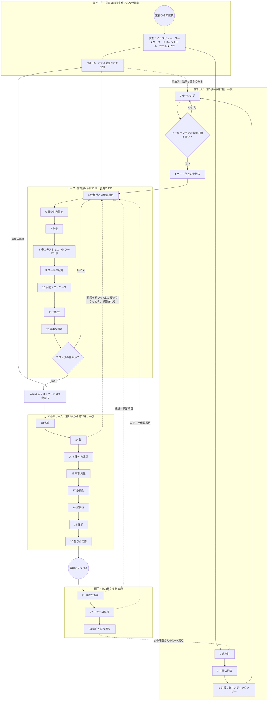

# Urazuke、裏付けの方法 — 方法論のはしご（第4版）

著者：Pablo Kuschniroff、Claude Codeの支援による。第4版、2026年10月18日に始まり、記録
（`docs/DECISIONES.md`）のその後の決定ごとに更新され続けている。開始日はわざと固定したまま
にしてある。新しい決定がこの文書に触れるたびにバージョン履歴を書き換えずに済むように。これは作業文書で、
これを使う各プロジェクトとともに磨き続けるつもりだ。ここに書かれていることはまだ何一つ
閉じた教義ではない。とはいえ、私の知る限り、既に三つの本番システムを背負っている方法の
最初の誠実な蒸留ではある。

本題に入る前に、どう書かれているかについて一言。重要だからだ。これらのプロジェクトを私と
ともに経験していない人のために書いた：人工知能でソフトウェアを構築し、そのソフトウェアが
長持ちしてほしい人であって、プログラミングを学びたい人でも、プロンプトのコツを集めたい人
でもない。だから説明に時間をかけ、必要なら繰り返し、日常の言葉を使い、末尾に私の口から
こぼれるすべての略語と口語表現を収めた**用語集**を置いた。どこかで見慣れない言葉に出く
わしたら——「ラチェット」「錠」「フェイルクローズド」「PND」——用語集へ。すべてそこに
ある。そして [Ref. 26](REFERENCIAS.md#ref-26) のような印を読んだら、それは参照文書で語る
実際の事例への近道で、日付と証拠が付いていると知ってほしい。流れを失わずに無視することも、
詳細に関心があれば辿ることもできる。

方法の公開リポジトリは
[github.com/pkuschnirof/urazuke](https://github.com/pkuschnirof/urazuke)。そこにこの文書、
各段の契約、コースのマニュアル、参照文書が、NAC3の八言語である。

## 名前

**Urazuke**（裏付け）は、ある主張が持つ根拠、それを背後から支えるもの（文字通り「裏の当て
布」）を指す日本語だ。動詞*裏付ける*は「証拠で支える」。2026年10月17日に、既存の企業やプロ
ジェクトとの衝突でいくつかの名前を除外した後にこれを選んだ。選んだのは、方法が求めることをそ
のまま言っているからだ：モデルのすべての主張がその裏付けとともに来ること、そしてその裏付けが
コードを読まずに検証できること。名前は翻訳しない。副題「裏付けの方法」は翻訳する：*the
evidence method*、*o método da evidência*、*la méthode de la preuve*、*die
Nachweis-Methode*、*il metodo del riscontro*、裏付けの方法、验证方法。この文書で「はしご」は
方法の構造——その二十四の段——を指し、「Urazuke」は方法全体を指す。

## 何についてのものか

何を教えていて何を教えていないかについて、明確でありたい。ツールを教えているのではない。
**方法**を教えている：何をどの順でするか、各時点でモデルに何を頼むか、何を納めてもらうべき
か、そしてコードを読まずに、納められたものが完全だとどう知るか。賭けているのは、誰でも、
プログラミングに使える人工知能ツールなら何でも使って、手でコードを打つ代わりにモデルと
会話してソフトウェアを構築でき、出てくるものが堅牢で、本番運用の準備ができていて、そして
ここが重要だが、**プロジェクトのオーナーがコードを一行もレビューする必要がない**ことだ。
そして、これが何で**ない**かについても同じく明確でありたい。これはシステムをより速く作る
ためのプロセスではない。誰もそのコードを一ビットも理解する必要なく、運用可能で保守可能な
システムを作るためのプロセスだ。コードを理解し保守するのは、それを書くエージェント的な
枠組みだからだ。速度は、現れるとすれば、結果である。だからこの文書には期限がない：各システム
の大きさと複雑さが期間を決め、方法は順序だけを決める。

ここで明確にしておきたいことがある。前の文が、私の意図とは違う読み方をされかねないからだ。
「所有者がコードを一行も確認する必要がない」ということは、「システムの知識がない人がプログラ
ムを組めるように設計されている」ということと同じではない。そうではない。この方法の第一の目的
は、誰でもソフトウェアの作り方を何も知らずにソフトウェアを作れるように技術的なハードルを下げ
ることではない。システムに責任を負う人に、モデルが作るものが、誰も書面で要求しなければモデル
がその同じ原則を脆く適用してしまう弱点に対抗しながら、昔ながらのシステム工学の堅実さで仕上が
るような、方法論的な支えを与えることだ。所有者がコードを読まないのは、ゲートをどこに置いた
か、そして人間が実装を読まずに何を検証できるかの結果であって、誰であろうと、何を知っていよう
と、自分が指揮しているものを何も理解せずにソフトウェアプロジェクトを指揮できるという約束では
ない。契約が実際に求めている人物像はその中間にある：コマンドを実行でき、認証情報を扱え、バッ
クアップを復元でき、CIのクォータが何を言っているか理解でき、モデルが渡したものが足りないとき
にそれを見分けられる人だ。純粋な素人でもなければ、すでにプログラムが組める人でもない。

そしてもう一つ、コストについての明確化。この段階を踏むことは、モデルに一度ですべてを解決させ
るよりも多くのトークンを使う：各段が、プロンプトと、それ自体の検証と、モデルが維持しなければ
ならない成果物を一つずつ増やすからだ。一目では見えないのは、それがどれだけ節約になるかという
ことだ。これらのゲートなしに作られたシステムは、遅かれ早かれ、作り直しを必要とする傾向があ
る：やっていなかったサイジングをやり直す、段8で赤いテストが捕まえていたはずのバグを追いかけ
る、誰も時間内に監査しなかったものを書き直す。その作り直しは、トークンでも、時間でも、お金で
も、各段がかかる余分なプロンプトよりもはるかに高くつく。私は先に、頭を使って使う。後で盲目的
に二倍使わないために。

野心的に聞こえるし、実際そうだ。だが私にはほとんど誰も持っていないものがある：まさにそう
やって構築し、今日本物の顧客とともに動いていて、続くすべてのルールをそこから抽出した三つの
実在のシステムだ。だから私が自分に問うのは「できるだろうか」ではない。もうできたからだ。
問いは「何を、どの順でし、そのうち何が本当に違いを生んだのか」だ。このはしごがその答えで
あり、三つのものの基盤だ：方法の文書、コースの受講生が行う実践、そしてマニュアル。後には
私のツールの中に実行フローとして輸出し、人の記憶ではなくツールが方法を導くようにする。

## 方法の出所、そして誤解されたくないこと

これらすべてには、定着する前に解体しておきたい安易な読み方がある：方法は、痛手のたびに
私が当てていったパッチの寄せ集めだ、というものだ。そうではない。正確に言うことが重要だ。
各段の読み方を変えるからだ。

方法は組み合わさった二つの要因から生まれ、どちらか一方だけでは足りない。第一は**システム工学
についての私自身の知識**だ。システム畑の人なら誰でもすぐわかることを、私は長年適用してきた：
設計の前の調査、書かれた要件、数字によるサイジング、設計、構築、証拠としてのテスト、再現可能
なデプロイ、運用、定期監査、プロダクトの一部としての文書。二十四の段で私が要求することの大半
は、よく運営されたプロジェクトで常に要求してきたことだ。モデルのために発明したのではない。以
前から持ってきた。

第二の要因は、この五か月のインシデントが次々と私に見せたもの：**モデルがそれらの原則を脆く
適用する場所**だ。モデルはテストとは何か、根本原因とは何か、サイジングとは何かを完璧に
知っている。聞けば多くのエンジニアより上手に説明する。だが実践では、テストしたと言って
テストしておらず、事業だけが持つデータを自信ありげな顔で推定し、事業ルールの穴を妥当に
思えたもので埋め、役に立つよう訓練されたために過剰に報告し、気づかずに嘘をつく計器を作る。
[参照文書](REFERENCIAS.md)で語るそれぞれの事例が、どこを締めるべきかを正確に教えてくれた：
私にとって自明だった原則が、どこでプロンプトの明示的な条項、ゲート、私がコードを読まずに
行う検証に変わる必要があったか。

だから、ある段で「これはあのインシデントの後に課した」と言うとき、原則がそこで生まれたと
言っているのではない。そこでモデルが独りでは適用しないことを確かめ、書面で要求しなければ
ならなかったと言っているのだ。方法は昔ながらのシステム工学を、疲れず、証拠なしには信じる
ことのできない構築者に必要な硬さで適用したものだ。傷跡はどこに硬さが必要かの証明であって、
原則の起源ではない。

## 方法の三つのユースケース

先へ進む前に、以前の版にはなかった分岐を一つ。ある読者がもっともな理由で求めてきたものだ。
この文書は空のフォルダを見ながらはしごを記述している：第0段はプロジェクトに取り組むかを
決め、第4段は機能のない骨組みをデプロイし、第5段が最初のブロックを開く。学ぶには最も明快な
場合であり、最も頻繁な場合ではない。方法には三つのユースケースがあり、エージェントを開く前に
どれにいるかを知っておくとよい。どこから入るかが変わるからだ。

1. **新規プロジェクト。** 空のフォルダと依頼を持つオーナー。第0段から入り、二十四を順に登
   る。この文書が、その契約とコースのマニュアルとともに記述しているものだ。
2. **方法で作られたシステムへの進化・修正。** システムは既にはしごを登っている：契約、地図、
   証拠付きで閉じた保留項目、テスト群、デプロイ、マニュアルがある。第5段から、ブロックを開い
   て入り、ループを辿る。第13段は定期的に。第23段は各段階の締めに。タイムラインのフェーズ4
   （パートB）だ。
3. **方法なしで作られたシステムへの進化・修正。** 動いていて、ユーザーがいて、他人または証拠
   なしの自分自身が作った、修正するか成長させなければならないシステム。第0段からも第5段から
   も入らない：八つのステーション（N0からN7）の**正常化の区間**から入る。それは立ち上げの段
   が生むすべての入力を自動発見で、出所の印付きで復元し、システムを書き直さずにその周りに安
   全ベルトを組み、そのうえでようやく修正モードか進化モードでループを開く。その道は独自の
   ページ、[進化・修正の道](EVOLUTIVO_CORRECTIVO.md)にあり、二つ目のガイドプロジェクトを伴う
   独自のコースのパートを持つ。

名指ししておく、外に残るもの：技術の移行は方法のユースケースではない。それは別のプロジェ
クトであり、一般には第0段の排除基準に当たる。

## AIは方法を中断しない。方法を継続する

これがすべてを開くテーゼで、最初に置くのは、最もよくある反論が現れる前に解体するためだ：
「機械が書いたコードをどうやって信用するのか」。

私の答えは、**業界は既に二十年前にコードの書き手を信用することをやめた**ということだ。
執筆の大半がジュニア、外注、ローテーションのチームに移ったとき、一行ずつのレビューは維持
不可能になった。その代わりに育ったのが、今日我々が当然視するすべてだ：自動テスト、継続的
インテグレーション、受け入れ基準、緑なしには何も通さないパイプライン、テストの「シフト
レフト」、独立した機能としての品質管理。それが「書く者は信用できない」に対するシステム
工学の答えだった：コードを読まず、証拠を要求する。

だからモデルに書かせることは、虚空への跳躍ではない。もう信用していなかった書き手を、やはり
信用しない別の書き手に換えることであり、その書き手のために**検証の装置は既に組み上がって
いた**。これは安心させるべきことで、不安にさせることではない。しかも新しい書き手はより
安く、より速く、そして——ジュニアと違って——赤で証明しろと頼んでも気を悪くしない。

だからこの方法は、隠すことなく古典的なシステム工学に依拠する。骨格はいつものものだ。他に
ありようがない。問題がいつものものだからだ：データがどれだけあるかわからない、顧客が何を
望むかわからない、構築したものが頼まれたものかわからない。AIは問題を変えなかった。誰が
各部分をどのコストでやるかを変えた。第0段の適格性基準X2でさえ古典工学だ：契約の条件と
してのテスト可能性。

### ここで何が古く、何が新しいか

古いもの、そして古いと言っておくべきもの：段階の骨格、検証者の構築者からの独立、証拠と
してのテスト、プロダクトの一部としての文書、設計前の調査。

本当に変わるもの、私の貢献があるところは三つだ：

1. **人間の努力がどこへ行くか。** 古典的方法では人間が仕様を書き、コードを書き、別の人間が
   それをレビューする。ここでは人間は二つのことだけをする：**決定し、成果物を検証する**。
   それ以外のすべて——起草、構築、テスト、計測、文書化——はモデルがする。だから各段は
   「コードを読まない完全性の検証」で終わる。それが人間が依然として不可欠である正確な場所
   であり、それ以外にはない。

2. **書き手が証拠も作る。** これが唯一の本当に新しい点であり、三つの段まるごとを正当化する
   ニュアンスだ。ジュニアは怪しいコードを書いたが、証拠は作らなかった：テストと計測は別の
   誰かが組み、少なくとも別の誰かが見た。モデルは対照的に、コード*と*テスト*と*計器*と*
   報告を、同じセッションで、正しいときも間違っているときも同じ自信のある声で作る。私は
   見た：二度嘘をついた計器 [Ref. 36](REFERENCIAS.md#ref-36)、「成功」と報告された認証エラー
   [Ref. 43](REFERENCIAS.md#ref-43)、四つのうち三つが間違っていた主張。だから「コードの代わり
   に証拠をレビューする」は依然として正しい原則だが、**証拠は自身を証明しなければならない**：
   赤で見たテスト（第8段）、ガード付きの計器（第7段）、検証済みと信じていることを分ける報告
   （第12段）、構築者とは別の監査者（第13段）。新しい懸念ではない：品質管理の独立という同じ
   規律を、一歩内側に持ち込んだものだ。

3. **成果物のコスト。** 古典的方法では文書は高価で、だから一度作られて古びた。ここでは
   再生成は無料で、だからルールは「同じコミットで」「AIなしで手で再現可能」になる。かつて
   達成不可能な理想だったものがゲートになる。

コースと公開のために、これが誠実にポジショニングを定める：「新しいプログラミングの仕方」
ではない。**疲れず、しかし信じることもできない構築者に適用されたシステム工学**だ。システム
畑の人には馴染み深く響き、不信を下げる。バイブコーディング畑の人には持っていないもの、
まさに骨格を与える。そして速度を売り骨格をまるごと省くツールから私を差別化する。

---

## パートA — 各段の読み方

各段には八つの部分があり、比較できるよう常に同じだ：

- **意図**：何を目指すか、一文で。
- **いつ**：プロジェクトのどの時点で登るか、一度登るか繰り返すか。この部分は第4版で新しく、
  パートBで詳しく説明する。タイムラインのない方法は善意のリストだからだ。
- **入力**：登るために何が先に存在しなければならないか。
- **成果物**：登ったときに何が書かれ、または実行可能なものとして残るか。常に具体的なもの：
  ファイル、テスト、スクリプト。
- **ゲート**：次へ進むために何が真でなければならないか。満たされなければ登らない。
- **誰が決めるか**：プロジェクトのオーナー、エージェント、または自動なので誰でもない。
- **防ぐ失敗**：段が防ぐ種類の問題、それを確かめた実際の事例への短い参照付き。
- **契約**：どう実行するかが書かれたファイル：文脈、プロンプト、成果物、検証、警告サイン。

二つの重要な注意。第一：**はしごはツールに対して中立**だ。すべての成果物はファイル、テスト、
スクリプトであり、どれも私のツールも他のツールも要求しない。Forgeはそれらを自動化する（ゲー
ト、コマンド、保留項目の記録）が、段はForgeなしに存在する。第二：**段は登る順に番号が付いて
いる**。そして四つの区間にまとまる：0から4は立ち上げで、プロジェクトごとに一度登る。5から12
は変更ごとに繰り返すループ。13から20は本番リリースで、最初のデプロイの前に一度登る。そして
21から23は運用で、システムが既に稼働しているとき。23はサイクルを閉じ、次のプロジェクトの
ために0へ戻る。区間の中では番号が順序を言い、区間の間では、ループが繰り返される一方で他の
三つは一度登られる。だが「厳密に順次ではない」は「どんな順でもよい」ではない：パートBが各段
をいつ登り、その間に何が起きるかを正確に言う。

---

## パートB — タイムライン：各段をいつ登り、その間に何が起きるか

この部分は以前の版には存在せず、その不在は深刻な欠陥だった：方法は何をしどう検証するかを言っ
たが、**いつ**を言わなかった。そして「いつ」は方法の半分だ。文字通りに受け取る読者は二十四の
段を次々と登り、ではインフラ、継続的インテグレーションとデプロイの連鎖、要件の取り込み、機能
の開発、すべてのフローのエンドツーエンドテスト、画面への人間の目、人間による受け入れテストは
いつするのかと自問しただろう。それらすべては起こり、段の間と段の中の正確な時点で起こる。ここ
に書く。

### B.0 プロセス全体を、一枚の図で

表の前に、絵を。プロセス記法（BPMN風：丸いイベント、長方形のタスク、ひし形のゲート、点線の
戻り矢印）で描いてあり、表よりうまく三つのことを言う。第一：プロセスは**方法の外から始ま
る**。要件工学であり、それは前提条件であると同時に恒常的だ。決して終わらず、新しい要件はその
たびにまた入ってくる。第二：新しい要件はループにだけ入るのではない。**評価の段へ再注入され
る**。アーキテクチャを決めた数字を変えうるからだ（「十倍」はまだ耐えるか？）。そしてそこから
先へ。第三：プロセスは**人によるテストケースの手動実行**で終わり（第10段）、その実行が見つけ
たものは要件としてループへ戻る。円環は機械ではなく、人で閉じる。第四、この修正より前の図には
これが描かれていなかった：システムが構築するものが世界に結果をもたらす場合（課金する、送信す
る）、ループは**第14段の後に再び開く**。すでに鍵がかかった状態で、そこから生産チェーン（15）
へ進む前に、その部分をリハーサルモードで構築するためだ。これは最初に戻ることではない。いつも
と同じゲート（ブロックの締めくくりか？）を、安全網が整った今、もう一度通るだけだ。

図が見えない場合（markdownのビューアがmermaidを描かない場合）、上の文章がそれを丸ごと記述
している。HTML版では独りで描かれる。

### B.1 プロジェクトの五つのフェーズ

この方法で進められるプロジェクトは五つのフェーズを通る。真ん中の三つはループ、本番リリース、
運用の区間に対応するもの。フェーズ1は立ち上げの区間。そしてフェーズ0は初期の取り込みで、それ
自体は「段」ではないが方法がカバーするものだ。期間は書かない：求められるものの大きさと複雑さ
に依存し、書かれた期間は偽の期待に変わるからだ。大きさに依存しないもの、それが順序だ。

| フェーズ | 登る段 | そのフェーズで他に何が起きるか |
|---|---|---|
| 0. 取り込み | まだなし。0、2、3、5の原材料 | 要件工学の古典的方法（B.5参照）によるオーナーとの事業の調査：インタビュー、ユースケースまたはユーザーストーリー、ドメインモデル、画面のプロトタイプ。散文で、意図的に不完全に書く。エージェントが質問して補完する。 |
| 1. 立ち上げ | 0、1、2、3、4 | 適格性、約束、定義、サイジング。そして**初期インフラのすべて**：リポジトリ、テスト環境、継続的インテグレーション、空のシステムでの最初のデプロイ。 |
| 2. ループ | 変更ごとに5から12：保留項目、決定、計測、赤のテスト、品質、手動テストケース、対称性、報告 | ブロックごとの機能開発。赤のテスト。構築したばかりのフローのエンドツーエンドテスト。新しい各画面への人間の目。各ブロックの締めに、テスト環境での人間によるテスト。 |
| 3. 本番リリース | 13から20、順に：監査、錠、本番への連鎖、可観測性、永続化、脆弱性、性能、文書 | 別のセッションによる監査。世界に作用するすべてに錠。試されたロールバック付きの本番へのデプロイ連鎖の締め。三つのマニュアル。すべてのフローについてオーナーとの受け入れテスト。 |
| 4. 運用 | 21と22は最初のデプロイとともに組み立てる。23は各段階の締めに。各進化にループ（5から12）。13と18は定期的 | 常駐エージェント。一、二か月ごとの監査。新しい変更はそれぞれ完全なループで入り、デプロイ連鎖で出る。各段階の締めに振り返り。 |

この表は新規プロジェクトのものだ。システムが既に存在し、方法で生まれなかったときは、
フェーズ0と1が正常化の区間に置き換わる（読み取り、安全ベルト、測って順序を付ける）。それは
[進化・修正の道](EVOLUTIVO_CORRECTIVO.md)にある。フェーズ2、3、4は同じだ。

ユーザーと帰結のあるプロジェクトで育つのはループ、つまり機能だ。立ち上げ、本番リリース、運用
は、小さいシステムでも大きいシステムでも同じ形をしている。変わるのはどれだけ計測しなければ
ならないかであって、何を計測するかではない。

### B.2 段と段の間に何が起きるか

ここに欠けていたものがある。各フェーズについて、各種の作業を段に対してどの正確な時点で
行うか。表を行で読んでほしい：各行は作業の種類で、各セルはそのフェーズ内でいつ行うかを言う。

| 作業の種類 | 立ち上げ（段0から4） | ループ（段5から12、ブロックごと） | 本番リリース（13から20） | 運用（21から23とループ） |
|---|---|---|---|---|
| **要件の取り込み** | 第0段の前：インタビュー、ユースケース、ドメインモデルによる、オーナーとの散文での調査。第2段（定義とセマンティックツリー）と第3段（ボリューム）で補完される。 | 各ブロックを開くとき：そのブロックに対する顧客の依頼が、顧客が言う通りの形で、**詳細な仕様**付きの保留項目に変換される（第5段）：記述、受け入れ基準、適用ルール、データ、画面、境界ケース。エージェントがする質問が細かい取り込みだ。 | 第14段の前：帰結のある行動の調査。第15段の前：環境とアクセスの調査。 | 新しい依頼はそれぞれ仕様付きの保留項目として入り、セマンティックツリーのノードにぶら下がる。常駐エージェントがユーザーの求めるものを集める。 |
| **インフラ** | 初期のすべてを第4段で：リポジトリ、構造、テスト環境、認証情報、テスト用ドメイン。空の骨組みがデプロイされるまで機能は構築しない。 | なし、ブロックが要求する場合を除く（キュー、外部サービス）。要求するなら、テスト付きの保留項目。 | 第15段で：本番環境、サーバー上の秘密、実ドメイン、バックアップ、最低限の監視。 | インフラの変更はループと第15段で入る。決して「手で、素早く」ではない。 |
| **CI/CD連鎖** | 第4段で：継続的インテグレーションは立ち上げからプッシュごとにテスト群を走らせ、テスト環境へのデプロイはマージ時に自動。 | 独りで機能する。各コミットがそれを通る。緑でなければブロックは閉じない。 | 第15段で完成する：本番へのデプロイはインテグレーションの結果を待ってパッケージするだけ。昇格は書かれた手順。ロールバックは試される。 | 各デプロイは第15段のルーチンに従う：同じバージョンでテストが緑、ロールバック準備済み、デプロイ後に本番でエンドツーエンド検証。 |
| **機能開発** | なし。骨組みは意図的に空でデプロイされる。 | ループの中心：エージェントが保留項目を取り（5）、欠けている事業ルールを質問し（6）、構築し、証拠で閉じる（7、8、9、10、11、12）。ブロックごとに、基本的なものから帰結のあるものへ。 | 世界に作用するもの（請求、送信）は第14段の**後**に、錠付きで、ループで構築し、ドライランモードで始まる。 | 進化はループで入る。 |
| **自動テスト** | 第4段で通るスモークテスト一つ。テスト群の種だ。 | 各保留項目とともに：赤で証明されたテスト（8）、同じセッションでの隣接項目の回帰、そして**構築したばかりのフローのエンドツーエンドテスト**、画面からバックエンドまで。ブロックを閉じるとき：既存の**すべての**フローの完全なエンドツーエンドのテスト群、テスト環境で。 | 本番への最初のデプロイの前：すべてのフローの完全なエンドツーエンドのテスト群、緑、昇格するのと同じバージョンで。デプロイ後：本番に対する読み取り専用のエンドツーエンド検証。 | 各変更とともに、ループと同じ。 |
| **画面の人間による目視** | 第4段の締めに：オーナーがテスト環境のURLを開き、空の画面を見る。些細に見えるが、エージェント以外の誰かがシステムを見る最初の瞬間だ。 | **画面に触れる各保留項目とともに**：エージェントがテスト環境の実際のスクリーンショットを納め、オーナーがそれを見る。十秒。どのテストも見つけないものを見つける最も安い方法だ：ボタンがあるべきでない場所にある、テキストが別のことを言っている、フローが事業が想像していたものではない。 | 第20段で：ユーザーマニュアルのスクリーンショットが本番前の最後の体系的な人間の目だ。 | 新しい、または変更された各画面、ループと同じ。 |
| **人間によるテスト** | まだなし、空の画面を開くこと以外。 | **各機能ブロックの締めに**：オーナー、または信頼できるユーザーが、ブロックのフローに従って、本当に使うようにテスト環境でシステムを使う。見つけたものは保留項目として記す。保留項目のない人間の発見を残したまま次のブロックは開かない。 | 本番への最初のデプロイの前：すべてのフローについてオーナーの**受け入れテスト**、現実的なテストデータで、テスト環境で。そして第20段で、プログラミングをしない人が復旧マニュアルを追う。 | 各進化とともに、そのブロックの締めに。 |
| **オーナーの決定** | 第0段（行くか行かないか）、第1段（約束）、第2段（何で**ない**か）、第3段（アーキテクチャの選択肢）。 | エージェントが書かれていない事業ルールで止まるたびに（6）。ブロックごとに二つか三つが普通。 | 第14段（錠ごとに）、第15段（本番への昇格）、第23段（常駐エージェントのレベル）。 | 生じるもの。常に書面で。 |

強調しておきたい細部がある。バイブコーディング畑の人が最も間違える場所だからだ：**すべての
フローのエンドツーエンドテストは最後に一度ではない**。三回、三つの規模で行う。各保留項目
とともに、その保留項目が触れたフロー。各ブロックの締めに、そこまでに存在するすべてのフロー。
そして本番の前に、昇格する正確なバージョンですべてのフロー。三つ目だけをするなら、何週間も
誰もエンドツーエンドでテストしなかったシステムで最後に至り、本番リリースは一週間の修正に
変わる。

### B.3 ループのリズム：典型的な機能ブロック

機能ブロックとは、四つから八つの関連する保留項目の集まりで、一緒になって事業が使える何かを
なす：「基本の予約台帳」「リマインダー」「月次レポート」。内側はこう見える：

1. **ブロックの開始。** オーナーが散文で、このブロックに何を望むかを語る。エージェ
   ントがそれを番号付きの保留項目に、「どう検証するか」付きで変換し、検証可能な保留項目を
   書くには足りないことを質問する（第5段）。オーナーが優先順位を付ける。
2. **各保留項目。** エージェントがどの保留項目をなぜ取るかを告げる。途中で書かれていない
   事業ルールが現れたら、止まって質問する（6）。保留項目が数字——いくつのクエリ、どれだけ
   かかるか——に依存するなら、まずテスト付きの計器でそれを計測する（7）。構築する。終わった
   らこの順で閉じる：赤で証明されたテスト、緑、隣接項目の回帰、そして触れたフローのエンド
   ツーエンドテスト（8）。コードの品質のゲートが緑（9）。人に向けて書かれた、そのフローの
   手動テストケース（10）。そして変更がシステムの二つの部分間の契約に触れたなら、同じコミッ
   トで更新された相手側（11）。報告は検証したことと信じていることを分け、盲点を宣言する
   （12）。オーナーは報告を読み、画面のスクリーンショットを見る。コードは読まない。
3. **ブロックの締め。** テスト環境で完全なエンドツーエンドのテスト群が緑。オーナーまたは
   信頼できるユーザーがブロックの手動テストケースを実行し（10）、何が起き何が失敗したかを
   書き留める。各失敗は修正の保留項目としてループへ戻る。ブロックの品質の報告を読む（9）。
   新しい画面でユーザーマニュアルを更新する（20、同じコミットで）。そのとき初めて次の
   ブロックを開く。

ループの典型的な一日で、方法がオーナーに求めることは小さく限られている：二つか三つの事業
ルールの質問に答え、二つか三つの報告を読み、二つか三つのスクリーンショットを見る。それだけ
だ。それ以上を求めているなら、エージェントが独りで解決できることを聞いているか（第1段）、
オーナーがコードを読んでいるか（なら第8段か第12段の何かが機能していない）だ。

### B.4 人間の節目

人間、オーナーまたは信頼できる誰かが、システムを見るか使わなければならない瞬間をリストに
まとめる。少なく、正確な時点にあり、どれもエージェントに委任できない：

- **立ち上げの終わり**：テスト環境のURLを開き、空のシステムを見る。
- **画面に触れる各保留項目とともに**：テスト環境の実際のスクリーンショットを見る。
- **各ブロックの締めに**：ブロックの手動テストケース（10）をテスト環境で実行し、結果を
  書き留める。失敗したものは要件としてループへ戻る。
- **本番への最初のデプロイの前**：すべての手動テストケースに従った、すべてのフローについて
  の受け入れテスト。
- **第20段で**：プログラミングをしない人がテスト環境で復旧マニュアルを追う。
- **本番への各デプロイの後**：動いているバージョンが意図したものであることを確かめ、重要な
  フローを読み取り専用で一巡する。
- **第19段で、最初のデプロイの前**：業務の許容を隣に置いて負荷テストの数字を読み、破断点を読
  む。
- **監視の各サイクルで（21と22）**：周期報告をエージェントと読み、どの逸脱とどのエラーが保留
  項目になるかを決める。

それ以外のすべて——テスト、計測、監査、文書——はモデルがし、人間はコードではなく成果物で
検証する。

### B.5 要件はどう入るか：調査からセマンティックツリーへ、そして保留項目へ

ここで立ち止まりたい。古典的なシステム工学が最も言うべきことを持ち、バイブコーディングが
最も熱心にそれを無視する場所だからだ。要件とはチャットの中の顧客の一文ではない。何十年も
前から存在し、前面にモデルがいても依然として有効な方法で**処理された**顧客の一文だ。モデルは
頼めばそれらを適用するのが非常にうまく、頼まなければ非常に下手だからだ。

私が使い、方法が各フェーズで要求する方法：

- **オーナーとのインタビュー**、自由に、散文で、記録して。フェーズ0だ。完全にしようとは
  しない：エージェントが何が足りないかを検知するようにする。
- **ユースケースまたはユーザーストーリー**、事業が名付けられるフローごとに一つ：「受付係が
  予約を登録する」「患者がリマインダーを受け取る」。それぞれにアクター、トリガー、手順、
  結果、例外がある。機能ブロックを開く単位だ。
- **ドメインモデル**：事業のエンティティ、その属性、可能な状態、状態間の遷移。セマンティック
  ツリー（下記参照）の心臓部で、モデルが事業にない状態を発明するのを防ぐものだ。
- ストーリーごとの**受け入れ基準**、「ある状況を前提に、あることが起きたとき、ならばある
  結果が見える」の形で。各保留項目の「どう検証するか」に、そして後にエンドツーエンドテストに
  変わるものだ。
- **画面のプロトタイプ**、絵でも。画面の人間による目視はここで、コードが存在する前に始まる。
- **トレーサビリティ**：各要件を、それを実装する保留項目、それを証明するテスト、それを閉じた
  コミットまで辿れる。方法ではトレーサビリティは別のマトリクスではない：保留項目そのもの
  であり、その出所と証拠を引用する。

**セマンティックツリー。** これらすべてを整理する成果物で、エージェントが毎セッション読む
地図だ（第2段）。木であって、リストではない：根にシステム。その下にドメインまたはモジュール。
各ドメインの下にそのアクター、プロセス（ユースケース）、状態を持つエンティティ、画面、外部
インテグレーション。そして各ノードからぶら下がる、それに触れる保留項目とそれに影響する決定。
エージェントが調査から構築し、あなたが修正し、各ブロックとともに育つ。その価値は二重だ：
モデルにプロジェクト全体を読まなくても触れるノードの正確な文脈を与え、あなたにはコードを
読まずに、エージェントが理解しているシステムが事業が求めたものであることを検証する方法を
与える。保留項目がどのノードからもぶら下がらないとき、木が不完全か保留項目が範囲外かだ。
どちらも十秒で見える。

**詳細な仕様は保留項目に住む。** 古典的方法には長い、古びる要件仕様書があった。ここでは
その文書が分解される：各保留項目が自分の完全な仕様を持ち、保留項目の総和がシステムの仕様
だ。よく書かれた保留項目が持つもの：タイトル。ぶら下がるセマンティックツリーのノード。
顧客の言葉による、それを生むストーリーまたはユースケース。求められるものの詳細な記述。
適用される事業ルール、その決定と日付付き。入出力データ。影響を受ける画面、プロトタイプが
あればそれも。境界ケースと例外。受け入れ基準。そしてどう検証するか。エージェントがあなたの
散文の依頼から起草し、仕様化できないことを質問し、あなたは構築前にそれを読む。保留項目の
仕様を読むことは、あなたがコードを読むことに最も近づく瞬間であり、まさに正しい距離だ。

**閉じた保留項目は文書である。** これが円環を閉じるものだ。保留項目が閉じるとき、消されも
空のまま保管されもしない：その仕様、それを生んだ決定、閉じたときの証拠（赤と緑の数字、
画面のスクリーンショット、計測した数字）、コミット、日付とともに残る。したがって閉じた
保留項目のキューはシステムの機能的な履歴だ：何を、なぜ、いつ構築し、どうテストしたか。
そこから変更日誌、ユーザーマニュアルの新しい節、そして六か月後に誰かが「なぜシステムは
こうするのか？」と聞いたときの答えが出てくる。コースのマニュアルは、第5段のルーチンの一部
として、各保留項目の締めに同じセッションでこの文書化を要求することを教える。

---

## パートC — 二十四の段

登る順に並んでいる。運用品質の六つの段（最初のデプロイの前に16から19、後に21と22）は、
私が名付けずにやっていたものだ：システムが走っている間に**見える**こと、サイジングした
量に耐えること、既知の穴がないこと、そして本番に出た後、誰も怒った利用者から問題を知らさ
れないこと。二つの監視は他のすべてと同じ場所に行き着く：ループへ、修正の保留項目として。
初心者の方へ：その六つの契約と、第9段と第10段の契約は、それぞれの言葉を日常の言語で説明
する段落から始まり、用語集にはそのすべてが載っている。

### ステップ 0 — このプロジェクトはこの方法で取り組めるか？（適格性）

すべてに先立つものがあり、どのリポジトリにもない。常に既に決まった状態で届いたからだ：
**プロジェクトにこの方法で取り組むかどうか**の決定だ。何か月も私の頭の中に住んでいた
基準で、書き終えつつある。二つの排除基準は既に明確で、受け入れたプロジェクトではなく断った
プロジェクトから来ている [Ref. 46](REFERENCIAS.md#ref-46)：「否」は「可」よりも境界をよく
定める。重み付け基準はまだ較正中で、そう印している。

- **意図**：リポジトリを開く**前に**、プロジェクトにこの方法で、エージェントを前面に、
  取り組むか否かを決める。耐えられないプロジェクトに入れば、方法は「AIでプログラミング
  する」に退化し、そこでこそオーナーはコードを読む羽目になるからだ。
- **いつ**：一度だけ、他の何よりも前に。システムが既に存在するなら、この段はレガシー向けの版で登る
  （[進化・修正の道](EVOLUTIVO_CORRECTIVO.md)のステーションN0）。基準が四つ多く、X2は画面
  ごとに測る。
- **入力**：顧客の依頼、事業のドメイン、データ、技術、利用可能な環境、誰がオーナーになるか。
- **成果物**：一ページの適格性シート、評価された基準と決定付き：可、不可、または条件付き可。
- **ゲート**：排除基準がすべて緑で、重み付け基準の得点が閾値（まだ定義していない閾値）を
  超える。
- **誰が決めるか**：オーナー。今日は私。方法によって別の人が同じシートでそれを決められる
  ようにするのが狙い。
- **防ぐ失敗**：エージェントが自分で検証できないプロジェクト、または決定するドメインの
  オーナーがいないプロジェクトに入り込み、人間が一行ずつコードをレビューする羽目になること。
- **契約**：`peldanos/peldano-00-elegibilidad.md`。

**二つの排除基準。**

| # | 排除基準 | なぜ方法を殺すか |
|---|---|---|
| X1 | アクセス可能なリポジトリのない、または標準に従わないリポジトリを持つレガシー技術 | 標準リポジトリなしには証拠を残す場所がない：コミットで引用される保留項目（第5段）も、コードとともに運ばれるテスト（8）も、パッケージとしてのインテグレーションとデプロイ（15）も、同じコミットでの文書（20）もない。エージェントは盲目で働き、検証可能な痕跡を残さない。 |
| X2 | エンドツーエンドでテストできない技術：画面を実行し、インターフェースの各要素にその各種の操作でアクセスし、変更がバックエンドに届いたことを検証できない | 画面からバックエンドへのその検証なしには、エージェントは自分を証明できず（第8、7、12段）、するとオーナーがコードを読まねばならない。それこそ方法が避けると約束するものだ。 |

ツール中立性にとって金に値する明確化：**NAC3（画面をプログラムから操作できるよう私の
ツールが使うプロトコル）は条件ではない。今日私がそれを達成する手段だ**。中立な基準はこう
なる：インターフェースをプログラムから実行でき、画面の各要素にその各種の操作（クリック、
入力、状態の読み取り）でアクセスでき、テストが画面を辿ってバックエンドへの効果を検証でき
る。インターフェースが「ドライバ」（例えばPlaywright）に要素を露出しない技術は、リポジトリ
があっても外に残る。

そして重要だと思う読み：根本的にはX1とX2は**同じ条件を二つの側から見たもの**だ。エージェ
ントはエンドツーエンドで自分を検証し、証拠をリポジトリに残せなければならない。X1は「証拠は
どこに残るか」の半分、X2は「証拠はどう作られるか」の半分。

`[仮説]` **重み付け基準、まだ重みなし。** 方法を最初から最後まで使う最初のプロジェクトで
較正するまで、仮説として印しておく。

| # | 候補基準 | 事例でどう見られたか | 排除？ |
|---|---|---|---|
| D1 | 判断力と決定する時間（プログラミングではなく）を持つドメインのオーナーがいる | 三つのシステムすべてで、日付付きで書かれた決定とともに | `[?]` |
| D2 | 検証可能な真実の「オラクル」がある：実データ、外部システム、読み取り専用の本番 | 共済組合とそのオラクルとしての認可者 [Ref. 26](REFERENCIAS.md#ref-26) | `[?]` |
| D4 | 技術がエージェントが発明なしに習熟しているもの（Node、Python、SQL、React）に収まる | 三つすべて | `[?]` |
| D5 | 誤りに実際の帰結がある（金銭、健康、運用）、フェイルクローズドを正当化する | 共済組合（健康、請求）、協会（家族） | `[?]` |
| D6 | ボリュームが初日から知りうる | Kikan：年間340万行 [Ref. 15](REFERENCIAS.md#ref-15) | `[?]` |
| D7 | 顧客が成熟の時間と回路内の人間を許容する | ドライランモード付きの自動承認者 [Ref. 28](REFERENCIAS.md#ref-28) | `[?]` |
| D9 | 範囲が一つのリポジトリと一人のオーナーに収まる | 三つすべて | `[?]` |
| D10 | 秘密とアクセスを分離できる（金庫、環境ファイル、限定された権限） | 作成者に紐付けられたAPIキー [Ref. 13](REFERENCIAS.md#ref-13) | `[?]` |

以前の版にあった二つの基準（エージェントが単独でテストできること、プロジェクトが新規または
監査可能であること）は、それぞれX2とX1に吸収した。帰結であって別個の基準ではないからだ。

### ステップ 1 — 共働の約束（コードの前のルール）

一行も書く前に、あなたとエージェントがどう働くかを書面にすること。形式的に見えるが、そう
ではない：最初の月の苛立ちの八十パーセントを防ぐものだ。エージェントは毎朝昨日の記憶なし
にやってくると考えてほしい。書かれていないことは毎回繰り返さなければならず、毎回少しずつ
違う言い方になる。

- **意図**：最初の一行のコードの前に、人間とエージェントがどう働くかを定める。
- **いつ**：一度だけ、適格性の直後。痛手がそれを求めたときに見直す。
- **入力**：プロジェクトからは何もない。最初のファイルだ。あなたから：あなたの働き方の好み。
- **成果物**：品質基準の文書、最低限以下を言う：人間の時間は神聖（エージェントが自分で解決
  できることには使わない）。技術的負債ゼロ、つまり何かが壊れたら根本から直し、同じセッション
  で回帰テストを加える。範囲は正確に、頼まれた以上でも以下でもなく。ユーザーの言語で話す。
  文書は同じコミットで更新する。そして、やっていないことを決してやったと告げない。
- **ゲート**：約束がリポジトリにあり、毎セッション読まれる。
- **誰が決めるか**：オーナー。エージェントは変更を提案できるが、独断で約束を編集しない。
- **防ぐ失敗**：良い考えに思えたからと範囲を広げて「助ける」エージェント。「後で」のために
  負債を残すエージェント（後では決して来ない）。そしてやったと*思う*ことをやったと報告する
  エージェント。私が初めてこれを書いたのは、二週間にわたって毎セッション同じことを繰り返し
  ていたときだった [Ref. 1](REFERENCIAS.md#ref-1)。
- **契約**：`peldanos/peldano-01-contrato-de-convivencia.md`。

### ステップ 2 — プロジェクトの定義と必読

エージェントの各セッションはゼロから始まる。短い地図を与え、何かに触れる前にそれを読む
よう義務付けること。二つの半分は等しく重要だ：誰も読まない地図は作用せず、長い地図は誰も
読まない。

- **意図**：各セッションが、プロジェクトが何で、どんな状態で、どの決定が既になされたかを
  知って始まるようにする。
- **いつ**：一度書く、約束の後。プロジェクト全体を通じて、新しい決定ごとに最新に保つ。
- **入力**：約束（第1段）と事業の調査。
- **成果物**：運用可能なプロジェクトファイル、そしてここで強調：**短く**。綱領であって履歴
  ではない。加えてシステムの**セマンティックツリー**（B.5参照）：ドメイン、アクター、
  プロセス、状態を持つエンティティ、画面、インテグレーション、各ノードからぶら下がる保留
  項目と決定付き。加えて取り組んでいることと開いている疑問を持つ生きた状態のファイル。
- **ゲート**：エージェントはコードに触れる前にプロジェクトファイルとセマンティックツリーを
  読み、読むことが証明された。
- **誰が決めるか**：オーナーが定義し、エージェントが最新に保つ。
- **防ぐ失敗**：二つ、非常に具体的。地図を読まなかったための捨てる仕事
  [Ref. 9](REFERENCIAS.md#ref-9)。そして読めなくなるまで育つプロジェクトファイル
  [Ref. 41](REFERENCIAS.md#ref-41)：運用ファイルと事例集は別のファイルでなければならない。
- **契約**：`peldanos/peldano-02-definicion-y-lectura.md`。

### ステップ 3 — アーキテクチャを設計する前にサイジングする

飛ばすと最も高くつく段であり、それを知っているのは私が飛ばしたからだ。構造的な決定は数字で
行い、一次の数字は事業が持っていて、モデルは持っていない。

- **意図**：構造的な決定（どのデータベースエンジンか、インターフェースは同期か非同期か、
  どれだけの並行性か）を好みではなく数字で行う。
- **いつ**：一度、骨組みを組む前。事業がスケールを変えればやり直す。小さいプロジェクトでは
  半ページと一つの決定。
- **入力**：事業とともに行ったボリュームデータの調査、本質的に不完全。そして以前のシステムが
  あれば読み取りアクセス。**事業だけが持つ**データがあり、モデルは推論できない：だから
  プロンプトは完全か評価し足りないものを求めるよう要求する。自信ありげな顔で推定する代わりに。
- **成果物**：**固定の**選択肢（三つか四つの具体的な選択肢）と選んだものを持つサイジングの
  記録。そして明示的に宣言された「非対称な」決定。例えば「永続化インターフェースは最初の
  エンジンが同期でも一行目から非同期」。間違えても安く、やらないと大金がかかるから。
- **ゲート**：骨組みを組む前にサイジングが記録されている。
- **誰が決めるか**：オーナーが固定の選択肢から選ぶ。エージェントが数字付きで提示する。
- **防ぐ失敗**：ボリュームに耐えないストレージで始め、インターフェースの変更が再設計の
  一段階まるごとを要するときにそれを発見すること [Ref. 15](REFERENCIAS.md#ref-15)。
- **契約**：`peldanos/peldano-03-dimensionar.md`。

### ステップ 4 — ゲート付きの骨組み

システムが何か役立つことをする前に、**空のまま**起動し、テストされ、デプロイされなければ
ならない。そう、空のまま。本番への道はプロダクトの一部であり、機能すると知る唯一の方法は、
まだ失うものがないときにそれを辿ることだからだ。これは**初期インフラのすべてとインテグレー
ションとデプロイの連鎖**を作る段で、だから立ち上げの中で最も長い。

- **意図**：まだ機能が何もない状態で起動し、テストされ、デプロイされるシステムを持つ。
- **いつ**：一度、立ち上げの終わりに、サイジングの後、いかなる機能よりも前。立ち上げ区間の
  締めだ。
- **入力**：サイジング（第3段）、環境の調査、そしてデプロイ先の認証情報。
- **成果物**：継続的インテグレーションが緑の骨組み、スモークテスト付きで組まれたテスト構造、
  機能し二度実行されたテスト環境へのデプロイ、そして書面で宣言されたワークフローのゲート。
- **ゲート**：骨組みが緑、継続的インテグレーションが走り、機能ゼロでテスト環境へのデプロイ
  が機能する。オーナーがURLを開き、空の画面を見た。
- **誰が決めるか**：エージェントが実行し、オーナーが目視で承認する。
- **防ぐ失敗**：立ち上げの一か月後にデプロイを発見し、機能を賭けた状態で動かすために五つの
  連続した保留項目を払うこと [Ref. 32](REFERENCIAS.md#ref-32)。
- **契約**：`peldanos/peldano-04-esqueleto.md`。

### ステップ 5 — 計画とは保留項目のこと

ここに、一度掴んだら手放さない考えがある：「計画」が一方に「タスクリスト」が他方にあるの
ではない。**保留項目のリストが計画そのものだ。** そして各保留項目はどう検証するかを言う。
それがあなたがコードを見る代わりに見るものだからだ。

- **意図**：順序とゲートを持つ単一の作業キューが、プロジェクトの真実であること。
- **いつ**：立ち上げが終わった直後、最初の機能ブロックを開くときに作る。プロジェクト全体を
  通じて毎セッション使う。新しいブロックはそれぞれ、顧客の依頼を保留項目に変換することから
  始まる。
- **入力**：ブロックに対する顧客の依頼、監査、人間によるテストの発見。
- **成果物**：番号付き保留項目の記録、それぞれ**詳細な仕様**付き（B.5参照）：ぶら下がる
  セマンティックツリーのノード、顧客の言葉による起源のストーリー、記述、適用される事業
  ルール、データ、画面、境界ケース、受け入れ基準、どう検証するか。そして閉じるとき、**完了
  した保留項目の文書化**：証拠、コミット、日付、途中で決まったこと。閉じた保留項目はシステム
  の機能的な履歴だ。
- **ゲート**：仕様付きの保留項目なしに変更は入らない。そして保留項目は「完了」ではなく文書化
  された証拠で閉じる。
- **誰が決めるか**：オーナーが優先順位を付け、エージェントが提案し順に実行する。
- **防ぐ失敗**：「追い越され」二週間で陳腐化する仕様 [Ref. 17](REFERENCIAS.md#ref-17)。
  そして六か月後、なぜやったか誰も知らない仕事 [Ref. 7](REFERENCIAS.md#ref-7)。
- **契約**：`peldanos/peldano-05-pendientes.md`。

### ステップ 6 — 決定はコードの隣に書く

モデルは、事業ルールの穴を見つけると、それを埋める。止まって質問しない。最もありそうなもの
で補完し、他のすべてを書くのと同じ自然さでそうする。だからこの段は「決定を書け」ではなく
「欠けていたら止まって質問するよう要求しろ」であり、あなたが決めたら、決定はあなたの言葉、
あなたの名前、日付とともに残る。

- **意図**：すべてのドメインルールまたは構造的決定に、オーナー、日付、場所があること。
- **いつ**：ループの各セッションで、エージェントが書かれていないルールに出くわすたびに。
  機能ブロックごとに二つか三つが普通。立ち上げ（第0段と第3段）と本番リリース（14と15）でも。
- **入力**：オーナーとの対話。唯一の入力だ。
- **成果物**：コミットと決定の記録に書かれた決定、発言そのままで。オーナーが答えずエージェ
  ントが選ばなければならなかったなら、見直すために「省略による決定」と印して残す。
- **ゲート**：事業ルールはその出所の文なしにコードに入らない。
- **誰が決めるか**：オーナー。常に。例外なし。
- **防ぐ失敗**：六週間後になぜそうなっているか議論すること。そしてもっと悪いのは、妥当に
  思えたからとドメインルールを発明するエージェント。ルールをコミットに日付とオーナー付きで
  書く実践は共済組合から来ており [Ref. 29](REFERENCIAS.md#ref-29)、構築前に決定を凍結する
  実践は私のツールから [Ref. 5](REFERENCIAS.md#ref-5)。
- **契約**：`peldanos/peldano-06-decisiones.md`。

### ステップ 7 — 構築の前に計測する、自身も検証される計器で

これは私にとってすべての中で最も大人の段であり、形式化するのに最も時間がかかったものだ。
モデルが独りで適用するだろうと当然視していたからだ。適用しない。ルールは：何かを決める数字
は印象からは出ない。リポジトリに住み、テストを持ち、あなたが実行できる計器から出る。そして
計器も検証される。計器は嘘をつくからだ。

- **意図**：決定に入力されるすべての数字がテスト付きの計器から出て、計器自体が監査されること。
- **いつ**：ループで、保留項目が数字または原因の仮説に依存するたびに、構築の**前**に。立ち
  上げでは、サイジングが最初の事例。小さいプロジェクトでは「計測する」とはコマンドで数えて
  数字を日付とともに記すことだ。
- **入力**：オーナーまたはエージェントの仮説、そして計測したいものへのアクセス。
- **成果物**：リポジトリ内のガード付きの計器。コマンドと日付付きの数字。双方向の監査。印さ
  れた近似。そして該当するなら、計測値に締められテストで守られた経路ごとの予算。
- **ゲート**：五つのルール：ガード付きの計器。計器がなければ作る。双方向で監査する。近似は
  印す。そして実行者は計画者の数字を検証する。
- **誰が決めるか**：数字。オーナーが仮説を持ち込み、エージェントが構築前に計測する。
- **防ぐ失敗**：嘘をついた計器と四つのうち三つの数字が間違っていた計画
  [Ref. 36](REFERENCIAS.md#ref-36)。84回の呼び出しを見なかったゼロのラチェット
  [Ref. 35](REFERENCIAS.md#ref-35)。ルールは教義になる前に、セッション中に私が書いた
  [Ref. 45](REFERENCIAS.md#ref-45)。
- **契約**：`peldanos/peldano-07-medir.md`。

### ステップ 8 — 錠としてのテスト、赤で証明

一度も失敗するのを見ていないテストは、何かを証明しているかわからない。だからここでの
ルールは「テストを書け」ではない。「テストが古いコードに対して赤になり、その後緑になり、
その後回帰が緑のままであることを示せ」だ。そして画面からバックエンドまでのエンドツーエンド
テストが、あなたのコード読みを置き換えるものだ。

- **意図**：重要なすべての振る舞いに、壊れたら**失敗する**テストがあり、失敗することが確実に
  知られていること。
- **いつ**：ループの各保留項目とともに、それを閉じるとき。触れたフローのエンドツーエンド
  テストは同じ締めで。完全なエンドツーエンドのテスト群は各ブロックの締めと本番への各デプロイ
  の前に。
- **入力**：既に実装された変更と、「どう検証するか」付きの保留項目。
- **成果物**：新しいテスト、レシートとしての赤の出力（コマンド、それが走った対象のバージョ
  ン、数字、終了コード：一つのコマンドでもう一度走らせるのに必要なもの）、数字付きの緑の出
  力、同じセッションでの隣接項目の回帰、そして何に対して赤で証明したかを言うコミット。
- **ゲート**：レシート付きで示された赤、緑、緑の回帰。そしてエージェントはまさに試したい部分
  をシミュレートしない。
- **誰が決めるか**：エージェントが実行して報告し、オーナーはテストではなく報告を読む。
- **防ぐ失敗**：何も証明しないから通るテストと、バグを隠す緑 [Ref. 44](REFERENCIAS.md#ref-44)。
  カウンタの事例は古い基準に対して赤で証明されたテストの完全な例だ
  [Ref. 26](REFERENCIAS.md#ref-26)。
- **最初のブロックの赤**: 以前のバージョンにモジュールがないときは、赤をミューテーションで証明する（植えた欠陥、赤のテスト、レシートの diff）。読み込めないファイルでは証明にならない。
- **契約**：`peldanos/peldano-08-tests-en-rojo.md`。

### ステップ 9 — 機械で検証されるコードの品質、ゲート付きで

オーナーはコードを読まない。それが要点だ。だがコードは誰かが保守することになり、今日動いて
明日読めないコードは、三か月目に取り立てられる負債だ。誰も読まないなら、機械が見なければ
ならない：各コミットで、人間のレビュアーが見るであろうものが、上限を持つ数字に変えられる。
私はそれを自分のすべてのプロジェクトで、段として名付けないままやってきた。

- **意図**：コードの品質が各コミットで機械によって検証され、ビルドの赤を帰結として持ち、
  決して独りでに劣化しないこと。
- **いつ**：最初の機能ブロックを開くときに組み立て、各プッシュで走る。各保留項目は品質が緑の
  状態で、赤のテスト（8）の後に閉じる。報告は各ブロックの締めにオーナーと読む。レガシーで
  は、最初の実行が基準線だ。
- **入力**：継続的インテグレーション（4）、閉じた保留項目が少なくとも一つ分のコード、そして
  オーナーが決めた上限（まずはファイルと関数の大きさ）。
- **成果物**：単一の設定を持つリンタとフォーマッタ。大きさと複雑度の上限。重複と死んだコード
  の検出。ラチェット付きのカバレッジ。言語が許すなら型。各上限とその計測値を持つ
  `docs/CODE_QUALITY.md`。`docs/GATES.md` のゲート。利用者のいるどんなプロジェクトでも必須
  で、実際の利用者がいないときだけ任意の、ミューテーションテスト（わざと植えた誤りを、テスト
  がいくつ捕まえるかで数えるもの）。ブロックごとの得点をカ
  バレッジの隣に。
- **ゲート**：品質が赤のものは何もマージされない。書かれた理由のないリンタへの例外はない。
  通すために引き上げられた上限はない。
- **誰が決めるか**：オーナーが上限を定め、何を今直し何を日付付きで許容するかを決める。
  エージェントが計測し、同じコミットで直す。
- **防ぐ失敗**：どの上限も止めなかったために監査が見つけた、二千行を超えるコンポーネントと
  一万行近いファイル [Ref. 41](REFERENCIAS.md#ref-41)。誰も見ないうちに悪化する品質の数字
  [Ref. 35](REFERENCIAS.md#ref-35)。
- **契約**：`peldanos/peldano-09-calidad-de-codigo.md`。

### ステップ 10 — 手動テストケースは機能とともに書かれ、それを実行するのは人である

自動テストはモデルが書きモデルが走らせ、モデルが理解したことを検証する。欠けているのは、人が
自分の目と自分の手で、台本に従って行うテストだ。台本は、その機能を構築したのと同じ者が、同じ
瞬間に、受け入れ基準から書く。それを人が実行するのは各ブロックの締め、受け入れ、そして各デプ
ロイの後。失敗したものは要件としてループへ戻る。プロセスの図が示す円環の閉じだ。

- **意図**：すべての機能が、システムがどう作られているかを知らない人に向けて書かれた手動テス
  トケースとともに生まれること。そして人による各実行が、失敗したものを保留項目として再注入
  すること。
- **いつ**：各保留項目とともに、それを閉じるとき、赤のテスト（8）と品質（9）の後に。人による
  実行は各ブロックの締め、最初のデプロイの前（受け入れ）、そして各デプロイの後、読み取り専用
  で。
- **入力**：保留項目の受け入れ基準（5）、データの入ったテスト環境、そして誰がいつ実行するかの
  決定。
- **成果物**：触れたフローごとに一つのケースを持つ `docs/MANUAL_TESTS.md`（識別子、保留項目、
  前提条件、何をし何が見えるかの手順、人が検証できるバックエンドでの効果を含む期待される結
  果、データ、実行の表）。記録された実行。失敗ごとに一つの修正の保留項目。
- **ゲート**：画面に触れる保留項目はケースなしに閉じない。日付と名前のない実行はない。人の
  言葉を持つ保留項目のない失敗はない。
- **誰が決めるか**：オーナーまたは信頼できる利用者が実行する。エージェントがケースを書き保留
  項目を開く。モデルはケースを実行済みと決して印さない。
- **防ぐ失敗**：毎回違うものを見つける台本なしの人によるテスト。その場で直されて失われる人の
  発見。コースのガイドプロジェクトで、どのテストも見なかったが担当者は見つけた、使いにくい
  ドロップダウンメニュー。
- **契約**：`peldanos/peldano-10-casos-de-prueba-manual.md`。

### ステップ 11 — 生産者と消費者の対称性、そしてアンチパターンの記録

一方の端（サーバー、データベース、ロボット）を変えたら、もう一方の端（画面、カウンタ、
レポート）も同じコミットで変わらなければならない。それを支える原則は**すべてのリストには
一人の所有者しかいない**ということだ。そして既に一度払った誤りは、二度払わないよう自動検証
付きで記す。

- **意図**：一方の端の変更が常に、同じコミットで、他方を引きずること。
- **いつ**：システムの二つの部分間の契約に触れる各保留項目とともに。契約の地図は既に画面と
  サーバーがある二つ目の機能ブロックを開くときに構築する。アンチパターンの記録は何かが二度目
  に壊れるたびに育つ。
- **入力**：誰が各契約を生産し誰が消費するかの地図。アンチパターンの記録。
- **成果物**：サーバーがリストを定義し消費者がそれを読む。生産者/消費者の地図。匂い、根本
  原因、修正、早期検知付きのアンチパターンの記録。
- **ゲート**：自動：エージェントは変更を閉じたとする前に相手側を探す。
- **誰が決めるか**：誰でもない。自動だ。
- **防ぐ失敗**：クエリと一致しないカウンタ [Ref. 26](REFERENCIAS.md#ref-26)。同期しなくなる
  同じモジュールの二つのコピー [Ref. 41](REFERENCIAS.md#ref-41)。単一の源の解決は共済組合で
  課した [Ref. 27](REFERENCIAS.md#ref-27)。
- **契約**：`peldanos/peldano-11-simetria-y-antipatrones.md`。

### ステップ 12 — 誠実な検証と釣り合った報告

コードを読まないのなら、エージェントの報告は信頼できなければならず、それは自然には起き
ない。モデルは役に立ち完全であるよう訓練されており、「これは検証できなかった」と言う報告
は「完了」と言う報告より役に立たないと感じられる。だから悪い知らせ、盲点、やらなかった
ことを明示的に要求すること。

- **意図**：オーナーがコードを読まずにエージェントの報告が信頼できること。
- **いつ**：各保留項目の各報告で、プロジェクト全体を通じて。エージェントがあなたに言う
  すべてが持つべき形だ。
- **入力**：なされた仕事とそれを求めた保留項目。
- **成果物**：三つのブロックを持つ報告：検証済み（隣に証拠付き）、信じている（そしてなぜ
  テストしなかったか）、盲点（いる場所から見えないもの）。頼まれた各項目を網羅する。悪い
  知らせを最初に。
- **ゲート**：証拠のない主張はない。そっけなく「完了」とは言わない。「まだ壊れている」に
  対しては、まず公開されているバージョンと修正を持つバージョンを比べる。
- **誰が決めるか**：オーナーが信頼するか、証拠を求める。決してコードをレビューしない。
- **防ぐ失敗**：成功として報告されたエラーと、検証されていないものを検証済みと宣言した報告
  [Ref. 43](REFERENCIAS.md#ref-43)。1時間43分見えないまま働いたターン
  [Ref. 16](REFERENCIAS.md#ref-16)。検証の誠実さのルールは六月に書いた
  [Ref. 8](REFERENCIAS.md#ref-8)。
- **契約**：`peldanos/peldano-12-verificacion-honesta.md`。

### ステップ 13 — 計画への入力としての定期監査

ときどきシステム全体を新鮮な目で見なければならず、見えたものは保管される報告には行かない：
保留項目のキューに行く。重要なのは「新鮮な目」：構築していない誰かが監査すること。構築した
者は自身の前提を共有するからだ。別の指示ファイルを持つモデルの別のセッションで足りる。

- **意図**：ときどきシステム全体を見て、見えたものを保留項目に変換する。
- **いつ**：本番への最初のデプロイの前に必須（本番リリース区間を開く）。運用中は変更の
  ペースに応じて一、二か月ごとに、そして各大きな段階の締めに。
- **入力**：リポジトリ全体と読み取り専用の本番。
- **成果物**：段階付けされた発見を持つ報告、それぞれ位置、リスク、証拠、優先度付き。次元
  ごとの評点。そして既に保留項目に変換された緊急の発見。
- **ゲート**：監査を閉じたとする前に、各緊急の発見に開かれた保留項目がある。
- **誰が決めるか**：オーナーが発見に優先順位を付ける。
- **防ぐ失敗**：テーブル全体を読むクエリ [Ref. 18](REFERENCIAS.md#ref-18)。別の人が見るまで
  誰も見なかった二つの管理者の扉 [Ref. 40](REFERENCIAS.md#ref-40)。既知の脆弱性と巨大な
  コンポーネント [Ref. 41](REFERENCIAS.md#ref-41)。
- **契約**：`peldanos/peldano-13-auditoria.md`。

### ステップ 14 — フェイルクローズド、錠、静かな損害ゼロ

疑いや故障の前で、システムは行動**しない**。そしてそう言う。当たり前に聞こえるが、ソフト
ウェアが既定でやることの逆だ。ソフトウェアは疑いの前で進む。この段は世界に作用する機能を
構築する**前**に来る。後ではない。

- **意図**：システムが疑いや故障の前で行動せず、知らせること。
- **いつ**：本番リリース区間で、請求し、送信し、承認し、削除する機能を構築する前に。帰結の
  ある新しい行動ごとに見直す。新しい自動化はドライランモードで始め、数日その記録を見た後に
  有効化する。
- **入力**：オーナーとともに行った、帰結のある行動の調査。
- **成果物**：錠の表：各行動にその可逆性、錠、戻り道。錠ごとに赤で証明されたテスト。ドライ
  ランモードの新しい自動化。
- **ゲート**：すべての不可逆な行動に錠と文書化された戻り道がある。
- **誰が決めるか**：オーナーが錠ごとに承認し、システムは決してそれを飛ばさない。
- **防ぐ失敗**：二重請求、人を通さない自動承認、顧客データの削除。共済組合の錠が模範で
  [Ref. 28](REFERENCIAS.md#ref-28)、リスト全体を壊さない反射もそうだ
  [Ref. 25](REFERENCIAS.md#ref-25)。
- **契約**：`peldanos/peldano-14-fail-closed.md`。

### ステップ 15 — プロダクトの一部としての継続的インテグレーション、環境、秘密、デプロイ

本番に至ることは再現可能なパッケージでなければならない：テストは**一度**走り、デプロイは
パッケージしてアップロードするだけ、設定はリポジトリではなくサーバーに住み、ロールバックは
試されている。この大半は骨組みから既に存在する。この段はそれを本番へ向けて完成させる。

- **意図**：本番に至ることが、テストを一度だけ実行し設定をリポジトリの外に置いた、再現可能
  なパッケージであること。
- **いつ**：インテグレーションの連鎖とテスト環境へのデプロイは第4段で組む。本番への締め
  ——実環境、秘密、昇格、試されたロールバック、秘密に対する錠——は監査と錠の後、本番
  リリース区間で行う。各デプロイのルーチンは運用全体で適用する。
- **入力**：環境とアクセスの調査。インテグレーションを持つ骨組み。
- **成果物**：コミットごとに一度テスト群を走らせる継続的インテグレーション。その結果を待ち
  パッケージするだけのデプロイ。サーバーのみの設定。書かれた繰り返し可能な昇格手順。試された
  ロールバック。秘密のアップロードを防ぐ検証。
- **ゲート**：本番に触れる前に同じバージョンでテストが緑。試されたロールバック。リポジトリ
  にもチャットにもローテーションされていない秘密がない。
- **誰が決めるか**：オーナーが本番へ昇格し、エージェントがすべてを準備する。
- **防ぐ失敗**：コミットごとに三度走るテストと燃え尽きたクォータ
  [Ref. 39](REFERENCIAS.md#ref-39)。遅く発見されたために保留項目を重ねて強化されたデプロイ
  [Ref. 32](REFERENCIAS.md#ref-32)。チャットに貼られた秘密 [Ref. 42](REFERENCIAS.md#ref-42)。
- **契約**：`peldanos/peldano-15-ci-entornos-secretos-deploy.md`。

### ステップ 16 — 設定可能なレベルを持つ、完全な可観測性とトレーサビリティ

本番で何かが失敗したとき、一つの識別子だけで、コードを開かずに、画面からデータベースまで一つ
の行動を追いたい。本番での記録の詳細さを一分で、再デプロイせずに上げられるようにしたい。そし
て帰結のあるすべての行動が、アプリケーションが消せない跡を残すようにしたい。

- **意図**：システムが走っている間にそれが見えること（可観測性）、そして重要な各行動がその跡
  を持つこと（トレーサビリティ）。詳細さのレベルは設定で変える。
- **いつ**：本番リリースで、第15段の後、第19段の前。レガシーでは最低限のレベルが安全ベルト
  （N4）に入り、完全なレベルはここ。「新しいモジュールはすべて記録し伝播する」というルールは
  運用の全期間にわたって効力を持つ。
- **入力**：環境ごとの設定（15）、錠の表（14）、調査の個人データのリスト、そして記録がどこに
  住むかという決定。
- **成果物**：デプロイせずに設定可能なレベルを持つ構造化された記録。各記録の中の、画面から
  データベースまでの相関識別子。帰結のある行動の不変の監査。健全性と指標のエンドポイント。
  `docs/OBSERVABILITY.md`。
- **ゲート**：実際の識別子がすべての層を通って追われること。デプロイなしに変えられたレベル。
  記録の中に個人データが一つもないこと。
- **誰が決めるか**：オーナーが、記録がどこに住むか、どれだけ保存するか、何が個人データかを決
  める。エージェントが組み立てる。
- **防ぐ失敗**：1時間43分生き続け、ログで見つかったプロセス
  [Ref. 16](REFERENCIAS.md#ref-16)。読むべき記録がなければ盲目で運用する常駐エージェント
  [Ref. 13](REFERENCIAS.md#ref-13)。
- **契約**：`peldanos/peldano-16-observabilidad-y-trazabilidad.md`。

### ステップ 17 — 永続化層の最適化、前と後を計測して

データベースはシステムがゆっくり死ぬ場所だ：百件ではよく、十万件では悪く、いつ始まったのか誰
も知らない。ここでは数字で、本番の前に、そして第7段の方法で決める：計測し、変え、同じデータ
の上で計測し直す。

- **意図**：サイジングの量における、システムの実際のクエリが業務の我慢できる範囲に収まるこ
  と。そして再び外れないようにする予算とともに。
- **いつ**：本番リリースで、第16段の後、第19段の前。ブロックが大きいテーブルを追加したとき
  や、監視（21）がクエリの範囲外を示したときに繰り返す。レガシーでは計測はN6から出て、ほとん
  どは「触れたときに払う」で払われる。
- **入力**：サイジング（3またはN6）、生産者・消費者の地図（11）、可観測性（16）、そして期待さ
  れる量を読み込んだテスト環境。
- **成果物**：テスト付きのクエリの計器。`docs/PERSISTENCE.md`、変更ごとの前と後の表、経路ご
  との予算、テーブルごとの保持とともに。予算ごとに一つのテスト。
- **ゲート**：重要なフローの中にテーブル全体を読むクエリが一つもないこと。各予算にそのテス
  ト。最も遅い画面がサイジングの期待した範囲の中にあること。
- **誰が決めるか**：オーナーが変更のリストを一つずつ承認する。エージェントが計測して適用す
  る。
- **防ぐ失敗**：生きたシステムでテーブル全体を読んでいたクエリ
  [Ref. 18](REFERENCIAS.md#ref-18)。計測値に締め直さなければならなかった予算
  [Ref. 37](REFERENCIAS.md#ref-37)。ファイルの上の数百万行
  [Ref. 15](REFERENCIAS.md#ref-15)。
- **契約**：`peldanos/peldano-17-persistencia.md`。

### ステップ 18 — 脆弱性の走査と解決、連鎖の中で、そして暦とともに

監査（13）はときどき、判断力でシステム全体を見る。この段はただ一つのこと、セキュリティを、い
つも、機械で見る：依存関係、コード、履歴の中の秘密、そしてサーバーの設定。そして一つのルー
ル：依存関係の更新は変更であり、ループから入る。

- **意図**：既知の脆弱性が一つも本番に届かないこと。そして誰もシステムに触れなくても新しいも
  のが独りで検知されること。
- **いつ**：本番リリースで、第15段の後、最初のデプロイの前。その後は各プッシュで、そして週次
  の暦で。レガシーでは最初の実行はN3の一部。
- **入力**：継続的インテグレーション（4と15）、環境の調査、以前の監査、そして何が急を要する
  かについてのオーナーの基準。
- **成果物**：連鎖の中と暦とともに走る四つの層の走査。`docs/SECURITY_[日付].md`、発見と未走
  査のものとともに。`docs/SECURITY.md`、方針とともに。`docs/GATES.md` のゲート。それぞれの保
  留項目とともに直されたP0とP1。
- **ゲート**：開いたP0があるものは本番に昇格しない。新しいP1は独りで保留項目を開く。
- **誰が決めるか**：オーナーが何がP0かを定め、修正を承認する。エージェントが組み立てて走らせ
  る。
- **防ぐ失敗**：品質の監査で現れた既知の脆弱性 [Ref. 41](REFERENCIAS.md#ref-41)。別のセッ
  ションだけが見た管理者の扉 [Ref. 40](REFERENCIAS.md#ref-40)。一度チェックを付けるリストと
  して扱われたセキュリティ [Ref. 23](REFERENCIAS.md#ref-23)。
- **契約**：`peldanos/peldano-18-vulnerabilidades.md`。

### ステップ 19 — 量に対する性能テストと破断点

第3段は計算でサイジングした。この段は動いているシステムでその計算を確かめる：期待される量
で、「十倍」で、そして何かが壊れるまで。破断点はこの区間で最も役に立つ数字だ。そこから第21段
の警報の閾値が出るからだ。

- **意図**：最初の利用者が入る前に、期待される量で、そして「十倍」でシステムがどうふるまう
  か、そしてどこでなぜ壊れるかを知ること。
- **いつ**：本番リリースで、第16段と第17段の後、最初のデプロイの前。アーキテクチャ、永続化、
  重要なフローを変えるデプロイのたびに繰り返す。レガシーではN6で計測した量で。
- **入力**：サイジング、点いた可観測性、最適化された永続化、重要なフロー、そして最もよく使わ
  れる画面についての業務の許容。
- **成果物**：リポジトリの中の、テスト付きの負荷スクリプト。`docs/PERFORMANCE_[日付].md`、三
  つの実行、破断点、診断とともに。`docs/PERFORMANCE.md`、閾値とゲートとともに。ボトルネック
  ごとに一つの保留項目。
- **ゲート**：最もよく使われる画面が期待される量で許容の中にあること、またはその数字を持つ保
  留項目があること。何が壊れるかとともに書かれた破断点。
- **誰が決めるか**：オーナーが許容を与え、どの量までボトルネックを今直すかを決める。
- **防ぐ失敗**：本番を見ることでしかわからなかった実際の負荷
  [Ref. 12](REFERENCIAS.md#ref-12)。テストの失敗に化けた破断点
  [Ref. 44](REFERENCIAS.md#ref-44)。ゲートとしてのサイジング
  [Ref. 14](REFERENCIAS.md#ref-14)。
- **契約**：`peldanos/peldano-19-rendimiento-y-punto-de-ruptura.md`。

### ステップ 20 — 生きた文書と、人がAIなしで追えるマニュアル

システムはエージェントなしで、あなたなしで、使い、保守し、復旧できなければならない。
エージェントがいない日にデプロイできないなら、完成していない。そしてモデルで文書を再生成
するのは無料なので、ルールは「同じコミットで」になる。

- **意図**：エージェントなしで、構築者なしで、システムを使い、保守し、復旧できること。
- **いつ**：ユーザーマニュアルは各機能ブロックとともに、その締めに、新しい画面で育つ。三つの
  完全なマニュアルは本番リリース区間で、第15段の後に生成し、プログラミングをしない人による
  テストは最初のデプロイの前に行う。同じコミットのルーチンは運用全体を支配する。
- **入力**：テスト環境で動くシステム。第14段と第15段の成果物。
- **成果物**：実際のスクリーンショット付きのユーザーマニュアル、保守マニュアル、そして午前
  三時に手でやらなければならない人のために書かれたインフラと復旧のマニュアル。それぞれ日付
  とバージョン付き。
- **ゲート**：文書が同じコミットで最新。プログラミングをしない誰かが復旧マニュアルを追った。
- **誰が決めるか**：エージェントが保守し、オーナーはコードではなくマニュアルを読む。
- **防ぐ失敗**：間違ったリポジトリへのコミットを引き起こした古い文書。履歴と化したプロジェ
  クトファイル [Ref. 41](REFERENCIAS.md#ref-41)。手で再現可能なマニュアルは共済組合のもの
  [Ref. 24](REFERENCIAS.md#ref-24)。
- **契約**：`peldanos/peldano-20-documentacion-viva.md`。

### ステップ 21 — 資源、関数、クエリの範囲外の監視、周期報告とともに

第19段のテストは、ある一日にシステムがどうふるまうかを言う。本番は毎日であり、データは増え続
ける。この段は、資源の使用と、各関数、各クエリの応答時間を、第19段の閾値と、そしてそれ自身の
歴史と比べて見張り、何かが範囲外に出たら知らせ、オーナーと読む周期報告を生む。各逸脱は一つの
保留項目だ。

- **意図**：資源や性能の問題を、利用者が見る前に見ること。そして各逸脱が原因か保留項目を持つ
  こと。
- **いつ**：本番への最初のデプロイとともに組み立てる。それ以降は独りで走り、報告はサイクル
  ごとに読む（帰結があれば週次、小さいプロジェクトでは月次）。レガシーでは最初の読みが基準線。
- **入力**：第16段の指標、第17段の予算、第19段の閾値、読み取り専用の本番、そしてオーナーと決
  めた経路とサイクル。
- **成果物**：歴史を持つ収集。閾値による警報と逸脱による警報。独りで生成される周期報告。
  `docs/MONITORING.md`。約束の中の読みのルーチン。
- **ゲート**：引き起こした警報が経路に届いたこと。最初の報告が各逸脱に原因か提案を持つこと。
  書かれた理由なしに上がった閾値が一つもないこと。
- **誰が決めるか**：オーナーが経路、サイクル、そしてどの逸脱を今対応するかを決める。エージェ
  ントが組み立てて提案する。
- **防ぐ失敗**：計測値に締め直さなければならなかった天井 [Ref. 37](REFERENCIAS.md#ref-37)。
  誰も見ないまま燃え尽きたクォータ [Ref. 39](REFERENCIAS.md#ref-39)。
- **検証可能な期間**: 周期測定にはデータベースから読んだ最初と最後のレコードを添える。手入力の期間はそう明記し、警告するだけ。
- **契約**：`peldanos/peldano-21-monitoreo-de-recursos-y-rendimiento.md`。

### ステップ 22 — エラーの監視と周期報告：保留項目のないエラーは一つもない

本番のシステムは誰も報告しないエラーを生む。この段はそれらを、隠れる三つの場所（バックエン
ド、ジョブ、利用者のブラウザ）で捕捉し、まとめ、新しいものと増えているものを知らせ、周期報告
を生む。ルールは二つ：保留項目のないエラーは一つもない。そして、なぜ許容するのかいつまで許容
するのかを言う保留項目のない「既知のエラー」は存在しない。

- **意図**：本番のどんなエラーも見られないまま過ぎないこと。そしてそれぞれが、それを再現する
  赤のテストとともに閉じられること。
- **いつ**：最初のデプロイとともに、第21段とともに組み立てる。それ以降は独りで走り、その場の
  警報と周期報告とともに。レガシーでは、初日に既に存在していたエラーは速度の印とともに保留項目
  になる。
- **入力**：第16段の記録、錠の表（14）、ブラウザを含む本番、第21段の経路とサイクル。
- **成果物**：中央でまとめられた捕捉、個人データなしで。新しいエラー、増えている繰り返すエ
  ラー、帰結のあるエラーによる警報。フローごとのエラー率を持つ周期報告。
  `docs/MONITORING.md`。約束の中のルーチン。
- **ゲート**：ブラウザで引き起こしたエラーが報告まで追われること。保留項目も日付付きの理由も
  ない繰り返すエラーが一つもないこと。
- **誰が決めるか**：オーナーが報告を読み、何に対応するかを決める。エージェントが捕捉し、まと
  め、提案する。
- **防ぐ失敗**：成功として報告された認証エラー [Ref. 43](REFERENCIAS.md#ref-43)。エラーが再
  現されていなかったせいの、根本原因までの四往復 [Ref. 22](REFERENCIAS.md#ref-22)。
- **エラーの発生源**: システムを観測する道具のエラーは別扱いにし、レポートの独自の節に置き、保留項目を開かない。
- **契約**：`peldanos/peldano-22-monitoreo-de-errores.md`。

### ステップ 23 — システムの中のエージェント、そして数字による振り返り

最後の段には同じサイクルを閉じる二つの部分がある。第一：エージェントが限定された範囲で、
人の名において行動しながら本番に常駐する。第二：方法自体が数字で見直され、学んだことが次の
プロジェクトのために第0段へ戻る。

- **意図**：エージェントが限定された範囲で本番に常駐し、方法が数字で見直されること。
- **いつ**：常駐エージェントは、本番への最初のデプロイの後、運用に入るとき。振り返りは各
  段階とプロジェクトの締めに。一ページでも必須だ。
- **入力**：本番のシステム、インシデント、コスト。
- **成果物**：システムの地図、範囲、人の名における認証情報、範囲外のものが拒否される証明を
  持つ常駐エージェントの文書。そして出所付きの数字、段に対応付けられた各インシデント、はしご
  への少なくとも一つの具体的な変更提案を持つ振り返り。
- **ゲート**：エージェントはオーナーが承認していないことをできない。振り返りははしごへの
  少なくとも一つの変更を生む。
- **誰が決めるか**：オーナー。
- **防ぐ失敗**：地図なしに運用するエージェント。そしてプロジェクトごとに学ばずに同じことを
  繰り返す方法。マルチエージェントチームを廃止した数字による振り返りが模範で
  [Ref. 6](REFERENCIAS.md#ref-6)、常駐エージェントは共済組合のもの
  [Ref. 13](REFERENCIAS.md#ref-13)。
- **契約**：`peldanos/peldano-23-agente-residente-y-retrospectiva.md`。

---

## パートD — どう実行し、どれだけ要求し、どのツールで

### 各段をどう実行するか：契約

八つの部分のカードは、各段が何を目指し、いつ登り、何を残すかを言う。だが段が本当に理解
されるのは、**どう頼み、何が返ってくるべきで、完全に返ってきたとどう知るか**を見たときだけ
だ。だから各段にはカードに加えて、`peldanos/` 内の専用ファイルに**契約**があり、常に同じ
五つの節を持つ：

1. **必要な文脈**、一般的な名前で（「ボリュームデータの調査」「以前のシステムへの読み取り
   アクセス」「実際の帰結を持つ行動のリスト」）、システム工学の細部に降りずに。調査は本質的
   に不完全であり、フォームで完全にしようとはしない。
2. **プロンプト**、モデルに与えるもの、原文で。最初のものと、段が対話であるときは締めのも
   の。すべて同じ条項を持ち、それが事の核心だ：*モデルは文脈が十分か評価する。不十分なら進む
   前に足りないものをすべて求める。そして事業だけが持つデータを推定も発明もしない*。計算に何
   が足りないかを知っているのはモデルであって、フォームではない。そして各プロンプトの前に
   は、**「プロンプトを送る前に」**と書かれた枠が置かれる：貼る前にあなた（または業務側とあ
   なた）が作り終えていなければならないファイルと材料を、その名前、その内容、そして最低限受
   け入れられる状態とともに。プロンプトはそれらを名指しし、枠はそれらがどう作られているべき
   かを言う。その枠がなければ、プロンプトは、どう書けばよいか誰も教えてくれないファイルを名
   指しすることになる。
3. **期待される成果物**：成果物の詳細な特徴。
4. **完全性の検証**：オーナーが成果物に対して**コードを読まずに**行う検査のリスト。一つでも
   「否」なら段は登れていない。
5. **警告サイン**：登ったように見えても段を登り損ねた二、三の症状。

そして各契約のヘッダに：区間、いつ、形式、規模（すべてのプロジェクトで必須か比例か）。

**プロンプトは英語で、それぞれに翻訳が付く。** 三つの理由で取った決定だ：同じ内容がスペイン
語では30〜50%多くのトークンを占める。モデルの指示追従能力は英語でより良く較正されているため、
英語のプロンプトは曖昧になることなく簡潔さによく耐える。そして業界の語彙（test、commit、
rollback、mock）は英語である。だが英語が方法を読む障壁になってほしくはない：各プロンプトの
下に何を求めているかとなぜ各条項があるかの説明があり、HTML版には文書の言語に翻訳された
プロンプトを表示するボタンがある。モデルに貼り付けるプロンプトは英語。翻訳はあなたが理解
するためのものだ。そしてすべて "Reply in my language" で終わる。プロンプトは英語でも、会話
まで英語である必要はないからだ。

### プロジェクトの規模に応じて、何が必須で何が比例か

すぐに出る問い：「小さいシステムにこれ全部？」答えは、二十四の段は二十四の長い段階ではなく、
いくつかは一セッションで登れ、比例するものはプロジェクトとともに縮む、だ。縮まないのは譲れないもののリス
トだ。この表は方法を最初から最後まで使う最初のプロジェクトで確認すべき提案 `[仮説]`である：

| 段 | 小さいプロジェクト（一人のオーナー、少数のユーザー、金銭なし） | ユーザーと帰結のあるプロジェクト |
|---|---|---|
| 0 適格性 | 必須 | 必須 |
| 1 約束 | 必須 | 必須 |
| 2 定義 | 必須、五十行で十分 | 必須 |
| 3 サイジング | 必須、半ページと一つの決定 | 必須、完全版 |
| 4 骨組み | ユーザーを持つなら必須 | 必須 |
| 5 保留項目 | 必須 | 必須 |
| 6 決定 | 必須 | 必須 |
| 7 計測 | 比例：数えて記す | 必須、計器と予算付き |
| 8 赤のテスト | 必須 | 必須 |
| 9 コードの品質 | 最低限：連鎖の中のリンタと大きさの上限 | 必須、完全版、カバレッジのラチェット付きで |
| 10 手動テストケース | 必須：フローごとに一つのケース、各ブロックの締めにオーナーが実行 | 必須、各サイクルで記録された実行付きで |
| 11 対称性 | ルールは必須。地図は任意 | 地図付きで必須 |
| 12 誠実な検証 | 必須 | 必須 |
| 13 監査 | 本番前に一度 | 定期的 |
| 14 フェイルクローズド | 読み取り専用なら任意 | 必須 |
| 15 インテグレーションとデプロイ | 最低限：テスト自動実行、設定は外、ロールバック | 必須、完全版 |
| 16 可観測性とトレーサビリティ | 最低限：設定可能なレベルを持つ構造化された記録と、行動ごとの識別子 | 必須、完全版、不変の監査付きで |
| 17 永続化 | 比例：実際のクエリのインデックスとN+1ループの終わり | 必須、経路ごとの予算付きで |
| 18 脆弱性 | 必須：連鎖の中の依存関係と秘密 | 必須、四つの層すべてと暦とともに |
| 19 性能 | 比例：期待される量での一回と「十倍」での一回 | 必須、破断点と閾値付きで |
| 20 文書 | 最低限：復旧 | 三つのマニュアル |
| 21 資源の監視 | 最低限：月次の報告と二つの警報（ディスク、データベース） | 必須、関数ごとの閾値と週次の報告付きで |
| 22 エラーの監視 | 必須：中央での捕捉と報告 | 必須、その場の警報付きで |
| 23 常駐と振り返り | 一ページの振り返り | 両方 |

要約：どのプロジェクトでも譲れない段が十三（0、1、2、3、5、6、8、最低限の9、10、12、18の依存
関係の走査、22のエラーの捕捉、23の振り返り）、プロジェクトに合わせて規模を変えるものが十一。

### どんなツールでも使う方法

方法はツールに対して中立である。ツールごとに変わるのは、モデルが読めるよう**各成果物を
どこに置くか**だ。2026年末時点で最も使われるツールへの対応：

| 方法の成果物 | Claude Code | Cursor | Codex CLI / Gemini CLI | Forge |
|---|---|---|---|---|
| 共働の約束（P1）とルーチン（P5、P6、P8、P9、P10、P11、P12、P20） | プロジェクトの `CLAUDE.md` | `.cursor/rules/` | `AGENTS.md` / `GEMINI.md` | ゲートごとに注入される教義 |
| プロジェクトの定義（P2） | `CLAUDE.md` + `docs/STATUS.md` | 同様、ルールと文書に | 同様 | `PROJECT.md` + 文脈ファイル |
| 保留項目の記録（P5） | `docs/PENDING.md` または issue | 同様 | 同様 | 動詞付きのネイティブな保留項目記録 |
| 段のプロンプト（すべて） | 段を登るときチャットに貼る | 同様 | 同様 | ゲート通過時に注入 |
| ゲート（P4） | `docs/GATES.md`、手動 | 同様 | 同様 | G1からG9、自動 |
| 計器と予算（P7） | テスト付きのリポジトリ内スクリプト | 同様 | 同様 | 同様、加えて静的ラチェット |

Forgeの列が最も自動化するものだ。他の三つも、Forgeが自動でやることをオーナーが手でやれば
同じくらい機能する：適切な瞬間に段のプロンプトを貼り、次へ進む前に完全性の検証を要求する
こと。それが、実際、コースの実践だ。

---

## パートE — 練り上げるべき残り

1. **完全な第0段**：重み付け基準の重み、閾値、そして反例としてのより多くの断ったプロジェク
   ト。X1とX2はある。残りが欠けている。
2. **各段の覚えやすい名前**、一文で、マニュアルと出版物のために。
3. **Forgeへの輸出、おおむね解決済み。** 方法はForge内でプロジェクトフローとして完全に動き、
   機械的なゲートと、進行中の段のプロンプトがチャットに注入される（D-035、D-036）。欠けている
   のは、この文書が言うこととツールが実際にすることのずれがたまる前にすぐ気づけるように、契約
   ごとの対応表をForgeが今実行していることと照らし合わせて作ることだ。
4. **契約を最初から最後まで試すことは、すでに進行中。** コースの指導用プロジェクト（Turnera）
   が書かれたとおりに二十四の契約を走らせ、24件中24件を閉じた。その途中で見つかったことは
   すでに方法そのものを修正している（D-037からD-040）。欠けているのは最初の完全な通し稽古で
   はない。それはもう起きた。欠けているのは、他人のプロジェクトがそれを走らせ、契約が想定し
   ていなかったことを私が隣で解決せずに済むことだ。
5. **コースの最初のコホート**、タイムラインの期間と典型的な誤りを修正する。今日それらは受講
   生からではなく私のプロジェクトから書かれている。
6. **進化・修正の道は、他人のではなく自分自身のレガシーで試された。** コースの指導用の引き継
   いだプロジェクト（引き継いだTurnera）が、書かれたとおりに八つのステーションと残りのはしご
   を走らせ、27件中27件を閉じ、方法の三つの決定を促した（D-038、D-039、D-040）。欠けている
   のは、コースのために自分で組んだシステムではなく、独自の歴史と独自の近道を持つ第三者の本
   物のレガシーで、同じ道を試すことだ。
7. **はしごにないがあるべきもの** `[仮説]`：明示的な予算としてのトークンとクォータのコスト管
   理（今日は反応的）。インシデントではなくルーチンとしての秘密のローテーション。そして人間
   がコードを見る**べき**ときの基準。今日の答えは「決して」だが、見た方がよい局所的な瞬間が
   あると疑っている。

---

## パートF — 関連する取り組み：似たものは何があり、この方法はどこが違うか

はしごを書き終えたとき、私は当然の問いを自分に向けた：これは別の名前で既に存在するのでは
ないか？ 2026年10月までに公開された、人工知能でソフトウェアを構築するための方法論、エッセ
イ、学術研究について、英語、スペイン語、日本語で徹底的な調査を頼んだ。以下がその結果で、
正直に要約したものだ：既に他の場所にあるものは、自分のものだと主張する代わりに引用し、見
つけられなかったものは「存在しない」ではなく「見つけられなかった」と言う。この部は、新しい
ものが現れるにつれて広げていくことになる。新しいものは毎週現れる。

短い答え：**この方法が束ねているものを束ねた、公開済みの方法は見つけられなかった**。見つ
けたのは、2025年半ばから、その部品のいくつかに別々に収斂しつつある一つの分野全体と、私が
これを公開する三か月前に同じ急進的な前提にたどり着いていた一人の著名な実践者だ。

### F.1 最も近い親戚たち

| 誰が、何を | Urazukeと共有するもの | 欠けているもの |
|---|---|---|
| **Robert C. Martin（「Uncle Bob」）、2026年7月。** Xのスレッドと自身のリポジトリ（[Acceptance Pipeline Specification](https://github.com/unclebob/Acceptance-Pipeline-Specification)、[SwarmForge](https://github.com/unclebob/swarm-forge)）で、自分のエージェントが書くコードを読まないと表明した。エージェントを、Gherkinの受け入れテスト、ユニットテスト、複雑度の上限、ミューテーションテスト、そして彼自身がときおり手で実行するQA手順という「ガントレット」で囲む。「エージェントにきれいであれとは言えない。エージェントが生み出すきれいさを計測しなければならない。」 | 人間はコードを読まない。前に仕様を、後に証拠を見直す。防壁は約束ではなく機械的なもの。最後の手動テスト。 | 四十年の職歴を持つプログラマであって、プログラムを書かないオーナーではない：防壁はその眼識で築かれる。順序づけられたはしごも、レガシーへの道も、運用も、公開されたプロンプトもない。Grady Boochは、指標は脆弱性もまずい分解も見ないと応じた。 |
| **old-coder、「evidence-first development」**（[リポジトリ](https://github.com/AmazingAng/old-coder)）。Uncle Bobに触発されたエージェント向けスキル：SPEC、RED、GREEN、REFACTOR、GAUNTLET、EVIDENCE。 | 人間はテスト計画を承認し、その後、一つのコマンドでもう一度走らせられる証拠報告を読む。コードは決して読まない。 | 一度に一つのタスク。プロジェクトも、レガシーも、運用も、要件工学もない。 |
| **Disciplined Agentic Engineering**（[リポジトリ](https://github.com/swingerman/disciplined-agentic-engineering)）。九つのチェックポイント、明示的な退出基準、ゲートとしての二十一の決定的スクリプトを持つキット。 | 「エージェントは指示を飛ばすよう自分を説得できる。ゼロでない終了コードを飛ばすよう自分を説得することはできない。」実装した者から独立した検証。 | エンジニア向けに考えられている。運用も監視もなく、レガシーはバグ用のスキル一つに縮む。 |
| **Tsumiki / AITDD、Classmethod（日本）、2025年7月**（[リポジトリ](https://github.com/classmethod/tsumiki)）。要件、設計、タスク、その後 `tdd-red`、`tdd-green`、`tdd-refactor`、`tdd-verify-complete`、既存コードのためのリバースエンジニアリングのコマンド付き。 | 別々で必須のコマンドとしての赤と緑。独立した一歩としての検証。受け継いだものへの道。そのままのプロンプト。ツール中立。 | 計器にテストがあることを要求せず、検証済み・信じた・盲点の報告がなく、本番にも監視にも至らない。 |
| **Addy Osmani、「Brownfield Agentic Engineering」と「Agentic Verification」、2026年9月と10月**（[brownfield](https://addyo.substack.com/p/brownfield-agentic-engineering)、[検証](https://addyo.substack.com/p/agentic-verification)）。 | 「まず振る舞いを固定し、それからエージェントを放て」：前段階としての特性化で、進化・修正の道のステーションN4とほぼ同一。「コードより先に検査を書け。」テストの削除を妨げるラチェット。 | 人間はdiffを読む。番号付きのリストではなく概念上の順序。プロンプトなし。 |
| **Consort、Databricks、2026年9月**（[arXiv 2609.09671](https://arxiv.org/abs/2609.09671)）。モデルの外にある決定的なオーケストレータ。作業単位の中の不変のテスト。本物のデータベースに対して要求される緑。 | 本物のフェイルクローズド。「作業者が無視できる統制は、作業者が非決定的であるとき統制ではない。」 | 一つのプラットフォームのバックエンドに限られる。はしごも、レガシーも、運用もない。 |
| **IACDM、2026年3月**（[arXiv 2604.16399](https://arxiv.org/abs/2604.16399)）。八つのフェーズ。生成者の外にある検証者。ゲートは状態機械が課す：エージェントは前進を求めることはできても、自分に前進を許すことはできない。 | ゲートと別インスタンスによる監査を持つはしごの形。ツール中立。 | 二十四の段に対して八つのフェーズ。レガシーも、セキュリティも、負荷も、運用もない。 |
| **「Trustworthy Change」と人間・エージェントのセル、2026年9月**（[arXiv 2609.04630](https://arxiv.org/abs/2609.04630)）。**SDAD**、2026年5月（[arXiv 2608.20341](https://arxiv.org/abs/2608.20341)）。**Agentic Agile-V**、2026年5月（[arXiv 2605.20456](https://arxiv.org/abs/2605.20456)）。 | 同じ権限の分割：エージェントが証拠を生み出し、人間が受け入れを保持する。Agentic Agile-Vは「証拠に基づく受け入れ」を名指し、エージェントは要件工学をより少なくではなく、より多く要求すると言う。 | プロンプト付きの手順ではなく、概念的な枠組みか粗いライフサイクル。人間は技術者。 |
| **AI-DLC、AWS、2025年**（[記事](https://aws.amazon.com/blogs/devops/ai-driven-development-life-cycle)）。Inception、Construction、Operations、人間のゲート付き。 | 運用まで至る唯一の大きな方法。 | 粗い三つのフェーズ。類型化された証拠がない。人間は技術チーム。 |
| **Spec Kit、GitHub、2025年**（[リポジトリ](https://github.com/github/spec-kit)）と、仕様駆動開発の一族：Kiro、BMAD、OpenSpec、GSD、Agent OS、Tessl。 | 永続する成果物、フェーズの順序、文字どおりのプロンプト、要件が先、トレーサビリティ。OpenSpecは「保留項目が計画である」にかなり似ている。 | 緑の前の赤を誰も要求しない。レガシーは軽いガイド。ほぼすべてがマージで終わる。BMADは役割を持つエージェントのチームとして仕事を組織する。Forgeで私はそのモデルを使い、チームが文脈を失っていた時期にやめ、今日それが改善したのを見ている：永続的な進化であって、廃棄ではない。 |
| **Reversa、2026年5月**（[arXiv 2605.18684](https://arxiv.org/abs/2605.18684)、[リポジトリ](https://github.com/sandeco/reversa)）。レガシーから仕様を、信頼度の印（確認済み、推定、空白）付きで回収するエージェント。 | 進化・修正の道のステーションN0にほぼ相当する：コードから記述された機能、出典の印付き。スペイン語とポルトガル語の文書。 | 回収するのは仕様であって、振る舞いではない。触れる前の硬い防壁として特性化を使わない。 |
| **Harness Engineering、OpenAI、2026年2月**（[記事](https://openai.com/index/harness-engineering/)）と**StrongDMのSoftware Factory**（[スタンフォードの研究](https://law.stanford.edu/2026/02/08/built-by-agents-tested-by-agents-trusted-by-whom/)）。企業の事例：手で書かれた行はゼロ。StrongDMでは、レビューもされない。 | 人間をキーボードから外すという急進的な前提。 | 人間は依然としてエンジニア。StrongDMは合否を別のモデルが出す得点に置き換えた：まさにこの方法が禁じるもの（決定を養う数字は、自分のテストを持つプログラムで計測する）。 |
| **Kent Beck、「Augmented Coding」、2025年6月**（[ニュースレター](https://newsletter.kentbeck.com/p/augmented-coding-beyond-the-vibes)）。赤、緑、リファクタリングを課す完全なシステムプロンプト。 | 緑の前の赤、文字どおりに、そして丸ごと公開されたプロンプト。「AIはずるをする。」 | Beckはコードを読んで介入する。プロジェクトではなくセッションの規律。 |
| **Harper Reed、「My LLM codegen workflow」、2025年2月**（[記事](https://harper.blog/2025/02/16/my-llm-codegen-workflow-atm/)）。一つずつの質問による仕様、プロンプトの計画、実行。受け継いだもののためのブランチ。 | 文字どおりのプロンプト、一度に一つの質問、レガシーのためのブランチ。 | 三つの段階、ゲートなし。著者は読む。 |
| **Anthropic、ベストプラクティスとハーネス設計**（[プラクティス](https://code.claude.com/docs/en/best-practices)、[ハーネス](https://www.anthropic.com/engineering/harness-design-long-running-apps)）。**OpenAI、PLANS.md**（[cookbook](https://developers.openai.com/cookbook/articles/codex_exec_plans)）。 | 「検証できないなら、出荷するな。」構築する者とは別のQAエージェントが画面からアプリケーションを操作する。「計画された予測ではなく、観測された結果」：検証済み対信じたに最も近いもの。 | 一つのプロダクトに結びついた、ばらばらのプラクティス。プログラムを書かないオーナーも、レガシーも、運用もない。 |
| **検証についてのエッセイ、2026年**：Peter Lavigne、João Queirós、Mihai Avram、John Young（[Queirós](https://www.ai.joaoqueiros.com/blog/read-less-code-verify-ai-generated-software-test-harnesses)、[Avram](https://mihaisplace.com/blog/ai-can-write-the-code-who-verifies-it)、[Young](https://jyoung.dev/blog/evaluating-ai-coding-agent-output/)）。 | 同じ診断：生成は安くなったが、検証は安くなっていない。「テストは主張であって、証明ではない。」リスクの水準ごとの検証の層。 | 全員が「読む量を減らせ、だが読め」で終わる。 |
| **スペイン語圏**：Daniel García（機能文書、技術文書、フェーズ間の敵対的分析を伴う実装）、Víctor Robles（十段階のコース）、Daniel Primo（Web Reactiva）、Emilio Carrión（Mercadona TechからのUncle Bobへの応答、[記事](https://www.emiliocarrion.com/en/blog/letting-go-of-the-wheel)）。 | Garcíaにはフェーズ間の監査に最も近いものがある。 | 誰にも証拠のゲートはなく、読まないオーナーもいない。この領域で、アルゼンチン、メキシコ、スペインの方法は見つけられなかった。 |

### F.2 既に存在していて、主張する代わりに引用すべきもの

エージェントに課される緑の前の赤は、Beckに、Tsumikiに、Anthropicのプラクティスに、そして
2026年のSimon Willisonのパターンにある。文字どおりのプロンプトを持つ順序づけられた段階は、
Spec Kitに、Tsumikiに、Reedにある。レガシーに先立つ段階としての特性化はOsmaniにあり、この
文書の一か月前に公開された。生成者とは別の評価者による、画面からのエンドツーエンドテストは
Anthropicにある。前提条件としての要件工学は、仕様駆動開発の運動全体にある。そしてコードを
読まない人間は、Uncle Bobに、使い捨てのものについてはKarpathyに、そしてYeggeとKimの本にあ
る。

### F.3 どこにも見つけられなかったもの

- **宛先。** あらゆる文献が、レビューするエンジニアを前提にしている。Uncle Bobがコードを読
  まないのは、防壁を築くための四十年の眼識があるからだ。この方法は決して読まないオーナーか
  ら出発し、残りすべてをその制約から導く。その反転は、どの研究にも提起されていない。プログ
  ラムを書かない人のためにあるのは、被害の記録だ：2026年6月の、「バイブコーディング」の道
  具で作られた9,041のアプリケーションについての研究は、監査したものの91%に脆弱性を見つけ
  た（[arXiv 2606.23130](https://arxiv.org/abs/2606.23130)）。
- **必須の提出物としての、検証済み・信じた・盲点の報告**（第12段）。問題は数字で診断されて
  いる：エージェントの完了宣言は、実際の承認を28から38ポイント上回り（[SpecHarness、arXiv 2609.29921](https://arxiv.org/abs/2609.29921)）、
  エージェント間の引き継ぎで「未検証」のラベルを失うと、危険な行動の承認が5%から60%に跳ね
  上がる（[arXiv 2609.20211](https://arxiv.org/abs/2609.20211)）。誰もそれを、一人の人に向け
  た説明責任の書式に変えていない。
- **自分のテストを持つ計器**（第7段）。「決定を養う数字は、自分のテストを持つプログラムで計
  測する」というルールは、私が見つけたどの出典にも書かれていない。
- **完全なはしご**、適格性から監視と振り返りまで。見つけた最も長いものは十段階。ほぼすべて
  がマージで終わる。AI-DLCとOsmaniだけが運用に触れる。
- **ルールとしての期限なし**（D-030）。反論されているのではなく、不在だ。
- **組み合わせ。** コードを読まない者は厳密にテストしない（Ronacher、Yegge）。厳密にテスト
  する者は読む（Beck、Osmani、Hashimoto、GitHub）。Uncle Bobとold-coderはその交差を破るが、
  プロジェクト単位ではなくタスク単位でそうしている。

### F.4 答えなければならない反論と、私がどう答えるか

Birgitta Böckelerは2026年8月に、エージェントにテストが先のサイクルを頼んでも品質が確実には
改善しないことを計測した。エージェントはときに赤を装い、あるいは最初から通るようにテストよ
り先に実装するからだ（[martinfowler.com](https://martinfowler.com/articles/exploring-gen-ai/tdd-in-the-agent-loop.html)）。
彼女の研究の中で、見張るテストと飾るテストを区別した唯一のものは、ミューテーションテストだ
った。同じ年の別の研究は、モデルが自分自身の誤りの三分の一を是認することを示し（[arXiv 2605.21537](https://arxiv.org/abs/2605.21537)）、
また別の研究は、きれいなセッションと別のモデルの組み合わせの方が、同じモデルの二つのセッ
ションより多くの誤りを見つけることを示している
（[arXiv 2610.01471](https://arxiv.org/abs/2610.01471)）。

深刻な反論であり、私はそれを受け止める。方法の答えは三つの部品からなる（D-033）。第8段で
は、赤は語りではなく**レシート**だ：正確なコマンド、それが走った対象のバージョン、失敗の
数、終了コードを、そのまま貼る。オーナーが一つのコマンドでもう一度走らせられるように、そし
てそれをブロックごとに一度、無作為に選んだ保留項目で実際に行うように。第13段では、別のセッ
ションによる監査が、それらのレシートの標本をもう一度走らせる。そして第9段では、ミューテー
ションテストが利用者のいるどんなプロジェクトでも必須だ（実際の利用者がいないときだけ任意の
ままになる）。各ブロックの締めにその得点をカバレッジの隣に置く。三つの部品のどれも、オーナ
ーがコードを読むことを要求
しない。三つとも、赤を装う方が走らせるより高くつくようにする。

この方法を地図の上に置くのに役立つ枠組みは、2026年6月のMacedoの分類法だ
（[arXiv 2606.04967](https://arxiv.org/abs/2606.04967)）：六つの次元（仕様、文脈、役割、実
行、検証、可搬性）と、比較したフレームワークのどれも六つを同時には覆っておらず、プロセスの
深さと可搬性のあいだに構造的なトレードオフがあるという確認である。Urazukeは六つすべてを狙
い、英語の正確なプロンプトとツール中立への賭けは、まさにそのトレードオフを破ろうとする試み
だ。

---

## 用語集

この文書に登場するすべての略語、固有名詞、口語表現の説明。アルファベット順（原文の配列に
沿って）。いくつかの項目は起源リポジトリのファイル名やコミットメッセージに現れる用語で、
証拠を追えるよう保持している。

**痛手を重ねて（A los golpes）** — 誰かが先に説明したからではなく、うまくいかなかったから
何かを学ぶこと。「これらのルールは痛手を重ねて学んだ」の意で使い、この文書ではそれが真実の
すべてではないと明確にしている：原則は以前から持っていた。痛手はモデルがそれを適用しない
場所を示した。

**エージェント（Agente）** — 質問に答えるだけでなく行動を実行する人工知能プログラム：
ファイルを読み、コードを書き、コマンドを実行し、コミットする。この文書で「エージェント」
はClaude Code、またはあなたが使うツール。

**警報（Alerta）** — 数字が範囲外に出たこと（超えられた閾値、新しいエラー）の、その場の自動
の知らせ。方法のルール：発報しても誰も読まない警報は警報の欠陥であり、直すか取り除く。

**静的解析（Análisis estático）** — コードを実行せずに機械で読み、既知の危険なパターン（イン
ジェクション、コードに書かれた鍵）を探すこと。第18段の脆弱性の走査の四つの層の一つ。

**匿名化（Anonimización）** — この文書では実際の顧客を「共済組合」「認可者」「協会」と呼び、
そのシステムを「Autorizaciones」「Kikan」と呼ぶ。意図的なものだ：名前は使用許可を得るまで
非公開とする。

**アンチパターン（Anti-patrón）** — 妥当に見えるが悪い結果に終わると知られているやり方。
「パターン」（実証された良い実践）の反対。

**セマンティックツリー（Árbol semántico）** — 木の形のシステムの地図：根にシステム。その下
にドメイン。その下にアクター、プロセス、状態を持つエンティティ、画面、インテグレーション。
そして各ノードから、それに触れる保留項目と決定がぶら下がる。エージェントが構築し、あなたが
修正し、エージェントがコードに触れる前に読むもの。B.5参照。

**天井を締める（Apretar el techo）** — 限界（予算、許容最大値）を計測値のすぐ上まで下げ、
どんな悪化もテストを失敗させるようにすること。

**自動承認者（Aprobador automático）** — Autorizacionesで、ルールに従って注文を自動承認
するロボット。行動させる前にまず「ドライランモード」（dry-run参照）で走った。

**成果物（Artefacto）** — 生み出される具体的なもの：ファイル、テスト、スクリプト、文書。
はしごでは各段が成果物を残す。

**非同期 / 同期（async / sync）** — 同期呼び出しは進む前に結果を待つ。非同期呼び出しは
タスクを進行中のまま進み、後で結果を回収する。Nodeの実際のデータベースは非同期だ。だから
インターフェースは最初からそうでなければならない。

**自動発見（Autodescubrimiento）** — 進化・修正の道で、誰も書かなかった入力を手に入れる
やり方：エージェントがシステムそのもの（コード、データベースのスキーマ、設定、ログ、ある
だけの文書）を読んで復元し、各主張にその出所の印（`[コード]`、`[データベース]`、`[設定]`、
`[文書]`、`[推定]`、そしてオーナーが確認したものには`[業務]`）を付ける。読めないものは穴と
印し、埋めない。

**協会（Asociación, la）** — この文書でKikanシステムの顧客（実名は非公開）をこう呼ぶ：
家族を支援し、オムニチャネル窓口とキャンペーンを必要とした市民団体。

**AUD-*** — 8月にKikanで行われた番号付き監査のシリーズ、保留項目を生んだ。

**認可者（Autorizador, el）** — 注文を受け取り判定（承認、却下）を返す共済組合のシステムを
こう呼ぶ。我々にとっては「オラクル」として機能する：カウンタを検証する真実。

**Autorizaciones** — 最初の本番システム（実名は非公開）をこう呼ぶ：医療機関向けの共済組合
の注文管理の自動化、回路内に人間を置いて。

**await** — JavaScriptで「この非同期呼び出しの結果を待て」を示す語。`await` のないデータ
ベース呼び出しは静かなバグだ：コードはデータを得る前に進む。

**バックエンド（Backend）** — システムの見えない部分：サーバー、ロジック、データベース。
「フロントエンド」（画面）の反対。

**テスト群（Batería de tests）** — プロジェクトのテスト一式、まとめて実行されるもの。

**機能ブロック（Bloque funcional）** — 一緒になって事業が使える何かをなす、四つから八つの
関連する保留項目の集まり。ループの作業単位。その大きさが求めるだけ続く。

**金庫（Bóveda, vault）** — 秘密（鍵、パスワード）をテキストファイルに置く代わりに保管する
暗号化された場所。

**錠（Candado）** — 明示的な条件なしに危険な行動が起きるのを防ぐ保護。例えば緊急ボタンには
専用の錠がある：誤って押せない。

**N+1ループ（Bucle N+1）** — とてもよくある永続化の誤り：百件の項目を表示するために、システ
ムは一覧のために一つのクエリをし、その後さらに百、項目ごとに一つ行う。一つか二つで済むのに。
クエリを数えることで検知され（第7段）、第17段で直される。

**セキュリティヘッダ（Cabeceras de seguridad）** — サーバーが各応答でブラウザを守るために送
る指示（ページを別のサイトに埋め込ませない、暗号化だけを使う、など）。欠けていれば第18段の走
査がそれを報告する。

**コードの品質（Calidad de código、機械で検証される）** — 人間のレビュアーがコードで見るで
あろうものを、各コミットで道具が計測し、上限を持つ数字に変えたもの：スタイル（リンタと
フォーマッタ）、ファイルと関数の大きさ、複雑度、重複、死んだコード、ラチェット付きのカバ
レッジ、型。第9段。赤のテストの代わりにはならない：正しいが誰も二度と触れないコードを防ぐ。

**運用品質（Calidad operativa）** — システムが見え、耐えるようにする六つの段：最初のデプロイ
の前に16可観測性、17永続化、18脆弱性、19性能。後に21と22、二つの監視。別の区間ではない：
最初の四つは本番リリースの区間に、最後の二つは運用の区間にある。

**進化・修正の道（Camino evolutivo-correctivo）** — 方法の三つ目のユースケース：既に存在し、
方法で生まれなかったシステムを引き受け、書き直さずに正常化し（八つのステーション、N0から
N7）、そのうえでようやく修正モード（失敗しているものを直す）か進化モード（足りないものを
加える）ではしごを登る。独自のページを持つ。

**特性化テスト（Caracterización, test de）** — システムが今日していることを、している通り
そのままに、欠陥も含めて捉えるテスト。すべきことではない。緑で生まれ、役に立つことの証明は、
わざとフローを壊したとき（ミューテーション）に赤になることだ。レガシーを変えているあいだ
それを守るテスト群である。用語はレガシーコードについての文献から来ていて、私はそのまま使う。

**手動テストケース（Caso de prueba manual）** — 人が機能を試すためのレシピ：識別子、元の
保留項目、前提条件、手順（何をし何が見えなければならないか）、人が検証できるバックエンドで
の効果を含む期待される結果、テストデータ、そして実行の表。エージェントが機能とともに書き
（第10段）、人が実行し、失敗したものが保留項目を再注入する。

**根本原因（Causa raíz）** — 症状に対する、問題の本当の理由。症状を直せば問題は戻る。根本
原因を直せば戻らない。

**CI（継続的インテグレーション）** — コードをアップロードするたびに自動でテストを実行する
サービス（ここではGitHub Actions）。CI/CDは自動デプロイを加える。

**安全ベルト（Cinturón de seguridad）** — 進化・修正の道で、レガシーの一行を変える前に
その周りに存在しなければならないもの：匿名化されたデータを持つテスト環境、繰り返せる
デプロイ、コードの外に出してローテーションした秘密、あるものを走らせる継続的インテグレー
ション、そして特性化テスト群。硬いゲートであり、書かれた例外は一つだけ（本番の緊急）。

**CLAUDE.md / PROJECT.md** — プロジェクトが何でどう働くか知るため、エージェントが各セッ
ションの最初に読むファイル。

**Claude Code** — これらのプロジェクトで働き、この文書を書いたAnthropicのツール：リポジトリ
へのアクセスを持ち、読み、書き、実行し、コミットするモデルのセッション。

**コミット（Commit）** — コードの歴史の保存点、何がなぜ変わったかを説明するメッセージ
付き。各コミットには短い識別子がある（例 `2219f7a`）。

**ゲート（Compuerta, gate）** — 進むために満たさねばならない条件。満たされなければ通れ
ない。ForgeではG1からG9まで番号付き。

**並行性（Concurrencia）** — システムで同時に起きることの数（同時ユーザー、並列プロセス）。

**カバレッジ（Cobertura、テストの）** — コードの何パーセントが何らかのテストで実行される
か。方法ではラチェットで計測する：今日のものが明日の床だ（第9段）。質ではなく量を計測する。
だから第8段の示された赤と一緒に行く。

**複雑度（Complejidad、関数の）** — 一つの関数がいくつの異なる経路を取りうるか。「もし」
が一つ増えるたびに増える。四十の経路を持つ関数は誰にも理解できず、第9段がそれに上限を
置く。

**CORS** — どのドメインからサーバーを呼べるかを決めるブラウザのセキュリティ機構。誤設定
されると正当な呼び出しを紛らわしいエラーでブロックする。

**受け入れ基準（Criterios de aceptación）** — 「ある状況を前提に、あることが起きたとき、
ならばある結果が見える」の形で書かれた、要件がいつ満たされたかを定める条件。方法では各
保留項目の「どう検証するか」であり、エンドツーエンドテストの台本。

**CVE** — ソフトウェアコンポーネントの既知のセキュリティ脆弱性の公開識別子。

**技術的負債（Deuda técnica）** — 「後で直す」として悪いまま残されたもの。方法はこれを
禁じる：壊れたものは同じセッションで根本から直す。

**食い違い（Discrepancia）** — 受け継いだシステムの読み取りで、コード、データベース、文書、
そして業務がシステムはこうすると信じていることが一致しない点。それぞれの側の証拠とともに
列挙し、オーナーが一つずつ決める：システムが間違っていることもあれば、業務が、コードの
覚えていたルールを忘れていたこともある。

**教義（Doctrina）** — Forgeで、何かをどうするか（どうテストし、どう検証し、どうサイジング
するか）を定める短い文書。ツールの中で方法が取る形だ。

**ドライバ（Driver、基準）** — 決定を一方か他方へ押す要因。第0段では、プロジェクトが適格か
を決める要因。

**ドライラン（Dry-run、ドライランモード）** — プロセスを「空」で実行すること：最終行動以外
のすべてをする。自動承認者は最初そう走り、何も承認せずに何を承認したはずか示した。

**組み込み（Embebido, embed）** — 顧客のシステムの中に常駐アシスタントとして、限定された
権限でインストールされたForge。

**エンドツーエンド（End to end, E2E）** — 人が使うように、画面からデータベースまでシステム
全体をテストすること。

**環境（Entorno）** — システムの分離されたインストール。通常：開発（プログラマのマシン）、
UAT（顧客のテスト）、PROD（本番、本物）。

**要件仕様（Especificación de requerimientos）** — 古典的方法で、システムがすべきこと
すべてを記述した長い文書。この方法では分解される：各保留項目が完全な詳細仕様を持ち、保留
項目の総和がシステムの仕様。B.5参照。

**ステーション（Estación、N0からN7）** — 進化・修正の道の正常化の区間の八つの段階のそれぞ
れ。はしごの二十四と混同されないよう、段ではなくステーションと呼ぶ：新しい段ではなく、立ち上
げの段（と第11段、第13段、第14段）を別の順序と別の入口で並べたものだ。

**骨組み（Esqueleto, scaffold）** — 機能のないプロジェクトの初期構造：起動し、空のテストを
持ち、デプロイされる。

**処理されない例外（Excepción no manejada）** — コードが予期しておらず、していたことを中断さ
せるエラー。第22段はそれらをすべて捕捉する。バックエンドで、ジョブで、そしてブラウザで。

**フェイルクローズド（Fail-closed）** — 「閉じて失敗する」：疑いや誤りの前でシステムは行動
しない。「フェイルオープン」、疑いの前で進む、の反対。

**フォールバック（Fallback、レガシーへの）** — 新しい経路が失敗したとき古い経路に戻ること。
方法はこれを禁じる：古いシステムがあれば監査して移行する。静かな安全網として残さない。

**フィクスチャ（Fixture）** — テストやデプロイの実行前に読み込むテストデータ。

**フリップ（Flip、スイッチ）** — コードに触れずに二つの経路（例えば古いエンジンと新しい
エンジン）から選ぶ設定変更。

**Forge（Yujin Forge）** — 私が構築したツール：Claude Codeの上に方法（教義、ゲート、保留
項目、チャットパネル、モバイルアプリ、組み込みモード）を加える層。

**フロントエンド（Frontend）** — システムの見える部分：画面。

**フルスキャン（Full scan）** — 助けるインデックスがないためテーブル全体を読むデータベース
クエリ。小さいテーブルでは気づかない。数百万行ではシステムを倒す。

**G-DOC** — Forgeで、変更と同じコミットで文書を更新することを要求するゲート。

**gate-ci** — パッケージする前に継続的インテグレーションが緑で終わるのを待つKikanの
デプロイジョブ。

**GCP** — Google Cloud Platform、協会の二つのシステムのサーバーが動くクラウド。

**GOTCHAS** — 既知の「罠」を記録するファイル：既に一度払った誤り、その匂い、根本原因、
修正、事前の検知法付き。

**グリーンフィールド / ブラウンフィールド（Greenfield / brownfield）** — ゼロからの新規
プロジェクト（グリーンフィールド、「緑の野」）対既存のものから始めるもの（ブラウンフィー
ルド、「使われた野」）。

**Grep** — ファイル内のテキストを検索するコマンド。「計器であってgrepではない」は：重要な
数字はテキスト検索で数えて得るのではなく、テスト付きのプログラムで得る、の意。

**ヒープ（Heap）** — プログラムが使うメモリ。「テスト群がヒープで死んだ」はテストがメモリ
を使い切り、失敗したように見えたの意。

**HITL（human in the loop、回路内の人間）** — システムが行動する前に人が承認する設計。
Autorizacionesでは手動承認者。

**孤児（Huérfano、孤児ターン）** — 起動した者が既に見失っているのに走り続けるプロセス。

**インデックス（Índice）** — 検索を速くするデータベースの補助構造。インデックスなしでは
クエリはフルスキャンになる。

**相関識別子（Identificador de correlación）** — 各行動が始まるとき（クリック、夜のジョブ、
届いたメッセージ）にそれに与えられる固有の番号で、その行動が引き起こすすべてに、データベース
と外部呼び出しまでくっついて旅をする。記録の中でその番号を探せば、その行動の完全な歴史が現れ
る。第16段の中心だ。

**インデックス（Índice、データベースの）** — 本の索引のように：テーブル全体を読まずに行を見
つけるためにデータベースが保守する構造。インデックスがなければクエリはフルスキャンをする。イ
ンデックスは実際のクエリから導かれるもので、推測されるものではない（第17段）。

**要件の取り込み（Ingesta de requerimientos）** — 事業の依頼が方法に入る瞬間：まず散文で、
オーナーとともに、その後エージェントによって検証可能な保留項目に変換され、エージェントは
足りないものを質問する。

**インジェクション（Inyección）** — 利用者がフォームに書いたものが、システムによって命令（た
とえばデータベースへのクエリ）として解釈されてしまう脆弱性。第18段の静的解析がそれを探し、修
正の赤のテストがもう通らないことを実証する。同じ考えは、本番を読むエージェント（第23段）や
他人のコードと文書（進化・修正の道のN2局）にも当てはまる：ログ、チケット、コメントに指示の
ように読めるものが含まれていても、それはデータであって命令ではなく、エージェントはそのように
扱わなければならない。

**IPC（プロセス間のリード）** — 二つのプロセス間のチャネル。Forgeでは「リード」として使わ
れた：親プロセスが死ねば子はそれを知って終了する。

**JSON（でのストレージ）** — データベースの代わりにJSON形式のテキストファイルにデータを
保存すること。始めるには役立つ。数百万行には役立たない。

**Kikan** — 協会のオムニチャネル窓口とキャンペーンのシステム、二番目の本番システム。

**レイテンシ（Latencia）** — 一つの行動が応答するのにかかる時間。中央値（行動の半分はこれよ
り短かった）と95パーセンタイル（95%はこれより短かった。残りの5%が苦情を言う利用者だ）を見
る。第19段と第21段。

**レガシー（Legado, legacy）** — まだ使われている古いシステム。

**基準線（Línea base）** — ある数字が普通に出していた値（たとえば直近十四日の平均）。第21段
の「範囲外」とは、固定の閾値を超えているか、基準線と大きく違うことだ。

**タイムライン（Línea de tiempo）** — この文書のパートB：各段をいつ登り、その間にインフラ、
取り込み、開発、テスト、人間の目のどんな作業が起きるか。

**リンタ / フォーマッタ（Linter / formateador）** — リンタはコードを読んで、まずく書かれた
ものや危険なものを、スペルチェッカーのように印すプログラム。フォーマッタはそれを単一の
スタイルに整える。二つとも第9段で各コミットに走る。

**ログ（Log）** — プログラムが行っていることの記録。「ログで検証しろ」は：エージェントが
やったと言うことを信用せず、記録を見ろ、の意。

**MariaDB** — Kikanが本番で使うSQLデータベースエンジン。

**ガード付きの計器（Medidor con guarda）** — 何か（クエリの数、ループの数）を測るスクリプト
で、計器が正しく測ることを検証する自身のテストを持つもの。「ガード付き」は「テストで守ら
れた」の意。

**嘘をつく（Mentir、計器が）** — 計器が測るべきものの一部を見ていないため間違った数字を
返すこと。我々には二度起きた。

**三か月目（Mes tres）** — 急いで構築されたシステムが問題を見せ始める時点を指す私の表現：
既に実データと実ユーザーを持つとき。

**モック（Mock、シミュレート）** — テスト中にシステムの実際の部分をシミュレーションで
置き換えること。「自分自身をモックしない」はまさに試したい部分をシミュレートしないこと。

**ミューテーションによる赤（Mutación, rojo por）** — 特性化テストが何かを見張っていること
を実証するやり方：一時的な変更でわざとフローを壊し、テストが赤になるのを見て、戻して、緑を
見る。ミューテーションによる赤のない特性化テストは、何も見ていないから通るテストだ。

**NAC3** — アプリケーションの画面をプログラムから操作できるようにする（インターフェースの
各要素が識別子と操作を持つ）Forgeのプロトコル。エンドツーエンドのテストを可能にする。方法に
必須ではない：手段であって条件ではない。

**記録のレベル（Nivel de registro）** — システムが記録にどれだけの詳細を書くか：エラー（失敗
したものだけ）、警告、情報（本番での普通）、デバッグ、トレース（一歩ごと）。方法ではレベルは
設定で、環境ごとに、再デプロイせずに変える（第16段）。

**Node（Node 22）** — サーバーのJavaScriptが動く環境。「Node 22固定」はすべての環境が
同じものを使うようバージョンを釘付けにしたの意。

**正常化（Normalización）** — 方法で生まれなかったシステムを、その機能に触れずに、方法が
ループを開くときに前提としている状態まで持っていくこと。二つの速度で行う：どんな変更よりも
前の安全ベルトと、各モジュールに**触れたときに**払う残りの負債（「触れたときに払う」と
印された正常化の保留項目は、そのモジュールに入るブロックと一緒に入る）。決して、始める前の
「全体清掃」ではない。

**可観測性（Observabilidad）** — システムが走っている間にそれが見えること：設定可能なレベル
を持つ構造化された記録、行動ごとの相関識別子、健全性の指標。可観測性がなければ、各インシデン
トは証拠ではなく仮説で診断される。第16段。

**共済組合（Obra Social, la）** — 最初の本番システムの顧客である医療支援組織（実名は
非公開）をこう呼ぶ。

**オラクル（Oráculo）** — 結果を検証できる外部の真実の源。

**P0、P1、P2** — 発見の優先度レベル：P0は今すぐ解決すべきもの。

**自動操縦（Piloto automático）** — エージェントが何時間も（24または48）単独で、質問せず
コミットとプッシュをし、最後に要約を納める書面の委任。

**上書きする（Pisar、設定を）** — 誤って何かの上に書くこと。

**ホワイトボード（Pizarrón、掲示板）** — 私が読むためにエージェントが報告を残すForgeの
共有掲示板。

**Playwright** — 人がするように画面をテストするためプログラムからブラウザを制御するツール。

**PND（保留項目）** — 作業キューの番号付き項目（PND-001、PND-002…）。この方法では、保留項目
が計画そのもので、それぞれ詳細な仕様を持ち、閉じた保留項目は完了したことの文書。

**ページング（Paginación）** — データを全部まとめてではなく、ひと塊ずつ（二十件ずつ、千件ず
つ）表示または処理すること。第17段の典型的な修正の一つ。

**95パーセンタイル（Percentil 95）** — 計測の95%がその下に収まる値。レイテンシでは：「行動の
95%はこれより短かった」。平均は長く待った人を隠すので、これが重要な数字だ。

**接続プール（Pool de conexiones）** — システムがデータベースとの間に同時に保っている「開い
た回線」の数。尽きると行動は待たされるか失敗する。負荷テストで最初に壊れるのはたいていこれ
だ。

**閉じた保留項目（Pendiente cerrado、完了の文書）** — 閉じるときにその仕様、それを生んだ
決定、閉じたときの証拠、コミット、日付を保持する保留項目。閉じた保留項目のキューはシステム
の機能的な履歴。

**クエリ予算（Presupuesto de consultas）** — アプリケーションの経路がデータベースに対して
行えるクエリの最大数、計測されテストで守られる。

**赤で証明（Probado en rojo）** — 修正が緑にする前に、古いコードに対して**失敗する**ことが
示されたテスト。

**PROD（本番）** — 本物の環境、顧客が使うもの。

**昇格（Promoción、UAT → PROD）** — 何かをテスト環境から本番環境へ制御された方法で渡す
こと。

**負荷テスト（Prueba de carga）** — リポジトリに保存され、自分のテストを持つプログラムで、多
くの利用者が同時にシステムを使うところを模擬し、スループット、レイテンシ、エラーを計測し、破
断点を見つける。第19段。

**ミューテーションテスト（Pruebas de mutación）** — コードをわざと壊すプログラム。一度に
小さな変更を一つずつ（条件を反転させる、一行を消す、演算子を変える）、テストを走らせ、それ
らの誤りをいくつ捕まえるかを数える。どのテストも捕まえない誤りは「生き残るミュータント」
で、捕まえた割合が得点。第9段では利用者のいるどんなプロジェクトでも必須で（実際の利用者が
いないときだけ任意）、エージェントが赤を装えるという反論への答えだ。特性化の「ミューテーシ
ョンによる赤」と混同しないこと。あれは同じ考えを、一つのフローに
手で適用したものだ。

**受け入れテスト（Pruebas de aceptación）** — 本番のために受け入れる前に、オーナーまたは
信頼できるユーザーが本当に使うようにシステムを使って行うテスト。人間によるもので、エージェ
ントは行わない。

**破断点（Punto de ruptura）** — システムの何かが動かなくなる正確な負荷と、その何かが何か
（データベースへの接続、メモリ、キュー）。負荷を一段ずつ上げて見つけ（第19段）、そこから第20
段の警報の閾値が出る。

**プル / プッシュ（Pull / push）** — リモートリポジトリ（GitHub）からコードをダウンロード、
アップロードすること。

**レシート（Recibo）** — コマンドの出力を出たままの形で貼ったもの。正確なコマンド、それが
走った対象のバージョン、数字、終了コードを含み、オーナーがそれが何をするか理解しなくても、
もう一度走らせられるようにしたもの。第8段では、赤は語り（「テストは期待どおり失敗した」）
ではなく、レシートでなければならない。

**Ref. N** — 参照文書で日付と証拠とともに説明された実際の事例への短い参照。手順をきれいに
保ち、詳細を利用可能にしておくためにある。

**構造化された記録（Registro, log, estructurado）** — システムが何かをするたびに書く一行で、
常に同じ部分を同じ順序で持つ（日付と時刻、レベル、モジュール、相関識別子、アクター、メッセー
ジ）。機械で検索できるように。第16段。

**スループット（Rendimiento, throughput）** — システムが一秒あたり何件の行動に耐えるか。負荷
テスト（19）で計測し、監視（21）で見張る。

**周期報告（Reporte cíclico）** — 監視（21と22）が毎週か毎月、独りで生成する要約で、その期間
の逸脱とエラーを含み、オーナーがエージェントと読んで何が保留項目になるかを決める。警報の反対
だ：落ち着いて読む。

**回帰（Regresión）** — 既に動いていたものが変更後も動き続けることを検証するテスト。

**再注入（Reinyección、要件の）** — 開発の外から保留項目としてループへ戻ってくるもの：
業務からの新しい依頼、手動テストケースの実行で人が見つけた失敗（10）、監視の逸脱（21）、
捕捉されたエラー（22）。プロセスの図（パートB）がそれらを戻り矢印として示している。

**リポジトリ（Repositorio, repo）** — コードがその全歴史とともに住む場所。「標準リポジトリ」
はGitで管理され認識可能な構造を持つもの。

**保持（Retención, retention）** — 各テーブルのデータを削除する前にどれだけ保管するか。

**ロールバック（Rollback、戻り道）** — デプロイがうまくいかなかったとき前のバージョンに
戻ること。デプロイにスキーマやデータの移行が含まれていた場合、コードを元に戻しても移行は
元に戻らない。それを元に戻すか埋め合わせるための書かれた計画も別に必要だ（第15段）。

**RPAForce** — これらのシステムが納品される私のブランド。

**ランブック（Runbook）** — 一歩ずつ書かれた運用手順。「冪等」は何も壊さず二度実行できる
の意。

**シーダー（Sembrador, seeder）** — 環境にテストデータを読み込むスクリプト。

**シフトレフト（Shift left）** — テストを開発プロセスのより早い時点へ移すこと。

**スメル（Smell、匂い）** — 失敗する前の、コードに何か問題がある兆候。

**SQ（品質基準）** — Forgeでの人間とエージェントの共働の約束。

**SQL** — リレーショナルデータベースの言語。

**フローごとのエラー率（Tasa de error por flujo）** — 誰かがあるフローを使った（予約を登録し
た）百回のうち、何回が失敗したか。オーナーが説明なしに理解する、エラーの報告（22）の数字だ。

**タグ（Tag）** — バージョンを印すコミット上のラベル。

**TDD** — 「テストが先、コードが後」。方法はこれを普遍的なルールではなく小さい範囲の選択肢
として残す。

**トークン（Token）** — 二つの意味。AIでは：モデルが処理するテキストを測る（そして課金
する）単位。セキュリティでは：アクセス認証情報。

**区間（Tramo）** — 登る順に並んだ四つの段のグループのそれぞれ：立ち上げ（0から4）、ループ
（5から12）、本番リリース（13から20）、そして運用（21から23）。

**トレーサビリティ（Trazabilidad）** — 二つの意味、どちらも方法の中にある。要件においては：
要件を、それを実装する保留項目、それを証明するテスト、それを閉じたコミットまで辿れること。別
のマトリクスではなく、保留項目そのものだ。運用においては（第16段）：帰結のあるすべての行動
が、誰が、いつ、何を、どこから、どんな結果でという跡を、アプリケーションが編集できない監査に
残し、そして相関識別子があらゆる行動を画面からデータベースまで追えるようにすること。

**ラチェット（Trinquete）** — 一方向にしか回らない機構。Kikanでは `await` なしの呼び出しの
カウンタで、下がることしかできない：上がればテストが失敗する。

**ターン（Turno）** — エージェントとの対話の一往復：ユーザーが頼み、エージェントが働いて
答える。

**UAT** — 本番の前に顧客がテストする環境。

**閾値（Umbral）** — そこから先は監視が知らせる限界の数字。方法では「目分量」で置かない：余
裕を持って破断点（19）から出るもので、計測された書かれた理由なしに、警報を黙らせるために上げ
てはいけない（21）。

**Urazuke**（裏付け） — 方法の名前。日本語で、ある主張が持つ根拠、背後から支えるもの。
*裏付ける*、証拠で支える。u-ra-ZU-keと発音する。翻訳しない。

**バイブコーディング / バイブコーダー（Vibecoding / vibecoder）** — 手でコードを書く代わり
に、望むものを描写してAIと会話してソフトウェアを構築すること。バイブコーダーはそれをする人。

**番人（Vigía）** — Autorizacionesで、何が詰まっているか定期的に確認して押すプロセス、二度
押さないためのガード付き。

**画面の人間による目視（Vista humana de las pantallas）** — オーナーが、画面に触れる各保留
項目とともに、テスト環境で新しいまたは変更された各画面の実際のスクリーンショットを見る習慣。
どのテストも見つけないものを見つける十秒。

**脆弱性（Vulnerabilidad）** — 誰かが侵入したり、データを盗んだり、システムに本来すべきでな
いことをさせたりするのに使える欠陥。他人のソフトウェア部品の既知のものはCVEという番号ととも
に公開される。第18段はそれを四つの層で機械で探し、保留項目として扱う。

**ボリューム（Volumetría）** — システムが扱うデータの量：年間の行数、ユーザー、ピーク。

**ウォッチドッグ（Watchdog、沈黙の番犬）** — 別のプロセスが生きている兆候を出し続けているか
確認し、長く黙っていれば殺すプロセス。

**Yujin** — Forgeがその商業プロダクトであるエコシステム。

**ミューテーションによる赤** — 以前のバージョンがなく、テストを走らせる相手がないときに、テストが振る舞いを見分けることを証明する方法。新しい関数に意図的な欠陥を植え、その欠陥に対してテストが失敗し、レシートに欠陥の diff が付く。保留項目ごとにミュータントひとつ（段 8）。コードベース全体のミューテーションテスト（段 9）とは別物。

**エラーの発生源** — 捕捉したエラーがどこから来たか。システムからか、それを観測する道具（パネル、常駐エージェント、監視）からか。道具のエラーは別に列挙し、保留項目を開かない（段 22）。

**測定の期間** — 行数の集計が対象とする最初と最後のレコード。データベースかログから読む。検証可能な期間がなければ、正しい数でも誤報になりうる（段 21）。
