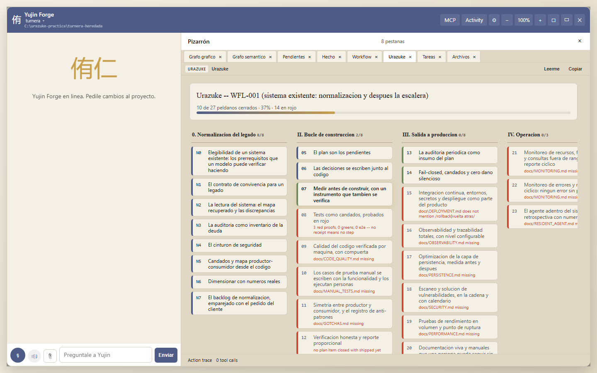
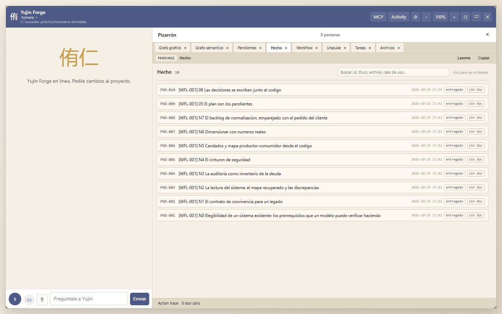
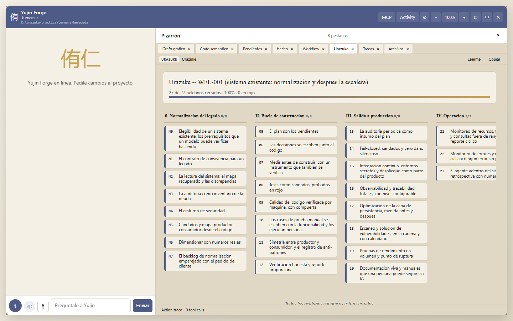

# Manual de ejecución: un proyecto existente con Urazuke en Yujin Forge

Paso a paso para principiantes, con capturas. Es la segunda práctica del 19 de octubre de 2026:
**Turnera heredada**, una copia "de un conocido" de la agenda de turnos del consultorio, sin
tests, sin cadena, sin documentación, con un defecto que la dueña sufre todos los días (a los
pacientes que reprogramaron les llega el recordatorio cada día hasta el turno) y con un par de
olores que nadie había mirado. El código no lo escribió el método; el método lo **hereda**.

Este manual da por leído el de [proyecto nuevo](MANUAL_FORGE_PROYECTO_NUEVO.html): el panel, las
pestañas, los recibos y el reporte honesto son los mismos. Acá se cuenta lo que cambia cuando
el sistema ya existe: el camino **N0 a N7** del método (el [evolutivo-correctivo](../EVOLUTIVO_CORRECTIVO.html)),
cómo Forge lo elige solo, y cómo se corrige un defecto real con un rojo de verdad.

## Qué cambia cuando el sistema ya existe

Tres cosas, y las tres las hace cumplir Forge:

1. **No se reescribe nada.** El contrato suma cinco reglas (7 a 11): nada se refactoriza sin
   pedido; el código que no se entiende se lee antes de tocarlo; lo raro se anota como
   pendiente, nunca se arregla de paso; **el comportamiento actual es la especificación** hasta
   que la dueña diga otra cosa; y nada llega al entorno de prueba sin la batería de
   caracterización en verde.
2. **Primero se lee, después se toca.** Los peldaños N0 a N7 recuperan el mapa del sistema desde
   el código (qué hace, con marcas de fuente), inventarían la deuda con una marca de velocidad
   (BLOQUEA, SE PAGA AL TOCAR, PUEDE ESPERAR) y ponen el cinturón de seguridad antes de cambiar
   una línea.
3. **El pedido del cliente y la deuda van en un solo plan.** En N7, cada pedido se empareja con
   la deuda del módulo que toca, y lo que bloquea va primero.

Después de N7 el proyecto entra en el bucle normal, en el peldaño 5.

## 0. Arrancar sobre una carpeta que ya tiene código

```
yf start --existing C:\urazuke-practica\turnera-heredada --no-launch
```

(O el botón **proyecto existente** del arranque en un clic, y elegir la carpeta.) Forge mira la
carpeta: tiene código y **no tiene** `docs/WORKING_AGREEMENT.md`, `docs/SEMANTIC_TREE.md` ni
`docs/GATES.md`, así que le asigna el flujo **WFL-001 (urazuke-legacy)**: las ocho estaciones N0
a N7 y después los peldaños 5 a 23, una tarea por cada uno, en orden.



En la práctica, la carpeta era una copia de Turnera con dos commits ("versión 1 del sistema de
turnos", "arreglos varios y recordatorio a los reprogramados"), un `README.md` de tres líneas y
un `package.json` sin tests. Nada más.

### Un tropiezo que vale como lección

Al abrir el panel sobre esta copia, Forge le dio el **mismo identificador** que al proyecto
original ("turnera", porque los dos `package.json` se llaman igual), y como "una carpeta = una
entrada", movió el registro del original a la carpeta heredada y borró la entrada de la
heredada. Los dos proyectos quedaron mezclados: la escalera de uno aparecía en el otro. Se
corrigió en Forge el mismo día (el registro manda sobre el `package.json`), pero la regla queda:
**si tenés dos copias de un sistema, dales nombres distintos** o un `project_slug` explícito en
`yujin.forge.json`.

## 1. Las estaciones N0 a N7

Cada estación tiene, como los peldaños, lo que verifica Forge y el prompt para pegar. En esta
práctica las estaciones N0 a N6 las produjo **una sesión del agente con el prompt de cada una**,
leyendo el código, sin tocarlo; N3 (la auditoría) la hizo la misma sesión, y el informe lo
declara: el método prefiere un auditor aparte, y en el proyecto nuevo se hizo así.

### N0: elegibilidad verificada haciendo

El agente no pregunta si el sistema se puede levantar: **lo levanta**. Puso el servidor en un
puerto libre con una base temporal, pidió `GET /api/profesionales` y pegó la respuesta (200, con
su `X-Request-Id`), dio de alta un turno por la API (201) y cerró el proceso. Escribió
`docs/ELIGIBILITY.md` con los siete prerrequisitos en verde o rojo y su evidencia, y
`docs/FUNCTIONALITY_RECOVERED.md`: qué hace el sistema, pantalla por pantalla, **desde el código**,
con marcas `[código: archivo:línea]` y `[supuesto]`.

Forge verifica los dos archivos. Los rojos de N0 (no había tests ni cadena ni respaldo) se
convierten en proyectos previos: acá, el cinturón de N4 y el respaldo del bloque 1.

### N1: el contrato para un legado

`docs/WORKING_AGREEMENT.md` con las seis reglas más las cinco del legado. Forge busca, además,
la rutina del rojo y la del reporte honesto: las va a exigir igual que en un proyecto nuevo.

### N2: el mapa recuperado y las discrepancias

`PROJECT.md`, `docs/SEMANTIC_TREE.md`, `docs/STATUS.md` y, lo más valioso, `docs/DISCREPANCIES.md`:
**19 discrepancias** entre lo que el código hace y lo que el negocio presumiblemente quiere,
cada una como "el código hace X [archivo:línea]; el negocio dice Y; decisión: pendiente de la
dueña". Entre ellas:

- D-01: a los reprogramados se les vuelve a avisar en cada corrida (`src/rules.js`, con un
  comentario "los reprogramados tienen que recibir el aviso sí o sí, pedido de la dueña, mayo"
  que nadie podía confirmar).
- D-02: el marcado del recordatorio pisa el aviso anterior en la base (no es idempotente).
- D-03: un contador global en memoria que se imprime con `console.log` y nadie lee.
- D-13: el commit que decía "recordatorio a los reprogramados" solo tocaba un CSS.
- D-14: "Enviar recordatorios" no envía nada: escribe un archivo. ¿Quién lo lee?

Ninguna se arregla acá. Se escriben, y la dueña decide una por una.

### N3: la auditoría como inventario de la deuda

`docs/AUDIT_2026-10-19.md`: 20 hallazgos, cada uno con archivo y línea, riesgo, evidencia,
prioridad **y la marca de velocidad**:

| Marca | Ejemplo en Turnera heredada |
|---|---|
| **BLOQUEA** | A-01: meses en producción sin una copia de seguridad, con la base abierta en modo WAL. |
| **SE PAGA AL TOCAR** | A-02/A-04: el marcado del recordatorio no es idempotente en la base. Se paga junto con R1, porque es el mismo módulo. |
| **PUEDE ESPERAR** | A-10: `GET /api/turnos` sin filtro devuelve la tabla entera (81 MB a 300.000 filas). |

### N4: el cinturón de seguridad

Antes de cambiar una línea, **30 tests de caracterización** (`tests/caracterizacion.test.js`)
que capturan lo que el sistema hace hoy, **defectos incluidos**: hay un test que se llama
"comportamiento actual: el reprogramado vuelve a recibir el aviso en cada corrida" y pasa en
verde, porque eso es lo que el sistema hace. El rojo del cinturón se prueba **por mutación**:
el agente plantó un defecto en `src/rules.js` (sacó la cláusula del reprogramado) y la batería
lo atrapó con 2 tests en rojo; otro en `src/store.js` (sacó el sobreturno) y 1 en rojo; después
lo revirtió. Más la cadena (`.github/workflows/ci.yml`), `docs/GATES.md`, `docs/DEPLOYMENT.md` y
`docs/ENVIRONMENTS_SURVEY.md`. Forge verifica los documentos y que exista una definición de
integración continua.

### N5: candados y mapa productor-consumidor desde el código

`docs/CONSEQUENTIAL_ACTIONS_SURVEY.md` (qué envía, borra o corre solo: acá solo el envío de
recordatorios a un archivo), `docs/LOCKS.md` con un candado propuesto por acción y cuáles van
**ahora** (restaurar el respaldo, preguntar quién lee el archivo de salida) y cuáles **al tocar**
(modo de prueba, idempotencia en la base, límite diario), y `docs/PRODUCER_CONSUMER_MAP.md`.

### N6: dimensionar con números reales

No había base de producción: el agente lo dice, mide sobre una base de prueba sembrada con un
**medidor con test** (`scripts/meter-volumen.mjs`: filas por tabla, filas por mes, las consultas
más lentas con su plan) y marca todo como `[base de prueba]`. A 30.000 filas (el volumen de la
dueña) las consultas usan índice y tardan menos de 0,2 ms; a 300.000 (el por diez), la única
que se rompe es el `GET` sin filtro: 81 MB y 7,9 segundos bloqueado. `docs/SIZING.md` dice qué
aguanta el por diez (SQLite) y qué no (ese endpoint, el contador en memoria, la falta de
respaldo). El registro G9 se tomó en Forge con las cuatro opciones admisibles.

### N7: el backlog, emparejado con el pedido

La dueña escribe su pedido en `docs/blocks/BLOCK_01_REQUEST.md`, con sus palabras ("a los
pacientes que reprogramaron les llega el recordatorio todos los días hasta el turno"; "que no se
reescriba el sistema"; "que no se toque la pantalla"). El agente arma la cola:

| Pendiente | Marca | Qué |
|---|---|---|
| PND-028 | BLOQUEA | Respaldo diario con `VACUUM INTO` y una restauración probada |
| PND-029 | CORRECTIVO | R1: al reprogramado le llega **un** solo recordatorio |
| PND-030 | SE PAGA AL TOCAR | El marcado es idempotente en la base (mismo módulo que R1) |
| PND-031 | CLARIFY | D-14: ¿quién lee el archivo de salida? (si alguien manda WhatsApp a mano desde ahí, pausar) |

Cada uno con criterios de aceptación, cómo se verifica y qué flujo toca. Forge verifica el
pedido y que todos los pendientes abiertos tengan especificación. Desde acá, el bucle del
peldaño 5 en adelante.

## 2. El bucle: el bloque correctivo

### El rojo de verdad

Acá está la diferencia con el primer bloque de un proyecto nuevo. El test nuevo
(`tests/recordatorio-reprogramado.test.js`) dice lo que la dueña quiere: tres corridas seguidas,
un solo aviso. Contra el código heredado, **falla**:

```
yf urazuke evidence run red_proof --pending PND-029 --step 8 --base-ref HEAD \
  --test-file tests/recordatorio-reprogramado.test.js \
  --command "npx vitest run tests/recordatorio-reprogramado.test.js -t PND-029"
recibo OK   exit: 1   counts: 2 failed, 1 files failed
```

Dos tests en rojo contra la versión `90d53bb`, la que tiene el defecto. Eso es un recibo: el
comando, la versión, la cuenta y el código de salida, para que la dueña lo vuelva a correr. Lo
mismo para la idempotencia (1 fallando) y para el respaldo (el script no existía).

### El cambio, mínimo

Dos líneas en `src/rules.js` (la cláusula del reprogramado y su comentario) y una en
`src/store.js` (`WHERE reminder_sent_at IS NULL`). El contador global se queda como está: no es
parte del pedido (regla 7) y está anotado como deuda "se paga al tocar". Más `scripts/backup.mjs`
con su test, que **restaura** la copia y cuenta los turnos: un respaldo que no se probó no es
un respaldo.

### Los tests de caracterización que describían el defecto

Al corregir, dos tests del cinturón se pusieron en rojo: los que decían "comportamiento actual"
para el aviso repetido y para el marcado no idempotente. Se cambiaron **a la vista, en el mismo
commit**, con el nombre nuevo ("corregido en R1 (PND-029)") y el motivo en el comentario. El
commit lo dice, el reporte honesto lo dice, y `docs/GOTCHAS.md` lo convierte en regla.

```
yf urazuke evidence run green      --pending PND-029 --command "npx vitest run tests/recordatorio-reprogramado.test.js -t PND-029"
yf urazuke evidence run regression --pending PND-029 --command "npm test"              # 41 tests
yf urazuke evidence run e2e        --pending PND-029 --command "npx vitest run tests/recordatorio-reprogramado.test.js"
```

El e2e, acá, es por la API real hasta el archivo de salida: el pedido no toca la pantalla
(D-007), y el recibo lo anota.

### El cierre

`yf pending close PND-029 --reason shipped --resolution "..."`: Forge arma el reporte honesto
con los cuatro recibos. PND-031 (la aclaración) se cerró con `--force-gate` y su razón: solo
documentación, no hay test que la ponga en rojo; la respuesta de la dueña quedó escrita en
D-14 con fecha.



Después, los peldaños 9 a 12 como en el proyecto nuevo: `yf urazuke quality init` y `check`
(8 archivos, 0 violaciones, trinquete), `docs/MANUAL_TESTS.md` con diez casos para la
recepcionista, `docs/GOTCHAS.md` con cinco golpes, y los tres cierres con reporte honesto.

## 3. Salida a producción y operación

Los peldaños 13 a 23 son los mismos que en el proyecto nuevo, y los documentos se escriben
igual; la diferencia es que acá describen un sistema que ya corre. La auditoría de N3 vale como
la del peldaño 13 (Forge busca `docs/AUDIT_*.md`), y los hallazgos ya están en el plan. Lo que
se midió, con su comando, está en `docs/PERSISTENCE.md`, `docs/SECURITY_2026-10-19.md` y
`docs/PERFORMANCE_2026-10-19.md` del proyecto; el reporte cíclico y la retrospectiva se corren
con `yf urazuke cycle` y `yf urazuke retro`.

Dos cosas de esta parte que vale la pena contar:

- El primer reporte cíclico abrió una **falsa alarma** de dimensionamiento: la base de prueba de
  30.000 filas cubre tres años y se pasó al comando como si fuera un año; Forge comparó 30.000
  por año contra los 10.000 declarados y abrió un pendiente. Se rechazó con motivo y se volvió a
  correr con la ventana correcta (admisible, 1x). La retrospectiva propone que la ventana salga
  de la base y no de la mano del operador.
- La retrospectiva (`yf urazuke retro`) dio: 3 rojos probados, 3 verdes, 3 regresiones, 2 de
  punta a punta, 0 recibos NOT OK, 1 override con razón, 27 de 27 cerrados.



## 4. Lo que Forge verificó, lo que creímos y lo que no vimos

**Verificado:** las ocho estaciones y los peldaños cerrados con sus artefactos en disco; tres
rojos de comportamiento contra `90d53bb` (2, 1 y 1 archivo); 41 tests en verde después del
cambio; el respaldo restaurado por test; 0 violaciones de calidad.

**Creído:** que la cadena corre en GitHub (no hubo push); que `listen` sin host expone a la red
local (es la semántica, no se probó desde otra máquina).

**Puntos ciegos:** la base y el archivo de salida reales, la máquina del consultorio, y quién
leía el archivo antes (la dueña contestó: nadie; quedó en D-14). N3 la hizo la misma sesión que
N2.

## Apéndice: todos los comandos, en orden

```
yf start --existing C:\urazuke-practica\turnera-heredada --no-launch   # -> urazuke-legacy
yf urazuke status                                                     # N0..N7, 5..23
(N0..N6: una sesion del agente con el prompt de cada estacion; el codigo no cambia)
yf pending close PND-001 ... PND-007 --reason shipped --resolution "..."
yf pending add "[BLOQUEA] A-01: respaldo ..." --category infra --priority 5 --acceptance ... --how-verified ... --flow ...
yf pending add "[CORRECTIVO] R1: ..." --category bug ...
yf pending add "[SE PAGA AL TOCAR] A-02 y A-04: ..." --category bug ...
yf pending add "[CLARIFY] D-14: ..." --category clarify ...
yf pending close PND-008 PND-009 PND-010                              # N7, 5, 6
yf urazuke evidence run red_proof --pending PND-029 --base-ref HEAD --test-file tests/recordatorio-reprogramado.test.js --command "..."
(idem PND-030, PND-028; cambio minimo; green, regression, e2e)
yf pending close PND-028 PND-029 PND-030 --reason shipped --resolution "..."
yf pending close PND-031 --reason shipped --force-gate "solo documentacion ..."
yf pending close PND-011 PND-012                                      # 7, 8
yf urazuke quality init && yf urazuke quality check                   # 9
yf pending close PND-013 ... PND-016                                  # 9, 10, 11, 12
(13 a 23: documentos, yf urazuke cycle, yf urazuke retro, cierres)
```

La evidencia completa está en `docs/practica/evidencia/turnera-heredada/` del repositorio del
método.
