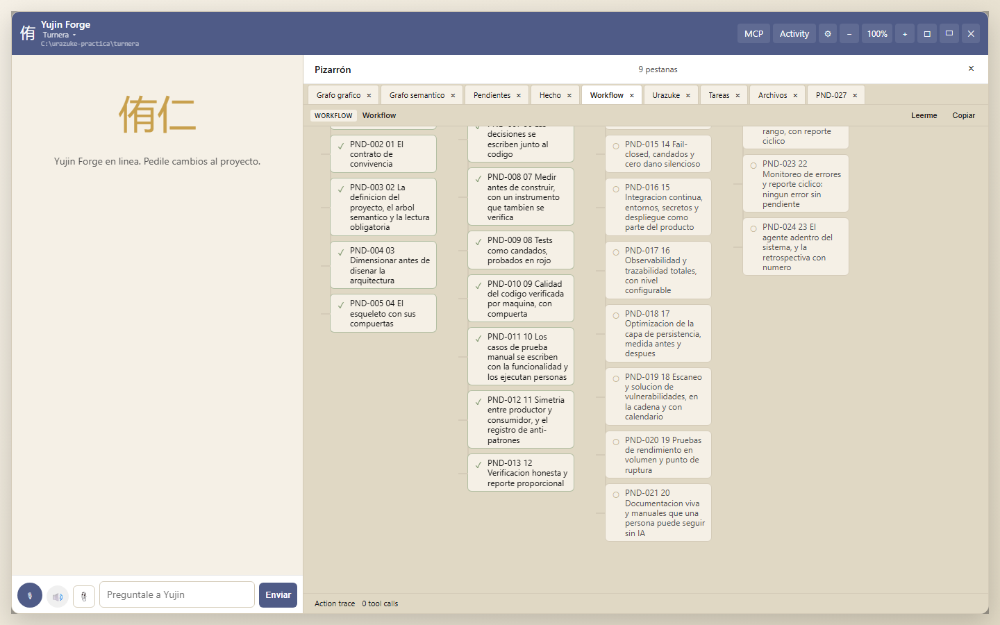
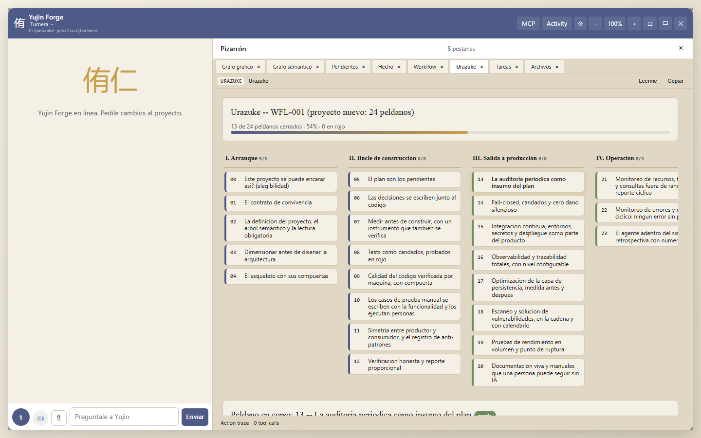
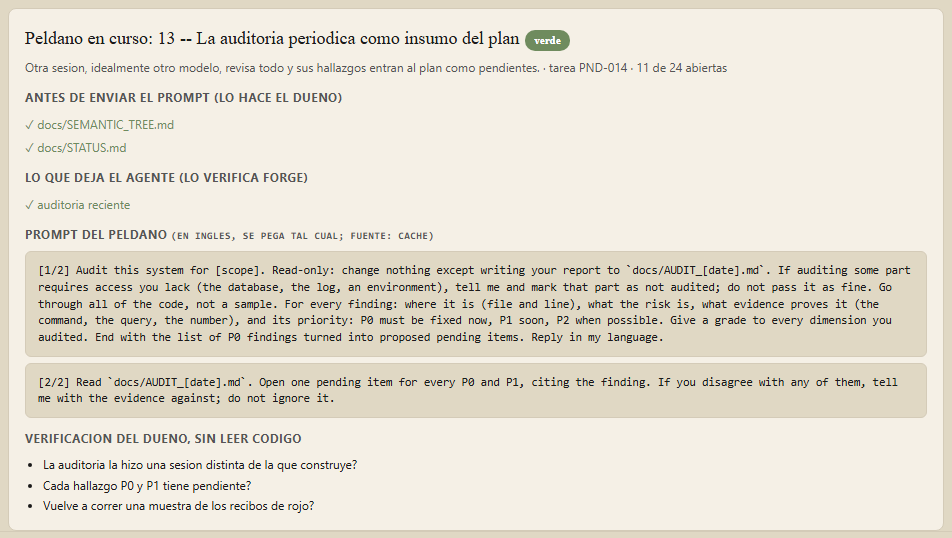
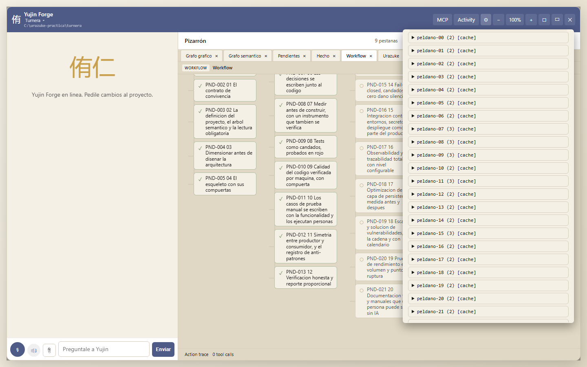
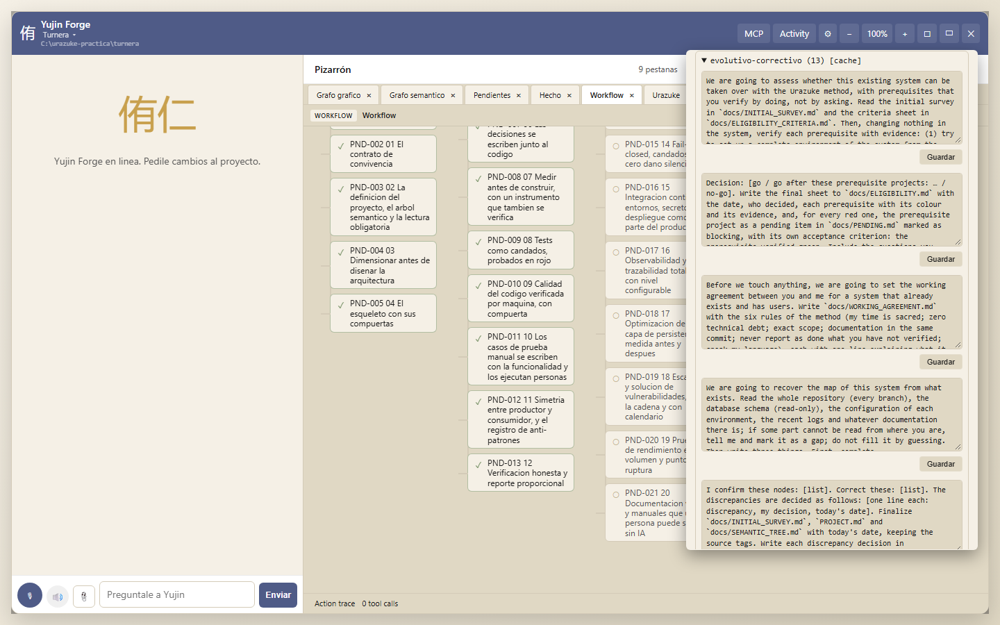
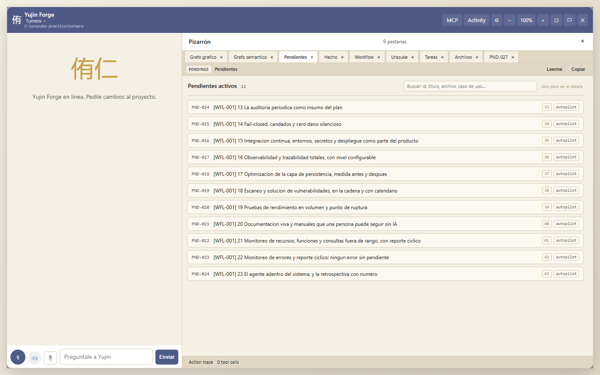
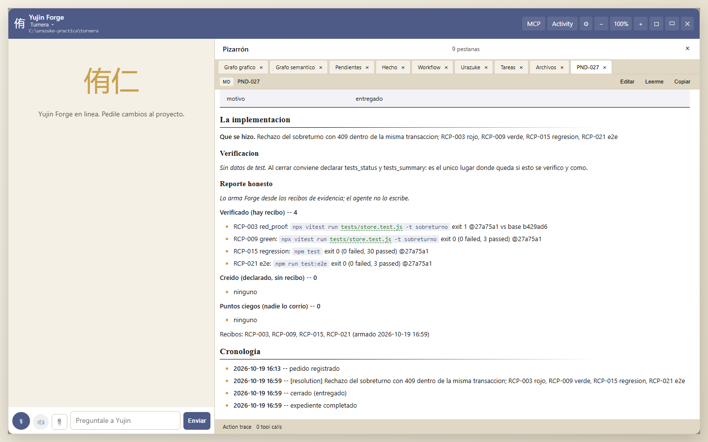
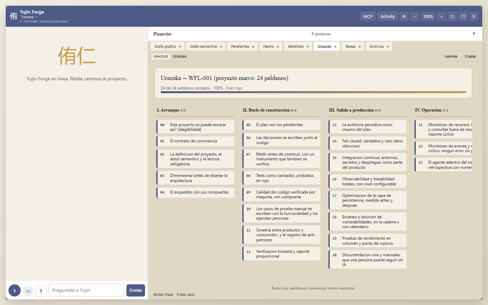

# Manual de ejecución: un proyecto nuevo con Urazuke en Yujin Forge

Paso a paso para principiantes, con capturas. Lo que acá se cuenta no es un ejemplo inventado:
es lo que pasó el 19 de octubre de 2026 al construir **Turnera**, una agenda de turnos para un
consultorio, desde el peldaño 0 hasta el 23, con Forge haciendo cumplir cada compuerta. Los
números, los recibos y los tropiezos son los reales; la evidencia está publicada en
`docs/practica/evidencia/turnera/` en el repositorio del método.

Si nunca leíste el método, empezá por la [escalera](../ESCALERA_METODOLOGICA.html) o al menos por su
[glosario](../ESCALERA_METODOLOGICA.html#glosario). Acá se dan por sabidas tres palabras: **peldaño** (cada
uno de los 24 pasos), **compuerta** (lo que Forge verifica antes de dejar cerrar un peldaño) y
**recibo** (la salida textual de un comando, con su versión y su código de salida, que Forge
guarda como prueba).

## Qué necesitás

- Windows, macOS o Linux con **Node 22 o superior** y **git**.
- **Yujin Forge** con el motor Urazuke. Al momento de escribir esto el motor está en la rama
  `feat/urazuke-engine` del repositorio `yujinapp/yujin-forge`; cuando se publique en npm el
  comando de instalación será `npm install -g @nac3/forge-cli`. Verificá con `yf --version`.
- Un cerebro configurado en Forge (plan de Claude, tu propia clave o cualquier proveedor):
  Forge te lo pide la primera vez que abrís el panel.
- Una tarde. Turnera entera, 24 peldaños y dos bloques de construcción, llevó una sesión de
  trabajo.

Una aclaración honesta antes de empezar: en esta práctica el rol de "dueña del consultorio"
lo hizo la misma persona que opera Forge. En un proyecto real la dueña no lee código y decide;
el agente propone y construye. Vas a ver las dos voces.

## 0. Arrancar en un clic

Forge no te pide abrir una terminal ni hacer `cd`. El comando `yf start` (o el ícono del
escritorio que crea `yf start --shortcut`) abre una ventana nativa con dos botones: **proyecto
existente** o **proyecto nuevo**. Si elegís nuevo, te pide el nombre y la carpeta donde crearlo
con el explorador de archivos de tu sistema; si elegís existente, te deja elegir la carpeta.
Después registra el proyecto, decide qué camino del método le toca y abre el panel en el
navegador.

Para Turnera, el arranque fue:

```
yf start --new turnera --parent C:\urazuke-practica
```

Eso creó `C:\urazuke-practica\turnera` con un `git init`, un primer commit ("Arranque del
proyecto con Yujin Forge (Urazuke, peldaño 0)") y el flujo **WFL-001 (urazuke)**: los 24
peldaños como tareas del proyecto, en orden, una por peldaño.

Qué camino elige Forge, y por qué importa:

| La carpeta | Camino |
|---|---|
| no tiene código | **urazuke** (proyecto nuevo, 24 peldaños) |
| tiene código pero no tiene `docs/WORKING_AGREEMENT.md`, `docs/SEMANTIC_TREE.md` y `docs/GATES.md` | **urazuke-legacy** (N0 a N7 y después entra en el peldaño 5) |
| tiene código y los tres documentos | evolutivo (ya se construyó con el método) |

El manual del segundo caso es [este otro](MANUAL_FORGE_PROYECTO_EXISTENTE.html).

## 1. El panel: dónde está cada cosa


A la izquierda, el chat con el cerebro ("Preguntale a Yujin"). A la derecha, el **Pizarrón**,
con pestañas. Las que vas a usar todo el tiempo:

- **Urazuke**: la escalera dibujada, el peldaño en curso y su prompt. Es la ventana canónica del
  método.
- **Pendientes** y **Hecho**: el plan y lo cerrado, con el expediente de cada pendiente.
- **Workflow**: las 24 tareas como tarjetas, en columnas por tramo (es la misma información
  que la escalera, vista como tablero).


- La ruedita (⚙) arriba a la derecha abre los ajustes, donde están los prompts del método para
  que los modifiques si querés.

Si no ves las pestañas, abrí los ajustes y activá "pestañas de arranque"; en esta práctica
estaban apagadas y el Pizarrón decía "0 pestañas" hasta que las activamos.



La escalera muestra los cuatro tramos (arranque, bucle de construcción, salida a producción,
operación), cuántos peldaños están cerrados y cuántos en rojo. Abajo, el **peldaño en curso**:



Cada peldaño en curso tiene cuatro partes, y son las mismas en los 24:

1. **Antes de enviar el prompt (lo hacés vos)**: los documentos que tenés que haber escrito o
   leído. Forge marca con ✓ los que existen.
2. **Lo que deja el agente (lo verifica Forge)**: los artefactos que el peldaño produce. Forge
   los busca en el disco y, cuando hace falta, corre una sonda (¿hay recibos? ¿hay registro de
   dimensionamiento?). Esta es la compuerta: no se cierra el peldaño con algo en rojo.
3. **El prompt del peldaño**, en inglés, para pegar tal cual en el chat. Viene del repositorio
   del método (`yujin.app/urazuke/api/prompts.json`), se guarda en caché un día y, si lo editaste
   en los ajustes, se usa tu versión. Además, **Forge lo inyecta solo** en el contexto del
   cerebro: cuando le escribís al chat, el cerebro ya sabe en qué peldaño está y qué le pide
   el método. Pegarlo a mano es opcional; sirve para dirigir la conversación.
4. **Verificación del dueño, sin leer código**: dos o tres preguntas para que vos compruebes el
   resultado sin abrir un archivo de código.

### Los prompts son tuyos

Los prompts de cada peldaño llegan a Forge desde el repositorio del método, por la API pública
`yujin.app/urazuke/api/prompts.json` (se guardan en caché un día; si no hay red, se usa la copia
que viene con Forge). Pero vos tenés el control: en los ajustes (⚙) hay una sección **Prompts
de Urazuke** donde cada peldaño muestra sus prompts y un botón **Guardar** por cada uno.





Un prompt editado se guarda en `.forge/urazuke-prompts.json` dentro del proyecto y gana sobre
el publicado; **Restablecer** vuelve al original. Desde la línea de comandos:
`yf urazuke prompts list | show 8 | set 8 1 --file mi_prompt.txt | reset 8`.

### La línea de comandos, para quien la prefiera

Todo lo del panel existe también como comando. Los que se usan en este manual:

```
yf urazuke status                 # la escalera en texto
yf urazuke step 8                 # el detalle de un peldaño
yf pending add "título" ...       # un pendiente del plan, con su especificación
yf pending close PND-025 ...      # cerrar un pendiente (pasa por la compuerta)
yf urazuke evidence run <tipo>    # correr un comando y guardar el recibo
yf urazuke quality init | check   # la calidad por máquina
yf urazuke cycle                  # el reporte cíclico
yf urazuke retro                  # la retrospectiva con números
```

Agregá `--project turnera` si no estás parado en la carpeta del proyecto.

## 2. El tramo de arranque: peldaños 0 a 4

### Peldaño 0: ¿este proyecto se puede encarar así?

La dueña escribe lo que quiere, con sus palabras, en `docs/INITIAL_SURVEY.md` y
`docs/MY_PREFERENCES.md`. En Turnera: un consultorio con tres profesionales, cuarenta turnos
por día, cinco personas usando el sistema, sin internet pública, sin WhatsApp todavía. Después
pega el prompt del peldaño 0 (o le dice al chat "evaluá la elegibilidad") y el agente escribe
`docs/ELIGIBILITY.md` con un veredicto: **go**, con las razones.

Forge verifica: que exista `docs/ELIGIBILITY.md` con contenido. Cierre:

```
yf pending close PND-001 --reason shipped --resolution "Elegible: ..."
```

En el panel, el cierre lo hace el cerebro cuando le decís "cerrá el peldaño 0"; la compuerta
es la misma.

### Peldaño 1: el contrato de convivencia

El agente escribe `docs/WORKING_AGREEMENT.md` con las seis reglas del método, la rutina del rojo
y la rutina del reporte honesto. Forge, además de la existencia del archivo, busca que esas dos
rutinas estén escritas: son las que le va a exigir en los peldaños 8 y 12.

### Peldaño 2: el proyecto, el árbol semántico y la lectura obligatoria

`PROJECT.md`, `docs/SEMANTIC_TREE.md` (los nodos de funcionalidad con sus identificadores:
`turnera.agenda`, `turnera.turno.alta`, `turnera.turno.sobreturno`...) y `docs/STATUS.md`. El
`CLAUDE.md` del proyecto le dice a cualquier sesión qué leer primero.

### Peldaño 3: dimensionar antes de diseñar la arquitectura

Acá pasó lo más instructivo de la práctica. La dueña contó los números (`docs/VOLUME_SURVEY.md`:
40 turnos por día, 250 días, 6 filas por turno contando cambios de estado y mensajes, 5 años de
retención, una PC con 8 GB) y el agente propuso una persistencia: **todo en memoria con
escritura a un archivo JSON, un solo hilo**. Es la elección más rápida de escribir y la que el
método cuenta, en su referencia del post mortem, como el origen de un sistema real que se
rompió.

Forge no la dejó pasar. El registro de dimensionamiento (la compuerta **G9**) respondió,
textual:

> pagination: 180000 rows at the horizon exceeds the 100000-row limit for materialising before
> slicing | write_concurrency: inadmissible with 5 concurrent users: the guarantee is implicit,
> undocumented, and nobody can see it in the code

El agente volvió con las cuatro opciones admisibles (base SQL con acceso asíncrono, paginación
por clave, retención por antigüedad, transacciones explícitas), eligió SQLite embebido en Node
(`node:sqlite`, sin dependencias) y lo dejó escrito en `docs/SIZING.md` y en la decisión D-003
de `docs/DECISIONS.md`. Todo esto **antes de escribir la primera línea de código**.

Para la dueña: no hace falta entender qué es "materializar antes de cortar". Alcanza con ver
que la compuerta dijo que no, y que el agente explicó con palabras simples por qué la segunda
opción aguanta diez veces el volumen.

### Peldaño 4: el esqueleto con sus compuertas

El agente arma el proyecto vacío pero completo: configuración, la cadena de integración continua
(`.github/workflows/ci.yml`), las compuertas escritas en `docs/GATES.md`, el registro
estructurado, la pantalla vacía. Forge verifica que exista la cadena, las compuertas, el
dimensionamiento, y que `docs/STATUS.md` diga cuál es el comando de la batería de tests.

El esqueleto se commitea solo, sin funcionalidad: es el "antes" contra el que se van a probar
en rojo los tests del primer bloque.

## 3. El bucle de construcción: peldaños 5 a 12

### Peldaño 5: el plan son los pendientes

La dueña escribe el pedido del bloque en `docs/blocks/BLOCK_01_REQUEST.md` con sus palabras. El
agente lo convierte en pendientes **con especificación**: criterios de aceptación, cómo se va a
verificar, qué flujo de pantalla toca. Desde la línea de comandos:

```
yf pending add "Rechazo del sobreturno" --category autopilot --priority 12 \
  --acceptance "un segundo turno en el mismo lugar responde 409 con el nombre de quien lo tiene" \
  --acceptance "la agenda sigue mostrando un solo turno en ese lugar" \
  --how-verified "test de store en rojo contra el esqueleto, verde, regresion y e2e" \
  --flow "alta de turno"
```

Forge verifica: que el pedido exista y que **todos** los pendientes abiertos del plan tengan
criterios de aceptación y modo de verificación (más de diez caracteres cada uno; un "e2e" a
secas no cuenta, y en Turnera uno quedó así y el peldaño se puso en rojo hasta corregirlo).



Turnera, bloque 1: seis pendientes, PND-025 a PND-030 (agenda del día, alta en bloques de 20
minutos, rechazo del sobreturno, confirmar, cancelar sin borrar, marcar ausente).

### Peldaño 6: las decisiones se escriben junto al código

`docs/DECISIONS.md`, una decisión por renglón con fecha. D-003 es la de SQLite; D-005, que los
recordatorios se simulan en un archivo hasta que haya proveedor.

### Peldaño 7: medir antes de construir, con un instrumento que también se verifica

La hipótesis era: "la agenda del día usa el índice y su tiempo no depende del total de filas".
El agente escribió un **medidor** que vive en el repositorio (`scripts/meter-agenda.mjs`), con
su **test** (`tests/meter.test.js`: contra un caso conocido, contra su determinismo y contra el
caso negativo sin índice), y lo corrió:

```
node scripts/meter-agenda.mjs --rows 180000 --fecha 2027-03-10
  filas totales:  180000
  filas del dia:  53 (2027-03-10)
  indice usado:   si  [SEARCH turnos USING INDEX idx_turnos_fecha (fecha=?) ...]
  tiempo p50:     0.653 ms   max: 1.27 ms  (20 muestras)
```

Y dejó un presupuesto protegido por test: 20 ms para la agenda a 20.000 filas (medido 0,137;
margen por cien, porque la máquina de CI es más lenta). Todo en `docs/MEASUREMENTS.md`, con el
comando y la fecha. Forge verifica que exista un medidor (`scripts/meter-*` o
`tools/measure_*`).

Un detalle que vale la pena contar: la primera versión del medidor **se colgaba** a 180.000
filas porque su generador de números al azar tenía un ciclo corto y nunca llenaba los lugares.
El test del medidor contra un caso conocido fue el que obligó a mirarlo. Un medidor sin test
habría dado un número cualquiera.

### Peldaño 8: tests como candados, probados en rojo

Este es el corazón del método y donde Forge más trabaja. Para cerrar un pendiente del plan
con `shipped`, Forge exige **tres recibos**: el rojo probado, el verde y la regresión (el e2e se
registra también y entra en el reporte). Los recibos los produce Forge, no el agente:

```
yf urazuke evidence run red_proof --pending PND-027 --step 8 \
  --base-ref b429ad6 --test-file tests/store.test.js \
  --command "npx vitest run tests/store.test.js -t sobreturno"
```

Qué hace ese comando: crea un **worktree temporal** de git en la versión `b429ad6` (el
esqueleto, el código de antes), copia ahí el archivo de test nuevo, corre el comando y espera
que falle. Guarda la salida (cola), el código de salida, la cuenta de tests fallados y la
versión. Después:

```
yf urazuke evidence run green      --pending PND-027 --step 8 --command "npx vitest run tests/store.test.js -t sobreturno"
yf urazuke evidence run regression --pending PND-027 --step 8 --command "npm test"
yf urazuke evidence run e2e        --pending PND-027 --step 8 --command "npm run test:e2e"
```

Cada uno devuelve **recibo OK** o **recibo NOT OK**, con su número (RCP-003, RCP-009...). Un
"verde" que falla es NOT OK y no cuenta. Un "rojo" que no falla (porque el test ya pasaba en la
versión anterior) es NOT OK y no cuenta: así se cierra la puerta al rojo inventado.

Lo que pasó en Turnera, con honestidad:

- Los seis rojos del bloque 1 fueron **rojos triviales**: contra el esqueleto, el módulo no
  existía y el archivo de test no cargaba ("1 files failed"). Forge primero los rechazó (su
  regla era "al menos un test fallado") y después se decidió aceptar el fallo a nivel archivo
  como rojo, porque el runner lo reporta como fallo. Es un recibo válido pero flojo. La
  retrospectiva propone que el primer bloque de un proyecto nuevo pruebe el rojo por mutación.
- El bloque 2 (los hallazgos de la auditoría) tuvo **rojos de verdad**: los tests fallaban
  contra el código vigente con 3, 1 y 2 tests en rojo, y pasaron con el cambio.
- La primera corrida de un rojo **borró `node_modules` del proyecto**: el runner enlazaba la
  carpeta con una junction y al limpiar el worktree la atravesó. Se corrigió en Forge el mismo
  día, con un test que lo impide. Si alguna vez te pasa con una versión vieja: `npm ci`.

Forge verifica, para cerrar el peldaño: que la rutina del rojo esté en el contrato y que haya
recibos de rojo y de verde registrados.

### Peldaño 9: calidad del código verificada por máquina, con compuerta

```
yf urazuke quality init     # detecta el stack, escribe eslint/stryker y el primer docs/CODE_QUALITY.md
yf urazuke quality check    # mide y compara con el trinquete
```

Forge trae **medidores nativos** (tamaño de archivo y de función, complejidad, duplicación)
para cualquier stack, y usa el linter del proyecto si está. La primera corrida en Turnera:

```
9 archivos, 723 lineas, 90 funciones
max lineas/archivo 163 (limite 300) | max lineas/funcion 28 (40) | max complejidad 12 (10)
violaciones: 2 | bloques duplicados: 0
```

Las dos violaciones (dos funciones con complejidad 11 y 12) **no se arreglaron en el acto**: se
abrieron como pendientes (PND-031 y PND-032), como pide el método, y se cerraron con sus
recibos. Un refactor no tiene rojo posible, así que se cerraron con `--force-gate` y la razón
escrita; esa razón queda en el historial del pendiente para siempre.

El **trinquete** (`.forge/quality-ratchet.json`) solo deja mejorar: cuando el script de carga
subió la complejidad de 0 a 1 violaciones, el check lo dijo ("violations rose 0 -> 1") y se
corrigió antes del commit.

### Peldaños 10 y 11: casos manuales, simetría y golpes

`docs/MANUAL_TESTS.md` (para que los ejecute una persona), `docs/PRODUCER_CONSUMER_MAP.md` (quién
escribe y quién lee cada estructura) y `docs/GOTCHAS.md`: cada vez que algo sale mal, la regla
que lo evita. Turnera cerró con seis golpes anotados, tres del proyecto y tres de la herramienta.

### Peldaño 12: verificación honesta y reporte proporcional

Cuando cerrás un pendiente del plan con `shipped`, Forge arma el **reporte honesto** desde los
recibos. No lo escribe el agente:



Tres bloques: **verificado** (hay recibo: el comando, el código de salida, la cuenta, la
versión), **creído** (declarado sin recibo) y **puntos ciegos** (nadie lo corrió). Si un recibo
se tomó con el árbol sucio (cambios sin commitear), el reporte lo dice: "the committed version
was not what ran". En Turnera pasó con los recibos de los refactors, y quedó escrito.

Forge verifica, para cerrar el peldaño 12: que al menos un pendiente del plan se haya cerrado
con reporte.

## 4. La salida a producción: peldaños 13 a 20

### Peldaño 13: la auditoría periódica como insumo del plan

Otra sesión, idealmente otro modelo, revisa todo. En Turnera la auditoría la hizo una sesión
independiente con **Claude Sonnet** (la constructora era Claude Fable), con el prompt del
peldaño, solo lectura, y escribió `docs/AUDIT_2026-10-19.md`: 15 hallazgos con archivo y línea,
cada uno verificado en vivo (levantó el servidor, probó rutas, corrió dos stores concurrentes
peleando por el mismo lugar). Los tres altos:

1. Un turno cancelado se podía **revivir** confirmándolo o reprogramándolo, y eso le borraba la
   cancelación al resumen del mes.
2. El candado "ausente solo el día del turno o después", escrito en `docs/LOCKS.md`, **no
   existía** en el código.
3. El candado "no se recuerda un teléfono inválido", también escrito, tampoco.

Los 11 hallazgos altos y medios se convirtieron en pendientes (PND-039 a PND-049) con su
especificación. Los tres altos se cerraron en el **bloque 2** con rojo de comportamiento:

```
yf urazuke evidence run red_proof --pending PND-039 --step 8 --base-ref HEAD \
  --test-file tests/estado-maquina.test.js --command "npx vitest run tests/estado-maquina.test.js"
recibo OK   exit: 1   counts: 3 failed, 1 files failed
```

Al implementar los candados, **cuatro tests viejos fallaron** porque sus datos asumían el
comportamiento anterior (un teléfono "111", marcar ausente un turno futuro). Se cambiaron a la
vista, en el mismo commit, y el reporte honesto lo dice. Eso también es el método: cuando una
regla cambia, los tests que la contradicen se cambian a la vista, no se silencia la regla.

### Peldaños 14, 15 y 16: candados, cadena y observabilidad

`docs/LOCKS.md` y `docs/CONSEQUENTIAL_ACTIONS_SURVEY.md` (qué cobra, envía, borra o corre solo,
y con qué candado); la cadena con lint + tests + e2e en cada push; el registro JSON por petición
con `req_id` que viaja también en la cabecera `X-Request-Id`, y `LOG_LEVEL` configurable.

### Peldaño 17: la persistencia, medida antes y después

Con el mismo medidor del peldaño 7, a 180.000 filas, sin índices y con índices:

| Camino | Antes | Después |
|---|---|---|
| Agenda del día | p50 36,0 ms | p50 0,71 ms |
| Resumen del mes | p50 47,9 ms | p50 10,1 ms |

En `docs/PERSISTENCE.md`, con el plan de consulta textual de cada caso. Forge verifica que el
documento exista.

### Peldaño 18: vulnerabilidades, en la cadena y con calendario

`docs/SECURITY_2026-10-19.md`: `npm audit` con cero vulnerabilidades (cero dependencias en
producción), sin secretos en el repositorio, calendario mensual. El escaneo de secretos en la
cadena quedó como pendiente (lo encontró la auditoría: el documento decía que corría y no
corría).

### Peldaño 19: rendimiento en volumen y punto de ruptura

El agente escribió `scripts/load-agenda.mjs`, que levanta el servidor real contra una base
sembrada y dispara peticiones concurrentes. Al volumen esperado, al por diez, y subiendo la
concurrencia hasta que se rompe:

```
node scripts/load-agenda.mjs --rows 300000 --requests 400 --breakpoint --p95-ms 200
  conc | req | errores | altas | ms total |   rps |  p50 |  p95
     5 | 400 |       0 |    49 |     1101 | 363.3 |   11 | 22.71
    40 | 400 |       0 |     0 |      717 | 557.9 | 70.83 | 101.33
   160 | 400 |       0 |     0 |      678 |   590 | 227.99 | 400.29
  punto de ruptura: concurrencia 160 (p95 400.29 ms, errores 0)
```

Lo primero que se rompe es la latencia por saturación del único hilo de Node, no la base. Los
dos recibos de tipo `load` quedaron registrados (`yf urazuke evidence run load ...`).

### Peldaño 20: manuales que una persona puede seguir sin IA

`docs/USER_MANUAL.md` (para la recepcionista), `docs/MAINTENANCE_MANUAL.md` (arrancar, parar,
copia de seguridad, leer el registro), `docs/INFRASTRUCTURE_AND_RECOVERY_MANUAL.md` (qué hay y
cómo se recupera desde cero en una tarde) y `docs/CHANGELOG.md`. Forge verifica los cuatro.

## 5. Operación: peldaños 21 a 23

### Peldaños 21 y 22: el reporte cíclico

```
yf urazuke cycle --rows 30000 --over-days 365 --source "medidor sembrado al volumen de un año"
```

Escribe `docs/MONITORING_REPORT_<fecha>.md`: revalida el dimensionamiento contra lo declarado
en el peldaño 3 (en Turnera: admisible, 30.000 filas por año contra 60.000 declaradas), junta
los errores de la ventana y **abre un pendiente por cada error nuevo**. En producción corre solo
con un timer (el `embed` de Forge lo instala).

Y acá, otro tropiezo útil: el primer ciclo abrió **seis bugs que no eran del producto**: eran
errores de red del propio panel de Forge mientras su servidor estaba apagado. Se rechazaron con
motivo (`--reason rejected`) y Forge se corrigió para separar sus propios errores de los del
sistema. La retrospectiva propone que el peldaño 22 lo diga explícitamente.

### Peldaño 23: el agente adentro y la retrospectiva con número

```
yf urazuke retro
```

Forge escribe `docs/RETROSPECTIVE_<fecha>.md` con los números que calcula de sus registros
(sección 1) y deja las secciones 2 y 3 para la dueña y el agente. Los números de Turnera:

| Medida | Valor |
|---|---|
| Pendientes cerrados con `shipped` | 12, los 12 con reporte honesto |
| Recibos: rojo probado / verde / regresión / punta a punta | 9 / 9 / 11 / 10 |
| Recibos NOT OK | 2 |
| Overrides de compuerta con razón escrita | 3 |
| Escalera | 24 de 24 cerrados |



Un detalle que también salió de esta práctica: cuando se cerró el peldaño 23, la pestaña
Urazuke **desapareció** del panel, porque el flujo ya no estaba abierto. Se corrigió en Forge:
la escalera terminada queda a la vista, y la compuerta de recibos sigue rigiendo para lo que se
agregue al plan después.

La sección 3 terminó en dos propuestas concretas al método (el rojo del primer bloque por
mutación; separar los errores de la herramienta de los del sistema), cada una con el incidente
que la justifica.

## 6. Lo que Forge verificó, lo que creímos y lo que no vimos

**Verificado (con recibo o con archivo en disco):** las 24 compuertas en verde; 47 recibos;
12 reportes honestos; el rechazo de G9; la auditoría por otro modelo; 37 tests unitarios y 3
flujos de punta a punta en verde; lint y límites en cero violaciones; carga y ruptura medidas.

**Creído (sin recibo):** que los manuales se pueden seguir sin IA: nadie ajeno al proyecto los
siguió todavía. Que el tiempo humano fue de unas dos horas: es una estimación.

**Puntos ciegos:** no hubo máquina del consultorio ni datos reales; los números de rendimiento
son de una máquina de desarrollo; la "dueña" fue un rol de práctica.

## 7. Lo que esta práctica le encontró a Forge

Esto era también una prueba de punta a punta del motor, y sirvió. Seis defectos reales,
corregidos el mismo día, cada uno con su test o su comando:

1. El cierre desde la línea de comandos evaluaba la carpeta actual y no la del proyecto.
2. La prueba en rojo borraba `node_modules` del proyecto al limpiar el worktree.
3. La cuenta de los recibos leía archivos en vez de tests, y no leía nada si el runner coloreaba
   la salida.
4. El reporte cíclico contaba los errores del propio panel como errores del producto.
5. `yf pending edit` no permitía corregir la especificación de un pendiente.
6. La pestaña Urazuke desaparecía al cerrar el último peldaño.

Ninguno lo habría encontrado una batería de tests escrita desde adentro. Los encontró usar la
herramienta como la usaría la dueña.

## Apéndice: todos los comandos, en orden

```
yf start --new turnera --parent C:\urazuke-practica
yf pending close PND-001 --reason shipped --resolution "..."      # peldaño 0
...                                                                # 1, 2, 3 (el 3 con el registro G9)
yf pending add "..." --acceptance "..." --how-verified "..." --flow "..."   # x6, peldaño 5
yf pending close PND-005 ... PND-008                               # peldaños 4 a 7
yf urazuke evidence run red_proof  --pending PND-025 --base-ref b429ad6 --test-file tests/server.test.js --command "npx vitest run tests/server.test.js"
yf urazuke evidence run green      --pending PND-025 --command "npx vitest run tests/server.test.js"
yf urazuke evidence run regression --pending PND-025 --command "npm test"
yf urazuke evidence run e2e        --pending PND-025 --command "npm run test:e2e"
                                                                   # x6 pendientes
yf pending close PND-009 ...                                       # peldaño 8
yf urazuke quality init && yf urazuke quality check                # peldaño 9
yf pending add "Bajar la complejidad de ..." ...  (x2)  y cierre con --force-gate "..."
yf pending close PND-010 ... PND-012                               # 9, 10, 11
yf pending close PND-025 ... PND-030 --reason shipped --resolution "..."   # el bloque 1, con reporte honesto
yf pending close PND-013                                           # peldaño 12
(auditoría por otra sesión -> docs/AUDIT_2026-10-19.md)            # peldaño 13
yf pending add "Auditoria 13 #..." ... (x11)
(bloque 2: red_proof --base-ref HEAD, green, regression, e2e; cierre)
yf pending close PND-014 ... PND-021                               # 13 a 20
yf urazuke cycle --rows 30000 --over-days 365 --source "..."       # 21 y 22
yf pending close PND-022 PND-023
yf urazuke retro                                                   # 23
yf pending close PND-024
yf urazuke status                                                  # 24 de 24
```

La evidencia completa (recibos, pendientes con sus reportes, el estado de la escalera, la
auditoría, la retrospectiva y el texto del rechazo de G9) está en
`docs/practica/evidencia/turnera/` del repositorio del método.
