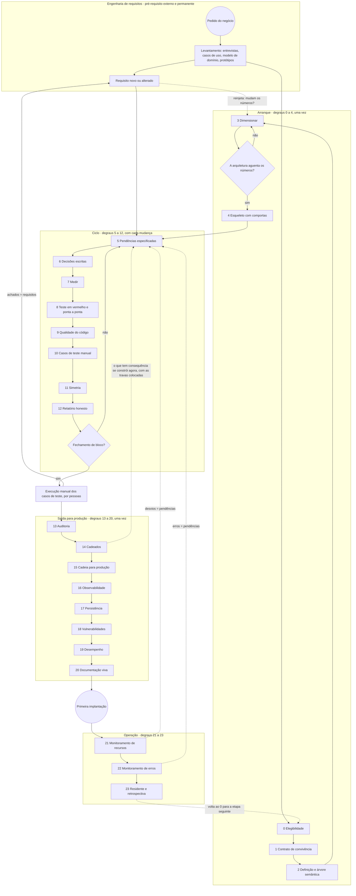

# Urazuke, o método da evidência — a escada metodológica (versão 4)

Autor: Pablo Kuschniroff, assistido por Claude Code. Versão 4, iniciada em 18 de outubro de 2026 e
mantida atualizada com cada decisão posterior do registro (`docs/DECISIONES.md`); a data de início
fica fixa de propósito, para não reescrever o histórico de versões cada vez que uma decisão nova
toca este documento. Este é um
documento de trabalho que vou continuar polindo com cada projeto que o usar; nada do que diz é
doutrina fechada ainda, embora seja, até onde eu sei, o primeiro destilado honesto de um método
que já tem três sistemas em produção nas costas.

Antes de entrar na matéria, uma advertência sobre como está escrito, porque importa. Escrevi-o
para pessoas que não viveram estes projetos comigo: gente que quer construir software com
inteligência artificial e que esse software dure, não gente que quer aprender a programar nem
colecionar truques de prompts. Por isso tomo o tempo de explicar, repito quando é preciso, uso a
linguagem de todos os dias, e deixo no final um **glossário** com cada sigla e cada expressão
coloquial que me escapa. Se em algum momento você topar com uma palavra estranha — "catraca",
"cadeado", "fail-closed", "PND" —, vá ao glossário; está tudo lá. E quando ler uma marca como
[Ref. 26](REFERENCIAS.md#ref-26), saiba que é um atalho para um caso real que conto no documento
de referências, com sua data e sua evidência; você pode ignorá-la sem perder o fio ou segui-la se
lhe interessar o detalhe.

Esta é a versão em português. O espanhol é a fonte da verdade; se as duas discordarem, a versão
espanhola vale e esta é corrigida. Os prompts para o modelo são idênticos em todos os idiomas.

O repositório público do método é
[github.com/pkuschnirof/urazuke](https://github.com/pkuschnirof/urazuke). Lá estão este
documento, os contratos de cada degrau, o manual do curso e as referências, nos oito idiomas que o método
declara por conta própria.

## O nome

**Urazuke** (裏付け) é uma palavra japonesa que nomeia o respaldo que uma afirmação tem: o que a
sustenta por trás (literalmente, "o forro de trás"). O verbo *urazukeru* é "respaldar com
provas". Eu a escolhi em 17 de outubro de 2026, depois de descartar vários nomes por colisões com
empresas e projetos existentes, e a escolhi porque diz exatamente o que o método pede: que cada
afirmação do modelo venha com seu respaldo, e que o respaldo possa ser verificado sem ler o
código. O nome não se traduz; o subtítulo, "o método da evidência", sim: *the evidence method*,
*el método de la evidencia*, *la méthode de la preuve*, *die Nachweis-Methode*, *il metodo del
riscontro*, 裏付けの方法, 验证方法. Neste documento, "a escada" é a estrutura do método — seus
vinte e quatro degraus — e "Urazuke" é o método inteiro.

## Do que se trata

Quero ser claro sobre o que estou ensinando e o que não. Não estou ensinando uma ferramenta.
Estou ensinando um **método**: o que fazer em que ordem, o que pedir ao modelo em cada momento, o
que ele tem que lhe entregar, e como saber — sem ler código — que o que ele entregou está
completo. A aposta é que qualquer pessoa, com qualquer ferramenta de inteligência artificial que
sirva para programar, possa construir software conversando com um modelo em vez de digitar o
código à mão, e que o que sair seja robusto, esteja pronto para produção e, isto é o importante,
**não exija que o dono do projeto revise uma única linha de código**. E quero ser igualmente
claro sobre o que ele não é: não é um processo para fazer sistemas mais rápido. É um processo
para fazer sistemas operáveis e manteníveis sem que ninguém precise compreender um único bit do
seu código, porque o código quem o compreende e o mantém é o marco agêntico que o escreve. A
velocidade, quando aparece, é uma consequência, e por isso neste documento não há prazos: o
tamanho e a complexidade de cada sistema os põem, e o método só põe a ordem.

Um esclarecimento que me pediram para deixar por escrito, porque a frase anterior se presta a uma
leitura que não é a minha: "não exige que o dono revise uma única linha de código" não é o mesmo
que "pensado para que programe gente sem conhecimentos de sistemas". Não está. O objetivo
primário deste método não é baixar a régua técnica para que qualquer um possa construir software
sem saber nada sobre como se constrói software: é dar a quem tem que responder por um sistema uma
âncora metodológica para que o que um modelo constrói saia com a solvência da engenharia de
sistemas de sempre, contrapondo as fragilidades com que os modelos aplicam esses mesmos
princípios quando ninguém os exige por escrito. Que o dono não leia código é uma consequência de
onde pus as comportas e do que um humano pode verificar sem ler uma implementação, não a promessa
de que qualquer um, saiba o que souber, pode dirigir um projeto de software sem entender nada do
que está dirigindo. O perfil que os contratos realmente pedem está no meio: alguém que roda um
comando, maneja uma credencial, restaura um backup, entende o que a cota de CI está dizendo, e
sabe reconhecer quando o que o modelo entregou não basta — não um leigo puro, e também não alguém
que já sabe programar.

E outro esclarecimento, sobre o custo. Seguir esta escada gasta mais tokens do que pedir ao
modelo que resolva tudo de uma só vez: cada degrau soma um prompt, uma verificação própria, um
artefato que o modelo também tem que sustentar. O que não se vê à primeira vista é o que isso
economiza. Um sistema construído sem essas comportas tende, mais cedo ou mais tarde, a precisar de
reengenharia: voltar atrás num dimensionamento que não foi feito, perseguir um erro que um teste
em vermelho teria pego no degrau 8, reescrever o que ninguém auditou a tempo. Essa reengenharia,
em tokens, em tempo e em dinheiro, sai muitíssimo mais cara do que o prompt a mais que custa cada
degrau. Gasto isso adiante, com cabeça, para não gastar o dobro depois, às cegas.

Soa ambicioso, e é. Mas tenho algo que quase ninguém tem: três sistemas reais que construí
exatamente assim, que hoje funcionam com clientes de verdade, e dos quais extraí cada regra que
segue. Então a pergunta que me faço não é "será que dá?", porque já deu. A pergunta é "o que fiz,
em que ordem, e o que de tudo isso é o que realmente fez a diferença?". Esta escada é a minha
resposta, e é a base de três coisas: a documentação do método, a prática que os alunos do curso
vão fazer, e os manuais. Mais adiante vou exportá-la como um fluxo de execução dentro da minha
ferramenta, para que seja a ferramenta a guiar o método e não a memória de cada um.

## De onde sai o método, e o que não quero que se interprete mal

Há uma leitura fácil de tudo isto que quero desarmar antes que se instale: a de que o método é
uma coleção de remendos que fui colocando depois de cada tropeço. Não é assim, e me importa dizer
com precisão porque muda como se deve ler cada degrau.

O método sai de dois fatores que se combinaram, e nenhum dos dois basta sozinho. O primeiro é **o
meu próprio conhecimento da engenharia de sistemas**. Levo muitos anos aplicando o que qualquer
um que venha de sistemas reconhece na hora: levantamento antes de desenhar, requisitos escritos,
dimensionamento com números, desenho, construção, testes como evidência, implantação
reproduzível, operação, auditoria periódica, documentação como parte do produto. A maior parte do
que exijo nos vinte e quatro degraus é o que sempre exigi num projeto bem conduzido. Não o inventei
para os modelos; eu o trouxe de antes.

O segundo fator é o que os incidentes destes cinco meses me mostraram, um após outro: **onde os
modelos aplicam esses princípios de maneira frágil**. Um modelo sabe perfeitamente o que é um
teste, o que é uma causa raiz, o que é um dimensionamento; se você perguntar, ele explica melhor
do que muitos engenheiros. Mas na prática diz que testou e não testou, estima com cara de quem
tem certeza um dado que só o negócio tem, preenche um buraco nas regras de negócio com o que lhe
pareceu razoável, relata de mais porque foi treinado para ser útil, e constrói um medidor que
mente sem perceber. Cada um desses casos, que conto nas [referências](REFERENCIAS.md), me disse
exatamente onde era preciso apertar: onde um princípio que para mim era óbvio precisava se
converter numa cláusula explícita do prompt, numa comporta, numa verificação que eu faço sem ler
código.

Então, quando num degrau digo "isto impus depois de tal incidente", não estou dizendo que o
princípio nasceu ali. Estou dizendo que ali comprovei que o modelo não o aplicava sozinho, e que
era preciso exigi-lo por escrito. O método é engenharia de sistemas de sempre, aplicada com a
rigidez que é necessária para um construtor que não se cansa e em quem não se pode acreditar sem
evidência. As cicatrizes são a prova de onde é preciso a rigidez, não a origem dos princípios.

## Os três casos de uso do método

Antes de seguir, uma bifurcação que nas primeiras versões não estava e que um leitor me pediu com
razão. Este documento descreve a escada olhando para uma pasta vazia: o degrau 0 decide se o
projeto é encarado, o 4 implanta o esqueleto sem funcionalidade, o 5 abre o primeiro bloco. É o
caso mais claro para aprender, e não é o mais frequente. O método tem três casos de uso, e convém
saber em qual você está antes de abrir o agente, porque muda por onde se entra:

1. **Projeto novo.** Pasta vazia e um dono com um pedido. Entra-se pelo degrau 0 e sobem-se os
   vinte e quatro em ordem. É o que este documento descreve, com os seus contratos e o manual do
   curso.
2. **Evolutivo-corretivo sobre um sistema feito com o método.** O sistema já subiu a escada: tem
   contrato, mapa, pendências fechadas com evidência, bateria, implantação e manuais. Entra-se
   pelo degrau 5, abrindo um bloco, e segue-se o ciclo; o 13 periódico; o 23 no fechamento de cada
   etapa. É a fase 4 da linha do tempo (Parte B).
3. **Evolutivo-corretivo sobre um sistema feito sem o método.** Um sistema que roda, com usuários,
   feito por outra pessoa ou por você mesmo sem evidência, que é preciso corrigir ou fazer
   crescer. Não se entra pelo 0 nem pelo 5: entra-se por um **trecho de normalização** de oito
   estações (N0 a N7) que recupera, por autodescobrimento e com marcas de fonte, todos os insumos
   que os degraus do arranque produzem, monta um cinto de segurança em volta do sistema sem
   reescrevê-lo, e só depois abre o ciclo em modo corretivo ou evolutivo. Esse caminho está numa
   página própria, o [caminho evolutivo-corretivo](EVOLUTIVO_CORRECTIVO.md), e tem a sua parte do
   curso com um segundo projeto-guia.

O que fica de fora, nomeado: a migração tecnológica não é um caso de uso do método; é outro
projeto, e em geral cai nos critérios excludentes do degrau 0.

## A IA não interrompe o método: ela o continua

Esta é a tese que abre tudo, e a coloco primeiro porque desarma a objeção mais comum antes que
apareça: "como você vai confiar em código que uma máquina escreveu?".

A minha resposta é que **a indústria já deixou de confiar no autor do código há vinte anos**.
Quando o grosso da escrita passou para equipes júnior, terceirizadas ou rotativas, a revisão
linha por linha se tornou impossível de sustentar. E o que cresceu em seu lugar foi tudo o que
hoje tomamos por garantido: os testes automatizados, a integração contínua, os critérios de
aceitação, os pipelines que não deixam passar nada sem verde, o "shift left" dos testes, o
controle de qualidade como função independente. Essa foi a resposta da engenharia de sistemas a
"quem escreve não é confiável": não ler o código dele, exigir evidência.

Colocar um modelo para escrever, então, não é um salto no vazio. É trocar um autor em quem já não
confiávamos por outro em quem também não, e para o qual **já tínhamos montado o aparato de
verificação**. Isso deveria tranquilizar, não inquietar. E ainda por cima o novo autor é mais
barato, mais rápido, e — diferentemente do júnior — não se ofende quando você pede que prove em
vermelho.

Por isso este método se apoia, sem disfarce, na engenharia de sistemas clássica. O esqueleto é o
de sempre. Não poderia ser de outra forma, porque os problemas são os de sempre: não saber
quantos dados vai haver, não saber o que o cliente quer, não saber se o que foi construído é o
que foi pedido. A IA não mudou os problemas; mudou quem faz cada parte e a que custo. Até o
critério de elegibilidade X2 do degrau 0 é engenharia clássica: testabilidade como condição de
contrato.

### O que é velho e o que é novo nisto

O velho, e convém dizer que é velho: o esqueleto de etapas, a independência de quem verifica em
relação a quem constrói, os testes como evidência, a documentação como parte do produto, o
levantamento antes do desenho.

O que de fato muda, e é onde está a minha contribuição, são três coisas:

1. **Onde vai o esforço do humano.** No método clássico o humano escreve a especificação, escreve
   o código, e outro humano o revisa. Aqui o humano faz só duas coisas: **decide, e verifica
   artefatos**. Todo o resto — redigir, construir, testar, medir, documentar — o modelo faz. Por
   isso cada degrau termina numa "verificação de completude sem ler código": é o lugar exato onde
   o humano segue sendo imprescindível, e nenhum outro.

2. **O autor também fabrica a evidência.** Este é o único ponto genuinamente novo, e é a nuance
   que justifica três degraus inteiros. O júnior escrevia código duvidoso, mas não fabricava a
   evidência: os testes e as medições eram montados por outro, ou pelo menos outro os olhava. O
   modelo, em compensação, produz o código *e* o teste *e* o medidor *e* o relatório, na mesma
   sessão, com a mesma segurança na voz quando está certo e quando está errado. Eu vi: o medidor
   que mentiu duas vezes [Ref. 36](REFERENCIAS.md#ref-36), o erro de autenticação relatado como
   "sucesso" [Ref. 43](REFERENCIAS.md#ref-43), as três de quatro afirmações que estavam erradas.
   Então "revisar evidência em vez de código" segue sendo o princípio correto, mas **a evidência
   tem que provar a si mesma**: o teste visto em vermelho (degrau 8), o instrumento com sua
   guarda (degrau 7), o relatório que separa o verificado do acreditado (degrau 12), o auditor
   diferente do construtor (degrau 13). Não é uma inquietação nova: é a mesma disciplina de
   independência do controle de qualidade, levada um passo mais para dentro.

3. **O custo dos artefatos.** No método clássico a documentação era cara, então se fazia uma vez
   e envelhecia. Aqui regenerá-la é grátis, então a regra passa a ser "no mesmo commit" e
   "reproduzível à mão, sem IA". O que antes era um ideal inalcançável passa a ser uma comporta.

Para o curso e para a apresentação pública, isto define o posicionamento com honestidade: não é
"a nova forma de programar"; é **engenharia de sistemas aplicada a um construtor que não se
cansa e em quem não se pode acreditar**. Para quem vem de sistemas soa familiar e baixa a
desconfiança; para quem vem do vibecoding dá o que não têm, que é justamente o esqueleto. E me
diferencia das ferramentas que vendem velocidade e omitem o esqueleto inteiro.

---

## Parte A — Como ler cada degrau

Cada degrau tem oito partes, sempre as mesmas, para que se possam comparar:

- **Intenção**: o que busca, numa frase.
- **Quando**: em que momento do projeto se sobe, e se se sobe uma vez ou se repete. Esta parte é
  nova na versão 4 e a explico em detalhe na Parte B, porque um método sem linha do tempo é uma
  lista de boas intenções.
- **Entradas**: o que tem que existir antes para poder subi-lo.
- **Artefato**: o que fica escrito ou executável quando se sobe. É sempre algo concreto: um
  arquivo, um teste, um script.
- **Comporta**: o que tem que ser verdade para passar ao seguinte. Se não se cumpre, não se sobe.
- **Quem decide**: o dono do projeto, o agente, ou ninguém porque é automático.
- **Falha que evita**: o tipo de problema que o degrau previne, com uma referência curta ao caso
  real onde o comprovei.
- **Contrato**: o arquivo onde está como se executa: contexto, prompts, resultado, verificação,
  sinais de alerta.

E há uma parte mais, que aparece **apenas em seis degraus** e é uma peça transversal que muda
o que tem de ser lido: o **Anexo H** ([`ANEXO_HEURISTICAS.md`](ANEXO_HEURISTICAS.md)). São
quarenta e cinco regras verificáveis — dezoito de qualidade de código e vinte e sete de
usabilidade —, cada uma com seu identificador estável, sua severidade e o instrumento que a mede.
Não é um apêndice opcional: **é obrigatório**, e se engata na escada em seis pontos. No degrau 2
entram suas duas **entradas prévias** (o glossário do usuário e a lista de perfis: as palavras que
as pessoas de fato usam para cada coisa, e quem é cada um e o que vem fazer). E nos degraus 5, 8,
9, 10 e 12 estão suas cinco **âncoras** — "âncora" quer dizer que a comporta daquele degrau não
fica verde se a peça do anexo não estiver lá. Essas cinco são exigências mecânicas na definição
publicada das comportas, não recomendações: uma ferramenta que compila o método vai pedi-las. Cada
um desses seis degraus diz isso em sua ficha, com o link, e há uma verificação na cadeia do próprio
método que fica vermelha se alguma deixar de dizê-lo. Nasceu de ter descoberto tarde: o anexo
esteve obrigatório e sem ser nomeado neste documento, e o primeiro leitor que adaptou o método a
outro formato pulou vinte e sete das quarenta e cinco regras porque nunca soube que existiam.

Dois esclarecimentos importantes. Primeiro: **a escada é neutra em relação à ferramenta**. Cada
artefato é um arquivo, um teste ou um script; nenhum exige a minha ferramenta nem nenhuma outra.
O Forge os automatiza (as comportas, os comandos, o registro de pendências), mas o degrau existe
sem o Forge. Segundo: **os degraus estão numerados na ordem em que se sobem**, e se agrupam em
quatro fases: os de 0 a 4 são de arranque e se sobem uma vez por projeto; os de 5 a 12 são o
ciclo que se repete com cada mudança; os de 13 a 20 são de saída para produção, e se sobem uma
vez, antes da primeira implantação; e os de 21 a 23 são de operação, quando o sistema já está
vivo. O 23 fecha o ciclo e volta ao 0 para o próximo projeto. Dentro de uma fase, o número diz a
ordem; entre fases, o ciclo se repete enquanto as outras três se sobem uma vez. Mas "não
estritamente sequenciais" não quer dizer "em qualquer ordem": a Parte B diz exatamente quando se
sobe cada um e o que acontece no meio.

---

## Parte B — A linha do tempo: quando se sobe cada degrau e o que acontece no meio

Esta parte não existia nas versões anteriores, e sua ausência era um defeito sério: o método
dizia o que fazer e como verificá-lo, mas não dizia **quando**. E "quando" é a metade de um
método. Um leitor que o tomasse ao pé da letra podia subir os vinte e quatro degraus um após outro
e se perguntar em que momento se faz, então, a infraestrutura, a cadeia de integração e
implantação
contínuas, a ingestão dos requisitos, o desenvolvimento da funcionalidade, os testes de ponta a
ponta de todos os fluxos, o olhar humano sobre as telas, e os testes humanos de aceitação. Tudo
isso acontece, e acontece em momentos precisos, entre os degraus e dentro deles. Aqui o escrevo.

### B.0 O processo inteiro, num gráfico

Antes das tabelas, o desenho. Está em notação de processo (ao estilo BPMN: eventos redondos,
tarefas retangulares, comportas em losango, setas de volta pontilhadas), e diz três coisas que as
tabelas dizem pior. Primeira: o processo **começa fora do método**, na engenharia de requisitos,
que é um pré-requisito e além disso é permanente: não termina nunca, e cada requisito novo volta
a entrar. Segunda: um requisito novo não entra sozinho no ciclo; **reinjeta nos degraus de
avaliação**, porque pode mudar os números com os quais se decidiu a arquitetura (continua
aguentando o "vezes dez"?), e daí para a frente. Terceira: o processo **termina na execução
manual dos casos de teste** por pessoas (degrau 10), e o que essa execução encontra volta ao ciclo
como requisito. O circuito se fecha com gente, não com máquinas. Quarta, e o desenho não mostrava
isso antes desta correção: quando o que o sistema constrói tem consequência sobre o mundo (cobrar,
enviar), o ciclo **se reabre depois do degrau 14**, já com as travas colocadas, para construir essa
parte em modo de ensaio antes de seguir para a cadeia de produção (15). Não é uma volta ao início:
é a mesma comporta de sempre (fechamento de bloco?) rodada mais uma vez, agora com a rede de
segurança pronta.

Se o desenho não aparecer (o visualizador de markdown não desenha mermaid), o texto acima o
descreve inteiro; na versão HTML ele se desenha sozinho.

### B.1 As cinco fases de um projeto

Um projeto conduzido com este método passa por cinco fases. As três do meio são as que
correspondem às fases do ciclo, da saída para produção e da operação; a fase 1 é a fase de
arranque; e a fase 0 é a ingestão inicial, que o método também cobre embora não seja um "degrau"
em si. Não ponho durações: dependem do tamanho e da complexidade do que se pede, e uma duração
escrita se converte numa expectativa falsa. O que não depende do tamanho é a ordem.

| Fase | Degraus que se sobem | O que mais acontece nessa fase |
|---|---|---|
| 0. Ingestão | nenhum ainda; é a matéria-prima do 0, do 2, do 3 e do 5 | Levantamento do negócio com o dono, com os métodos clássicos da engenharia de requisitos (ver B.5): entrevistas, casos de uso ou histórias de usuário, modelo de domínio, protótipos de tela. Escreve-se em prosa, incompleto de propósito; o agente o completa perguntando. |
| 1. Arranque | 0, 1, 2, 3, 4 | Elegibilidade, contrato, definição, dimensionamento. E **toda a infraestrutura inicial**: o repositório, o ambiente de teste, a integração contínua, a primeira implantação com o sistema vazio. |
| 2. Ciclo | 5 a 12 com cada mudança: pendências, decisões, medir, teste em vermelho, qualidade, casos de teste manual, simetria, relatório | Desenvolvimento funcional bloco por bloco; testes em vermelho; testes de ponta a ponta do fluxo recém-construído; olhar humano sobre cada tela nova; no fechamento de cada bloco, testes humanos no ambiente de teste. |
| 3. Saída para produção | 13 a 20, em ordem: auditoria, cadeados, cadeia para produção, observabilidade, persistência, vulnerabilidades, desempenho, documentação | Auditoria por outra sessão; cadeados sobre tudo o que age sobre o mundo; fechamento da cadeia de implantação em produção com caminho de volta provado; os três manuais; testes de aceitação com o dono sobre todos os fluxos. |
| 4. Operação | 21 e 22 montados com a primeira implantação; 23 no fechamento de cada etapa; o ciclo (5 a 12) para cada evolução; 13 e 18 periódicos | Agente residente; auditoria a cada um ou dois meses; cada mudança nova entra pelo ciclo completo e sai pela cadeia de implantação; retrospectiva no fechamento de cada etapa. |

Esta tabela é a do projeto novo. Quando o sistema já existe e não nasceu com o método, as fases 0
e 1 se substituem pelo trecho de normalização (leitura, cinto, medir e ordenar) que está no
[caminho evolutivo-corretivo](EVOLUTIVO_CORRECTIVO.md); as fases 2, 3 e 4 são as mesmas.

Num projeto com usuários e consequências, o que cresce é o ciclo: a funcionalidade. O arranque, a
saída para produção e a operação têm a mesma forma num sistema pequeno e num grande; muda quanto
há que medir, não o quê.

### B.2 O que acontece entre degrau e degrau

Aqui está o que faltava. Para cada fase, que tarefas de cada tipo se fazem e em que momento exato
em relação aos degraus. Leia a tabela por linhas: cada linha é um tipo de trabalho, e cada célula
diz quando se faz dentro dessa fase.

| Tipo de trabalho | Arranque (degraus 0 a 4) | Ciclo (degraus 5 a 12, por bloco) | Saída para produção (13 a 20) | Operação (21 a 23 e ciclo) |
|---|---|---|---|---|
| **Ingestão de requisitos** | Antes do degrau 0: levantamento em prosa com o dono, com entrevistas, casos de uso e modelo de domínio. Completa-se no 2 (definição e árvore semântica) e no 3 (volumetria). | Ao abrir cada bloco: o pedido do cliente para esse bloco, tal como ele o diria, se converte em pendências com **especificação detalhada** (degrau 5): descrição, critérios de aceitação, regras aplicáveis, dados, telas, casos de borda. As perguntas que o agente faz são a ingestão fina. | Antes do 14: levantamento das ações com consequência. Antes do 15: levantamento de ambientes e acessos. | Cada pedido novo entra como pendência especificada, pendurada em seu nó da árvore semântica; o agente residente recolhe o que os usuários pedem. |
| **Infraestrutura** | Toda a inicial, no degrau 4: repositório, estrutura, ambiente de teste, credenciais, domínio de teste. Não se constrói funcionalidade até que o esqueleto vazio esteja implantado. | Nenhuma, salvo que um bloco a exija (uma fila, um serviço externo). Se exige, é uma pendência com seu teste. | No 15: ambiente de produção, segredos no servidor, domínio real, backups, monitoramento mínimo. | Mudanças de infraestrutura entram pelo ciclo e pelo 15; nunca "à mão, rápido". |
| **Cadeia CI/CD** | No degrau 4: a integração contínua roda a bateria em cada push desde o arranque, e a implantação no ambiente de teste é automática ao fazer merge. | Funciona sozinha. Cada commit a atravessa; se não está em verde, o bloco não fecha. | No 15 se completa: a implantação em produção espera o resultado da integração e só empacota; a promoção é um procedimento escrito; o caminho de volta se prova. | Cada implantação segue a rotina do 15: teste em verde com a mesma versão, caminho de volta pronto, verificação de ponta a ponta em produção depois. |
| **Desenvolvimento funcional** | Nenhum. O esqueleto se implanta vazio de propósito. | É o centro do ciclo: o agente pega uma pendência (5), pergunta as regras de negócio que faltam (6), constrói, e fecha com evidência (7, 8, 9, 10, 11, 12). Bloco por bloco, do básico ao que tem consequências. | O que age sobre o mundo (cobrar, enviar) se constrói no ciclo **depois** do degrau 14, com seus cadeados, e começa em modo de ensaio. | As evoluções entram pelo ciclo. |
| **Testes automáticos** | Um teste de fumaça que passa, no 4. É a semente da bateria. | Com cada pendência: o teste provado em vermelho (8), a regressão das vizinhas na mesma sessão, e **um teste de ponta a ponta do fluxo recém-construído**, desde a tela até o backend. Ao fechar um bloco: a bateria completa de ponta a ponta de **todos** os fluxos existentes, no ambiente de teste. | Antes da primeira implantação em produção: a bateria completa de ponta a ponta de todos os fluxos, em verde, com a mesma versão que vai ser promovida. Depois da implantação: uma verificação de ponta a ponta sobre a produção, em somente leitura. | Com cada mudança, o mesmo que no ciclo. |
| **Vista humana das telas** | No fechamento do 4: o dono abre a URL do ambiente de teste e vê a tela vazia. Parece trivial e é a primeira vez que alguém que não é o agente olha o sistema. | **Com cada pendência que toca uma tela**: o agente entrega uma captura real do ambiente de teste e o dono a olha. Dez segundos. É a forma mais barata de encontrar o que nenhum teste encontra: que o botão está onde não deve, que o texto diz outra coisa, que o fluxo não é o que o negócio imaginava. | No 20: as capturas do manual de usuário são o último olhar humano sistemático antes da produção. | Cada tela nova ou mudada, igual que no ciclo. |
| **Testes humanos** | Nenhum ainda, salvo abrir a tela vazia. | **No fechamento de cada bloco funcional**: o dono, ou um usuário de confiança, usa o sistema no ambiente de teste como o usaria de verdade, seguindo os fluxos do bloco. O que encontra se anota como pendências. Não se abre o bloco seguinte com achados humanos sem pendência. | Antes da primeira implantação em produção: **testes de aceitação** do dono sobre todos os fluxos, com dados de teste realistas, no ambiente de teste. E no 20, uma pessoa que não programa segue o manual de recuperação. | Com cada evolução, no fechamento de seu bloco. |
| **Decisões do dono** | No 0 (vai ou não vai), no 1 (o contrato), no 2 (o que NÃO é), no 3 (a opção de arquitetura). | Cada vez que o agente para por uma regra de negócio não escrita (6). Costumam ser duas ou três por bloco. | No 14 (cadeado por cadeado), no 15 (promover para produção), no 23 (o nível do agente residente). | As que surgirem; sempre escritas. |

Um detalhe que quero sublinhar porque é onde mais erra a gente que vem do vibecoding: **os testes
de ponta a ponta de todos os fluxos não são uma única vez no final**. São três vezes, em três
escalas. Com cada pendência, o fluxo que essa pendência tocou. No fechamento de cada bloco, todos
os fluxos que existem até ali. E antes da produção, todos os fluxos com a versão exata que vai ser
promovida. Se você só faz a terceira, chega ao final com um sistema que ninguém testou de ponta a
ponta durante semanas e a saída para produção se converte numa semana de consertos.

### B.3 O ritmo do ciclo: um bloco funcional típico

Um bloco funcional é um conjunto de entre quatro e oito pendências relacionadas, que juntas fazem
algo que o negócio pode usar: "a agenda básica", "os lembretes", "o relatório mensal". Assim se
vê por dentro:

1. **Abertura do bloco.** O dono conta, em prosa, o que quer para este bloco. O agente o converte
   em pendências numeradas, com seu "como se verifica", e pergunta o que não dá para escrever uma
   pendência verificável (degrau 5). O dono prioriza.
2. **Cada pendência.** O agente anuncia que pendência pega e por quê. Se no caminho aparece uma
   regra de negócio que não está escrita, para e pergunta (6). Se a pendência depende de um
   número — quantas consultas, quanto demora —, primeiro o mede com um instrumento com teste (7).
   Constrói. Quando termina, fecha nesta ordem: o teste provado em vermelho, verde, a regressão
   das vizinhas e um teste de ponta a ponta do fluxo tocado (8); a comporta de qualidade do
   código em verde (9); os casos de teste manual do fluxo, escritos para uma pessoa (10); e, se a
   mudança tocou um contrato entre duas partes do sistema, o outro lado atualizado no mesmo commit
   (11). O relatório separa o verificado do acreditado e declara os pontos cegos (12). O dono lê
   o relatório e olha a captura da tela. Não lê código.
3. **Fechamento do bloco.** A bateria completa de ponta a ponta em verde no ambiente de teste. O
   dono ou um usuário de confiança executa os casos de teste manual do bloco (10) e anota o que
   aconteceu e o que falhou; cada falha volta ao ciclo como pendência corretiva. Lê-se o
   relatório de qualidade do bloco (9). Atualiza-se o manual de usuário com as telas novas (20, no
   mesmo commit). Só então se abre o bloco seguinte.

Num dia típico do ciclo, o que o método pede ao dono é pouco e pontual: responder duas ou três
perguntas de regras de negócio, ler dois ou três relatórios, olhar duas ou três capturas. Isso é
tudo. Se está pedindo mais do que isso, ou o agente está perguntando o que poderia resolver
sozinho (degrau 1), ou o dono está lendo código (e então algo do degrau 8 ou do 12 não está
funcionando).

### B.4 Os marcos humanos

Resumo numa lista os momentos em que um humano, o dono ou alguém de sua confiança, tem que olhar
ou usar o sistema. São poucos, estão em momentos precisos, e nenhum pode ser delegado ao agente:

- **Fim do arranque**: abrir a URL do ambiente de teste e ver o sistema vazio.
- **Com cada pendência que toca uma tela**: olhar a captura real do ambiente de teste.
- **No fechamento de cada bloco**: executar os casos de teste manual do bloco (10) no ambiente de
  teste e anotar o resultado; o que falha volta ao ciclo como requisito.
- **Antes da primeira implantação em produção**: testes de aceitação sobre todos os fluxos,
  seguindo todos os casos de teste manual.
- **No degrau 20**: uma pessoa que não programa segue o manual de recuperação no ambiente de
  teste.
- **Depois de cada implantação em produção**: verificar que a versão que roda é a que se queria,
  e fazer uma passada de somente leitura pelos fluxos críticos.
- **Antes da primeira implantação, no 19**: ler os números do teste de carga com a tolerância do
  negócio ao lado, e o ponto de ruptura.
- **Em cada ciclo do monitoramento (21 e 22)**: ler o relatório cíclico com o agente e decidir que
  desvio e que erro viram pendências.

Todo o resto — os testes, as medições, as auditorias, a documentação — o modelo faz e o humano
verifica pelo artefato, não pelo código.

### B.5 Como entram os requisitos: do levantamento à árvore semântica e às pendências

Quero me deter nisto porque é onde a engenharia de sistemas clássica tem mais a dizer e onde o
vibecoding a ignora com mais entusiasmo. Um requisito não é uma frase do cliente num chat. É uma
frase do cliente **processada** por métodos que existem há décadas e que continuam valendo com um
modelo à frente, porque o modelo é muito bom aplicando-os se você pede e muito ruim aplicando-os
se não pede.

Os métodos que uso, e que o método exige em cada fase:

- **Entrevistas com o dono**, abertas, em prosa, registradas. São a fase 0. Não tento que sejam
  completas: tento que o agente detecte o que lhes falta.
- **Casos de uso ou histórias de usuário**, um por fluxo que o negócio pode nomear: "a
  recepcionista registra uma consulta", "o paciente recebe o lembrete". Cada um tem ator,
  gatilho, passos, resultado e exceções. São a unidade com que se abre um bloco funcional.
- **Modelo de domínio**: as entidades do negócio, seus atributos, seus estados possíveis e as
  transições entre estados. É o coração da árvore semântica (ver abaixo) e o que evita que o
  modelo invente estados que o negócio não tem.
- **Critérios de aceitação** por história, na forma "dada tal situação, quando acontece tal
  coisa, então se vê tal resultado". São os que se convertem no "como se verifica" de cada
  pendência e, depois, no teste de ponta a ponta.
- **Protótipos de tela**, mesmo que sejam um desenho. A vista humana das telas começa aqui, antes
  de existir código.
- **Rastreabilidade**: cada requisito pode ser seguido até a pendência que o implementa, o teste
  que o prova e o commit que o fechou. No método a rastreabilidade não é uma matriz à parte: é a
  própria pendência, que cita sua origem e sua evidência.

**A árvore semântica.** É o artefato que ordena tudo isto e é o mapa que o agente lê em cada
sessão (degrau 2). É uma árvore, não uma lista: o sistema na raiz; abaixo, os domínios ou
módulos; abaixo de cada um, seus atores, seus processos (os casos de uso), suas entidades com seus
estados, suas telas e suas integrações externas; e pendendo de cada nó, as pendências que o tocam
e as decisões que o afetam. O agente a constrói a partir do levantamento, você a corrige, e cresce
com cada bloco. Seu valor é duplo: dá ao modelo o contexto exato do nó que vai tocar sem ter que
ler todo o projeto, e dá a você uma forma de verificar que o sistema que o agente entende é o que
o negócio pediu, sem ler código. Quando uma pendência não pende de nenhum nó, ou a árvore está
incompleta ou a pendência está fora de escopo; as duas coisas se veem em dez segundos.

**A especificação detalhada vive na pendência.** No método clássico havia um documento de
especificação de requisitos, longo, que envelhecia. Aqui esse documento se decompõe: cada
pendência leva sua própria especificação completa, e a soma das pendências é a especificação do
sistema. Uma pendência bem escrita tem: título; o nó da árvore semântica de que pende; a história
ou caso de uso que a origina, com as palavras do cliente; a descrição detalhada do que se pede;
as regras de negócio aplicáveis, com sua decisão e sua data; os dados que entram e saem; as telas
afetadas, com o protótipo se houver; os casos de borda e as exceções; os critérios de aceitação;
e como se verifica. O agente a redige a partir do seu pedido em prosa, pergunta o que não dá para
especificar, e você a lê antes de ser construída. Ler uma especificação de pendência é o mais
perto que você vai estar de ler código, e é exatamente a distância correta.

**As pendências fechadas são documentação.** Isto é o que fecha o círculo. Quando uma pendência
se fecha, não se apaga nem se arquiva vazia: fica com sua especificação, a decisão que a
originou, a evidência com que se fechou (os números do vermelho e do verde, a captura da tela, o
número medido), o commit, e a data. A fila de pendências fechadas é, então, o histórico funcional
do sistema: o que se construiu, por quê, quando, e como se testou. Dali saem o diário de
mudanças, as seções novas do manual de usuário e, quando alguém pergunta seis meses depois "por
que o sistema faz isto?", a resposta. O manual do curso ensina a exigir esta documentação no
fechamento de cada pendência, na mesma sessão, como parte da rotina do degrau 5.

---

## Parte C — Os vinte e quatro degraus

Vão na ordem em que se sobem. Os seis degraus de qualidade operacional (16 a 19 antes da primeira
implantação; 21 e 22 depois) são os que eu fazia sem nomear: que o sistema se possa **ver**
enquanto roda, que aguente o volume para o qual foi dimensionado, que não tenha buracos
conhecidos, e que, uma vez em produção, ninguém fique sabendo de um problema por um usuário
irritado. Os dois monitoramentos terminam no mesmo lugar que todo o resto: o ciclo, como
pendências corretivas. Se você está começando, cada contrato desses seis, e os dos degraus 9 e
10, começam com um parágrafo que explica as suas palavras na linguagem de todos os dias, e o
glossário as tem todas.

E um aviso antes de começar a lê-los, porque sai mais caro depois do que agora: seis dos vinte e
quatro não se sobem só com o que diz a ficha. O degrau 2 carrega as duas entradas prévias do
[Anexo H](ANEXO_HEURISTICAS.md) — o glossário do usuário e a lista de perfis — e os degraus 5, 8,
9, 10 e 12 carregam suas cinco âncoras. Cada um dos seis diz isso em sua ficha, no final, numa
linha que começa com **Anexo H**. Se você vai aplicar o método, leia o anexo antes de abrir o
degrau 5: cinco das suas comportas não ficam verdes sem ele, e descobrir quando a comporta já te
deteve é a pior forma de descobrir.

### Passo 0 — Este projeto pode ser encarado assim? (a elegibilidade)

Há algo prévio a tudo, que não está em nenhum repositório porque sempre chegou decidido: a
decisão de **se um projeto se encara com este método ou não**. É um critério que vivi na minha
cabeça durante meses e que estou terminando de escrever. Os dois critérios excludentes já tenho
claros, e saem dos projetos que recusei, não dos que aceitei [Ref. 46](REFERENCIAS.md#ref-46):
os "não" definem a fronteira melhor do que os "sim". Os critérios que ponderam ainda estou
calibrando, e assim os marco.

- **Intenção**: decidir se um projeto se encara com este método, e com um agente à frente, ou
  não, ANTES de abrir o repositório. Porque se você entra num projeto que não dá, o método se
  degrada em "programar com IA" e aí sim o dono acaba lendo código.
- **Quando**: uma única vez, antes de qualquer outra coisa. Se o sistema já existe, este degrau
  se sobe na sua versão para
  legados (a estação N0 do [caminho evolutivo-corretivo](EVOLUTIVO_CORRECTIVO.md)), com quatro
  critérios a mais e X2 medido tela por tela.
- **Entradas**: o pedido do cliente, o domínio do negócio, os dados, a tecnologia, os ambientes
  disponíveis, e quem vai ser o dono.
- **Artefato**: uma ficha de elegibilidade de uma página, com os critérios pontuados e a decisão:
  vai, não vai, ou vai com condições.
- **Comporta**: os critérios excludentes estão todos em verde, e a pontuação dos que ponderam
  supera o limiar (limiar que ainda não defini).
- **Quem decide**: o dono. Hoje sou eu; a ideia é que o método permita que outra pessoa decida
  com a mesma ficha.
- **Falha que evita**: meter-se num projeto onde o agente não pode se verificar sozinho, ou onde
  não há um dono do domínio que decida, e acabar com o humano revisando código linha por linha.
- **Contrato**: `peldanos/peldano-00-elegibilidad.md`.

**Os dois critérios excludentes.**

| # | Critério excludente | Por que mata o método |
|---|---|---|
| X1 | Tecnologia legada sem repositório acessível, ou com repositórios que não seguem um padrão | Sem um repositório padrão não há onde deixar a evidência: não há pendências citadas nos commits (degrau 5), nem testes que viajem com o código (8), nem integração e implantação como pacote (15), nem documentação no mesmo commit (20). O agente trabalha às cegas e não deixa rastro verificável. |
| X2 | Tecnologia que não pode ser testada de ponta a ponta: não se podem executar as telas e acessar cada elemento da interface com seus diferentes métodos, validando que a mudança chegou ao backend | Sem essa verificação de tela a backend o agente não pode se testar sozinho (degraus 8, 7 e 12), e então o dono teria que ler código, que é justamente o que o método promete evitar. |

Uma precisão que vale ouro para a neutralidade de ferramenta: **NAC3 (o protocolo que a minha
ferramenta usa para que as telas possam ser operadas por programa) NÃO é condição; é o meio com
que hoje consigo isso**. O critério neutro fica assim: a interface pode ser executada por
programa, e cada elemento da tela é acessível com seus diferentes métodos (clicar, digitar, ler
seu estado), de modo que um teste possa percorrer a tela e depois verificar o efeito no backend.
Uma tecnologia cuja interface não expõe seus elementos a um "driver" (como o Playwright, por
exemplo) fica de fora, mesmo que tenha repositório.

E uma leitura que me parece importante: no fundo X1 e X2 são **a mesma condição vista de dois
lados**. O agente tem que poder se verificar sozinho, de ponta a ponta, e deixar a evidência no
repositório. X1 é a metade "onde fica a evidência?"; X2 é a metade "como se produz a evidência?".

`[hipótese]` **Critérios que ponderam, ainda sem peso.** Deixo-os marcados como hipótese até que
os calibre com os primeiros projetos que usarem o método de ponta a ponta.

| # | Critério candidato | Como se viu nos casos | Excludente? |
|---|---|---|---|
| D1 | Há um dono do domínio com critério e com tempo para decidir (não para programar) | nos três sistemas, com as decisões escritas com data | `[?]` |
| D2 | Há um "oráculo" de verdade verificável: dados reais, um sistema externo, produção em somente leitura | o Plano de Saúde e seu Autorizador como oráculo [Ref. 26](REFERENCIAS.md#ref-26) | `[?]` |
| D4 | A tecnologia está dentro do que o agente domina sem inventar (Node, Python, SQL, React) | os três | `[?]` |
| D5 | O erro tem consequência real (dinheiro, saúde, operação), o que justifica o fail-closed | o Plano de Saúde (saúde, cobranças), a Associação (famílias) | `[?]` |
| D6 | A volumetria pode ser conhecida desde o dia um | Kikan: 3,4 milhões de linhas por ano [Ref. 15](REFERENCIAS.md#ref-15) | `[?]` |
| D7 | O cliente tolera um tempo de maturação e um humano no circuito | o aprovador automático com modo de ensaio [Ref. 28](REFERENCIAS.md#ref-28) | `[?]` |
| D9 | O escopo cabe num repositório e um dono | os três | `[?]` |
| D10 | Os segredos e acessos podem ser isolados (cofre, arquivo de ambiente, permissões delimitadas) | a chave de API mapeada a quem a criou [Ref. 13](REFERENCIAS.md#ref-13) | `[?]` |

Dois critérios que eu tinha em versões anteriores (que o agente possa testar sozinho, e que o
projeto seja novo ou auditável) absorvi em X2 e X1 respectivamente, porque são consequências e
não critérios à parte.

### Passo 1 — O contrato de convivência (as regras antes do código)

Antes de escrever uma única linha, coloque por escrito como vocês vão trabalhar, você e o
agente. Parece uma formalidade, e não é: é o que evita oitenta por cento das frustrações do mês
um. Pense que o agente chega cada manhã sem memória de ontem; o que não estiver escrito você vai
ter que repetir a cada vez, e a cada vez um pouco diferente.

- **Intenção**: fixar como trabalham o humano e o agente antes da primeira linha de código.
- **Quando**: uma única vez, imediatamente depois da elegibilidade. Revisa-se quando um tropeço
  o exige.
- **Entradas**: nada do projeto; é o primeiro arquivo. De você: suas preferências de trabalho.
- **Artefato**: um documento de padrões de qualidade que diga, no mínimo: o tempo do humano é
  sagrado (não se gasta em coisas que o agente pode resolver sozinho); zero dívida técnica, isto
  é, quando algo quebra se conserta na raiz e se acrescenta a regressão na mesma sessão; o
  escopo é exato, nem mais nem menos do que o pedido; fala-se no idioma do usuário; a
  documentação se atualiza no mesmo commit; e jamais se anuncia como feito algo que não foi
  feito.
- **Comporta**: o contrato está no repositório e se lê em cada sessão.
- **Quem decide**: o dono. O agente pode propor mudanças, mas não edita o contrato por conta
  própria.
- **Falha que evita**: o agente que "ajuda" expandindo o escopo porque lhe pareceu boa ideia; o
  que deixa dívida "para depois" (e o depois nunca chega); e o que relata como feito o que
  *acredita* ter feito. Eu o escrevi pela primeira vez quando já levava duas semanas repetindo a
  mesma coisa em cada sessão [Ref. 1](REFERENCIAS.md#ref-1).
- **Contrato**: `peldanos/peldano-01-contrato-de-convivencia.md`.

### Passo 2 — A definição do projeto e a leitura obrigatória

Cada sessão do agente começa do zero. Dê a ele um mapa, curto, e obrigue-o a lê-lo antes de tocar
em qualquer coisa. As duas metades importam por igual: um mapa que ninguém lê não age, e um mapa
longo ninguém lê.

- **Intenção**: que cada sessão comece sabendo o que é o projeto, em que estado está e que
  decisões já foram tomadas.
- **Quando**: escreve-se uma vez, depois do contrato; mantém-se em dia
  durante todo o projeto, com cada decisão nova.
- **Entradas**: o contrato (degrau 1) e o levantamento do negócio.
- **Artefato**: um arquivo de projeto operacional, e aqui vai uma ênfase: CURTO. É o programa,
  não o histórico. Mais a **árvore semântica** do sistema (ver B.5): domínios, atores, processos,
  entidades com seus estados, telas e integrações, com as pendências e as decisões pendendo de
  cada nó. Mais um arquivo de estado vivo com o que se está trabalhando e as dúvidas abertas.
- **Comporta**: o agente lê o arquivo de projeto e a árvore semântica antes de tocar em código, e
  provou-se que os lê.
- **Quem decide**: o dono define; o agente o mantém em dia.
- **Falha que evita**: duas, bem concretas. Trabalho descartável por não ter lido o mapa
  [Ref. 9](REFERENCIAS.md#ref-9). E o arquivo de projeto que cresce até se tornar ilegível
  [Ref. 41](REFERENCIAS.md#ref-41): o arquivo operacional e o livro de casos têm que ser arquivos
  diferentes.
- **Anexo H**: aqui entram as duas **entradas prévias** do
  [Anexo H](ANEXO_HEURISTICAS.md), e entram aqui porque tudo o que vem depois as usa. Uma é o
  **glossário do usuário**: as palavras que as pessoas de fato usam para cada coisa, não as que o
  sistema usa. A outra é a **lista de perfis**: quem é cada um — administração, operação, consulta,
  cliente — e o que vem fazer. Dessas duas saem a matriz do degrau 8, os casos por perfil do 10 e
  os critérios de aceitação por perfil do 5. Se não estiverem lá, as cinco âncoras do anexo não
  têm de onde sair.
- **Contrato**: `peldanos/peldano-02-definicion-y-lectura.md`.

### Passo 3 — Dimensionar antes de desenhar a arquitetura

Este é o degrau que mais caro custa pular, e sei disso porque eu o pulei. As decisões estruturais
se tomam com números, e os números primários o negócio tem, não o modelo.

- **Intenção**: que as decisões estruturais (que motor de banco de dados, se a interface é
  síncrona ou assíncrona, quanta concorrência) se tomem com números e não com gosto.
- **Quando**: uma vez, antes de montar o esqueleto; refaz-se se o negócio
  muda de escala. Meia página e uma decisão num projeto pequeno.
- **Entradas**: um levantamento de dados de volumetria feito com o negócio, por natureza
  incompleto; e acesso de leitura ao sistema anterior se existir. Há dados que **só o negócio
  tem** e o modelo não pode inferir: por isso o prompt exige que ele avalie se estão completos e
  peça os que faltam, em vez de estimá-los com cara de quem tem certeza.
- **Artefato**: um registro de dimensionamento com opções FIXAS (três ou quatro opções concretas)
  e a escolhida; e as decisões "assimétricas" declaradas explicitamente, por exemplo "a interface
  de persistência é assíncrona desde a linha um mesmo que o primeiro motor seja síncrono", porque
  se você está errado custa pouco e se não faz custa uma fortuna.
- **Comporta**: o dimensionamento está registrado antes de montar o esqueleto.
- **Quem decide**: o dono escolhe entre as opções fixas; o agente as apresenta com números.
- **Falha que evita**: começar com um armazenamento que não aguenta a volumetria e descobrir
  quando mudar a interface custa uma etapa inteira de reengenharia
  [Ref. 15](REFERENCIAS.md#ref-15).
- **Contrato**: `peldanos/peldano-03-dimensionar.md`.

### Passo 4 — O esqueleto com suas comportas

Antes de o sistema fazer algo útil, tem que arrancar, ser testado e ser implantado VAZIO. Sim,
vazio. Porque o caminho para a produção é parte do produto, e a única forma de saber que funciona
é percorrê-lo quando ainda não há nada a perder. Este é o degrau onde se faz **toda a
infraestrutura inicial e a cadeia de integração e implantação**, e por isso é o mais longo do
arranque.

- **Intenção**: ter um sistema que arranca, se testa e se implanta sem nenhuma funcionalidade
  ainda.
- **Quando**: uma vez, no final do arranque, depois do dimensionamento e antes de qualquer
  funcionalidade. É o fechamento da fase de arranque.
- **Entradas**: o dimensionamento (degrau 3), o levantamento de ambientes, e as credenciais do
  lugar onde vai ser implantado.
- **Artefato**: o esqueleto com a integração contínua em verde, a estrutura de testes montada com
  um teste de fumaça, uma implantação num ambiente de teste que funciona e foi rodada duas vezes,
  e as comportas do fluxo declaradas por escrito.
- **Comporta**: o esqueleto está em verde, a integração contínua roda, e a implantação no
  ambiente de teste funciona com zero funcionalidade. O dono abriu a URL e viu a tela vazia.
- **Quem decide**: o agente executa; o dono aprova visualmente.
- **Falha que evita**: descobrir a implantação um mês depois do arranque e pagar cinco pendências
  seguidas para que funcione, com funcionalidade em jogo [Ref. 32](REFERENCIAS.md#ref-32).
- **Contrato**: `peldanos/peldano-04-esqueleto.md`.

### Passo 5 — O plano são as pendências

Aqui há uma ideia que, quando você a pega, não solta mais: não há "plano" de um lado e "lista de
tarefas" do outro. **A lista de pendências É o plano.** E cada pendência diz como se verifica,
porque isso é o que você vai olhar em vez de olhar o código.

- **Intenção**: uma única fila de trabalho, com ordem e com comporta, que seja a verdade do
  projeto.
- **Quando**: cria-se ao abrir o primeiro bloco funcional, assim que termina o arranque; usa-se
  em cada sessão durante todo o projeto. Cada bloco novo começa convertendo o pedido do cliente
  em pendências.
- **Entradas**: o pedido do cliente para o bloco, as auditorias, e os achados dos testes humanos.
- **Artefato**: um registro de pendências numeradas, cada uma com sua **especificação detalhada**
  (ver B.5): o nó da árvore semântica de que pende, a história de origem com as palavras do
  cliente, a descrição, as regras de negócio aplicáveis, os dados, as telas, os casos de borda,
  os critérios de aceitação e como se verifica. E, ao fechar, a **documentação da pendência
  feita**: a evidência, o commit, a data, o que ficou decidido no caminho. As pendências fechadas
  são o histórico funcional do sistema.
- **Comporta**: nenhuma mudança entra sem pendência especificada; e a pendência se fecha com
  evidência documentada, não com "pronto".
- **Quem decide**: o dono prioriza; o agente propõe e executa em ordem.
- **Falha que evita**: a especificação que "é superada" e fica obsoleta em duas semanas
  [Ref. 17](REFERENCIAS.md#ref-17); e o trabalho do qual seis meses depois ninguém sabe por que
  foi feito [Ref. 7](REFERENCIAS.md#ref-7).
- **Anexo H**: âncora 1 do [Anexo H](ANEXO_HEURISTICAS.md). Toda pendência que toca uma tela
  declara, além do acima, três coisas mais: o **grupo de convergência funcional** a que pertence
  (o que a pessoa veio fazer, que é por onde se agrupa a funcionalidade), os **perfis** que a têm,
  e **um critério de aceitação por perfil**. Sem essa declaração a pendência não passa o degrau, e
  isso não é uma recomendação: é o que a comporta mede.
- **Contrato**: `peldanos/peldano-05-pendientes.md`.

### Passo 6 — As decisões se escrevem junto ao código

O modelo, quando encontra um buraco nas regras de negócio, o preenche. Não para para perguntar;
completa com o que lhe parece mais provável, com a mesma naturalidade com que escreve o resto. Por
isso este degrau não é "escreva as decisões" mas "exija que ele pare e pergunte quando faltar
uma", e quando você decide, a decisão fica com as suas palavras, o seu nome e a data.

- **Intenção**: que cada regra de domínio ou decisão estrutural tenha dono, data e lugar.
- **Quando**: em cada sessão do ciclo, cada vez que o agente topa com uma regra não escrita.
  Costumam ser duas ou três por bloco funcional. Também no arranque (degraus 0 e 3) e na saída
  para produção (14 e 15).
- **Entradas**: a conversa com o dono. É o único insumo.
- **Artefato**: a decisão escrita no commit e num registro de decisões, com as palavras textuais.
  Se o dono não respondeu e o agente teve que escolher, fica marcada como "decisão por omissão"
  para revisá-la.
- **Comporta**: uma regra de negócio não entra no código sem sua frase de origem.
- **Quem decide**: o dono. Sempre. Sem exceções.
- **Falha que evita**: discutir seis semanas depois por que algo é assim; e, pior, o agente
  inventando regras de domínio porque lhe pareceram razoáveis. A prática de escrever a regra no
  commit com data e dono vem do Plano de Saúde [Ref. 29](REFERENCIAS.md#ref-29), e a de congelar
  decisões antes de construir, da minha ferramenta [Ref. 5](REFERENCIAS.md#ref-5).
- **Contrato**: `peldanos/peldano-06-decisiones.md`.

### Passo 7 — Medir antes de construir, com um instrumento que também se verifica

Este é, para mim, o degrau mais adulto de todos, e o que mais demorei a formalizar porque dava
por certo que um modelo o aplicaria sozinho. Não aplica. A regra é: nenhum número que decide algo
sai de uma impressão; sai de um medidor que vive no repositório, que tem um teste, e que você pode
rodar. E o medidor também se verifica, porque os medidores mentem.

- **Intenção**: que todo número que alimenta uma decisão saia de um instrumento com teste, e que
  o próprio instrumento seja auditado.
- **Quando**: no ciclo, cada vez que uma pendência depende de um número ou de uma hipótese de
  causa, ANTES de construir. No arranque, o dimensionamento é o primeiro caso. Num projeto
  pequeno, "medir" é contar com um comando e anotar o número com a data.
- **Entradas**: a hipótese, do dono ou do agente, e acesso ao que se quer medir.
- **Artefato**: o medidor com guarda no repositório; o número com seu comando e sua data; a
  auditoria em duas direções; o aproximado marcado; e, se corresponder, um orçamento por caminho
  apertado ao medido e protegido por um teste.
- **Comporta**: as cinco regras: medidor com guarda; se o instrumento não existe, constrói-se;
  audita-se em duas direções; o aproximado se marca; e quem executa verifica os números de quem
  planejou.
- **Quem decide**: o número. O dono traz a hipótese; o agente a mede antes de construir.
- **Falha que evita**: os medidores que mentiam e o plano com três de quatro números errados
  [Ref. 36](REFERENCIAS.md#ref-36); a catraca em zero que não via 84 chamadas
  [Ref. 35](REFERENCIAS.md#ref-35). As regras, eu as escrevi, em sessão, antes de que fossem
  doutrina [Ref. 45](REFERENCIAS.md#ref-45).
- **Contrato**: `peldanos/peldano-07-medir.md`.

### Passo 8 — Testes como cadeados, provados em vermelho

Um teste que você nunca viu falhar, você não sabe se prova algo. Por isso aqui a regra não é
"escreva testes"; é "demonstre que o teste fica em vermelho contra o código antigo, depois em
verde, e depois que a regressão continua em verde". E os testes de ponta a ponta, desde a tela
até o backend, são os que substituem a sua leitura do código.

- **Intenção**: que cada comportamento que importa tenha um teste que FALHA se quebra, e que se
  saiba com certeza que falha.
- **Quando**: com cada pendência do ciclo, ao fechá-la. O teste de ponta a ponta do fluxo tocado,
  no mesmo fechamento. A bateria completa de ponta a ponta, no fechamento de cada bloco e antes
  de cada implantação em produção.
- **Entradas**: a mudança já implementada e a pendência com seu "como se verifica".
- **Artefato**: o teste novo, a saída em vermelho como recibo (o comando, a versão contra a qual
  rodou, os números, o código de saída: o que faz falta para voltar a rodá-lo com um comando), a
  saída em verde com números, a regressão das vizinhas na mesma sessão, e o commit que diz contra
  o que se provou em vermelho.
- **Comporta**: vermelho demonstrado com recibo, verde, regressão em verde. E o agente não simula
  justamente a parte que quer provar.
- **Quem decide**: o agente executa e relata; o dono lê o relatório, não o teste.
- **Falha que evita**: os testes que passam porque não provam nada, e o verde que esconde um bug
  [Ref. 44](REFERENCIAS.md#ref-44). O caso dos contadores é o exemplo completo de um teste provado
  em vermelho contra o critério antigo [Ref. 26](REFERENCIAS.md#ref-26).
- **Vermelho do primeiro bloco**: quando a versão anterior não tem o módulo, o vermelho se prova por mutação (um defeito plantado, o teste em vermelho, o diff no recibo), não com um arquivo que não carrega.
- **Anexo H**: âncora 2 do [Anexo H](ANEXO_HEURISTICAS.md). A mesma pendência carrega o teste da
  **matriz de funcionalidade por perfil**: uma tabela que diz o que cada perfil pode fazer, da qual
  se derivam o menu, as rotas e as permissões em vez de escrevê-las três vezes em três lugares. O
  teste de ponta a ponta compara, por cada perfil, o que é alcançável contra sua linha da matriz:
  nem menos nem mais. É a forma de pegar quem vê um botão que não lhe corresponde, e quem tem a
  permissão e não encontra a tela.
- **Contrato**: `peldanos/peldano-08-tests-en-rojo.md`.

### Passo 9 — Qualidade do código verificada por máquina, com comporta

O dono não lê o código, e esse é o ponto. Mas o código alguém vai manter, e um código que
funciona hoje e é ilegível amanhã é dívida que se cobra no mês três. Se ninguém o lê, uma
máquina tem que olhá-lo: em cada commit, o que um revisor humano olharia, convertido num número
com um limite. Fiz isso em todos os meus projetos sem nomeá-lo como degrau.

E aqui convém ter à mão a frase que separa este degrau do anterior, porque é a confusão mais cara
do ofício e se resolve em nove palavras: **a cobertura conta testes; o vermelho diz se servem**. Um
número de cobertura de noventa por cento te diz quanto código os testes executam, e não te diz nada
sobre se algum desses testes ficaria vermelho se o comportamento se rompesse. Isso diz o degrau 8,
e diz da única forma que não se pode fingir: vendo o vermelho. A cobertura é um número deste degrau;
o vermelho é o recibo do anterior. (A formulação é da primeira adaptação do método a outro formato,
creditada na Parte F.)

- **Intenção**: que a qualidade do código se verifique por máquina em cada commit, com a
  construção em vermelho como consequência, e que nunca se degrade sozinha.
- **Quando**: monta-se ao abrir o primeiro bloco funcional e roda em cada push; cada pendência se
  fecha com a qualidade em verde, depois do teste em vermelho (8); o relatório se lê com o dono
  no fechamento de cada bloco. Num legado, a primeira corrida é a linha base.
- **Entradas**: a integração contínua (4), código de ao menos uma pendência fechada, e os limites
  decididos pelo dono (tamanho de arquivo e de função, para começar).
- **Artefato**: linter e formatador com uma só configuração; limites de tamanho e complexidade;
  detecção de duplicação e código morto; cobertura com catraca; tipos se a linguagem permitir;
  `docs/CODE_QUALITY.md` com cada limite e o seu valor medido; a comporta em `docs/GATES.md`.
  Obrigatórios em qualquer projeto com usuários, opcionais só sem usuários reais, os testes de
  mutação (erros plantados de propósito, contados por quantos os testes capturam), com a sua
  pontuação por bloco junto à cobertura.
- **Comporta**: nada se funde com a qualidade em vermelho; nenhuma exceção ao linter sem razão
  escrita; nenhum limite subido para passar.
- **Quem decide**: o dono fixa os limites e decide o que se conserta agora e o que se tolera com
  data; o agente mede e conserta no mesmo commit.
- **Falha que evita**: o componente de mais de duas mil linhas e o arquivo de quase dez mil que
  uma auditoria encontrou porque nenhum limite os tinha freado [Ref. 41](REFERENCIAS.md#ref-41);
  o número de qualidade que piora sem que ninguém o veja [Ref. 35](REFERENCIAS.md#ref-35).
- **Anexo H**: âncora 3 do [Anexo H](ANEXO_HEURISTICAS.md), e a maior das cinco: aqui a comporta
  se estende da qualidade do código à **usabilidade**. O catálogo das quarenta e cinco regras está
  declarado e ativo por grupo; cada regra ativa tem seu instrumento, sua severidade e seu
  verificador; cada regra **desligada** tem seu registro com motivo, quem autoriza e data de
  revisão — desligada sem registro é vermelho, que não é o mesmo que a regra ausente —; cada limite
  que o dono não declarou se publica como não declarado em vez de inventado; e o relatório sai com
  as duas cifras e a impressão digital do conjunto de regras. Um sistema pode passar a qualidade do
  código com honras e ser inutilizável; esta âncora é o que impede.
- **Contrato**: `peldanos/peldano-09-calidad-de-codigo.md`.

### Passo 10 — Os casos de teste manual se escrevem junto com a funcionalidade, e quem os executa são pessoas

Os testes automáticos quem os escreve e quem os roda é o modelo, e provam o que o modelo
entendeu. Falta a prova que faz uma pessoa com os seus olhos e as suas mãos, seguindo um
roteiro. O roteiro é escrito por quem construiu a funcionalidade, no mesmo momento, a partir dos
critérios de aceitação; executam-no pessoas no fechamento de cada bloco, na aceitação e depois de
cada implantação; e o que falha volta ao ciclo como requisito. É o fechamento do circuito que o
gráfico do processo mostra.

- **Intenção**: que toda funcionalidade nasça com o seu caso de teste manual, escrito para uma
  pessoa que não sabe como o sistema está feito, e que cada execução humana reinjete o que falha
  como pendência.
- **Quando**: com cada pendência, ao fechá-la, depois do teste em vermelho (8) e da qualidade (9).
  Execução por pessoas no fechamento de cada bloco, antes da primeira implantação (aceitação) e
  depois de cada implantação, em somente leitura.
- **Entradas**: os critérios de aceitação da pendência (5), o ambiente de teste com dados, e a
  decisão de quem executa e quando.
- **Artefato**: `docs/MANUAL_TESTS.md` com um caso por fluxo tocado (identificador, pendência,
  precondição, passos com o que se faz e o que se vê, resultado esperado com efeito no backend
  verificável por uma pessoa, dados, tabela de execuções); as execuções registradas; uma pendência
  corretiva por falha.
- **Comporta**: nenhuma pendência que toque uma tela se fecha sem o seu caso; nenhuma execução
  sem data e nome; nenhuma falha sem pendência com as palavras da pessoa.
- **Quem decide**: o dono ou um usuário de confiança executa; o agente escreve os casos e abre as
  pendências; o modelo nunca marca um caso como executado.
- **Falha que evita**: o teste humano sem roteiro que encontra coisas diferentes a cada vez, e o
  achado humano que se conserta na hora e se perde; o menu suspenso incomodo que nenhum teste viu
  e a encarregada sim, no projeto-guia do curso.
- **Anexo H**: âncora 4 do [Anexo H](ANEXO_HEURISTICAS.md). Cada caso manual se roda **uma vez por
  cada perfil afetado**, e os perfis saem da matriz do degrau 8, não da memória de quem executa.
  Um caso rodado com um só perfil não conta como executado: metade dos problemas de permissões e
  de menu só se vê do perfil que não é o de quem construiu.
- **Contrato**: `peldanos/peldano-10-casos-de-prueba-manual.md`.

### Passo 11 — Simetria entre produtor e consumidor, e o registro de antipadrões

Quando você muda uma ponta (o servidor, o banco, um robô), a outra ponta (a tela, um contador, um
relatório) tem que mudar no mesmo commit. O princípio que sustenta isso é que **toda lista tem um
único dono**. E os erros que você já pagou uma vez se anotam com sua verificação automática, para
não pagá-los duas vezes.

- **Intenção**: que uma mudança numa ponta arraste a outra, sempre, no mesmo commit.
- **Quando**: com cada pendência que toca um contrato entre duas partes do sistema; o mapa de
  contratos se constrói ao abrir o segundo bloco funcional, quando já há tela e servidor; o
  registro de antipadrões cresce cada vez que algo quebra pela segunda vez.
- **Entradas**: o mapa de quem produz e quem consome cada contrato; o registro de antipadrões.
- **Artefato**: o servidor define a lista e o consumidor a lê; o mapa produtor/consumidor; o
  registro de antipadrões com cheiro, causa raiz, correção e detecção precoce.
- **Comporta**: automática: o agente procura o outro lado antes de dar uma mudança por fechada.
- **Quem decide**: ninguém; é automático.
- **Falha que evita**: o contador que não coincide com a consulta [Ref. 26](REFERENCIAS.md#ref-26);
  duas cópias do mesmo módulo que se dessincronizam [Ref. 41](REFERENCIAS.md#ref-41). A solução
  de uma única fonte, eu a impus no Plano de Saúde [Ref. 27](REFERENCIAS.md#ref-27).
- **Contrato**: `peldanos/peldano-11-simetria-y-antipatrones.md`.

### Passo 12 — Verificação honesta e relatório proporcional

Se você não vai ler código, o relatório do agente tem que ser confiável, e isso não acontece
sozinho. O modelo foi treinado para ser útil e completo, e um relatório que diz "isto não consegui
verificar" parece menos útil do que um que diz "pronto". Então exija explicitamente as más
notícias, os pontos cegos e o que ele não fez.

- **Intenção**: que o relatório do agente seja confiável sem que o dono leia código.
- **Quando**: em cada relatório, de cada pendência, durante todo o projeto. É a forma que tem que
  ter tudo o que o agente lhe diz.
- **Entradas**: o trabalho feito e a pendência que o pedia.
- **Artefato**: um relatório com três blocos: verificado (com a prova ao lado), acreditado (e por
  que não foi testado), pontos cegos (o que ele não consegue ver de onde está). Cobre cada item
  pedido. As más notícias primeiro.
- **Comporta**: nenhuma afirmação sem sua prova. "Pronto" não se diz seco. Diante de um
  "continua quebrado", primeiro se compara a versão publicada com a que tem a correção.
- **Quem decide**: o dono confia, ou pede a prova. Nunca revisa código.
- **Falha que evita**: o erro relatado como sucesso e os relatórios que declaravam verificado o
  que não estava [Ref. 43](REFERENCIAS.md#ref-43); o turno que trabalhou invisível uma hora e
  quarenta e três [Ref. 16](REFERENCIAS.md#ref-16). A regra de honestidade de verificação, eu a
  escrevi em junho [Ref. 8](REFERENCIAS.md#ref-8).
- **Anexo H**: âncora 5 do [Anexo H](ANEXO_HEURISTICAS.md). O relatório informa também os grupos
  do anexo: o que se mediu, o que ficou sem medir e qual regra está desligada com seu registro. É a
  mesma regra de honestidade aplicada ao anexo: uma regra que a instalação não sabe medir se
  reporta como não medida, nunca como verde.
- **Contrato**: `peldanos/peldano-12-verificacion-honesta.md`.

### Passo 13 — A auditoria periódica como insumo do plano

De vez em quando há que olhar o sistema inteiro com olhos frescos, e o que se vê não vai para um
relatório que se arquiva: vai para a fila de pendências. A parte importante é "olhos frescos":
que audite alguém que não construiu, porque quem construiu compartilha seus próprios
pressupostos. Basta outra sessão do modelo, com outro arquivo de instruções.

- **Intenção**: olhar o sistema completo de vez em quando e converter o que se vê em pendências.
- **Quando**: obrigatória antes da primeira implantação em produção (abre a fase de saída). Em
  operação, a cada um ou dois meses segundo o ritmo de mudança, e no fechamento de cada etapa
  grande.
- **Entradas**: o repositório inteiro e a produção em somente leitura.
- **Artefato**: um relatório com achados graduados, cada um com localização, risco, evidência e
  prioridade; notas por dimensão; e os achados urgentes já convertidos em pendências.
- **Comporta**: cada achado urgente tem uma pendência aberta antes de dar a auditoria por
  fechada.
- **Quem decide**: o dono prioriza os achados.
- **Falha que evita**: consultas que leem tabelas inteiras [Ref. 18](REFERENCIAS.md#ref-18); duas
  portas de administrador que ninguém viu até que outro as olhou
  [Ref. 40](REFERENCIAS.md#ref-40); uma vulnerabilidade conhecida e um componente enorme
  [Ref. 41](REFERENCIAS.md#ref-41).
- **Contrato**: `peldanos/peldano-13-auditoria.md`.

### Passo 14 — Fail-closed, cadeados e zero dano silencioso

Diante da dúvida ou da falha, o sistema NÃO age. E o diz. Soa óbvio, mas é o contrário do que o
software faz por padrão, que diante da dúvida segue em frente. Este degrau vai **antes** de
construir as funcionalidades que agem sobre o mundo, não depois.

- **Intenção**: que o sistema, diante de uma dúvida ou de uma falha, não aja, e avise.
- **Quando**: na fase de saída para produção, antes de construir qualquer funcionalidade que
  cobre, envie, aprove ou apague; revisa-se com cada ação nova com consequências. As automações
  novas começam em modo de ensaio e se habilitam depois de olhar seu registro por uns dias.
- **Entradas**: o levantamento das ações com consequência, feito com o dono.
- **Artefato**: a tabela de cadeados: cada ação com sua reversibilidade, seu cadeado, seu caminho
  de volta; um teste por cadeado provado em vermelho; as automações novas em modo de ensaio.
- **Comporta**: toda ação irreversível tem cadeado e caminho de volta documentado.
- **Quem decide**: o dono aprova cadeado por cadeado; o sistema nunca os pula.
- **Falha que evita**: uma dupla cobrança, uma aprovação automática sem passar por um humano, o
  apagamento de dados do cliente. Os cadeados do Plano de Saúde são o modelo
  [Ref. 28](REFERENCIAS.md#ref-28); o reflexo de não quebrar a listagem inteira, também
  [Ref. 25](REFERENCIAS.md#ref-25).
- **Contrato**: `peldanos/peldano-14-fail-closed.md`.

### Passo 15 — Integração contínua, ambientes, segredos e implantação como parte do produto

Chegar à produção tem que ser um pacote reproduzível: os testes rodam UMA vez, a implantação só
empacota e sobe, a configuração vive no servidor e não no repositório, e o caminho de volta está
provado. Boa parte disto já existe desde o esqueleto; este degrau o completa rumo à produção.

- **Intenção**: que chegar à produção seja um pacote reproduzível, com os testes rodados uma
  única vez e a configuração fora do repositório.
- **Quando**: a cadeia de integração e a implantação no ambiente de teste se montam no degrau 4.
  O fechamento rumo à produção — ambiente real, segredos, promoção, caminho de volta provado,
  cadeado contra segredos — se faz na fase de saída, depois da auditoria e dos cadeados. A rotina
  de cada implantação se aplica em toda a operação.
- **Entradas**: o levantamento de ambientes e acessos; o esqueleto com sua integração.
- **Artefato**: a integração contínua que roda a bateria uma vez por commit; a implantação que
  espera esse resultado e só empacota; a configuração só no servidor; o procedimento de promoção
  escrito e repetível; o caminho de volta provado; a verificação que impede subir um segredo.
- **Comporta**: teste em verde com a mesma versão antes de tocar na produção; caminho de volta
  provado; nenhum segredo no repositório nem no chat sem rotacionar.
- **Quem decide**: o dono promove para produção; o agente prepara tudo.
- **Falha que evita**: testes rodados três vezes por commit e a cota queimada
  [Ref. 39](REFERENCIAS.md#ref-39); a implantação endurecida a golpes de pendências por tê-la
  descoberto tarde [Ref. 32](REFERENCIAS.md#ref-32); segredos colados no chat
  [Ref. 42](REFERENCIAS.md#ref-42).
- **Contrato**: `peldanos/peldano-15-ci-entornos-secretos-deploy.md`.

### Passo 16 — Observabilidade e rastreabilidade totais, com nível configurável

Quando algo falhar em produção quero seguir uma ação desde a tela até o banco de dados com um
único identificador, sem abrir o código; quero poder subir o detalhe dos registros em produção em
um minuto, sem voltar a implantar; e quero que toda ação com consequência deixe um rastro que a
aplicação não possa apagar.

- **Intenção**: que o sistema se possa ver enquanto roda (observabilidade) e que cada ação
  importante tenha o seu rastro (rastreabilidade), com um nível de detalhe que se muda por
  configuração.
- **Quando**: na saída para produção, depois do 15 e antes do 19. Num legado, o nível mínimo
  entra no cinto de segurança (N4) e o completo aqui. A regra "todo módulo novo registra e
  propaga" vale durante toda a operação.
- **Entradas**: a configuração por ambiente (15), a tabela de cadeados (14), a lista de dados
  pessoais do levantamento, e a decisão de onde vivem os registros.
- **Artefato**: registros estruturados com nível configurável sem implantar; um identificador de
  correlação em cada registro, da tela ao banco; uma auditoria imutável das ações com
  consequência; pontos de saúde e métricas; `docs/OBSERVABILITY.md`.
- **Comporta**: um identificador real seguido por todas as camadas; o nível mudado sem implantar;
  nenhum dado pessoal nos registros.
- **Quem decide**: o dono decide onde vivem os registros, quanto se conservam e o que é dado
  pessoal; o agente monta.
- **Falha que evita**: o processo que continuou vivo uma hora e quarenta e três e se encontrou
  pelo log [Ref. 16](REFERENCIAS.md#ref-16); o agente residente que opera às cegas se não há
  registros para ler [Ref. 13](REFERENCIAS.md#ref-13).
- **Contrato**: `peldanos/peldano-16-observabilidad-y-trazabilidad.md`.

### Passo 17 — Otimização da camada de persistência, medida antes e depois

O banco de dados é onde os sistemas morrem devagar: bem com cem registros, mal com cem mil, e
ninguém sabe quando começou. Aqui se decide com números, antes da produção, e com o método do
degrau 7: medir, mudar, voltar a medir sobre os mesmos dados.

- **Intenção**: que as consultas reais do sistema, aos volumes do dimensionamento, entrem no que
  o negócio tolera, com orçamentos que impeçam que voltem a sair.
- **Quando**: na saída para produção, depois do 16 e antes do 19; repete-se quando um bloco
  acrescenta uma tabela grande ou o monitoramento (21) mostra uma consulta fora de faixa. Num
  legado, as medições saem de N6 e quase tudo se paga "ao tocar".
- **Entradas**: o dimensionamento (3 ou N6), o mapa produtor-consumidor (11), a observabilidade
  (16), e o ambiente de teste carregado ao volume esperado.
- **Artefato**: medidores de consultas com teste; `docs/PERSISTENCE.md` com a tabela de antes e
  depois por mudança, os orçamentos por caminho e a retenção por tabela; um teste por orçamento.
- **Comporta**: nenhuma consulta que leia uma tabela inteira num fluxo crítico; cada orçamento
  com o seu teste; a tela mais lenta dentro do que o dimensionamento esperava.
- **Quem decide**: o dono aprova a lista de mudanças, uma por uma; o agente mede e aplica.
- **Falha que evita**: as consultas que liam tabelas inteiras num sistema vivo
  [Ref. 18](REFERENCIAS.md#ref-18); o orçamento que foi preciso apertar ao medido
  [Ref. 37](REFERENCIAS.md#ref-37); os milhões de linhas sobre arquivos
  [Ref. 15](REFERENCIAS.md#ref-15).
- **Contrato**: `peldanos/peldano-17-persistencia.md`.

### Passo 18 — Varredura e solução de vulnerabilidades, na cadeia e com calendário

A auditoria (13) olha o sistema inteiro com critério, de vez em quando; este degrau olha uma só
coisa, a segurança, o tempo todo e por máquina: dependências, código, segredos no histórico e
configuração do servidor. E uma regra: uma atualização de dependência é uma mudança, e entra pelo
ciclo.

- **Intenção**: que nenhuma vulnerabilidade conhecida chegue à produção, e que as novas se
  detectem sozinhas ainda que ninguém toque no sistema.
- **Quando**: na saída para produção, depois do 15 e antes da primeira implantação; depois, em
  cada push e com calendário semanal. Num legado, a primeira rodada é parte de N3.
- **Entradas**: a integração contínua (4 e 13), o levantamento de ambientes, a auditoria
  anterior, e o critério do dono sobre o que é urgente.
- **Artefato**: a varredura em quatro camadas rodando na cadeia e com calendário;
  `docs/SECURITY_[data].md` com os achados e o não varrido; `docs/SECURITY.md` com a política; a
  comporta em `docs/GATES.md`; os P0 e P1 corrigidos com a sua pendência.
- **Comporta**: nenhum P0 aberto se promove para produção; um P1 novo abre uma pendência sozinho.
- **Quem decide**: o dono define o que é P0 e aprova as correções; o agente monta e roda.
- **Falha que evita**: a vulnerabilidade conhecida que apareceu na auditoria de qualidade
  [Ref. 41](REFERENCIAS.md#ref-41); as portas de administrador que só outra sessão viu
  [Ref. 40](REFERENCIAS.md#ref-40); a segurança tratada como uma lista que se marca uma vez
  [Ref. 23](REFERENCIAS.md#ref-23).
- **Contrato**: `peldanos/peldano-18-vulnerabilidades.md`.

### Passo 19 — Testes de desempenho em volume e ponto de ruptura

O degrau 3 dimensionou com contas; este comprova as contas com o sistema rodando: ao volume
esperado, ao "vezes dez", e até que algo quebre. O ponto de ruptura é o número mais útil da fase,
porque dele saem os limiares de alerta do 21.

- **Intenção**: saber como se comporta o sistema ao volume esperado, ao "vezes dez", e onde e por
  que quebra, antes de entrar o primeiro usuário.
- **Quando**: na saída para produção, depois do 16 e do 17, antes da primeira implantação;
  repete-se antes de cada implantação que mude a arquitetura, a persistência ou um fluxo crítico.
  Num legado, com os volumes medidos em N6.
- **Entradas**: o dimensionamento, a observabilidade acesa, a persistência otimizada, os fluxos
  críticos e a tolerância do negócio para a tela mais usada.
- **Artefato**: o script de carga no repositório, com teste; `docs/PERFORMANCE_[data].md` com as
  três rodadas, o ponto de ruptura e o diagnóstico; `docs/PERFORMANCE.md` com os limiares e a
  comporta; uma pendência por gargalo.
- **Comporta**: a tela mais usada dentro da tolerância ao volume esperado, ou uma pendência com o
  número; o ponto de ruptura escrito com o que quebra.
- **Quem decide**: o dono dá a tolerância e decide até que volume se corrigem os gargalos agora.
- **Falha que evita**: a carga real que só se conheceu olhando produção
  [Ref. 12](REFERENCIAS.md#ref-12); o ponto de ruptura que se disfarçou de teste falho
  [Ref. 44](REFERENCIAS.md#ref-44); o dimensionamento como comporta
  [Ref. 14](REFERENCIAS.md#ref-14).
- **Contrato**: `peldanos/peldano-19-rendimiento-y-punto-de-ruptura.md`.

### Passo 20 — Documentação viva e manuais que uma pessoa pode seguir sem IA

O sistema tem que poder ser usado, mantido e recuperado sem o agente e sem você. Se no dia em
que não há agente não se pode implantar, não está terminado. E como regenerar documentação com um
modelo é grátis, a regra passa a ser "no mesmo commit".

Dito em uma palavra que qualquer um entende antes de terminar de lê-la: sem estes manuais, **o dono
não é dono, é inquilino**. Tem o sistema, paga por ele, mora dentro, e não pode entrar se perder a
chave: para ligá-lo, para recuperá-lo ou para entender por que parou de funcionar depende de que
quem o construiu — ou o modelo que o construiu — continue disponível e continue com vontade. A
propriedade de um sistema não é o código: é poder operá-lo sem pedir permissão. (A formulação é da
primeira adaptação do método a outro formato, creditada na Parte F.)

- **Intenção**: que o sistema possa ser usado, mantido e recuperado sem o agente e sem o
  construtor.
- **Quando**: o manual de usuário cresce com cada bloco funcional, no fechamento, com as telas
  novas. Os três manuais completos se geram na fase de saída para produção, depois do 15, e o
  teste com uma pessoa que não programa se faz antes da primeira implantação. A rotina do mesmo
  commit rege durante toda a operação.
- **Entradas**: o sistema rodando no ambiente de teste; os artefatos do 14 e do 15.
- **Artefato**: o manual de usuário com capturas reais, o de manutenção, e o de infraestrutura e
  recuperação escrito para uma pessoa que tem que fazê-lo à mão às três da manhã; cada um com data
  e versão.
- **Comporta**: a documentação está em dia no mesmo commit; alguém que não programa seguiu o
  manual de recuperação. **e a execução deixou seu registro** (o de baixo)
- **A prova deixa três coisas escritas, não um "foi feito"**: o **tempo medido** de ponta a ponta
  (quando começou, quando o sistema voltou a funcionar), o **ponto exato onde a pessoa travou** — o
  passo do manual, com as palavras dela —, e **cada palavra que não entendeu**. As três se escrevem
  com a data e o nome de quem fez a prova. E cada palavra que não entendeu **abre uma pendência**:
  ou se explica no manual, ou se troca o nome da coisa. Sem esse registro a comporta não está
  cumprida, mesmo que a pessoa tenha recuperado o sistema: uma prova que não produz evidência é a
  forma mais barata de ter uma comporta que não mede nada.
- **Quem decide**: o agente mantém; o dono lê o manual, não o código.
- **Falha que evita**: o documento desatualizado que provocou um commit no repositório errado; o
  arquivo de projeto convertido em histórico [Ref. 41](REFERENCIAS.md#ref-41). Os manuais
  reproduzíveis à mão são os do Plano de Saúde [Ref. 24](REFERENCIAS.md#ref-24).
- **Contrato**: `peldanos/peldano-20-documentacion-viva.md`.

### Passo 21 — Monitoramento de recursos, funções e consultas fora de faixa, com relatório cíclico

Os testes do 19 dizem como se comporta o sistema um dia; a produção é todos os dias, com os dados
crescendo. Este degrau vigia o uso de recursos e o tempo de resposta de cada função e cada
consulta contra os limiares do 19 e contra a sua própria história, avisa quando algo sai de
faixa, e produz um relatório cíclico que se lê com o dono. Cada desvio é uma pendência.

- **Intenção**: ver um problema de recursos ou de desempenho antes que o usuário o veja, e que
  cada desvio tenha causa ou pendência.
- **Quando**: monta-se com a primeira implantação em produção; a partir daí roda sozinho,
  e o relatório se lê em cada ciclo (semanal com consequências, mensal num projeto pequeno). Num
  legado, a primeira leitura é a linha base.
- **Entradas**: as métricas do 16, os orçamentos do 17, os limiares do 19, produção em somente
  leitura, e o canal e o ciclo decididos com o dono.
- **Artefato**: coleta com história; alertas por limiar e por desvio; o relatório cíclico gerado
  sozinho; `docs/MONITORING.md`; a rotina de leitura no contrato.
- **Comporta**: um alerta provocado chegou ao canal; o primeiro relatório tem cada desvio com
  causa ou proposta; nenhum limiar subiu sem razão escrita.
- **Quem decide**: o dono decide o canal, o ciclo e que desvio se atende agora; o agente monta e
  propõe.
- **Falha que evita**: o teto que foi preciso apertar ao medido
  [Ref. 37](REFERENCIAS.md#ref-37); a cota que se esgotou sem que ninguém olhasse
  [Ref. 39](REFERENCIAS.md#ref-39).
- **Janela verificável**: a medição cíclica leva o primeiro e o último registro lidos da base; uma janela digitada à mão é marcada como tal e só avisa.
- **Contrato**: `peldanos/peldano-21-monitoreo-de-recursos-y-rendimiento.md`.

### Passo 22 — Monitoramento de erros e relatório cíclico: nenhum erro sem pendência

Um sistema em produção produz erros que ninguém reporta. Este degrau os captura nos três lugares
onde se escondem (o backend, as tarefas, o navegador do usuário), agrupa-os, avisa dos novos e
dos que crescem, e produz um relatório cíclico. Duas regras: nenhum erro sem pendência, e não
existe o "erro conhecido" sem uma pendência que diga por que se tolera e até quando.

- **Intenção**: que nenhum erro em produção passe sem ser visto, e que cada um se feche com o
  teste que o reproduz em vermelho.
- **Quando**: monta-se com a primeira implantação, junto com o 21; a partir daí roda
  sozinho, com alertas na hora e relatório cíclico. Num legado, os erros que já existiam no
  primeiro dia viram pendências com a sua marca de velocidade.
- **Entradas**: os registros do 16, a tabela de cadeados (14), produção com o navegador incluído,
  o canal e o ciclo do 21.
- **Artefato**: captura centralizada e agrupada, sem dados pessoais; alertas por erro novo,
  recorrente que cresce e com consequência; o relatório cíclico com a taxa de erro por fluxo;
  `docs/MONITORING.md`; a rotina no contrato.
- **Comporta**: um erro provocado no navegador seguido até o relatório; nenhum erro recorrente
  sem pendência nem razão com data.
- **Quem decide**: o dono lê o relatório e decide o que se atende; o agente captura, agrupa e
  propõe.
- **Falha que evita**: o erro de autenticação relatado como sucesso
  [Ref. 43](REFERENCIAS.md#ref-43); as quatro rodadas até a causa raiz por não ter o erro
  reproduzido [Ref. 22](REFERENCIAS.md#ref-22).
- **Fonte do erro**: os erros das ferramentas que observam o sistema vão à parte, na sua própria seção do relatório, e não abrem pendentes.
- **Contrato**: `peldanos/peldano-22-monitoreo-de-errores.md`.

### Passo 23 — O agente dentro do sistema, e a retrospectiva com número

O último degrau tem duas partes que fecham o mesmo ciclo. Primeiro: o agente fica residente em
produção, com escopo delimitado, agindo em nome de uma pessoa. Segundo: o próprio método se
revisa com números, e o que se aprende volta ao degrau 0 para o próximo projeto.

- **Intenção**: que o agente fique residente em produção com escopo delimitado, e que o método se
  revise com números.
- **Quando**: o agente residente, ao entrar em operação, depois da primeira implantação em
  produção. A retrospectiva, no fechamento de cada etapa e do projeto; é obrigatória mesmo que
  seja de uma página.
- **Entradas**: o sistema em produção, os incidentes, os custos.
- **Artefato**: o documento do agente residente com seu mapa do sistema, seu escopo, sua
  credencial em nome de uma pessoa e a prova de que o que está fora do escopo é recusado; e a
  retrospectiva com números com fonte, cada incidente mapeado a um degrau, e pelo menos uma
  proposta concreta de mudança à escada.
- **Comporta**: o agente não pode fazer o que o dono não aprovou; a retrospectiva produz pelo
  menos uma mudança à escada.
- **Quem decide**: o dono.
- **Falha que evita**: o agente que opera sem mapa; e o método que se repete igual projeto após
  projeto sem aprender. A retrospectiva com número que matou a equipe multiagente é o modelo
  [Ref. 6](REFERENCIAS.md#ref-6); o agente residente, o do Plano de Saúde
  [Ref. 13](REFERENCIAS.md#ref-13).
- **Contrato**: `peldanos/peldano-23-agente-residente-y-retrospectiva.md`.

---

---

## Parte D — Como se executa, quanto se exige, e com que ferramenta

### Como se executa cada degrau: o contrato

A ficha de oito partes diz o que cada degrau busca, quando se sobe e o que deixa. Mas um degrau
se entende cabalmente só quando se vê **como se pede, o que tem que voltar e como sei que voltou
completo**. Por isso cada degrau tem, além da ficha, um **contrato** num arquivo próprio dentro de
`peldanos/`, sempre com as mesmas cinco seções:

1. **Contexto necessário**, nomeado de forma genérica ("levantamento de dados de volumetria",
   "acesso de leitura ao sistema anterior", "a lista de ações com consequência real"), sem descer
   ao detalhe da engenharia de sistemas. Os levantamentos são por natureza incompletos; não tento
   torná-los completos com um formulário.
2. **Prompts**, os que se dão ao modelo, textuais. O inicial e, quando o degrau é uma conversa, o
   de fechamento. Todos levam a mesma cláusula, que é o coração do assunto: *o modelo avalia se o
   contexto basta; se não basta, pede tudo o que falta antes de seguir; e não estima nem inventa
   um dado que só o negócio tem*. Quem sabe o que lhe falta para calcular é o modelo, não um
   formulário. E cada prompt vem precedido de um bloco que diz **"Antes de enviar o prompt"**:
   os arquivos e os insumos que você (ou o negócio com você) tem que ter construído antes de
   colá-lo, com o seu nome, o seu conteúdo e o seu estado mínimo aceitável. O prompt os nomeia, o
   bloco lhe diz como têm que estar feitos; sem esse bloco, o prompt menciona arquivos que
   ninguém lhe disse como escrever.
3. **Resultado esperado**: as características detalhadas do artefato.
4. **Verificação de completude**: a lista de comprovações que o dono faz sobre o artefato, **sem
   ler código**. Se uma dá "não", o degrau não foi subido.
5. **Sinais de alerta**: dois ou três sintomas de que o degrau foi subido mal embora pareça
   subido.

Essa verificação de completitude está repartida em trinta e dois contratos, um por degrau e um por
estação, e isso serve enquanto o projeto está em marcha. Mas há um momento anterior em que você não
tem trinta e dois contratos à mão: a reunião em que alguém oferece construir o seu sistema. Para
esse momento há uma folha: **[as vinte e cinco perguntas para o
fornecedor](PREGUNTAS_AL_PROVEEDOR.md)**, que é a mesma verificação de completitude reunida,
escrita para uma pessoa que nunca contratou software e ordenada pelo que estão lhe prometendo. Cada
pergunta diz que resposta se pode **ver** — um arquivo, um número com seu comando, um teste em
vermelho, um manual, uma assinatura — e de que degrau sai. Imprime-se e leva-se.

E no cabeçalho de cada contrato: a fase, o quando, a forma e o tamanho (se é obrigatório em todo
projeto ou proporcional).

**Os prompts estão em inglês, e cada um traz sua tradução.** É uma decisão que tomei por três
razões: o mesmo conteúdo em espanhol ocupa entre 30 e 50 % mais tokens; a capacidade de seguir
instruções dos modelos está mais bem calibrada em inglês, de modo que um prompt em inglês tolera
melhor a brevidade sem se tornar ambíguo; e o vocabulário do ofício (test, commit, rollback, mock)
é inglês. Mas não quero que o inglês seja uma barreira para ler o método: abaixo de cada prompt
vai a explicação do que estou pedindo e por que cada cláusula está ali, e na versão HTML há um
botão que mostra o prompt traduzido ao idioma do documento. O prompt que se cola ao modelo é o
inglês; a tradução é para que você o entenda. E todos terminam com "Reply in my language", porque
o prompt está em inglês mas a conversa não precisa estar.

### O que é obrigatório e o que é proporcional, segundo o tamanho do projeto

Uma pergunta que aparece logo: "tudo isso para um sistema pequeno?". A resposta é que vinte e
quatro degraus não são vinte e quatro etapas longas; vários se sobem numa sessão, e os que são
proporcionais encolhem com o projeto. O que não encolhe é a lista dos que não se negociam. Esta tabela é uma proposta
`[hipótese]` para confirmar com o primeiro projeto que usar o método de ponta a ponta:

Mas antes da tabela convém dizer **como se chega a encolher um degrau**, porque a tabela sozinha se
lê como uma permissão e não é. São três momentos, e vão em ordem.

**Primeiro se faz completo, inclusive o que não se entende para quê.** A primeira vez que você
aplica o método não está em condições de saber que parte lhe sobra: os degraus que parecem
burocracia são justamente os que previnem os problemas que ainda não lhe aconteceram, e a lista
inteira saiu de problemas que já aconteceram. Fazê-lo completo uma vez é mais barato que a discussão
sobre o que pular, e é a única coisa que te dá o critério para a etapa seguinte.

**Depois se adapta ao que você tem na frente.** Quando já subiu os vinte e quatro uma vez, sabe o
que cada um produz e pode dimensioná-lo: meia página em vez de cinco, uma rodada em vez de um
orçamento por caminho, um relatório mensal em vez de um semanal. Isso é o que esta tabela propõe. E
a decisão é do dono, degrau por degrau e em voz alta: quais se encolhem e quais não se negociam
neste projeto, escrito antes de começar e não depois do primeiro problema. Um degrau encolhido por
decisão escrita é proporcionalidade; encolhido em silêncio, é dívida.

**E no final se melhora, para os que vêm.** O degrau 23 fecha com uma retrospectiva que volta aqui
como proposta de mudança à escada. O que você descobriu aplicando-o não é a sua anedota: é a próxima
linha desta tabela. Este documento está na sua versão 4 por isso.

| Degrau | Projeto pequeno (um dono, poucos usuários, sem dinheiro em jogo) | Projeto com usuários e consequências |
|---|---|---|
| 0 Elegibilidade | obrigatório | obrigatório |
| 1 Contrato | obrigatório | obrigatório |
| 2 Definição | obrigatório, cinquenta linhas bastam | obrigatório |
| 3 Dimensionar | obrigatório, meia página e uma decisão | obrigatório, completo |
| 4 Esqueleto | obrigatório se vai ter usuários | obrigatório |
| 5 Pendências | obrigatório | obrigatório |
| 6 Decisões | obrigatório | obrigatório |
| 7 Medir | proporcional: contar e anotar | obrigatório, com medidores e orçamentos |
| 8 Testes em vermelho | obrigatório | obrigatório |
| 9 Qualidade de código | mínimo: linter e limite de tamanho na cadeia | obrigatório, completo, com catraca de cobertura |
| 10 Casos de teste manual | obrigatório: um caso por fluxo, executado pelo dono no fechamento de cada bloco | obrigatório, com execução registrada em cada ciclo |
| 11 Simetria | a regra sim; o mapa, opcional | obrigatório com mapa |
| 12 Verificação honesta | obrigatório | obrigatório |
| 13 Auditoria | uma, antes da produção | periódica |
| 14 Fail-closed | opcional se é somente leitura | obrigatório |
| 15 Integração e implantação | mínimo: testes sozinhos, configuração fora, caminho de volta | obrigatório, completo |
| 16 Observabilidade e rastreabilidade | mínimo: registros estruturados com nível configurável e um identificador por ação | obrigatório, completo, com auditoria imutável |
| 17 Persistência | proporcional: os índices das consultas reais e o fim dos laços N+1 | obrigatório, com orçamentos por caminho |
| 18 Vulnerabilidades | obrigatório: dependências e segredos na cadeia | obrigatório, as quatro camadas e com calendário |
| 19 Desempenho | proporcional: uma rodada ao volume esperado e uma ao "vezes dez" | obrigatório, com ponto de ruptura e limiares |
| 20 Documentação | mínimo: recuperação | os três manuais |
| 21 Monitoramento de recursos | mínimo: um relatório mensal e dois alertas (disco, banco) | obrigatório, com limiares por função e relatório semanal |
| 22 Monitoramento de erros | obrigatório: captura centralizada e relatório | obrigatório, com alertas na hora |
| 23 Residente e retrospectiva | retrospectiva de uma página | ambos |

Em resumo: há treze degraus que não se negociam em nenhum projeto (0, 1, 2, 3, 5, 6, 8, 9 no seu
mínimo, 10, 12, a varredura de dependências do 18, a captura de erros do 22 e a retrospectiva do
23), e onze que se dimensionam com o projeto.

### Como se usa com qualquer ferramenta

O método é neutro de ferramenta; o que muda entre uma e outra é **onde se coloca cada artefato**
para que o modelo o leia. A correspondência, para as ferramentas mais usadas no final de 2026:

| Artefato do método | Claude Code | Cursor | Codex CLI / Gemini CLI | Forge |
|---|---|---|---|---|
| Contrato de convivência (P1) e rotinas (P5, P6, P8, P9, P10, P11, P12, P20) | `CLAUDE.md` do projeto | `.cursor/rules/` | `AGENTS.md` / `GEMINI.md` | doutrinas injetadas por comporta |
| Definição do projeto (P2) | `CLAUDE.md` + `docs/STATUS.md` | igual, em regras e docs | igual | `PROJECT.md` + arquivo de contexto |
| Registro de pendências (P5) | `docs/PENDING.md` ou issues | igual | igual | registro de pendências nativo com verbos |
| Prompts de degrau (todos) | colam-se no chat ao subir o degrau | igual | igual | injetam-se ao cruzar a comporta |
| Comportas (P4) | `docs/GATES.md`, manual | igual | igual | G1 a G9, automáticas |
| Medidores e orçamentos (P7) | scripts no repo com teste | igual | igual | igual, mais a catraca estática |

A coluna do Forge é a que mais automatiza; as outras três funcionam igualmente bem se o dono faz à
mão o que o Forge faz sozinho: colar o prompt do degrau no momento certo e exigir a verificação de
completude antes de passar ao seguinte. Essa é, de fato, a prática do curso.

---

## Parte E — O que falta elaborar

1. **O degrau 0 completo**: os pesos dos critérios que ponderam, o limiar, e mais projetos
   recusados como contraexemplos. Tenho X1 e X2; falta o resto.
2. **Um nome memorável para cada degrau**, numa frase, para os manuais e as publicações.
3. **A exportação ao Forge, em grande parte resolvida.** O método roda completo como fluxo de
   projeto no Forge, com comportas mecânicas e o prompt do degrau em curso injetado no chat
   (D-035, D-036). O que falta é a matriz explícita, contrato por contrato, contra o que o Forge
   executa hoje, para que uma divergência entre o que este documento diz e o que a ferramenta faz
   seja notada assim que aparece, em vez de se acumular.
4. **Provar os contratos de ponta a ponta, já em andamento.** O projeto guia do curso (Turnera)
   rodou os vinte e quatro contratos tal como estão escritos e fechou 24 de 24; o que encontrou no
   caminho já corrigiu o método (D-037 a D-040). O que falta não é a primeira rodada completa, que
   já aconteceu: é que um projeto alheio a rode, sem que eu esteja do lado resolvendo o que o
   contrato não previu.
5. **A primeira turma do curso**, que vai corrigir a ordem da linha do tempo onde fizer falta e
   os erros típicos, que hoje estão escritos a partir dos meus projetos e não de alunos.
6. **O caminho evolutivo-corretivo, provado num legado próprio, não num alheio.** O projeto guia
   herdado do curso (Turnera herdada) rodou as oito estações e o resto da escada tal como está
   escrito, fechou 27 de 27, e motivou três decisões do método (D-038, D-039, D-040). O que falta
   é o mesmo caminho sobre um legado real de um terceiro, com a sua própria história e os seus
   próprios atalhos, não sobre o sistema que montei para o curso.
7. **O que NÃO está na escada e deveria estar** `[hipótese]`: a gestão do custo de tokens e cotas
   como orçamento explícito (hoje é reativa); a rotação de segredos como rotina e não como
   incidente; e um critério para quando o humano SIM tem que olhar o código, porque hoje a
   resposta é "nunca" e suspeito que há momentos pontuais em que convém.

---

## Parte F — Trabalhos relacionados: o que existe de parecido, e em que este método se distingue

Quando terminei de escrever a escada, fiz-me a pergunta óbvia: isto já existe com outro nome?
Pedi uma pesquisa a fundo, em inglês, em castelhano e em japonês, sobre metodologias, ensaios e
trabalhos acadêmicos publicados até outubro de 2026 para construir software com inteligência
artificial. O que segue é o resultado, resumido com honestidade: o que já está em outros lugares
eu cito em vez de reivindicar, e o que não encontrei eu digo como "não encontrei", não como "não
existe". Esta parte vai se ampliando à medida que apareçam coisas novas, que aparecem todas as
semanas.

A resposta curta: **não encontrei nenhum método publicado que junte o que este junta**. Encontrei,
sim, um campo inteiro que, desde meados de 2025, converge em várias das suas peças em separado, e
um praticante célebre que chegou à mesma premissa radical três meses antes de eu publicar isto.

### F.1 Os parentes mais próximos

| Quem e o quê | O que compartilha com o Urazuke | O que lhe falta |
|---|---|---|
| **Robert C. Martin ("Uncle Bob"), julho de 2026.** Num fio no X e nos seus repositórios ([Acceptance Pipeline Specification](https://github.com/unclebob/Acceptance-Pipeline-Specification), [SwarmForge](https://github.com/unclebob/swarm-forge)) anunciou que não lê o código que os seus agentes escrevem: cerca-os com um "gauntlet" de testes de aceitação em Gherkin, testes unitários, limites de complexidade, testes de mutação e um procedimento de QA que ele mesmo executa à mão de vez em quando. "Não dá para dizer a um agente que seja limpo; é preciso medir a limpeza que ele produz." | O humano não lê código. Revisa a especificação antes e a evidência depois. As barreiras são mecânicas, não promessas. Teste manual final. | É um programador com quarenta anos de ofício, não um dono que não programa: a barreira ele constrói com esse critério. Não há escada ordenada, nem caminho para um legado, nem operação, nem prompts publicados. Grady Booch respondeu-lhe que as métricas não veem uma vulnerabilidade nem uma má fatoração. |
| **old-coder, "evidence-first development"** ([repositório](https://github.com/AmazingAng/old-coder)). Uma habilidade para agentes inspirada no Uncle Bob: SPEC, RED, GREEN, REFACTOR, GAUNTLET, EVIDENCE. | O humano aprova o plano de teste e depois lê um relatório de evidência que se volta a rodar com um comando; nunca o código. | Uma tarefa por vez. Sem projeto, sem legado, sem operação, sem engenharia de requisitos. |
| **Disciplined Agentic Engineering** ([repositório](https://github.com/swingerman/disciplined-agentic-engineering)). Um kit com nove pontos de controle, critérios de saída explícitos e vinte e um scripts determinísticos como comportas. | "Um agente pode se convencer a pular uma instrução; não pode se convencer a pular um código de saída diferente de zero." Verificação independente de quem implementou. | Pensado para engenheiros. Sem operação nem monitoramento; o legado se reduz a uma habilidade para bugs. |
| **Tsumiki / AITDD, da Classmethod (Japão), julho de 2025** ([repositório](https://github.com/classmethod/tsumiki)). Requisitos, desenho, tarefas, e depois `tdd-red`, `tdd-green`, `tdd-refactor`, `tdd-verify-complete`, com comandos de engenharia reversa para código existente. | O vermelho e o verde como comandos separados e obrigatórios; a verificação como passo próprio; um caminho para o herdado; prompts literais; neutro de ferramenta. | Não exige que o medidor tenha teste, não tem o relatório de verificado, acreditado e ponto cego, e não chega à produção nem ao monitoramento. |
| **Addy Osmani, "Brownfield Agentic Engineering" e "Agentic Verification", setembro e outubro de 2026** ([brownfield](https://addyo.substack.com/p/brownfield-agentic-engineering), [verificação](https://addyo.substack.com/p/agentic-verification)). | "Fixe o comportamento primeiro, depois solte o agente": a caracterização como passo prévio, quase idêntica à estação N4 do caminho evolutivo-corretivo. "Escreva a verificação antes do código." Catracas que impedem apagar testes. | O humano lê os diffs. É sequência conceitual, não lista numerada. Sem prompts. |
| **Consort, da Databricks, setembro de 2026** ([arXiv 2609.09671](https://arxiv.org/abs/2609.09671)). Orquestrador determinístico fora do modelo; testes imutáveis dentro de uma unidade de trabalho; verde exigido contra um banco de dados real. | Fail-closed de verdade. "Um controle que o trabalhador pode ignorar não é um controle quando o trabalhador é não determinístico." | Restrito a backends de uma plataforma. Sem escada, sem legado, sem operação. |
| **IACDM, março de 2026** ([arXiv 2604.16399](https://arxiv.org/abs/2604.16399)). Oito fases; verificadores externos ao gerador; a comporta é imposta por uma máquina de estados: o agente pode pedir para avançar, não conceder a si mesmo o avanço. | A forma de escada com comportas e auditoria por outra instância; neutro de ferramenta. | Oito fases contra vinte e quatro degraus; sem legado, sem segurança, sem carga, sem operação. |
| **"Trustworthy Change" e a célula humano-agente, setembro de 2026** ([arXiv 2609.04630](https://arxiv.org/abs/2609.04630)); **SDAD**, maio de 2026 ([arXiv 2608.20341](https://arxiv.org/abs/2608.20341)); **Agentic Agile-V**, maio de 2026 ([arXiv 2605.20456](https://arxiv.org/abs/2605.20456)). | A mesma divisão de autoridade: o agente produz evidência, o humano conserva a aceitação. O Agentic Agile-V nomeia a "aceitação baseada em evidência" e diz que o agente exige mais engenharia de requisitos, não menos. | São arcabouços conceituais ou ciclos de vida grossos, não procedimentos com prompts; o humano é técnico. |
| **AI-DLC, da AWS, 2025** ([artigo](https://aws.amazon.com/blogs/devops/ai-driven-development-life-cycle)). Inception, Construction, Operations, com comportas humanas. | É o único método grande que chega até a operação. | Três fases grossas; sem evidência tipificada; o humano é uma equipe técnica. |
| **Spec Kit, do GitHub, 2025** ([repositório](https://github.com/github/spec-kit)) e a família do desenvolvimento guiado por especificações: Kiro, BMAD, OpenSpec, GSD, Agent OS, Tessl. | Artefatos persistentes, ordem de fases, prompts textuais, requisitos primeiro, rastreabilidade. O OpenSpec se parece bastante com "as pendências são o plano". | Ninguém exige o vermelho antes do verde; o legado é um guia leve; quase todos terminam no merge. O BMAD organiza o trabalho como uma equipe de agentes com papéis; no Forge usei esse modelo, deixei-o num momento em que as equipes perdiam o contexto, e hoje vejo que melhorou: é evolução permanente, não um descarte. |
| **Reversa, maio de 2026** ([arXiv 2605.18684](https://arxiv.org/abs/2605.18684), [repositório](https://github.com/sandeco/reversa)). Agentes que recuperam especificações de um legado com marcas de confiança: confirmado, inferido, lacuna. | É quase a estação N0 do caminho evolutivo-corretivo: a funcionalidade descrita a partir do código, com marcas de fonte. Documentação em castelhano e português. | Recupera especificações, não comportamento. Não usa a caracterização como barreira dura antes de tocar. |
| **Harness Engineering, da OpenAI, fevereiro de 2026** ([artigo](https://openai.com/index/harness-engineering/)) e a **Software Factory da StrongDM** ([estudo de Stanford](https://law.stanford.edu/2026/02/08/built-by-agents-tested-by-agents-trusted-by-whom/)). Casos de empresa: zero linhas escritas à mão; na StrongDM, tampouco revisadas. | A premissa radical de tirar o humano do teclado. | Os humanos continuam sendo engenheiros. A StrongDM substituiu o passa ou não passa por uma pontuação que outro modelo dá: justamente o que este método proíbe (um número que alimenta uma decisão se mede com um programa que tem o seu teste). |
| **Kent Beck, "Augmented Coding", junho de 2025** ([boletim](https://newsletter.kentbeck.com/p/augmented-coding-beyond-the-vibes)). Um prompt de sistema completo que impõe vermelho, verde e refatoração. | O vermelho antes do verde, literal, e o prompt publicado inteiro. "A IA trapaceia." | Beck lê o código e intervém. É disciplina de sessão, não de projeto. |
| **Harper Reed, "My LLM codegen workflow", fevereiro de 2025** ([artigo](https://harper.blog/2025/02/16/my-llm-codegen-workflow-atm/)). Especificação por perguntas de uma em uma, plano de prompts, execução; ramo para o herdado. | Prompts textuais, uma pergunta por vez, ramo para o legado. | Três passos, sem comportas; o autor lê. |
| **Anthropic, boas práticas e desenho de arnês** ([práticas](https://code.claude.com/docs/en/best-practices), [arnês](https://www.anthropic.com/engineering/harness-design-long-running-apps)); **OpenAI, PLANS.md** ([cookbook](https://developers.openai.com/cookbook/articles/codex_exec_plans)). | "Se não dá para verificar, não despache." Um agente de QA distinto do que constrói opera a aplicação a partir da tela. "Resultados observados, não previsões planejadas": o mais próximo de verificado contra acreditado. | Práticas soltas, atadas a um produto. Sem dono não programador, sem legado, sem operação. |
| **Ensaios sobre verificação, 2026**: Peter Lavigne, João Queirós, Mihai Avram, John Young ([Queirós](https://www.ai.joaoqueiros.com/blog/read-less-code-verify-ai-generated-software-test-harnesses), [Avram](https://mihaisplace.com/blog/ai-can-write-the-code-who-verifies-it), [Young](https://jyoung.dev/blog/evaluating-ai-coding-agent-output/)). | O mesmo diagnóstico: gerar ficou barato, verificar não. "Os testes são afirmações, não provas." Camadas de verificação por nível de risco. | Todos terminam em "leia menos, mas leia". |
| **Em castelhano**: Daniel García (documento funcional, documento técnico, implementação com análise adversária entre fases), Víctor Robles (um curso de dez passos), Daniel Primo (Web Reactiva), Emilio Carrión (uma réplica ao Uncle Bob desde a Mercadona Tech, [artigo](https://www.emiliocarrion.com/en/blog/letting-go-of-the-wheel)). | García tem o mais parecido com a auditoria entre fases. | Nenhum tem comportas de evidência nem um dono que não lê. Não encontrei nenhum método argentino, mexicano nem espanhol neste espaço. |

### F.2 O que já existe, e convém citar em vez de reivindicar

O vermelho antes do verde imposto ao agente está em Beck, no Tsumiki, nas práticas da Anthropic
e nos padrões de Simon Willison de 2026. Os passos ordenados com prompts textuais estão no Spec
Kit, no Tsumiki e em Reed. A caracterização como passo prévio ao legado está em Osmani,
publicada um mês antes deste documento. O teste de ponta a ponta a partir da tela, com um
avaliador distinto do gerador, está na Anthropic. A engenharia de requisitos como pré-requisito
está em todo o movimento do desenvolvimento guiado por especificações. E o humano que não lê o
código está no Uncle Bob, em Karpathy para o descartável, e no livro de Yegge e Kim.

### F.3 O que não encontrei em lugar nenhum

- **O destinatário.** Toda a literatura assume um engenheiro que revisa. O Uncle Bob não lê
  código porque tem quarenta anos de critério para construir a barreira. Este método parte do
  dono que nunca lê, e deriva todo o resto dessa restrição. Essa inversão não está colocada em
  nenhum trabalho. O que há para o não programador é documentação do dano: um estudo de junho de
  2026 sobre 9.041 aplicações feitas com ferramentas de "vibe coding" encontrou vulnerabilidades
  em 91 % das auditadas ([arXiv 2606.23130](https://arxiv.org/abs/2606.23130)).
- **O relatório de verificado, acreditado e ponto cego como entregável obrigatório** (degrau 12).
  O problema está diagnosticado com números: a declaração de completude de um agente supera a
  aprovação real entre 28 e 38 pontos ([SpecHarness, arXiv 2609.29921](https://arxiv.org/abs/2609.29921)),
  e perder a etiqueta "não verificado" numa passagem entre agentes dispara a aprovação de ações
  arriscadas de 5 % para 60 % ([arXiv 2609.20211](https://arxiv.org/abs/2609.20211)). Ninguém o
  converteu num formato de prestação de contas a uma pessoa.
- **O medidor com teste próprio** (degrau 7). A regra "um número que alimenta uma decisão se mede
  com um programa que tem o seu teste" não está escrita em nenhuma fonte que eu tenha encontrado.
- **A escada completa**, da elegibilidade ao monitoramento e à retrospectiva. A mais longa que
  encontrei tem dez passos; quase todas terminam no merge; só o AI-DLC e Osmani roçam a operação.
- **Sem prazos como regra** (D-030). Não está contestada; está ausente.
- **A combinação.** Os que não leem código não testam com rigor (Ronacher, Yegge). Os que testam
  com rigor, leem (Beck, Osmani, Hashimoto, GitHub). O Uncle Bob e o old-coder rompem esse
  cruzamento, e o fazem por tarefa, não por projeto.

### F.4 A objeção que é preciso responder, e como eu a respondo

Birgitta Böckeler mediu, em agosto de 2026, que pedir a um agente o ciclo de teste primeiro não
melhora a qualidade de forma confiável, porque o agente às vezes finge o vermelho ou implementa
antes do teste para que passe de primeira ([martinfowler.com](https://martinfowler.com/articles/exploring-gen-ai/tdd-in-the-agent-loop.html)).
A única coisa que no seu estudo distinguiu os testes que vigiam dos que decoram foram os testes
de mutação. Outro estudo do mesmo ano mostra que um modelo avaliza um terço dos seus próprios
erros ([arXiv 2605.21537](https://arxiv.org/abs/2605.21537)), e outro, que uma sessão limpa mais
um modelo distinto encontram mais erros do que duas sessões do mesmo modelo
([arXiv 2610.01471](https://arxiv.org/abs/2610.01471)).

É uma objeção séria, e eu a aceito. A resposta do método tem três peças (D-033). No degrau 8, o
vermelho é um **recibo**, não um relato: o comando exato, a versão contra a qual rodou, a
quantidade de falhas e o código de saída, colados tal qual, para que o dono volte a rodá-lo com
um comando e o faça, uma vez por bloco, com uma pendência escolhida ao acaso. No degrau 13, a
auditoria por outra sessão volta a rodar uma amostra desses recibos. E no degrau 9, os testes de
mutação são obrigatórios em qualquer projeto com usuários (ficam opcionais só sem usuários reais),
com a sua pontuação no fechamento de cada bloco junto à cobertura. Nenhuma das três peças exige
que o dono
leia código. As três fazem com que fingir o vermelho custe mais do que rodá-lo.

### F.5 Uma adaptação do método a outro formato, e o que me ensinou

Em 2026, Oscar Schmitz publicou **"El Arte de Forjar Sistemas"** ("A Arte de Forjar Sistemas", 191
páginas), um romance que adapta este método: toma a escada e a conta como ficção, com uma dona que
decide e uma equipe que constrói. Não é um trabalho relacionado no sentido dos de cima — não propõe
outro método — e sim algo que não havia acontecido antes: alguém leu o corpus inteiro para produzir
outra obra. Validei-a afirmação por afirmação contra a letra do método, e o relatório dessa
validação fica no repositório.

O que saiu daí, e por que está nesta parte e não nas referências: **as referências são casos
próprios, com data e commit; um romance não é um caso**. O que ele fez foram duas coisas.

Aportou **quatro formulações melhores que as minhas**, e estão adotadas neste documento com este
crédito: "a cobertura conta testes; o vermelho diz se servem" (degrau 9), "o dono não é dono: é
inquilino" (degrau 20), a ideia de que a encolher um degrau se chega depois de tê-lo feito completo
(Parte D) e a de que a prova do manual de recuperação tem de **registrar** o tempo, o travamento e
as palavras que não se entenderam (degrau 20). A quinta é a folha das
[vinte e cinco perguntas para o fornecedor](PREGUNTAS_AL_PROVEEDOR.md): a ideia de reunir a
verificação de completitude numa folha que um dono leva a uma reunião é dele; as vinte e cinco
perguntas deste repositório estão escritas de zero a partir dos contratos do método, porque a versão
dele é obra dele e tem seus direitos reservados.

E mostrou um **defeito estrutural do método** que nenhuma auditoria havia visto, que é o mais
valioso de tudo: o autor reproduziu sem um erro seis cifras seguidas das referências, e pulou vinte
e sete das quarenta e cinco regras do Anexo H. Não passaram por ele: **este documento não o nomeava
nem uma vez**, então nunca soube que existiam. Um leitor que lê tudo e aplica o método ficaria
detido em cinco comportas publicadas sem entender por quê. Essa é a razão de o anexo estar nomeado
na Parte A, na abertura da Parte C e na ficha dos seis degraus que o carregam, e de haver uma
verificação na cadeia que fica vermelha se alguma ficha deixar de nomeá-lo. O degrau 23 pede que a
retrospectiva volte como proposta de mudança à escada; esta é a primeira que veio de um leitor.

Um referencial útil para situar este método no mapa é a taxonomia de Macedo, de junho de 2026
([arXiv 2606.04967](https://arxiv.org/abs/2606.04967)): seis dimensões (especificação, contexto,
papéis, execução, validação, portabilidade), e a constatação de que nenhum framework dos que
comparou cobre as seis ao mesmo tempo, com uma troca estrutural entre profundidade de processo e
portabilidade. O Urazuke aponta para as seis, e a sua aposta nos prompts exatos em inglês mais a
neutralidade de ferramenta é, justamente, a tentativa de romper essa troca.

---

## Glossário

Cada sigla, cada nome próprio e cada expressão coloquial que aparece neste documento, explicada.
Em ordem alfabética. Algumas entradas são termos que aparecem em nomes de arquivo ou mensagens de
commit dos repositórios de origem; mantenho-as para que a evidência possa ser seguida.

**Agente** — Um programa de inteligência artificial que não só responde perguntas mas executa
ações: lê arquivos, escreve código, roda comandos, faz commits. Neste documento, "o agente" é o
Claude Code ou a ferramenta que você usar.

**Alerta** — Um aviso automático, na hora, de que um número saiu de faixa (um limiar
ultrapassado, um erro novo). Regra do método: um alerta que dispara e ninguém lê é um defeito do
alerta, e se corrige ou se elimina.

**Ambiente** — Uma instalação separada do sistema. Os habituais: desenvolvimento (a máquina do
programador), UAT (teste do cliente) e PROD (produção, o de verdade).

**Análise estática** — Ler o código por máquina, sem executá-lo, buscando padrões perigosos
conhecidos (uma injeção, uma chave escrita no código). É uma das quatro camadas da varredura de
vulnerabilidades do degrau 18.

**Âncora (do Anexo H)** — O ponto onde uma peça do Anexo H se torna condição de um degrau: se a
peça não estiver, a comporta daquele degrau não fica verde. São cinco, nos degraus 5, 8, 9, 10 e
12, e a ficha de cada um as nomeia. Não é uma recomendação nem uma boa prática: é parte do que se
mede.

**Anexo H** — O anexo de heurísticas do método
([`ANEXO_HEURISTICAS.md`](ANEXO_HEURISTICAS.md)): quarenta e cinco regras verificáveis, dezoito de
qualidade de código e vinte e sete de usabilidade, cada uma com seu identificador estável, sua
severidade e o instrumento que a mede. É obrigatório e atravessa os quatro trechos: entra com duas
entradas prévias no degrau 2 e com cinco âncoras nos degraus 5, 8, 9, 10 e 12. O "H" é de
heurísticas.

**Anonimização** — Neste documento os clientes reais se chamam "o Plano de Saúde", "o
Autorizador" e "a Associação", e seus sistemas "Autorizaciones" e "Kikan". É de propósito: os
nomes ficam reservados até que eu tenha permissão para usá-los.

**Antipadrão** — Uma forma de fazer as coisas que parece razoável mas que se sabe que termina
mal. O contrário de um "padrão" (uma boa prática comprovada).

**Apertar o teto** — Baixar um limite (um orçamento, um máximo permitido) até que fique logo
acima do medido, para que qualquer piora faça falhar um teste.

**Aprovador automático** — Em Autorizaciones, o robô que aprova ordens automaticamente segundo
regras. Primeiro rodou em "modo de ensaio" (ver dry-run) antes de deixá-lo agir.

**Artefato** — Algo concreto que se produz: um arquivo, um teste, um script, um documento. Na
escada, cada degrau deixa um artefato.

**Árvore semântica** — O mapa do sistema em forma de árvore: o sistema na raiz; abaixo, os
domínios; abaixo, atores, processos, entidades com seus estados, telas e integrações; e de cada
nó pendem as pendências e as decisões que o tocam. O agente a constrói, você a corrige, e é o que
o agente lê antes de tocar em código. Ver B.5.

**Assíncrono / síncrono (async / sync)** — Uma chamada síncrona espera o resultado antes de
seguir; uma assíncrona deixa a tarefa andando e segue, e depois recolhe o resultado. Os bancos de
dados reais em Node são assíncronos; por isso a interface tem que ser desde o começo.

**Associação (a)** — Assim chamo neste documento o cliente do sistema Kikan (seu nome real fica
reservado): uma associação civil que atende famílias e precisava de uma mesa de atendimento
omnicanal e campanhas.

**AUD-*** — A série de auditorias numeradas que se fizeram no Kikan em agosto, e que geraram
pendências.

**Autodescobrimento** — No caminho evolutivo-corretivo, a forma de conseguir os insumos que
ninguém escreveu: o agente os recupera lendo o próprio sistema (o código, o esquema do banco, a
configuração, os logs, a documentação que houver) e marca cada afirmação com a sua fonte
(`[código]`, `[base]`, `[configuração]`, `[documentação]`, `[inferido]`, e `[negócio]` para o que
o dono confirmou). O que não se pode ler se marca como lacuna, não se preenche.

**Autorizador (o)** — Assim chamo o sistema do Plano de Saúde que recebe as ordens e devolve um
veredito (aprovada, rejeitada). Para nós funciona como "oráculo": a verdade contra a qual se
verificam os contadores.

**Autorizaciones** — Nome com que chamo o primeiro sistema em produção (o real fica reservado):
automação da gestão de ordens do Plano de Saúde para uma entidade de saúde, com um humano no
circuito.

**await** — Em JavaScript, a palavra que indica "espere o resultado desta chamada assíncrona".
Uma chamada ao banco sem `await` é um bug silencioso: o código segue antes de ter o dado.

**Backend** — A parte do sistema que não se vê: o servidor, a lógica, o banco de dados. O
contrário de "frontend" (a tela).

**Bateria (de testes)** — O conjunto completo de testes de um projeto, rodado todo junto.

**Bloco funcional** — Um conjunto de entre quatro e oito pendências relacionadas que juntas fazem
algo que o negócio pode usar. É a unidade de trabalho do ciclo; dura o que o seu tamanho pedir.

**Cabeçalhos de segurança** — Instruções que o servidor manda ao navegador em cada resposta
para protegê-lo (não embutir a página em outro site, usar só cifragem, etc.). Se faltam, a
varredura do degrau 18 as reporta.

**Cadeado** — Uma proteção que impede que uma ação perigosa ocorra sem uma condição explícita.
Por exemplo, o botão de pânico tem um cadeado dedicado: não pode ser apertado por acidente.

**Caminho evolutivo-corretivo** — O terceiro caso de uso do método: pegar um sistema que já existe
e não nasceu com o método, normalizá-lo sem reescrevê-lo (oito estações, N0 a N7) e só depois
subir a escada em modo corretivo (consertar o que falha) ou evolutivo (acrescentar o que falta).
Tem página própria.

**Caracterização (teste de)** — Um teste que captura o que o sistema faz hoje, exatamente como o
faz, defeitos incluídos; não o que deveria fazer. Nasce em verde, e a prova de que serve é que
fica em vermelho quando se quebra o fluxo de propósito (uma mutação). É a bateria que protege um
legado enquanto se o muda. O termo vem da literatura sobre código herdado; eu o uso tal e qual.

**Caso de teste manual** — A receita para que uma pessoa prove uma funcionalidade:
identificador, pendência de origem, precondição, passos (o que faz e o que tem que ver),
resultado esperado com o efeito no backend que uma pessoa pode verificar, dados de teste, e a
tabela de execuções. Escreve-o o agente junto com a funcionalidade (degrau 10); executam-no
pessoas; o que falha reinjeta uma pendência.

**Catraca** — Um mecanismo que só gira para um lado. No Kikan, um contador de chamadas sem
`await` que só pode descer: se sobe, o teste falha.

**Causa raiz** — O motivo real de um problema, em oposição ao sintoma. Corrigir o sintoma faz o
problema voltar; corrigir a causa raiz, não.

**CI (integração contínua)** — Um serviço (aqui, o GitHub Actions) que roda os testes
automaticamente cada vez que se sobe código. CI/CD acrescenta a implantação automática.

**Cinto de segurança** — No caminho evolutivo-corretivo, o que tem que existir em volta de um
legado antes de lhe mudar uma linha: um ambiente de teste com dados anonimizados, uma implantação
que se repete, os segredos fora do código e rotacionados, a integração contínua rodando o que
houver, e a bateria de caracterização. É uma comporta dura, com uma única exceção escrita (a
urgência em produção).

**CLAUDE.md / PROJECT.md** — O arquivo que o agente lê ao começar cada sessão para saber o que é
o projeto e como trabalhar nele.

**Claude Code** — A ferramenta da Anthropic com que trabalhei estes projetos e com que escrevi
este documento: uma sessão de um modelo com acesso ao repositório, que lê, escreve, executa e faz
commits.

**Cobertura (de testes)** — Que porcentagem do código é executada por algum teste. No método
mede-se com uma catraca: a de hoje é o piso de amanhã (degrau 9). Mede quantidade, não
qualidade: por isso vai junto com o vermelho demonstrado do degrau 8.

**Complexidade (de uma função)** — Quantos caminhos diferentes uma função pode tomar; cada
"se" a aumenta. Uma função com quarenta caminhos ninguém entende, e o degrau 9 lhe põe um
limite.

**Cofre (vault)** — Um lugar cifrado onde se guardam segredos (chaves, senhas) em vez de
deixá-los em arquivos de texto.

**Commit** — Um ponto salvo na história do código, com uma mensagem que explica o que mudou e por
quê. Cada commit tem um identificador curto (por exemplo `2219f7a`).

**Comporta (gate)** — Uma condição que tem que ser cumprida para poder avançar. Se não se cumpre,
não se passa. No Forge estão numeradas G1 a G9.

**Concorrência** — Quantas coisas acontecem ao mesmo tempo no sistema (usuários simultâneos,
processos em paralelo).

**CORS** — Um mecanismo de segurança dos navegadores que decide de que domínios se pode chamar
um servidor. Mal configurado, bloqueia chamadas legítimas com erros confusos.

**Critérios de aceitação** — As condições, escritas na forma "dada tal situação, quando acontece
tal coisa, então se vê tal resultado", que definem quando um requisito está cumprido. No método
são o "como se verifica" de cada pendência e o roteiro do teste de ponta a ponta.

**CVE** — Um identificador público de uma vulnerabilidade de segurança conhecida num componente
de software.

**Discrepância** — Na leitura de um sistema herdado, um ponto em que não coincidem o código, o
banco de dados, a documentação e o que o negócio acredita que o sistema faz. Lista-se com a
evidência de cada lado e quem a decide é o dono, uma por uma: às vezes o sistema está errado, e às
vezes o negócio tinha esquecido uma regra de que o código se lembrava.

**Dívida técnica** — O que fica mal feito "para arrumar depois". O método a proíbe: o que quebra
se conserta na raiz na mesma sessão.

**Doutrina** — No Forge, um documento curto que fixa como se faz algo (como se testa, como se
verifica, como se dimensiona). É a forma que o método toma dentro da ferramenta.

**Driver (critério)** — Um fator que empurra uma decisão para um lado ou para outro. No degrau
0, os drivers são os fatores que decidem se um projeto é elegível.

**Dry-run (modo de ensaio)** — Rodar um processo "a seco": faz tudo menos a ação final. O
aprovador automático rodou assim no começo, mostrando o que teria aprovado sem aprovar nada.

**Embarcado (embed)** — O Forge instalado dentro do sistema do cliente, como assistente
residente, com permissões delimitadas.

**End to end (E2E, de ponta a ponta)** — Testar o sistema completo, desde a tela até o banco de
dados, como uma pessoa o usaria.

**Especificação de requisitos** — No método clássico, um documento longo que descrevia tudo o que
o sistema devia fazer. Neste método se decompõe: cada pendência leva sua especificação detalhada
completa, e a soma das pendências é a especificação do sistema. Ver B.5.

**Esqueleto (scaffold)** — A estrutura inicial de um projeto, sem funcionalidade: arranca, tem
testes vazios, se implanta.

**Estação (N0 a N7)** — Cada um dos oito passos do trecho de normalização do caminho
evolutivo-corretivo. Chamo-as estações e não degraus para que não se confundam com os vinte e
quatro da escada: não são degraus novos, são os do arranque (e o 11, o 13 e o 14) em outra ordem
e com outra entrada.

**Exceção não tratada** — Um erro que o código não previu e que corta o que estava fazendo. O
degrau 22 as captura todas, no backend, nas tarefas e no navegador.

**Fail-closed** — "Falha fechado": diante da dúvida ou do erro, o sistema não age. O contrário de
"fail-open", que diante da dúvida segue em frente.

**Fallback (ao legado)** — Voltar a um caminho antigo quando o novo falha. O método o proíbe: se
há sistema antigo, audita-se e migra-se; não se deixa como rede de segurança silenciosa.

**Fase (da escada)** — Cada um dos quatro grupos de degraus, na ordem em que se sobem: arranque
(0 a 4), ciclo (5 a 12), saída para produção (13 a 20) e operação (21 a 23).

**Fixture** — Dados de teste que se carregam antes de rodar um teste ou uma implantação.

**Flip (interruptor)** — Uma mudança de configuração que escolhe entre dois caminhos (por
exemplo, o motor antigo ou o novo) sem tocar em código.

**Fonte do erro** — De onde saiu um erro capturado: do sistema, ou de uma ferramenta que o observa (o painel, o agente residente, o monitoramento). Os erros das ferramentas são listados à parte e não abrem pendentes (degrau 22).

**Forge (Yujin Forge)** — A ferramenta que construí: uma camada sobre o Claude Code que lhe
acrescenta o método (doutrinas, comportas, pendências, um painel de chat, um app móvel, e o modo
embarcado).

**Frontend** — A parte visível do sistema: as telas.

**Full scan** — Uma consulta ao banco de dados que lê a tabela inteira porque não tem um índice
que a ajude. Com tabelas pequenas não se nota; com milhões de linhas, derruba o sistema.

**G-DOC** — No Forge, a comporta que exige que a documentação se atualize no mesmo commit que a
mudança.

**gate-ci** — O trabalho da implantação do Kikan que espera que a integração contínua termine em
verde antes de empacotar.

**GCP** — Google Cloud Platform, a nuvem onde rodam os servidores dos dois sistemas da
Associação.

**GOTCHAS** — Um arquivo que registra "armadilhas" conhecidas: erros que já pagamos uma vez, com
seu cheiro, sua causa raiz, sua correção e como detectá-los antes.

**Greenfield / brownfield** — Um projeto novo do zero (greenfield, "campo verde") contra um que
parte de algo existente (brownfield, "campo usado").

**Grep** — Um comando que busca texto em arquivos. "Medidor, não grep" significa: um número
importante não se tira contando com uma busca de texto, mas com um programa com teste.

**Grupo de convergência funcional** — A forma em que o Anexo H agrupa a funcionalidade: por **o que
a pessoa veio fazer**, não pela tabela do banco nem pelo módulo do código. "Cobrar uma consulta" é
um grupo; "tabela de pagamentos" não é. Cada pendência que toca uma tela declara o seu (âncora 1,
degrau 5).

**Heap** — A memória que um programa usa. "A bateria morria por heap" quer dizer que os testes
ficavam sem memória e parecia que falhavam.

**HITL (human in the loop, humano no circuito)** — Um desenho onde uma pessoa aprova antes de o
sistema agir. Em Autorizaciones, o aprovador manual.

**Identificador de correlação** — Um número único que se dá a cada ação quando ela começa (um
clique, uma tarefa noturna, uma mensagem que chega) e que viaja colado a tudo o que essa ação
provoca, até o banco e as chamadas externas. Buscando esse número nos registros aparece a
história completa da ação. É o centro do degrau 16.

**Índice** — Uma estrutura auxiliar do banco de dados que torna rápida uma busca. Sem índice, a
consulta é um full scan.

**Índice (de banco de dados)** — Como o índice de um livro: uma estrutura que o banco mantém para
encontrar linhas sem ler a tabela inteira. Sem índice, a consulta faz um *full scan*. Os índices
derivam-se das consultas reais, não se adivinham (degrau 17).

**Ingestão de requisitos** — O momento em que o pedido do negócio entra no método: primeiro em
prosa, com o dono, e depois convertido em pendências verificáveis pelo agente, que pergunta o que
falta.

**Injeção** — Uma vulnerabilidade na qual o que um usuário escreve num formulário acaba
interpretado pelo sistema como uma ordem (por exemplo, uma consulta ao banco). A análise estática
do degrau 18 a busca; o teste em vermelho da correção demonstra que já não passa. A mesma ideia se
aplica ao agente que lê produção (degrau 23) ou código e documentação alheios (estação N2 do
caminho evolutivo-corretivo): um log, um ticket ou um comentário que contém algo que soa como uma
instrução é dado, não uma ordem, e o agente tem que tratá-lo como tal.

**IPC (correia entre processos)** — Um canal entre dois processos. No Forge foi usado como
"correia": se o processo pai morre, o filho fica sabendo e se desliga.

**Janela de medição** — O primeiro e o último registro que uma contagem de linhas abrange, lidos da base ou do registro. Sem janela verificável, um número correto pode dar um alarme falso (degrau 21).

**JSON (armazenamento em)** — Guardar os dados em arquivos de texto com formato JSON em vez de
num banco de dados. Serve para começar; não serve para milhões de linhas.

**Kikan** — O sistema de mesa de atendimento omnicanal e campanhas da Associação, o segundo
sistema em produção.

**Laço N+1** — Um erro de persistência muito comum: para mostrar cem itens, o sistema faz uma
consulta para a lista e depois mais cem, uma por item, em vez de uma ou duas. Detecta-se contando
consultas (degrau 7) e corrige-se no degrau 17.

**Latência** — Quanto uma ação demora para responder. Olha-se a mediana (a metade das ações
demorou menos) e o percentil 95 (95 % demorou menos; os 5 % restantes são os usuários que
reclamam). Degraus 19 e 21.

**Legado (legacy)** — Um sistema antigo que continua em uso.

**Limiar** — Um número limite a partir do qual o monitoramento avisa. No método não se põe "a
olho": sai do ponto de ruptura (19) com uma margem, e não se sobe para calar um alerta sem uma
razão medida escrita (21).

**Linha base** — O que um número vinha dando normalmente (por exemplo, a média dos últimos
catorze dias). "Fora de faixa" no degrau 21 é acima de um limiar fixo ou muito diferente da linha
base.

**Linha do tempo** — A Parte B deste documento: quando se sobe cada degrau e que tarefas de
infraestrutura, ingestão, desenvolvimento, testes e olhar humano acontecem no meio.

**Linter / formatador** — O linter é um programa que lê o código e marca o que está mal escrito
ou é perigoso, como um corretor ortográfico; o formatador o arruma com um estilo único. Os dois
rodam em cada commit no degrau 9.

**Log** — O registro do que um programa vai fazendo. "Valide com o log" significa: não confie no
que o agente diz que fez, olhe o registro.

**MariaDB** — O motor de banco de dados SQL que o Kikan usa em produção.

**Matriz de funcionalidade por perfil** — Uma tabela com os perfis nas linhas e as funcionalidades
nas colunas, que diz quem pode fazer o quê. O menu, as rotas e as permissões se **derivam** dela em
vez de serem escritos três vezes em três lugares, que é por onde se dessincronizam sozinhos. É o
instrumento da âncora 2 (degrau 8) do Anexo H.

**Medidor com guarda** — Um script que mede algo (quantas consultas, quantos laços) e que tem um
teste próprio que verifica que o medidor mede bem. "Com guarda" quer dizer "protegido por um
teste".

**Mentir (um medidor)** — Quando um instrumento devolve um número errado porque não vê parte do
que tem que medir. Aconteceu conosco duas vezes.

**Mês três** — Expressão minha para o momento em que um sistema construído às pressas começa a
mostrar seus problemas: quando já tem dados de verdade e usuários de verdade.

**Mock (simular)** — Substituir uma parte real do sistema por uma simulação durante um teste.
"Não mockar a si mesmo" significa não simular justamente a parte que se quer testar.

**Mutação (vermelho por)** — A forma de demonstrar que um teste de caracterização vigia alguma
coisa: quebrar o fluxo de propósito com uma mudança temporária, ver o teste em vermelho, reverter,
ver o verde. Um teste de caracterização sem o seu vermelho por mutação é um teste que passa porque
não olha nada.

**NAC3** — O protocolo do Forge que faz com que as telas de uma aplicação possam ser operadas por
programa (cada elemento da interface tem um identificador e métodos). Permite o teste de ponta a
ponta. Não é obrigatório para o método: é o meio, não a condição.

**Na marra** — Aprender algo porque saiu mal, não porque alguém explicou antes. Uso no sentido de
"estas regras se aprenderam na marra", e neste documento esclareço que não é toda a verdade: os
princípios eu trazia de antes; os tropeços mostraram onde o modelo não os aplica.

**Nível de registro** — Quanto detalhe o sistema escreve nos seus registros: erro (só o que
falhou), aviso, informação (o normal em produção), depuração e rastreamento (cada passo). No
método o nível se muda por configuração, por ambiente, sem voltar a implantar (degrau 16).

**Node (Node 22)** — O ambiente onde roda o JavaScript do servidor. "Node 22 fixo" quer dizer
que se cravou a versão para que todos os ambientes usem a mesma.

**Normalização** — Levar um sistema que não nasceu com o método ao estado que o método dá por
suposto ao abrir o ciclo, sem tocar na sua funcionalidade. Faz-se em duas velocidades: o cinto de
segurança antes de qualquer mudança, e o resto da dívida **à medida que se toca** cada módulo (as
pendências de normalização marcadas "paga-se ao tocar" entram com o bloco que entra no seu
módulo). Nunca "uma faxina geral" antes de começar.

**Observabilidade** — Que o sistema se possa ver enquanto roda: registros estruturados com
nível configurável, um identificador de correlação por ação, métricas de saúde. Sem
observabilidade, cada incidente se diagnostica com hipóteses em vez de com evidência. Degrau 16.

**Oráculo** — Uma fonte de verdade externa contra a qual se pode verificar um resultado.

**Orçamento de consultas** — O máximo de consultas ao banco que um caminho da aplicação pode
fazer, medido e protegido por um teste.

**Órfão (turno órfão)** — Um processo que continua rodando quando quem o lançou já lhe perdeu o
rastro.

**P0, P1, P2** — Níveis de prioridade de um achado: P0 é o que há que resolver já.

**Paginação** — Mostrar ou processar os dados em porções (de vinte em vinte, de mil em mil) em
vez de todos juntos. Uma das correções típicas do degrau 17.

**Pendência fechada (documentação do feito)** — Uma pendência que ao fechar conserva sua
especificação, a decisão que a originou, a evidência com que se fechou, o commit e a data. A fila
de pendências fechadas é o histórico funcional do sistema.

**Percentil 95** — O valor abaixo do qual fica 95 % das medições. Em latência: "95 % das ações
demorou menos que isto". É o número que importa, porque a média esconde os que esperaram muito.

**Piloto automático** — Um mandato escrito para que o agente trabalhe sozinho durante horas (24
ou 48) fazendo commits e pushes sem perguntar, e entregue um resumo no final.

**Plano de Saúde (o)** — Assim chamo a entidade de saúde cliente do primeiro sistema em produção
(seu nome real fica reservado).

**Perfil (de usuário)** — Um tipo de pessoa que usa o sistema, dito pelo que vem fazer:
administração, operação, consulta, cliente. Não é um papel técnico nem uma permissão: é alguém. A
lista de perfis é uma das duas entradas prévias do Anexo H e se escreve no degrau 2; tudo o que o
anexo mede depois se mede **por perfil**.

**Playwright** — Uma ferramenta que controla um navegador por programa para testar telas como uma
pessoa faria.

**PND (pendência)** — Um item numerado da fila de trabalho (PND-001, PND-002…). Neste método, as
pendências SÃO o plano, cada uma leva sua especificação detalhada, e as pendências fechadas são a
documentação do feito.

**Ponto de ruptura** — A carga exata em que algo do sistema deixa de funcionar, e o que é esse
algo (as conexões ao banco, a memória, uma fila). Encontra-se subindo a carga degrau por degrau
(degrau 19), e dele saem os limiares de alerta do 21.

**Pool de conexões** — A quantidade de "linhas abertas" que o sistema mantém com o banco de dados
ao mesmo tempo. Se se esgota, as ações esperam ou falham; costuma ser o primeiro que quebra num
teste de carga.

**PROD (produção)** — O ambiente de verdade, o que o cliente usa.

**Promoção (UAT → PROD)** — Passar algo do ambiente de teste para o de produção de forma
controlada.

**Provado em vermelho** — Um teste do qual se demonstrou que FALHA contra o código antigo antes
de que a correção o ponha em verde.

**Pull / push** — Baixar e subir código ao repositório remoto (GitHub).

**Quadro (o painel)** — O painel compartilhado do Forge onde o agente deixa relatórios para que
eu os leia.

**Qualidade de código (verificada por máquina)** — O que um revisor humano olharia no código,
medido por ferramentas em cada commit e convertido num número com um limite: estilo (linter e
formatador), tamanho de arquivos e funções, complexidade, duplicação, código morto, cobertura
com catraca, tipos. Degrau 9. Não substitui o teste em vermelho: evita o código correto que
ninguém pode voltar a tocar.

**Qualidade operacional** — Os seis degraus que fazem com que o sistema se possa ver e aguente:
16 observabilidade, 17 persistência, 18 vulnerabilidades e 19 desempenho, antes da primeira
implantação; 21 e 22, os monitoramentos, depois. Não são uma fase à parte: os quatro primeiros
estão na fase de saída para produção e os dois últimos na de operação.

**Rastreabilidade** — Dois sentidos, os dois no método. Nos requisitos: poder seguir um requisito
até a pendência que o implementa, o teste que o prova e o commit que o fechou; não é uma matriz à
parte, é a própria pendência. Na operação (degrau 16): que toda ação com consequência deixe um
rastro de quem, quando, o quê, de onde e com que resultado, numa auditoria que a aplicação não
pode editar, e que um identificador de correlação permita seguir qualquer ação da tela ao
banco.

**Recibo** — A saída de um comando colada tal como saiu, com o comando exato, a versão contra a
qual rodou, os números e o código de saída, de maneira que o dono possa voltar a rodá-lo sem
entender o que ele faz. No degrau 8, o vermelho tem que ser um recibo, não um relato ("o teste
falhou como se esperava").

**Ref. N** — Uma referência curta a um caso real, explicado no documento de referências com sua
data e sua evidência. Está para que os procedimentos fiquem limpos e o detalhe continue
disponível.

**Registro (log) estruturado** — Uma linha que o sistema escreve cada vez que faz alguma coisa,
sempre com as mesmas partes na mesma ordem (data e hora, nível, módulo, identificador de
correlação, ator, mensagem), para que se possa buscar por máquina. Degrau 16.

**Regressão** — Um teste que verifica que algo que já funcionava continua funcionando depois de
uma mudança.

**Reinjeção (de requisitos)** — O que volta ao ciclo como pendência desde fora do
desenvolvimento: um pedido novo do negócio, uma falha encontrada por uma pessoa ao executar os
casos de teste manual (10), um desvio do monitoramento (21), um erro capturado (22). O gráfico
do processo (Parte B) as mostra como setas de volta.

**Relatório cíclico** — O resumo que o monitoramento (21 e 22) gera sozinho a cada semana ou a
cada mês, com os desvios e os erros do período, e que o dono lê com o agente para decidir o que
vira pendência. O contrário de um alerta: lê-se com calma.

**Repositório (repo)** — O lugar onde vive o código com toda a sua história. "Repo padrão" quer
dizer um manejado com Git e com uma estrutura reconhecível.

**Retenção (retention)** — Quanto tempo se guardam os dados de cada tabela antes de apagá-los.

**Rollback (caminho de volta)** — Voltar à versão anterior quando uma implantação sai mal. Se a
implantação incluiu uma migração de esquema ou de dados, reverter o código não reverte a
migração: também é preciso um plano escrito para desfazê-la ou compensá-la (degrau 15).

**RPAForce** — A minha marca, sob a qual se entregam estes sistemas.

**Runbook** — Um procedimento operacional escrito passo a passo. "Idempotente" quer dizer que
pode ser rodado duas vezes sem quebrar nada.

**Semeador (seeder)** — Um script que carrega dados de teste num ambiente.

**Shift left** — Mover os testes para mais cedo no processo de desenvolvimento.

**Smell (cheiro)** — Um sinal de que algo anda mal no código, antes de falhar.

**Sobrescrever (uma configuração)** — Escrever por cima de algo por acidente.

**SQ (padrões de qualidade)** — O contrato de convivência entre humano e agente no Forge.

**SQL** — A linguagem dos bancos de dados relacionais.

**Tag** — Uma etiqueta sobre um commit que marca uma versão.

**Taxa de erro por fluxo** — De cada cem vezes que alguém usou um fluxo (cadastrar um turno),
quantas falharam. É o número do relatório de erros (22) que o dono entende sem explicação.

**TDD** — "Primeiro o teste, depois o código". O método o deixa como opção para escopos
pequenos, não como regra universal.

**Teste de carga** — Um programa, guardado no repositório e com o seu teste, que simula muitos
usuários usando o sistema ao mesmo tempo para medir vazão, latência e erros, e para encontrar o
ponto de ruptura. Degrau 19.

**Testes de aceitação** — Os testes que o dono, ou um usuário de confiança, faz usando o sistema
como o usaria de verdade, antes de aceitá-lo para produção. São humanos; o agente não os faz.

**Testes de mutação** — Um programa que quebra o código de propósito, uma mudança pequena por
vez (inverte uma condição, apaga uma linha, troca um operador), roda os testes e conta quantos
desses erros são capturados. Cada erro que nenhum teste captura é um "mutante que sobrevive"; a
proporção de capturados é a pontuação. É obrigatória em qualquer projeto com usuários no degrau 9
(opcional só sem usuários reais), e é a resposta à objeção de que o agente pode fingir o vermelho.
Não confundir com o "vermelho por mutação" da
caracterização, que é a mesma ideia aplicada à mão a um único fluxo.

**Token** — Dois sentidos. Em IA: a unidade com que se mede (e se cobra) o texto que o modelo
processa. Em segurança: uma credencial de acesso.

**Turno** — Uma volta da conversa com o agente: o usuário pede, o agente trabalha e responde.

**UAT** — O ambiente onde o cliente testa antes da produção.

**Urazuke** (裏付け) — O nome do método. Em japonês, o respaldo que uma afirmação tem, o que a
sustenta por trás; *urazukeru*, respaldar com provas. Pronuncia-se u-ra-ZU-ke. Não se traduz.

**Vazão (throughput)** — Quantas ações por segundo o sistema aguenta. Mede-se com o teste de
carga (19) e vigia-se no monitoramento (21).

**Vermelho por mutação** — A forma de provar que um teste distingue comportamento quando não há versão anterior contra a qual rodá-lo: planta-se um defeito de propósito na função nova, o teste falha contra esse defeito, e o recibo leva o diff do defeito. Um só mutante por pendente (degrau 8); diferente dos testes de mutação sobre toda a base (degrau 9).

**Vibecoding / vibecoder** — Construir software conversando com uma IA, descrevendo o que se
quer, em vez de escrever o código à mão. Um vibecoder é quem faz isso.

**Vigia** — Em Autorizaciones, o processo que revisa periodicamente o que ficou travado e o
empurra, com guardas para não empurrar duas vezes.

**Vista humana das telas** — O hábito de que o dono olhe uma captura real de cada tela nova ou
mudada, no ambiente de teste, com cada pendência que a toca. Dez segundos que encontram o que
nenhum teste encontra.

**Volumetria** — Quantos dados o sistema vai manejar: linhas por ano, usuários, picos.

**Vulnerabilidade** — Um defeito que alguém pode usar para entrar, roubar dados ou fazer com que
o sistema faça algo que não deveria. As conhecidas em peças de software de terceiros publicam-se
com um número CVE. O degrau 18 as busca por máquina em quatro camadas e as trata como pendências.

**Watchdog (vigia de silêncio)** — Um processo que verifica se outro continua dando sinais de
vida, e o mata se fica calado tempo demais.

**Yujin** — O ecossistema do qual o Forge é o produto comercial.
