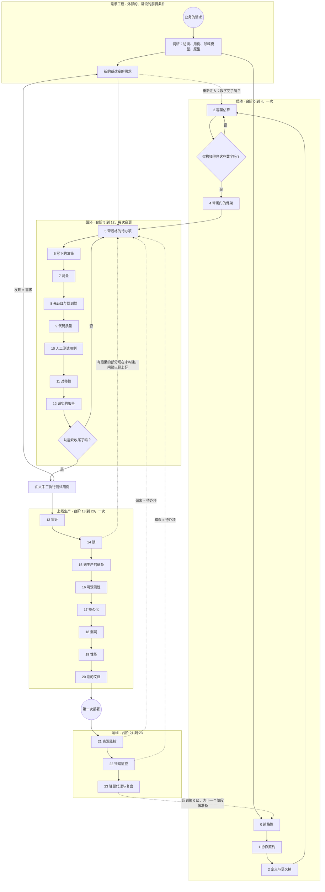

# Urazuke，验证方法 — 方法论之梯（第 4 版）

作者：Pablo Kuschniroff，由 Claude Code 辅助。第 4 版，始于 2026 年 10 月 18 日，并随着记录
（`docs/DECISIONES.md`）里的每一次后续决定持续更新；起始日期故意保持不变，这样每次有新决定
涉及这份文档时，版本历史都不需要重写。这是一份工作文档，
我会随着每一个使用它的项目继续打磨；它说的任何东西都还不是定论，不过据我所知，它确实是对一
个背后已经有三个生产系统的方法的第一次诚实提炼。

进入正题之前，先说一句关于它是怎么写的，因为这很重要。我是写给没有和我一起经历这些项目的人
的：想用人工智能构建软件、并且希望那软件能长久的人，而不是想学编程或收集提示词技巧的人。所
以我花时间解释，需要时重复，用日常的语言，并在末尾留一份**术语表**，收录每个缩写和每个我不
小心用上的口语表达。如果你在某处碰到一个陌生的词——"棘轮"、"锁"、"失败即关闭"、"PND"——去
查术语表；都在那里。当你读到像 [Ref. 26](REFERENCIAS.md#ref-26) 这样的标记时，要知道它是通向
一个真实案例的捷径，我在参考资料文档里讲了它，附日期和证据；你可以忽略它而不丢失脉络，也可
以在对细节感兴趣时跟着它走。

方法的公开仓库是
[github.com/pkuschnirof/urazuke](https://github.com/pkuschnirof/urazuke)。那里有这份文档、每级
台阶的契约、课程手册和参考资料，以方法自行声明的八种语言。

## 名字

**Urazuke**（裏付け）是一个日语词，指一个断言所拥有的依据：从背后支撑它的东西（字面意思是
"背面的衬里"）。动词 *urazukeru* 是"用证据支撑"。我在 2026 年 10 月 17 日选了它，此前因为与现
有公司和项目冲突而排除了几个名字；我选它是因为它恰好说出了方法要求的东西：模型的每条断言都
带着它的依据，而且依据可以不读代码就验证。名字不翻译；副标题"验证方法"翻译：*the evidence
method*、*o método da evidência*、*la méthode de la preuve*、*die Nachweis-Methode*、*il
metodo del riscontro*、裏付けの方法、验证方法。在本文档中，"梯子"是方法的结构——它的二十四级
台阶——而"Urazuke"是整个方法。

## 这是关于什么的

我想说清楚我在教什么、不在教什么。我不是在教一个工具。我在教一个**方法**：按什么顺序做什么，
每个时刻向模型要什么，它必须交给你什么，以及如何——不读代码——知道它交给你的东西是完整的。赌
注是，任何人，用任何能用来编程的人工智能工具，都能通过与模型对话而不是手敲代码来构建软件，
而且产出的东西稳健、可投入生产，并且——这是重点——**不要求项目的所有者审查任何一行代码**。我
也想把它不是什么说得一样清楚：它不是一个把系统做得更快的流程。它是一个让系统可运维、可维
护，而不需要任何人理解它代码里的任何一个比特的流程，因为代码由写它的那个代理式框架来理解和
维护。速度，在它出现的时候，是一个后果；正因如此，这份文档里没有任何期限：期限由每个系统的
规模和复杂度来定，而方法只定顺序。

有一个澄清是别人要求我写下来的，因为前一句话很容易被读成一种不是我本意的意思："不要求所有者
审阅一行代码"并不等于"是为没有系统知识的人编程而设计的"。不是这样的。这个方法的首要目标不是
降低技术门槛，让任何人在对软件是怎么构建的一无所知的情况下也能构建软件：而是给必须为一个系统
负责的人一个方法论上的支点，让模型构建出来的东西带着一贯的系统工程的扎实，对抗模型在没有人用
书面方式要求时应用这些同样原则的脆弱之处。所有者不读代码是我把闸门放在哪里、以及一个人不读实
现也能验证什么的结果，而不是承诺任何人，不管懂不懂，都能在完全不理解自己在指挥什么的情况下指
挥一个软件项目。合同实际要求的人物画像处在中间：能跑一条命令、能管理一个凭证、能恢复一次备
份、能看懂CI配额在告诉他什么、并且能识别出模型交付的东西不够的人——既不是纯粹的外行，也不是
已经会编程的人。

还有另一个澄清，关于成本。按这架梯子走，比让模型一次性解决所有问题要多花一些token：每一级台
阶都多加一个提示词、一次自己的验证、一个模型也必须维护的产物。一眼看不出来的是它省下的东西。
一个在没有这些闸门的情况下构建的系统，迟早会需要重新返工：回头补做没做过的容量估算，追查一个
本该在第8级就被红色测试抓住的错误，重写没人及时审计过的东西。这种返工，无论是token、时间还是
钱，都比每一级台阶多花的那一点提示词贵得多。我把它花在前面，清醒地花，为的是不在后面盲目地多
花一倍。

听起来雄心勃勃，确实如此。但我有几乎没人有的东西：三个正是这样构建、如今和真实客户一起运行
的真实系统，接下来的每条规则都是从它们提取的。所以我问自己的问题不是"能行吗？"，因为已经行
了。问题是"我做了什么，按什么顺序，其中什么真正起了决定性作用？"。这架梯子是我的答案，也是
三件事的基础：方法的文档、课程学员要做的实践，以及手册。之后我会把它作为执行流程导出到我的
工具里，让工具来引导方法，而不是靠人的记忆。

## 方法从哪里来，以及我不希望被误解的

这一切有一种容易的解读，我想在它扎根之前拆掉：方法是我每挨一次打就贴上一块补丁的集合。不是
这样，而且我在意把它说准确，因为这改变了读每级台阶的方式。

方法出自两个结合在一起的因素，单独哪一个都不够。第一个是**我自己的系统工程知识**。我应用那些
任何来自系统工程的人一眼就能认出的东西已经很多年了：设计之前先调研，写下来的需求，带数字的
容量估算，设计、构建、作为证据的测试、可复现的部署、运维、定期审计、作为产品一部分的文档。
我在二十四级台阶里要求的大部分东西，是我在一个带得好的项目里一直要求的。我不是为模型发明
的；是从以前带过来的。

第二个因素是这五个月的事故一个接一个让我看到的：**模型在哪些地方把这些原则应用得很脆弱**。一
个模型完全知道什么是测试、什么是根因、什么是容量估算；你问它，它解释得比很多工程师都好。但
在实践中它说测了而没测，一脸笃定地估计一个只有业务才有的数据，用它觉得合理的东西填上业务规
则的空缺，因为被训练成有用而多报，还建一把不自知地撒谎的量具。这些案例的每一个，我在[参考资
料](REFERENCIAS.md)里讲了，都准确地告诉我哪里需要收紧：哪里一条对我来说显而易见的原则需要变
成提示词里的显式条款、变成闸门、变成我不读代码就做的验证。

所以，当我在某级台阶说"这是我在某次事故之后强制推行的"时，我不是说原则诞生在那里。我是说我在
那里证实了模型不会自己应用它，必须以书面形式要求它。方法是一直以来的系统工程，以一个不知疲
倦、没有证据就不能相信的构建者所需要的硬度来应用。伤疤是哪里需要硬度的证明，不是原则的起源。

## 方法的三个使用场景

在往下讲之前，先说一个分叉，它在前几版里没有，是一位读者很有道理地向我提出来的。这份文档是看
着一个空文件夹来描述梯子的：第 0 级台阶决定项目要不要接，第 4 级部署没有功能的骨架，第 5 级
打开第一个功能块。那是最适合学习的情形，但不是最常见的情形。方法有三个使用场景，在打开代理之
前最好知道自己在哪一个里，因为入口不一样：

1. **新项目。** 空文件夹，加一个带着请求的所有者。从第 0 级台阶进，二十四级按顺序登。这就是
   这份文档所描述的，连同它的契约和课程手册。
2. **对一个用方法做出来的系统做演进-纠正。** 系统已经登过梯子：有契约、地图、带证据关闭的待
   办项、测试套件、部署链和手册。从第 5 级台阶进，开一个功能块，然后跟着循环走；第 13 级定期；
   第 23 级在每个阶段收尾。这是时间线（B 部分）的阶段 4。
3. **对一个不是用方法做出来的系统做演进-纠正。** 一个在跑的、有用户的系统，别人做的或者自己
   没有证据做出来的，现在要纠正它或者让它成长。既不从第 0 级进，也不从第 5 级进：要从一个八
   个站点（N0 到 N7）的**规范化阶段**进，它用自动发现把启动阶段各级台阶产出的全部输入物恢复
   出来并带上来源标记，在不重写系统的前提下给它造一条安全带，之后才以纠正模式或演进模式打开
   循环。那条路在它自己的一页上，[演进-纠正之路](EVOLUTIVO_CORRECTIVO.md)，而且它在课程里有
   自己的一部分，带第二个引导项目。

有一样东西落在外面，我把它点名出来：技术迁移不是方法的使用场景；那是另一个项目，而且一般会落
进第 0 级台阶的排他性准则。

## AI 没有中断方法：它延续了方法

这是开启一切的论点，我把它放在最前面，因为它在最常见的反对意见出现之前就拆掉了它："你怎么能
信任机器写的代码？"。

我的回答是，**业界在二十年前就已经不再信任代码的作者了**。当大部分编写工作转到初级、外包或轮换
的团队时，逐行审查变得无法维持。取而代之生长起来的，是今天我们视为理所当然的一切：自动化测
试、持续集成、验收标准、不绿就不放行的流水线、测试的"左移"、作为独立职能的质量控制。那是系
统工程对"写的人不可信"的回答：不读他的代码，向他索要证据。

所以让一个模型来写不是跳进虚空。是把一个我们已经不信任的作者换成另一个我们同样不信任的，而
且**验证装置我们早就搭好了**。这应该让人安心，而不是不安。而且新作者更便宜、更快，并且——与初
级不同——你让它先证红时它不会生气。

因此这个方法毫不掩饰地建立在经典系统工程之上。骨架还是老样子。不可能是别的样子，因为问题还
是老问题：不知道会有多少数据，不知道客户要什么，不知道构建的是不是要求的。AI 没有改变问题；
它改变了谁做每一部分、以什么成本。连第 0 级台阶的适格性准则 X2 都是经典工程：可测试性作为合
同条件。

### 这里面什么是旧的，什么是新的

旧的，而且值得说明是旧的：阶段的骨架、验证者相对于构建者的独立、测试作为证据、文档作为产品
的一部分、设计前的调研。

真正改变的，也是我的贡献所在的，是三件事：

1. **人的努力去哪里。** 在经典方法中，人写规格说明，写代码，另一个人审查。这里人只做两件
   事：**决定，以及验证产出物**。其他一切——起草、构建、测试、测量、记录——都由模型做。所以每
   级台阶都以"不读代码的完整性检验"结束：那正是人仍然不可或缺的地方，再无其他。

2. **作者也制造证据。** 这是唯一真正新的点，也是足以撑起整整三级台阶的细微之处。初级写可疑
   的代码，但不制造证据：测试和测量由别人搭，或者至少由别人看。模型则在同一次会话中生产代码
   *和*测试*和*量具*和*报告，无论对错都用同样笃定的语气。我见过：撒了两次谎的量具
   [Ref. 36](REFERENCIAS.md#ref-36)，被报告为"成功"的认证错误
   [Ref. 43](REFERENCIAS.md#ref-43)，四条断言错了三条。所以"审查证据而不是代码"仍然是正确的
   原则，但**证据必须证明它自己**：看到变红的测试（第 8 级台阶）、带守卫的量具（第 7 级）、
   把已验证和相信分开的报告（第 12 级）、与构建者不同的审计者（第 13 级）。这不是新的担忧：
   是质量控制独立性的同一种纪律，再往里走一步。

3. **产出物的成本。** 在经典方法中文档昂贵，所以做一次就过时。这里重新生成是免费的，所以规
   则变成"在同一次提交中"和"无需 AI 即可手工复现"。曾经无法达到的理想变成了闸门。

对于课程和公开展示，这诚实地定义了定位：它不是"新的编程方式"；它是**应用于一个不知疲倦、却
不能轻信的构建者的系统工程**。对来自系统工程的人，它听起来熟悉，降低了戒心；对来自 vibecoding
的人，它给了他们缺的东西，恰恰是骨架。它也把我与那些兜售速度、省掉整个骨架的工具区分开。

---

## A 部分 — 如何读每级台阶

每级台阶有八个部分，始终相同，以便比较：

- **意图**：它追求什么，一句话。
- **时机**：在项目的哪个时刻登它，登一次还是重复。这部分是第 4 版新增的，我在 B 部分详细解
  释，因为一个没有时间线的方法是一张良好意愿的清单。
- **输入**：登它之前必须存在什么。
- **产出物**：登上去之后留下什么书面或可执行的东西。总是具体的东西：一个文件、一个测试、一
  个脚本。
- **闸门**：要进到下一级，什么必须为真。不满足，就不登。
- **谁决定**：项目的所有者、代理，或者没有人，因为它是自动的。
- **避免的故障**：这级台阶防止的那类问题，附一条指向我证实它的真实案例的短引用。
- **契约**：写着它如何执行的文件：上下文、提示词、结果、检验、警报信号。

还有一个部分，它**只出现在六级台阶里**，是一块横贯的构件，会改变必须读什么：
**附录H**（[`ANEXO_HEURISTICAS.md`](ANEXO_HEURISTICAS.md)）。四十六条可验证的规则——十八条
关于代码质量，二十七条关于可用性——每条都有它稳定的标识、它的严重度，以及度量它的器具。它
不是一个可选的附录：**它是强制的**，并且在六个点上挂进梯子。在第2级进来的是它的两项**前置
输入**（用户术语表和角色清单：人们实际上怎么称呼每样东西，以及每个角色是谁、来做什么）。而
在第5、8、9、10、12级是它的五个**锚点**——"锚点"的意思是，如果附录的那块构件不在，那级台阶
的闸门就不会变绿。这五个是已发布的闸门定义里的机械要求，不是建议：一个编译本方法的工具会
要它们。这六级台阶各自都在自己的卡片里带链接地说了这件事，而且本方法自己的链条里有一项检
查，只要其中哪一级不再说，它就会变红。它是从发现得太晚里诞生的：附录一直是强制的，却在本
文档里一次也没被点名，而第一个把本方法改编成另一种形式的读者，跳过了四十五条里的二十七
条——因为他从来不知道它们在那里。

而这四十六条里有一条不是关于被建造的系统，而是关于**别人怎么问你**。那是 **UX-28**，它在
2026-10-27 进来，因为它本来就缺：方法命令它的提示词来问你——二十二次，分布在一半以上的语料
里——却在任何地方都没说过该怎么问，于是形式交给了临场发挥，而你收到的是一个光秃秃的问题。
从现在起，代理向你提出的每一个问题，都带着四个部分、按这个顺序到来：让它成为必要的**数据**，
列举出来；不超过五行的**一段话**，把这些数据连起来并让问题显现；**问题**本身，可能的答案逐
一编号；以及代理的**推荐**。并且用你选的技术深度来说——一共三种，在项目配置里声明一次：
`beginner`（日常语言，面向结果）、`decision_maker`（测出来的数字和后果，不出现文件路径——这
是默认值）和 `technical`（文件、行、命令）。你一个都不声明时，代理就用 `decision_maker`，并且
说出来。这段条款出现在语料的七十二条提示词里，以一段在八种语言中完全相同的英文写法；只要它
从任何一种语言里掉出来，链条上的一道检查就会变红。而没有任何检查能做到的——这一点值得知道
——是核实某个具体的问题是否带着它的四个部分：那由你来判断，这也是这条规则警告而不阻断的原因。

还有一件改变「必须读什么」的事，因为它决定这些要求中**哪一些**适用于你：**项目所固定的方法版本**。
关口的机械定义——每一级必须存在哪个文件、它必须说什么——以数据形式发布，带着一个声明的版本
（`catalog_version`）和一个内容指纹：一个由整个文件算出来的长数字，有人改一个逗号它就变，所以它
用来核对你手里的副本正是方法发布的那一份。项目在开始的那一天**固定**其中一个版本，并一直保持到
结束。这不是图省事：在项目中途升版本是**完整性状态的回退**。如果新版本给一个你已经视为关闭的级
添了一条要求，那一级就重新变成未完成；如果它添了一条你的工具还不会测的要求，关口不会说绿：它说
「已声明、未测量」，那一级就不前进。这不是故障，这是机制在工作。升版本是允许的——由所有者决定，
带日期写进第6级的决策记录，并且在决定之前要看中间进来了哪些要求，这个数是真的能数出来的，因为
冻结之后添加的每一条要求都说明自己是在哪个版本进来的。不允许的是悄悄地升，或者走到一半才发现
关口是在对着一个没人选过的定义测量。而对协助你的工具，如果你用了一个，方法对它的要求和对你的
一样：写下它固定了哪个版本、用的是哪个指纹，并把这一对拿去和方法的版本台账比对——台账住在方法
的仓库里，不在把文件递给它的那台服务器上。固定到一个方法无法命名的、它自己的内部标识符上，看
起来像固定，其实不是：外面没有人能审计它。这件事到今天为止没有写在这里，是第11级所追查的那一类
缺陷：数据对消费者说了，而散文从来没有对所有者说过——而只有所有者才能决定换版本。

两点重要说明。第一：**梯子对工具是中立的**。每个产出物是一个文件、一个测试或一个脚本；没有一个
要求我的工具或任何其他工具。Forge 把它们自动化（闸门、命令、待办项登记册），但台阶没有 Forge
也存在。第二：**台阶是按登的顺序编号的**，并归成四个阶段：0 到 4 是启动阶段，每个项目登一
次；5 到 12 是随每次变更重复的循环；13 到 20 是上线生产阶段，登一次，在第一次部署之前；21 到
23 是运维阶段，那时系统已经活着。第 23 级闭合循环，回到第 0 级，为下一个项目做准备。在一个阶段
内部，编号就说明顺序；在阶段之间，循环反复进行，而另外三个阶段各登一次。但"不是严格顺序的"不
意味着"任意顺序"：B 部分准确地说了每一级何时登、中间发生什么。

---

## B 部分 — 时间线：每级台阶何时登，台阶之间发生什么

这部分在之前的版本里不存在，它的缺失是一个严重缺陷：方法说了做什么、怎么验证，但没说**何时**。
而"何时"是一个方法的一半。一个照字面理解它的读者，可能一级接一级地登完二十四级台阶，然后问：那
基础设施、持续集成与部署链、需求摄入、功能开发、全部流程的端到端测试、对界面的人工查看，以及人
工验收测试，是在什么时候做的？这一切都会发生，而且发生在精确的时刻，在台阶之间和台阶之内。我在
这里把它写下来。

### B.0 整个流程，用一张图

在表格之前，先看图。它用流程记法画（BPMN 风格：圆形是事件，矩形是任务，菱形是闸门，虚线箭头是
返回流），而且它说了三件表格说得更差的事。第一：流程**从方法之外开始**，从需求工程开始，它是
一个前提条件，而且是常设的：它永远不结束，每条新需求都会重新进来。第二：一条新需求不是只进循
环；它**重新注入到评估类的台阶**，因为它可能改变当初决定架构的那些数字（"乘以十"还扛得住吗？），
从那里再往下走。第三：流程**终结在人对测试用例的手工执行**上（第 10 级台阶），而那次执行发现的
东西又作为需求回到循环。回路是靠人闭合的，不是靠机器。第四点，这次修正之前的图没有画出来：
当系统构建的东西会对世界产生后果（扣款、发送）时，循环会**在第 14 级台阶之后重新打开**，这时
闸锁已经上好，用来在演练模式下构建那部分，然后再继续走向生产链（第 15 级）。这不是回到起点：
这是同一道闸门（这个块关闭了吗？）又走了一遍，只不过现在安全网已经准备好了。

如果图没显示出来（markdown 阅读器不画 mermaid），上面那段文字完整地描述了它；在 HTML 版里它会
自己画出来。

### B.1 一个项目的五个阶段

一个用这个方法带的项目经历五个阶段。中间三个对应梯子的循环、上线生产和运维这三个阶段；阶段 1
是启动阶段；阶段 0 是初始摄入，方法同样覆盖它，尽管它本身不是一级"台阶"。我不写时长：时长取决
于所要求之物的规模和复杂度，而一个写下来的时长会变成一个虚假的期待。不取决于规模的是顺序。

| 阶段 | 登的台阶 | 该阶段还发生什么 |
|---|---|---|
| 0. 摄入 | 还没有；它是第 0、2、3 和 5 级的原材料 | 与所有者一起做业务调研，用需求工程的经典方法（见 B.5）：访谈、用例或用户故事、领域模型、界面原型。写成散文，有意不完整；代理通过提问补全它。 |
| 1. 启动 | 0、1、2、3、4 | 适格性、契约、定义、容量估算。以及**全部初始基础设施**：仓库、测试环境、持续集成、空系统的第一次部署。 |
| 2. 循环 | 每次变更 5 到 12：待办项、决策、测量、先证红的测试、质量、人工测试用例、对称性、报告 | 一块一块地做功能开发；红色测试；刚建好的流程的端到端测试；对每个新界面的人工查看；每块收尾时，在测试环境里做人工测试。 |
| 3. 上线生产 | 13 到 20，按顺序：审计、锁、到生产的链条、可观测性、持久化、漏洞、性能、文档 | 由另一次会话做审计；给一切作用于现实世界的东西上锁；收尾通往生产的部署链，附经测试的回滚；三份手册；与所有者一起对全部流程做验收测试。 |
| 4. 运维 | 21 和 22 随第一次部署搭起来；23 在每个阶段收尾时；每次演进的循环（5 到 12）；13 和 18 定期 | 驻留代理；每一到两个月审计；每个新变更走完整的循环，经部署链出去；每个阶段收尾时复盘。 |

这张表是给新项目的。当系统已经存在、而且不是用方法诞生的时候，阶段 0 和 1 被规范化阶段取代
（阅读、安全带、测量和排序），它在[演进-纠正之路](EVOLUTIVO_CORRECTIVO.md)那一页；阶段 2、3
和 4 是一样的。

在一个有用户、有后果的项目里，长大的是循环：功能。启动、上线生产和运维在小系统和大系统里形状
一样；变的是要测量多少，不是测量什么。

### B.2 台阶与台阶之间发生什么

缺的就在这里。对每个阶段，各类任务做什么、在相对于台阶的哪个精确时刻做。按行读这张表：每一
行是一类工作，每个单元格说它在那个阶段里何时做。

| 工作类型 | 启动（台阶 0 到 4） | 循环（台阶 5 到 12，按功能块） | 上线生产（13 到 20） | 运维（21 到 23 和循环） |
|---|---|---|---|---|
| **需求摄入** | 第 0 级台阶之前：与所有者一起做散文式调研，用访谈、用例和领域模型。在第 2 级（定义和语义树）和第 3 级（容量）补全。 | 开启每个功能块时：客户对该块的请求，按他会说的方式，转成带**详细规格**的待办项（第 5 级台阶）：描述、验收标准、适用规则、数据、界面、边界情况。代理提的问题就是精细摄入。 | 第 14 级之前：对有后果动作的调研。第 15 级之前：对环境和访问的调研。 | 每个新请求作为带规格的待办项进来，挂在它的语义树节点下；驻留代理收集用户的要求。 |
| **基础设施** | 全部初始的，在第 4 级台阶：仓库、结构、测试环境、凭证、测试域名。空骨架部署好之前不构建功能。 | 没有，除非某个功能块要求（一个队列、一个外部服务）。要求的话，它是一个带测试的待办项。 | 在第 15 级：生产环境、服务器上的密钥、真实域名、备份、最低限度的监控。 | 基础设施的变更走循环和第 15 级；绝不"手工、快速"。 |
| **CI/CD 链** | 在第 4 级台阶：从启动阶段起持续集成在每次 push 时运行测试套件，合并时自动部署到测试环境。 | 它自己运转。每次提交都经过它；不是绿色，功能块就不收尾。 | 在第 15 级补全：到生产的部署等待集成的结果且只打包；提升是书面流程；回滚经过测试。 | 每次部署遵循第 15 级的例行：同一版本测试绿色，回滚就绪，之后在生产上做端到端检查。 |
| **功能开发** | 没有。骨架有意空着部署。 | 它是循环的中心：代理取一个待办项（5），问缺的业务规则（6），构建，用证据收尾（7、8、9、10、11、12）。一块一块，从基础的到有后果的。 | 作用于现实世界的东西（收费、发送）在第 14 级台阶**之后**于循环中构建，带它们的锁，并以演练模式起步。 | 演进走循环。 |
| **自动测试** | 第 4 级里一个通过的冒烟测试。它是测试套件的种子。 | 每个待办项：先证红的测试（8）、同一会话中邻近项的回归，以及**刚建好的流程的一次端到端测试**，从界面到后端。功能块收尾时：**全部**现有流程的完整端到端套件，在测试环境里。 | 第一次部署到生产之前：全部流程的完整端到端套件，绿色，用将要提升的同一版本。部署之后：对生产的一次只读端到端检查。 | 每次变更，和循环里一样。 |
| **对界面的人工查看** | 第 4 级收尾时：所有者打开测试环境的 URL，看到空界面。看起来琐碎，但这是第一次有不是代理的人看系统。 | **每个触及界面的待办项**：代理交一张来自测试环境的真实截图，所有者看它。十秒钟。这是找到任何测试都找不到的东西最便宜的方式：按钮在不该在的地方，文字说的是别的，流程不是业务想象的那个。 | 在第 20 级：用户手册的截图是生产之前最后一次系统性的人工查看。 | 每个新的或改变的界面，和循环里一样。 |
| **人工测试** | 还没有，除了打开空界面。 | **每个功能块收尾时**：所有者或一个可信的用户，像真正使用那样在测试环境里用系统，沿着该块的流程。发现的东西记为待办项。有人工发现而没有待办项，不开启下一块。 | 第一次部署到生产之前：所有者对全部流程做**验收测试**，用逼真的测试数据，在测试环境里。以及第 20 级里，一个不编程的人照着恢复手册做。 | 每次演进，在其功能块收尾时。 |
| **所有者的决定** | 第 0 级（可行还是不可行）、第 1 级（契约）、第 2 级（它不是什么）、第 3 级（架构选项）。 | 每次代理因一条没写下的业务规则而停下（6）。通常每块两三次。 | 第 14 级（逐个锁）、第 15 级（提升到生产）、第 23 级（驻留代理的级别）。 | 出现的那些；始终写下来。 |

有个细节我想强调，因为这是来自 vibecoding 的人错得最多的地方：**全部流程的端到端测试不是最后
做一次**。是三次，在三个尺度上。每个待办项，测那个待办项触及的流程。每个功能块收尾时，测到
那时为止存在的全部流程。生产之前，用将要提升的精确版本测全部流程。如果你只做第三次，你到最
后会得到一个几周内没人端到端测过的系统，上线生产变成一周的修补。

### B.3 循环的节奏：一个典型的功能块

一个功能块是四到八个相关待办项的集合，合在一起做出业务能用的东西："基本日程表"、"提醒"、"月
报"。它从里面看是这样的：

1. **开启功能块。** 所有者用散文讲他想要这块做什么。代理把它转成编号的待办项，附"如何验
   证"，并问那些不足以写出可验证待办项的东西（第 5 级台阶）。所有者排优先级。
2. **每个待办项。** 代理宣布取哪个待办项、为什么。如果途中出现一条没写下的业务规则，停下来
   问（6）。如果待办项依赖一个数字——多少查询、花多久——先用带测试的仪器测它（7）。构建。完成
   后，按这个顺序收尾：先证红的测试、绿色、邻近项的回归，以及所触及流程的一次端到端测试
   （8）；代码质量的闸门为绿（9）；该流程的人工测试用例，写给一个人看（10）；以及，如果变更
   触及系统两部分之间的契约，另一边在同一次提交中更新（11）。报告把已验证的和相信的分开，并
   声明盲点（12）。所有者读报告，看界面的截图。不读代码。
3. **功能块收尾。** 完整的端到端套件在测试环境里绿色。所有者或一个可信的用户执行该块的人工测
   试用例（10），记下发生了什么、什么失败了；每一处失败作为纠正型待办项回到循环。读该块的质
   量报告（9）。用新界面更新用户手册（20，在同一次提交中）。只有那时才开启下一块。

在循环的典型一天里，方法向所有者要的东西又少又有限：回答两三个业务规则的问题，读两三份报
告，看两三张截图。仅此而已。如果要求的比这更多，要么代理在问它自己能解决的事（第 1 级台
阶），要么所有者在读代码（那第 8 级或第 12 级就有什么没起作用）。

### B.4 人工里程碑

我用一张清单总结一个人——所有者或他信任的人——必须看或用系统的时刻。它们很少，在精确的时刻，
而且没有一个能委托给代理：

- **启动结束**：打开测试环境的 URL，看到空系统。
- **每个触及界面的待办项**：看来自测试环境的真实截图。
- **每个功能块收尾时**：在测试环境里执行该块的人工测试用例（10）并记下结果；失败的东西作为
  需求回到循环。
- **第一次部署到生产之前**：对全部流程做验收测试，照着全部人工测试用例走。
- **在第 20 级台阶**：一个不编程的人在测试环境里照着恢复手册做。
- **每次部署到生产之后**：验证运行的版本是想要的那个，并对关键流程做一遍只读的走查。
- **第一次部署之前，在第 19 级台阶**：把业务的容忍度放在旁边，读负载测试的数字和断裂点。
- **在监控的每个周期（21 和 22）**：和代理一起读周期报告，决定哪个偏离、哪个错误变成待办项。

其他一切——测试、测量、审计、文档——由模型做，人通过产出物验证，而不是通过代码。

### B.5 需求如何进来：从调研到语义树再到待办项

我想在这里停一下，因为这是经典系统工程最有话说、而 vibecoding 最热情地忽视它的地方。一个需
求不是客户在聊天里的一句话。它是客户的一句话，经过几十年前就存在、在模型在前的情况下依然有
效的方法**处理**过——因为你要求它，模型就非常善于应用这些方法；你不要求，它就非常不善于。

我用的、也是方法在每个阶段要求的方法：

- **与所有者的访谈**，开放，散文，有记录。它们是阶段 0。我不试图让它们完整：我试图让代理察
  觉它们缺什么。
- **用例或用户故事**，业务能叫出名字的每个流程一个："前台录入一个预约"、"患者收到提醒"。每个
  有参与者、触发器、步骤、结果和例外。它们是开启一个功能块的单位。
- **领域模型**：业务的实体、它们的属性、它们可能的状态和状态之间的转换。它是语义树（见下）
  的心脏，也是避免模型发明业务没有的状态的东西。
- 每个故事的**验收标准**，形式是"给定某种情况，当发生某事，那么看到某结果"。它们变成每个待
  办项的"如何验证"，之后变成端到端测试。
- **界面原型**，哪怕是一张画。对界面的人工查看从这里开始，在代码存在之前。
- **可追溯性**：每个需求都能追到实现它的待办项、测它的测试和关闭它的提交。在方法里可追溯性
  不是一张单独的矩阵：它是待办项本身，它引用自己的来源和证据。

**语义树。** 它是把这一切理顺的产出物，是代理每次会话读的地图（第 2 级台阶）。它是一棵树，不是
一张清单：根上是系统；下面是领域或模块；每个下面是它的参与者、它的流程（用例）、它的实体及
其状态、它的界面和它的外部集成；每个节点下挂着触及它的待办项和影响它的决策。由代理根据调研
构建，你纠正，随每个功能块增长。它的价值是双重的：给模型提供它将要触及的节点的精确上下文，
而不必读整个项目；给你一种不读代码就验证代理理解的系统就是业务要的那个的方式。当一个待办项
不挂在任何节点下，要么树不完整，要么待办项超出了范围；两样十秒钟就能看出来。

**详细规格活在待办项里。** 在经典方法里有一份需求规格文档，长长的，会老化。这里那份文档被分
解：每个待办项带着自己的完整规格，待办项之和就是系统的规格。一个写得好的待办项有：标题；它
挂在语义树的哪个节点下；引发它的故事或用例，用客户的原话；对所要求之事的详细描述；适用的业
务规则，附决定和日期；进出的数据；受影响的界面，有原型就附上；边界情况和例外；验收标准；以
及如何验证。代理根据你的散文请求起草它，问那些不足以写成规格的东西，你在它被构建之前读它。
读一个待办项的规格是你离读代码最近的地方，而那正是恰当的距离。

**已关闭的待办项是文档。** 这是闭合圆圈的东西。一个待办项关闭时，不删除，也不空着归档：它保留
着规格、引发它的决定、关闭它的证据（红色和绿色的数字、界面的截图、测得的数字）、提交和日
期。已关闭的待办项队列于是就是系统的功能历史：建了什么、为什么、什么时候、怎么测的。变更日
志、用户手册的新章节，以及六个月后有人问"系统为什么这样做？"时的答案，都从那里来。课程手册
教你在每个待办项关闭时、同一次会话中、作为第 5 级台阶例行的一部分，索要这份文档。

---

## C 部分 — 二十四级台阶

它们按登的顺序排列。运维质量的那六级台阶（16 到 19 在第一次部署之前；21 和 22 在之后）是我原
本做了却没给它命名的那些：让系统在运行时能被**看见**，让它扛得住当初估算的量级，让它没有已知
的窟窿，以及，一旦进了生产，不要让任何人是从一个生气的用户那里才知道出了问题。两个监控终结在
和其他一切同样的地方：循环，作为纠正型待办项。如果你是初学者，这六级的每一份契约，以及第 9 和
第 10 级的契约，都以一段用日常语言解释它那些词的段落开头，而术语表里全都有。

在开始读它们之前有一个提醒，因为以后比现在更贵：二十四级里有六级，只靠卡片上说的话登不
上去。第2级承载[附录H](ANEXO_HEURISTICAS.md)的两项前置输入——用户术语表和角色清单——而第
5、8、9、10、12级承载它的五个锚点。这六级各自都在卡片末尾、以**附录H**开头的一行里说了。
如果你要应用本方法，在打开第5级之前读附录：没有它，你的五道闸门不会变绿，而等闸门已经把
你拦住了才知道，是最糟的知道方式。

### 步骤 0 — 这个项目能这样做吗？（适格性）

有一件先于一切的事，它不在任何仓库里，因为它总是已经决定好才到来：**一个项目是否用这个方法来
做**的决定。这是一条我在脑子里活了几个月、正在写完的准则。两条排他性准则我已经清楚，它们来
自我拒绝过的项目，而不是我接受过的 [Ref. 46](REFERENCIAS.md#ref-46)："不"比"是"更好地定义了
边界。加权准则我还在校准，并如此标注。

- **意图**：在打开仓库**之前**，决定一个项目是否用这个方法、由一个代理在前来做。因为如果你进
  入一个不行的项目，方法就退化为"用 AI 编程"，而那时所有者真的会去读代码。
- **时机**：只一次，先于其他一切。如果系统已经存在，这
  一级台阶要登它的遗留版本（[演进-纠正之路](EVOLUTIVO_CORRECTIVO.md)的 N0 站点），多四条准则，
  而且 X2 要一个界面一个界面地测。
- **输入**：客户的请求、业务领域、数据、技术、可用的环境，以及谁将是所有者。
- **产出物**：一页的适格性表，准则打了分，附决定：可行、不可行，或有条件可行。
- **闸门**：排他性准则全部绿色，加权准则的得分超过阈值（阈值我还没定）。
- **谁决定**：所有者。今天是我；想法是让方法允许另一个人用同一张表来决定。
- **避免的故障**：进入一个代理无法自己验证自己、或没有一个能做决定的领域所有者的项目，最后
  人逐行审查代码。
- **契约**：`peldanos/peldano-00-elegibilidad.md`。

**两条排他性准则。**

| # | 排他性准则 | 为什么它扼杀方法 |
|---|---|---|
| X1 | 没有可访问仓库的遗留技术，或者仓库不遵循标准 | 没有标准仓库就没有地方留证据：没有在提交里引用的待办项（第 5 级台阶），没有随代码一起走的测试（8），没有作为包的集成与部署（15），没有同一次提交中的文档（20）。代理盲目工作，不留可验证的痕迹。 |
| X2 | 无法端到端测试的技术：没法执行界面、没法通过各种方法访问界面的每个元素来验证变更到达了后端 | 没有从界面到后端的验证，代理没法自己测自己（第 8、7 和 12 级台阶），那样所有者就得读代码，而那恰恰是方法承诺避免的。 |

一条对工具中立价值千金的精确说明：**NAC3（我的工具用来让界面可由程序操作的协议）不是条件；
它是我今天达成这一点的手段**。中立的准则是这样的：界面可由程序执行，界面的每个元素都可通过
其各种方法（点击、输入、读取状态）访问，使得一个测试能走完界面，然后在后端验证效果。一种界
面不向"驱动"（比如 Playwright）暴露其元素的技术被排除在外，哪怕它有仓库。

还有一个我认为重要的解读：归根到底 X1 和 X2 是**同一个条件从两面看**。代理必须能自己端到端地
验证自己，并把证据留在仓库里。X1 是"证据留在哪里？"的一半；X2 是"证据怎么产生？"的一半。

`[假设]` **加权准则，尚无权重。** 我把它们标为假设，直到用头几个端到端使用方法的项目校准它
们。

| # | 候选准则 | 在案例中如何体现 | 排他？ |
|---|---|---|---|
| D1 | 有一个有判断力、有时间做决定（不是编程）的领域所有者 | 三个系统都有，决策写下来并附日期 | `[?]` |
| D2 | 有一个可验证真相的"神谕"：真实数据、一个外部系统、只读的生产环境 | 互助会和它的授权方作为神谕 [Ref. 26](REFERENCIAS.md#ref-26) | `[?]` |
| D4 | 技术在代理不用发明就能掌握的范围内（Node、Python、SQL、React） | 三个都是 | `[?]` |
| D5 | 错误有真实后果（钱、健康、运营），这证明失败即关闭是合理的 | 互助会（健康、收费）、协会（家庭） | `[?]` |
| D6 | 容量从第一天起就能知道 | Kikan：每年 340 万行 [Ref. 15](REFERENCIAS.md#ref-15) | `[?]` |
| D7 | 客户容忍一段成熟期和回路中有人 | 带演练模式的自动批准器 [Ref. 28](REFERENCIAS.md#ref-28) | `[?]` |
| D9 | 范围装得进一个仓库和一个所有者 | 三个都是 | `[?]` |
| D10 | 密钥和访问可以隔离（保险库、环境文件、受限权限） | 映射到创建者的 API 密钥 [Ref. 13](REFERENCIAS.md#ref-13) | `[?]` |

之前版本里有两条准则（代理能自己测试，项目是新的或可审计的），我分别把它们吸收进了 X2 和
X1，因为它们是后果，不是单独的准则。

### 步骤 1 — 协作契约（代码之前的规则）

在写一行代码之前，把你和代理将如何工作写下来。看起来像走形式，其实不是：它是避免第一个月百
分之八十挫败的东西。想想代理每天早上到来时不记得昨天；没写下来的你每次都得重复，而且每次都
有点不一样。

- **意图**：在第一行代码之前确定人和代理如何工作。
- **时机**：只一次，紧接着适格性之后。当一次教训要求时复查。
- **输入**：项目方面的没有；它是第一个文件。你这方面的：你的工作偏好。
- **产出物**：一份质量标准文档，至少说明：人的时间是神圣的（不花在代理能自己解决的事上）；零
  技术债务，也就是坏了的从根上修并在同一次会话中加回归；范围精确，不多不少只做要求的；用用
  户的语言说话；文档在同一次提交中更新；以及绝不把没做的事宣布为已完成。
- **闸门**：契约在仓库里，每次会话都读。
- **谁决定**：所有者。代理可以提议修改，但不能自行编辑契约。
- **避免的故障**：因为觉得是好主意而扩大范围来"帮忙"的代理；把债务留到"以后"（而以后永远不
  来）的代理；以及把它*以为*做了的事报告为已完成的代理。我第一次写它，是在每次会话重复同样
  的话两周之后 [Ref. 1](REFERENCIAS.md#ref-1)。
- **契约**：`peldanos/peldano-01-contrato-de-convivencia.md`。

### 步骤 2 — 项目定义与必读

代理的每次会话从零开始。给它一张地图，短的，并强制它在动任何东西之前读。两半同样重要：没人
读的地图不起作用，长地图没人读。

- **意图**：让每次会话一开始就知道项目是什么、处于什么状态、已经做了哪些决定。
- **时机**：写一次，契约之后；整个项目期间随每个新决定保持最新。
- **输入**：契约（第 1 级台阶）和业务调研。
- **产出物**：一份运行中的项目文件，这里要强调：**短**。它是纲领，不是历史。加上系统的**语义
  树**（见 B.5）：领域、参与者、流程、带状态的实体、界面和集成，每个节点下挂着待办项和决策。
  加上一个活状态文件，记录正在做的事和开放的疑问。
- **闸门**：代理在动代码之前读项目文件和语义树，并且验证过它读了。
- **谁决定**：所有者定义；代理保持最新。
- **避免的故障**：两个，很具体。因为没读地图而白做的工作 [Ref. 9](REFERENCIAS.md#ref-9)。以
  及长到没法读的项目文件 [Ref. 41](REFERENCIAS.md#ref-41)：运行中的文件和案例集必须是不同的
  文件。
- **附录H**：[附录H](ANEXO_HEURISTICAS.md)的两项**前置输入**在这里进来，而它们在这里进
  来，是因为后面的一切都要用它们。一项是**用户术语表**：人们实际上怎么称呼每样东西，不是
  系统用的那些词。另一项是**角色清单**：每个角色是谁——管理、运维、查询、客户——以及来做什
  么。从这两项里出来第8级的矩阵、第10级的按角色用例，以及第5级的按角色验收标准。如果它们
  不在，附录的五个锚点就没有来处。
- **契约**：`peldanos/peldano-02-definicion-y-lectura.md`。

### 步骤 3 — 在设计架构之前先做容量估算

这是跳过代价最大的一级台阶，我知道，因为我跳过了。结构性决定用数字来做，而原始数字在业务手
里，不在模型手里。

- **意图**：让结构性决定（哪个数据库引擎、接口是同步还是异步、多大并发）用数字而不是凭喜好
  来做。
- **时机**：一次，搭骨架之前；业务规模变化时重做。在小项目里是半页和一个决定。
- **输入**：和业务一起做的容量数据调研，天然不完整；以及旧系统（如果存在）的读访问权。有些
  数据**只有业务才有**，模型推断不出来：所以提示词要求它评估数据是否完整，并索要缺的，而不
  是一脸笃定地估计。
- **产出物**：一份容量估算记录，附**固定**的选项（三四个具体选项）和选中的那个；以及明确声明
  的"非对称"决策，比如"持久化接口从第一行起就是异步的，哪怕第一个引擎是同步的"，因为你错
  了代价很小，你不做代价巨大。
- **闸门**：容量估算在搭骨架之前记录在案。
- **谁决定**：所有者在固定选项中选择；代理用数字呈现它们。
- **避免的故障**：用一个撑不住容量的存储起步，等到改接口要花整整一个重构阶段时才发现
  [Ref. 15](REFERENCIAS.md#ref-15)。
- **契约**：`peldanos/peldano-03-dimensionar.md`。

### 步骤 4 — 带闸门的骨架

在系统做任何有用的事之前，它必须**空着**启动、测试和部署。是的，空着。因为通往生产的路是产品
的一部分，而知道它能走通的唯一方法是在还没有东西可失去的时候走一遍。这是做**全部初始基础设施
和集成与部署链**的台阶，所以它是启动阶段里最长的一级。

- **意图**：拥有一个在还没有任何功能时就能启动、测试和部署的系统。
- **时机**：一次，在启动阶段末尾，容量估算之后、任何功能之前。它是启动阶段的收尾。
- **输入**：容量估算（第 3 级台阶）、环境调研，以及将要部署的地方的凭证。
- **产出物**：持续集成绿色的骨架、搭好并带一个冒烟测试的测试结构、一次能用且运行了两次的到测
  试环境的部署，以及书面声明的流程闸门。
- **闸门**：骨架绿色，持续集成运行，到测试环境的部署在零功能下能用。所有者打开了 URL，看到了
  空界面。
- **谁决定**：代理执行；所有者目视批准。
- **避免的故障**：启动一个月后才发现部署，为了让它能用连付五个待办项，而功能已经在赌桌上
  [Ref. 32](REFERENCIAS.md#ref-32)。
- **契约**：`peldanos/peldano-04-esqueleto.md`。

### 步骤 5 — 计划就是待办项

这里有一个想法，一旦抓住就再也不放手：没有"计划"归计划、"任务清单"归任务清单。**待办项清单就
是计划。** 而且每个待办项都说如何验证，因为那是你要看的东西，而不是看代码。

- **意图**：一条唯一的工作队列，有顺序、有闸门，是项目的真相。
- **时机**：在开启第一个功能块时创建，启动阶段一结束就建；整个项目期间每次会话都用。每个新
  功能块都从把客户的请求转成待办项开始。
- **输入**：客户对该块的请求、审计，以及人工测试的发现。
- **产出物**：一份编号待办项的登记册，每项附**详细规格**（见 B.5）：它挂的语义树节点、用客户
  原话写的来源故事、描述、适用的业务规则、数据、界面、边界情况、验收标准和如何验证。以及，
  关闭时的**已完成待办项文档**：证据、提交、日期、途中决定的事。已关闭的待办项是系统的功能
  历史。
- **闸门**：没有带规格的待办项，任何变更都不能进；待办项用有文档的证据关闭，不用"搞定"。
- **谁决定**：所有者排优先级；代理按顺序提议并执行。
- **避免的故障**：两周内"被超越"而过时的规格 [Ref. 17](REFERENCIAS.md#ref-17)；以及六个月后
  没人知道为什么做了的工作 [Ref. 7](REFERENCIAS.md#ref-7)。
- **附录H**：[附录H](ANEXO_HEURISTICAS.md)的锚点1。每一个触到界面的待办项，除上面之外还要
  声明三样：它所属的**功能收敛分组**（那个人来做什么，功能就是按这个归并的）、拥有它的**角
  色**，以及**每个角色一条验收标准**。没有这项声明，待办项过不了这一级；这不是建议：这就是
  闸门度量的东西。
- **契约**：`peldanos/peldano-05-pendientes.md`。

### 步骤 6 — 决策写在代码旁边

模型遇到业务规则里的空缺时，把它填上。它不停下来问；它用它觉得最可能的东西补全，和写其他东
西一样自然。所以这级台阶不是"写下决策"，而是"要求它缺一条时停下来问"，而当你决定时，决定连
同你的原话、你的名字和日期留下来。

- **意图**：让每条领域规则或结构性决定有所有者、日期和位置。
- **时机**：循环的每次会话中，每当代理碰到一条没写下的规则。通常每个功能块两三次。也在启动阶
  段（第 0 和第 3 级台阶）和上线生产阶段（12 和 13）。
- **输入**：与所有者的对话。这是唯一的输入。
- **产出物**：写在提交里和决策记录里的决定，用原话。如果所有者没回答而代理不得不选，就标为
  "缺省决策"以便复查。
- **闸门**：一条业务规则没有它的来源句就不进代码。
- **谁决定**：所有者。永远。没有例外。
- **避免的故障**：六周后争论为什么某事是这样；更糟的是，代理因为觉得合理而发明领域规则。把规
  则连同日期和所有者写进提交的做法来自互助会 [Ref. 29](REFERENCIAS.md#ref-29)，在构建之前冻
  结决策的做法来自我的工具 [Ref. 5](REFERENCIAS.md#ref-5)。
- **契约**：`peldanos/peldano-06-decisiones.md`。

### 步骤 7 — 构建之前先测量，用一把自己也要被验证的量具

对我来说，这是所有台阶里最成熟的一级，也是我最晚形式化的一级，因为我以为模型会自己应用它。
它不会。规则是：没有一个决定什么的数字出自印象；它出自一把活在仓库里、有测试、你能运行的量
具。而且量具也要被验证，因为量具会撒谎。

- **意图**：让每个喂给决定的数字都出自一把带测试的仪器，而且仪器本身也被审计。
- **时机**：在循环里，每当一个待办项依赖一个数字或一个原因假设时，在构建**之前**。在启动阶
  段，容量估算是第一个案例。在小项目里，"测量"就是用一条命令数一数，并把数字连日期记下来。
- **输入**：假设，所有者的或代理的，以及对要测量之物的访问权。
- **产出物**：仓库里带守卫的量具；数字附命令和日期；双向审计；标出的近似值；以及，如果适用，
  按路径的预算，收紧到测量值并由测试保护。
- **闸门**：五条规则：带守卫的量具；仪器不存在就构建它；双向审计；近似的要标出来；执行者验证
  规划者的数字。
- **谁决定**：数字。所有者带来假设；代理在构建之前测它。
- **避免的故障**：撒谎的量具和四个数字错了三个的计划 [Ref. 36](REFERENCIAS.md#ref-36)；看不
  见 84 次调用的零棘轮 [Ref. 35](REFERENCIAS.md#ref-35)。这些规则是我在会话中写的，在它们成
  为教义之前 [Ref. 45](REFERENCIAS.md#ref-45)。
- **契约**：`peldanos/peldano-07-medir.md`。

### 步骤 8 — 作为锁的测试，先证红

一个你从没见它失败过的测试，你不知道它是否证明了什么。所以这里的规则不是"写测试"；是"证明测
试对旧代码变红，然后变绿，然后回归仍然绿色"。而从界面到后端的端到端测试，是替代你读代码的
东西。

- **意图**：让每个重要的行为都有一个坏了就**失败**的测试，并且确切地知道它会失败。
- **时机**：循环里每个待办项关闭时。所触及流程的端到端测试，在同一次收尾里。完整的端到端套
  件，在每个功能块收尾时和每次部署到生产之前。
- **输入**：已实现的变更和附"如何验证"的待办项。
- **产出物**：新测试、作为凭据的红色输出（命令、它所针对的版本、数字、退出码：用一条命令重
  新跑一遍所需要的一切）、带数字的绿色输出、同一会话中邻近项的回归，以及说明对什么先证红的
  提交。
- **闸门**：带凭据展示出来的红色、绿色、回归绿色。而且代理不恰好模拟它要测的那部分。
- **谁决定**：代理执行并报告；所有者读报告，不读测试。
- **避免的故障**：因为什么都不证明而通过的测试，以及掩盖 bug 的绿色
  [Ref. 44](REFERENCIAS.md#ref-44)。计数器的案例是对旧标准先证红的测试的完整例子
  [Ref. 26](REFERENCIAS.md#ref-26)。
- **第一个块的红色**：上一版本没有该模块时，红色通过变异来证明（植入的缺陷、变红的测试、凭据里的 diff），而不是靠无法加载的文件。
- **附录H**：[附录H](ANEXO_HEURISTICAS.md)的锚点2。同一个待办项还承载**按角色的功能矩阵**
  的测试：一张说明每个角色能做什么的表，菜单、路由和权限都从它派生，而不是在三个地方写三
  遍。端到端测试按每个角色，把可达到的东西和它在矩阵里的那一行比对：不少也不多。这是抓住
  "看见一个不属于自己的按钮的人"和"有权限却找不到界面的人"的办法。
- **契约**：`peldanos/peldano-08-tests-en-rojo.md`。

### 步骤 9 — 由机器验证的代码质量，带闸门

所有者不读代码，而这正是要点。但代码总得有人维护，而一份今天能跑、明天没人看得懂的代码，就是
会在第三个月被讨回的债。如果没人读它，那就得让一台机器来看：在每次提交时，把一个人类评审会看
的东西变成一个带限制的数字。我在我所有项目里都做过，只是没把它命名为一级台阶。

而在这里，手边最好留着把这一级和上一级分开的那句话，因为那是这行里最贵的混淆，而它用九个
字就解开了：**覆盖率数的是测试；红才说它们有没有用**。百分之九十的覆盖率告诉你测试执行了
多少代码，却完全没告诉你：如果行为坏掉，那些测试里会不会有一个变红。那是第8级说的，而且它
用唯一装不出来的方式说：看见红。覆盖率是这一级的数字；红是上一级的收据。（这个表述来自本
方法向另一种形式的第一次改编，在F部分标注出处。）

- **意图**：让代码质量在每次提交时由机器验证，以构建变红作为后果，并且永远不自己退化。
- **时机**：在开启第一个功能块时搭起来，在每次 push 时运行；每个待办项都在质量为绿时关闭，在
  先证红的测试（8）之后；报告在每个功能块收尾时和所有者一起读。在遗留系统里，第一次运行就是
  基线。
- **输入**：持续集成（4）、至少一个已关闭待办项的代码，以及所有者决定的那些限制（作为起点，
  文件和函数的大小）。
- **产出物**：只用一份配置的 linter 和格式化工具；大小和复杂度的限制；重复和死代码的检测；带
  棘轮的覆盖率；语言允许的话还有类型；`docs/CODE_QUALITY.md`，每条限制附它的实测值；
  `docs/GATES.md` 里的闸门。在任何有用户的项目里必需，只在没有真实用户时可选的变异测试（故意
  植入的错误，按测试抓住了多少来计数），其按功能块的分数放在覆盖率旁边。
- **闸门**：质量为红时什么都不合并；没有写下理由就没有对 linter 的例外；绝不为了通过而调高某
  条限制。
- **谁决定**：所有者定限制，并决定哪些现在修、哪些带日期容忍；代理测量，并在同一次提交中修。
- **避免的故障**：一次审计发现的那个两千多行的组件和那个将近一万行的文件，因为没有任何限制拦
  住它们 [Ref. 41](REFERENCIAS.md#ref-41)；在没人看见的情况下变差的质量数字
  [Ref. 35](REFERENCIAS.md#ref-35)。
- **附录H**：[附录H](ANEXO_HEURISTICAS.md)的锚点3，也是五个里最大的一个：在这里闸门从代码
  质量扩展到**可用性**。四十五条规则的目录按分组声明并启用；每条启用的规则都有它的器具、它
  的严重度和它的检查器；每条**关掉**的规则都有它的记录，带原因、谁批准和复查日期——关掉而
  没有记录是红的，这和"规则不存在"不是一回事——；主人没有声明的每个阈值，都发布为"未声明"
  而不是编一个出来；而报告出来时带着那两个数字和规则集的指纹。一个系统可以优异地通过代码质
  量却难用；这个锚点就是防住这件事的东西。
- **契约**：`peldanos/peldano-09-calidad-de-codigo.md`。

### 步骤 10 — 人工测试用例和功能一起写，并且由人来执行

自动测试由模型写、由模型跑，它们检验的是模型理解到的东西。还缺一个人用自己的眼睛和手、照着脚
本做的那种测试。脚本由构建了那个功能的同一个人、在同一个时刻、根据验收标准写出来；由人在每个
功能块收尾时、在验收时和每次部署之后执行；而失败的东西作为需求回到循环。这就是过程图所展示的
那个回路的闭合。

- **意图**：让每个功能诞生时就带着它的人工测试用例，写给一个不知道系统是怎么造的人看，并让每
  一次人工执行把失败的东西作为待办项重新注入。
- **时机**：每个待办项关闭时，在先证红的测试（8）和质量（9）之后。由人在每个功能块收尾时、第
  一次部署之前（验收）和每次部署之后以只读方式执行。
- **输入**：待办项的验收标准（5）、带数据的测试环境，以及谁执行、什么时候执行的决定。
- **产出物**：`docs/MANUAL_TESTS.md`，每条被触及的流程一个用例（标识符、待办项、前置条件、附
  做什么和看到什么的步骤、包含一个人可验证的后端效果的预期结果、数据、执行表）；记录在案的执
  行；每处失败一个纠正型待办项。
- **闸门**：没有任何触及界面的待办项在没有它的用例时关闭；没有任何执行没有日期和名字；没有任
  何失败没有带着那个人原话的待办项。
- **谁决定**：所有者或一个可信的用户执行；代理写用例并开待办项；模型绝不把用例标为已执行。
- **避免的故障**：没有脚本的人工测试，每次找到的东西都不一样；以及当场被修掉、随后丢失的人为
  发现；课程引导项目里那个没有任何测试看见、而诊所负责人看见了的别扭下拉菜单。
- **附录H**：[附录H](ANEXO_HEURISTICAS.md)的锚点4。每个手工用例要**按每个受影响的角色各跑
  一次**，而角色出自第8级的矩阵，不是出自执行者的记忆。只用一个角色跑过的用例不算已执行：
  权限和菜单的问题有一半，只能从"不是建造者的那个角色"看见。
- **契约**：`peldanos/peldano-10-casos-de-prueba-manual.md`。

### 步骤 11 — 生产者与消费者之间的对称性，以及反模式记录

当你改动一端（服务器、数据库、一个机器人）时，另一端（界面、计数器、报表）必须在同一次提交中
改动。支撑它的原则是**每张列表只有一个所有者**。而你已经付过一次代价的错误，连同它的自动检
查记下来，别付两次。

- **意图**：让一端的变更永远拖着另一端，在同一次提交中。
- **时机**：每个触及系统两部分之间契约的待办项；契约地图在开启第二个功能块时构建，那时已经有
  了界面和服务器；反模式记录在每次有东西第二次坏掉时增长。
- **输入**：谁生产、谁消费每个契约的地图；反模式记录。
- **产出物**：服务器定义列表，消费者读取它；生产者/消费者地图；带气味、根因、修复和提前检测
  的反模式记录。
- **闸门**：自动：代理在宣布一个变更关闭之前找另一边。
- **谁决定**：没有人；它是自动的。
- **避免的故障**：和查询对不上的计数器 [Ref. 26](REFERENCIAS.md#ref-26)；同一模块的两份副本失
  去同步 [Ref. 41](REFERENCIAS.md#ref-41)。单一来源的解决方案是我在互助会强制推行的
  [Ref. 27](REFERENCIAS.md#ref-27)。
- **契约**：`peldanos/peldano-11-simetria-y-antipatrones.md`。

### 步骤 12 — 诚实的验证与相称的报告

如果你不打算读代码，代理的报告就必须可信，而这不会自动发生。模型被训练成有用且完整，一份说
"这个我没能验证"的报告感觉上不如一份说"搞定"的有用。所以明确地向它索要坏消息、盲点和它没做
的事。

- **意图**：让代理的报告可信，而所有者不必读代码。
- **时机**：每份报告，每个待办项，整个项目期间。这是代理告诉你的一切必须具备的形式。
- **输入**：做完的工作和要求它的待办项。
- **产出物**：一份三块的报告：已验证（证据在旁边）、相信（以及为什么没测）、盲点（它从所在的
  位置看不到的）。覆盖要求的每一项。坏消息先说。
- **闸门**：没有一条断言没有它的证据。不光秃秃地说"搞定"。面对"还是坏的"，先比较已发布的版本
  和含修复的版本。
- **谁决定**：所有者信任，或索要证据。从不审查代码。
- **避免的故障**：报告为成功的错误，以及把没验证的声明为已验证的报告
  [Ref. 43](REFERENCIAS.md#ref-43)；不可见地工作了一小时四十三分的轮次
  [Ref. 16](REFERENCIAS.md#ref-16)。验证的诚实规则我在六月写下
  [Ref. 8](REFERENCIAS.md#ref-8)。
- **附录H**：[附录H](ANEXO_HEURISTICAS.md)的锚点5。报告还要报附录的分组：度量了什么、什么
  没被度量、哪条规则带着它的记录被关掉了。这是同一条诚实规则用在附录上：一条安装不知道怎么
  度量的规则，报为"未度量"，绝不报为绿。
- **契约**：`peldanos/peldano-12-verificacion-honesta.md`。

### 步骤 13 — 作为计划输入的定期审计

每隔一段时间要用新鲜的眼光看整个系统，而看到的不进一份归档的报告：进待办项队列。重要的部分
是"新鲜的眼光"：让没有构建的人来审计，因为构建的人共享自己的预设。模型的另一次会话、另一个
指令文件就够了。

- **意图**：每隔一段时间看完整的系统，并把看到的转成待办项。
- **时机**：第一次部署到生产之前必需（它开启上线阶段）。在运维中，根据变化节奏每一到两个月一
  次，以及每个大阶段收尾时。
- **输入**：整个仓库和只读的生产环境。
- **产出物**：一份带分级发现的报告，每个发现附位置、风险、证据和优先级；按维度的分数；以及已
  经转成待办项的紧急发现。
- **闸门**：在宣布审计关闭之前，每个紧急发现都开了待办项。
- **谁决定**：所有者给发现排优先级。
- **避免的故障**：读整张表的查询 [Ref. 18](REFERENCIAS.md#ref-18)；直到别人看才发现的两道管
  理员入口 [Ref. 40](REFERENCIAS.md#ref-40)；一个已知漏洞和一个巨大的组件
  [Ref. 41](REFERENCIAS.md#ref-41)。
- **契约**：`peldanos/peldano-13-auditoria.md`。

### 步骤 14 — 失败即关闭、锁与零静默损害

面对疑问或故障，系统**不**行动。并且说出来。听起来显而易见，但它是软件默认行为的反面，软件面
对疑问会继续往前走。这级台阶在构建作用于现实世界的功能**之前**，不是之后。

- **意图**：让系统面对疑问或故障时不行动，并发出警告。
- **时机**：在上线生产阶段，在构建任何收费、发送、批准或删除的功能之前；每有一个新的有后果的
  动作就复查。新的自动化从演练模式起步，看过它几天的记录后再启用。
- **输入**：和所有者一起做的有后果动作调研。
- **产出物**：锁表：每个动作附其可逆性、它的锁、它的回退路径；每个锁一个先证红的测试；新的自
  动化在演练模式下。
- **闸门**：每个不可逆的动作都有锁和写下来的回退路径。
- **谁决定**：所有者逐个锁批准；系统绝不跳过它们。
- **避免的故障**：重复收费、不经人的自动批准、删除客户数据。互助会的锁是范本
  [Ref. 28](REFERENCIAS.md#ref-28)；不弄坏整个列表的反射也是
  [Ref. 25](REFERENCIAS.md#ref-25)。
- **契约**：`peldanos/peldano-14-fail-closed.md`。

### 步骤 15 — 持续集成、环境、密钥与作为产品一部分的部署

到达生产必须是一个可复现的包：测试跑**一**次，部署只打包和上传，配置活在服务器上而不是仓库
里，回滚经过测试。这里的大部分从骨架起就已经存在；这级台阶把它向生产补全。

- **意图**：让到达生产成为一个可复现的包，测试只跑一次，配置在仓库之外。
- **时机**：集成链和到测试环境的部署在第 4 级台阶搭建。面向生产的收尾——真实环境、密钥、提
  升、经测试的回滚、防密钥的锁——在上线阶段做，在审计和锁之后。每次部署的例行贯穿整个运维。
- **输入**：环境与访问调研；带集成的骨架。
- **产出物**：每次提交运行一次测试套件的持续集成；等待那个结果、只打包的部署；只在服务器上的
  配置；书面、可重复的提升流程；经测试的回滚；阻止上传密钥的检查。
- **闸门**：动生产之前同一版本测试绿色；回滚经过测试；仓库里和聊天里没有任何未轮换的密钥。
- **谁决定**：所有者提升到生产；代理准备一切。
- **避免的故障**：每次提交跑三遍的测试和烧光的配额 [Ref. 39](REFERENCIAS.md#ref-39)；因发现
  太晚而靠一个个待办项硬化的部署 [Ref. 32](REFERENCIAS.md#ref-32)；贴进聊天的密钥
  [Ref. 42](REFERENCIAS.md#ref-42)。
- **契约**：`peldanos/peldano-15-ci-entornos-secretos-deploy.md`。

### 步骤 16 — 完整的可观测性与可追溯性，级别可配置

当生产里有什么东西坏掉时，我想用一个标识符把一个动作从界面跟到数据库，不打开代码；我想能在一分
钟内把生产的日志详细程度调高，不重新部署；而且我想让每个有后果的动作都留下一条应用删不掉的痕
迹。

- **意图**：让系统在运行时能被看见（可观测性），让每个重要动作都有它的痕迹（可追溯性），而详细
  程度用配置来改。
- **时机**：在上线生产阶段，第 15 级之后、第 19 级之前。在遗留系统里，最低级别进安全带（N4），
  完整级别在这里。"每个新模块都记录并传递"这条规则在整个运维期间有效。
- **输入**：按环境的配置（15）、锁的表格（14）、调研里的个人数据清单，以及日志住在哪里的决定。
- **产出物**：级别可配置、不部署就能改的结构化日志；每条记录里一个从界面到数据库的关联标识符；
  有后果动作的一份不可变审计；健康与指标端点；`docs/OBSERVABILITY.md`。
- **闸门**：一个真实标识符被所有层跟踪；级别不部署就改过；日志里没有任何个人数据。
- **谁决定**：所有者决定日志住在哪里、保存多久、什么算个人数据；代理搭建。
- **避免的故障**：那个活了一小时四十三分钟、靠日志才找到的进程
  [Ref. 16](REFERENCIAS.md#ref-16)；没有日志可读就只能瞎着运维的驻留代理
  [Ref. 13](REFERENCIAS.md#ref-13)。
- **契约**：`peldanos/peldano-16-observabilidad-y-trazabilidad.md`。

### 步骤 17 — 持久化层的优化，前后都要测量

数据库是系统慢慢死掉的地方：一百条记录时好好的，十万条时很糟，而没人知道是什么时候开始的。在这
里用数字决定，在生产之前，并且用第 7 级台阶的方法：测量、改动、在同样的数据上重新测量。

- **意图**：让系统的真实查询，在容量估算的量级下，进入业务能容忍的范围，并带上防止它们再次跑出
  去的预算。
- **时机**：在上线生产阶段，第 16 级之后、第 19 级之前；当某个功能块加进一张大表、或监控（21）
  显示某条查询超出范围时重复。在遗留系统里，测量来自 N6，几乎一切都"触及时偿还"。
- **输入**：容量估算（3 或 N6）、生产者-消费者地图（11）、可观测性（16），以及装载了预期量级的
  测试环境。
- **产出物**：带测试的查询量具；`docs/PERSISTENCE.md`，带每项改动的前后对比表、按路径的预算和
  每张表的保留期；每个预算一个测试。
- **闸门**：关键流程里没有读整张表的查询；每个预算都有它的测试；最慢的界面在容量估算所预期的范
  围内。
- **谁决定**：所有者逐项批准改动清单；代理测量并应用。
- **避免的故障**：一个活着的系统上那些读整张表的查询 [Ref. 18](REFERENCIAS.md#ref-18)；不得不
  被收紧到测量值的预算 [Ref. 37](REFERENCIAS.md#ref-37)；文件上的几百万行
  [Ref. 15](REFERENCIAS.md#ref-15)。
- **契约**：`peldanos/peldano-17-persistencia.md`。

### 步骤 18 — 漏洞的扫描与解决，放进链条并带日程

审计（13）每隔一段时间带着判断力看整个系统；这级台阶只看一件事，安全，而且一直看、由机器看：依
赖、代码、历史里的密钥和服务器配置。还有一条规则：一次依赖更新是一次变更，它要走循环。

- **意图**：不让任何已知漏洞进到生产，并且让新的漏洞在没人碰系统的情况下也能自己被发现。
- **时机**：在上线生产阶段，第 15 级之后、第一次部署之前；之后，在每次 push 时并带每周日程。在
  遗留系统里，第一次运行是 N3 的一部分。
- **输入**：持续集成（4 和 13）、环境调研、之前的审计，以及所有者关于什么算紧急的判断。
- **产出物**：四层扫描跑在链条里并带日程；`docs/SECURITY_[日期].md`，带发现和未扫描的部分；
  `docs/SECURITY.md`，带策略；`docs/GATES.md` 里的闸门；修好的 P0 和 P1，各带它的待办项。
- **闸门**：没有任何 P0 开着的时候才往生产提升；一个新的 P1 自动开一个待办项。
- **谁决定**：所有者定义什么是 P0 并批准修复；代理搭建并运行。
- **避免的故障**：在质量审计里出现的那个已知漏洞 [Ref. 41](REFERENCIAS.md#ref-41)；只有另一次
  会话才看到的那些管理员入口 [Ref. 40](REFERENCIAS.md#ref-40)；被当成一张打一次勾的清单来对待
  的安全 [Ref. 23](REFERENCIAS.md#ref-23)。
- **契约**：`peldanos/peldano-18-vulnerabilidades.md`。

### 步骤 19 — 量级下的性能测试与断裂点

第 3 级台阶用算式做了容量估算；这一级用跑着的系统核对那些算式：在预期量级下、在"乘以十"下，以
及一直到有什么东西坏掉。断裂点是这个阶段最有用的数字，因为第 21 级的告警阈值就是从它来的。

- **意图**：在第一个用户进来之前，知道系统在预期量级下、在"乘以十"下表现如何，以及它在哪里、为
  什么断裂。
- **时机**：在上线生产阶段，第 16 级和第 17 级之后，第一次部署之前；在每次会改变架构、持久化或
  某条关键流程的部署之前重复。在遗留系统里，用 N6 测出来的量级。
- **输入**：容量估算、打开的可观测性、优化过的持久化、关键流程，以及业务对最常用界面的容忍度。
- **产出物**：仓库里带测试的负载脚本；`docs/PERFORMANCE_[日期].md`，带三次运行、断裂点和诊断；
  `docs/PERFORMANCE.md`，带阈值和闸门；每个瓶颈一个待办项。
- **闸门**：最常用的界面在预期量级下进入容忍范围，否则有一个带那个数字的待办项；断裂点写明了是
  什么断了。
- **谁决定**：所有者给出容忍度，并决定现在修到哪个量级的瓶颈。
- **避免的故障**：只有看着生产才知道的真实负载 [Ref. 12](REFERENCIAS.md#ref-12)；伪装成测试失
  败的断裂点 [Ref. 44](REFERENCIAS.md#ref-44)；作为闸门的容量估算
  [Ref. 14](REFERENCIAS.md#ref-14)。
- **契约**：`peldanos/peldano-19-rendimiento-y-punto-de-ruptura.md`。

### 步骤 20 — 活的文档与一个人无需 AI 即可遵循的手册

系统必须在没有代理、也没有你的情况下能用、能维护、能恢复。如果没有代理的那天没法部署，它就
没完成。而且既然用模型重新生成文档是免费的，规则就变成"在同一次提交中"。

用一个任何人读完之前就能懂的词来说：没有这些手册，**主人不是主人，是租客**。他拥有系统、
付钱、住在里面，而钥匙丢了就进不去：要启动它、要恢复它，或者要弄明白它为什么不工作了，都
得依赖建造它的人——或者建造它的模型——继续在、继续有空。拥有一个系统不是拥有代码：是能够不
用请求许可就运行它。（这个表述来自本方法向另一种形式的第一次改编，在F部分标注出处。）

- **意图**：让系统在没有代理、也没有构建者的情况下能用、能维护、能恢复。
- **时机**：用户手册随每个功能块在收尾时增长，加入新界面。三份完整的手册在上线生产阶段、第
  13 级之后生成，找一个不编程的人做的测试在第一次部署之前完成。同一次提交的例行贯穿整个运
  维。
- **输入**：在测试环境中运行的系统；第 14 和第 15 级的产出物。
- **产出物**：附真实截图的用户手册、维护手册，以及写给一个必须在凌晨三点手工完成的人的基础设
  施与恢复手册；每份都附日期和版本。
- **闸门**：文档在同一次提交中是最新的；一个不编程的人照着恢复手册做过。 而且**那次执行留下了它的记录**（见下）
- **那次试跑写下三样东西，而不是一句"做过了"**：端到端的**度量时间**（什么时候开始，什么
  时候系统重新工作），**那个人卡住的确切位置**——手册的哪一步，用他自己的话——，以及**每一个
  他没看懂的词**。三样都带日期和试跑者的名字。而他没看懂的每个词都要**开一个待办项**：要么
  手册里把它讲清楚，要么把那样东西改个名字。没有这份记录，即便那个人确实恢复了系统，闸门也
  没被满足：一次不产出证据的试跑，是拥有一道什么都不度量的闸门最便宜的办法。
- **谁决定**：代理维护；所有者读手册，不读代码。
- **避免的故障**：导致在错误仓库提交的过时文档；变成历史的项目文件
  [Ref. 41](REFERENCIAS.md#ref-41)。可手工复现的手册是互助会的那些
  [Ref. 24](REFERENCIAS.md#ref-24)。
- **契约**：`peldanos/peldano-20-documentacion-viva.md`。

### 步骤 21 — 对资源、函数和超出范围查询的监控，带周期报告

第 19 级的测试说的是系统在某一天表现如何；生产是每一天，而且数据在长大。这级台阶看守资源使用，
以及每个函数、每条查询的响应时间，对照第 19 级的阈值和它自己的历史，有东西出了范围就报警，并产
出一份与所有者一起读的周期报告。每个偏离都是一个待办项。

- **意图**：在用户看到之前看到资源或性能的问题，并让每个偏离都有原因或待办项。
- **时机**：在第一次部署到生产的那一周搭起来；从那以后自己跑，报告在每个周期读（有后果的每周，
  小项目每月）。在遗留系统里，第一次阅读就是基线。
- **输入**：第 16 级的指标、第 17 级的预算、第 19 级的阈值、只读的生产，以及和所有者一起决定的
  渠道和周期。
- **产出物**：带历史的采集；按阈值和按偏离的告警；自动生成的周期报告；`docs/MONITORING.md`；写
  进契约的阅读例行。
- **闸门**：一条被挑起来的告警到达了渠道；第一份报告里每个偏离都有原因或提议；没有任何阈值在没
  有书面理由的情况下被调高。
- **谁决定**：所有者决定渠道、周期和现在处理哪个偏离；代理搭建并提议。
- **避免的故障**：不得不被收紧到测量值的上限 [Ref. 37](REFERENCIAS.md#ref-37)；在没人看的情况
  下被烧光的配额 [Ref. 39](REFERENCIAS.md#ref-39)。
- **可验证的窗口**：周期测量附带从数据库读取的最早和最晚记录；手工输入的窗口要标明，且只发出提醒。
- **契约**：`peldanos/peldano-21-monitoreo-de-recursos-y-rendimiento.md`。

### 步骤 22 — 错误监控与周期报告：没有任何错误没有待办项

一个生产中的系统会产生没人报告的错误。这级台阶在它们藏身的三个地方（后端、任务、用户的浏览器）
捕获它们，把它们分组，对新出现的和在长大的发出告警，并产出一份周期报告。两条规则：没有任何错误
没有待办项，而且不存在"已知错误"，除非有一个待办项说明为什么容忍它、容忍到什么时候。

- **意图**：不让生产里任何错误不被看见，并让每一个都用复现它的红色测试来关闭。
- **时机**：在第一次部署的那一周搭起来，和第 21 级一起；从那以后自己跑，带当场的告警和周期报
  告。在遗留系统里，第一天就已经存在的错误带着速度标记变成待办项。
- **输入**：第 16 级的日志、锁的表格（14）、包含浏览器在内的生产，以及第 21 级的渠道和周期。
- **产出物**：集中且分组的捕获，没有个人数据；按新错误、在长大的复发错误和有后果的错误发出的告
  警；带按流程错误率的周期报告；`docs/MONITORING.md`；写进契约的例行。
- **闸门**：一个在浏览器里引发的错误被一路跟到报告；没有任何复发错误没有待办项或带日期的理由。
- **谁决定**：所有者读报告并决定处理什么；代理捕获、分组并提议。
- **避免的故障**：被报告为成功的认证错误 [Ref. 43](REFERENCIAS.md#ref-43)；因为没有复现错误而
  一直走到根因的四轮折腾 [Ref. 22](REFERENCIAS.md#ref-22)。
- **错误来源**：观测系统的工具的错误单独放在报告的专属一节里，不打开待办项。
- **契约**：`peldanos/peldano-22-monitoreo-de-errores.md`。

### 步骤 23 — 系统里的代理，以及带数字的复盘

最后一级台阶有两部分，闭合同一个循环。第一：代理留驻在生产里，范围受限，以一个人的名义行
动。第二：方法本身用数字复查，学到的东西回到第 0 级台阶，为下一个项目做准备。

- **意图**：让代理留驻在生产里、范围受限，并让方法用数字复查。
- **时机**：驻留代理，在进入运维时，第一次部署到生产之后。复盘，在每个阶段和项目收尾时；必
  需，哪怕只有一页。
- **输入**：生产中的系统、事故、成本。
- **产出物**：驻留代理的文档，附它的系统地图、它的范围、它以一个人的名义的凭证，以及范围之外
  的事会被拒绝的证明；以及带来源数字的复盘，每个事故映射到一级台阶，至少一条对梯子的具体修
  改提案。
- **闸门**：代理不能做所有者没批准的事；复盘至少产生一条对梯子的修改。
- **谁决定**：所有者。
- **避免的故障**：没有地图就运维的代理；以及一个项目接一个项目原样重复、不学习的方法。砍掉
  多代理团队的那次带数字的复盘是范本 [Ref. 6](REFERENCIAS.md#ref-6)；驻留代理，是互助会的那
  个 [Ref. 13](REFERENCIAS.md#ref-13)。
- **契约**：`peldanos/peldano-23-agente-residente-y-retrospectiva.md`。

---

## D 部分 — 如何执行、要求多少，以及用什么工具

### 每级台阶如何执行：契约

八个部分的卡片说了每级台阶追求什么、何时登、留下什么。但一级台阶只有在看到**怎么要、必须回
来什么、我怎么知道回来的是完整的**时，才算真正理解。所以每级台阶除了卡片之外，还有一份放在
`peldanos/` 里独立文件中的**契约**，始终是同样的五节：

1. **所需上下文**，以通用方式命名（"容量数据调研"、"旧系统的读访问权"、"有真实后果的动作清
   单"），不深入系统工程的细节。调研天然是不完整的；我不试图用一张表单把它们做完整。
2. **提示词**，给模型的，原文。初始的，以及当台阶是一次对话时，收尾的。所有提示词都带同一个条
   款，那是事情的核心：*模型评估上下文是否足够；不够，就在继续之前索要所有缺的；而且不估计、
   不发明只有业务才有的数据*。知道自己缺什么才能计算的是模型，不是一张表单。而且每条提示词前
   面都有一个写着**"发送提示词之前"**的方框：在你粘贴它之前，你（或业务方和你一起）必须已经构
   建好的文件和输入，连同它们的名字、内容和最低可接受状态。提示词点名它们，方框告诉你它们该做
   成什么样；没有那个方框，提示词提到的就是一些没人告诉你怎么写的文件。
3. **预期结果**：产出物的详细特征。
4. **完整性检验**：所有者对产出物做的检查清单，**不读代码**。有一项是"否"，台阶就没登上。
5. **警报信号**：台阶看似登上、其实登错了的两三个症状。

那套完整性检验分散在三十二份契约里，每级台阶一份、每个站点一份，而这在项目运行当中是够用
的。但有一个更早的时刻，那时你手边没有三十二份契约：有人向你提出要给你造这个系统的那场会
面。为那个时刻有一张纸：**[给供应方的二十五个问题](PREGUNTAS_AL_PROVEEDOR.md)**，它就是同
一套完整性检验被汇到一起，为一个从未发包过软件的人而写，并按"人家在向他承诺什么"来排序。
每个问题都说明哪种回答是能**看见**的——一个文件、一个带命令的数字、一个见过它变红的测试、
一本手册、一个签名——以及它出自哪一级台阶。打印出来带着走。

每份契约的标题栏里：阶段、时机、形式和规模（在所有项目必需还是按比例）。

**提示词是英文的，每条附翻译。** 这是我出于三个原因做的决定：同样的内容用西班牙语要多占 30%
到 50% 的 token；模型遵循指令的能力在英文上校准得更好，所以英文提示词更能承受简短而不变得含
糊；而且这行的词汇（test、commit、rollback、mock）是英文。但我不希望英文成为读方法的障碍：每
条提示词下面有我在要求什么、为什么每个条款都在那里的解释，HTML 版里有一个按钮显示翻译成文档
语言的提示词。贴给模型的提示词是英文；翻译是为了让你理解。而且所有提示词都以"Reply in my
language"结尾，因为提示词是英文的，但对话不必是。

### 根据项目规模，什么是必需的、什么是按比例的

一个马上会出现的问题："一个小系统也要这一整套？"回答是，二十四级台阶不是二十四个漫长的阶段；
有几级一次会话就登上，按比例的那些随项目缩小。不缩小的是不可协商的那些的清单。这张表是一个
`[假设]` 提案，待第一个端到端使用方法的项目确认：

但在表格之前值得先说**怎么才走到"把一级缩小"这一步**，因为表格单看像一张许可证，而它不
是。有三个时刻，而且有顺序。

**先做完整的，包括你还不明白有什么用的部分。** 第一次应用本方法时，你没有条件知道哪部分
对你是多余的：看起来像官僚手续的那几级，恰恰是在防那些还没发生在你身上的问题，而整张清单
就是从已经发生过的问题里来的。完整做一次，比"该跳过什么"的争论更便宜；而且这是唯一能给你
下一阶段判断力的东西。

**然后按你眼前的东西来调整。** 当你已经把二十四级登过一次，你知道每一级产出什么，就能给它
定尺寸：半页而不是五页、跑一次而不是按路径定预算、月报而不是周报。这就是这张表提议的。而
决定权在主人手里，一级一级地、说出声地决定：在这个项目里哪些缩小、哪些不可商量，写在开始
之前，而不是第一个问题之后。因为一个写下来的决定而缩小的台阶，是相称；在沉默里缩小的，是
债。

**最后再改良，为后来的人。** 第23级以一次回顾收尾，而那次回顾作为对梯子的变更提议回到这
里。你在应用中发现的东西不是你的轶事：它是这张表的下一行。本文档之所以到了第4版，就是因为
这个。

| 台阶 | 小项目（一个所有者、少量用户、没有钱在赌桌上） | 有用户、有后果的项目 |
|---|---|---|
| 0 适格性 | 必需 | 必需 |
| 1 契约 | 必需 | 必需 |
| 2 定义 | 必需，五十行就够 | 必需 |
| 3 容量估算 | 必需，半页和一个决定 | 必需，完整 |
| 4 骨架 | 将有用户则必需 | 必需 |
| 5 待办项 | 必需 | 必需 |
| 6 决策 | 必需 | 必需 |
| 7 测量 | 按比例：数一数并记下 | 必需，带量具和预算 |
| 8 先证红的测试 | 必需 | 必需 |
| 9 代码质量 | 最低限度：链条里的 linter 和大小限制 | 必需，完整，带覆盖率棘轮 |
| 10 人工测试用例 | 必需：每条流程一个用例，所有者在每个功能块收尾时执行 | 必需，每个周期都有记录在案的执行 |
| 11 对称性 | 规则必需；地图可选 | 必需，带地图 |
| 12 诚实的验证 | 必需 | 必需 |
| 13 审计 | 一次，生产之前 | 定期 |
| 14 失败即关闭 | 只读则可选 | 必需 |
| 15 集成与部署 | 最低限度：测试自动跑、配置在外、回滚 | 必需，完整 |
| 16 可观测性与可追溯性 | 最低限度：级别可配置的结构化日志，每个动作一个标识符 | 必需，完整，带不可变审计 |
| 17 持久化 | 按比例：真实查询的索引和 N+1 循环的终结 | 必需，带按路径的预算 |
| 18 漏洞 | 必需：链条里的依赖扫描和密钥扫描 | 必需，四层并带日程 |
| 19 性能 | 按比例：一次预期量级的运行和一次"乘以十"的运行 | 必需，带断裂点和阈值 |
| 20 文档 | 最低限度：恢复 | 三份手册 |
| 21 资源监控 | 最低限度：一份月报和两条告警（磁盘、数据库） | 必需，带按函数的阈值和周报 |
| 22 错误监控 | 必需：集中捕获和报告 | 必需，带当场的告警 |
| 23 驻留与复盘 | 一页的复盘 | 两者 |

概括：有十三级台阶在任何项目里都不可协商（0、1、2、3、5、6、8、最低限度的 9、10、12、第 18 级
的依赖扫描、第 22 级的错误捕获和第 23 级的复盘），十一级随项目调整规模。

### 如何与任何工具一起使用

方法对工具是中立的；工具之间变化的是**每个产出物放在哪里**让模型读到。对 2026 年底最常用的工
具，对应关系如下：

| 方法的产出物 | Claude Code | Cursor | Codex CLI / Gemini CLI | Forge |
|---|---|---|---|---|
| 协作契约（P1）和例行（P5、P6、P8、P9、P10、P11、P12、P20） | 项目的 `CLAUDE.md` | `.cursor/rules/` | `AGENTS.md` / `GEMINI.md` | 按闸门注入的教义 |
| 项目定义（P2） | `CLAUDE.md` + `docs/STATUS.md` | 同样，在规则和文档里 | 同样 | `PROJECT.md` + 上下文文件 |
| 待办项登记册（P5） | `docs/PENDING.md` 或 issues | 同样 | 同样 | 带动词的原生待办项登记册 |
| 台阶提示词（全部） | 登台阶时贴进聊天 | 同样 | 同样 | 跨过闸门时注入 |
| 闸门（P4） | `docs/GATES.md`，手动 | 同样 | 同样 | G1 到 G9，自动 |
| 量具与预算（P7） | 仓库里带测试的脚本 | 同样 | 同样 | 同样，加上静态棘轮 |

Forge 那一列自动化得最多；另外三列只要所有者手工做 Forge 自动做的事，就同样好用：在正确的时
刻贴上台阶的提示词，并在进入下一级之前要求完整性检验。事实上，那就是课程的实践。

---

## E 部分 — 尚待展开的

1. **完整的第 0 级台阶**：加权准则的权重、阈值，以及更多作为反例的被拒绝项目。我有 X1 和
   X2；其余还缺。
2. **每级台阶一个好记的名字**，一句话，用于手册和出版物。
3. **导出到 Forge，已大体解决。** 这个方法已经作为项目流程完整地在 Forge 里运行，有机械闸门，
   当前台阶的提示词会注入到聊天里（D-035、D-036）。还缺的是逐条契约对照 Forge 今天实际执行
   的内容做出的明确对应表，好让这份文档所说的和工具实际做的之间一出现偏差就被发现，而不是
   积累下去。
4. **端到端测试契约，已经在进行中。** 课程的指导项目（Turnera）已经按原样跑完二十四份契约，
   24 条里关了 24 条；这一路上发现的问题已经修正了方法本身（D-037 到 D-040）。缺的不是第一次
   完整通跑——那已经发生了——缺的是让别人的项目去跑它，而不是我在旁边解决契约没预见到的事。
5. **课程的第一期学员**，他们会在需要的地方修正时间线的顺序和常见错误，这些今天是从我的项目
   而不是从学员写出来的。
6. **演进-纠正之路，验证于自己的遗留系统，而不是别人的。** 课程的指导性遗留项目（遗留版
   Turnera）已经按原样跑完八个站点和梯子的其余部分，27 条里关了 27 条，并促成了方法的三项
   决定（D-038、D-039、D-040）。缺的是在一个第三方的真实遗留系统上走同样的路，带着它自己的
   历史和自己的捷径，而不是我为课程搭建的那个系统。
7. **不在梯子里而应该在的** `[假设]`：把 token 成本和配额作为显式预算来管理（今天是被动的）；
   把密钥轮换作为例行而不是事故；以及一条人**确实**该看代码的时机准则，因为今天的答案是"从不"，
   而我怀疑有些特定时刻值得看。

---

## F 部分 — 相关工作：世上已有什么相似的东西，以及本方法在哪里不同

写完这架梯子之后，我问了自己那个显而易见的问题：这东西是不是已经以别的名字存在了？我请人做
了一次深入的调研，用英语、西班牙语和日语，对象是截至 2026 年 10 月发表的、用人工智能构建软件
的方法论、随笔和学术工作。下面是结果，诚实地概括：别处已经有的，我引用而不是据为己有；我没
找到的，我说"我没找到"，而不是"不存在"。这一部分会随着新东西的出现不断扩充，而新东西每周都
在出现。

简短的回答：**我没有找到任何一个已发表的方法把本方法所汇集的东西汇集在一起**。我确实找到了
一整个领域，从 2025 年中起，分别在它的若干组成部分上趋同；还有一位著名的实践者，在我发表这
份文档之前三个月就到达了同一个激进的前提。

### F.1 最近的亲戚

| 谁和什么 | 与 Urazuke 共有什么 | 缺什么 |
|---|---|---|
| **Robert C. Martin（"Uncle Bob"），2026 年 7 月。** 在 X 上的一条线程和他的仓库里（[Acceptance Pipeline Specification](https://github.com/unclebob/Acceptance-Pipeline-Specification)、[SwarmForge](https://github.com/unclebob/swarm-forge)），他宣布不读他的代理写的代码：他用一道"gauntlet"把它们围起来——用 Gherkin 写的验收测试、单元测试、复杂度限制、变异测试，以及一套他每隔一段时间手工执行的 QA 流程。"你没法告诉一个代理要干净；你得测量它产出的干净度。" | 人不读代码。事前审阅规格，事后审阅证据。栅栏是机械的，不是承诺。最后有人工测试。 | 他是一个有四十年手艺的程序员，不是一个不编程的所有者：栅栏是用那种判断力建起来的。没有有序的梯子，没有通往遗留系统的路，没有运维，没有发表的提示词。Grady Booch 回复他说，度量看不见一个漏洞，也看不见一次糟糕的分解。 |
| **old-coder，"evidence-first development"**（[仓库](https://github.com/AmazingAng/old-coder)）。一个受 Uncle Bob 启发的代理技能：SPEC、RED、GREEN、REFACTOR、GAUNTLET、EVIDENCE。 | 人批准测试计划，然后读一份能用一条命令重新跑一遍的证据报告；从不读代码。 | 一次一个任务。没有项目，没有遗留系统，没有运维，没有需求工程。 |
| **Disciplined Agentic Engineering**（[仓库](https://github.com/swingerman/disciplined-agentic-engineering)）。一套工具包，有九个检查点、明确的退出标准，以及二十一个作为闸门的确定性脚本。 | "一个代理可以说服自己跳过一条指令；它没法说服自己跳过一个非零的退出码。"由实现者以外的人做独立验证。 | 为工程师设计。没有运维也没有监控；遗留系统被缩减为一个处理 bug 的技能。 |
| **Tsumiki / AITDD，Classmethod（日本），2025 年 7 月**（[仓库](https://github.com/classmethod/tsumiki)）。需求、设计、任务，然后是 `tdd-red`、`tdd-green`、`tdd-refactor`、`tdd-verify-complete`，并有针对现有代码的逆向工程命令。 | 红和绿作为分开的、必需的命令；验证作为独立的一步；一条通往遗留系统的路；逐字的提示词；工具中立。 | 不要求量具自己有测试，没有已验证、相信、盲点的报告，也没走到生产和监控。 |
| **Addy Osmani，"Brownfield Agentic Engineering" 和 "Agentic Verification"，2026 年 9 月和 10 月**（[brownfield](https://addyo.substack.com/p/brownfield-agentic-engineering)、[verification](https://addyo.substack.com/p/agentic-verification)）。 | "先把行为固定下来，再放开代理"：表征作为前置步骤，几乎和演进-纠正之路的 N4 站点一模一样。"先写检查，再写代码。"防止删除测试的棘轮。 | 人读 diff。它是概念上的顺序，不是编号的清单。没有提示词。 |
| **Consort，Databricks，2026 年 9 月**（[arXiv 2609.09671](https://arxiv.org/abs/2609.09671)）。模型之外的确定性编排器；一个工作单元内不可变的测试；绿必须对着一个真实数据库取得。 | 真正的失败即关闭。"当工作者是非确定性的时候，一个工作者可以忽略的控制就不是控制。" | 限于一个平台的后端。没有梯子，没有遗留系统，没有运维。 |
| **IACDM，2026 年 3 月**（[arXiv 2604.16399](https://arxiv.org/abs/2604.16399)）。八个阶段；验证者在生成者之外；闸门由一台状态机施加：代理可以请求前进，不能自己批准前进。 | 带闸门的梯子形态，以及由另一个实例做的审计；工具中立。 | 八个阶段对二十四级台阶；没有遗留系统，没有安全，没有负载，没有运维。 |
| **"Trustworthy Change" 与人-代理单元，2026 年 9 月**（[arXiv 2609.04630](https://arxiv.org/abs/2609.04630)）；**SDAD**，2026 年 5 月（[arXiv 2608.20341](https://arxiv.org/abs/2608.20341)）；**Agentic Agile-V**，2026 年 5 月（[arXiv 2605.20456](https://arxiv.org/abs/2605.20456)）。 | 同样的权力划分：代理产出证据，人保留验收权。Agentic Agile-V 点名了"基于证据的验收"，并说代理要求的是更多的需求工程，不是更少。 | 它们是概念框架或粗粒度的生命周期，不是带提示词的流程；人是技术人员。 |
| **AI-DLC，AWS，2025 年**（[文章](https://aws.amazon.com/blogs/devops/ai-driven-development-life-cycle)）。Inception、Construction、Operations，带人工闸门。 | 它是唯一走到运维的大型方法。 | 三个粗粒度的阶段；没有分类型的证据；人是一个技术团队。 |
| **Spec Kit，GitHub，2025 年**（[仓库](https://github.com/github/spec-kit)）以及规格驱动开发这一家族：Kiro、BMAD、OpenSpec、GSD、Agent OS、Tessl。 | 持久的产出物、阶段的顺序、文本提示词、需求优先、可追溯性。OpenSpec 和"计划就是待办项"相当像。 | 没有人要求绿之前先红；遗留系统只有一份轻量的指南；几乎全部止于合并。BMAD 把工作组织成一个带角色的代理团队；在 Forge 里我用过那个模型，在团队会丢失上下文的那个时期放下了它，如今我看到它改进了：这是持续的演进，不是一次抛弃。 |
| **Reversa，2026 年 5 月**（[arXiv 2605.18684](https://arxiv.org/abs/2605.18684)、[仓库](https://github.com/sandeco/reversa)）。从遗留系统中恢复规格的代理，带置信度标记：已确认、推断、空缺。 | 几乎就是演进-纠正之路的 N0 站点：从代码描述出来的功能，带来源标记。有西班牙语和葡萄牙语的文档。 | 恢复的是规格，不是行为。不把表征当作动手之前的硬栅栏。 |
| **Harness Engineering，OpenAI，2026 年 2 月**（[文章](https://openai.com/index/harness-engineering/)）和 **StrongDM 的 Software Factory**（[斯坦福的研究](https://law.stanford.edu/2026/02/08/built-by-agents-tested-by-agents-trusted-by-whom/)）。企业案例：零行手写代码；在 StrongDM，也不做评审。 | 把人从键盘前拿走的激进前提。 | 人仍然是工程师。StrongDM 用另一个模型给出的分数取代了通过或不通过：恰恰是本方法所禁止的（一个喂给决策的数字，要用一个自己有测试的程序来测量）。 |
| **Kent Beck，"Augmented Coding"，2025 年 6 月**（[通讯](https://newsletter.kentbeck.com/p/augmented-coding-beyond-the-vibes)）。一份完整的系统提示词，强制红、绿和重构。 | 绿之前先红，逐字的，而且提示词整个发表了。"AI 会作弊。" | Beck 读代码并介入。它是会话的纪律，不是项目的纪律。 |
| **Harper Reed，"My LLM codegen workflow"，2025 年 2 月**（[文章](https://harper.blog/2025/02/16/my-llm-codegen-workflow-atm/)）。用一次一个的问题写规格，提示词计划，执行；遗留系统有一个分支。 | 文本提示词，一次一个问题，遗留系统的分支。 | 三步，没有闸门；作者读代码。 |
| **Anthropic，最佳实践与 harness 设计**（[实践](https://code.claude.com/docs/en/best-practices)、[harness](https://www.anthropic.com/engineering/harness-design-long-running-apps)）；**OpenAI，PLANS.md**（[cookbook](https://developers.openai.com/cookbook/articles/codex_exec_plans)）。 | "你没法验证的，就不要交付。"一个不同于构建者的 QA 代理从界面操作应用。"观察到的结果，不是计划中的预测"：最接近已验证对相信的东西。 | 零散的实践，绑在一个产品上。没有不编程的所有者，没有遗留系统，没有运维。 |
| **关于验证的随笔，2026 年**：Peter Lavigne、João Queirós、Mihai Avram、John Young（[Queirós](https://www.ai.joaoqueiros.com/blog/read-less-code-verify-ai-generated-software-test-harnesses)、[Avram](https://mihaisplace.com/blog/ai-can-write-the-code-who-verifies-it)、[Young](https://jyoung.dev/blog/evaluating-ai-coding-agent-output/)）。 | 同样的诊断：生成变便宜了，验证没有。"测试是断言，不是证明。"按风险等级分层的验证。 | 全都止于"少读，但要读"。 |
| **西班牙语世界**：Daniel García（功能文档、技术文档、带阶段间对抗分析的实现）、Víctor Robles（一门十步的课程）、Daniel Primo（Web Reactiva）、Emilio Carrión（从 Mercadona Tech 对 Uncle Bob 的一篇回应，[文章](https://www.emiliocarrion.com/en/blog/letting-go-of-the-wheel)）。 | García 有最接近阶段间审计的东西。 | 没有一个有证据闸门或不读代码的所有者。在这个领域我没有找到任何阿根廷、墨西哥或西班牙的方法。 |

### F.2 已经存在的东西，与其据为己有不如引用

强加给代理的"绿之前先红"，在 Beck 那里、在 Tsumiki 那里、在 Anthropic 的实践里、在 Simon
Willison 2026 年的模式里都有。带文本提示词的有序步骤，在 Spec Kit、Tsumiki 和 Reed 那里都
有。表征作为处理遗留系统之前的一步，在 Osmani 那里有，比本文档早一个月发表。从界面出发、由
一个不同于生成者的评估者做的端到端测试，在 Anthropic 那里有。需求工程作为前提，在整个规格驱
动开发运动里都有。而不读代码的人，在 Uncle Bob 那里有，在 Karpathy 那里（对于可抛弃的东西）
有，在 Yegge 和 Kim 的书里也有。

### F.3 我在任何地方都没找到的东西

- **对象是谁。** 所有文献都假设有一位做评审的工程师。Uncle Bob 不读代码，是因为他有四十年的
  判断力来建那道栅栏。本方法从一个从不读代码的所有者出发，把其余一切从这条约束推导出来。这
  种倒转没有在任何工作里被提出。为不编程的人准备的，只有对损害的记录：2026 年 6 月的一项研
  究，检查了 9,041 个用"vibe coding"工具做出来的应用，在被审计的应用中有 91% 发现了漏洞
  （[arXiv 2606.23130](https://arxiv.org/abs/2606.23130)）。
- **作为必交产出物的已验证、相信、盲点报告**（第 12 级台阶）。问题已经用数字诊断出来了：代
  理的完成声明比真实的批准率高出 28 到 38 个点（[SpecHarness, arXiv 2609.29921](https://arxiv.org/abs/2609.29921)），
  而在代理之间交接时丢掉"未验证"标签，会让危险动作的批准率从 5% 跳到 60%
  （[arXiv 2609.20211](https://arxiv.org/abs/2609.20211)）。没有人把它变成一种面向一个人的问
  责格式。
- **自己带测试的量具**（第 7 级台阶）。"一个喂给决策的数字，要用一个自己有测试的程序来测
  量"这条规则，在我找到的任何来源里都没有写下来。
- **完整的梯子**，从适格性到监控和复盘。我找到的最长的有十步；几乎全部止于合并；只有 AI-DLC
  和 Osmani 触及了运维。
- **不设期限作为规则**（D-030）。它没有被反驳；它是缺席的。
- **这个组合。** 不读代码的人不严格地测试（Ronacher、Yegge）。严格测试的人读代码（Beck、
  Osmani、Hashimoto、GitHub）。Uncle Bob 和 old-coder 打破了这个交叉，而且是按任务做的，不是
  按项目。

### F.4 必须回答的反对意见，以及我如何回答

Birgitta Böckeler 在 2026 年 8 月测得，要求代理走先测试的循环并不能可靠地改善质量，因为代理
有时会伪造红色，或者在测试之前先实现，好让测试一上来就通过
（[martinfowler.com](https://martinfowler.com/articles/exploring-gen-ai/tdd-in-the-agent-loop.html)）。
在她的研究里，唯一能把看守的测试和装饰的测试区分开的，是变异测试。同年的另一项研究表明，一
个模型会给自己三分之一的错误背书（[arXiv 2605.21537](https://arxiv.org/abs/2605.21537)）；还有
一项表明，一个干净的会话加一个不同的模型，比同一模型的两个会话找到更多错误
（[arXiv 2610.01471](https://arxiv.org/abs/2610.01471)）。

这是一个严肃的反对意见，我接受它。方法的回答有三块（D-033）。在第 8 级台阶，红色是一张**凭
据**，不是一段叙述：确切的命令、它所针对的版本、失败的数量和退出码，按原样粘贴，好让所有者
能用一条命令重新跑一遍，而且每个功能块做一次，用一个随机挑出的待办项。在第 13 级台阶，由另
一个会话做的审计重新跑这些凭据中的一个样本。在第 9 级台阶，变异测试在任何有用户的项目里都是
必需的（只在没有真实用户时保持可选），其分数在每个功能块收尾时放在覆盖率旁边。这三块没有一
块要求所有者读代
码。三块都让伪造红色比真的跑一遍更费劲。

### F.5 本方法向另一种形式的一次改编，以及它教给我的东西

2026年，Oscar Schmitz 出版了**《El Arte de Forjar Sistemas》**（《锻造系统的艺术》，191
页），一部改编本方法的小说：它取来这座梯子，当成虚构来讲，有一位做决定的主人和一支建造的
团队。它不是上面那种意义上的相关工作——它没有提出另一种方法——而是以前没发生过的事：有人
为了produce另一部作品而读完了整个语料。我把它一条断言一条断言地对照本方法的字面做了校验，
那份校验报告留在仓库里。

从那里出来的东西，以及它为什么在这一部分而不在参考里：**参考是我自己的案例，带日期和提
交；一部小说不是案例**。它确实做到的是两件事。

它贡献了**四个比我更好的表述**，并带着这个出处被采纳进本文档："覆盖率数的是测试；红才说
它们有没有用"（第9级）、"主人不是主人：是租客"（第20级）、"要缩小一级，是在完整做过之后
才走到的"这个想法（D部分），以及"恢复手册的试跑必须**记录**时间、卡点和没看懂的词"（第20
级）。第五个是[给供应方的二十五个问题](PREGUNTAS_AL_PROVEEDOR.md)这张纸：把完整性检验汇成
一张主人能带去会面的纸，这个想法是他的；本仓库里的二十五个问题是从本方法的契约从零写出来
的，因为他的版本是他的作品，权利保留。

而它显出了一个没有任何审计看见过的**本方法的结构性缺陷**，这是其中最有价值的：作者一个错
都没有地连续复现了参考里的六个数字，却跳过了附录H四十五条里的二十七条。不是他看漏了：**本
文档一次也没点过它的名**，所以他从来不知道它们存在。一个读完全部并应用本方法的读者，会被
五道已发布的闸门拦住却不明白为什么。这就是附录如今出现在A部分、C部分开篇，以及承载它的六
级台阶卡片里的原因，也是链条里有一项"哪张卡片不再点它的名就变红"的检查的原因。第23级要求
回顾作为对梯子的变更提议回来；这是第一次来自读者的回顾。

要把本方法放到地图上，一个有用的框架是 Macedo 2026 年 6 月的分类法
（[arXiv 2606.04967](https://arxiv.org/abs/2606.04967)）：六个维度（规格、上下文、角色、执行、
验证、可移植性），以及一个发现：它比较过的框架没有一个同时覆盖六个维度，在流程深度和可移植
性之间存在一种结构性的取舍。Urazuke 瞄准全部六个，而它押注于精确的英文提示词加上工具中立，
正是打破这种取舍的尝试。

---

## 术语表

本文档中出现的每个缩写、每个专有名词和每个口语表达，一一解释。按字母顺序排列。有些条目是出
现在源仓库文件名或提交信息中的术语；保留它们以便追溯证据。

**吃一堑长一智（A los golpes）** — 因为出了问题而学到东西，而不是因为有人事先解释过。我用在
"这些规则是吃一堑长一智学来的"的意义上，而在本文档里我澄清那不是全部真相：原则我从以前就
带着；教训显示的是模型在哪里不应用它们。

**代理（Agente）** — 一个不仅回答问题还执行动作的人工智能程序：读文件、写代码、运行命令、做
提交。在本文档中，"代理"是 Claude Code 或你使用的工具。

**告警（Alerta）** — 一个自动的、当场的通知，说某个数字超出了范围（一个阈值被超过、一个新错
误）。方法的规则：一条被触发而没人读的告警是那条告警的缺陷，要修掉或者删掉。

**静态分析（Análisis estático）** — 由机器读代码而不执行它，寻找已知的危险模式（一次注入、一
把写在代码里的钥匙）。它是第 18 级台阶漏洞扫描的四层之一。

**锚点（Ancla，附录H的）** — 附录H的一块构件成为某级台阶条件的那个点：构件不在，那级的闸
门就不变绿。一共五个，在第5、8、9、10、12级，每一级的卡片都点了它们的名。它不是建议也不是
最佳实践：它是被度量的东西的一部分。

**附录H（Anexo H）** — 本方法的启发式附录
（[`ANEXO_HEURISTICAS.md`](ANEXO_HEURISTICAS.md)）：四十五条可验证的规则，十八条关于代码质
量、二十七条关于可用性，每条都有它稳定的标识、它的严重度和度量它的器具。它是强制的，并且横
贯四个区段：在第2级带着两项前置输入进来，在第5、8、9、10、12级带着五个锚点进来。"H"是启发
式的意思。

**匿名化（Anonimización）** — 在本文档中，真实客户被称为"互助会"、"授权方"和"协会"，它们的
系统叫"Autorizaciones"和"Kikan"。这是有意的：名字在获得使用许可之前保密。

**反模式（Anti-patrón）** — 一种看起来合理、但已知会以糟糕结局收场的做法。"模式"（经过验证
的好做法）的反面。

**语义树（Árbol semántico）** — 树形的系统地图：根上是系统；下面是领域；下面是参与者、流程、
带状态的实体、界面和集成；每个节点下挂着触及它的待办项和决策。由代理构建，你纠正，是代理动
代码之前读的东西。见 B.5。

**收紧上限（Apretar el techo）** — 把一个限制（预算、允许的最大值）降到刚好高于测量值，让任
何恶化都使测试失败。

**自动批准器（Aprobador automático）** — 在 Autorizaciones 中，按规则自动批准订单的机器人。
在放手让它行动之前，先以"演练模式"运行（见 dry-run）。

**产出物（Artefacto）** — 被生产出来的具体东西：一个文件、一个测试、一个脚本、一份文档。在
梯子里，每级台阶留下一个产出物。

**异步 / 同步（async / sync）** — 同步调用在继续之前等待结果；异步调用让任务进行着，自己继
续，之后再收结果。Node 里真实的数据库是异步的；所以接口从一开始就必须是。

**自动发现（Autodescubrimiento）** — 在演进-纠正之路里，拿到那些没人写过的输入物的方式：代理
通过阅读系统本身（代码、数据库结构、配置、日志、现有的任何文档）把它们恢复出来，并给每条断言
标上它的来源（`[代码]`、`[数据库]`、`[配置]`、`[文档]`、`[推断]`，以及给所有者确认过的东西用
`[业务]`）。读不到的东西标为缺口，不去填它。

**协会（Asociación, la）** — 本文档对 Kikan 系统客户（真名保密）的称呼：一个帮助家庭的民间组
织，需要一个全渠道服务台和活动。

**AUD-\*** — 8 月在 Kikan 做的编号审计系列，它们产生了待办项。

**授权方（Autorizador, el）** — 本文档对互助会那个接收订单并返回裁决（批准、拒绝）的系统的称
呼。对我们来说它充当"神谕"：用来验证计数器的真相。

**Autorizaciones** — 本文档对第一个生产系统（真名保密）的称呼：为一家医疗机构自动化互助会的
订单管理，回路中有人。

**await** — 在 JavaScript 中表示"等待这个异步调用的结果"的词。没有 `await` 的数据库调用是一
个静默的 bug：代码在拿到数据之前就继续了。

**后端（Backend）** — 系统看不见的部分：服务器、逻辑、数据库。"前端"（界面）的反面。

**测试套件（Batería de tests）** — 一个项目的全部测试，一起运行。

**功能块（Bloque funcional）** — 四到八个相关待办项的集合，合在一起做出业务能用的东西。它是
循环的工作单位；它的规模要求它持续多久，它就持续多久。

**保险库（Bóveda, vault）** — 一个加密的地方，用来存放密钥（密钥、密码），而不是留在文本文件
里。

**锁（Candado）** — 一种保护，防止危险动作在没有显式条件的情况下发生。比如紧急按钮有一把专
用锁：不会误按。

**N+1 循环（Bucle N+1）** — 一个很常见的持久化错误：为了显示一百个条目，系统先做一条查询取列
表，然后再做一百条，每个条目一条，而不是一条或两条。用数查询（第 7 级台阶）来发现，在第 17 级
台阶纠正。

**安全响应头（Cabeceras de seguridad）** — 服务器在每次响应里发给浏览器、用来保护它的指令（不
要把页面嵌进别的站点、只用加密，等等）。如果缺失，第 18 级台阶的扫描会报告它们。

**运维质量（Calidad operativa）** — 让系统能被看见、扛得住的那六级台阶：16 可观测性、17 持久
化、18 漏洞和 19 性能，在第一次部署之前；21 和 22，两个监控，在之后。它们不是一个单独的阶段：
前四级在上线生产阶段里，后两级在运维阶段里。

**代码质量（由机器验证的）（Calidad de código）** — 一个人类评审会在代码里看的东西，由工具在
每次提交时测量，并变成一个带限制的数字：风格（linter 和格式化工具）、文件和函数的大小、复杂
度、重复、死代码、带棘轮的覆盖率、类型。第 9 级台阶。它不取代先证红的测试：它避免的是那种正确
却再没人能动的代码。

**人工测试用例（Caso de prueba manual）** — 让一个人去测某个功能的食谱：标识符、来源待办项、前
置条件、步骤（做什么、必须看到什么）、包含一个人可验证的后端效果的预期结果、测试数据，以及执行
表。由代理和功能一起写（第 10 级台阶）；由人执行；失败的东西重新注入一个待办项。

**演进-纠正之路（Camino evolutivo-correctivo）** — 方法的第三个使用场景：接下一个已经存在、
而且不是用方法诞生的系统，不重写地把它规范化（八个站点，N0 到 N7），之后才以纠正模式（修出错
的东西）或演进模式（加缺的东西）登梯子。它有自己的一页。

**表征测试（Caracterización, test de）** — 一种捕捉系统今天做了什么、而且完全按它今天的做法
（缺陷也照收不误）的测试；不是它本该做什么。它诞生时是绿的，而它有用的证据是当人故意弄坏流程
时它会变红（一次变异）。它是在改动一个遗留系统时保护它的那套测试套件。这个术语来自关于遗留代
码的文献；我原样沿用。

**根因（Causa raíz）** — 问题的真正原因，与症状相对。修症状，问题会回来；修根因，不会。

**CI（持续集成）** — 每次上传代码时自动运行测试的服务（这里是 GitHub Actions）。CI/CD 加上自动
部署。

**安全带（Cinturón de seguridad）** — 在演进-纠正之路里，一个遗留系统在被改动一行之前周围必
须存在的东西：一个带匿名化数据的测试环境、一条重复得了的部署链、代码之外并且轮换过的密钥、跑
着现有东西的持续集成，以及表征测试套件。它是一道硬闸门，只有一个写下来的例外（生产环境的紧急
情况）。

**CLAUDE.md / PROJECT.md** — 代理在每次会话开始时读的文件，用来知道项目是什么、如何在其中工
作。

**Claude Code** — Anthropic 的工具，我用它做了这些项目，也用它写了这份文档：一个可以访问仓库
的模型会话，它读、写、执行并做提交。

**提交（Commit）** — 代码历史中的一个保存点，带一条说明改了什么、为什么的信息。每次提交有一
个短标识符（例如 `2219f7a`）。

**闸门（Compuerta, gate）** — 要前进必须满足的条件。不满足，就过不去。在 Forge 里编号 G1 到
G9。

**并发（Concurrencia）** — 系统中同时发生多少事（同时的用户、并行的进程）。

**覆盖率（测试的）（Cobertura）** — 代码里有多大比例被某个测试执行到。在方法里它用棘轮来测
量：今天的就是明天的底线（第 9 级台阶）。它量的是数量，不是质量：正因如此它要和第 8 级台阶展示
出来的红一起走。

**复杂度（一个函数的）（Complejidad）** — 一个函数能走多少条不同的路径；每一个"如果"都会增加
它。一个有四十条路径的函数谁也看不懂，而第 9 级台阶给它一个限制。

**CORS** — 浏览器的一种安全机制，决定可以从哪些域名调用一个服务器。配置错了，会用令人困惑的
错误阻止合法调用。

**验收标准（Criterios de aceptación）** — 以"给定某种情况，当发生某事，那么看到某结果"的形式
写下的条件，定义一个需求何时算满足。在方法里它们是每个待办项的"如何验证"和端到端测试的
脚本。

**CVE** — 软件组件中已知安全漏洞的公开标识符。

**技术债务（Deuda técnica）** — 被做得不好、"以后再修"的东西。方法禁止它：坏了的在同一会话中
从根上修。

**不一致（Discrepancia）** — 在阅读一个继承来的系统时，代码、数据库、文档和业务以为系统做的
事这四者对不上的一个点。它连同各方的证据被列出来，并由所有者一条一条地决定：有时候是系统错了，
有时候是业务忘了一条代码还记得的规则。

**教义（Doctrina）** — 在 Forge 里，一份确定某事如何做的简短文档（如何测试、如何验证、如何容
量估算）。它是方法在工具内部采取的形式。

**驱动因素（Driver，准则）** — 把一个决定推向一边或另一边的因素。在第 0 级台阶，驱动因素是决
定一个项目是否适格的因素。

**Dry-run（演练模式）** — "干跑"一个流程：做一切，除了最后的动作。自动批准器一开始就这样跑，
显示它本会批准什么而不批准任何东西。

**嵌入（Embebido, embed）** — 安装在客户系统内部的 Forge，作为驻留助手，权限受限。

**端到端（End to end, E2E）** — 像一个人使用那样，从界面到数据库测试完整的系统。

**环境（Entorno）** — 系统的一个独立安装。常见的有：开发（程序员的机器）、UAT（客户测试）和
PROD（生产，真正的那个）。

**需求规格（Especificación de requerimientos）** — 在经典方法里，一份描述系统必须做的一切的
长文档。在这个方法里它被分解：每个待办项带着自己完整的详细规格，待办项之和就是系统的规
格。见 B.5。

**站点（Estación，N0 到 N7）** — 演进-纠正之路规范化阶段的八个步骤中的每一个。我把它们叫做站
点而不是台阶，是为了不和梯子的二十四级混淆：它们不是新台阶，而是启动阶段的那几级（加上第 11、
13 和 14 级），换了顺序，换了入口。

**骨架（Esqueleto, scaffold）** — 一个项目的初始结构，没有功能：能启动，有空测试，能部署。

**未处理异常（Excepción no manejada）** — 一个代码没有预见到、并且会中断它正在做的事的错误。
第 22 级台阶把它们全部捕获，在后端、在任务里、在浏览器里。

**失败即关闭（Fail-closed）** — "关闭着失败"：面对疑问或错误，系统不行动。"失败即打开"
（fail-open）的反面，后者面对疑问会继续。

**回退（Fallback，到遗留）** — 新路径失败时回到旧路径。方法禁止它：如果有旧系统，先审计再迁
移；不把它留作静默的安全网。

**Fixture** — 在运行测试或部署之前加载的测试数据。

**Flip（开关）** — 一个在两条路径之间选择（例如旧引擎或新引擎）而不动代码的配置变更。

**Forge（Yujin Forge）** — 我构建的工具：Claude Code 之上的一层，给它加上方法（教义、闸门、待
办项、聊天面板、移动应用，以及嵌入模式）。

**前端（Frontend）** — 系统可见的部分：界面。

**全表扫描（Full scan）** — 一条因为没有索引帮忙而读整张表的数据库查询。表小的时候察觉不到；
几百万行时，拖垮系统。

**G-DOC** — 在 Forge 里，要求文档在变更的同一次提交中更新的闸门。

**gate-ci** — Kikan 部署中的一个作业，在打包之前等待持续集成以绿色结束。

**GCP** — Google Cloud Platform，协会两个系统的服务器运行的云。

**GOTCHAS** — 一个记录已知"陷阱"的文件：我们已经付过一次代价的错误，带它们的气味、根因、修复
和提前检测方法。

**绿地 / 棕地（Greenfield / brownfield）** — 从零开始的新项目（greenfield，"绿地"）对从已有事
物出发的项目（brownfield，"棕地"）。

**Grep** — 一个在文件中搜索文本的命令。"量具，不是 grep"意思是：一个重要的数字不是用文本搜索
数出来的，而是用带测试的程序。

**功能收敛分组（Grupo de convergencia funcional）** — 附录H归并功能的方式：按**那个人来做
什么**，不按数据库的表，也不按代码的模块。"收一次门诊的钱"是一个分组；"支付表"不是。每个
触到界面的待办项都要声明自己的（锚点1，第5级）。

**堆（Heap）** — 程序使用的内存。"测试套件因堆而死"意思是测试耗尽了内存，看起来像失败了。

**HITL（human in the loop，回路中的人）** — 一种在系统行动之前由一个人批准的设计。在
Autorizaciones 里，是手动批准者。

**孤儿（Huérfano，孤儿轮次）** — 一个在启动它的人已经失去视线后仍在运行的进程。

**索引（Índice）** — 数据库的一种辅助结构，让查找变快。没有索引，查询就是全表扫描。

**关联标识符（Identificador de correlación）** — 每个动作开始时（一次点击、一个夜间任务、一条
到来的消息）拿到的一个唯一编号，它粘着这个动作引起的一切一起走，一直到数据库和外部调用。在日志
里搜这个编号，就出现这个动作的完整故事。它是第 16 级台阶的核心。

**索引（数据库的）（Índice de base de datos）** — 就像一本书的目录：数据库维护的一种结构，用
来不读整张表就找到行。没有索引，查询就做一次*全表扫描*。索引是从真实查询推导出来的，不是猜出来
的（第 17 级台阶）。

**需求摄入（Ingesta de requerimientos）** — 业务的请求进入方法的时刻：先是散文，和所有者一
起，然后由代理转成可验证的待办项，代理问缺的东西。

**注入（Inyección）** — 一种漏洞：用户在表单里写的东西最后被系统当成一条命令来解释（比如一条
对数据库的查询）。第 18 级台阶的静态分析寻找它；修复的红色测试证明它不再通过。同样的道理也适
用于读取生产环境的代理（第 23 级台阶）或别人的代码和文档（演进-纠正之路的 N2 站）：一条日
志、一张工单或一条评论里如果包含听起来像指令的东西，那是数据，不是命令，代理必须这样对待它。

**IPC（进程间的牵引绳）** — 两个进程之间的通道。在 Forge 中用作"牵引绳"：如果父进程死了，子
进程会得知并关闭。

**JSON（存储在）** — 把数据保存在 JSON 格式的文本文件里而不是数据库里。起步时够用；几百万行
时不够用。

**Kikan** — 协会的全渠道服务台和活动系统，第二个生产系统。

**延迟（Latencia）** — 一个动作要多久才响应。要看中位数（一半的动作比这个快）和 95 百分位
（95% 比这个快；剩下的 5% 就是会来抱怨的用户）。台阶 19 和 20。

**遗留（Legado, legacy）** — 一个仍在使用的旧系统。

**基线（Línea base）** — 一个数字平时给出的值（比如最近十四天的平均值）。第 21 级台阶里的"超
出范围"，是指高于一个固定阈值，或者和基线差得很远。

**时间线（Línea de tiempo）** — 本文档的 B 部分：每级台阶何时登，以及基础设施、摄入、开发、
测试和人工查看的哪些任务在中间发生。

**Linter / 格式化工具（Linter / formateador）** — linter 是一个读代码并标出哪里写得不对或有
危险的程序，就像拼写检查；格式化工具把代码按唯一的风格摆好。两者都在第 9 级台阶里于每次提交时
运行。

**日志（Log）** — 程序正在做什么的记录。"用日志验证"意思是：别信代理说它做了什么，去看记录。

**MariaDB** — Kikan 在生产中使用的 SQL 数据库引擎。

**按角色的功能矩阵（Matriz de funcionalidad por perfil）** — 一张行是角色、列是功能的表，
说明谁能做什么。菜单、路由和权限都从它**派生**，而不是在三个地方写三遍——在三个地方写，就是
它们自己走散的地方。它是附录H锚点2（第8级）的器具。

**带守卫的量具（Medidor con guarda）** — 一个测量某物（多少查询、多少循环）并拥有自己的测试
来验证它测得对的脚本。"带守卫"意思是"受测试保护"。

**撒谎（Mentir，量具）** — 当一把仪器因为没看见它该测的一部分而返回错误的数字。我们遇到过两
次。

**第三个月（Mes tres）** — 我对一个匆忙构建的系统开始暴露问题的时刻的说法：当它已经有真实数
据和真实用户时。

**Mock（模拟）** — 在测试期间用模拟替换系统的一个真实部分。"不 mock 自己"意思是不模拟恰好要
测的那部分。

**变异（Mutación，变异产生的红）** — 证明一个表征测试确实在看守某样东西的方式：用一处临时改
动故意把流程弄坏，看着测试变红，撤回改动，看着它变绿。一个没有变异红的表征测试，是一个因为什
么都没看着所以才通过的测试。

**NAC3** — Forge 的协议，使一个应用的界面可以程序化操作（界面的每个元素都有标识符和方法）。它
使端到端测试成为可能。对方法不是必需的：它是手段，不是条件。

**日志级别（Nivel de registro）** — 系统在它的日志里写多少细节：错误（只写失败的）、警告、信
息（生产里的常态）、调试和追踪（每一步）。在方法里，级别用配置按环境来改，不用重新部署（第 16
级台阶）。

**Node（Node 22）** — 服务器端 JavaScript 运行的环境。"Node 22 固定"意思是版本被钉死，让所有环
境用同一个。

**规范化（Normalización）** — 把一个不是用方法诞生的系统带到方法在开启循环时所预设的那个状态，
而不碰它的功能。它以两种速度来做：安全带在任何改动之前，其余的债务则**触及时偿还**，一个模块
一个模块地还（标着"触及时偿还"的规范化待办项跟着进入它那个模块的功能块一起进）。永远不要"花
一周做一次大扫除"。

**可观测性（Observabilidad）** — 让系统在运行时能被看见：级别可配置的结构化日志、每个动作一个
关联标识符、健康指标。没有可观测性，每一次事故都靠假设而不是靠证据来诊断。第 16 级台阶。

**互助会（Obra Social, la）** — 本文档对第一个生产系统的客户——一家医疗保障机构（真名保密）的
称呼。

**神谕（Oráculo）** — 一个可以用来验证结果的外部真相来源。

**P0、P1、P2** — 发现的优先级等级：P0 是必须马上解决的。

**自动驾驶（Piloto automático）** — 一份书面授权，让代理独自工作几小时（24 或 48），提交并推
送而不提问，最后交一份摘要。

**覆盖（Pisar，配置）** — 误写在某物之上。

**白板（Pizarrón，看板）** — Forge 的共享看板，代理把报告留在那里给我读。

**角色（Perfil，用户的）** — 使用系统的一类人，按他来做什么来说：管理、运维、查询、客户。
它不是技术角色也不是权限：它是某个人。角色清单是附录H两项前置输入之一，写在第2级；附录之后
度量的一切都是**按角色**度量的。

**Playwright** — 一个程序化控制浏览器的工具，用来像人一样测试界面。

**PND（待办项）** — 工作队列中的一个编号条目（PND-001、PND-002……）。在这个方法里，待办项**就
是**计划，每一项带着它的详细规格，已关闭的待办项是所做之事的文档。

**分页（Paginación）** — 把数据一份一份地显示或处理（一次二十条、一次一千条），而不是全部一
起。它是第 17 级台阶的典型纠正之一。

**95 百分位（Percentil 95）** — 95% 的测量值低于它的那个值。在延迟上："95% 的动作比这个快"。
它是要紧的那个数字，因为平均值会把等了很久的人藏起来。

**连接池（Pool de conexiones）** — 系统同时和数据库保持的"开着的线路"的数量。如果它耗尽了，动
作就要等待或者失败；它往往是负载测试里最先坏的东西。

**已关闭的待办项（已完成之事的文档）** — 一个在关闭时保留着规格、引发它的决定、关闭它的证据、
提交和日期的待办项。已关闭的待办项队列是系统的功能历史。

**查询预算（Presupuesto de consultas）** — 应用的一条路径对数据库可以做的最大查询数，测量过
并由测试保护。

**先证红（Probado en rojo）** — 一个在修复让它变绿之前，被证明对旧代码**失败**的测试。

**PROD（生产）** — 真正的环境，客户用的那个。

**提升（Promoción, UAT → PROD）** — 以受控方式把某物从测试环境传到生产环境。

**负载测试（Prueba de carga）** — 一个保存在仓库里、带着它自己的测试的程序，它模拟很多用户同
时使用系统，用来测量吞吐量、延迟和错误，并找到断裂点。第 19 级台阶。

**变异测试（Pruebas de mutación）** — 一个程序，它故意把代码弄坏，一次一个小改动（反转一个条
件、删掉一行、改一个运算符），跑测试，然后数一数这些错误里有多少被抓住了。每一个没有任何测试
抓住的错误都是一个"存活的变异体"；被抓住的比例就是分数。它在第 9 级台阶里对任何有用户的项目
都是必需的（只在没有真实用户时可选），也是对"代理可以伪造红色"这条反对意见的回答。不要和表
征测试的"变异产生的红"混淆，后者是同一个想法
手工应用到单个流程上。

**验收测试（Pruebas de aceptación）** — 所有者或一个可信的用户像真正使用那样用系统做的测试，
在接受它投入生产之前。它们是人工的；不由代理做。

**断裂点（Punto de ruptura）** — 系统里某样东西不再工作时的确切负载，以及那样东西是什么（数据
库连接、内存、一个队列）。它是一级一级加负载找到的（第 19 级台阶），而第 21 级的告警阈值就是从
它来的。

**Pull / push** — 从远程仓库（GitHub）下载和上传代码。

**凭据（Recibo）** — 一条命令的输出按原样粘贴，带着确切的命令、它所针对的版本、数字和退出码，
好让所有者不用理解它在做什么也能重新跑一遍。在第 8 级台阶，红色必须是一张凭据，而不是一段
叙述（"测试如预期失败了"）。

**Ref. N** — 对一个真实案例的短引用，在参考资料文档里解释，附日期和证据。它存在是为了让流程
保持干净，而细节仍然可得。

**结构化日志（Registro log estructurado）** — 系统每做一件事就写下的一行，始终按同样的顺序有
同样的部分（时间戳、级别、模块、关联标识符、执行者、消息），好让机器能搜。第 16 级台阶。

**吞吐量（Rendimiento, throughput）** — 系统每秒能扛多少个动作。用负载测试（19）来测量，在监
控（21）里被看守。

**周期报告（Reporte cíclico）** — 监控（21 和 22）每周或每月自动生成的汇总，包含本期的偏离和
错误，所有者和代理一起读它，决定什么变成待办项。它是告警的反面：平心静气地读。

**回归（Regresión）** — 一个验证原本能用的东西在变更后仍然能用的测试。

**需求的重新注入（Reinyección）** — 从开发之外作为待办项回到循环的东西：业务的一个新请求、一
个人在执行人工测试用例（10）时发现的一处失败、监控的一个偏离（21）、一个被捕获的错误（22）。
流程图（B 部分）把它们画成返回的箭头。

**仓库（Repositorio, repo）** — 代码连同其全部历史所在的地方。"标准仓库"指用 Git 管理、结构可
辨认的仓库。

**保留期（Retención, retention）** — 每张表的数据在删除之前保存多久。

**回滚（Rollback，回退）** — 一次部署出问题时回到上一个版本。如果那次部署包含模式或数据迁
移，回滚代码并不会撤销那次迁移：还需要一份书面计划来撤销或补偿它（第 15 级台阶）。

**RPAForce** — 我的品牌，这些系统以它交付。

**Runbook** — 一份逐步写下的操作流程。"幂等"意思是可以运行两次而不弄坏任何东西。

**播种器（Sembrador, seeder）** — 一个向环境加载测试数据的脚本。

**左移（Shift left）** — 把测试移到开发过程更早的时候。

**气味（Smell）** — 代码在失败之前有些不对劲的信号。

**SQ（质量标准）** — Forge 中人与代理的协作契约。

**SQL** — 关系数据库的语言。

**按流程的错误率（Tasa de error por flujo）** — 每一百次有人用了一条流程（登记一个预约），其
中有多少次失败了。它是错误报告（22）里所有者不用解释就看得懂的那个数字。

**标签（Tag）** — 提交上的一个标记，标示一个版本。

**TDD** — "先测试，后代码"。方法把它留作小范围的选项，而不是普遍规则。

**Token** — 两个含义。在 AI 中：衡量（和计费）模型处理的文本的单位。在安全中：一个访问凭证。

**阶段（Tramo）** — 四组台阶中的每一组，按登的顺序：启动（0 到 4）、循环（5 到 12）、上线生产
（13 到 20）和运维（21 到 23）。

**可追溯性（Trazabilidad）** — 两个含义，在方法里都成立。在需求上：能把一个需求追到实现它的待
办项、测它的测试和关闭它的提交；它不是一张单独的矩阵，它就是待办项本身。在运维上（第 16 级台
阶）：每个有后果的动作都留下一条谁、何时、做了什么、从哪里、结果如何的痕迹，记在一份应用改不了
的审计里，而且一个关联标识符能让任何动作从界面被跟到数据库。

**棘轮（Trinquete）** — 只朝一个方向转的机构。在 Kikan 里，一个没有 `await` 的调用计数器，只
能下降：如果上升，测试失败。

**轮次（Turno）** — 与代理对话的一个来回：用户提出，代理工作并回答。

**UAT** — 客户在生产之前测试的环境。

**阈值（Umbral）** — 一个数字界限，超过它监控就报警。在方法里它不是"拍脑袋"定的：它来自断裂点
（19）加一点余量，而且不能为了让一条告警闭嘴就在没有一条测出来的书面理由的情况下把它调高
（21）。

**Urazuke**（裏付け） — 方法的名字。日语中，一个断言所拥有的依据，从背后支撑它的东西；
*urazukeru*，用证据支撑。读作 u-ra-ZU-ke。不翻译。

**Vibecoding / vibecoder** — 通过与 AI 对话、描述想要什么来构建软件，而不是手写代码。vibecoder
是这样做的人。

**哨兵（Vigía）** — 在 Autorizaciones 中，定期检查什么卡住了并推一把的进程，带守卫以免推两
次。

**对界面的人工查看（Vista humana de las pantallas）** — 所有者在每个触及界面的待办项上，看一
张来自测试环境的每个新界面或改变界面的真实截图的习惯。十秒钟，找到任何测试都找不到的东西。

**漏洞（Vulnerabilidad）** — 一个别人可以用来进来、偷数据，或者让系统做它不该做的事的缺陷。别
人的软件组件里的已知漏洞会带着一个 CVE 编号公布。第 18 级台阶用机器在四层里寻找它们，并把它们
当作待办项来处理。

**容量（Volumetría）** — 系统将处理多少数据：每年多少行、多少用户、多少峰值。

**看门狗（Watchdog，沉默看门狗）** — 一个检查另一个进程是否还在给出生命迹象、如果沉默太久就
杀掉它的进程。

**Yujin** — Forge 作为其商业产品的生态系统。

**变异红色** — 没有可供对比运行的上一版本时，证明测试能分辨行为的方法：在新函数里故意植入一个缺陷，测试针对该缺陷失败，凭据附带缺陷的 diff。每个待办项一个变异体（台阶 8）；不同于对整个代码库的变异测试（台阶 9）。

**错误来源** — 捕获的错误来自哪里：来自系统，还是来自观测它的工具（面板、常驻代理、监控）。工具的错误单独列出，不打开待办项（台阶 22）。

**测量窗口** — 一次行数统计所覆盖的最早和最晚记录，从数据库或日志读取。没有可验证的窗口，正确的数字也可能引发误报（台阶 21）。
